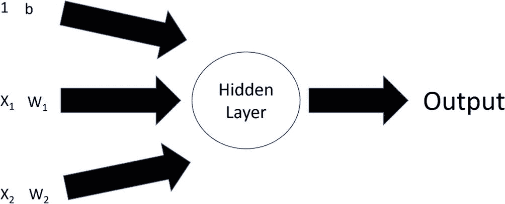
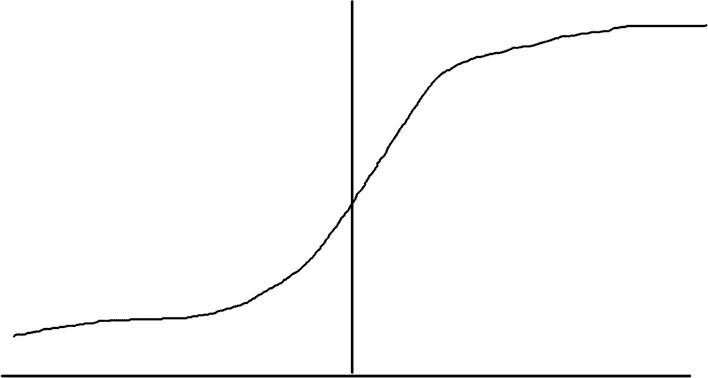
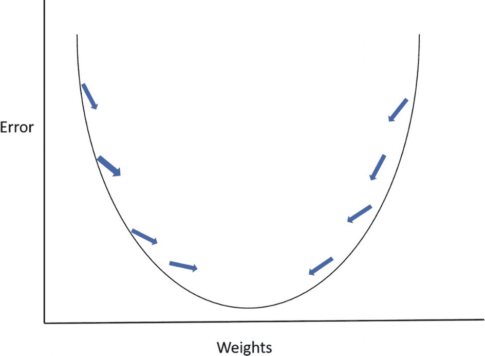

# 4. 深度学习

人工智能的革命

> 任何拥有大量数据的旧分类问题，都将通过深度学习得到解决。未来将会有成千上万个`深度学习`的应用。

> ——杰弗里·辛顿，英裔加拿大认知心理学家和计算机科学家^(⁵³)

李飞飞，1999 年以优异成绩获得普林斯顿大学物理学学士学位，2005 年获得加州理工学院电气工程博士学位，她将自己的才智专注于开发人工智能模型。但她面临一个重大挑战：寻找高质量的数据集。起初，她考虑手工创建，比如让研究生从互联网下载图像。但这个过程过于缓慢和繁琐。

一天，一名学生向李飞飞提到，亚马逊的 Mechanical Turk（一个利用众包解决问题的在线服务）可能是扩展该流程的好方法。它可以实现快速、准确的数据标注。

李飞飞尝试了一下，效果非常好。到 2010 年，她创建了 `ImageNet`，该数据集包含超过 5200 个类别的 320 万张图像。

然而，学术界对此反应冷淡。但这并没有阻止李飞飞。她继续不知疲倦地推广这个数据集。2012 年，她组织了一场竞赛，旨在鼓励研究人员创建更有效的模型并推动创新边界。这最终成为了一个游戏规则的改变者，该竞赛也成为了一年一度的盛事。

在首届竞赛中，多伦多大学的教授们——杰弗里·辛顿、伊利亚·苏茨克沃和亚历克斯·克里热夫斯基——使用了先进的深度学习算法。结果非常出色。他们构建的系统名为 `AlexNet`，以 10.8%的优势击败了所有其他参赛者。^(⁵⁴)

这绝非偶然。在此后的几年里，深度学习在 `ImageNet` 上持续展现出加速进步。截至目前，深度学习的错误率仅为 2%左右——这比人类的表现还要好。

顺便提一下，李飞飞后来成为斯坦福大学的教授和该校人工智能实验室的联合主任。她也是谷歌人工智能和机器学习的首席科学家。毋庸置疑，现在每当她提出新想法时，人们都会倾听！

在本章中，我们将探讨深度学习，这显然是人工智能最热门的领域。它已经在自动驾驶汽车和 Siri 等虚拟助手领域取得了重大进展。

是的，深度学习可能是一个复杂的课题，并且该领域在不断变化。但我们将在不深入技术细节的情况下，了解其主要概念和趋势。

## 深度学习与机器学习的区别

人们常常混淆深度学习和机器学习。这情有可原。这两个主题都非常复杂，并且确实有许多相似之处。

那么，为了理解它们的区别，我们首先来看看机器学习的两个高层次方面，以及它们与深度学习的关系。首先，虽然两者通常都需要大量数据，但数据类型通常不同。

以下面的例子为例：假设我们有数千张动物的照片，并想创建一个算法来找出马。那么，机器学习无法直接分析照片本身；相反，数据必须被标记。然后，机器学习算法将通过一个称为监督学习（在第 3 章中介绍）的过程来训练识别马。

尽管机器学习可能会产生良好的结果，但它们仍然存在局限性。如果能直接查看图像本身的像素——并找到模式，岂不是更好？确实如此。

但是，要使用机器学习做到这一点，你需要使用一个称为特征提取的过程。这意味着你必须提出马的各种特征——比如形状、蹄子、颜色和身高——然后算法会尝试识别这些特征。

同样，这是一个好方法——但它远非完美。如果你的特征偏离目标，或者没有考虑到异常值或例外情况怎么办？在这种情况下，模型的准确性很可能会受到影响。毕竟，马有各种各样的形态。特征提取还有一个缺点，即忽略了大量数据。对于某些用例来说，这可能极其复杂——甚至是不可能的。看看计算机病毒。它们的结构和模式（称为签名）在不断变化，以便渗透系统。但是，通过特征提取，人们必须以某种方式预测到这一点，这并不现实。这就是为什么网络安全软件通常是在病毒造成损害后才收集签名的原因。

但是，通过深度学习，我们可以解决这些问题。这种方法逐像素地分析所有数据，然后通过模仿人脑的神经网络来发现其中的关系。

让我们来看看。

## 那么，深度学习到底是什么？

深度学习是机器学习的一个子领域。这类系统能够处理海量数据，以发现人类通常无法察觉的关系和模式。“深度”一词指的是神经网络中隐藏层的数量，这些隐藏层提供了强大的学习能力。

在人工智能的话题中，深度学习处于前沿地位，并且常常在主流媒体中引发最多热议。“[深度学习]人工智能就是新的电力，”百度前首席科学家、谷歌大脑联合创始人吴恩达（`Andrew Yan-Tak Ng`）曾如此盛赞。^(⁵⁵)

但同样重要的是要记住，深度学习仍处于开发和商业化的早期阶段。例如，直到大约 2015 年，谷歌才开始在其搜索引擎中使用这项技术。

正如我们在第 1 章中所见，神经网络的历史充满了起伏。是弗兰克·罗森布拉特创造了感知机，这是一个相当基础的系统。但神经网络真正的学术进展直到 20 世纪 80 年代才出现，例如反向传播、卷积神经网络和循环神经网络的突破。然而，要让深度学习对现实世界产生影响，还需要数据（例如来自互联网的数据）的惊人增长以及计算能力的激增。

## 大脑与深度学习

人类大脑仅重约 3.3 磅，却是进化史上的惊人杰作。大约有 860 亿个神经元（通常被称为灰质），通过数万亿个突触相互连接。可以把神经元想象成处理数据的中央处理器（CPU）。学习过程就发生在突触的增强或减弱之中。

大脑由三个区域组成：前脑、中脑和后脑。在这些区域中，有各种执行不同功能的部位。其中一些主要部位包括：

- `海马体`：这是大脑存储记忆的地方。事实上，当一个人患上阿尔茨海默病时，正是这个部分功能失效，导致患者失去形成短期记忆的能力。
- `额叶`：大脑在此区域负责处理情绪、语言、创造力、判断、规划和推理。
- `大脑皮层`：在人工智能领域，这或许是最重要的部分。大脑皮层有助于思考和其他认知活动。根据苏珊娜·赫库拉诺-霍泽尔的研究，智力水平与大脑这个区域的神经元数量有关。

那么，深度学习与人脑相比又如何呢？两者存在一些微弱的相似之处。至少在视网膜等区域，存在一个通过复杂网络摄取和处理数据的过程，该过程基于分配权重。但当然，这只是学习过程中极小的一部分。此外，人脑仍有许多未解之谜，而且它显然并非基于数字计算之类的东西（相反，它似乎更像一个模拟系统）。然而，随着研究的不断深入，神经科学的发现可能有助于为人工智能构建新的模型。

## 人工神经网络（`ANN`）

在最基本的层面上，人工神经网络（`ANN`）是一个包含单元（也可称为神经元、感知机或节点）的函数。每个单元都有一个值和权重，权重表示相对重要性，并会进入隐藏层。隐藏层使用一个函数，其结果成为输出。还有一个称为偏置的值，它是一个常数，用于函数的计算。

这种模型训练方式被称为前馈神经网络。换句话说，它只从输入层到隐藏层再到输出层，不会循环回去。但它可以进入一个新的神经网络，将输出作为输入。

图 4-1 展示了一个前馈神经网络的图表。

图 4-1. 一个基本的前馈神经网络

让我们通过一个例子来深入理解。假设你正在创建一个模型来预测一家公司的股票是否会涨。以下是变量所代表的内容以及分配的数值和权重：

- `X[1]`：收入年增长率至少为 20%。数值为 2。
- `X[2]`：利润率至少为 20%。数值为 4。
- `W[1]`：1.9。
- `W[2]`：9.6。
- `b`：这是偏置（值为 1），有助于平滑计算结果。

然后，你将对这些权重求和，接着函数会处理这些信息。这通常会涉及一个激活函数，该函数是非线性的。这更符合现实世界的情况，因为数据通常不是呈直线分布的。

现在有多种激活函数可供选择。最常见的一种是 `Sigmoid` 函数。它将输入值压缩到 0 到 1 的范围内。数值越接近 1，模型越准确。

当你绘制这个函数的图形时，它会呈现 S 形。见图 4-2。

图 4-2. 一个典型的 `Sigmoid` 激活函数

如你所见，这个系统相对简单，对于高端人工智能模型并无帮助。要增加更强大的能力，通常需要多个隐藏层。这就形成了多层感知机（`MLP`）。同时，使用一种称为反向传播的技术也很有帮助，它允许输出结果循环回神经网络中。

## 反向传播

人工神经网络的主要缺点之一是对模型中的权重进行调整的过程。传统方法，例如使用变异算法，采用的是随机值，这被证明非常耗时。

鉴于此，研究人员开始寻找替代方案，例如反向传播。这项技术自 20 世纪 70 年代就已存在，但由于性能不佳而鲜受关注。但大卫·鲁梅尔哈特、杰弗里·辛顿和罗纳德·威廉姆斯意识到，只要加以改进，反向传播仍有潜力。1986 年，他们发表了一篇题为《通过反向传播误差学习表征》的论文，这在人工智能界引起了轰动。^(⁵⁶) 该论文清楚地表明，反向传播不仅可以更快，还能实现更强大的人工神经网络。

毫不意外，反向传播涉及大量数学运算。但归根结底，它是在发现错误时调整神经网络，然后再次通过神经网络迭代新的数值。本质上，这个过程涉及持续的微小调整，以不断优化模型。

例如，假设某个输入的输出为 0.6。这意味着误差为 0.4（1.0 减去 0.6），这并不理想。但我们可以反向传播这个输出，也许新的输出可以达到 0.65。这种训练将持续进行，直到数值非常接近 1。

图 4-3 说明了这一过程。起初，由于权重过大，误差水平很高。但通过迭代，误差会逐渐下降。然而，过度迭代可能导致误差增加。换句话说，反向传播的目标是找到中间点。

图 4-3.
反向传播函数的最优值位于图表底部

作为反向传播成功的一个衡量标准，涌现了大量商业应用。其中之一是 NETtalk，由特伦斯·谢伊诺夫斯基和查尔斯·罗森伯格在 20 世纪 80 年代中期开发。这台机器能够学习如何发音英语文本。NETtalk 非常有趣，甚至曾在《今日秀》上演示过。

还出现了许多利用反向传播技术的初创公司，例如 HNC Software。该公司构建了检测信用卡欺诈的模型。直到 HNC 在 20 世纪 80 年代末成立之前，这个过程大多由人工完成，导致错误成本高昂且发卡量低。但通过使用深度学习方法，信用卡公司得以节省数十亿美元。

2002 年，HNC 被费埃哲公司（Fair, Isaac）以 8.1 亿美元收购。^(⁵⁷)

## 各种神经网络

最基本的神经网络类型是全连接神经网络。顾名思义，它是指所有神经元在层与层之间都有连接。这种网络实际上非常流行，因为它在创建模型时几乎不需要进行判断。

那么，还有哪些其他类型的神经网络呢？常见的包括循环神经网络（RNN）、卷积神经网络（CNN）和生成对抗网络（GAN），我们接下来将介绍这些网络。

### 循环神经网络

对于循环神经网络（RNN），其功能不仅处理当前输入，还处理跨时间的先前输入。一个例子是你在消息应用中输入字符时发生的情况。当你开始打字时，系统会预测单词。所以，如果你输入“He”，计算机可能会建议“He”、“Hello”和“Here's”。RNN 本质上是一系列基于复杂算法相互馈送的神经网络。

该模型有多种变体。其中一种称为 LSTM，即长短期记忆网络。这源于塞普·霍赫赖特教授和于尔根·施密德胡伯教授在 1997 年发表的一篇论文。^(⁵⁸) 在该论文中，他们提出了一种有效利用长时间间隔输入的方法，从而允许使用更多的数据集。

当然，RNN 也有缺点。存在梯度消失问题，这意味着随着模型变大，准确性会下降。模型也可能需要更长的训练时间。

为了解决这个问题，谷歌开发了一种名为 Transformer 的新模型，该模型通过并行处理输入，效率更高，并且能产生更准确的结果。

谷歌通过其翻译应用（Translate）对 RNN 有了深入的了解，该应用支持超过 100 种语言，每天处理超过 1000 亿个单词。^(⁵⁹) 该应用于 2006 年推出，最初使用机器学习系统。但在 2016 年，谷歌转向深度学习，创建了谷歌神经机器翻译系统。^(⁶⁰) 总而言之，这带来了更高的准确率。^(⁶¹)

想想谷歌翻译如何帮助医生与说其他语言的患者沟通。根据加州大学旧金山分校（UCSF）发表在《美国医学会内科杂志》上的一项研究，该应用在英语到西班牙语的翻译中准确率达到 92%。这比过去几年的 60%有所提高。^(⁶²)

### 卷积神经网络（CNN）

直观上，让神经网络中的所有单元都连接起来是有道理的。这在许多应用中效果很好。

但在某些场景下，这远非最优，例如图像识别。想象一下，如果每个像素都是一个单元，模型会变得多么复杂！它很快就会变得难以管理。还会出现其他复杂情况，比如过拟合。这意味着数据不能反映测试内容，或者模型关注了错误的特征。

为了解决这些问题，你可以使用卷积神经网络（CNN）。其起源可以追溯到 1998 年，当时扬·勒昆教授发表了一篇题为《基于梯度学习的文档识别应用》的论文。^(⁶³) 尽管其见解深刻且具有突破性，但并未获得太多关注。然而，随着深度学习在 2012 年开始展现出显著进展，研究人员重新审视了这个模型。

勒昆从诺贝尔奖得主大卫·休伯尔和托斯坦·维厄瑟尔那里获得了 CNN 的灵感，他们研究视觉皮层的神经元。该系统从视网膜获取图像，并在不同阶段进行处理——从简单到复杂。每个阶段称为一个卷积。例如，第一级是识别线条和角度；接下来，视觉皮层会找到形状；然后检测物体。

这与基于计算机的 CNN 的工作方式类似。让我们举个例子：假设你想构建一个能够识别字母的模型。CNN 的输入形式是一张包含 3072 个像素的图像。每个像素都有一个从 0 到 255 的值，表示整体强度。通过使用 CNN，计算机将经历多次变化来识别特征。

首先是卷积层，它是一个扫描图像的滤波器。在我们的例子中，这可能是 5×5 像素。这个过程会创建一个特征图，它是一个长长的数字数组。接下来，模型会对图像应用更多滤波器。通过这样做，CNN 将识别线条、边缘和形状——所有这些都用数字表示。利用各种输出层，模型将使用池化，将它们组合起来生成单个输出，然后创建一个全连接神经网络。

CNN 确实可能变得复杂。但它应该能够准确地识别输入到系统中的数字。

### 生成对抗网络（GANs）

伊恩·古德费洛在斯坦福大学获得计算机科学硕士学位，并在蒙特利尔大学获得机器学习博士学位，之后他进入谷歌工作。二十多岁时，他合著了人工智能领域的顶级著作之一《深度学习》^(⁶⁴)，并在谷歌地图方面做出了创新。

但最具影响力的突破发生在 2014 年。当时他在蒙特利尔的一家酒吧与朋友讨论深度学习如何能够*创造*照片。^(⁶⁵) 那时，主流方法是使用生成模型，但生成的照片往往模糊不清且毫无意义。

古德费洛意识到一定有更好的方法。那么，为什么不运用博弈论呢？也就是说，让两个模型在紧密的反馈循环中相互竞争。这种方法同样适用于未标记的数据。

以下是基本工作流程：

*   *生成器*：这个神经网络会创造出大量新作品，例如照片或句子。
*   *判别器*：这个神经网络会审视这些作品，判断哪些是真实的。
*   *调整*：根据两个结果，新模型会修改作品，使其尽可能逼真。经过多次迭代后，判别器将不再需要被使用。

他对这个想法兴奋不已，离开酒吧后便开始编写代码实现自己的想法。结果便诞生了一种新的深度学习模型：生成对抗网络（GAN）。其效果非常出色。他很快成为了人工智能领域的摇滚明星。

GAN 研究已经催生了超过 500 篇学术论文。^(⁶⁶) 像 Facebook 这样的公司也已将这项技术用于照片分析和处理等领域。该公司首席人工智能科学家杨立昆指出，GAN 是“过去 20 年里深度学习中最酷的想法”。^(⁶⁷)

GAN 还被证明有助于复杂的科学研究。例如，它们帮助提高了在瑞士欧洲核子研究中心大型强子对撞机中检测亚原子粒子行为的准确性。^(⁶⁸)

尽管仍处于早期阶段，这项技术有望催生出能够开发新型时尚单品或新奇可穿戴设备的计算机。也许，GAN 甚至能创作出一首热门说唱歌曲。

而这可能比你想象的要来得更快。十几岁时，罗比·巴拉特就自学了如何使用深度学习系统，并构建了一个能以坎耶·维斯特风格进行说唱的模型。

但这只是他人工智能魔法的开始。作为斯坦福大学的研究员，他开发了自己的 GAN 平台，处理了大约 10,000 幅裸体肖像。该系统随后能够创作出真正令人着迷的新艺术作品（你可以在他的 Twitter 账号@DrBeef_ 上找到它们）。

哦，他还将自己的系统在 GitHub 账户上开源了。这引起了名为 Obvious 的法国艺术家团体的注意，他们利用这项技术创作了一个 18 世纪虚构家族的肖像画。该作品基于对 14 世纪到 20 世纪的 15,000 幅肖像画的处理。

2018 年，Obvious 将他们的作品放在佳士得拍卖行拍卖，最终以 43.2 万美元的高价成交。^(⁶⁹)

但不幸的是，在 GAN 的应用方面，也出现了一些不那么光彩的用途。一个例子是用于深度伪造，即利用神经网络创建具有误导性的图像或视频。其中一些只是带有戏谑性质。例如，有一个 GAN 可以让巴拉克·奥巴马说出你告诉他的任何话！

然而，这其中存在巨大风险。纽约大学和密歇根州立大学的研究人员发表了一篇关于“深度万能指纹”的论文。^(⁷⁰) 该论文展示了 GAN 如何能够生成假指纹来解锁三种类型的智能手机！

还有一起事件涉及女演员詹妮弗·劳伦斯在金球奖新闻发布会上的所谓深度伪造视频。她的脸被换成了史蒂夫·布西密的脸。^(⁷¹)

## 深度学习应用

由于大量资金和资源投入到深度学习中，创新成果层出不穷。似乎每天都有令人惊叹的新成果发布。

那么，有哪些具体的应用呢？深度学习在哪些领域被证明是颠覆性的？让我们来看看一些涵盖医疗、能源甚至地震等领域的应用案例。

### 应用案例：检测阿尔茨海默病

尽管经过数十年的研究，阿尔茨海默病的治愈方法仍然难以捉摸。不过，科学家们已经开发出能够减缓疾病进展的药物。

鉴于此，早期诊断至关重要——而深度学习可能大有裨益。加州大学旧金山分校放射科与生物医学成像系的研究人员利用这项技术分析脑部扫描图像（数据来自阿尔茨海默病神经影像学倡议公共数据集），并检测葡萄糖水平的变化。

结果：该模型能够在临床诊断前最多六年诊断出阿尔茨海默病。其中一项测试显示准确率达到 92%，另一项则达到 98%。

目前这仍处于起步阶段——还需要分析更多的数据集。但迄今为止，结果非常令人鼓舞。

该研究的作者 Jae Ho Sohn 博士表示：

> 这是深度学习的理想应用，因为它特别擅长发现非常细微但弥散的过程。人类放射科医生非常擅长识别像脑肿瘤这样微小的局灶性发现，但在检测更缓慢、全局性的变化方面则比较吃力。鉴于深度学习在此类应用中的优势，尤其是与人类相比，这似乎是一个很自然的应用方向。^(⁷²)

### 应用案例：能源

由于其庞大的数据中心基础设施，谷歌是最大的能源消耗者之一。即使是效率上的微小提升，也能对利润产生显著影响。同时，还可能带来减少碳排放的好处。

为了帮助实现这些目标，谷歌的 DeepMind 部门一直在应用深度学习，其中包括更好地管理风能。尽管风能是一种清洁能源，但由于天气变化，其利用可能颇具挑战性。

但 DeepMind 的深度学习算法发挥了关键作用。将其应用于美国 700 兆瓦的风力发电中，该算法能够提前 36 小时准确预测发电量。

根据 DeepMind 的博客：

> 这一点很重要，因为可调度的能源（即能够在设定时间输送设定电量的能源）对电网来说通常更有价值……迄今为止，与不对电网做出时间承诺的基准情景相比，机器学习已使我们的风能价值提升了大约 20%。^(⁷³)

当然，这个深度学习系统的影响可能远不止于谷歌——它可能对全球的能源使用产生广泛影响。

### 应用案例：地震

地震的成因极其复杂，预测难度也极高。你需要评估断层、岩层构造与形变、电磁活动以及地下水的变化。嘿，甚至有证据表明动物能够感知地震！

但几十年来，科学家们已经收集了大量关于这一主题的数据。换句话说，这或许正是深度学习的用武之地，对吧？

完全正确。

加州理工学院的地震学家——包括岳一松、埃吉尔·豪克森、扎卡里·罗斯和门-安德林·迈尔——一直在利用卷积神经网络和循环神经网络对此进行大量研究。他们正试图构建一个有效的早期预警系统。

以下是岳一松的观点：

> 人工智能能够比人类更快、更准确地[分析地震]，甚至能发现人类肉眼难以察觉的模式。此外，我们希望提取的模式很难被基于规则的系统充分捕捉，因此现代深度学习先进的模式匹配能力，能够比现有的自动化地震监测算法提供更优越的性能。^(⁷⁴)

但关键在于改进数据收集。这意味着要对更多小地震进行分析（在加利福尼亚州，平均每天发生 50 次）。目标是创建一个地震目录，进而催生出一位“虚拟地震学家”，使其能够比人类更快地评估地震。这有望在地震发生时争取更长的预警时间，从而帮助挽救生命和财产。

### 应用案例：放射学

PET 扫描和核磁共振成像（MRI）是了不起的技术，但确实存在缺点。患者需要在一个狭窄的管状设备中停留 30 分钟到一小时。这不仅令人不适，还意味着要接触钆，而钆已被证明具有有害的副作用。

在斯坦福大学相识的格雷格·扎哈丘克和龚恩浩认为，或许有更好的方法。扎哈丘克拥有医学博士和哲学博士学位，专攻放射学。他也是龚恩浩的博士导师，后者是电气工程博士，研究方向为深度学习和医学图像重建。

2017 年，他们共同创立了 Subtle Medical 公司，并聘请了一些最杰出的影像科学家、放射科医生和人工智能专家。他们共同致力于改进 PET 扫描和 MRI 的挑战。Subtle Medical 创建的系统不仅将 MRI 和 PET 扫描的时间缩短了多达十倍，而且准确性也大大提高。该系统由高端 NVIDIA GPU 提供动力。

随后在 2018 年 12 月，该系统获得了美国食品药品监督管理局（FDA）的 510(k)许可和欧洲市场的 CE 标志认证。^(⁷⁵) 这是首个同时获得这两项认证的基于人工智能的核医学设备。

Subtle Medical 还有更多计划来革新放射学业务。截至 2019 年，该公司正在开发 SubtleMRTM，它将比公司当前的解决方案更强大；以及 SubtleGADTM，它将减少钆的剂量。^(⁷⁶)

## 深度学习硬件

在深度学习的芯片系统方面，GPU 一直是主要选择。但随着人工智能（例如生成对抗网络 GAN）变得越来越复杂，数据集也越来越庞大，新方法无疑还有更大的发展空间。公司在功能和数据等方面也有定制化需求。毕竟，面向消费者的应用通常与面向企业的应用大相径庭。

因此，一些大型科技公司已经开始开发自己的芯片组：

*   谷歌：2018 年夏天，该公司宣布了其第三代张量处理单元（TPU；第一代芯片于 2016 年开发）。^(⁷⁷) 这些芯片功能强大——处理模型训练时性能超过 100 petaflops——以至于数据中心需要采用液体冷却。谷歌还宣布了面向设备的 TPU 版本。从本质上讲，这意味着处理延迟将更低，因为无需访问云端。

*   亚马逊：2018 年，该公司宣布了 AWS Inferentia。^(⁷⁸) 这项技术源于 2015 年对 Annapurna 的收购，专注于处理复杂的推理操作。换句话说，这发生在模型训练完成之后。

*   脸书和英特尔：这两家公司联手打造了一款人工智能芯片。^(⁷⁹) 但该计划仍处于初期阶段。英特尔还凭借一款名为 Nervana 神经网络处理器（NNP）的人工智能芯片获得了发展势头。

*   阿里巴巴：该公司成立了自己的人工智能芯片公司，名为“平头哥”。^(⁸⁰) 它还计划构建一个基于量子比特（代表电子和光子等亚原子粒子）的量子计算机处理器。

*   特斯拉：埃隆·马斯克开发了自己的人工智能芯片。它拥有 60 亿个晶体管，每秒可处理 36 万亿次运算。^(⁸¹)

此外，还有各种初创公司也在争夺人工智能芯片市场。其中的领先公司之一是 Untether AI，专注于制造提升数据传输速度的芯片（这历来是人工智能中一个特别困难的环节）。在该公司的一个原型中，这一过程比典型的人工智能芯片快了 1000 倍以上。^(⁸²) 英特尔与其他投资者一起参与了该公司 2019 年 1300 万美元的融资轮。

目前，在人工智能芯片领域，NVIDIA 占据着主导市场份额。但由于这项技术的重要性，市场上出现越来越多的产品似乎不可避免。

## 何时使用深度学习？

由于深度学习的强大能力，人们在创建人工智能项目时往往会首先想到使用这项技术。但这可能是一个重大错误。深度学习的应用场景仍然较为狭窄，例如适用于文本、视频、图像和时间序列数据集。同时，它还需要大量的数据和强大的计算机系统。

哦，还有一点，当结果可以被量化和验证时，深度学习的效果会更好。

为了说明原因，让我们考虑以下示例。由约翰霍普金斯大学毒理学家托马斯·哈通领导的一个研究团队，基于 80 万次动物测试创建了一个包含约 1 万种化学物质的数据集。通过使用深度学习，结果显示该模型在毒性预测方面比许多动物测试更准确。^(⁸³) 请记住，动物测试不仅成本高昂且需要安全措施，而且由于对同一种化学物质进行重复测试，其结果也可能不一致。

“第一个场景展示了深度学习的预测能力，以及它从人类永远无法发现的大型数据集中挖掘相关性的能力，”DarwinAI 的首席执行官谢尔顿·费尔南德斯说。^(⁸⁴)

那么，深度学习在哪些场景中表现不佳呢？实际上，2018 年俄罗斯世界杯（法国队夺冠）就是一个例证。许多研究人员试图预测全部 64 场比赛的结果，但结果远非准确：^(⁸⁵)

*   一组研究人员采用了博彩公司共识模型，该模型预测巴西队将获胜。

*   另一组研究人员使用随机森林和泊松排名等算法预测西班牙队将获胜。

这里的问题在于，很难找到具有预测能力的正确变量。事实上，深度学习模型基本上无法处理某些事件特征的复杂性，尤其是那些具有混沌元素的事件。

然而，即使你拥有足够的数据和计算能力，你仍然需要雇佣具有深度学习背景的人员，这并非易事。请记住，选择合适的模型并对其进行微调是一项挑战。应该设置多少个超参数？隐藏层的数量应该是多少？以及如何评估模型？所有这些都是高度复杂的。

即使是专家也可能出错。以下是谢尔登的分享：

> 我们的一位汽车客户遇到了一些奇怪的行为：一辆自动驾驶汽车在天空呈现某种紫色色调时，会越来越频繁地左转。经过数月痛苦的调试，他们确定，针对某些转弯场景的训练是在内华达沙漠进行的，当时天空恰好是那种特定的颜色。神经网络在其人类设计者不知情的情况下，在其转弯行为与天空色调之间建立了一种关联。^(⁸⁶)

有一些工具可以帮助进行深度学习过程，例如亚马逊的 SageMaker、谷歌的 HyperTune 和 SigOpt。但仍有很长的路要走。

如果深度学习不合适，那么你可能需要考虑机器学习，它通常需要相对较少的数据。此外，模型往往要简单得多，但结果可能仍然更有效。

## 深度学习的缺点

鉴于所有的创新和突破，许多人认为深度学习是灵丹妙药也是合理的。这将意味着我们不再需要开车。甚至可能意味着我们将治愈癌症。

怎么可能不感到兴奋和乐观呢？这是自然而合理的。但重要的是要注意到，深度学习仍处于初级阶段，实际上存在许多棘手的问题。最好还是降低预期。

2018 年，加里·马库斯撰写了一篇题为《深度学习：批判性评估》的论文，他在其中清晰地阐述了这些挑战。^(⁸⁷) 在他的论文中，他指出：

> 在语音识别、图像识别和游戏等领域取得显著进展，以及大众媒体热情高涨的背景下，我提出了对深度学习的十点担忧，并认为如果我们想要达到通用人工智能，深度学习必须辅以其他技术。^(⁸⁸)

马库斯绝对有资格提出他的担忧，因为他兼具人工智能领域的学术和商业背景。在成为纽约大学心理学系教授之前，他将自己创立的初创公司 `Geometric Intelligence` 卖给了优步。马库斯还是几本畅销书的作者，例如《人类心智的偶然构建》。^(⁸⁹)

## 马库斯对深度学习的担忧

以下是他对深度学习的一些担忧：

*   **黑箱**：一个深度学习模型可能轻易拥有数百万个参数，涉及许多隐藏层。清晰理解这一点确实超出了人类的能力范围。诚然，在数据集中识别猫可能不一定是问题。但对于用于医疗诊断或确定石油钻井平台安全性的模型来说，这绝对可能是个问题。在这些情况下，监管机构希望充分了解模型的透明度。因此，研究人员正在考虑创建系统来确定“可解释性”，从而提供对深度学习模型的理解。

*   **数据**：人脑有其缺陷。但有些功能它做得非常好，比如通过抽象进行学习的能力。例如，假设五岁的简和家人去一家餐馆。她妈妈指着盘子里的一个东西说这是“玉米卷”。她不需要解释或提供任何相关信息。相反，简的大脑会立即处理这些信息并理解整体模式。将来，当她看到另一个玉米卷时——即使它有所不同，比如调味料不同——她也会知道它是什么。在大多数情况下，这是直觉性的。但不幸的是，对于深度学习来说，没有通过抽象学习玉米卷这回事！系统必须处理海量信息才能识别它。当然，对于脸书、谷歌甚至优步这样的公司来说，这不是问题。但许多公司的数据集要有限得多。结果是，深度学习可能不是一个好的选择。

*   **层级结构**：这种组织方式在深度学习中并不存在。因此，语言理解还有很长的路要走（尤其是在长篇讨论中）。

*   **开放式推理**：马库斯指出，深度学习无法理解“约翰答应玛丽离开”和“约翰答应离开玛丽”之间的细微差别。更重要的是，深度学习距离能够阅读简·奥斯汀的《傲慢与偏见》并洞悉伊丽莎白·班纳特的性格动机还差得很远。

*   **概念性思维**：深度学习无法理解民主、正义或幸福等概念。它也没有想象力，无法思考新的想法或计划。

*   **常识**：这是深度学习不擅长的领域。这意味着模型很容易被混淆。例如，假设你问一个人工智能系统：“能用海绵制造一台计算机吗？”大多数情况下，它可能不知道这是一个荒谬的问题。

*   **因果关系**：深度学习无法确定因果关系。它只关注寻找相关性。

*   **先验知识**：卷积神经网络（`CNN`）可以帮助处理一些先验信息，但这很有限。深度学习仍然相当独立，因为它一次只解决一个问题。它无法接收数据并创建跨越多个领域的算法。此外，模型不会自适应。如果数据发生变化，就需要训练和测试一个新模型。最后，深度学习不具备人类本能认知的先验知识——例如现实世界的基本物理原理。这必须被明确地编程到人工智能系统中。

*   **静态性**：深度学习在相对简单的环境中表现最佳。这就是为什么人工智能在棋盘游戏中如此有效，因为棋盘游戏有一套清晰的规则和边界。但现实世界是混乱且不可预测的。这意味着深度学习在处理复杂问题时可能会力不从心，即使是自动驾驶汽车也是如此。

*   **资源消耗**：深度学习模型通常需要大量的 `CPU` 算力，例如使用 `GPU`。这可能会成本高昂。不过，一种选择是使用第三方云服务。

这已经很多了？确实如此。但该论文仍然遗漏了一些缺点。以下是另外几个：

*   **蝴蝶效应**：由于数据、网络和连接的复杂性，微小的变化可能会对深度学习模型的结果产生重大影响。这很容易导致错误或误导性的结论。

*   **过拟合**：我们在本章前面解释过这个概念。

至于马库斯，他最大的担忧是人工智能可能会“陷入局部最小值，过度停留在智力空间的错误区域，过分专注于对某一类易于获取但有限的模型进行详细探索，这些模型旨在摘取‘低垂的果实’——从而可能忽略了那些最终可能通向更稳健路径的风险更大的探索。”

然而，他并非悲观主义者。他认为研究人员需要超越深度学习，寻找能够解决棘手问题的新技术。

## 结论

尽管马库斯指出了深度学习的缺陷，但事实是，这种人工智能方法仍然极其强大。在不到十年的时间里，它已经彻底改变了科技世界——并且也在显著影响着金融、机器人和医疗保健等领域。

随着大型科技公司和风险投资公司的投资激增，这些模型将迎来进一步的创新。这也将鼓励工程师攻读研究生学位，从而形成一个良性循环的突破。

## 关键要点

*   深度学习是机器学习的一个子领域，它处理海量数据以检测人类通常无法发现的关系和模式。“深度”一词描述了隐藏层的数量。

*   人工神经网络（`ANN`）是一个函数，包含具有权重的单元，用于预测人工智能模型中的值。

*   隐藏层是模型中处理传入数据的一部分。

*   前馈神经网络的数据仅从输入层流向隐藏层再到输出层。结果不会循环返回。但它们可以进入另一个神经网络。

*   激活函数是非线性的。换句话说，它往往能更好地反映现实世界。

*   `Sigmoid` 函数是一种激活函数，它将输入值压缩到 `0-1` 的范围内，从而便于分析。

*   反向传播是一种调整神经网络权重的复杂技术。这种方法对深度学习的发展至关重要。

*   循环神经网络（`RNN`）是一个函数，它不仅处理当前输入，还处理跨时间的先前输入。

*   卷积神经网络（`CNN`）逐段（即通过卷积）分析数据。该模型适用于图像识别等复杂应用。

*   生成对抗网络（`GAN`）是两个神经网络在紧密的反馈循环中相互竞争。其结果通常是生成一个新对象。

*   可解释性描述了用于复杂深度学习模型透明化的技术。

脚注 1   2   3   4   5   6   7   8   9   10   11   12   13   14   15   16   17   18   19   20   21   22   23   24   25   26   27   28   29   30   31   32   33   34   35   36   37