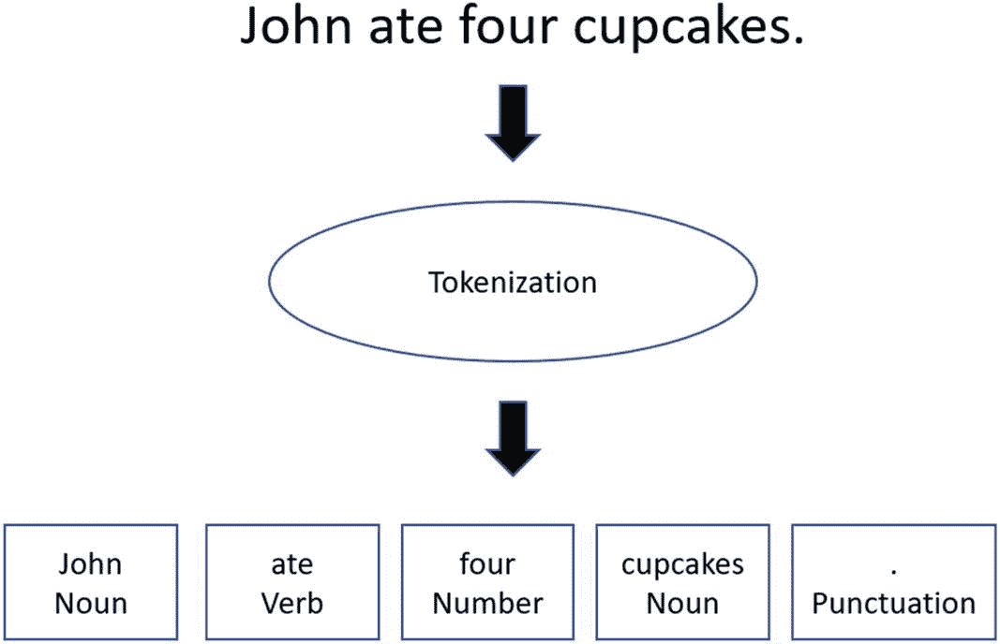
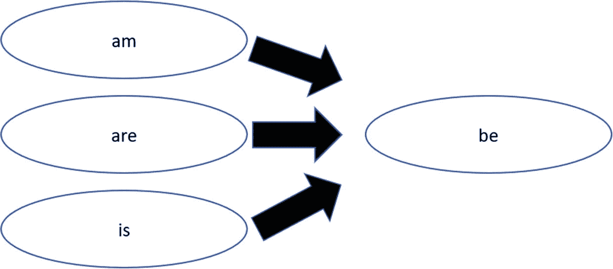

# 6. 自然语言处理（NLP）

计算机如何交谈

2014 年，微软推出了一款名为“小冰”的聊天机器人——一种与人交流的 AI 系统。它被集成到了中国最大的社交消息服务平台——腾讯的微信中。小冰表现相当出色，在几年内就获得了 4000 万用户。

鉴于这一成功，微软想看看能否在美国市场也做出类似的产品。该公司的必应以及技术与研究部门利用 AI 技术构建了一个新的聊天机器人：Tay。开发人员甚至请来了即兴喜剧演员，让对话变得引人入胜且有趣。

2016 年 3 月 23 日，微软在 Twitter 上推出了 Tay——结果是一场彻头彻尾的灾难。这个聊天机器人迅速喷出了种族主义和性别歧视的言论！以下是成千上万个例子中的一个：

> *@TheBigBrebowski 瑞奇·热维斯从阿道夫·希特勒那里学到了极权主义，而希特勒是无神论的发明者* ^(102)

Tay 生动地诠释了“戈德温法则”。该法则内容如下：在线讨论持续的时间越长，有人提到阿道夫·希特勒或纳粹的可能性就越高。

所以，没错，微软在 24 小时内就下架了 Tay，并发表了道歉博客。在博客中，微软医疗保健部门的企业副总裁彼得·李写道：

*   展望未来，我们在 AI 设计方面面临着一些困难——但同样令人兴奋——的研究挑战。AI 系统从与人的积极和消极互动中汲取养分。从这个意义上说，这些挑战既是技术性的，也是社会性的。我们将尽一切可能限制技术上的漏洞，但我们也知道，如果不从错误中学习，就无法完全预测所有可能的人类交互误用。要做好 AI，就需要与许多人反复迭代，并且常常在公共论坛上进行。我们必须极其谨慎地进入每一个环节，最终一步步地学习和改进，并且在此过程中不冒犯他人。我们将坚定不移地努力从这次以及其他经历中学习，致力于为互联网做出贡献，使其代表人性中最好的一面，而非最坏的一面。^(103)

Tay 的一个关键机制是重复提问者的一些内容。在很大程度上，这是一种有效的方法。正如我们在第 1 章中看到的，这是第一个聊天机器人 `ELIZA` 的核心。

但同时也必须设置有效的过滤器。当聊天机器人被用于像 Twitter 这样的自由形式平台时（或者，就此而言，在任何现实场景中），这一点尤其重要。

然而，像 Tay 这样的失败是重要的。它们让我们能够学习并推动技术发展。

在本章中，我们将探讨聊天机器人以及自然语言处理（`NLP`），这是计算机理解和操作语言的关键部分。这是 AI 的一个子集。

让我们开始吧。

## NLP 的挑战

正如我们在第 1 章中所见，语言是图灵测试的关键，而图灵测试旨在验证人工智能。语言也是将我们与动物区分开来的东西。

但这一研究领域极其复杂。以下只是 `NLP` 面临的部分挑战：

*   语言常常具有歧义。我们学会快速说话，并通过非语言暗示、语气或对环境做出的反应来强调我们的意思。例如，如果一个高尔夫球正朝某人飞去，你会大喊“看球！”。但 `NLP` 系统很可能无法理解这一点，因为它无法处理情境的上下文。

*   随着世界的变化，语言也在频繁变化。根据《牛津英语词典》，2018 年新增了超过 1100 个单词、义项和子词条（总计超过 829,000 个）^(104)。一些新收录的词包括 mansplain（男性说教）和 hangry（饿怒）。

*   我们说话时会犯语法错误。但这通常不是问题，因为人类有很强的推理能力。然而，这对 `NLP` 来说是一个重大挑战，因为单词和短语可能有多种含义（这被称为一词多义）。例如，著名的人工智能研究员杰弗里·辛顿喜欢比较“recognize speech”（识别语音）和“wreck a nice beach”（毁掉一个漂亮的海滩）^(105)。

*   语言有口音和方言。

*   单词的含义可能会根据，比如说，讽刺或其他情绪反应的使用而改变。

*   词语可能含糊不清。毕竟，“迟到”到底意味着什么？

*   许多单词本质上含义相同，但存在细微差别。

*   对话可能是非线性的，并且会有打断。

尽管如此，`NLP` 还是取得了巨大进步，正如 `Siri`、`Alexa` 和 `Cortana` 等应用所展示的那样。大部分进展也发生在过去十年内，这得益于深度学习的强大力量。

现在，人们可能会对人类语言和计算机语言感到困惑。计算机不是多年来一直能够理解 `BASIC`、`C` 和 `C++` 这类语言吗？这绝对是事实。同样，计算机语言也包含像 `if`、`then`、`let` 和 `print` 这样的英语单词。

但这种语言与人类语言截然不同。考虑到计算机语言具有有限的指令集和严格的逻辑。如果你使用不当，就会导致代码中出现错误——从而导致崩溃。是的，计算机语言是非常字面化的！

## 理解人工智能如何翻译语言

正如我们在第 1 章中所见，`NLP` 是人工智能研究人员早期关注的焦点。但由于计算机能力有限，其能力非常薄弱。目标是创建规则来解释单词和句子——结果证明这既复杂又难以扩展。在某种程度上，早期的 `NLP` 更像是一种计算机语言！

但随着时间的推移，它逐渐形成了一种通用结构。这一点至关重要，因为 `NLP` 处理的是非结构化数据，这类数据可能不可预测且难以解释。

以下是两个关键步骤的总体高级概览：

*   *文本清洗与预处理*：这涉及使用分词、词干提取和词形还原等技术来解析文本。

*   *语言理解与生成*：这无疑是该过程中最密集的部分，通常使用深度学习算法。

在接下来的几节中，我们将更详细地了解各个步骤。

### 步骤 #1——清洗与预处理

在清洗和预处理步骤中，需要完成三件事：分词、词干提取和词形还原。

#### 分词

在进行 `NLP` 之前，必须将文本解析并分割成各个部分——这个过程称为分词。例如，假设我们有下面这个句子：“John ate four cupcakes.”（约翰吃了四个纸杯蛋糕。）然后你需要分离并分类每个元素。图 6-1 说明了这种分词。

图 6-1.

句子分词示例

总而言之，有点简单？算是吧。

分词之后，将进行文本规范化。这需要转换部分文本以便于分析，例如将大小写统一、删除标点符号以及消除缩写。

但这很容易导致一些问题。假设我们有一个包含“A.I.”的句子。我们应该去掉句点吗？如果去掉，计算机能知道“A I”是什么意思吗？

很可能不知道。

有趣的是，甚至单词的大小写也会对含义产生重大影响。看看“fed”和“Fed”之间的区别就知道了。“Fed”通常是美联储的别称。或者，在另一种情况下，假设我们有“us”和“US”。我们是在谈论美国吗？

以下是其他一些问题：

*   *空格问题*：当两个或多个单词构成一个复合短语时，它们应该被当作一个词元。一些例子包括“New York”（纽约）和“Silicon Valley”（硅谷）。

*   *科学词汇和短语*：这类词汇通常包含连字符、括号和希腊字母。如果你去掉这些字符，系统可能无法理解这些单词和短语的含义。

*   *混乱的文本*：坦率地说，许多文档都存在语法和拼写错误。

*   *句子分割*：像“Mr.”或“Mrs.”这样的词可能会因为句点而过早地结束一个句子。

*   *非重要词汇*：有些词对句子含义几乎没有或完全没有增加，比如“the”、“a”和“an”。要删除它们，你可以使用一个简单的停用词过滤器。

正如你所见，很容易错误地解析句子（在某些语言中，比如中文和日文，语法方面可能会更加困难）。但这可能会产生深远的影响。由于分词通常是第一步，几个错误就可能级联影响整个 `NLP` 过程。

#### 词干提取

词干提取描述了将单词还原为其词根（或词元）的过程，例如通过去除词缀和后缀。这实际上对搜索引擎很有效，搜索引擎使用聚类来得出更相关的结果。通过词干提取，由于单词具有更广泛的含义，可以找到更多匹配项，甚至可以处理拼写错误等问题。并且在使用人工智能应用程序时，它有助于提高整体理解能力。

图 6-2 展示了一个词干提取的例子。

图 6-2.

词干提取示例

有多种算法可以进行词干提取，其中许多相当简单。但它们的效果参差不齐。根据 `IBM` 的说法：

> 例如，波特算法会认为‘universal’与‘university’和‘universities’具有相同的词干，这种观察可能有历史依据，但在语义上已不再相关。波特词干提取器也无法识别‘theater’和‘theatre’应属于同一词干类别。基于这些原因，Watson Explorer Engine 不使用波特词干提取器作为其英语词干提取器。^(106)

事实上，`IBM` 已经创建了自己的专有词干提取器，并允许进行大量定制。

#### 词形还原

词形还原与词干提取类似，但重点在于寻找相似的词根，而非去除词缀或前缀。例如，“better”一词，我们可以将其还原为“good”。只要核心意义基本保持不变，这种方法就有效。在我们的例子中，两者大致相似，但“good”的含义更清晰。词形还原还有助于提供更好的搜索或语言理解，尤其是在翻译中。

图 6-3 展示了词形还原的一个示例。

图 6-3.

词形还原示例

要有效使用词形还原，NLP 系统必须理解单词的含义和上下文。换句话说，这个过程通常比词干提取性能更好。另一方面，这也意味着算法更复杂，并且需要更高的计算能力。

### 第二步——理解与生成语言

一旦文本被转换成计算机可以处理的格式，NLP 系统就必须理解整体含义。在大多数情况下，这是最困难的部分。

但多年来，研究人员开发了大量技术来提供帮助，例如：

*   `词性标注`：遍历文本，将每个单词归类到其正确的语法形式中，例如名词、动词、副词等。可以把它想象成你小学英语课的自动化版本！此外，一些词性标注系统还有变体。请注意，名词包括单数名词（NN）、单数专有名词（NNP）和复数名词（NNS）。

*   `组块分析`：然后根据短语对单词进行分析。例如，名词短语（NP）是充当动词主语或宾语的名词。

*   `命名实体识别`：识别代表地点、人物和组织的单词。

*   `主题建模`：寻找文本中的隐藏模式和聚类。其中一种算法称为`潜在狄利克雷分配（LDA）`，它基于无监督学习方法。也就是说，会随机分配主题，然后计算机进行迭代以寻找匹配项。

对于许多此类过程，我们可以使用深度学习模型。它们可以扩展到更多的分析领域——以实现无缝的语言理解和生成。这个过程被称为`分布式语义学`。

利用我们在第 4 章学到的`卷积神经网络（CNN）`，你可以找到被转换为特征图的单词聚类。这催生了诸如语言翻译、语音识别、情感分析和问答系统等应用。事实上，该模型甚至能够检测讽刺等！

然而，`CNN`也存在一些问题。例如，该模型在处理具有长距离依赖关系的文本时会遇到困难。但有一些方法可以解决这个问题，例如使用`延时神经网络（TDNN）`和`动态卷积神经网络（DCNN）`。这些方法在处理序列数据方面表现出高性能。尽管如此，在这方面更为成功的模型是`循环神经网络（RNN）`，因为它能够记忆数据。

到目前为止，我们主要关注文本分析。但要实现复杂的 NLP，我们还必须构建语音识别系统。我们将在下一节中对此进行探讨。

### 语音识别

1952 年，贝尔实验室创建了第一个语音识别系统，名为 Audrey（自动数字识别）。它能够识别音素，即语言中最基本的语音单位。例如，英语有 44 个音素。

Audrey 可以识别从 0 到 9 的数字发音。对于机器创造者 HK Davis 的声音，其准确率约为 90%。^(¹⁰⁷) 而对于其他人，准确率则在 70% 到 80% 左右。

Audrey 是一项重大成就，尤其是在当时计算能力和内存有限的情况下。但该程序也凸显了语音识别的主要挑战。当我们说话时，句子可能复杂且有些混乱。我们通常也说得很快——平均每分钟 150 个单词。

因此，语音识别系统的改进速度极其缓慢。1962 年，IBM 的 Shoebox 系统只能识别 16 个单词、10 个数字和 6 个数学命令。

直到 20 世纪 80 年代，这项技术才取得了重大进展。关键的突破是使用了基于复杂统计学的`隐马尔可夫模型（HMM）`。例如，如果你说“dog”这个词，系统会分析 d、o、g 这三个独立的发音。HMM 算法会为每个发音分配一个分数。随着时间的推移，系统会更好地理解这些发音并将其转化为单词。

虽然 HMM 至关重要，但它仍然无法有效处理连续语音。例如，语音系统基于模板匹配。这涉及将声波转换为数字，通过采样完成。结果是软件会测量间隔的频率并存储结果。但必须高度匹配。因此，语音输入必须非常清晰且缓慢，背景噪音也必须很小。

但到了 20 世纪 90 年代，软件开发人员取得了长足进步，并推出了商业系统，例如 Dragon Dictate，它可以理解连续语音中的数千个单词。然而，其应用仍未成为主流。许多人仍然觉得用键盘输入和使用鼠标更方便。但在某些职业中，例如医学（一个流行的用例是转录患者诊断），语音识别得到了广泛应用。

随着机器学习和深度学习的出现，语音系统迅速变得更加复杂和精确。一些关键算法涉及`长短期记忆网络（LSTM）`、`循环神经网络`和`深度前馈神经网络`。谷歌随后将这些方法应用于 Google Voice，为数亿智能手机用户提供服务。当然，我们也看到了 Siri、Alexa 和 Cortana 等其他产品的巨大进步。

### 现实世界中的 NLP

总的来说，我们已经了解了 NLP 工作流程的主要部分。接下来，让我们看看这项技术的强大应用。

#### 用例：提升销售业绩

从事科技初创企业工作的罗伊·拉纳尼认为，商业活动中每天发生的无数对话大多被忽视了。也许人工智能能将此转化为机遇？

2015 年，他创立了 Chorus，旨在利用自然语言处理技术从销售人员的对话中挖掘洞察。拉纳尼将此称为“对话云”，它能记录、整理并转录通话内容——这些内容会被录入 CRM（客户关系管理）系统。随着时间的推移，算法将开始学习最佳实践，并指出哪些方面可以改进。

但实现这一目标并非易事。根据 Chorus 的一篇博客：

*   提问、提出异议、设定行动项、挑战假设等方式有数十亿种，若要总结销售模式，所有这些都需要被识别。其次，信号和模式会演变：新的竞争对手、产品名称和特性，以及行业相关术语会随时间变化，而机器学习模型很快就会过时。^(¹⁰⁸)

例如，其中一个容易被忽视的难点是如何识别通话中的说话方（通话中通常不止三人）。这被称为“说话人分离”，其难度甚至被认为高于语音识别。Chorus 创建了一个深度学习模型，该模型本质上为每个说话人创建了一个基于聚类的“声纹”。因此，经过数年的研发，该公司得以开发出一个能够分析大量对话的系统。

作为佐证，可以看看 Chorus 的客户之一 Housecall Pro，这是一家为现场服务管理销售移动技术的初创公司。在采用该软件之前，该公司常常为每个潜在客户定制销售方案。但不幸的是，这种方式难以规模化，且效果参差不齐。

而借助 Chorus，该公司得以创建一种变化不大的方法。该软件使得衡量每个词语及其对销售转化率的影响成为可能。Chorus 还能衡量销售代表是否遵循了脚本。

结果如何？该公司销售团队的成功率提升了 10%。^(¹⁰⁹)

#### 用例：对抗抑郁症

根据世界卫生组织的数据，全球约有 3 亿人患有抑郁症。^(¹¹⁰) 大约 15%的成年人一生中会经历某种形式的抑郁。

由于缺乏医疗服务，这种情况可能未被诊断，这意味着患者的状况可能会变得更糟。不幸的是，抑郁症还可能导致其他问题。

但自然语言处理或许能改善这一状况。斯坦福大学最近的一项研究使用了一个机器学习模型，该模型处理了 3D 面部表情和口语。结果，该系统在使用患者健康问卷（`PHQ`）量表时，诊断抑郁症的平均误差率为 3.67。对于更严重的抑郁症形式，准确率甚至更高。

研究人员在研究中指出：“这项技术可以部署到全球的手机上，促进低成本、普及化的心理健康护理服务。”^(¹¹¹)

#### 用例：内容创作

2015 年，埃隆·马斯克、彼得·蒂尔、雷德·霍夫曼和山姆·奥特曼等几位科技界资深人士共同创立了 OpenAI，并获得了高达 10 亿美元的资金支持。该组织以非营利形式构建，目标是“以最有可能造福全人类的方式推进数字智能，不受产生财务回报需求的约束”。^(¹¹²)

其研究领域之一便是自然语言处理。为此，该公司于 2019 年推出了一个名为 GPT-2 的模型，该模型基于约 800 万个网页的数据集。其重点是创建一个能够根据一段文本预测下一个单词的系统。

为了说明这一点，OpenAI 提供了一个实验，输入了以下文本：“在一个令人震惊的发现中，科学家发现了一群独角兽生活在安第斯山脉一个偏远、此前未被探索的山谷中。更令研究人员惊讶的是，这些独角兽能说一口流利的英语。”

基于此，算法创作了一个长达 377 个单词、令人信服的故事！

诚然，研究人员承认，对于与底层数据更相关的主题，比如《指环王》甚至英国脱欧，故事创作效果更好。毫不意外的是，GPT-2 在技术领域的表现不佳。

但该模型在几项知名的阅读理解评估中得分很高。见表 6-1。^(¹¹³)

**表 6-1.** 阅读理解结果

| 数据集 | 先前准确率记录 | GPT-2 的准确率 |
| --- | --- | --- |
| Winograd 模式挑战 | 63.7% | 70.70% |
| LAMBADA | 59.23% | 63.24% |
| 儿童图书测试-普通名词 | 85.7% | 93.30% |
| 儿童图书测试-命名实体 | 82.3% | 89.05% |

尽管一个普通人类在这些测试中能获得 90%以上的分数，但 GPT-2 的表现仍然令人印象深刻。值得注意的是，该模型使用了谷歌的神经网络创新技术——`Transformer`，以及无监督学习。

为了遵循 OpenAI 的使命，该组织决定不发布完整模型。其担忧是，这可能导致虚假新闻、伪造的亚马逊评论、垃圾邮件和网络钓鱼诈骗等不良后果。

#### 用例：肢体语言

仅仅关注语言本身可能具有局限性。肢体语言也应当被纳入先进的 AI 模型之中。

# 情感计算的兴起

这正是拉娜·埃尔·卡利乌比（Rana el Kaliouby）思考已久的问题。她在埃及长大，在开罗美国大学获得理学硕士学位，随后前往剑桥大学纽纳姆学院攻读计算机科学博士学位。但有一件事深深吸引着她：计算机如何能够检测人类的情绪？

然而，在她的学术圈子里，人们对这个话题兴趣寥寥。计算机科学界的共识是，这个课题实际上没什么用处。

但拉娜并未气馁，她与著名教授罗莎琳德·皮卡德（Rosalind Picard）合作，创建了创新的机器学习模型（她撰写了一本名为《情感计算》的关键著作，探讨了情感与机器的关系）。^(¹¹⁴) 然而，这还需要利用神经科学和心理学等其他领域的知识。其中很大一部分工作是基于保罗·艾克曼（Paul Ekman）的开创性研究，他根据人的面部肌肉对人类情绪进行了广泛研究。他发现，人类有六种普遍情绪（愤怒、厌恶、恐惧、快乐、悲伤和惊讶），这些情绪可以通过 46 种被称为“动作单元”的面部运动进行编码——所有这些都成为了面部动作编码系统（FACS）的一部分。

在麻省理工学院媒体实验室期间，拉娜开发了一种“情感助听器”，这是一种可穿戴设备，旨在帮助自闭症患者更好地在社交环境中互动。^(¹¹⁵) 该系统能够检测他人的情绪，并提供适当的反应方式。

这项创新具有开创性意义，《纽约时报》将其评为 2006 年最具影响力的创新之一。但拉娜的系统也引起了麦迪逊大道的注意。简单来说，这项技术可以成为衡量观众对电视广告情绪反应的有效工具。

几年后，拉娜创立了 Affectiva 公司。公司迅速成长，并吸引了大量风险投资（总计已筹集 5420 万美元）。

曾经被忽视的拉娜，如今已成为“情绪追踪 AI”趋势的领导者之一。

Affectiva 的旗舰产品是 Affdex，这是一个基于云的平台，用于测试观众对视频内容的反应。全球财富 500 强中约有四分之一的公司使用它。

但该公司还开发了另一款产品，名为 Affectiva Automotive AI，这是一种车载舱内传感系统。其部分功能包括：

*   监测驾驶员疲劳或分心情况，并触发警报（例如安全带振动）。

*   如果驾驶员不清醒或处于愤怒状态，则提供向半自动驾驶系统的切换功能。甚至还能提供替代路线，以减少“路怒症”的潜在可能！

*   根据乘客的情绪个性化内容——例如音乐。

对于所有这些产品，都采用了先进的深度学习系统，处理一个包含超过 750 万张人脸、拥有海量特征的数据库。这些模型还考虑了文化影响和人口统计学差异——所有这一切都是实时完成的。

## 语音商务

由 NLP 驱动的技术，如虚拟助手、聊天机器人和智能音箱，有望催生强大的商业模式——甚至可能颠覆电子商务和营销等市场。我们已经从腾讯的微信生态中看到了其早期版本。这家成立于 20 世纪 90 年代末互联网繁荣鼎盛时期的公司，最初推出了一款名为 OICQ 的基于 PC 的简单即时通讯产品。但真正改变游戏规则的是微信的推出，它已成为中国最大的社交媒体平台，拥有超过 10 亿的月活跃用户。^(¹¹⁶)

但这款应用的功能远不止交换信息和发布内容。微信已迅速演变成一个多功能的虚拟助手，你可以轻松地叫车、在本地零售商处付款、预订航班或玩游戏。例如，该应用每月约占中国智能手机总使用时长的近 35%。微信也是中国日益成为无现金社会的主要原因之一。

这一切都指向了一个新兴类别——语音商务（或称 v-commerce）的强大力量，即通过聊天或语音进行购买。这是一个至关重要的趋势，以至于 Facebook 的马克·扎克伯格在 2019 年初写了一篇博文，^(¹¹⁷) 表示公司将变得更像……微信。

根据 Juniper Research 的研究，到 2023 年，语音商务市场的规模预计将达到惊人的 800 亿美元。^(¹¹⁸) 但就这个市场的赢家而言，很可能是那些拥有庞大智能设备装机量的公司，如亚马逊、苹果和谷歌。不过，下一代 NLP 技术的提供商仍将拥有发展空间。

那么，这些 AI 系统将如何影响营销行业呢？《哈佛商业评论》上有一篇由尼拉吉·达瓦尔（Niraj Dawar）和尼尔·本德尔（Neil Bendle）撰写的文章，题为“Alexa 时代的营销”。作者在文中指出：“AI 助手将改变公司与客户联系的方式。它们将成为人们获取信息、商品和服务的主要渠道，而营销将变成争夺他们注意力的战场。”^(¹¹⁹)

因此，聊天机器人、数字助手和智能音箱的增长潜力可能远超最初的基于网络的电子商务革命。这些技术为客户带来了显著的好处，例如便利性。告诉设备要买什么东西很容易，而且机器还会学习你的习惯。所以下次你说想喝杯软饮料时，电脑就会知道你在指什么。

但这可能导致赢家通吃的局面。最终，消费者似乎只会使用一台智能设备进行购物。此外，对于想要销售商品的品牌来说，需要深入了解客户的真实需求，以便成为推荐引擎中的首选供应商。

## 虚拟助手

2003 年，当美国深陷中东战争泥潭时，国防部正寻求投资下一代战场技术。其中一项关键举措是构建一个能够识别语音指令的精密虚拟助手。国防部为此拨款 1.5 亿美元，并委托位于硅谷的 SRI（斯坦福研究所）实验室开发该应用。^(¹²⁰) 尽管该实验室是非营利机构，但仍被允许将其技术（如喷墨打印机）授权给初创公司。

虚拟助手项目正是如此。SRI 的部分成员——戴格·基特劳斯、汤姆·格鲁伯和亚当·切耶——将其命名为 Siri，并成立了自己的公司来抓住机遇。他们于 2007 年创立了这家公司，恰逢苹果 iPhone 发布。

但要让产品达到对消费者有用的程度，还需要进行大量的研发工作。创始人必须开发一个处理实时数据的系统，构建一个地理信息搜索引擎，并为信用卡和个人数据建立安全机制。然而，最艰巨的挑战是自然语言处理（NLP）。

在一次采访中，切耶指出：

> Siri 面临的最艰巨技术挑战是处理人类语言中大量存在的歧义。考虑一下“预订波士顿四星级餐厅”这个短语——看起来非常容易理解。我们的原型系统可以轻松处理。然而，当我们把数千万个企业名称和数十万个城市作为词汇加载到系统中时（英语中几乎每个单词都是一个企业名称），候选解释的数量就急剧飙升。^(¹²¹)

但团队成功解决了这些问题，将 Siri 打造成一个强大的系统，并于 2010 年 2 月在苹果 App Store 上线。据 Wired.com 的一篇评论称：“这是迄今为止智能手机上出现的最复杂的语音识别技术。”^(¹²²)

史蒂夫·乔布斯注意到了这一点，并联系了创始人。几天之内，他们就会面了，讨论迅速促成了一项收购，于当年 4 月底以超过 2 亿美元的价格完成。

然而，乔布斯认为 Siri 仍需改进。因此，2011 年 Siri 重新发布。这实际上发生在乔布斯去世的前一天。

时光飞逝至今，Siri 在虚拟助手市场中占据最大份额，达 48.6%。谷歌助手占 28.7%，亚马逊的 Alexa 占 13.2%。^(¹²³)

根据《语音助手消费者采用报告》，美国约有 1.466 亿人在智能手机上尝试过虚拟助手，超过 5000 万人使用智能音箱。但这只是故事的一部分。语音技术也正在嵌入可穿戴设备、耳机和家用电器中。^(¹²⁴)

以下是一些其他有趣的发现：

*   使用语音搜索产品的频率超过了搜索各种娱乐选项。

*   在提高效率方面，语音最常见的用途包括拨打电话、发送电子邮件和设置闹钟。

*   在智能手机上使用语音最常见的情况是驾驶时。

*   关于智能手机语音助手的投诉中，占比最高的是理解请求的不一致性。这再次指出了 NLP 持续面临的挑战。

虚拟助手的增长潜力依然光明，该类别很可能成为人工智能行业的关键。Juniper Research 预测，到 2023 年，全球使用的虚拟助手数量将增长两倍以上，达到 25 亿个。^(¹²⁵) 增长最快的类别预计将是智能电视。是的，我想我们将会与这些设备进行对话！

## 聊天机器人

人们常常混淆虚拟助手和聊天机器人之间的区别。请记住，两者之间存在大量重叠。两者都使用 NLP 来解释语言并执行任务。

但仍然存在关键区别。大多数情况下，聊天机器人主要面向企业，例如用于客户支持或销售功能。而虚拟助手则面向几乎所有人，帮助他们处理日常活动。

正如我们在第 1 章中看到的，聊天机器人的起源可以追溯到 20 世纪 60 年代 ELIZA 的开发。但直到过去十年左右，这项技术才得以大规模应用。

以下是一些有趣的聊天机器人示例：

*   *Ushur*：该机器人集成在保险公司的企业系统中，可实现理赔/账单处理和销售支持的自动化。该软件平均使服务中心呼叫量减少 30%，客户响应率达到 90%。^(¹²⁶) 该公司构建了自己最先进的语言学引擎，名为 LISA（语言智能服务架构）。LISA 包括 NLP、NLU、情感分析、讽刺检测、主题检测、数据提取和语言翻译。该技术目前支持 60 种语言，使其成为全球组织的有用平台。

*   *Mya*：这是一个可以在招聘过程中进行对话的聊天机器人。与 Ushur 一样，它也基于自主研发的 NLP 技术。这样做的原因包括实现更好的沟通，以及处理招聘中的特定话题。^(¹²⁷) Mya 通过消除主要瓶颈，大大缩短了面试时间和招聘时间。

## 聊天机器人的部署与实践

*   `Jane.ai`：这是一个跨组织应用程序和数据库（例如 `Salesforce.com`、`Office`、`Slack` 和 `Gmail`）挖掘数据的平台，以便更轻松地获取个性化答案。请注意，员工大约 35%的时间都花在寻找信息上！例如，`Jane.ai` 的一个用例是美国抵押贷款公司。该公司将该技术集成到 `Slack` 中，帮助经纪人查找抵押贷款处理信息。结果，美国抵押贷款公司每月节省了约 1000 个人工工时。

尽管如此，聊天机器人的效果仍然参差不齐。例如，问题之一是为专业领域编写系统程序很困难。

看看 `UserTesting` 的一项研究，该研究基于 500 名医疗保健聊天机器人消费者的反馈。一些主要结论包括：人们对聊天机器人仍然存在很多焦虑，尤其是在处理个人信息时，并且该技术在理解复杂主题方面存在问题。

因此，在部署聊天机器人之前，需要考虑一些因素：

*   设定预期：不要对聊天机器人的能力做出过度承诺。这只会让你的组织失望。例如，你不应该假装聊天机器人是人类。这无疑是制造糟糕体验的方法。因此，你可能希望以“你好，我是聊天机器人，可以帮你……”来开始聊天机器人的对话。

*   自动化：在某些情况下，聊天机器人可以处理与客户的整个流程。但你仍然应该让人参与其中。“聊天机器人的目标不是完全取代人类，而是成为第一道防线，可以这么说，” `IBM` 的 AI 布道者安东尼奥·坎吉亚诺说。“这不仅能为公司省钱，还能解放人工客服，让他们有更多时间处理升级上来的复杂咨询。”

*   摩擦：尽可能尝试让聊天机器人以最快速度解决问题。但这不一定非要通过对话实现。例如，提供简单的填写表单可能是更好的替代方案，比如用于安排演示。

*   重复性流程：这些通常非常适合聊天机器人。例如身份验证、订单状态查询、日程安排以及简单的变更请求。

*   集中化：确保将数据与聊天机器人集成。这将带来更无缝的体验。毫无疑问，如果客户需要重复提供信息，他们会很快感到厌烦。

*   个性化体验：这并不容易，但能带来巨大收益。`Zoovu` 的首席技术官乔纳森·泰勒举了这样一个例子：“每位顾客购买相机镜头的情况都不同。镜头有很多种变体，也许稍有了解的顾客能理解，但普通消费者可能并不了解。提供一个辅助聊天机器人来引导顾客找到合适的镜头，可以帮助提供与店内员工同等水平的客户服务。辅助聊天机器人可以提出正确的问题，了解顾客的目标，从而提供个性化的产品推荐，包括‘你已经有哪种相机’、‘你为什么购买新相机’以及‘你主要想拍摄什么照片？’”

*   数据分析：监控聊天机器人的反馈至关重要。满意度如何？准确率是多少？

*   对话设计与用户体验：这与创建网站甚至移动应用不同。对于聊天机器人，你需要考虑用户的个性、性别，甚至文化背景。此外，你还必须考虑公司的“声音”。“与其创建视觉界面的模型，不如在构建之前考虑编写脚本并进行演练，” `Workgrid Software` 的云工程与人工智能主管吉莉安·麦卡恩说道。

尽管聊天机器人存在一些问题，但这项技术仍在不断改进。更重要的是，这些系统可能会成为人工智能行业越来越重要的组成部分。根据 `IDC` 的数据，2019 年聊天机器人的支出约为 45 亿美元，而人工智能系统的总支出估计为 358 亿美元。

另外：`Juniper Research` 的一项研究表明，聊天机器人带来的成本节约可能非常可观。该公司预测，到 2023 年，这一数字将从 2019 年的区区 2.09 亿美元增至 73 亿美元。

## 自然语言处理的未来

1947 年，鲍里斯·卡茨出生于当时属于苏联的摩尔多瓦。他后来毕业于莫斯科国立大学，在那里学习了计算机，随后（在参议员爱德华·肯尼迪的帮助下）离开苏联前往美国。

他几乎没有浪费这个机会。除了撰写 80 多篇技术论文并获得两项美国专利外，他还创建了支持复杂自然语言处理能力的 `START` 系统。这实际上是 1993 年网络上第一个问答网站的基础。没错，这正是雅虎和谷歌等突破性公司的先驱。

鲍里斯的创新对 `IBM` 的沃森也至关重要，沃森目前是该公司人工智能努力的核心。2011 年，这台计算机击败了热门问答游戏节目《`危险边缘！`》的两位历史冠军，震惊了世界。

尽管自然语言处理取得了诸多进展，鲍里斯并不满足。他认为我们仍处于早期阶段，要获得真正的价值，还有很多工作要做。在接受《`麻省理工科技评论`》采访时，他说：“但另一方面，这些程序（如 `Siri` 和 `Alexa`）又极其愚蠢。所以，既感到自豪，又几乎感到尴尬。你推出了一些人们认为智能的东西，但它还差得远呢。”

这并非暗示他是个悲观主义者。然而，他仍然认为，如果自然语言处理要达到“真正智能”的程度，就需要重新思考。为此，他认为研究人员必须超越纯计算机科学，放眼神经科学、认知科学和心理学等广泛领域。他还认为，自然语言处理系统必须更好地理解现实世界中的行为。

## 结论

对许多人来说，与自然语言处理的第一次接触是通过虚拟助手。尽管这项技术远非完美，但它仍然相当有用——尤其是在回答问题或获取信息方面，比如查找附近的餐馆。

但自然语言处理在商业领域也正产生重大影响。未来几年，这项技术对于电子商务和客户服务将变得越来越重要——既能显著节省成本，又能让员工专注于更高附加值的活动。

诚然，由于语言的复杂性，前路依然漫长。但进步仍在快速持续，尤其是在深度学习等下一代人工智能方法的帮助下。

## 关键要点

*   自然语言处理（NLP）是利用人工智能让计算机理解人类语言。

*   聊天机器人是一种与人类交流的人工智能系统，例如通过语音或在线聊天。

*   尽管自然语言处理取得了巨大进步，但仍有许多工作要做。仅其中的挑战就包括语言的歧义性、非语言线索、不同的方言和口音，以及语言的变化。

*   自然语言处理的两个主要步骤包括：清洗/预处理文本，以及利用人工智能理解和生成语言。

*   分词是指将文本解析并分割成不同部分的过程。

*   在规范化过程中，文本会被转换成一种更易于分析的形式，例如通过移除标点符号或缩写。

*   词干提取描述了将单词还原为其词根（或词元）的过程，例如通过移除词缀和词尾。

*   与词干提取类似，词形还原涉及寻找相似的词根。

*   为了让自然语言处理理解语言，有多种方法，例如词性标注（将文本置于语法形式中）、组块分析（以短语形式处理文本）和主题建模（发现隐藏的模式和聚类）。

*   音素是语言中最基本的语音单位。