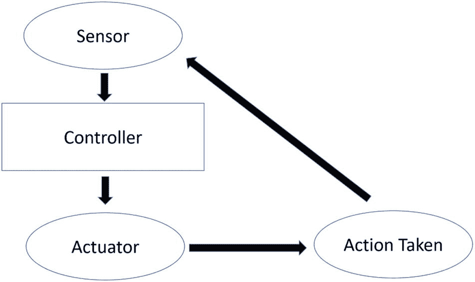

# 7. 实体机器人

人工智能的终极体现

在帕萨迪纳市，我去 CaliBurger 吃午餐，注意到烹饪区（隔着玻璃）旁边围着一群人。他们正用智能手机拍照！

为什么？原因就是 Flippy，一个能烹饪汉堡的 AI 驱动机器人。

我和大卫·齐托（David Zito）一起在那家餐厅，他是开发该系统的 Miso Robotics 公司的联合创始人兼首席执行官。“Flippy 通过其一致性帮助提高食品质量，并降低生产成本，”他说。“我们还严格遵循监管标准来制造这款机器人。”^(¹³⁶)

午餐后，我去了 Miso Robotics 的实验室，那里有一个配备样品机器人的测试中心。正是在这里，我看到了软件 AI 系统与实体机器人的融合。工程师们正在构建 Flippy 的大脑，并将其上传到云端。其部分能力包括清洗餐具和烤架、学习适应烹饪中的问题、在生肉铲和熟肉铲之间切换，以及将篮子放入油炸锅。所有这些都在实时进行。

然而，餐饮服务业只是机器人技术和人工智能将产生重大影响的众多领域之一。

根据国际数据公司（IDC）的数据，机器人和无人机的支出预计将从 2019 年的 1157 亿美元增长到 2022 年的 2103 亿美元。^(¹³⁷) 这代表着 20.2%的年复合增长率。其中约三分之二的支出将用于硬件系统。

在本章中，我们将探讨实体机器人以及人工智能将如何改变这个行业。

## 什么是机器人？

“机器人”一词的起源可以追溯到 1921 年卡雷尔·恰佩克的一部戏剧《罗素姆的万能机器人》。该剧讲述了一家工厂用有机物质制造机器人的故事，没错，这些机器人充满敌意！它们最终联合起来反抗人类主人（请注意，“机器人”一词源自捷克语 *robata*，意为强制劳动）。

但时至今日，对于这类系统，一个恰当的定义是什么？请记住，机器人有无数种形态和功能，因此定义也多种多样。

不过，我们可以将其归结为几个关键部分：

*   **物理形态**：机器人的尺寸范围很广，从能探索人体内部的微型机器，到大型工业系统，再到飞行器和水下航行器。此外，还需要某种能源，如电池、电力或太阳能。

*   **执行动作**：简单来说，机器人必须能够执行某些动作。这可能包括移动物品，甚至说话。

*   **感知环境**：为了执行动作，机器人必须理解其环境。这可以通过传感器和反馈系统来实现。

*   **智能**：这并不意味着需要完整的 AI 能力。但机器人需要能够被编程以执行动作。

如今，从头开始制造一个机器人并不太难。例如，RobotShop.com 上有数百种套件，价格从不到 10 美元到高达 35,750.00 美元不等（例如 Dr. Robot Jaguar V6 履带式移动平台）。

关于建造机器人的独创性，有一个暖心的故事，主角是两岁的西利安·杰克逊。他出生时患有一种罕见的遗传病，导致他无法行动。他的父母试图为一种特殊的电动轮椅申请报销，但被拒绝了。

于是，法明顿高中的学生们行动起来，为西利安建造了一个系统。^(¹³⁸) 本质上，这是一个机器人轮椅，只花了一个月就完成了。正因为如此，西利安现在可以在家里追逐他的两只柯基犬了！

虽然上面我们探讨了机器人的特征，但还有一些关键的交互作用需要考虑：

*   **传感器**：典型的传感器是摄像头或激光雷达（光探测与测距），它使用激光扫描仪创建 3D 图像。但机器人也可能配备用于声音、触觉、味觉甚至嗅觉的系统。事实上，它们还可能包含超越人类能力的传感器，例如夜视或检测化学物质。来自传感器的信息被发送到控制器，控制器可以激活机械臂或机器人的其他部件。

*   **执行器**：这些是机电设备，例如电机。在大多数情况下，它们有助于手臂、腿、头部以及任何其他可移动部件的运动。

*   **计算机**：有内存和处理器来处理来自传感器的输入。在高级机器人中，可能还有 AI 芯片或连接到 AI 云平台的互联网连接。

图 7-1 展示了这些功能的交互作用。

图 7-1.

实体机器人的通用系统

操作机器人主要有两种方式。首先，是由人类操作的远程控制。在这种情况下，机器人被称为远程机器人。其次是自主机器人，它利用自身能力进行导航——例如借助 AI。

那么，第一个可移动、会思考的机器人是什么？它就是 Shakey。这个名字很贴切，正如该系统的项目经理查尔斯·罗森所说：“我们花了一个月想给它起个好名字，从希腊名字到各种名字都想遍了，然后我们中的一个人说：‘嘿，它晃得厉害，还能到处移动，我们就叫它 Shakey 吧。’”^(¹³⁹)

斯坦福研究所（SRI）在 DARPA 的资助下，从 1966 年到 1972 年一直在研究 Shakey。在当时，它相当先进。Shakey 体型庞大，超过五英尺高，有轮子可以移动，还有传感器和摄像头辅助触觉。它还通过无线方式连接到 DEC PDP-10 和 PDP-15 计算机。通过这种方式，人们可以通过电传打字机输入命令。不过，Shakey 使用算法在其环境中导航，甚至能关门。

这个机器人的开发是众多 AI 突破的成果。例如，尼尔斯·尼尔森和理查德·菲克斯创建了 STRIPS（斯坦福研究所问题求解器），它实现了自动规划，以及用于在消耗最少计算机资源的情况下找到最短路径的 A∗ 算法。^(¹⁴⁰)

到 20 世纪 60 年代末，当美国专注于太空计划时，Shakey 引起了不小的轰动。《生活》杂志上一篇赞美文章宣称，这个机器人是“第一个电子人”。^(¹⁴¹)

但不幸的是，1972 年，随着 AI 寒冬的到来，DARPA 撤回了对 Shakey 的资助。然而，这个机器人仍然是科技史上的关键部分，并于 2004 年入选机器人名人堂。^(¹⁴²)

## 工业与商业机器人

机器人首次真正意义上的应用与制造业有关。但这些系统确实花了相当长的时间才得到采用。

故事始于乔治·德沃尔，一位没有完成高中学业的发明家。但这并不是问题。德沃尔天生具有工程和创造力方面的才能，他后来创造了微波炉、条形码和自动门的一些核心系统（他一生中获得了超过 40 项专利）。

正是在 20 世纪 50 年代早期，他还获得了一项名为“尤尼梅特”的可编程机器人的专利。他努力想让自己的创意引起人们的兴趣，但每个投资者都拒绝了他。

然而，1957 年，他在一次鸡尾酒会上遇到了约瑟夫·恩格尔伯格，他的人生从此彻底改变。可以把它想象成史蒂夫·乔布斯遇到史蒂夫·沃兹尼亚克，共同创造了苹果电脑。

恩格尔伯格是一名工程师，同时也是一位精明的商人。他甚至热爱阅读科幻小说，比如艾萨克·阿西莫夫的故事。正因为如此，恩格尔伯格希望尤尼梅特能够造福社会。

然而，阻力依然存在——许多人认为这个想法不切实际，而且，嗯，是科幻小说——他们花了一年时间才获得资金。但一旦恩格尔伯格拿到资金，他就毫不拖延地制造出了机器人，并于 1961 年将其卖给了通用汽车公司。尤尼梅特体积庞大（重达 2700 磅），有一个 7 英尺长的手臂，但它仍然非常有用，也意味着人们不必再从事固有的危险活动。它的一些核心功能包括焊接、喷涂和抓取——所有这些都能精确完成，并且全天候运行。

恩格尔伯格寻找创造性的方式来宣传他的机器人。为此，他于 1966 年出现在约翰尼·卡森的《今夜秀》上，节目中尤尼梅特完美地推杆进洞，甚至还倒了啤酒。约翰尼打趣说，这台机器可以“取代某人的工作”。^(¹⁴³)

但工业机器人确实有其令人头疼的问题。有趣的是，通用汽车在 20 世纪 80 年代就深刻体会到了这一点。当时，首席执行官罗杰·史密斯推行“熄灯工厂”的愿景——即机器人可以在黑暗中制造汽车！

他随后在该项目上投入了高达 900 亿美元的巨资，甚至与富士通-发那科合资成立了 GMF 机器人公司。该组织后来成为世界上最大的机器人制造商。

但不幸的是，这次合资最终以灾难告终。除了激怒工会之外，机器人也常常达不到预期效果。其中一些失败案例包括机器人焊死车门，或者给自己喷漆——而不是给汽车喷漆！

然而，GMF 的情况并非什么新鲜事——也不一定归咎于管理层的错误决策。看看特斯拉，它是世界上最具创新力的公司之一。但首席执行官埃隆·马斯克在其工厂车间里仍然遇到了机器人的重大问题。问题严重到危及特斯拉的生存。

在 2018 年 4 月接受《CBS 今晨》采访时，马斯克表示，他在制造 Model 3 时使用了太多机器人，这实际上拖慢了生产进程。^(¹⁴⁴)他指出，他本应该让更多人参与进来。

所有这些都印证了汉斯·莫拉维克曾写过的话：“让计算机在智力测试或下跳棋方面表现出成人水平的性能相对容易，但在感知和移动能力方面赋予它们一岁孩子的技能却很难，甚至不可能。”^(¹⁴⁵)这通常被称为莫拉维克悖论。

尽管如此，工业机器人已经成为一个庞大的产业，扩展到消费品、生物技术/医疗保健和塑料等不同领域。根据机器人工业协会的数据，截至 2018 年，北美地区共出货了 35,880 台工业和商业机器人。^(¹⁴⁶)例如，汽车行业约占 53%，但这一比例一直在下降。

推进自动化协会主席杰夫·伯恩斯坦曾这样说道：

> 正如我们从会员那里以及在“自动化展”等展会上听到的那样，这些销售和出货不再仅仅面向大型跨国公司。中小型企业正在使用机器人解决现实世界中的挑战，这有助于它们在全球范围内更具竞争力。^(¹⁴⁷)

与此同时，工业机器人的制造成本持续下降。根据 ARK 的研究，到 2025 年，成本将降低 65%——每台设备的平均价格将低于 11,000 美元。^(¹⁴⁸)该分析基于赖特定律，该定律指出，累计产量每翻一番，成本就会以一定的百分比持续下降。

那么，人工智能和机器人呢？这项技术的现状如何？即使深度学习取得了突破，将人工智能应用于机器人的进展总体上仍然缓慢。部分原因是许多研究都集中在基于软件的模型上，例如图像识别。但另一个原因是，物理机器人需要复杂的技术来实时理解环境——而环境通常充满噪音和干扰。这涉及到在未知环境中实现同步定位与地图构建，同时跟踪机器人的位置。为了有效做到这一点，甚至可能需要创造新技术，例如更好的神经网络算法和量子计算机。

尽管如此，确实正在取得进展，尤其是在使用强化学习技术方面。看看下面的一些创新：

*   *Osaro*：该公司开发的系统能让机器人快速学习。Osaro 将其描述为“模仿需要学习传感器融合以及高级规划和物体操作的行为的能力。它还将实现从一台机器向另一台机器学习，并超越人类程序员的洞察力进行改进的能力。”^(¹⁴⁹)例如，它的一款机器人能够在短短五秒钟内学会如何提起并放置一只鸡（该系统预计将用于家禽工厂）。^(¹⁵⁰)但这项技术可能有许多应用，例如用于无人机、自动驾驶汽车和物联网。

*   *OpenAI*：他们创造了 Dactyl，这是一个具有类人灵巧性的机器人手。这基于对模拟环境的复杂训练，而非真实世界的交互。OpenAI 称之为“领域随机化”，它为机器人呈现了许多场景——即使是那些发生概率极低的场景。借助 Dactyl，模拟能够涉及大约 100 年的问题解决时间。^(¹⁵¹)令人惊讶的结果之一是，系统学会了未经预先编程的人类手部动作——例如手指的滑动。Dactyl 还经过训练，可以处理不完美的信息，例如当传感器读数延迟时，或者当需要处理多个物体时。

*   *麻省理工学院*：机器人可能需要数千个样本数据才能理解其环境，例如检测像杯子这样简单的东西。但根据麻省理工学院教授的一篇研究论文，或许有办法减少这一数据量。他们使用了一个只关注少数关键特征的神经网络。^(¹⁵²)这项研究仍处于早期阶段，但可能对机器人产生重大影响。

*   *谷歌*：从 2013 年开始，该公司掀起了一场针对机器人公司的并购狂潮。但结果令人失望。尽管如此，它并没有放弃这项业务。在过去几年里，谷歌专注于开发由人工智能驱动的更简单的机器人，并成立了一个名为“谷歌机器人”的新部门。例如，其中一款机器人可以查看一箱物品，并识别出被要求的那一件——用三指手将其拿起——成功率约为 85%。而普通人做到这一点大约有 80%的成功率。^(¹⁵³)

那么，所有这些都指向完全自动化吗？可能不会——至少在可预见的未来不会。请记住，一个主要趋势是协作机器人的发展。这些机器人与人类一起工作。总而言之，这正变成一种更强大的方法，因为它可以同时利用机器和人类的优势。

请注意，这一领域的主要领导者之一是亚马逊。早在 2012 年，该公司就斥资 7.75 亿美元收购了顶级工业机器人制造商 Kiva。自那以后，亚马逊已在超过 25 个配送中心部署了约 10 万个系统（正因如此，公司的库存容量提高了 40%）。^(¹⁵⁴)该公司这样描述道：

> 亚马逊机器人利用各种机器人技术方法实现配送中心运营自动化，包括自主移动机器人、复杂的控制软件、语言感知、电源管理、计算机视觉、深度感知、机器学习、物体识别以及对命令的语义理解。^(¹⁵⁵)

在仓库内，机器人在地板上快速移动，帮助定位和搬运存储货架。但人类也至关重要，因为他们能更好地识别和挑选单个产品。

然而，这种设置非常复杂。例如，仓库员工会穿着机器人技术背心，以免被机器人撞倒！^(¹⁵⁶)这项技术使机器人能够识别人类。

但协作机器人还存在其他问题。例如，员工确实担心最终会被机器取代。更重要的是，人们自然会感觉自己像机器中一个无足轻重的齿轮，这可能意味着士气低落。人类真的能与机器人建立情感联系吗？可能不会，尤其是工业机器人，它们确实不具备人类特质。

## 现实世界中的机器人

那么，现在让我们来看看工业机器人和商业机器人的其他一些有趣用例。

### 用例：安保

埃里克·施伦茨和特拉维斯·戴尔都在机器人行业拥有丰富的背景，曾在谷歌和 SpaceX 等公司任职。2016 年，他们想创办自己的企业，但首先花了大量时间试图为这项技术寻找实际应用场景，这包括与众多公司进行交流。施伦茨和戴尔发现了一个共同主题：对设施物理安全的需求。机器人如何在下午 5 点后提供保护——而无需花费大量资金雇佣保安？

这促成了 Cobalt Robotics 的成立。时机恰到好处，因为计算机视觉、机器学习等技术正在融合，当然，机器人技术也取得了长足进步。

虽然使用传统安全技术（比如摄像头和传感器）很有效，但它们是静态的，不一定适合实时响应。但有了机器人，由于具备移动性和底层智能，就有可能变得更加主动。

然而，人类仍然参与其中。机器人可以发挥其擅长之处，例如全天候的数据处理和感知，而人类则可以专注于批判性思考和权衡各种方案。

除了技术，Cobalt 在其商业模式上也有所创新，他们称之为机器人即服务（RaaS）。通过收取订阅费，这些设备对客户来说更加实惠。

### 用例：地板擦洗机器人

我们可能会在相当平凡的类别中看到一些最有趣的机器人应用。话又说回来，这些机器确实非常擅长处理重复性流程。

来看看 Brain Corp，它由尤金·伊兹克维奇博士和艾伦·格鲁伯博士于 2009 年创立。他们最初为高通和 DARPA 开发技术。但 Brain 后来利用机器学习和计算机视觉来制造自动驾驶机器人。总体而言，该公司已从高通和软银等投资者那里筹集了 1.25 亿美元。

Brain 的旗舰机器人是 Auto-C，它能高效地擦洗地板。由于名为 BrainOS（连接到云端）的人工智能系统，该机器能够自主导航复杂环境。只需按下一个按钮，Auto-C 就能快速绘制出路线图。

2018 年底，Brain 与沃尔玛达成协议，将在数百家门店部署 1500 台 Auto-C 机器人。^(¹⁵⁷) 该公司还在机场和商场部署了机器人。

但这并不是沃尔玛正在开发的唯一机器人。该公司还在安装能够扫描货架以帮助库存管理的机器。沃尔玛在美国拥有约 4600 家门店，机器人可能会对这家零售商产生重大影响。^(¹⁵⁸)

### 用例：在线药房

作为第二代药剂师，TJ·帕克亲身经历过人们在管理处方时感到的挫败感。所以他思考：解决方案可能是创建一个数字药房吗？

他确信答案是肯定的。但尽管他在该行业有深厚的背景，他需要一位坚实的技术联合创始人，他找到了麻省理工学院的工程师埃利奥特·科恩。他们于 2013 年创立了 PillPack。

其重点是重新构想客户体验。通过使用应用程序或访问 PillPack 网站，用户可以轻松注册——例如输入保险信息、输入处方需求以及安排配送。当用户收到包裹时，上面会有关于剂量说明的详细信息，甚至每片药丸的图片。此外，每粒药丸都附有标签，并预先分装到容器中。

为了实现这一切，需要一个名为 PharmacyOS 的复杂技术基础设施。它还基于一个机器人网络，这些机器人位于一个 8 万平方英尺的仓库中。通过这种方式，系统可以高效地分类和包装处方。但该设施也有持证药剂师来管理流程并确保一切合规。

2018 年 6 月，亚马逊公司斥资约 10 亿美元收购了 PillPack。消息传出后，CVS 和沃尔格林等公司的股价下跌，原因是担心这家电商巨头正准备大举进军医疗保健市场。

### 用例：机器人科学家

开发处方药成本极其高昂。根据塔夫茨药物开发研究中心的研究，每个获批化合物的平均成本约为 26 亿美元。^(¹⁵⁹) 此外，由于繁琐的法规，一种新药上市通常需要十多年的时间。

但使用先进的机器人和深度学习可能会有所帮助。要了解这一点，可以看看阿伯里斯特威斯大学和剑桥大学的研究人员所做的工作。2009 年，他们推出了亚当，这本质上是一个帮助药物发现过程的机器人科学家。几年后，他们推出了下一代机器人夏娃。

该系统可以提出假设并进行测试，还能运行实验。但这个过程不仅仅是蛮力计算（该系统每天可以筛选超过一万种化合物）。^(¹⁶⁰) 通过深度学习，夏娃能够利用智能更好地识别那些最具潜力的化合物。例如，它能够证明三氯生——牙膏中用于防止牙菌斑堆积的常见成分——可能有效对抗疟疾中的寄生虫生长。这一点尤其重要，因为这种疾病对现有疗法的耐药性越来越强。

## 人形机器人与消费级机器人

上世纪 60 年代初播出的热门动画片《杰森一家》塑造了一系列精彩角色。其中一位是罗茜，一个手里总是拿着吸尘器的机器人女佣。

谁不想要这样一个机器人呢？反正我想。但别指望罗茜这样的机器人能很快走进家庭。在消费级机器人领域，我们仍处于早期阶段。换句话说，我们目前看到的机器人只具备部分人类特征。

以下是一些著名例子：

*   ***索菲亚***：由香港汉森机器人技术公司开发，这可能是最著名的机器人。事实上，2017 年底沙特阿拉伯授予了她公民身份！拥有奥黛丽·赫本外貌的索菲亚能够行走和交谈。她的动作也很细腻，例如能保持眼神交流。

*   ***阿特拉斯***：由波士顿动力公司开发，于 2013 年夏季推出。毫无疑问，阿特拉斯多年来进步显著。例如，它能完成后空翻，并在摔倒后自己站起来。

*   ***佩珀***：这是由软银机器人公司创造的人形机器人，专注于提供客户服务，例如在零售场所。这台机器能使用手势来辅助沟通，还能说多种语言。

随着人形机器人技术变得越来越逼真和先进，社会将不可避免地发生变化。关于爱与友谊的社会规范也将演变。毕竟，从智能手机的普及中，我们已经看到技术如何改变我们与他人联系的方式，比如发短信和参与社交媒体。根据 Tappable 对千禧一代的一项调查，近 10%的人宁愿牺牲自己的小指，也不愿放弃智能手机！^(¹⁶¹)

至于机器人，我们可能会看到类似的情况。这关乎社交机器人。这种机器——具有逼真的外观和人工智能，栩栩如生——最终可能会变得像，嗯，朋友……甚至爱人。

诚然，这很可能还很遥远。但就目前而言，社交机器人领域确实有一些有趣的创新。一个例子是 ElliQ，它由一个平板电脑和一个小型机器人头部组成。它主要面向独居者，例如老年人。ElliQ 可以交谈，还能提供宝贵的帮助，比如提醒服药。该系统还可以与家人进行视频聊天。^(¹⁶²)

然而，社交机器人当然也有缺点。看看 Jibo 的糟糕处境就知道了。这家公司曾获得 7270 万美元的风险投资，创造了第一款家用社交机器人。但问题重重，例如产品延迟和仿冒品泛滥。由于这些原因，Jibo 于 2018 年申请破产，次年 4 月服务器被关闭。^(¹⁶³)

不用说，许多 Jibo 的用户感到沮丧，Reddit 上的大量帖子就是明证。

## 机器人三定律

艾萨克·阿西莫夫是一位多产的作家，涉猎科幻、历史、化学和莎士比亚等多个领域，他对机器人也产生了重大影响。在他 1942 年创作的短篇小说《转圈圈》中，他提出了机器人三定律：

1.  机器人不得伤害人类，或因不作为而让人类受到伤害。

2.  机器人必须服从人类给予它的命令，除非这些命令与第一定律相冲突。

3.  机器人必须保护自身存在，只要这种保护不与第一或第二定律相冲突。

### 注

阿西莫夫后来增加了另一条，即第零定律，内容是：“机器人不得伤害人类整体，或因不作为而让人类整体受到伤害。”他认为这条定律最为重要。

阿西莫夫还写了更多短篇小说，反映这些定律在复杂情况下的应用，这些故事被收录在《我，机器人》一书中。所有这些故事都发生在 21 世纪的世界里。

三定律代表了阿西莫夫对科幻小说将机器人描绘成恶毒形象的反应。但他认为这不现实。阿西莫夫预见到，将会出现控制机器人力量的伦理规则。

如今，阿西莫夫的愿景开始变得更加真实——换句话说，探索伦理原则是个好主意。诚然，这未必意味着他的方法是正确的。但这是一个好的开端，尤其是在机器人因人工智能的力量而变得更加智能和个性化的今天。

## 网络安全与机器人

网络安全在机器人领域一直不是什么大问题。但不幸的是，这种情况可能不会持续太久。主要原因是机器人连接到云端正变得越来越普遍。其他系统也是如此，例如物联网和自动驾驶汽车。例如，许多此类系统通过无线方式更新，这使它们暴露于恶意软件、病毒甚至勒索之下。此外，对于电动汽车来说，充电网络也存在遭受攻击的脆弱性。

事实上，你的数据可能会滞留在车辆中！因此，如果车辆被毁或你将其出售，这些信息——例如视频、导航细节以及来自配对智能手机的联系人——可能会被其他人获取。据 CNBC.com 报道，一位名为 GreenTheOnly 的白帽黑客已能从废车场中的多种特斯拉车型中提取这些数据。^(¹⁶⁴) 但重要的是要注意，该公司确实提供了擦除数据的选项，你也可以选择退出数据收集（但这意味着无法享受某些优势，例如无线更新）。

如果机器人发生网络安全漏洞，后果无疑是毁灭性的。想象一下，如果黑客侵入了生产线、供应链，甚至是机器人手术系统。生命可能危在旦夕。

尽管如此，针对机器人的网络安全投资仍然不多。到目前为止，只有少数几家公司，如 Karamba Security 和 Cybereason，专注于这一领域。但随着问题日益严重，风险投资的投资和传统网络安全公司的新举措将不可避免地增加。

## 为人工智能编程机器人

随着系统成本降低以及新软件平台的出现，制造智能机器人正变得越来越容易。这很大程度上归功于机器人操作系统（ROS），它正成为行业标准。其起源可追溯到 2007 年，当时该平台作为斯坦福人工智能实验室的一个开源项目启动。

尽管名为操作系统，ROS 实际上并非真正的操作系统。相反，它是一种中间件，有助于管理机器人的许多关键部分：规划、仿真、地图构建、定位、感知和原型设计。ROS 也是模块化的，你可以轻松挑选所需的功能。其结果是，该系统能轻松缩短开发时间。

另一个优势是：ROS 拥有一个全球性的用户社区。要知道，该平台有超过 3000 个软件包。^(¹⁶⁵)

作为 ROS 强大能力的证明，微软在 2018 年底宣布将发布适用于 Windows 操作系统的版本。根据 Windows IoT 首席软件工程师卢·阿马迪奥的博文：“随着机器人的进步，开发工具也在进步。我们将结合人工智能的机器人视为一种可普遍获取的技术，用以增强人类的能力。”^(¹⁶⁶)

其结果是，ROS 可以与 Visual Studio 配合使用，并将连接到包含 AI 工具的 Azure 云平台。

那么，在开发智能机器人时，其过程通常与基于软件的典型 AI 方法不同。也就是说，不仅需要物理设备，还需要一种测试方法。这通常通过使用仿真来完成。一些开发者甚至会从制作纸板模型开始，这可能是了解物理需求的好方法。

当然，也有一些有用的虚拟仿真器，例如 MuJoCo、Gazebo、MORSE 和 V-REP。这些系统使用复杂的 3D 图形来处理真实世界的运动和物理特性。

那么，如何为机器人创建 AI 模型呢？实际上，这与基于软件的算法方法（如第 2 章所述）差别不大。但对于机器人来说，其优势在于它会持续从传感器收集数据，这有助于 AI 的进化。

云也正成为智能机器人开发的关键因素，正如亚马逊公司所展示的那样。该公司利用其广受欢迎的 AWS 平台推出了名为 AWS RoboMaker 的新服务。通过使用它，你无需太多配置即可构建、测试和部署机器人。AWS RoboMaker 基于 ROS 运行，并允许使用机器学习、分析和监控等服务。甚至还有针对零售店、室内房间和赛道的预制虚拟 3D 世界！一旦你完成了机器人的开发，就可以使用 AWS 开发一个空中下载（OTA）系统，用于安全部署和定期更新。

毫不意外的是，谷歌也计划发布自己的机器人云平台（预计于 2019 年推出）。^(¹⁶⁷)

## 机器人的未来

罗德尼·布鲁克斯是机器人行业的巨头之一。1990 年，他共同创立了 iRobot，试图将这项技术商业化。但这并不容易。直到 2002 年，该公司才推出了 Roomba 扫地机器人，大受消费者欢迎。截至撰写本文时，iRobot 市值达 32 亿美元，2018 年营收超过 10 亿美元。

但 iRobot 并非布鲁克斯创立的唯一一家初创公司。他还帮助创立了 Rethink Robotics——他的愿景雄心勃勃。以下是他在 2010 年公司宣布获得 2000 万美元融资时的表述：

> 我们的机器人将直观易用、智能且高度灵活。它们将易于购买、训练和部署，并且价格将难以置信地低廉。[Rethink Robotics]将改变机器人使用方式和场所的定义，极大地拓展机器人市场。^(¹⁶⁸)

但不幸的是，与 iRobot 一样，这里也面临许多挑战。尽管布鲁克斯关于协作机器人的想法具有开创性——并且最终被证明是一个利润丰厚的市场——但他不得不与构建有效系统的复杂性作斗争。对安全性的关注意味着其精度和准确性达不到工业客户的标准。因此，市场对 Rethink 机器人的需求并不旺盛。

到 2018 年 10 月，该公司资金耗尽，不得不关门歇业。总体而言，Rethink 从风投和高盛、Sigma Partners、通用电气、贝佐斯探险队等战略投资者那里筹集了近 1.5 亿美元。该公司的知识产权被出售给一家德国自动化公司 HAHN Group。

诚然，这只是一个例子。但这确实表明，即使是最聪明的科技人士也可能犯错。更重要的是，机器人市场具有独特的复杂性。就这一类别的发展而言，进步可能是断断续续且不稳定的。

正如 Cobalt 公司的 Schluntz 所指出的：

> 尽管该行业在过去十年中取得了进步，但机器人技术尚未充分发挥其潜力。任何新技术都会催生大量新公司，但只有少数能存活下来并成为持久的企业。互联网泡沫破灭淘汰了大多数互联网公司，但谷歌、亚马逊和 Netflix 都幸存了下来。机器人公司需要做的是，坦诚地说明其机器人今天能为客户做什么，克服好莱坞将机器人视为坏人的刻板印象，并向客户展示清晰的 ROI（投资回报率）。^(¹⁶⁹)

## 结论

直到几年前，机器人还主要用于高端制造业，例如汽车制造。但随着人工智能的发展和设备制造成本的降低，机器人正变得越来越普及，广泛应用于各行各业。如本章所述，机器人有许多有趣的用例，例如清洁地板或为设施提供安保。

但人工智能在机器人领域的应用仍处于初级阶段。为硬件系统编程绝非易事，并且需要复杂的系统来导航环境。然而，通过强化学习等人工智能方法，已经取得了加速进展。

但在考虑使用机器人时，理解其局限性至关重要。还必须有一个明确的目标。否则，部署很容易导致代价高昂的失败。即使是谷歌和特斯拉等世界上最具创新力的公司，在机器人应用方面也面临过挑战。

## 关键要点

*   机器人能够执行动作、感知环境，并具备一定程度的智能。其关键功能还包括传感器、执行器（如电机）和计算机等。

*   操作机器人主要有两种方式：远程机器人（由人类控制）和自主机器人（基于人工智能系统）。

*   开发机器人极其复杂。即使是像特斯拉的埃隆·马斯克这样世界顶尖的技术专家，也曾在这项技术上遭遇重大难题。一个关键原因在于莫拉维克悖论。简而言之，对人类来说容易的事情，对机器人来说往往很困难，反之亦然。

*   尽管人工智能正在对机器人产生影响，但这一进程一直很缓慢。原因之一是人们更侧重于基于软件的技术。但同样，机器人在移动和理解环境方面也极其复杂。

*   协作机器人是与人类协同工作的机器。其理念是，这将有助于发挥机器和人类双方的优势。

*   成本是机器人未能得到广泛采用的一个主要原因。但像 Cobalt Robotics 这样的创新公司，正在通过订阅等新的商业模式来提供帮助。

*   消费级机器人仍处于初级阶段，尤其是与工业机器人相比。但也有一些有趣的用例，例如可以作为人类伴侣的机器。

*   在 20 世纪 50 年代，科幻作家艾萨克·阿西莫夫创立了机器人三定律。这些定律在很大程度上侧重于确保机器不会伤害人类或社会。尽管对阿西莫夫的方法存在批评，但它们仍被广泛接受。

*   安全问题通常不是机器人的主要问题。但这很可能会改变——而且改变会很快。毕竟，越来越多的机器人连接到云端，这为病毒和恶意软件的入侵提供了可乘之机。

*   机器人操作系统（ROS）已成为机器人行业的标准。这个中间件有助于规划、仿真、建图、定位、感知和原型设计。

*   由于需要构建物理系统，开发智能机器人面临着诸多挑战。不过，也有一些工具可以提供帮助，例如允许进行复杂的仿真。

脚注 1   2   3   4   5   6   7   8   9   10   11   12   13   14   15   16   17   18   19   20   21   22   23   24   25   26   27   28   29   30   31   32   33   34

