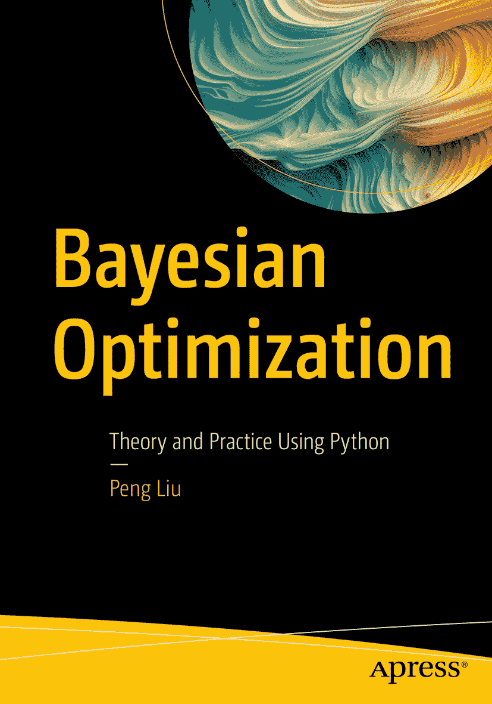

ISBN 978-1-4842-9062-0 e-ISBN 978-1-4842-9063-7 [`doi.org/10.1007/978-1-4842-9063-7`](https://doi.org/10.1007/978-1-4842-9063-7) © 刘鹏 2023 Apress 标准书号 本出版物中使用的通用描述性名称、注册商标名称、商标、服务标记等，即使未作明确声明，也不意味着这些名称不受相关保护性法律和法规的约束，因此可自由用于一般用途。出版商、作者和编辑可以假定，本书中的建议和信息在出版之日是真实准确的。出版商和作者或编辑均不对本书所含材料或可能存在的任何错误或遗漏提供明示或暗示的保证。出版商对已出版地图中的管辖权主张和机构归属保持中立。

本 Apress 印记由注册公司 APress Media, LLC（施普林格自然集团的一部分）出版。

注册公司地址为：1 New York Plaza, New York, NY 10004, U.S.A.

*谨以此书献给我的妻子郑和孩子们：佳欣、佳然和佳宇。*

## 引言

贝叶斯优化提供了一个统一的框架，用于解决不确定性下的序贯决策问题。它包含两个关键组成部分：一个代理模型，用于近似未知的黑箱函数并提供不确定性估计；以及一个采集函数，用于指导序贯搜索。本书回顾了这两个组成部分，涵盖了理论介绍和在 Python 中的实践实现，并基于 GPyTorch 和 BoTorch 等流行库进行构建。此外，本书还提供了案例研究，展示了如何使用贝叶斯优化来寻找模拟函数的全局最优值，或在训练深度神经网络时定位最佳超参数（例如学习率）。本书假设读者对模型开发和机器学习有基本的了解，并面向以下读者群体：

*   数据科学、机器学习或优化相关领域的学生

*   处于职业生涯早期和中期、需要构建具有良好性能超参数的机器学习模型的从业者，例如数据科学家

*   对贝叶斯优化作为一种全局优化技术感兴趣，希望尽可能快地寻求最优解的爱好者

本书中使用的所有源代码均可从 `github.com/apress/Bayesian-optimization` 下载。

## 致谢

本书总结了我在（在职）攻读博士学位期间学习贝叶斯优化的历程。它始于我个人对探索这一领域的兴趣，并逐渐发展成为一本理论与实践相结合的书籍。为此，我感谢我的导师张忠平教授和陈颖教授在我学术生涯中给予的持续支持。

## 关于作者 关于技术审校者