# 1. 贝叶斯优化概述

顾名思义，贝叶斯优化是一个使用贝叶斯方法研究优化问题的领域。优化旨在定位所有可能值中的最优目标值（即全局最大值或最小值），或环境中最优值对应的位置（搜索域）。搜索过程从特定的初始位置开始，遵循特定的策略来迭代地指导后续的采样位置，收集新的观测值，并刷新指导策略。

如图 1-1 所示，整个优化过程由策略与环境之间的重复交互组成。策略是一个映射函数，它接收新的输入观测值（以及历史观测值），并以一种有原则的方式输出下一个采样位置。在这里，我们不断地学习和改进策略，因为一个好的策略能够更高效、更有效地引导我们的搜索走向全局最优。相反，一个好的策略会将有限的采样预算节省在最有希望的候选位置上。另一方面，环境包含了策略需要在特定边界内学习的未知目标函数。当按照策略的要求探测函数值时，环境向策略揭示的实际观测值通常会被噪声污染，这使得学习更具挑战性。因此，贝叶斯优化作为一种*全局优化*的特定方法，希望学习一种策略，能够帮助我们尽可能快速、高效地导航到未知、受噪声污染的环境的全局最优值。

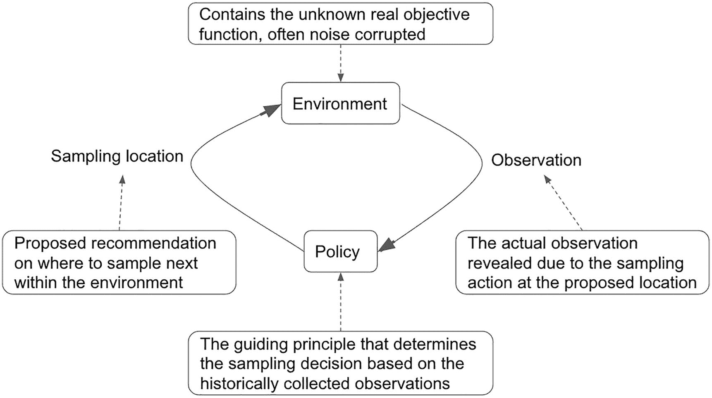

贝叶斯优化的流程图：环境包含未知的真实目标函数（通常受噪声污染），策略是指导原则，根据历史收集的观测值决定采样决策，采样和观测发生在环境与策略过程之间。

图 1-1

贝叶斯优化的整体过程。策略消化历史观测值并提出新的采样位置。环境决定了新提出位置上的（可能受噪声污染的）观测值如何被揭示给策略。我们的目标是学习一种高效且有效的策略，能够尽可能快地导航到全局最优值。

## 全局优化

优化的目标是通过精心分配有限资源，在整个定义域内定位最优的参数集合。例如，当你在两分钟后就要出门上班，却需要在家中找到车钥匙时，我们自然会从最有可能放钥匙的地方开始寻找。如果不在那里，就稍作思考，想想其他可能的位置，然后前往下一个最有可能的地方。这个过程会一直重复，直到找到钥匙为止。在这个例子中，策略就是消化之前搜索中获得的可用信息，并提出下一个有希望的位置。环境就是房子本身，每次采样时，它会揭示钥匙是否位于所提议的位置。

这是一个简单的例子，因为我们熟悉环境的结构设计。然而，想象一下在一个全新的环境中寻找物品。策略需要考虑到因不熟悉环境而产生的不确定性，同时依次确定下一个采样位置。当采样预算有限时（这在现实生活中的搜索中，就时间和资源而言是常见情况），策略需要仔细权衡每个候选采样位置的*效用*。

让我们用数学术语来形式化描述序贯全局优化。我们处理的是一个基于特定定义域 Α 的未知标量值目标函数 *f*。换句话说，未知的目标对象 *f* 是一个函数，它将 Α 中的某个样本映射到 ℝ 中的一个实数，即 *f* : Α → ℝ。我们通常不对定义域 Α 的性质做具体假设，只要求它是一个有界、紧致且凸的集合。

除非另有说明，我们关注的是最大化问题而非最小化问题，因为最大化目标函数等价于最小化其相反数，反之亦然。因此，优化过程旨在以一种有原则且系统的方式，定位全局最大值 *f*^∗ 或其对应的位置 *x*^∗。从数学上讲，我们希望找到 *f*^∗，其中

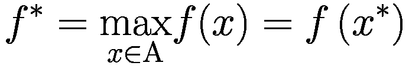

或者等价地，我们对其位置 *x*^∗ 感兴趣，其中

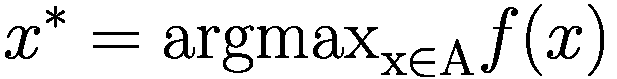

图 1-2 展示了一个一维目标函数的示例，并标出了其全局最大值 *f* ^∗ 及其位置 *x*^∗。因此，全局优化的目标是在整个搜索空间 Α 内系统地推理一系列采样决策，以便尽可能快地定位全局最大值，即尽可能少地采样。

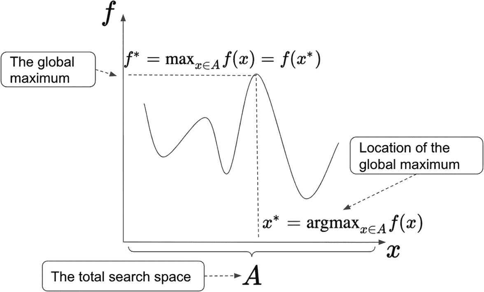

一张函数 f 相对于 x 的图表。方程 f star 等于 maximum subscript x belongs to A, f of x 等于 f of x star, x star 等于 argmax subscript x belongs to A, f of x。图表上标注了全局最大值、总搜索空间和全局最大值的位置。

图 1-2

一个示例目标函数，其全局最大值及其位置用星号标出。全局优化的目标是系统地推理一系列采样决策，以便尽可能快地定位全局最大值

请注意，这是一个*非凸函数*，正如我们在现实优化中经常遇到的情况。非凸函数意味着我们不能依赖基于一阶梯度的可靠方法来搜索全局最优解，因为这类方法很可能会收敛到局部最优解。这也是贝叶斯优化与其他基于梯度的优化方法相比的优势之一。

### 目标函数

目标函数有多种类型。例如，有些函数形状蜿蜒曲折，而另一些则平滑；有些是凸函数，而另一些则是非凸函数。目标函数对我们来说是一个未知对象；如果我们能获知其底层数学形式，问题就可以认为解决了。许多复杂函数几乎不可能用显式表达式来表示。对于贝叶斯优化而言，特定类型的目标函数通常具有以下属性：

*   我们无法获得目标函数的显式表达式，使其成为一个“黑箱”函数。这意味着我们只能与环境（即目标函数）交互，通过在特定位置采样来执行一次函数评估。

*   在特定位置探测所返回的值通常受到噪声的污染，并不代表该位置目标函数的精确真实值。由于对其实际值的间接评估，我们需要考虑环境实际观测值中嵌入的这种噪声。

*   每次函数评估的成本都很高，因此排除了穷举探测的可能性。我们需要一种*样本高效*的方法，在尝试定位其全局最优解的同时，最小化对环境评估的次数。换句话说，优化器需要充分利用已有的观测值，并系统地推理下一个采样决策，以便将有限的资源有效地用于有希望的位置。

*   我们无法获得其梯度。当函数评估相对廉价且函数形式平滑时，计算梯度并使用诸如梯度下降等一阶方法进行优化会非常方便。获取梯度对于理解特定评估点附近的曲率是必要的。有了梯度评估，后续的移动方向就更容易确定了。

由于上述原因，“黑箱”函数的优化颇具挑战性。为了进一步阐述目标函数可能的形式，我们在图 1-3 中列出了三个示例。左侧是一个只有一个全局最小值的凸函数；这被认为是全局优化中的简单情况。中间是一个具有多个局部最优值的非凸函数；很难确定当前的局部最优解是否也是全局最优解。对于一个充满鞍点的平坦区域的函数，也很难判断这是一个平坦区域还是一个局部最优解。所有这三种情况都处于最小化设定中。

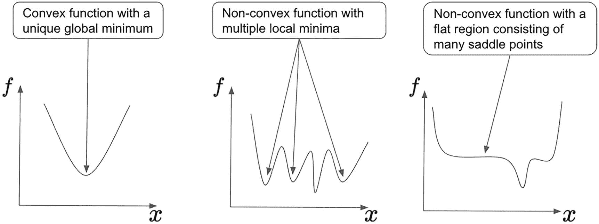

3 张函数 f 相对于 x 的图表。具有唯一全局最小值的凸函数、具有多个最小值的非凸函数以及由许多鞍点组成的平坦区域的非凸函数。

图 1-3

三种可能的函数形式。左侧是一个凸函数，其优化很容易。中间是一个具有多个局部最小值的非凸函数，右侧也是一个具有广阔平坦区域且充满鞍点的非凸函数。后两种情况的优化工作比第一种情况要多得多。

让我们来看一个训练机器学习模型时进行*超参数调优*的例子。机器学习模型是一个函数，它包含一组需要根据输入数据进行优化的参数。这些参数通过特定的优化过程自动调整，该过程通常由一组称为超参数的对应元参数控制，这些超参数在模型训练开始前就已固定。例如，在使用*梯度下降*算法训练深度神经网络时，需要预先手动选择一个决定每次参数更新步长的学习率。如果学习率过大，模型可能会发散，最终无法学习；如果学习率过小，模型可能会收敛得非常缓慢，因为每次迭代中权重的更新幅度很小。请参见图 1-4 的直观说明。

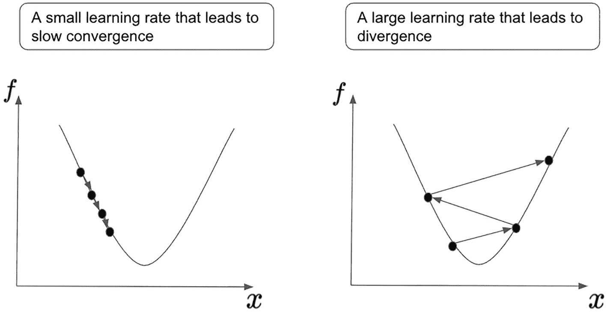

2 个 f 对 x 的曲线图，有 2 条抛物线，解释了小学习率导致缓慢收敛，有 4 个点显示下降趋势；大学习率导致发散，显示上升趋势。

图 1-4

左侧因学习率过小导致收敛缓慢，右侧因学习率过大导致发散

因此，选择一个合理的学习率作为预设超参数，对于训练出好的机器学习模型至关重要。找到最佳学习率和其他超参数是一个适合贝叶斯优化的优化问题。在超参数调优中，评估每个学习率是一项耗时的任务。目标函数通常是模型收敛后的最终测试集损失（在最小化设定下）。为了获得一次评估，需要完整地训练一个模型，这通常需要数百个 epoch 才能达到稳定收敛。这里，一个 epoch 是指对整个训练数据集完整遍历一次。本书的最后一章将介绍一个使用贝叶斯优化调整学习率的案例研究。

测试集损失或准确率的函数形式对于超参数来说，也可能是高度非凸且多模态的。在收敛时，我们很难知道自己是处于局部最优、鞍点还是全局最优。此外，一些超参数可能是离散的，例如训练深度神经网络时的节点数和层数。在这种情况下，我们无法计算其梯度，因为这需要定义域具有连续性。

贝叶斯优化方法正是为应对所有这些挑战而设计的。它已被证明能够在有限预算（即允许的评估次数）下，在定位最佳超参数方面表现出良好的性能。它也被广泛且成功地应用于其他领域，例如化学工程。

接下来，我们将深入探讨典型贝叶斯优化设置中的各个组成部分，包括观测模型、优化策略和贝叶斯推断。

### 观测模型

前面我们提到，一次函数评估会给出关于真实目标函数的一个观测值，并且由于噪声的存在，该观测值很可能与真实目标值不同。因此，为策略学习收集的观测值将是不精确的，并且会受到额外噪声项的污染，通常假设该噪声项是可加的。观测模型是一种形式化真实目标函数、实际观测值和噪声之间关系的方法。它决定了观测值如何从环境呈现给策略。

图 1-5 展示了底层目标函数的一系列观测值。由于可加随机噪声的影响，这些观测值与目标函数发生了偏移。这些可加噪声表现为实际观测值与底层目标函数之间的垂直位移。由于这些由噪声引起的偏差施加在观测值上，我们需要在观测模型中考虑这种不确定性。当基于实际观测值学习策略时，该策略也需要足够稳健，能够聚焦于目标函数的底层模式，而不被噪声干扰。我们用于近似目标函数，同时考虑可加噪声带来的不确定性的模型，通常是高斯过程。我们将在本章简要介绍，并在下一章更详细地讨论。

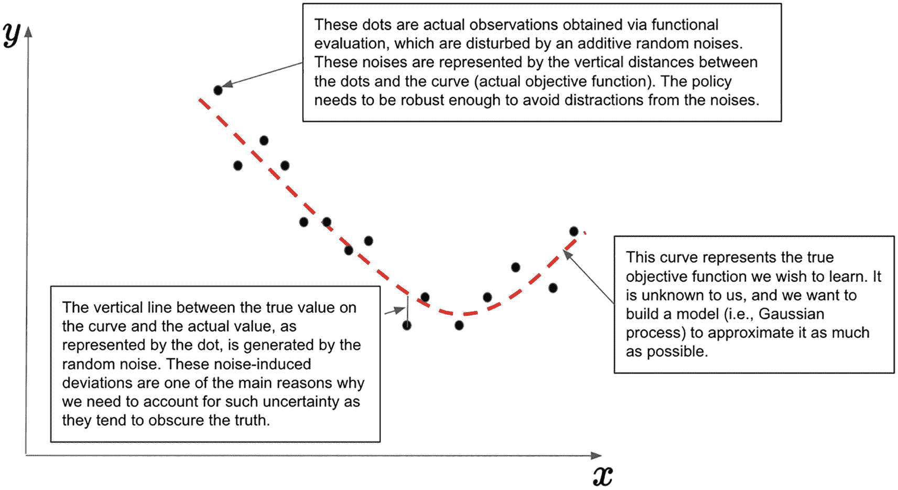

一个 x 对 y 的折线图，绘制了一条先下降后略微上升的虚线。数据点沿着这条线散落分布。它有三组段落解释了这些点从顶部移动到底部再向上的过程。

图 1-5

说明实际观测值（点状）与底层目标函数（虚线）。在特定位置采样时，观测值会受到可加噪声的干扰。因此，观测模型决定了观测值如何呈现给策略，而策略需要考虑噪声扰动带来的不确定性

为了使讨论更精确，我们用 *f*(*x*) 表示位置 *x* 处（未知的）目标函数值。为简便起见，有时将 *f*(*x*) 写作 *f*。我们用 *y* 表示位置 *x* 处的实际观测值，由于噪声扰动，该值会与 *f* 略有不同。因此，我们可以将观测模型（它决定了策略如何从环境中看到观测值）表示为基于特定位置 *x* 和真实函数值 *f* 的 *y* 的概率分布：

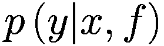

假设存在一个作用于 *f* 上的可加噪声项 *ε*；那么实际观测值 *y* 可以表示为：

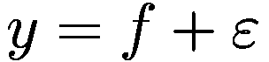

这里，噪声项 *ε* 源于测量误差或不精确的统计近似，尽管在某些计算机模拟中它可能不存在。常见的做法是将该误差视为一个随机变量，它服从均值为零、固定标准差为 *σ* 的高斯分布，即 *ε* ~ *N*(0, *σ*²)。注意，在整个定义域 *A* 上固定 *σ* 并非必要；贝叶斯优化允许同方差噪声（即 *σ* 在 *A* 上固定）和异方差噪声（即 *σ* 取决于 *A* 中的特定位置）。

因此，我们可以将高斯观测模型公式化如下：

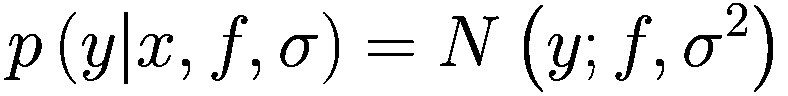

这意味着对于特定位置 *x*，实际观测值 *y* 被视为一个随机变量，它服从均值为 *f*、方差为 *σ*² 的高斯/正态分布。图 1-6 展示了一个以 *f* 为中心的 *y* 概率分布示例。请注意，噪声的方差通常通过采样少量初始观测值来估计，并且预期其值较小，因此整体观测模型仍然强烈依赖于 *f* 并保持接近 *f*。

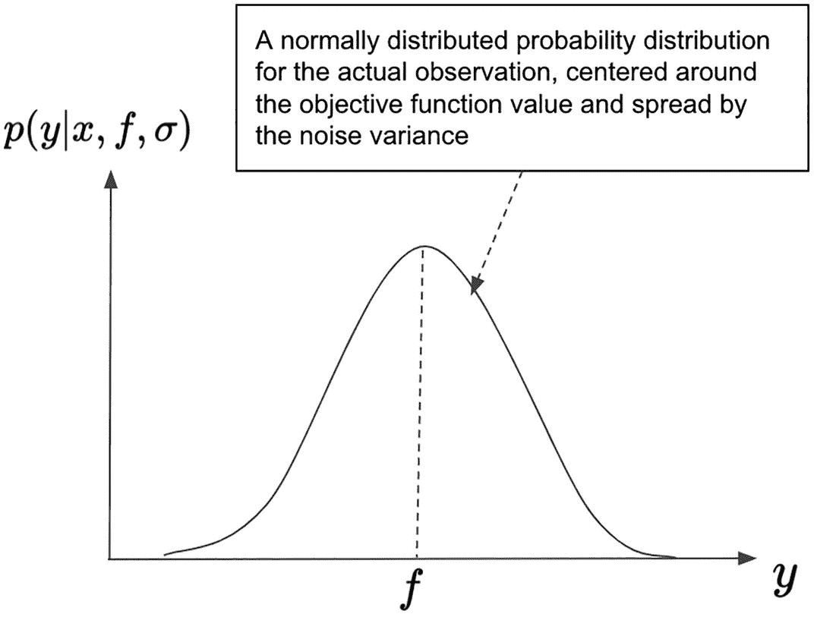

一张关于 p(y | x, f, σ) 相对于 f 的折线图，绘制了一条倒抛物线曲线。文字说明为：实际观测值的正态分布概率分布，以目标函数值为中心，并由噪声方差决定其离散程度。

图 1-6

假设实际观测值作为一个随机变量服从正态概率分布。该高斯分布以在给定位置 x 处评估的目标函数 f 值为中心，并由噪声项的方差决定其离散程度。

下一节将介绍贝叶斯统计，为我们在处理概率分布的过程中奠定理论基础。

## 贝叶斯统计

贝叶斯优化并非一种特定的全局优化算法；它是一套基于贝叶斯推断原理的算法套件。随着优化过程在每次迭代中进行，策略需要确定下一个采样决策，*或者*判断当前搜索是否需要终止。由于目标函数和观测模型存在不确定性，策略在决定下一个采样位置时需要考虑到这种不确定性，这既会对后续决策产生直接影响，也会对所有未来决策产生长期影响。因此，所选样本需要合理地服务于全局优化的最终目标，并证明因采样而产生的成本是合理的。

在优化中使用贝叶斯统计，为我们系统且定量地利用概率来推理这些不确定性铺平了道路。例如，我们可以对目标函数的特征设定一个先验信念，并通过为特定值域分配高概率、为其他值域分配低概率来量化其不确定性。随着收集到更多观测值，先验信念会逐渐更新，并以后验分布的形式向目标函数的真实潜在分布校准。

我们现在介绍贝叶斯统计的基本概念和工具。理解这些章节对于领会贝叶斯优化的内部工作原理至关重要。

### 贝叶斯推断

贝叶斯推断本质上依赖于贝叶斯公式（也称为贝叶斯法则）来推理三个组成部分之间的相互作用：先验分布 *p*(*θ*)，其中 *θ* 表示感兴趣的参数；给定特定参数 *θ* 下的似然函数 *p*(数据| *θ*)；以及后验分布 *p*(*θ*| 数据)。还有一个组成部分，即数据的证据 *p*(数据)，它通常是不可计算的。贝叶斯公式如下：

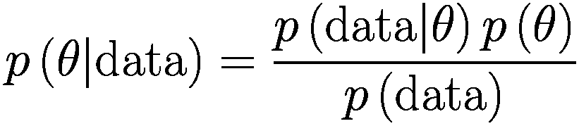

让我们仔细审视这个被广泛使用、可以说是贝叶斯统计中最重要的公式。请记住，任何贝叶斯推断过程的目标都是为感兴趣的参数 *θ* 推导出后验分布 *p*(*θ*| 数据)（或计算其边际期望），其形式为概率密度函数。例如，我们最终可能会得到一个如图 1-7 所示的连续后验分布，其中 *θ* 从 0 变化到 1，并且所有概率（即曲线下的面积）之和为 1。

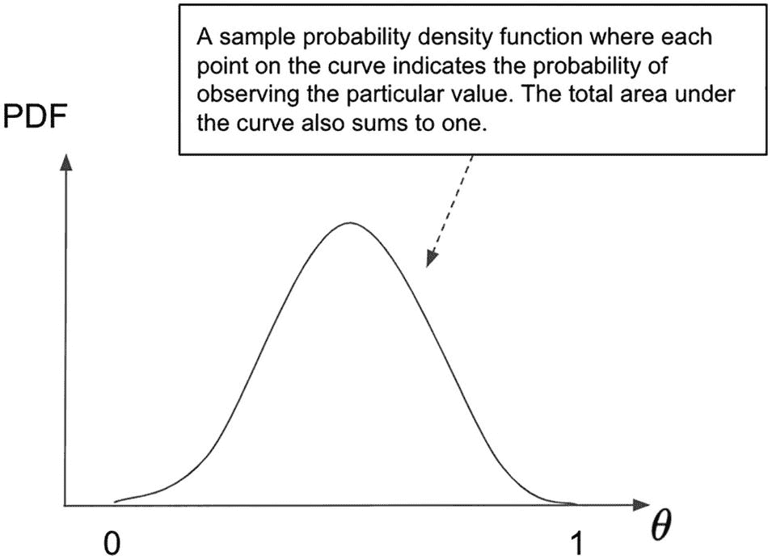

一张关于概率密度函数相对于 θ 的折线图，绘制了一条倒抛物线曲线。文字说明为：一个样本概率密度函数，曲线上的每个点表示观测到该特定值的概率。曲线下的总面积之和也为 1。

图 1-7

说明感兴趣的参数的样本（连续）后验分布。随着新数据的收集，曲线的具体形状会发生变化。

我们需要获取三个组成部分才能得到 *θ* 的后验分布。首先，我们需要推导出在给定我们选择的 *θ* 的情况下看到实际数据的概率，即 *p*(数据| *θ*)。这也被称为似然项，因为我们是在评估在指定了某个数据观测模型后，生成该数据的可能性有多大。似然函数可以根据假定的数据生成观测模型来计算。

第二项 *p*(*θ*) 表示我们在未观测到任何实际数据之前对 *θ* 分布的先验信念；我们将对参数 *θ* 的实验前知识编码在这一项中。例如，*p*(*θ*) 可以采用均匀分布的形式，为 0 到 1 之间的任何值分配相等的概率。换句话说，该范围内的所有值都是等可能的，这是我们在没有任何信息表明对特定值有偏好的情况下，对 *θ* 设定的一个常见先验信念。然而，随着我们收集更多观测值和更多数据，先验分布的作用会逐渐减弱，主观信念会逐渐减少对数据中事实证据的支持。如图 1-8 所示，随着收集到更多数据，*θ* 的分布将逐渐趋近于正态分布，从而形成一个能更好地逼近 *θ* 真实分布的后验分布。

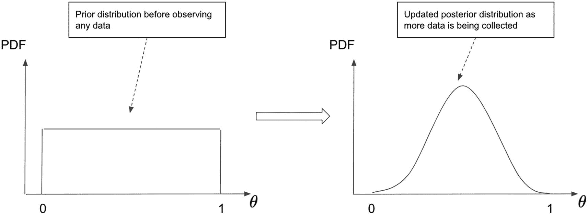

两张关于概率密度函数相对于 θ 的图。图 1 绘制了从 0 到 1 的矩形波，标记为“观测任何数据前的先验分布”。它转变为一条倒抛物线曲线，即“随着收集更多数据而更新的后验分布”。

图 1-8

随着收集更多数据，将先验均匀分布更新为后验正态分布。随着收集更多数据以支持对真实潜在分布的逼近，先验分布的作用会减弱。

最后一项是分母 *p*(数据)，也称为证据，它表示在所有不同的 *θ* 选择下获得数据的概率，并在贝叶斯定理中充当一个与 *θ* 无关的归一化常数。这是所有分量中最难计算的部分，因为我们需要通过对所有可能的 *θ* 值进行积分来计算。对于每个给定的 *θ*，似然度是基于假定的数据生成观测模型来计算的，这与似然项的计算方式相同。不同之处在于，证据考虑了 *θ* 的每一个可能值，并根据观察到特定 *θ* 的概率对由此产生的似然度进行加权。由于证据与 *θ* 无关，因此在分析后验概率的比例变化时，它通常被忽略。因此，我们只关注似然度和先验概率。

一个相对简单的情况是，当先验概率 *p*(*θ*) 和似然度 *p*(数据| *θ*) 是*共轭*的，这使得最终的后验概率 *p*(*θ*| 数据) 具有解析形式，从而因其闭合表达式而易于处理。如果我们能够写出显式形式并生成后验概率 *p*(*θ*| 数据) 的精确形状，而无需借助采样方法，那么贝叶斯推断就会变得容易得多，限制也更少。当先验概率与似然函数共轭时，后验概率将遵循与先验概率相同的分布。一个例子是，当先验概率和似然函数都服从正态分布时，最终的后验概率也将是正态分布。然而，当先验概率和似然度不共轭时，我们仍然可以通过高效的采样技术（例如*吉布斯采样*）来更深入地了解后验分布。

### 频率学派 vs. 贝叶斯学派方法

贝叶斯方法是一种系统性的方法，用于为 *θ* 的可能值分配概率，并根据观测到的数据更新这些概率。然而，有时我们只对产生我们观测数据的最可能（期望）的 *θ* 值感兴趣。这可以通过*频率学派*方法实现，该方法将感兴趣的参数（即 *θ*）视为一个固定量，而不是一个随机变量。这种方法在机器学习社区中经常被采用，重点关注优化特定的目标函数以找到最优的参数集。

更一般地，我们使用频率学派方法来寻找关于 *θ* 的正确答案。例如，我们可以通过*最大似然估计*（MLE）最大化实际数据的联合概率来定位 *θ* 的值，其解为 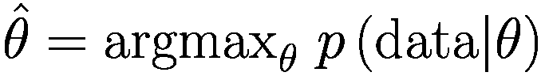。这里不涉及 *θ* 的分布，因为我们将其视为一个固定量，这使得计算更容易，因为我们只需要处理数据的概率分布。使用频率学派方法得到的最终解是 *θ* 的一个特定值。而且，由于我们处理的是来自底层数据生成分布的样本，不同的样本会彼此不同，目标是找到最能描述我们当前观测样本的最优参数 *θ*。

另一方面，贝叶斯方法通过将 *θ* 视为一个具有自身概率分布的随机变量来引入额外的复杂性，并且随着更多数据的收集，该分布会得到更新。这种方法提供了对所有可能的 *θ* 值及其相应概率的整体视图，而不仅仅是 *θ* 的最可能值。这是一种不同的方法，因为现在数据被视为固定的，而参数 *θ* 被视为一个随机变量。然后，在给定观测到的固定样本的情况下，推导出 *θ* 的最优概率分布。在贝叶斯方法中，没有绝对的对错，只有概率。因此，最终解是 *θ* 的一个概率分布，而不是一个特定的值。图 1-9 总结了这两种不同的思想流派。

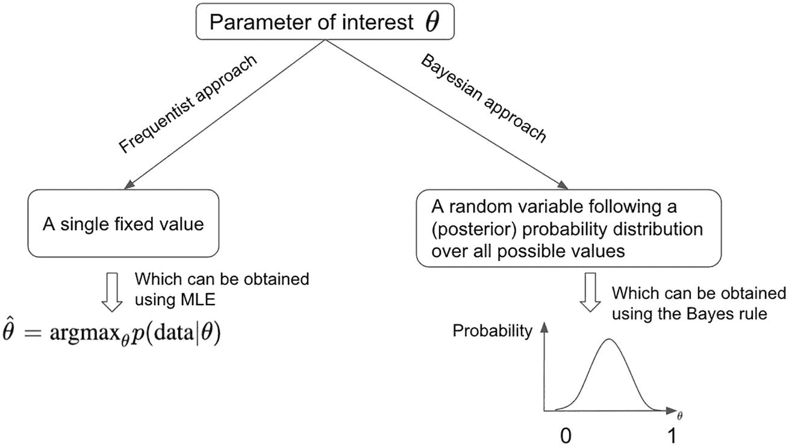

一个关于参数 theta 的流程图，分为频率学派和贝叶斯学派方法。在频率学派中，一个单一的固定值可以通过 M L E 获得，其方程为 Theta-hat 等于 argument maximum subscript theta, p left parenthesis data vertical bar theta right parenthesis。在贝叶斯方法中，一个随机变量遵循所有可能值 0 到 1 的概率分布，以图形格式呈现。

图 1-9

比较频率学派方法和贝叶斯学派方法在感兴趣的参数上的差异。频率学派方法将 θ 视为一个可以通过 MLE 估计的固定量，而贝叶斯方法则采用一个概率分布，该分布随着更多数据的收集而更新。

### 联合概率、条件概率与边缘概率

我们一直使用（连续）概率分布 *p*(*θ*) 来描述随机变量 *θ*。概率分布是一个函数，它将 *θ* 的特定值映射为概率，并且 *θ* 所有取值的概率之和为 1，即 ∫ *p*(*θ*)*dθ* = 1。

当我们处理多个（不止一个）变量时，情况会变得更有趣。假设我们有两个随机变量 *x* 和 *y*，并且我们关注两个事件 *x* = X 和 *y* = Y，其中 X 和 Y 分别是 *x* 和 *y* 可能取到的特定值。同时，我们假设这两个随机变量以某种方式相互依赖。这将引出在现代机器学习和贝叶斯优化文献中常用的三种概率：联合概率、边缘概率和条件概率，我们现在来详细探讨它们。

两个事件的联合概率指的是它们同时发生的概率。它也被称为联合概率分布，因为该概率现在代表了这两个同时事件所有可能的组合。

我们可以将这两个事件的联合概率写为 *p*(X 和 Y) = *p*(*x* = X ∩ *y* = Y) = *p*(X ∩ Y)。利用概率的*链式法则*，我们可以进一步写出 *p*(X 和 Y) = *p*(X 给定 Y) ∗ *p*(Y) = *p*(X| Y)*p*(Y)，其中 *p*(X| Y) 表示在事件 *y* = Y 已发生的条件下，事件 *x* = X 发生的概率。因此，它被称为条件概率，因为第一个事件的概率现在是以第二个事件为条件的。对于（连续）随机变量 *x*，给定另一个随机变量的特定值（即 *y* = Y）的所有条件概率构成了条件概率分布 *p*(*x*| *y* = Y)。更一般地，我们可以将随机变量 *x* 和 *y* 的联合概率分布写为 *p*(*x*, *y*)，将条件概率分布写为 *p*(*x* ∣ *y*)。

联合概率也是对称的，即 *p*(X 和 Y) = *p*(Y 和 X)，这是概率的*可交换性*性质的结果。将链式法则代入联合概率的定义，得到以下公式：

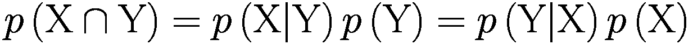

如果你更仔细地观察这个等式，不难发现它可以推导出我们之前介绍的贝叶斯公式，即：

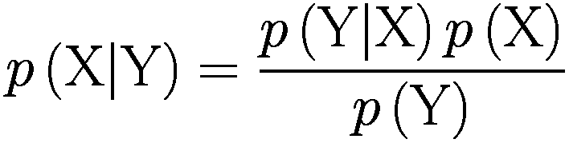

理解这种联系给了我们另一个理由，不是去死记硬背贝叶斯公式，而是去欣赏它。我们也可以将单个事件 *x* = X 替换为随机变量 *x*，以得到相应的条件概率分布 *p*(*x*| *y* = Y)。

最后，我们可能只关心单个随机变量某个事件的概率，而忽略另一个随机变量可能实现的值。也就是说，我们想要考虑在 *y* 的所有可能取值下，事件 *x* = X 的概率。这被称为事件 *x* = X 的边缘概率。在存在另一个（连续）随机变量 *y* 的情况下，（连续）随机变量 *x* 的边缘概率分布可以如下计算：

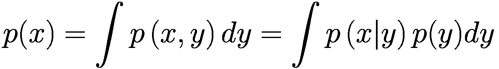

上述定义本质上是将 *p*(*x*| *y*) 的所有可能取值按其发生可能性 *p*(*y*) 加权求和。这个加权求和运算消解了随机变量 *y* 的不确定性，从而在某种程度上将其从原始的联合概率分布中积分掉，只保留一个随机变量。例如，贝叶斯规则中的先验概率 *p*(*θ*) 就是 *θ* 的一个边缘概率分布，它积分掉了其他随机变量（如果有的话）。证据项 *p*(data) 也是如此，它是通过对 *θ* 的所有可能取值进行积分来计算的。

类似地，我们也有随机变量 *y* 的边缘概率分布，定义如下：

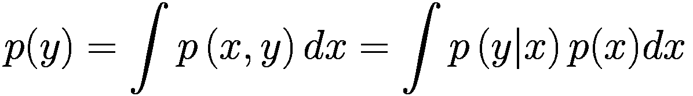

图 1-10 总结了这三种常见的概率分布。请注意，联合概率分布关注两个或更多随机变量，而条件概率分布和边缘概率分布通常都指代单个随机变量。对于条件概率分布，另一个随机变量取特定值，因此在某种程度上从联合分布中“消失”了。对于边缘概率分布，另一个随机变量则被从联合分布中积分掉了。

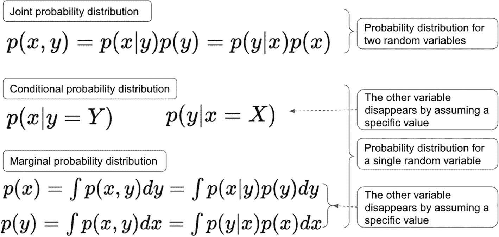

3 个等式。联合概率分布，P of x, y equals p of x bar y p of y equals p of y bar x p of x 称为两个随机变量的概率分布。条件概率分布，P of x bar y equals Y, P of y bar x equals X 称为另一个变量通过取特定值而消失。边缘概率分布，P of x equals integral of p of x, y derivative y equals integral p of x bar y, p of y derivative y。p of y 同理。

图 1-10

三种常见的概率分布。联合概率分布表示两个或更多随机变量的概率分布，而条件概率分布和边缘概率分布通常指代一个随机变量的概率分布。条件分布通过假设/给定其他变量的特定值来表示一个随机变量的概率，而边缘分布则通过积分掉其他变量，将联合概率转换为单个随机变量的概率。

让我们在条件概率和边缘概率的背景下重新审视贝叶斯规则。具体来说，似然项 *p*(data| *θ*) 可以看作是给定参数 *θ* 下数据的条件概率，而证据项 *p*(data) 是一个需要在 *θ* 的所有可能选择上进行评估的边缘概率。根据边缘概率的定义，我们可以将 *p*(data) 的计算写成一个加权和（假设 *θ* 是连续的）：

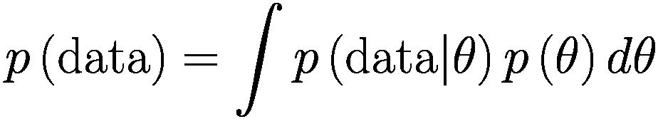

其中，我们有由特定参数 *θ* 条件化的不同似然项，并且这些似然项由先验概率加权。因此，证据项考虑了我们可以用来得到特定数据的所有不同方式。

### 独立性

一种会影响前述三种概率计算的特殊情况是*独立性*，即随机变量之间相互独立。我们来看看在独立随机变量情况下的联合概率、条件概率和边缘概率。

当两个随机变量相互独立时，事件 *x* = X 与事件 *y* = Y 无关，也就是说，在给定 *y* = Y 的条件下，*x* = X 的条件概率变为 *p*(X| Y) = *p*(X)。因此，两个独立随机变量的条件概率分布变为 *p*(*x*| *y*) = *p*(*x*)。它们的联合概率变为各自概率的乘积：*p*(X ∩ Y) = *P*(X| Y)*P*(Y) = *p*(X)*p*(Y)，并且联合概率分布变为各个概率分布的乘积：*p*(*x*, *y*) = *p*(*x*)*p*(*y*)。*x* 的边缘概率就是它自身的概率分布：

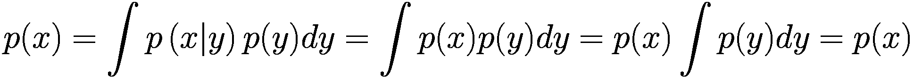

这里我们利用了以下事实：由于 *p*(*x*) 与 *y* 独立，因此可以将其移出积分运算，并且概率分布的总面积为 1，即 ∫ *p*(*y*)*dy* = 1。

我们还可以扩展到*条件独立性*，即给定另一个随机变量 *z* 时，随机变量 *x* 可能与 *y* 独立。换句话说，我们有 *p*(*x*, *y*| *z*) = *p*(*x*| *z*)*p*(*y*| *z*)。

### 先验预测分布与后验预测分布

现在让我们转换焦点，通过使用贝叶斯规则量化不确定性来进行实际预测。为便于讨论，我们将使用 *y* 来表示贝叶斯公式中的数据，或贝叶斯优化设定中的实际观测值。我们感兴趣的是它的预测分布 *p*(*y*)，即 *y* 的可能取值及其对应的概率。如果我们对未知未来数据的预测分布有很好的理解，我们的决策将会更加明智，尤其是在需要仔细决定下一个采样位置的贝叶斯优化框架中。

在收集任何数据之前，我们会使用一个考虑底层参数 *θ* 所有可能取值的先验预测分布。也就是说，*y* 的先验预测分布是一个边缘概率分布，可以通过对参数 *θ* 的所有依赖关系进行积分来计算：

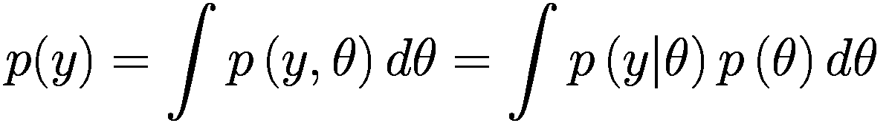

这正是贝叶斯公式中证据项的精确定义。在离散情况下，我们会取参数 *θ* 某个特定值的先验概率，乘以在当前 *θ* 下产生该数据的似然，然后对所有加权的似然求和。

现在，让我们看看在观测到一组数据（统称为 ）之后，新数据点 *y*^′ 的后验预测分布。我们想要评估，在已经观测到一些实际数据的情况下，如果再次进行实验并获取另一个数据点，未来数据将如何分布，以及我们可能观测到 *y*^′ 的哪个值。也就是说，我们要计算后验预测分布 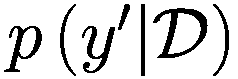。

我们可以通过将其视为一个边缘分布（以收集到的数据集  为条件）并应用与之前相同的技巧来计算后验预测分布，即：

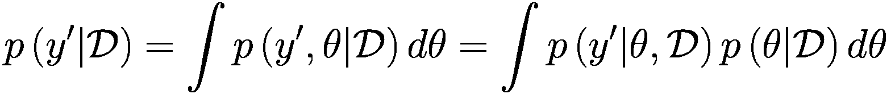

其中第二项  是参数 *θ* 的后验分布，可以通过应用贝叶斯规则计算得出。然而，第一项 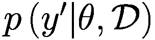 则更为复杂。在观测到一些现有数据点后评估一个新数据点时，一个常见的假设是，在给定 *θ* 的特定值时，它们是*条件独立的*。这种条件独立性意味着 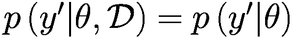，这恰好是似然项。因此，我们可以将后验预测分布简化为：

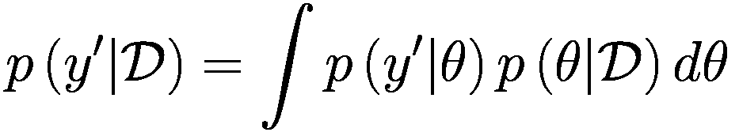

其计算模式与先验预测分布相同。这将给出我们在给定一组先前收集的观测值后，对新实验（例如在贝叶斯优化环境中探测环境）所期望的观测值分布。先验预测分布和后验预测分布总结在图 1-11 中。

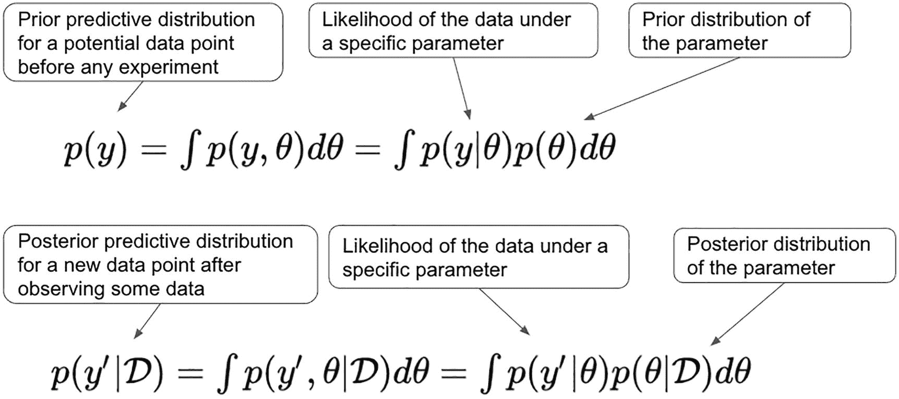

一个方程给出了：任何实验前潜在数据点的先验预测分布、特定参数下数据的似然、观测到一些数据后新数据点的后验预测分布，以及参数的先验分布。

图 1-11

先验预测分布和后验预测分布的定义。两者都基于先验与似然之间加权和的相同模式进行计算。

让我们看一个在正态先验和似然函数下先验预测分布的示例。在实验开始前，我们假设数据 *y* 的似然观测模型服从正态分布，即 *y*~*N*(*θ*, *σ*²)，或 *p*(*y*| *θ*, *σ*²) = *N*(*θ*, *σ*²)，其中 *θ* 是底层参数，*σ*² 是固定方差。例如，在之前介绍的贝叶斯优化设置中的观测模型情况下，参数 *θ* 可以代表真实的目标函数，方差 *σ*² 则源于加性高斯噪声。*y* 的分布依赖于 *θ*，而 *θ* 本身是一个不确定量。我们进一步假设参数 *θ* 服从正态分布作为其先验，即 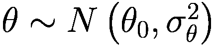，或 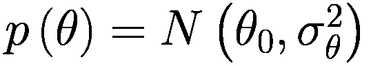，其中 *θ*[0] 和 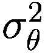 是在收集任何数据点之前我们假设的先验正态分布的均值和方差。由于我们对感兴趣的环境一无所知，我们想了解数据点（视为随机变量）*y* 在这个未知环境中，在不同的 *θ* 值下会如何分布。

理解实验开始时 *y* 的分布，相当于计算其先验预测分布 *p*(*y*)。由于我们处理的是连续型 *θ*，为了积分掉 *θ* 带来的不确定性，边缘化需要考虑从负无穷到正无穷的所有 *θ* 值：

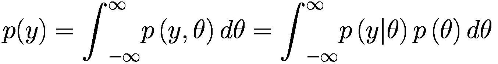

因此，可以通过代入正态似然项 *p*(*y*| *θ*) 和正态先验项 *p*(*θ*) 的定义来计算先验预测分布。然而，我们可以使用一个简单的技巧来避免数学计算，如果直接代入正态分布的公式，计算量会相当大。

让我们尝试直接处理随机变量。我们首先注意到 *y* = (*y* − *θ*) + *θ*。第一项 *y* − *θ* 从 *y* 中减去 *θ*，这通过将均值变为零来使 *y* 中心化，并消除了 *y* 对 *θ* 的依赖。换句话说，(*y* − *θ*)~*N*(0, *σ*²)，这也代表了贝叶斯优化观测模型中随机噪声的分布。由于第二项 *θ* 也是正态分布的，我们可以如下推导 *y* 的分布：

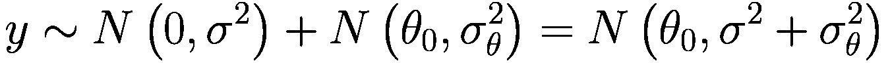

这里我们利用了以下事实：两个独立的正态分布随机变量相加，结果仍为正态分布，其均值和方差由各自均值和方差之和计算得出。

因此，*y* 的边缘概率分布变为 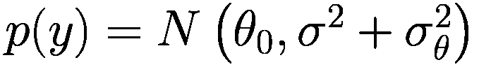。直观上，这种形式也说得通。在我们开始收集关于 *y* 的任何观测值之前，对其均值的最佳猜测是 *θ*[0]，即底层随机变量 *θ* 的期望值。其方差是各个方差之和，因为我们同时考虑了先验和似然带来的不确定性；边缘分布需要吸收这两个方差，从而加剧了最终的不确定性。图 1-12 总结了在似然和先验均为正态假设下，针对连续型 *θ* 的先验预测分布的推导过程。

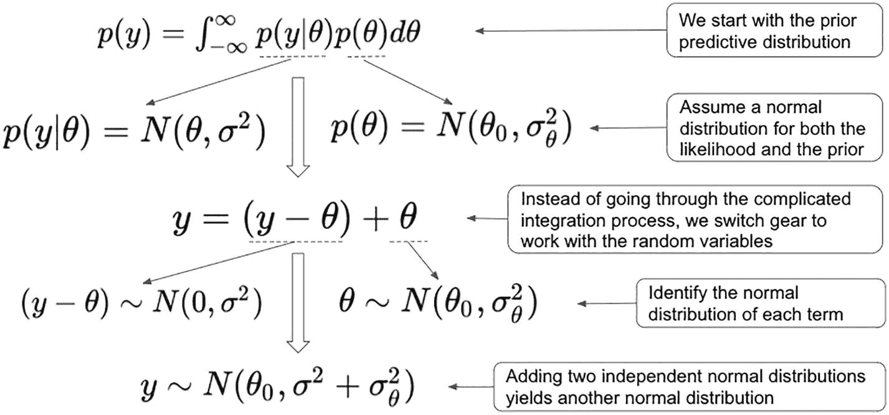

一个方程解释了过程：从先验预测分布开始，假设似然和先验均为正态分布，无需进行复杂的积分过程，转而处理随机变量，识别每个项的正态分布，并将两个独立的正态分布相加得到另一个正态分布。

图 1-12

在收集任何观测值之前，针对新数据点的先验预测分布的推导过程，假设似然和先验均为正态分布。

我们可以遵循同样的推理思路，来处理在收集了一些数据点  之后，针对新观测值 *y*^′ 的后验预测分布的情况，假设似然 *p*(*y*^′| *θ*) 和后验 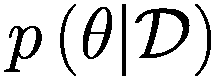 均为正态分布，其中 *p*(*y*^′| *θ*) = *N*(*θ*, *σ*²) 且 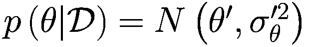。我们可以看到，随着更多数据的收集，通过贝叶斯规则，*θ* 的后验分布具有更新后的参数 *θ*^′ 和 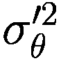。

现在回顾一下具有连续底层参数 *θ* 的后验预测分布的定义：

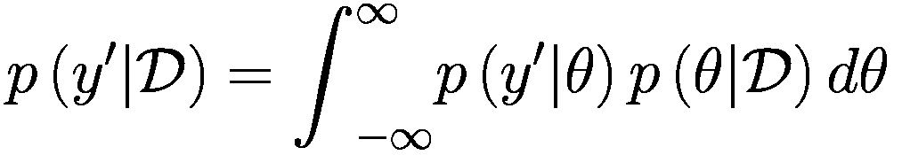

同样，代入两个正态分布密度函数的表达式并进行积分运算会非常繁琐。我们可以改为写成 *y*^′ = (*y*^′ − *θ*) + *θ*，其中 (*y*^′ − *θ*)~*N*(0, *σ*²) 且 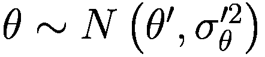。将两个独立的正态分布相加得到：

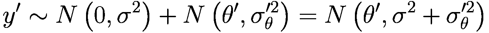

图 1-13 总结了在似然函数和先验均服从正态分布的假设下，连续变量 *θ* 的后验预测分布的推导过程。

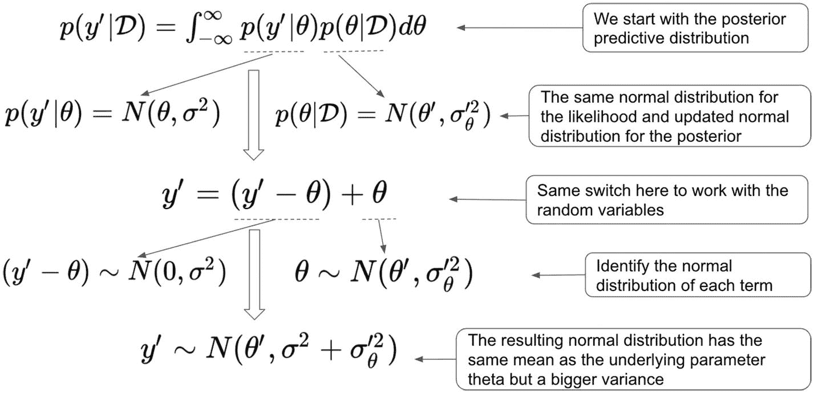

一个方程解释了该过程：从先验预测分布开始，似然函数服从相同的正态分布，后验分布更新为新的正态分布。此处同样切换为处理随机变量，识别每一项的正态分布，最终得到的正态分布与底层参数 theta 均值相同，但方差更大。

图 1-13

在收集一些观测数据后，针对新数据点的后验预测分布的推导过程，假设似然函数和先验均服从正态分布。

### 贝叶斯推断：一个示例

在快速学习了贝叶斯推断的基本要点之后，让我们通过一个具体示例来将数学理论付诸实践。首先，我们为先验选择一个概率密度函数 ，似然函数 *p*(*y*| *θ*) = *N*(*θ*, *σ*²)，两者均服从正态分布。注意，先验和似然函数分别针对随机变量 *θ* 和 *y*，其中 *θ* 表示未知的真实底层目标值，*y* 是受噪声污染的实际观测值，它遵循观测模型 *y* = *θ* + *ε*，其中 *ε*~*N*(0, *σ*²) 是服从正态分布的加性随机噪声。我们希望根据 *y* 的实际观测值来推断 *θ* 的分布。

先验的选择基于我们对感兴趣参数 *θ* 的主观经验。利用贝叶斯定理，它有助于启动对其真实概率分布的学习。*θ* 的可能取值范围覆盖了先验正态分布的整个支撑集。在观察到 *y* 的实际实现值 Y 后，会发生两件事：计算观察到 *θ* = Y 的概率并将其作为先验代入贝叶斯规则；似然函数将被实例化为一个条件正态分布 *p*(*y*| *θ* = Y) = *N*(Y, σ²)。

图 1-14 展示了边缘先验分布和条件似然函数（也是一个概率分布）以及观测值 Y 的一个示例。我们可以看到，这两个分布都遵循正态曲线，后者的均值由于 Y = *θ* 的条件作用而与实际观测值 Y 对齐。此外，根据先验分布 *p*(*θ*)，观察到 Y 的概率并不高，这表明在下一次迭代的后验更新中需要改变先验。我们需要改变先验以提高这种概率，并使主观期望符合现实。

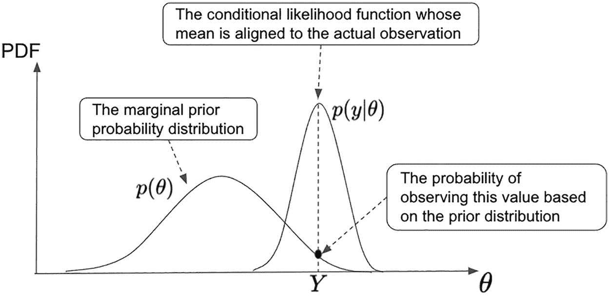

一个 PDF 与 theta 的折线图，绘制了点 P(theta)、P(y|theta) 和 y，解释了边缘先验概率分布、均值与实际观测值对齐的条件似然函数，以及基于先验分布观察到该值的概率。

图 1-14

说明先验分布和似然函数，两者均服从正态分布。由于条件作用，似然函数的均值等于实际观测值。

然后，通过调用贝叶斯规则，先验分布将逐渐更新以逼近实际观测值。这将得到实线表示的后验分布 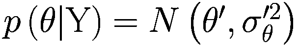，其均值从 *θ*[0] 略微向 Y 移动，并更新为 *θ*^′，如图 1-15 所示。先验分布和似然函数以虚线显示作为参考。*θ* 的后验分布现在更符合实际观测到的结果。

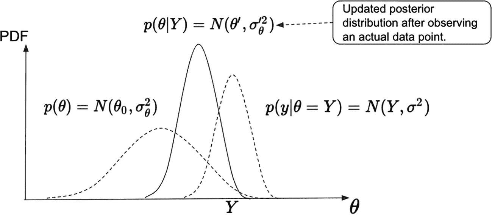

一个 PDF 与 theta 的折线图，绘制了点 P(theta) = N(theta_0, sigma²_theta)、p(theta|Y) = N(theta', sigma'²_theta) 和 p(y|theta=Y) = N(Y, sigma²)。

图 1-15

使用贝叶斯规则推导 θ 的后验分布。更新后的均值 θ^′ 现在位于先验均值 θ[0] 和实际观测值 Y 之间，表明主观偏好与现实之间的一致性。

最后，如果我们获取一个新的观测值，我们会对实际数据点的预测分布感兴趣。将其视为随机变量 *y*^′，使我们能够以信息概率分布的形式表达我们的不确定性，这有利于后续任务，例如决定下一步在哪里采样（稍后会详细介绍）。基于我们之前的讨论，*y*^′ 的最终概率分布将服从正态分布，其均值与 *θ* 的后验分布相同，但方差更大，吸收了来自 *θ* 和 *y* 观测模型的不确定性，如图 1-16 所示。先验分布、后验分布和似然函数现在以虚线显示作为参考。

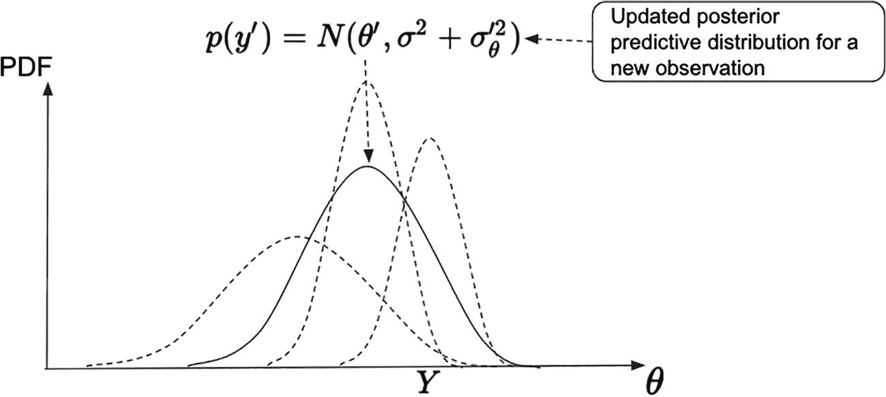

一个 PDF 与 theta 的折线图，绘制了点 p(y') = N(theta', sigma² + sigma'²_theta)。3 条虚线，一条线呈倒抛物线形状。

图 1-16

说明如果我们从所研究的系统/环境中获取另一个观测值时的后验预测分布。后验预测分布与 θ 的后验分布具有相同的均值，但由于来自 θ 和观测模型的不确定性，其分布范围更广。

## 贝叶斯优化工作流程

在了解了贝叶斯统计的核心要点后，您可能会好奇这些内容如何与贝叶斯优化场景联系起来。回顾一下，预测后验分布量化了当我们探测环境并接收到新实现时，不同观测结果的概率。在推理不同采样选择 *x* ∈ *A* 的效用，以寻找全局最大值 *f* ^∗ 时，这是一个强大的工具。

为了更清晰地说明这一点，让我们将位置 *x* 作为显式条件添加到先验/后验预测分布中，并使用 *f*（真实目标值）来表示 *θ*（我们关注的基础参数）。例如，先验预测分布 *p*(*y*| *x*) 表示在位置 *x* 处实际观测值 *y* 的条件概率分布。由于我们在整个域 *A* 中有许多不同的位置，因此也会有许多先验预测分布。在探测环境之前，当假设底层真实目标函数具有特定属性时，每个分布都遵循同一类概率分布。

以一维目标函数 *f* (*x*) ∈ *ℝ* 为例。对于任意位置 *x*[0] ∈ *A*，我们将使用先验预测分布 *p*(*y*| *x*[0]) 来表征未知真实值 *f*[0] = *f* (*x*[0]) 的可能取值。这些先验预测分布将共同构成我们对底层目标函数 *f* 形状的先验概率信念。由于存在无限多个位置 *x*[0]，从而也就有无限多个随机变量 *y*，这些无限随机变量集合的概率分布被联合用作一个*随机过程*来表征真实目标函数。在这里，当仅限于单个位置时，该随机过程就简化为我们之前运行的示例。

### 高斯过程

贝叶斯优化中一种常用的随机过程是*高斯过程*，它要求这些有限维概率分布是连续域中具有无限变量的多元高斯分布。这是一个灵活的框架，可以对广泛的函数族进行建模并量化其不确定性，因此成为用于逼近底层真实函数的强大*代理模型*。我们将在下一章深入探讨高斯过程的细节，但现在，先让我们看几个可视化示例，了解它能提供什么。

图 1-17 展示了一个从高斯过程的先验信念中选出的单个随机变量的“翻转”先验概率分布示例。每个点都遵循正态分布。绘制所有这些先验分布的均值（实线）和 95% 置信区间（虚线），就得到了域中每个位置对应的目标函数的先验过程。因此，高斯过程利用有界范围内无限多个正态分布的随机变量来对底层目标函数进行建模，并通过概率方法量化相关的不确定性。

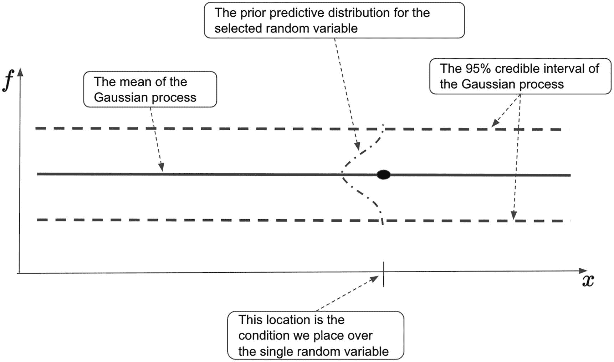

一张 f 对 x 的折线图，绘制了三条线性线。x 轴上标记为“此位置”的点是我们对单个随机变量施加的条件。第一条和第三条线标记为“高斯过程的 95% 置信区间”。第二条线标记为“高斯过程的均值”。第二条线上的一条曲线标记为“所选随机变量的先验预测分布”。

图 1-17

高斯过程的先验信念样本，由域中每个位置的均值和 95% 置信区间表示。每个目标值都由一个遵循正态先验预测分布的随机变量建模。收集所有随机变量的分布有助于我们量化真实底层函数的潜在形状及其概率。

因此，先验过程可以作为代理数据生成过程，以函数的形式生成样本，这是从概率分布中采样单个点的扩展。例如，如果我们反复从之前的先验过程中采样，我们会预期大多数（约 95%）样本落在置信区间内，而少数样本落在该范围之外。图 1-18 展示了从先验过程中采样的三个函数。

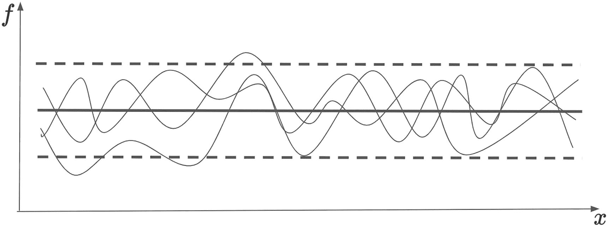

一张 f 对 x 的折线图，绘制了两条虚线直线、一条实线以及沿 x 轴采样的三条正弦波曲线。

图 1-18

从先验过程中采样的三个示例函数，其中大部分函数落在 95% 置信区间内。

在高斯过程中，每个位置目标值的不确定性通过置信区间来量化。当我们开始收集观测值并假设一个无噪声且精确的观测模型时，收集位置处的不确定性将被消除，导致这些位置的方差为零，并直接进行插值。此外，随着我们远离观测点，方差会增大，这是将先验过程与实际观测提供的信息相结合的结果。图 1-19 展示了收集两个观测值后更新的后验过程。基于观测值更新了知识的后验过程，将构成更准确的代理模型，并能更好地估计目标函数。

一张 f 对 x 的折线图，绘制了两条虚线扭结线，一条实线穿过中心点并与虚线相交于 x 轴。

图 1-19

在高斯过程中纳入两个精确观测值后更新的后验过程。后验均值在观测点处进行插值，并且随着我们靠近观测点，相关的方差会减小。

### 采集函数

贝叶斯推断的工具及其向高斯过程的扩展，为目标函数的分布提供了基于原理的推理。然而，我们仍需将这些概率信息融入决策过程，以搜索全局最大值。我们需要构建一个策略，该策略能吸收目标函数的最新信息，并在面对整个域中的不确定性时，推荐下一个最有希望的采样位置。因此，优化策略在连接高斯过程与贝叶斯优化的最终目标中扮演着至关重要的角色。具体而言，后验预测分布为尚未探索的位置提供了目标值及其相关不确定性的展望，优化策略可利用此分布来量化域内任何备选位置的*效用*。

当将关于候选位置的后验知识（即后验参数，如均值和方差）转换为单一效用分数时，采集函数便发挥作用。采集函数是一种人工设计的机制，它以标量分数的形式评估每个候选位置的相对潜力，得分最高的位置将被推荐为下一轮采样的位置。该函数用于评估当我们获取/采样某个候选位置时，其价值有多大。采集函数的评估通常计算成本低廉，因为我们需要在每个候选位置对其进行评估，然后定位到最大效用分数，这构成了另一个（内部）优化问题。

文献中提出了多种采集函数的选择。在本书的后续部分，我们将介绍一些流行的采集函数，例如期望提升（EI）和知识梯度（KG）。不过，目前只需理解它是一种预先设计好的函数，需要平衡两种对立的力量：*探索*与*利用*。探索鼓励通过在陌生且遥远的位置进行采样来解决整个域中的不确定性，因为这些区域可能因高不确定性而带来巨大惊喜。利用则建议在预期观测值较高的有希望区域进行贪婪的移动。探索与利用的权衡是许多优化场景中的常见话题。

另一个显著特征是短期与长期的权衡。短期采集函数只关注下一步，并假设这是从环境中采样的最后机会；因此，其推荐旨在最大化即时效用。长期采集函数则采用多步前瞻方法，通过模拟未来的潜在演变/路径，并最大化长期效用来做出最终推荐。本书将涵盖这两种类型的策略。

在采集函数的设计中还有许多其他新兴的变体，例如为所研究的系统添加安全约束。无论如何，我们将根据在耗尽预算时，我们与全局最大值位置的接近程度，来评判使用特定采集函数的策略质量。当前位置与最优位置之间的距离通常被称为*即时遗憾或简单遗憾*。此外，在整个采样过程中产生的*累积遗憾*（历史位置与最优位置之间的累积距离）也可用于评估。

### 完整的贝叶斯优化循环

贝叶斯优化是（不受控的）环境与（受控的）策略之间的迭代过程。该策略包含两个支持序贯决策的组件：一个作为代理模型来近似真实底层函数（即环境）的高斯过程，以及一个用于推荐下一个最佳采样位置的采集函数。环境在特定位置接收探测请求，并通过揭示遵循特定观测模型的新观测值来做出响应。然后，高斯过程代理模型利用新观测值获得后验过程，以支持预设采集函数进行后续决策。此过程持续进行，直到满足停止标准（例如耗尽给定预算）。图 1-20 展示了这一过程。

一个贝叶斯优化流程图，涉及环境观测、策略、采集函数、高斯过程、采样位置以及作为代理函数的近似。图中给出了该过程的详细描述。

图 1-20

完整的贝叶斯优化循环，其特点是未知（黑盒）环境与决策策略之间的迭代交互，该策略由用于概率评估的高斯过程和用于评估环境中候选位置效用的采集函数组成。

## 总结

贝叶斯优化是一类旨在实现样本高效全局优化的方法论。本章涵盖了贝叶斯优化框架的基础知识，包括以下内容：

*   贝叶斯优化作为全局优化技术的定义性特征，包括观测模型、代理模型和采集函数
*   贝叶斯统计的基础知识，包括贝叶斯推断框架、不同类型的概率（联合概率、条件概率和边缘概率），以及先验预测分布和后验预测分布
*   贝叶斯优化工作流程，重点突出了两个主要组成部分：高斯过程和采集函数

在下一章中，我们将讨论第一个组成部分：高斯过程，涵盖理论理解和在 Python 中的实际实现。

