# 2. 高斯过程

在上一章中，我们介绍了在正态/高斯先验分布下，参数 `θ` 的后验分布以及新观测值 `y′` 的预测后验分布的推导过程。了解后验预测分布有助于监督学习任务，例如回归和分类。具体而言，后验预测分布能够量化现有观测值和未来观测值（如果我们再次采样）的可能实现形式及其不确定性。在本章中，我们将在第一节介绍高斯过程的一些基础内容，然后在第二节转向代码实现。

我们处理参数的方式取决于训练所使用的模型类型。监督学习任务中有两种模型类型：`参数化`模型和`非参数化`模型。参数化模型假设存在一组固定的参数，用于估计和预测。例如，给定一组输入观测值 `X`（粗体大写字母表示矩阵）和输出目标 `y`，我们定义一组参数 `θ`（粗体小写字母表示向量中包含的多个元素），并依赖参数化模型 `p(y | X, θ)`，通过最大似然估计或最大后验估计等过程来估计最优参数值 `\hat{\boldsymbol{\theta}}`。使用贝叶斯方法，我们还可以推断出完整的后验分布 `p(θ | X, y)`，从而实现对参数 `θ` 的分布化表示，而非点估计。

图 2-1 展示了矩阵 `X` 和向量 `y` 的简写数学符号。

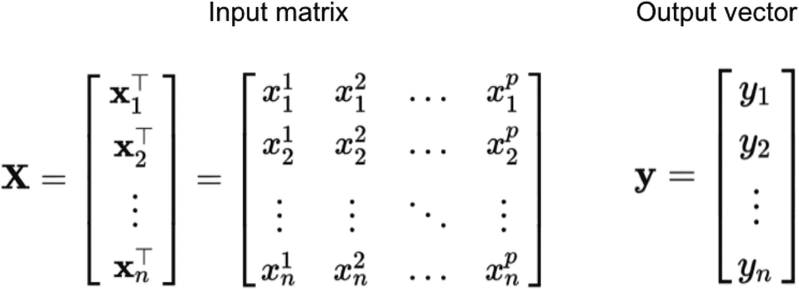

图 2-1

输入矩阵与输出向量的可视化

另一方面，非参数化方法不假设存在一组固定的参数，相反，参数的数量由数据集的大小决定。例如，`k-近邻`（`KNN`）算法是一种非参数化模型，它取最近的 k 个数据点的平均值作为最终预测。这个过程涉及计算所有数据点之间的距离/相似度，这些相似度作为权重（在 `KNN` 中，所有 k 个邻近点的权重相等）。因此，当数据集规模较大时，它在测试时往往较慢，尽管由于直接记忆数据，其训练时间比参数化模型更快。

`高斯过程`（`GP`）可以被视为一种非参数化模型。它是一种随机过程，用于刻画`函数上的分布`，而非一组固定的参数。关键区别在于，`GP` 将多元高斯分布中常用的、来自离散空间的有限参数集 `θ`，扩展为连续无限空间中的无限函数 `f`，该函数在图形上绘制时对应一条函数或曲线。`GP` 继承了多元高斯分布优良的数学性质，并提供了一个灵活的框架来对带有不确定性估计的函数进行建模。

例如，图 2-2 展示了一个包含三个参数的系数向量 `θ` 的一次实现，以及一个显示为曲线且具有无限个参数的函数 `f`。然而，在计算上，我们在绘制函数时仍然会使用有限数量的点来逼近实际曲线。使用 `GP`，函数 `f` 代表一个无限的随机变量集合，其中任何（有限）子集都遵循联合高斯分布。这些随机变量之间的相互依赖关系因此决定了函数 `f` 的最终形状。

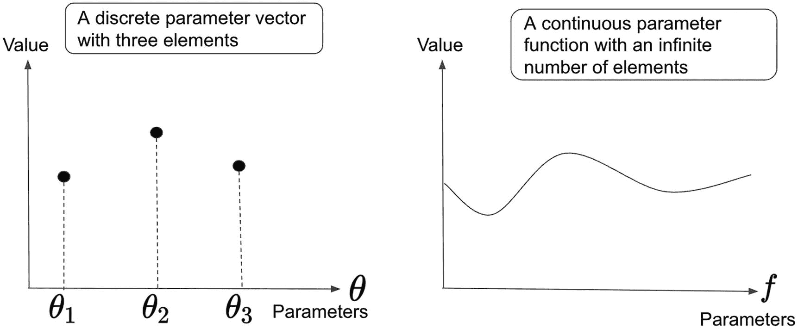

图 2-2

比较离散参数向量（左）和连续参数函数（右），后者是从有限参数集扩展到嵌入在函数中的无限参数数量

由于任意多元高斯分布都可以通过其均值向量和半正定协方差矩阵来表征，我们可以将同样的概念扩展到跨越连续域 `A` 的函数上，并通过一个`均值函数 μ` : `A` → ℝ 和一个半正定`协方差函数 κ` : `A` x `A` → ℝ 来表征一个 `GP`：

```
p(f)= GP(f;μ, κ)
```

均值函数 `μ` 返回任意输入位置 `x` 的期望值（集中趋势），而协方差函数则量化任意两个输入位置之间的相似性。

我们稍后将更详细地介绍协方差函数。现在，将 `GP` 视为一个庞大的高斯分布会有所帮助。在 `GP` 框架下，对函数分布的推断始于一个先验过程（同样是在函数上），该过程随着新观测值的出现而迭代更新。通过将 `f` 视为遵循 `GP` 先验的随机变量集合，并使用贝叶斯推断获得 `GP` 后验，我们可以量化关于潜在真实目标函数本身的不确定性，包括其最大值点 `f^∗` 和 `x^∗`。此外，根据任务类型，`GP` 可用于回归和分类。

在我们正式阐述 `GP` 的数学性质之前，让我们先回顾一下多元高斯分布的基础知识，这将有助于我们建立理解 `GP` 的直觉。然后，我们将深入探讨为目标函数构建有用先验分布，以及在观测到一些含噪声或无噪声样本后计算后验分布的机制。

## 回顾高斯分布基础

假设我们有一组二维观测数据，它们以坐标系原点为中心分布。也就是说，系统上的每个点由两个标量特征描述，即 `x=[x^1, x^2]^T ∈ ℝ^2`。这里，ℝ² 描述了一个由所有实数构成的、延伸至无穷远的二维平面。这些点可能均匀分布在原点周围，也可能呈现某种系统性模式，从而形成图 2-3 所示的两种情形。

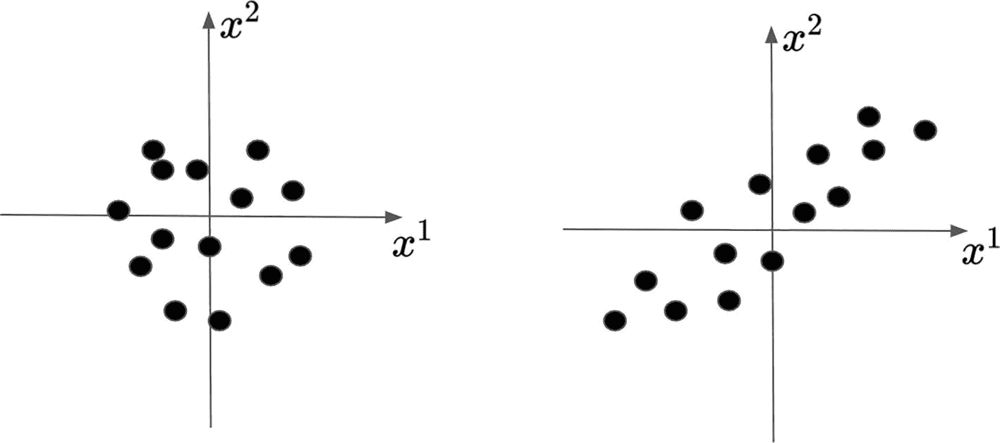

图 2-3

展示了以原点为中心的平面上点的两种可能分布。这些点可能均匀分布在原点周围（左图），也可能呈现系统性偏差分布（右图）

现在，我们希望为每种情形拟合一个高斯分布。如果拟合得当，该分布将帮助我们更好地描述其他未知点。在二维情况下，高斯分布由一个均值向量 `μ=[μ_1, μ_2]^T` 和一个协方差矩阵 `K=[[σ_11^2, σ_12^2], [σ_21^2, σ_22^2]]` 来表征。均值向量描述了如果我们反复从高斯分布中采样时的集中趋势，而协方差矩阵则描述了各点之间的相互关联性。

相应地，平面上的任何点都可以视为来自该高斯分布的一个实现（或等价地，一个样本或模拟值）：

```
x ~ N(μ, K) = N([μ_1, μ_2]^T, [[σ_11^2, σ_12^2], [σ_21^2, σ_22^2]])
```

由于我们假设这些点以原点为中心，这意味着 `μ=[0, 0]^T`。现在，让我们更仔细地审视协方差矩阵。

### 理解协方差矩阵

多元协方差矩阵描述了数据的各个特征之间如何相互关联。在前面的例子中，协方差矩阵告诉我们，当 `x^1` 的值增加时，`x^2` 在方向和幅度上如何变化，即两个变量之间的共同变动关系。协方差矩阵中的每个元素都使用方差和协方差的定义来计算。例如：

![$$ {\sigma}_{11}²=\mathit{\operatorname{var}}\left({x}¹\right)=\mathbbm{E}\left[{\left({x}¹-\mathbbm{E}\left[{x}¹\right]\right)}²\right]=\mathbbm{E}\left[{\left({x}¹\right)}²\right] $$](images/527334_1_En_2_Chapter/527334_1_En_2_Chapter_TeX_Equc.png)
![$$ {\sigma}_{12}²={\sigma}_{21}²=\mathbbm{E}\left[\left({x}¹-\mathbbm{E}\left[{x}¹\right]\right)\left({x}²-\mathbbm{E}\left[{x}²\right]\right)\right]=\mathbbm{E}\left[{x}¹{x}²\right] $$](images/527334_1_En_2_Chapter/527334_1_En_2_Chapter_TeX_Equd.png)

这里我们利用了 ![$$ \mathbbm{E}\left[{x}¹\right]=\mathbbm{E}\left[{x}²\right]=0 $$](images/527334_1_En_2_Chapter/527334_1_En_2_Chapter_TeX_IEq6.png) 这一事实，这是数据点中心化的结果。元素 （或等价地 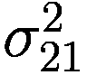）衡量了 `x`¹ 维度和 `x`² 维度上观测值之间的相似性，通过点积 `x`¹`x`² 计算得出。点积是一种广泛使用的方法，用于衡量两个向量在相似程度和方向上的相似性。

协方差与相关性的概念密切相关。对于变量 `x`¹ 和 `x`²，它们的相关性 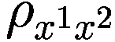 定义如下：

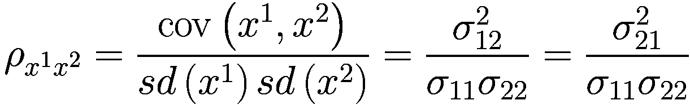

这里我们利用了协方差矩阵的对称性，并假设其为半正定矩阵，即 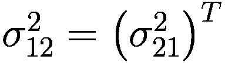。相关性是一个度量指标，它通过利用计算中的所有分量来概括协方差矩阵。它是一个介于 -1 和 1 之间的数值，其中 1 表示完全正相关（例如 `x`² = 2`x`¹），-1 表示完全负相关（例如 `x`² = − 2`x`¹）。

由于协方差矩阵中的对角线元素表示特定特征的方差，我们可以通过除以标准差轻松地进行归一化，从而得到单位方差，结果得到 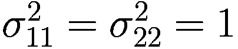。

当我们观察非对角线元素时，情况变得更有趣，即 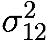 和 。在图 2-3 的左侧分布中，如果我们将 `x`² 从零增加到某个特定值（例如 `x`² = 0.8），我们对 `x`¹ 可能取值（即正或负）的了解仍然非常有限。事实上，知道 `x`² 并不能帮助我们了解 `x`¹ 的任何信息，`x`¹ 仍然均匀分布在垂直轴周围。关于 `x`² 的信息无助于获取更多关于 `x`¹ 的信息。换句话说，`x`¹ 和 `x`² 彼此不相关，并且 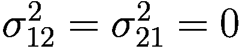。因此，对于第一种情形，我们有

![$$ \left[\begin{array}{c}{x}¹\\ {}{x}²\end{array}\right]\sim N\left(\left[\begin{array}{c}0\\ {}0\end{array}\right],\left[\begin{array}{cc}1&amp; 0\\ {}0&amp; 1\end{array}\right]\right) $$](images/527334_1_En_2_Chapter/527334_1_En_2_Chapter_TeX_Equf.png)

另一方面，如果在第二种场景中采取相同的切割，并将 `x`² 条件约束为相同的值，我们知道 `x`¹ 有很大概率为正。此时，了解 `x`² 的值能为我们提供关于 `x`¹ 的一些信息，从而使这两个变量相关。我们会预期，如果 `x`² 增加，`x`¹ 也会增加，从而形成正相关。假设 `x`¹ 和 `x`² 之间的协方差为 0.6，即共同变动的强度为 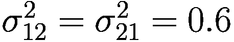，那么第二种场景的*二元*高斯分布可以表示为

![$$ \left[\begin{array}{c}{x}¹\\ {}{x}²\end{array}\right]\sim N\left(\left[\begin{array}{c}0\\ {}0\end{array}\right],\left[\begin{array}{cc}1&amp; 0.6\\ {}0.6&amp; 1\end{array}\right]\right) $$](images/527334_1_En_2_Chapter/527334_1_En_2_Chapter_TeX_Equg.png)

图 2-4 总结了这两种场景，其关键区别在于这两个变量之间的依赖关系。非对角线元素上的值为零表示变量之间互不依赖，而正值或负值则表示存在一定程度的依赖关系。

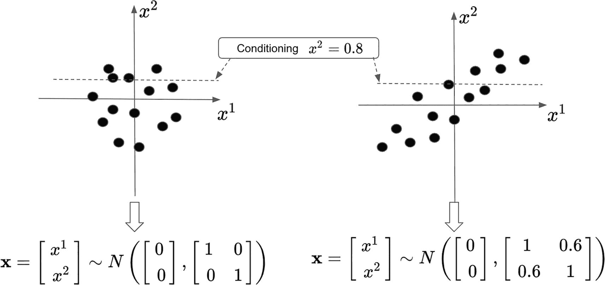

一组两个散点图，x 上标 2 对 x 上标 1。它表明在图 1 中，点簇散布在所有象限中，而在图 2 中，点从第三象限到第一象限呈线性增加。两个图中都有一条虚线，表示条件约束 x 平方等于 0.8。下方是两个定义 x 值的矩阵。

图 2-4

说明两种场景下的二元高斯分布。左侧的协方差项设为零，表示变量不相关；而右侧由于正相关，协方差项为 0.6。

### 多元高斯的边缘分布与条件分布

我们的二元高斯示例包含两个变量/特征：`x`¹ 和 `x`²，它们联合服从高斯分布。在处理多元高斯分布时，我们通常关注特征层面的分布，即其边缘分布和条件分布。更深入地了解各个分布，将使我们能够在贝叶斯优化过程中系统地推理其他未观测变量的不确定性。

回顾一下，二元高斯分布由均值向量 ![$$ \boldsymbol{\upmu} =\left[\begin{array}{c}{\mu}_1\\ {}{\mu}_2\end{array}\right] $$](images/527334_1_En_2_Chapter/527334_1_En_2_Chapter_TeX_IEq16.png) 和协方差矩阵 ![$$ \textbf{K}=\left[\begin{array}{cc}{K}_{11}&amp; {K}_{12}\\ {}{K}_{21}&amp; {K}_{22}\end{array}\right]=\left[\begin{array}{cc}{\sigma}_{11}²&amp; {\sigma}_{12}²\\ {}{\sigma}_{21}²&amp; {\sigma}_{22}²\end{array}\right] $$](images/527334_1_En_2_Chapter/527334_1_En_2_Chapter_TeX_IEq17.png) 参数化。根据*多元高斯定理*，我们可以将两个变量的边缘分布写成如下形式：

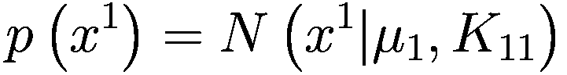

## 从高斯分布中采样

在前面的章节中，我们介绍了如何从一组数据点中推断多元高斯分布的参数。通过以这些观测值为条件，我们可以获得其他未观测变量后验分布的更新视图。然后，我们可以利用更新后的后验分布进行采样，并为这些未观测变量生成未来可能出现的新的模拟观测值。在此过程中，如果模拟样本与实际观测值偏差不大，我们的后验信念将得到加强。

现在假设我们要从高斯分布 `N(μ, σ²)` 中采样。我们如何生成遵循这个特定分布的随机样本呢？一种常见的方法是首先从标准正态分布 `N(0, 1)` 中生成一个随机数 `x`，然后应用*尺度-位置变换*来获得样本 `σx + μ`。通过基于标准差 `σ` 缩放样本，然后加上均值 `μ`，得到的样本将服从均值为 `μ`、方差为 `σ²` 的正态分布。

从标准正态分布中采样的第一步更为复杂，而第二步则是一个简单且确定性的变换。一种通用方法是使用标准高斯分布的反向累积分布函数来变换均匀随机变量。例如，如果 `U` 在 `[0, 1]` 上均匀分布，那么 `Φ^(−1)(U)` 将服从标准正态分布，其中 `Φ^(−1)` 是标准正态分布累积函数的反函数。

图 2-5 展示了一个可视化示例。我们首先从 `[0, 1]` 上的均匀分布中采样一个随机点，然后调用标准正态分布的反向累积密度函数（CDF），以获得 CDF 输入空间中对应的样本，这是因为 CDF 单调地将任意输入值映射到 `[0, 1]` 上的输出。从数学上讲，标准正态分布的随机样本由 `x = Φ^(−1)(U)` 给出。考虑到标准正态分布的概率密度函数（PDF）和 CDF 之间存在一一映射关系，我们也可以在 PDF 空间中获得相同的输入 `x`。我们还会预期大多数样本集中在 PDF 的均值附近。最后，我们应用尺度-位置变换，将其转换为具有所需均值和方差的正态分布的随机样本。

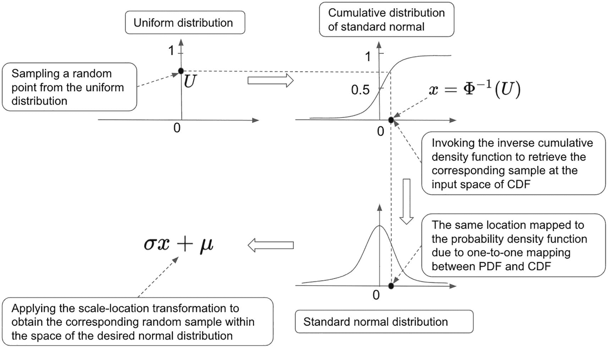

图 2-5

基于三个步骤从所需的一元高斯分布中获取随机样本：从均匀分布中采样，使用反向累积函数转换为 CDF（或 PDF）的对应输入，并应用尺度-位置变换将随机样本转换到具有所需均值和方差的正态分布空间。

让我们扩展到多元情况，看看如何从具有任意均值向量 `μ = [μ₁, μ₂]^T` 和协方差矩阵 `K = [[K₁₁, K₁₂], [K₂₁, K₂₂]]` 的二元高斯分布中进行采样。我们可以遵循类似的过程，首先从标准二元正态分布 `N([0, 0]^T, [[1, 0], [0, 1]])` 中采样，然后对得到的样本应用尺度-位置变换。

我们如何从 `N([0, 0]^T, [[1, 0], [0, 1]])` 中随机采样 `x = [x¹, x²]^T`？等价地，我们希望从 `N(0, I)` 中采样 `x`，其中 `0` 是零向量，`I` 是单位矩阵。由于协方差矩阵的非对角线元素为零，我们可以利用两个变量 `x¹` 和 `x²` 不相关这一事实。因此，问题就变成了分别从 `x¹` 和 `x²` 各自的分布中抽取随机样本。基于之前关于多元高斯分布的定理，边缘分布是具有各自均值和方差的一元高斯分布。换句话说：

`x¹ ~ N(0, 1)`

`x² ~ N(0, 1)`

由于我们已经知道如何从一元标准正态分布中采样，我们可以为 `x¹` 和 `x²` 采样一个包含两个随机样本的向量，并将该向量作为来自二元标准正态分布的一个随机样本。

接下来，我们需要获取协方差矩阵 `K` 的平方根，以便应用尺度-位置变换。实现这一点的一种方法是应用*乔列斯基分解*，该分解可以将矩阵 `K` 分解为一个下三角矩阵 `L` 及其转置 `L^T` 的乘积：

`K = L L^T`

因此，我们可以通过 `Lx + μ` 获得一个变换后的样本，该样本将服从 `N(μ, K)`。

理解多元高斯分布的采样过程，对于在贝叶斯框架下从后验高斯过程中模拟样本（特别是曲线）至关重要。来自多元高斯分布的随机样本以包含有限元素的向量形式存在，而在高斯过程中，该向量会被拉伸成一个无限函数。接下来，我们将进入顺序获取新观测值的场景，并探讨如何将高斯过程框架嵌入其中，以通过高斯过程回归获得更新后的样本。

## 高斯过程回归

高斯过程是一种工具，用于通过对随机函数施加先验信念，并通过顺序观测新数据点来更新这些函数的后验，从而进行代理建模。给定一组输入-输出对作为观测值，高斯过程可用于这些回归场景，以进行带有不确定性量化的预测。在地统计学中，它也被称为*克里金法*。基于由特定先验协方差函数控制的高斯过程，我们可以利用观测值获得更新后的后验协方差函数，这类似于机器学习领域中使用训练数据更新模型参数。实际上，高斯过程回归是一种非参数贝叶斯回归方法，由于其对预测提供了不确定性度量，因此在实践中被广泛使用。

选择一个好的协方差函数，即*核*函数，至关重要，因为它决定了不同样本之间的相似性，并影响高斯过程生成的最终函数曲线的形状。为了更好地描述核函数的效果，让我们通过一个回归案例来详细说明。

### 核函数

# 核函数或协方差函数

核函数或协方差函数 `κ(x[i], x[j])` 用于衡量输入空间中两个点 `x[i]` 和 `x[j]` 之间的统计关系。具体来说，它量化了在 GP 框架中，`x[j]` 的变化与 `x[i]` 相应变化之间的相关性。该函数为输入空间中的任意两点输出一个标量相似度值，通常基于欧几里得距离来定义。

假设我们有三个无噪声观测对 `D = {(x[1], f[1]), (x[2], f[2]), (x[3], f[3])}`，其中 `{x[i], i = 1…3}` 表示输入位置，`{f[i] = f(x[i])}` 是相应的函数值，被建模为随机变量。我们希望使用一个具有均值向量 `μ` 和协方差矩阵 `K` 的多元高斯分布来对这些变量进行建模。不失一般性，通常假设均值向量 `μ=0`，即变量被中心化以简化推导。另外，请注意，我们使用带下标 `i` 的 `{x[i]}` 来表示沿水平轴排列的观测位置，在上一章的贝叶斯推断框架中，这些位置被认为是给定的。

## 多元高斯分布建模

我们可以假设这三个变量共同遵循如下多元高斯分布：

![$$ \textbf{f}=\left[\begin{array}{c}{f}_1\\ {}{f}_2\\ {}{f}_3\end{array}\right]\sim N\left(\boldsymbol{\upmu}, \textbf{K}\right)=N\left(\left[\begin{array}{c}0\\ {}0\\ {}0\end{array}\right],\left[\begin{array}{ccc}{K}_{11}&amp; {K}_{12}&amp; {K}_{13}\ \\ {}{K}_{21}&amp; {K}_{22}&amp; {K}_{23}\\ {}{K}_{31}&amp; {K}_{32}&amp; {K}_{33}\end{array}\right]\right) $$](images/527334_1_En_2_Chapter/527334_1_En_2_Chapter_TeX_Equp.png)

其中协方差函数 `K` 捕捉了这三个观测之间的相关性。具体来说，由于数值差异较小，`f[1]` 与 `f[2]` 的相关性应高于与 `f[3]` 的相关性。这种先验信念也构成了我们引入模型中的归纳偏置：最终得到的模型应该是平滑的，相邻点之间不应有突变。关于此示例的回顾，请参见图 2-6。

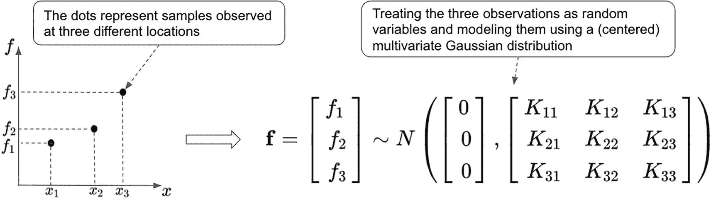

图 2-6
使用多元高斯分布对三个样本进行建模

鉴于观测（被建模为随机变量）的相似性与其距离之间存在正相关关系，我们可以预期 `K[12]` 大于 `K[13]`。同样的逻辑也适用于协方差矩阵中的其他元素。这种见解使得在对所有数据点进行标准化（使得所有对角线元素为 1）后，可以得到如下示例协方差矩阵：

![$$ \left[\begin{array}{c}{f}_1\\ {}{f}_2\\ {}{f}_3\end{array}\right]\sim N\left(\left[\begin{array}{c}0\\ {}0\\ {}0\end{array}\right],\left[\begin{array}{ccc}1&amp; 0.8&amp; 0.3\ \\ {}0.8&amp; 1&amp; 0.7\\ {}0.3&amp; 0.7&amp; 1\end{array}\right]\right) $$](images/527334_1_En_2_Chapter/527334_1_En_2_Chapter_TeX_Equq.png)

## 平方指数核函数

我们可以用来获得类似于上述示例的协方差矩阵的一个常用核函数是平方指数核：

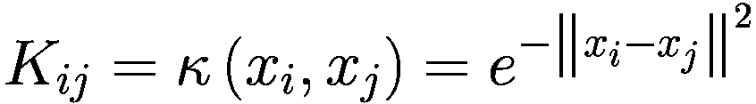

这里我们将负平方距离的指数作为最终的距离度量。现在，我们可以量化有界范围内任意一对点之间的相似性。例如，当 `x[i]` 距离 `x[j]` 非常远，且它们的距离趋近于无穷大时，即 ‖`x[i]` − `x[j]`‖ → ∞，我们有 `K[ij]` → 0；当 `x[i]` = `x[j]` 时，即给定点与自身的相似性，我们有 `K[ij]` = 1，这对应于协方差矩阵中的对角线元素。因此，平方指数核函数 `κ(x[i], x[j])` 使用 0 到 1 之间的值来描述任意两个输入位置之间的相似性。使用这样的核函数将使我们能够构建类似于前面示例的协方差矩阵。

让我们在下面的代码清单中实现该核函数，并观察随着输入距离增加时相似度值的变化。

```python
# 定义一个核函数，返回平方指数距离
def kernel(x):
    return np.exp(-x**2)
# 创建两个输入位置之间差异的列表
X = np.linspace(-5,5,100).reshape(-1,1)
K = kernel(X)
plt.plot(X, K)
```

**清单 2-1** 计算平方指数距离

运行上述代码将生成图 2-7，该图显示两点之间的协方差随着它们距离的增加而减小，并且当距离超过 2 时趋近于零。这意味着附近位置的函数值相关性更强，而距离较远的位置则基本上会导致独立的随机变量，它们之间几乎没有协方差。这也表明，在任意输入位置揭示一个观测值，可以为附近位置的函数值提供重要的信息。

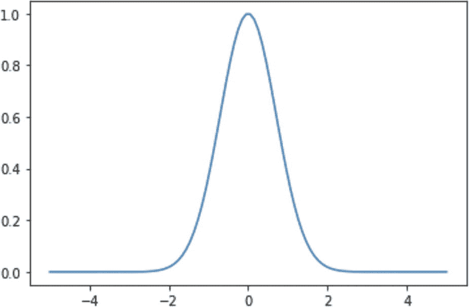

图 2-7
可视化平方指数核函数

注意，在每个点 `x[i]` ∈ `A` 处，`K[ii]` = `κ(x[i], x[i])` = 1。因此，两个点 `x[i]` 和 `x[i]` 之间的协方差也根据前面介绍的相关性定义，衡量了相应函数值 `f(x[i])` 和 `f(x[j])` 之间的相关性。假设均值函数在整个域上返回零，我们可以看到每个输入位置处随机变量的边缘分布遵循标准正态分布。

从另一个角度来看，核函数也可以被认为是在给定一组固定位置 `{x[1], x[2], x[3]}` 的情况下，决定了代表我们关注实体的三个随机变量 `{f[1], f[2], f[3]}` 的高度。我们还可以向核函数引入额外的参数，使其在表征特定数据集（可能是图像或文本形式）时更加灵活。

## 扩展到其他变量

假设我们希望根据观测数据集 `D`，获取另一个变量在其他输入位置上的均值与方差所对应的分布。基于已观测变量来量化其他变量的分布，是高斯过程（GP）的一个关键特征。为此，我们可以构建一个包含已观测变量集和新变量的联合分布，并应用相同的技术来获取新变量的条件分布。让我们基于前面的例子来展开。

给定一个新的输入位置 `x[*]`，我们可以为对应的随机变量 `f[*]`（条件独立于 `f` 中的所有其他变量）选取三个可能的值/实现（高、中、低），每个值对应不同的发生概率。如图 2-8 所示，考虑到由核函数编码的“距离越近的值越相似”这一特性，我们可以直观地推断中间点的概率最高，因为它与第二个和第三个观测点的距离大致相等。也就是说，输入位置的微小变化应导致输出观测值的微小变化。选择中间点，在将其与其他观测点连接时，会形成一条平滑的曲线。此外，如果我们将 `x[*]` 向 `x[2]` 移动，预计 `f[*]` 的值会增加，并进一步接近 `f[2]`。

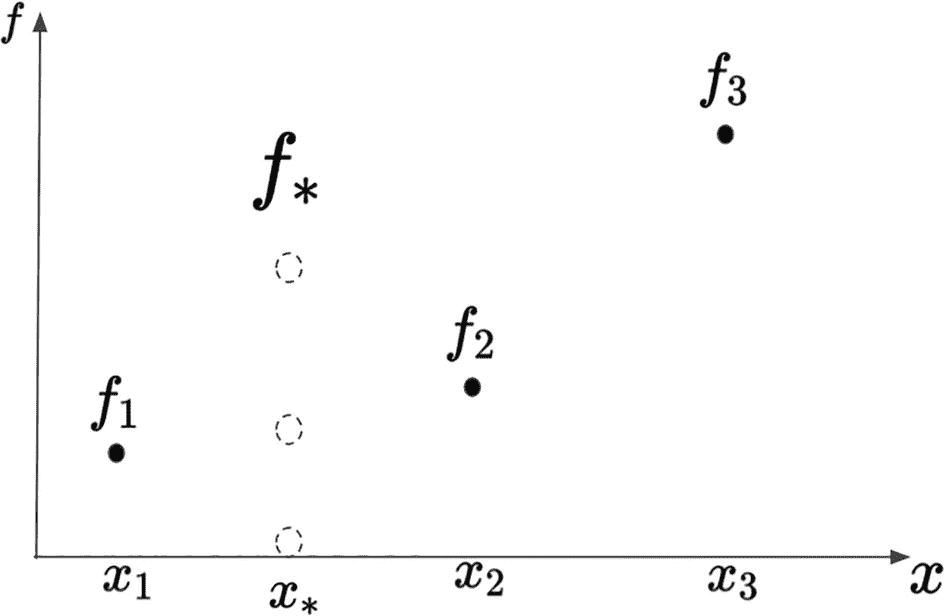

图 2-8
新输入位置 x[*] 对应的 f[*] 的三个可能值（虚线圆圈）。基于核/协方差函数所编码的平滑性假设，我们可以直观地推断中间点是最可能的候选值。

让我们分析如何利用 GP 框架来融入这种直觉。我们可以将相应的观测值建模为一个随机变量 `f[*]`，它与已观测的随机变量 `f` = `{f[1], f[2], f[3]}` 共同服从联合高斯分布。将所有变量整合在一起，使我们能够强制执行协方差函数中编码的相似性约束。

具体来说，已观测变量 `f` 和未观测变量 `f[*]` 的分布分别如下：

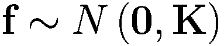

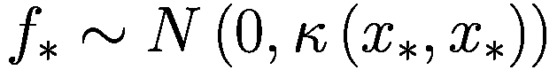

其中，自协方差项`K(x_*, x_*)`就是`x_*`的方差，当使用平方指数核函数时，该值等于 1。为了使设定更具一般性，我们假设在位置`x`处观测到的`f`中的随机变量数量有限，且无噪声，并共同服从多元高斯分布：

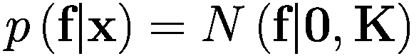

这与`f~N(0, K)`相同。揭示这些观测结果将有助于更新我们对 GP 的先验信念`p(f_*| x_*) = N(f_*| 0, κ(x_*, x_*))`，并为一组新的输入位置`x_*`（同样在无噪声条件下观测）处的一组新随机变量`f_*`获得后验分布`p(f_*| x_*, x, f)`。为了了解如何实现这一点，我们参考 GP 框架，并利用`f`和`f_*`也是联合高斯分布这一事实。即：

![$$ \left[\begin{array}{c}\textbf{f}\\ {}{\textbf{f}}_{\ast}\end{array}\right]\sim N\left(\textbf{0},\left[\begin{array}{cc}\textbf{K}& {\textbf{K}}_{\ast}\\ {}{\textbf{K}}_{\ast}^T& {\textbf{K}}_{\ast \ast}\end{array}\right]\right) $$](images/527334_1_En_2_Chapter/527334_1_En_2_Chapter_TeX_Equv.png)

其中`K_* = κ(x, x_*)`，`K_** = κ(x_*, x_*)`。当总共有`n`个观测样本（即训练数据）和`n_*`个新输入位置时，`K`是一个`n × n`矩阵，`K_*`是一个`n × n_*`矩阵，`K_**`是一个`n_* × n_*`矩阵。

将`f`和`f_*`建模为联合高斯分布后，我们可以再次依赖多元高斯定理，直接使用闭式解来获取条件分布`p(f_*| x_*, x, f)`的参数：

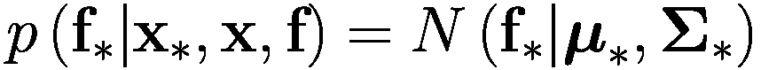

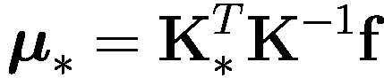

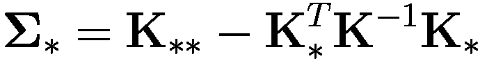

因此，具有这些参数的更新后验分布`p(f_*| x_*, x, f)`将为图 2-8 中的三个候选值中的中间点（均值估计）分配最高的概率。

图 2-9 总结了在 GP 框架下，从现有数据中学习并获取新数据预测（条件）分布的推导过程。关键部分在于将核函数定义为一种先验信念或归纳偏置的形式，并通过纳入观测信息来迭代地对其进行优化。

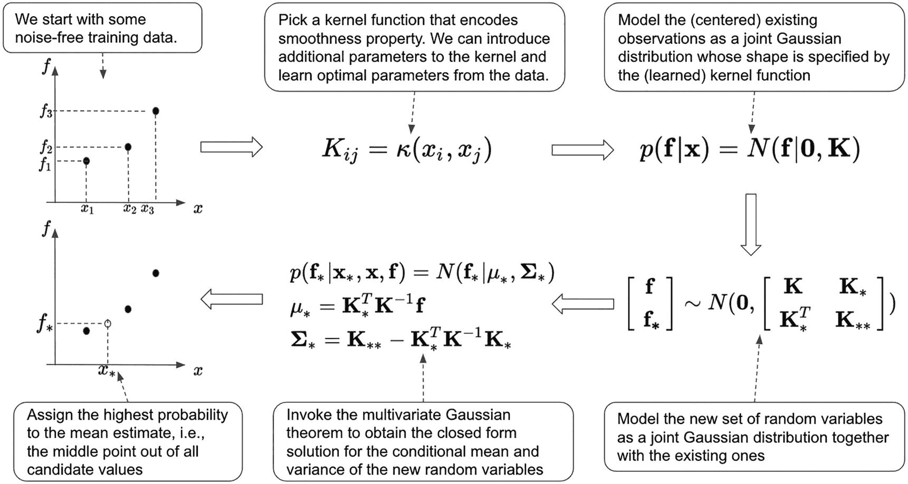

一组图表和方程组成的示意图，展示了从一些无噪声训练数据开始，经过两个方程，选择编码平滑性属性的核函数，并将现有观测值建模为联合高斯分布的过程。接着将新随机变量集建模为联合高斯分布，然后调用多元高斯定理，并将最高概率分配给均值估计。

图 2-9

使用高斯过程获取新输入位置的预测分布。我们首先定义并可选地优化一个核函数，以编码从实际样本中观测到的信息以及基于先验所相信的信息。然后，我们将所有变量建模为联合高斯分布，并获取新变量的条件分布。

### 从含噪观测中学习

在我们的运行示例中，我们假设样本观测是无噪声的。但在实践中，这类观测常常受到噪声污染，这给建模增加了另一层不确定性。一种常见的处理方式是将每个观测的噪声建模为条件独立的随机变量，并作为加性噪声叠加到无噪声观测上。换句话说，我们可以用`y = f + ε`来表示实际观测，其中`ε~N(0, σ_y²I)`具有齐次方差。然而，我们也可以针对每个输入位置建模具有异质方差的情况。

使用加性高斯噪声的最大好处是，我们可以精确地执行相同的推理，为更新后的后验高斯过程的参数获得一个闭式解。遵循相同的推导过程，无噪声预测`f_*`的预测分布现在变为

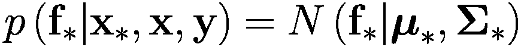

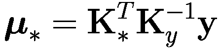

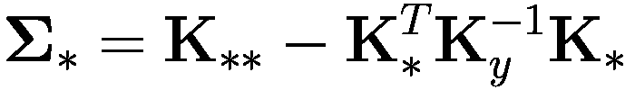

其中`K_y = K + σ_y²I`是实际含噪样本的方差，它吸收了真实无噪声观测和噪声各自的方差。由于噪声也会附着在`f_*`中的每个随机变量上，我们还可以通过将`σ_y²I`加到`Σ_*`上，将噪声`ε`纳入含噪预测`y_*`中：

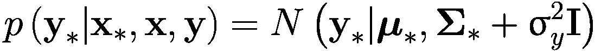

然后，我们可以使用这个预测分布在域内的任何输入位置进行采样。当样本数量增长到无穷大时，连接这些样本将形成一条函数曲线，这是高斯过程的一个样本。我们还可以通过连接逐点标准差来绘制置信区间。将函数曲线视为无限多个逐点样本的组成，这与从二元高斯分布中采样的情形遵循相同的论证。

## 高斯过程的实践

在本节中，我们将通过一个具体示例，演示如何利用高斯过程的先验分布绘制函数曲线作为样本，更新参数，并利用其后验分布获取更新后的样本。我们将使用 Python 来说明实现步骤。

## 从 GP 先验中采样

让我们看看在揭示任何观测之前，如何从高斯过程的先验中采样函数曲线。我们将遵循以下步骤，这与从任意高斯分布中采样类似：

*   创建一个包含 `n` 个候选输入位置的列表 `{x[i], i = 1, …, n}`。我们使用离散位置 `X_test` 来近似一个连续域。当 `n → ∞` 时，我们将获得一条覆盖无限多个输入位置的函数曲线。

*   初始化均值向量 `μ`（包含 `n` 个元素）和协方差矩阵 `K`（包含 `n` x `n` 个元素）。我们假设数据已中心化，因此 `μ = 0`，并且 `K` 是一个平方指数核函数，计算后存储在变量 `K` 中。

*   执行 Cholesky 分解 `K = LL`^`(T)` 以获得 `L`，存储在变量 `L` 中。

*   通过 `L`*`N`(0, `I`) 从 `N`(0, `K`) 中获得一个样本，并存储在 `f_prior` 中。

有关从 GP 先验生成样本的完整代码，请参见清单 2-2。

```
# 导入必要的包
import numpy as np
from matplotlib import pyplot as plt
%matplotlib inline
# 设置随机种子以确保可重复性
np.random.seed(8)
# 定义一个核函数，返回两个输入位置之间的平方指数距离
def kernel(a, b):
    # 将平方运算分解为三部分
    # 每个输入位置可能是多维的，因此对所有维度求和
    sq_dist = np.sum(a**2,1).reshape(-1,1) + np.sum(b**2,1) - 2*np.dot(a,b.T)
    return np.exp(-sq_dist)
# 设置输入位置的数量，当增长到无穷大时近似于一个函数
n = 100
X_test = np.linspace(-5,5,n).reshape(-1,1)
# 计算成对距离，得到一个 nxn 矩阵
K = kernel(X_test, X_test)
# 沿对角线元素添加一个小数，以确保 Cholesky 分解有效
L = np.linalg.cholesky(K + 1e-10*np.eye(n))
# 通过将标准差与标准正态样本相乘来计算函数样本
samples = np.dot(L,np.random.normal(size=(n,5)))
plt.plot(X_test, samples)
```

清单 2-2 从 GP 先验中绘制样本

运行上述代码将生成五条随机曲线，每条曲线由 100 个离散点连接而成，以近似整个域上的一个函数。输出结果见图 2-10。

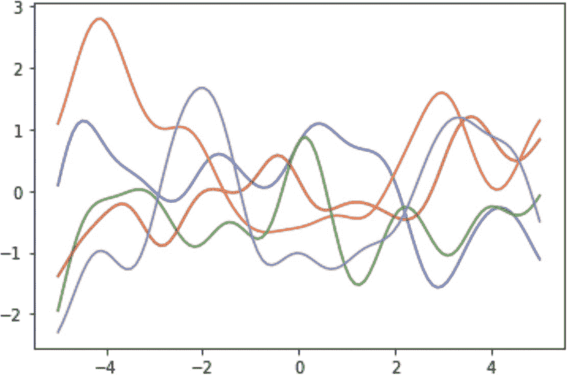

一个折线图显示了 5 条曲线穿过多个波峰和波谷的趋势。y 轴范围从负 2 到正 3，而 x 轴范围从负值到正 4。

图 2-10 从 GP 先验中绘制五个随机样本

我们可以通过引入额外参数使核函数更加灵活。例如，广泛使用的`高斯核`或`RBF核`使用两个参数：长度参数 `l` 控制函数的平滑度，`σ[f]` 控制垂直变化：

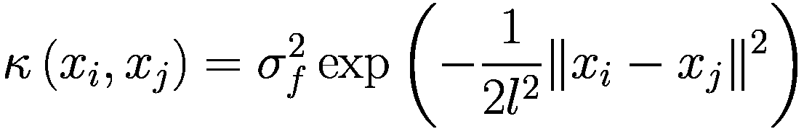

出于演示目的，我们将对每个输入位置/维度使用相同的参数，这也会产生所谓的`各向同性核`，其定义如下。两个输入参数都可以包含多个元素/位置，每个元素/位置由一个或多个维度组成。例如，如果 `X1` 是一个 (`m` x `d`) 矩阵，包含 `m` 个位置，每个位置有 `d` 个维度，而 `X2` 是一个 (`n` x `d`) 矩阵，应用核函数将得到一个 (`m` x `n`) 矩阵，其中包含成对的相似性条目。

```
# Args:
#     X1: m 个点的数组 (m x d)。
#     X2: n 个点的数组 (n x d)。
# Returns:
#     (m x n) 矩阵。
def ise_kernel(X1, X2, l=1.0, sigma_f=1.0):
    sq_dist = np.sum(X1**2,1).reshape(-1,1) + np.sum(X2**2,1) - 2*np.dot(X1,X2.T)
    return sigma_f**2 * np.exp(-0.5/l**2 * sq_dist)
```

代码清单 2-3 定义各向同性平方指数核

我们可以根据之前在 `X_test` 中定义的输入位置列表，获得均值向量（假设为零）和协方差矩阵（使用 `l` = 1 和 `σ[f]` = 1）。

```
# 先验的均值和协方差
mu = np.zeros(X_test.shape)
K = ise_kernel(X_test, X_test)
```

代码清单 2-4 计算均值向量和协方差矩阵

之前，我们通过对标准正态分布的样本进行缩放，从多元高斯分布中采样。实际上，`numpy` 中有一个`multivariate_normal`函数可以帮助我们实现这一点。我们按如下方式抽取五个样本。

```
# 使用 numpy 中的 multivariate_normal 从先验中抽取样本
# 将 mu 的形状从 (n,1) 转换为 (n,)
samples = np.random.multivariate_normal(mean=mu.ravel(), cov=K, size=5)
```

代码清单 2-5 从多元高斯分布中采样

然后，我们可以绘制这五个样本，以及均值函数和基于协方差矩阵对角线元素（包含在 `uncertainty` 变量中）形成的 95% 置信区间（构成不确定性区域）。在下面的代码清单中，我们定义了一个实用函数，用于在预定义的网格值上绘制样本。该函数还有两个输入参数（`X_train` 和 `Y_train`），作为实际观测数据出现时的占位符。

```
def plot_gp(mu, cov, X, X_train=None, Y_train=None, samples=[]):
    X = X.ravel()
    mu = mu.ravel()
    # 95% 置信区间
    uncertainty = 1.96 * np.sqrt(np.diag(cov))
    plt.fill_between(X, mu + uncertainty, mu - uncertainty, alpha=0.1)
    plt.plot(X, mu, label='均值')
    for i, sample in enumerate(samples):
        plt.plot(X, sample, lw=1, ls='--', label=f'样本 {i+1}')
    # 如果观测数据可用则绘制
    if X_train is not None:
        plt.plot(X_train, Y_train, 'rx')
    plt.legend()
```

代码清单 2-6 绘制 GP 先验均值函数、不确定性区域和样本

然后，我们可以提供必要的参数来调用此函数，其输出如图 2-11 所示：

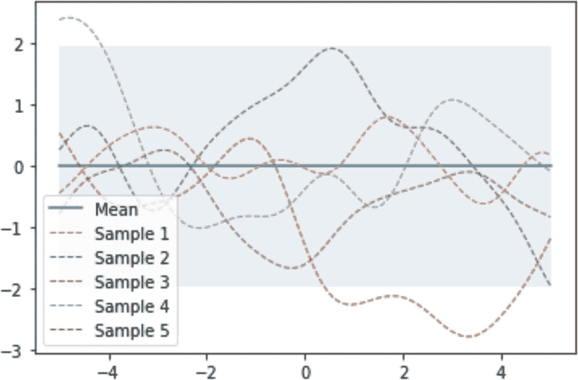

折线图展示了 6 条线穿过多个波峰和波谷的趋势。Y 轴上 0 点处的直线表示均值，其余 5 条线代表 5 个样本。样本 3 表示最低值。

图 2-11 来自 GP 先验的五个样本，以及均值函数和 95% 置信区间

```
>>> plot_gp(mu, K, X_test, samples=samples)
```

## 基于无噪声观测获取 GP 后验

在观测到一些输入位置和输出函数值对形式的样本后，我们可以将它们视为训练数据，用于更新 GP 先验，并获得由其均值函数和协方差函数指定的更新后后验。由于我们使用密集网格中包含的离散位置来近似连续域，因此 GP 的后验参数将通过均值向量和协方差矩阵来表示。

在下面的代码清单中，我们定义了一个函数，使用训练数据 `X_train` 和 `Y_train`、新的输入位置 `X_s`、核相关参数 `l` 和 `sigma_f`，以及加性高斯噪声的标准差 `sigma_y` 来计算后验 GP 的参数。首先计算现有输入 `X_train` 和新输入 `X_s` 之间联合多元高斯分布的协方差矩阵中的相应条目，并分别存储在 `K`、`K_s` 和 `K_ss` 中，然后将它们代入闭式公式，以获得新输入的**后验均值向量** `mu_s` 和**协方差矩阵** `cov_s`。

```markdown
## 处理含噪声观测

当观测值含有噪声时，观测输入的总方差将同时源于输入位置随机变量的不确定性以及噪声的方差。如前所述，噪声通常由测量误差或不精确的统计近似引起。我们可以照常估计观测输入处的无噪声协方差矩阵 `K`，并将噪声方差添加到对角线元素（自协方差）上，从而得到含噪声协方差矩阵 $${\textbf{K}}_y=\textbf{K}+{\upsigma}_y²\textbf{I}$$。请参阅以下代码清单进行说明。

```python
# 设置噪声的标准差
noise = 0.5
# 创建含噪声的训练数据
Y_train = np.cos(X_train) + noise * np.random.randn(*X_train.shape)
# 计算后验分布的均值和协方差
mu_s, cov_s = update_posterior(X_test, X_train, Y_train, sigma_y=noise)
# 生成五个样本
samples = np.random.multivariate_normal(mu_s.ravel(), cov_s, 5)
```

代码清单 2-9
获取含噪声观测的高斯过程后验

运行上述代码将生成图 2-13，由于 `K[y]` 中额外的噪声项，均值函数并未插值实际的训练观测值，且对应输入位置的方差也不为零。

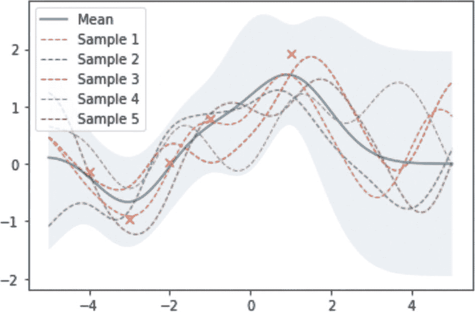

一幅折线图展示了 6 条线穿过多个波峰和波谷的趋势。实线表示均值，其余 5 条虚线代表 5 个样本。所有线条都更靠近均值线，并穿过多个波峰和波谷。

图 2-13

基于含噪声观测从高斯过程后验中抽取五个样本

在前面的示例中，我们将噪声项（假设与所关注的基础随机变量独立）的标准差设为 0.5。增大噪声方差将导致特定输入位置的实际观测值进一步偏离底层真实函数值，从而使整个域上的置信区间进一步膨胀。如图 2-14 所示，当设置 `noise=1` 时，由于信噪比较低，置信区间变得更宽。

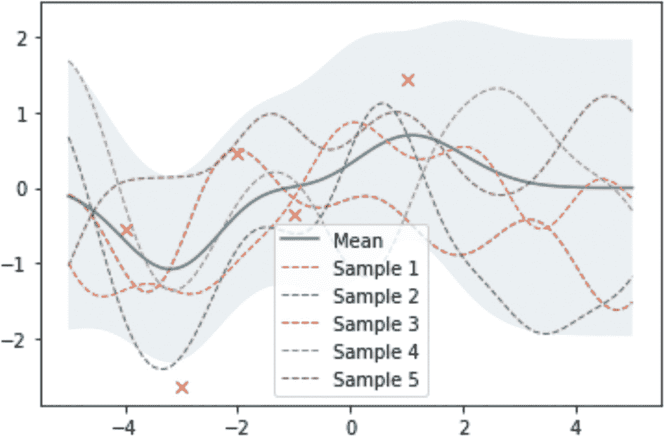

一幅折线图展示了 6 条线穿过多个波峰和波谷的趋势。实线表示均值，其余 5 条虚线代表 5 个样本。图中显示样本 2、3 和 4 与均值线的距离更大。

图 2-14

在较低信噪比下，整个输入域上的置信区间更宽

另外请注意，当噪声更强时，拟合的均值函数会变得更平滑。通过进行更粗略的近似，含噪声更多的训练数据有助于防止模型变得过于波动，从而避免过拟合。

## 尝试不同的核参数

此前，我们在所有观测位置采用了一个各向同性核，其中 `l` = 1 且 `σ_f` = 1。`l` 控制着高斯过程拟合的平滑度。较高的 `l` 会导致拟合更平滑、曲率更小，而较低的 `l` 则会产生更灵活、不确定性区间更宽的拟合。`σ_f` 控制着从高斯过程中抽取的函数样本的垂直变化。当我们远离观测位置时，较高的 `σ_f` 会导致整个域上的不确定性区域更宽。

在以下代码清单中，选择了 `l` 和 `σ_f` 的四种组合，以演示不同参数设置对拟合结果的影响。这些组合以元组列表的形式存储在 `params` 中，并在循环中迭代，以生成排列成两行的四个图形。

```python
params = [
    (0.1, 1.0),
    (2.0, 1.0),
    (1.0, 0.1),
    (1.0, 2.0)
]
plt.figure(figsize=(12, 5))
for i, (l, sigma_f) in enumerate(params):
    mu_s, cov_s = update_posterior(X_test, X_train, Y_train, l=l,
                                   sigma_f=sigma_f)
    plt.subplot(2, 2, i + 1)
    plt.subplots_adjust(top=2)
    plt.title(f'l = {l}, sigma_f = {sigma_f}')
    plot_gp(mu_s, cov_s, X_test, X_train=X_train, Y_train=Y_train)
```

代码清单 2-10
尝试不同的核参数

运行上述代码的输出如图 2-15 所示。在顶行中，从左到右的图中，在控制 `σ_f` 的同时增大 `l`，可以看到拟合结果波动更小，且不确定性区域更窄。在底行中，从左到右的图中，固定 `l` 并增大 `σ_f`，我们观察到不确定性区域明显变宽，尤其是在右端位置。

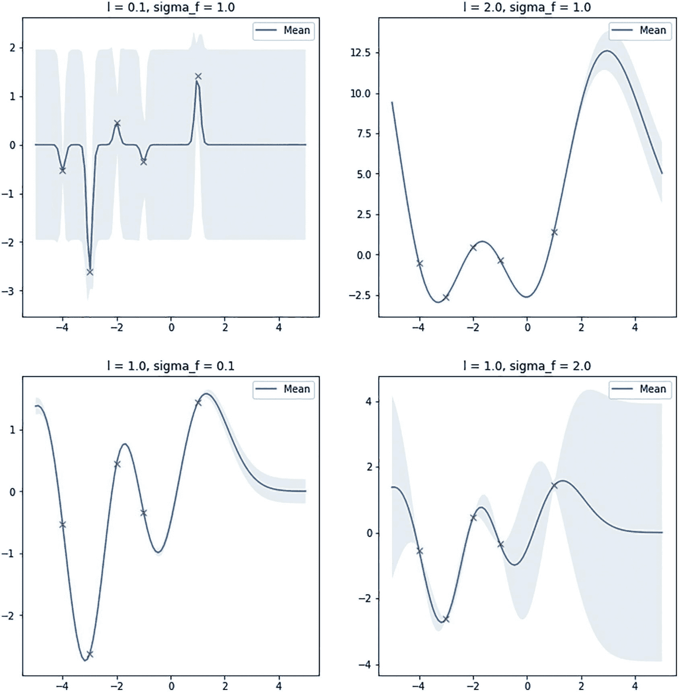

一组 4 幅折线图展示了线条穿过多个波峰和波谷的趋势。图中的线条表示均值。这些图显示了 l = 0.1 和 sigma f = 1.0 的值。

图 2-15

说明四种不同的核参数设置

## 超参数调优

核参数 `l` 和 `σ_f` 在拟合高斯过程之前是固定的，通常被称为超参数。在上一节中，我们展示了不同*手动*设置的超参数对拟合结果的影响。与其逐一测试多种不同的组合，更好的方法是在高斯过程框架下，根据观测数据的特征自动确定超参数的值。由于我们已经可以获取这些观测值的边缘似然，一种常见的方法是选择能够最大化这些边缘分布联合对数似然的那组超参数。

假设在位置 `x` 处共观测到 `n` 个含噪声的样本 `y`，它们服从均值为向量 `μ`、协方差矩阵为 `K[y]` 的联合高斯分布。我们使用 `θ` = {`l`, `σ_f`} 来表示所有超参数。边缘高斯分布的联合似然可以表示为：

现在，我们可以传入一些无噪声的训练数据点，应用该函数获取后验均值和协方差，并从 GP 后验中生成更新后的样本。

```python
# 无噪声训练数据
X_train = np.array([-4, -3, -2, -1, 1]).reshape(-1, 1)
Y_train = np.cos(X_train)
# 计算后验分布的均值和协方差
mu_s, cov_s = update_posterior(X_test, X_train, Y_train)
# 从多元正态分布生成五个样本
samples = np.random.multivariate_normal(mu_s.ravel(), cov_s, 5)
```

代码清单 2-8
从后验 GP 生成样本

我们可以再次调用相同的绘图函数，并将训练数据作为附加参数传入，以叉号形式绘制。

```python
>>> plot_gp(mu_s, cov_s, X_test, X_train=X_train, Y_train=Y_train, samples=samples)
```

运行上述代码将生成图 2-12。后验均值函数平滑地插值了观测输入，这些输入对应的随机变量方差也为零。如置信区间所示，在观测位置附近不确定性较小，并且随着我们远离观测输入，不确定性增加。同时，距离观测位置足够远的边际分布将基本保持不变，因为先验协方差函数本质上对远距离位置不编码相关性。

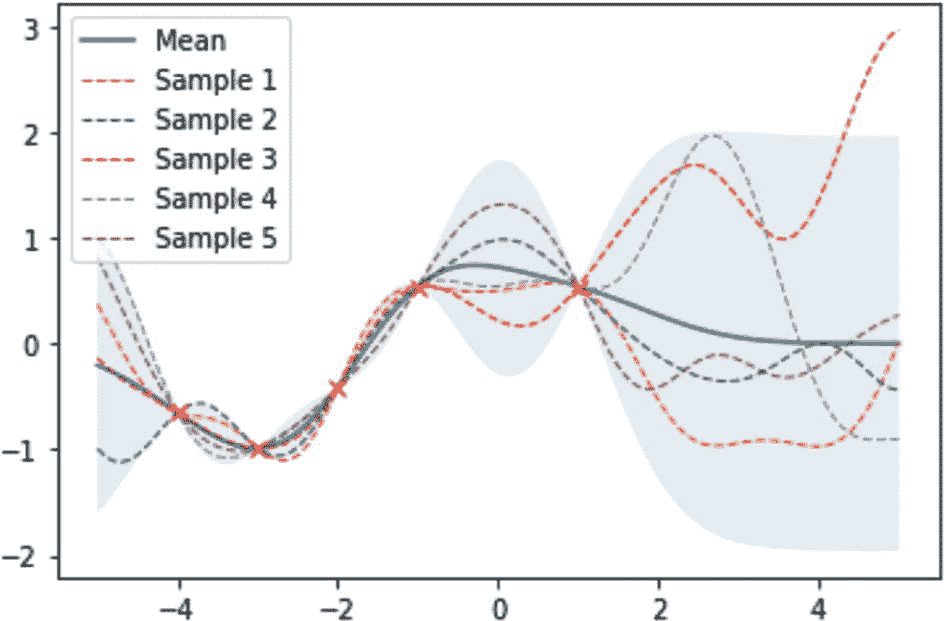

折线图展示了 6 条线穿过多个波峰和波谷的趋势。实线表示均值，其余 5 条虚线代表 5 个样本。样本 3 表示最低值。所有线最初都更接近均值线，而样本 3 和样本 4 在后期与均值线的距离更大。

图 2-12

基于无噪声观测从 GP 后验中抽取五个样本

```python
from numpy.linalg import inv
def update_posterior(X_s, X_train, Y_train, l=1.0, sigma_f=1.0, sigma_y=1e-8):
    """
    根据 m 个训练数据 X_train 和 Y_train 以及 n 个新输入 X_s，
    计算后验分布的均值向量和协方差矩阵。
    Args:
        X_s: 新的输入位置 (n x d)。
        X_train: 训练位置 (m x d)。
        Y_train: 训练目标 (m x 1)。
        l: 核长度参数。
        sigma_f: 核垂直变化参数。
        sigma_y: 观测噪声参数。
    Returns:
        后验均值向量 (n x d) 和协方差矩阵 (n x n)。
    """
    # 观测输入的协方差矩阵
    K = ise_kernel(X_train, X_train, l, sigma_f) + sigma_y**2 * np.eye(len(X_train))
    # 观测输入与新输入之间的交叉协方差
    K_s = ise_kernel(X_train, X_s, l, sigma_f)
    # 新输入的协方差矩阵
    K_ss = ise_kernel(X_s, X_s, l, sigma_f) + 1e-8 * np.eye(len(X_s))
    # 计算协方差矩阵的逆
    K_inv = inv(K)
    # 基于推导的闭式公式的后验均值向量
    mu_s = K_s.T.dot(K_inv).dot(Y_train)
    # 基于推导的闭式公式的后验协方差矩阵
    cov_s = K_ss - K_s.T.dot(K_inv).dot(K_s)
    return mu_s, cov_s
```

代码清单 2-7
计算新输入的 GP 后验均值向量和协方差矩阵
```

然后，我们可以通过最大化联合似然来获得最优超参数 `$\hat{\theta}$`：

`$p(\mathbf{y}|\mathbf{x},\theta)=N(\mathbf{y}|\boldsymbol{\mu}, {\mathbf{K}}_y)$`

`$\hat{\theta}={\textrm{argmax}}_{\theta}p(\mathbf{y}|\mathbf{x},\theta)$`

代入多元高斯分布的定义，得到下式：

`$p(\mathbf{y}|\mathbf{x},\theta)=\frac{1}{\sqrt{{\left(2\pi \right)}^n\mid {\mathbf{K}}_y\mid }}\exp \left(-\frac{1}{2}{\left(\mathbf{y}-\boldsymbol{\mu} \right)}^T{\mathbf{K}}_y^{-1}\left(\mathbf{y}-\boldsymbol{\mu} \right)\right)$`

其中 `$\mid \mathbf{K}_y \mid$` 表示 `$\mathbf{K}_y$` 的行列式。然后，我们可以对联合似然取对数以消除指数项，转而最大化对数似然：

`$\log p(\mathbf{y}|\mathbf{x},\theta)=-\frac{1}{2}{\left(\mathbf{y}-\boldsymbol{\mu} \right)}^T{\mathbf{K}}_y^{-1}\left(\mathbf{y}-\boldsymbol{\mu} \right)-\frac{n}{2}\log 2\pi -\frac{1}{2}\log \mid {\mathbf{K}}_y\mid$`

其中第一项衡量拟合优度，后两项则作为一种基于熵的惩罚项。我们可以通过假设 `$\boldsymbol{\mu} = 0$` 来进一步简化公式，得到：

`$\log p(\mathbf{y}|\mathbf{x},\theta)=-\frac{1}{2}{\mathbf{y}}^T{\mathbf{K}}_y^{-1}\mathbf{y}-\frac{n}{2}\log 2\pi -\frac{1}{2}\log \mid {\mathbf{K}}_y\mid$`

在实践中，最优超参数 `$\hat{\theta}$` 是通过最小化边缘分布的*负对数似然*（NLL）来找到的：

`$\hat{\theta}={\textrm{argmin}}_{\theta}-\log p(\mathbf{y}|\mathbf{x},\theta)$`

让我们看看如何实现这一点。在下面的代码清单中，我们定义了一个函数，该函数接收训练数据和噪声水平，并返回一个基于指定参数（`l` 和 `$\sigma_f$`）计算负对数边缘似然的函数。这是基于前面负对数似然定义的直接实现。

```python
from numpy.linalg import det
from scipy.optimize import minimize
# 直接实现，可能存在数值不稳定性
def nll_direct(X_train, Y_train, noise) :
    """
    返回一个函数，用于计算给定训练数据 X_train 和 Y_train
    以及噪声水平的负对数边缘似然。
    参数:
    X_train: 训练位置 (m x d)。
    Y_train: 训练目标值 (m x 1)。
    Noise: Y_train 的已知噪声水平。
    返回:
    最小化目标函数。
    """
    Y_train = Y_train.ravel()
    def nll(theta):
        K = ise_kernel(X_train, X_train, l=theta[0], sigma_f=theta[1]) + \
            noise**2 * np.eye(len(X_train))
        return 0.5 * Y_train.dot(inv(K).dot(Y_train)) + \
               0.5 * len(X_train) * np.log(2*np.pi) + \
               0.5 * np.log(det(K))
    return nll
```

**代码清单 2-11** 计算负对数边缘似然

我们可以调用 `numpy` 中的 `minimize` 函数，使用广泛使用的优化算法 `L-BFGS-B` 来执行最小化。优化过程从 `l` 和 `$\sigma_f$` 都等于 1 开始，并搜索最优参数。在实践中，通常会进行多轮不同起始点的搜索，以避免陷入相同的局部最小值。

```python
# 从 [1,1] 初始化，在 1e-5 到无穷大范围内搜索最优值
res = minimize(nll_direct(X_train, Y_train, noise), [1, 1],
               bounds=((1e-5, None), (1e-5, None)),
               method='L-BFGS-B')
l_opt, sigma_f_opt = res.x
# 使用优化后的核参数计算后验均值和协方差，并绘制结果
mu_s, cov_s = update_posterior(X_test, X_train, Y_train, l=l_opt,
                               sigma_f=sigma_f_opt, sigma_y=noise)
plot_gp(mu_s, cov_s, X_test, X_train=X_train, Y_train=Y_train)
```

**代码清单 2-12** 使用最优核参数的高斯过程后验

运行上述代码将生成图 2-16，其中训练数据点被合理地覆盖在 95% 的不确定性区域内。高斯过程后验的均值函数也呈现出良好的近似效果。

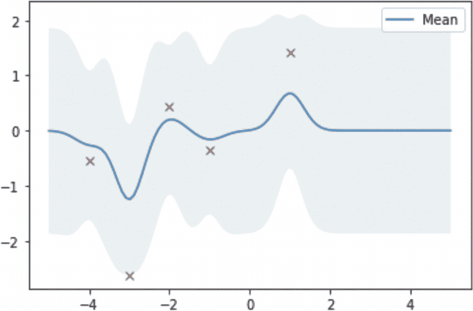

一幅折线图，展示了一条表示均值变化的线条趋势，该线条经过多个波峰和波谷。y 轴范围从负 2 到正 2，x 轴范围从负 4 到正 4。线条从 y 轴上的 0 点开始。

**图 2-16** 使用优化后核参数的高斯过程后验

请注意，随着问题规模的扩大，直接基于给定公式计算负对数边缘似然可能在数值上不稳定且计算成本高昂。特别是，计算 `${\mathbf{K}}_y^{-1}$` 涉及矩阵求逆，当矩阵增大时，计算开销会变得很大。在实践中，一个巧妙的技巧是将矩阵求逆转换为另一种更易于计算的操作，从而间接获得相同的结果。

为了更全面地看待问题，我们首先来看对数概率 `$\log p(\mathbf{y}|\mathbf{x},\theta)$` 中的第一项 `$-\frac{1}{2}{\mathbf{y}}^T{\mathbf{K}}_y^{-1}\mathbf{y}$`。使用 `inv(K)` 计算 `${\mathbf{K}}_y^{-1}$` 可能会导致数值不稳定，正如之前的代码所示。为了避免直接计算，我们可以将 `${\mathbf{K}}_y^{-1}\mathbf{y}$` 的计算视为一个整体，并利用 Cholesky 分解技巧来求解方程组，从而避免直接矩阵求逆。具体来说，我们注意到 `${\mathbf{K}}_y^{-1}\mathbf{y}={\mathbf{L}}^{-T}{\mathbf{L}}^{-1}\mathbf{y}$`，这里我们使用了 Cholesky 分解将 `$\mathbf{K}_y$` 转换为三角因子矩阵 `$\mathbf{L}$` 与其转置 `$\mathbf{L}^{T}$` 的乘积，即 `$\mathbf{K}_y = \mathbf{LL}^{T}$`。在执行数学运算时，三角矩阵的内存效率要高得多，并且只需要计算和存储一个三角矩阵。

假设 `Lm = y`，那么我们可以使用 `scipy` 包中的 `solve_triangular` 函数轻松求解 `m` = `L`^(−1)`y`。类似地，假设 `L`^(`T`)`α = m`，我们可以使用相同的函数求解 `α` = `L`^(−`T`)`m` = `L`^(−`T`)`L`^(−1)`y`。因此，我们可以通过基于 Cholesky 分解的结果求解两个方程组来计算 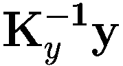。

此外，我们还可以利用以下事实进一步加速计算：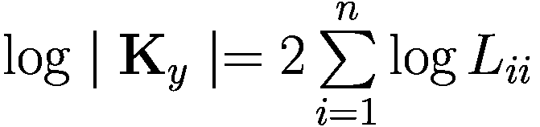，其中 `L`[`ii`] 是因子矩阵 `L` 的第 `i`th 个对角线元素。上述重构在以下代码清单中实现。

### 代码清单 2-13
计算 NLL 时数值更稳定且速度更快的实现

```python
from numpy.linalg import cholesky
from scipy.linalg import solve_triangular

# 间接实现，数值稳定性更高
def nll_stable(X_train, Y_train, noise):
    Y_train = Y_train.ravel()
    def nll(theta):
        K = ise_kernel(X_train, X_train, l=theta[0], sigma_f=theta[1]) + \
            noise**2 * np.eye(len(X_train))
        L = cholesky(K)
        # 求解第一个方程组
        m = solve_triangular(L, Y_train, lower=True)
        # 求解第二个方程组
        alpha = solve_triangular(L.T, m, lower=False)
        return 0.5 * Y_train.dot(alpha) + \
               0.5 * len(X_train) * np.log(2*np.pi) + \
               np.sum(np.log(np.diagonal(L)))
    return nll
```

运行上述代码将生成与之前相同的图，但当问题规模变大时，差异就会显现出来。要查看完整的实现列表，请参考随附的笔记本，网址为 [`github.com/jackliu333/bayesian_optimization_theory_and_practice_with_python/blob/main/Chapter_2.ipynb`](https://github.com/jackliu333/bayesian_optimization_theory_and_practice_with_python/blob/main/Chapter_2.ipynb)。

## 总结

高斯过程是许多建模问题中的重要工具。在本章中，我们涵盖了以下内容：

*   高斯过程由均值函数和协方差函数刻画。它将有限多元高斯分布的情况扩展到无限情况。
*   核/协方差函数控制拟合曲线的形状，例如平滑度，它作为一种归纳偏置被引入。
*   从任意（独立）多元高斯分布中采样，可以通过从正态分布中采样，然后进行尺度-位置变换来实现。
*   高斯过程回归将观测到的随机变量视为联合多元高斯分布，并利用多元高斯定理为新输入位置提供封闭形式的预测边际分布。
*   带有加性正态分布噪声的含噪观测可以无缝地融入高斯过程框架中。
*   实现高斯过程学习过程，首先计算高斯过程先验的参数，然后使用观测样本更新这些参数以获得高斯过程后验，其中高斯过程后验的均值函数会对无噪声观测进行插值。
*   可以使用最大似然估计过程来优化核参数，通过使用 Cholesky 分解可以使实现过程在数值上更稳定、速度更快。

在下一章中，我们将研究期望提升（EI），这是贝叶斯优化中使用最广泛的采集函数。