# 3. 贝叶斯决策理论与期望提升

前一章使用高斯过程（`GP`）作为代理模型来逼近底层目标函数。`GP` 是一个灵活的框架，它以整个域上合理函数的概率分布形式提供不确定性估计。然后，我们可以利用在提议位置处的封闭形式后验预测分布，来获得对潜在观测值的合理估计。

然而，它并非贝叶斯优化中代理模型的唯一选择。尽管默认和主流选择仍然是 `GP`，但近年来，许多其他模型（如随机森林）的使用也日益增多。尽管如此，规范的贝叶斯优化框架允许使用任何代理模型，只要它能提供函数的后验估计，然后采集函数会利用该估计来生成采样提议。

采集函数则有更多的选择，并且是一个日益拥挤的研究领域。标准的采集函数，如期望提升和上置信界，已在许多应用中得到广泛使用，而结合了领域知识（如安全约束）的特定问题采集函数也在不断被提出。采集函数在贝叶斯优化框架中扮演着更重要的角色，因为它直接决定了后续数据采集的采样决策。因此，一个好的采集函数能使优化器尽可能快地定位到（全局）最优值，这里的最优值是从持有最优值的位置或整个域上的最优值角度来衡量的。

本章将深入探讨使用期望提升的贝叶斯优化流程，期望提升是用于采样决策的最广泛使用的采集函数。我们首先将贝叶斯优化描述为一个在不确定性下的序贯决策过程，然后详细介绍期望提升。智能地选择涉及不确定性估计的下一个采样位置，是实现样本高效的全局优化的关键。最后，我们将通过一个案例研究，展示如何使用期望提升来指导超参数调优。

## 通过序贯决策进行优化

贝叶斯优化框架会序贯地确定下一个采样位置，以搜索全局最优解（在最大化设定中通常假设为最大值）。基于特定策略，优化器会收集观测数据点，更新关于底层函数概率分布的后验信念，提出下一个待探测的采样点，最终在提议位置收集额外数据点并重复此过程。这便完成了迭代序贯过程中的一次循环。我们对底层函数的认知会随着每次在现有观测集合指导下纳入新数据点而不断演进和更新。

在过程结束时，策略将返回最优值的位置或最优值本身，尽管我们通常更关心最优位置。这通常被称为贝叶斯优化框架中的`外循环`。此外，最大化采集函数以生成下一个采样位置构成了贝叶斯优化的`内循环`。采集函数作为内循环中的辅助计算，用于支持后续的采样决策。由于采集函数评估成本低且具有解析可微性，优化该函数通常被认为是快速且廉价的。我们可以获得某些采集函数的闭式表达式，并通过使用现成的优化程序访问其梯度。对于没有闭式表达式的更复杂采集函数，我们也可以借助蒙特卡洛估计等近似方法。

此外，策略还需要考虑*何时*终止探测过程，尤其是在探测预算有限的情况下。终止时，优化器将返回最优函数值或位置，该值或位置可能存在于观测位置中，也可能不存在，而可能位于域内的任何位置。因此，优化器需要在停止查询与执行额外采样之间进行权衡，后者会产生额外成本。因此，优化器的动作空间不仅包含采样位置，还包含一个关于终止的二元决策。

图 3-1 描述了支撑贝叶斯优化的序贯决策过程。策略会在每次外循环迭代中提议下一个采样位置，或终止循环。假设它决定提议一个额外的采样动作。在这种情况下，我们将进入内循环，以寻找具有预设采集函数最高值的最有前景位置。然后，我们将探测该最有利位置，并将额外观测值追加到数据集中，随后通过高斯过程利用该数据集更新关于底层目标函数的后验信念。另一方面，如果策略认为额外查询不值得付出相应成本来改进我们对全局最优解的信念，它将决定终止外循环，并返回当前对全局最优解或其位置的最佳估计。这也构成了策略的*停止规则*，该规则可在耗尽有限预算时触发，或基于当前进展采用自适应机制触发。

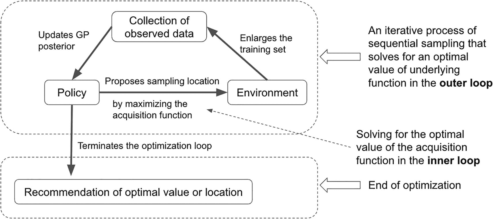

一个框图展示了从观测数据集合开始，经过策略和环境，再循环回数据集合以扩充训练集的序列过程。策略发送最优值的推荐，该推荐被标记为优化的终点。

图 3-1

贝叶斯优化中的序贯决策过程。外循环通过在整个域内进行序贯采样来执行优化，以搜索全局最优解。每次迭代都基于内循环的输出，而内循环则涉及另一个独立的优化过程

量化对全局最优解信念的改进，体现在观测数据`效用`的`期望边际增益`上，这是贝叶斯优化中所用贝叶斯决策理论的核心概念。我们将在后续章节中讨论这一主题。

### 寻求最优策略

贝叶斯优化的最终目标是开发一种智能策略，能够以原则性的方式在不确定性下执行序贯决策。当根据所收集数据的质量来衡量策略时，贝叶斯优化会寻求`最优策略`，以最大化所收集数据的期望质量。换句话说，最优策略平均而言能提供信息量最大的数据集，以协助定位全局最优解的任务，同时考虑对底层目标函数的后验信念。

在这方面，采集函数用于衡量在考虑整个域内下一个采样决策时的数据质量。采集函数将每个候选位置映射为一个数值分数，这本质上编码了对不同候选位置的偏好。它充当了连接更新后验信念与寻求最优策略之间的中间计算环节。具体来说，基于最新后验信念的最优决策是通过选择使用指定采集函数计算出的分数最高的位置来做出的，这完成了一轮内部优化。

数学上，对于域 `A` 中的每个候选位置 `x`，自定义的采集函数 `α(x)` 将每个 `x` 映射为一个标量值，即 `α: A → ℝ`。这里，我们假设 `x` 是单维度的，这无损一般性且为了方便符号表示，尽管它可以具有多个特征，即 `x ∈ ℝ^d`。此外，采集函数是一个不断演变的评分函数，它也依赖于当前收集到的包含 `n` 个观测值的数据集 `$${\mathcal{D}}_n$$`，因此写作 `$$\alpha(x;{\mathcal{D}}_n)$$` 以表明这种依赖关系。

因此，对于 `A` 内的任意两个位置 `x_1` 和 `x_2`，如果 `$$\alpha(x_1;{\mathcal{D}}_n) > \alpha(x_2;{\mathcal{D}}_n)$$`，我们会偏好 `x_1` 胜过 `x_2`，反之亦然。在连续搜索域中存在无限多个候选位置的情况下，最优策略会贪婪地选择具有最高采集值的单个位置 `$$x_{n+1}^{\ast }$$` 作为下一个采样动作。我们使用上标 ∗ 表示最优动作，下标 `n + 1` 表示在现有 `n` 个观测值基础上增加的第一个未来采样位置。因此，加一意味着向未来的前瞻步长或时间步。符号 `x_{n+1}` 表示所有可能的候选位置，包括已观测到的位置，并被视为一个随机变量。最优决策定义如下：

```
x_{n+1}^{\ast } = {\textrm{argmax}}_{x_{n+1}\in A} \alpha(x_{n+1};{\mathcal{D}}_n)
```

常见的采集函数，如期望提升（将在后面介绍），由于具有闭式解析表达式及其对应的梯度，因此支持快速的基于梯度的优化。这意味着我们将原本对困难且未知的目标函数进行全局优化的任务，转化为一系列对已知采集函数的快速优化。然而，正如我们稍后将了解到的，某些采集函数，特别是那些具有多步前瞻特性的函数，可能无法解析求导，这使得内部优化成为一个非平凡的问题。在这种情况下，通常使用蒙特卡洛近似来近似计算。

我们现在可以呈现贝叶斯优化高层次上的数学细节，暂时忽略关于终止的决策。如图 3-2 所示，整个贝叶斯优化（外）循环包含三个主要步骤：基于当前数据集 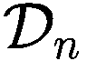 提出下一个采样位置 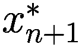 作为采集函数 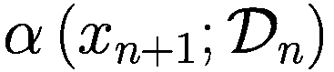 的最大化位置；探测所提出的位置并将额外的观测值追加到当前数据集  中；最后，假设一个高斯过程代理模型 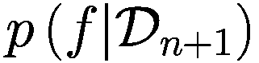 来更新后验信念。这里，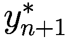 表示在最优下一个采样位置  处的观测值。因此，选择合适的采集函数对于确定序贯优化过程的质量起着至关重要的作用。

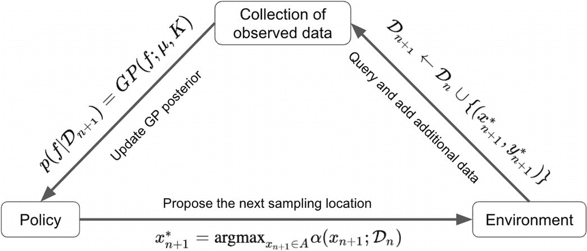

一个三角形图表示一组过程，从收集观测数据开始，通过策略更新高斯过程后验，向环境提出下一个采样位置，并通过查询和添加额外数据循环回到数据收集。每个阶段都标有一个方程。

**图 3-2**

通过迭代最大化当前采集函数、探测额外数据并更新后验信念来说明整个贝叶斯优化循环

尽管贝叶斯优化循环可以从空数据集开始，但实际训练通常依赖于一个由少量均匀采样观测值组成的小型数据集。这加速了优化过程，因为它起到了热启动的作用，并且比均匀先验提供了更具信息量的先验信念。当初始数据集对域中不同位置具有良好的覆盖时，这种效果更为明显。

### 效用驱动优化

贝叶斯优化的最终目标是收集一组有价值的观测数据，这些数据能提供关于全局最优解的最丰富信息。数据集的价值通过*效用*来量化，这一概念最初用于贝叶斯决策理论，此处借助采集函数辅助贝叶斯优化中的序贯优化过程。在评估候选位置的价值时，采集函数建立在当前数据集效用的基础之上。

由于我们的目标是定位全局最大值，效用函数的一个自然选择是当前数据集的最大值，即假设无噪声观测的情况下，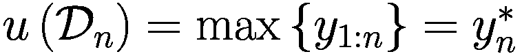。这也被称为当前数据集的`当前最优值`，并作为评估所有未来候选观测的基准。作为实际应用中最广泛使用的采集函数，期望改进函数利用这个当前最优值来奖励那些推测观测值可能更高的候选位置。

在评估候选位置`x[n+1]`时，我们需要一个虚构的观测值`y`，以便能够计算*如果*我们在此位置获取额外观测值时的效用。考虑到目标函数的随机性，我们最好的估计是`y[n+1]`将遵循根据更新后的高斯过程后验得到的后验正态分布。由于`y[n+1]`是一个随机变量，标准方法是通过计算特定位置的*期望效用*来积分消除其随机性，即给定特定评估位置`x[n+1]`和当前观测集  的条件下，计算 ![$$ {\mathbbm{E}}_{y_{n+1}}\left[u\left({x}_{n+1},{y}_{n+1},{\mathcal{D}}_n\right)|{x}_{n+1},{\mathcal{D}}_n\right] $$](images/527334_1_En_3_Chapter/527334_1_En_3_Chapter_TeX_IEq13.png)。这也对应于假设我们有一个额外的未知观测值 `(x[n+1], y[n+1])` 时的期望效用，从而得到 ![$$ {\mathbbm{E}}_{y_{n+1}}\left[u\left({\mathcal{D}}_{n+1}\right)|{x}_{n+1},{\mathcal{D}}_n\right]={\mathbbm{E}}_{y_{n+1}}\left[u\left({\mathcal{D}}_n\cup \left({x}_{n+1},{y}_{n+1}\right)\right)|{x}_{n+1},{\mathcal{D}}_n\right]={\mathbbm{E}}_{y_{n+1}}\left[u\left({x}_{n+1},{y}_{n+1},{\mathcal{D}}_n\right)|{x}_{n+1},{\mathcal{D}}_n\right] $$](images/527334_1_En_3_Chapter/527334_1_En_3_Chapter_TeX_IEq15.png)。然后我们可以利用后验预测分布 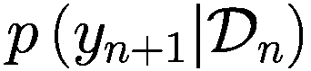，在连续情况下将期望效用表示为如下积分运算：

![$$ {\mathbbm{E}}_{y_{n+1}}\left[u\left({x}_{n+1},{y}_{n+1},{\mathcal{D}}_n\right)|{x}_{n+1},{\mathcal{D}}_n\right]=\int u\left({x}_{n+1},{y}_{n+1},{\mathcal{D}}_n\right)p\left({y}_{n+1}|{x}_{n+1},{\mathcal{D}}_n\right)d{y}_{n+1} $$](images/527334_1_En_3_Chapter/527334_1_En_3_Chapter_TeX_Equb.png)

该表达式考虑了位置`x[n+1]`处`y[n+1]`的所有可能值。它根据发生的概率对相应的效用进行加权。通过获取每个候选位置的期望效用，可以通过选择期望效用最大的位置来确定下一个采样位置：

![$$ {x}_{n+1}^{\ast }={\textrm{argmax}}_{x_{n+1}\in A}{\mathbbm{E}}_{y_{n+1}}\left[u\left({x}_{n+1},{y}_{n+1},{\mathcal{D}}_n\right)|{x}_{n+1},{\mathcal{D}}_n\right] $$](images/527334_1_En_3_Chapter/527334_1_En_3_Chapter_TeX_Equc.png)

因此，在通过最大化期望效用确定下一个最优位置时，我们需要一个设计得当的效用函数。等价地，策略采取的每个动作都是为了最大化期望效用的改进。此过程持续进行，直到触发停止规则，此时使用 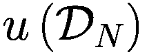 来评估最终返回数据集  的质量。

由于我们关注的是最优的单步前瞻动作，上述问题可以表述为最大化效用的*期望边际增益*，该增益作为采集函数来指导搜索。因此，使用期望边际增益的单步前瞻策略定义如下：

![$$ {\alpha}_1\left({x}_{n+1};{\mathcal{D}}_n\right)={\mathbbm{E}}_{y_{n+1}}\left[u\left({\mathcal{D}}_{n+1}\right)|{x}_{n+1},{\mathcal{D}}_n\right]-\mathbbm{E}\left[u\left({\mathcal{D}}_n\right)\right] $$](images/527334_1_En_3_Chapter/527334_1_En_3_Chapter_TeX_Equd.png)

![$$ ={\mathbbm{E}}_{y_{n+1}}\left[u\left({x}_{n+1},{y}_{n+1},{\mathcal{D}}_n\right)|{x}_{n+1},{\mathcal{D}}_n\right]-u\left({\mathcal{D}}_n\right) $$](images/527334_1_En_3_Chapter/527334_1_En_3_Chapter_TeX_Eque.png)

其中 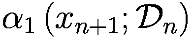 中的下标 1 表示向未来前瞻的步数。第二步成立是因为现有观测值的效用  不存在随机性。

使用单步前瞻策略的最优动作随后被定义为期望边际增益的最大化者：

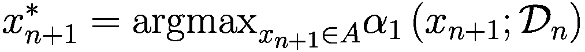

图 3-3 说明了这一过程。我们以已收集观测值的效用 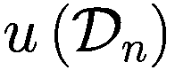 作为基准，用于比较评估新候选位置处的期望边际增益。该评估需要基于更新后的高斯过程后验考虑下一次观测的所有可能值，从而得到期望效用项 ![$$ {\mathbbm{E}}_{y_{n+1}}\left[u\left({x}_{n+1},{y}_{n+1},{\mathcal{D}}_n\right)|{x}_{n+1},{\mathcal{D}}_n\right] $$](images/527334_1_En_3_Chapter/527334_1_En_3_Chapter_TeX_IEq22.png)。由于我们考虑的是未来的一步，采集函数  就变成了单步前瞻策略，我们的目标是选择能够最大化已收集数据集效用期望边际增益的位置。

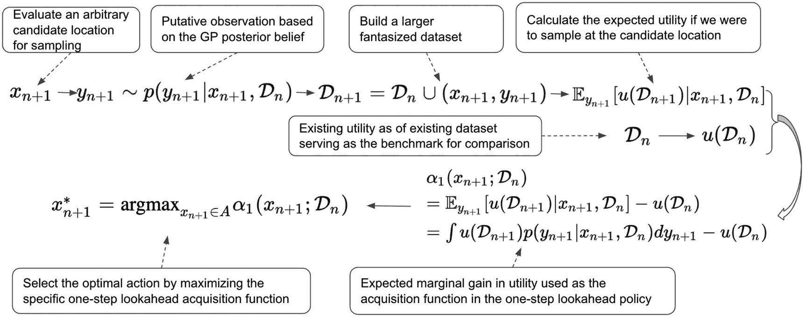

一组方程指示了其周围的以下步骤：评估任意候选采样位置；基于高斯过程后验信念的推测观测值；构建一个更大的虚构数据集；计算如果我们在候选位置采样时的期望效用；现有效用和现有数据集；效用的期望边际增益；通过最大化特定的单步前瞻采集函数来选择最优动作。

图 3-3

通过最大化已获取观测值效用的期望边际增益来推导单步前瞻策略

### 多步前瞻策略

采用单步前瞻策略的序贯决策过程是一种强大且应用广泛的技术。通过模拟如果我们收集另一个观测值可能产生的未来路径，该策略因最大化扩增人工数据集中效用的单步期望边际增益而成为贝叶斯最优策略。然而，优化过程将持续进行，直到搜索预算耗尽时达到终止点。后续采样位置的选择，即 ，因此会影响所有剩余的优化决策。也就是说，我们需要考虑直到停止规则触发为止的所有未来采样步骤，而不仅仅是未来的一步。

为了更清晰地阐述，我们假设前瞻范围，即未来需要考虑的步数，为 `τ`。换句话说，我们考虑一个假设的数据集 ，该数据集在现有数据集  的基础上增加了 `τ` 个人工观测值。每个观测值都涉及选择一个候选搜索位置 `x` 并获取相应的观测值 `y`，该观测值被建模为一个随机变量，其后验分布基于先前的观测值（包括现有的和假设的）进行更新。通过将每次添加的位置和观测值表示为一个对 (`x`, `y`)，`τ` 步前瞻数据集 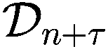 可以写为：


遵循与之前相同的机制，多步前瞻策略将通过最大化期望的长期终端效用 ![$$ \mathbbm{E}\left[u\left({\mathcal{D}}_{n+\tau}\right)\right] $$](images/527334_1_En_3_Chapter/527334_1_En_3_Chapter_TeX_IEq29.png) 来对  做出最优采样决策：

![$$ {x}_{n+1}^{\ast }={\textrm{argmax}}_{x\in A}\mathbbm{E}\left[u\left({\mathcal{D}}_{n+\tau}\right)|{x}_{n+1},{\mathcal{D}}_n\right] $$](images/527334_1_En_3_Chapter/527334_1_En_3_Chapter_TeX_Equh.png)

其中，期望是针对未来位置和观测值的随机性而取的。等价地，我们可以依赖于如下定义的终端期望边际增益：

![$$ {\alpha}_{\tau}\left({x}_{n+1};{\mathcal{D}}_n\right)=\mathbbm{E}\left[u\left({\mathcal{D}}_{n+\tau}\right)|{x}_{n+1},{\mathcal{D}}_n\right]-u\left({\mathcal{D}}_n\right) $$](images/527334_1_En_3_Chapter/527334_1_En_3_Chapter_TeX_Equi.png)

该函数作为多步前瞻采集函数，用于支持最优序贯优化：

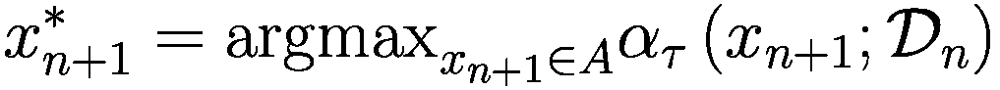

与单独最大化期望终端效用 ![$$ \mathbbm{E}\left[u\left({\mathcal{D}}_{n+\tau}\right)|x,{\mathcal{D}}_n\right] $$](images/527334_1_En_3_Chapter/527334_1_En_3_Chapter_TeX_IEq31.png) 相比，该定义仅向下平移了一个常数值 。

现在，如果我们展开 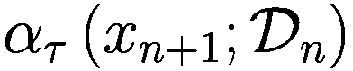 定义中的期望，我们需要考虑未来 `τ` 步中关于位置 {*x*[*n* + *i*], *i* = 2, …, *τ*} 的所有可能演化决策，以及随机变量 {*y*[*n* + *i*], *i* = 1, …, *τ*} 的相关实现。这里，关于位置 {*x*[*n* + *i*], *i* = 2, …, *τ*} 的决策从 *i* = 2 开始，是因为我们正在评估位置 *x*[*n* + 1]。我们可以将终端期望边际增益的展开形式写为：


其中，我们明确地将 `y[n+1]` 的后验概率分布写为 `$$ p\left({y}_{n+1}|{x}_{n+1},{\mathcal{D}}_n\right) $$`，并将 `{(x[n+i], y[n+i]), i = 2, …, τ}` 的后续联合概率分布写为 `$$ {\prod}_{i=2}^{\tau }p\left({x}_{n+i},{y}_{n+i}|{\mathcal{D}}_{n+i-1}\right) $$`。对这些随机变量进行积分，将得到返回数据集的期望效用中最终的多步前瞻边际增益。

图 3-4 总结了推导多步前瞻采集函数的过程。请注意，`{(x[n+i], y[n+i]), i = 2, …, τ}` 中下一轮候选位置和观测值的模拟，依赖于所有先前累积的数据集 `$$ {\mathcal{D}}_{n+i-1} $$`，该数据集用于基于观测值和假设值构建更新的后验信念。

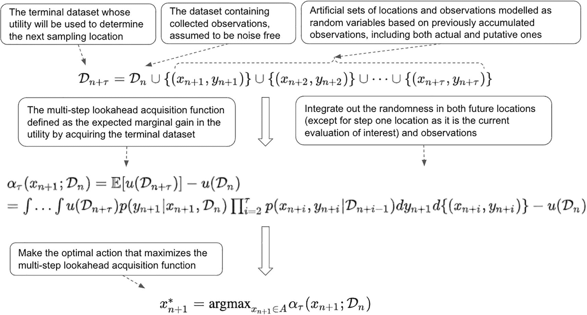

一个方程表示多个步骤，从终端数据集开始，经过假设收集到的数据集是无噪声的、被建模为随机变量的人工位置和观测值集合、多步前瞻采集函数，以及对未来位置和观测值的随机性进行积分，最终做出最优行动以最大化多步前瞻采集函数。

图 3-4
多步前瞻最优策略，通过最大化终端数据集的边际期望效用来选择最佳采样位置

通过梳理嵌套的期望和最大化操作序列，我们可以更深入地了解计算该表达式的过程。如图 3-5 所示，我们从最大化算子中的下一个采样位置 `x[n+1]` 开始，然后是期望算子中的 `y[n+1]`。相同的模式在后续阶段继续，在 `x[n+2]` 处有一个最大化算子，在 `y[n+2]` 处有一个期望算子，依此类推，直到最后阶段到达假设的观测值 `y[n+τ]`。每个算子，无论是最大化还是期望，都涉及多个分支。常见的策略是通过标准程序（如 L-BFGS）求解最大化操作，并通过高斯求积法近似期望操作。

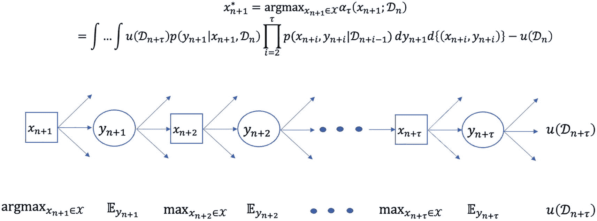

一个方程表示变量 x 的上标星号、下标 n+1 的值，该值等于多个变量的积分。底部的图表在方框中表示 x 下标 n+1、x 下标 n+2，直至 x 下标 n+τ，并在圆形中表示 y 下标 n+1、y 下标 n+2，直至 y 下标 n+τ。该值返回 u，括号内为 D 下标 n+τ。

图 3-5
可视化嵌套的最大化与期望算子

显然，计算一个考虑所有可能未来路径的嵌套期望形式在计算上具有挑战性。此外，由于我们的目标是通过最大化采集函数来选择最优采样动作，我们将添加一个合理的假设：在给定当前数据集的情况下，所有未来的动作也将是最优的，该数据集可能包含目标值上随机变量的假定实现。添加最优性条件意味着，我们不再考虑 `{(x[n+i], y[n+i]), i = 1, …, τ}` 的所有可能未来路径，而只关注最优路径 `$$ \left\{\left({x}_{n+i}^{\ast },{y}_{n+i}\right),i=1,\dots, \tau \right\} $$`，这实质上通过选择最大化位置来消除对候选位置的依赖。通过最大化长期期望效用增益来选择最优动作的论点遵循贝尔曼最优性原理，如下一节所述。

### 贝尔曼最优性原理

贝尔曼最优性原理指出，一系列最优决策始于做出第一个最优决策，随后是一系列基于先前结果的最优决策。这是一个递归表达式，为了在当前时间点做出最优动作，我们需要在未来也做出最优动作。

让我们从之前的多步前瞻采集函数开始构建。回顾一下，在候选位置 `x[n+1]` 处的 `τ` 步期望边际效用增益定义为

`$$ {\alpha}_{\tau}\left({x}_{n+1};{\mathcal{D}}_n\right)=\mathbbm{E}\left[u\left({\mathcal{D}}_{n+\tau}\right)|{x}_{n+1},{\mathcal{D}}_n\right]-u\left({\mathcal{D}}_n\right) $$`

这是我们寻求最大化的目标。为了明确地将一步前瞻采集函数与未来剩余的 `τ − 1` 步模拟联系起来，我们可以通过在期望中加减这一项来引入一步效用 `$$ u\left({\mathcal{D}}_{n+1}\right) $$`，如下所示：

`$$ {\alpha}_{\tau}\left({x}_{n+1};{\mathcal{D}}_n\right)=\mathbbm{E}\left[u\left({\mathcal{D}}_{n+\tau}\right)|{x}_{n+1},{\mathcal{D}}_n\right]-u\left({\mathcal{D}}_n\right)=\mathbbm{E}\left[u\left({\mathcal{D}}_{n+\tau}\right)-u\left({\mathcal{D}}_{n+1}\right)+u\left({\mathcal{D}}_{n+1}\right)|{x}_{n+1},{\mathcal{D}}_n\right]-u\left({\mathcal{D}}_n\right)=\left(\mathbbm{E}\left[u\left({\mathcal{D}}_{n+1}\right)|{x}_{n+1},{\mathcal{D}}_n\right]-u\left({\mathcal{D}}_n\right)\right)+\mathbbm{E}\left[u\left({\mathcal{D}}_{n+\tau}\right)-u\left({\mathcal{D}}_{n+1}\right)|{x}_{n+1},{\mathcal{D}}_n\right]={\alpha}_1\left({x}_{n+1};{\mathcal{D}}_n\right)+\mathbbm{E}\left[{\alpha}_{\tau -1}\left({x}_{n+2};{\mathcal{D}}_{n+1}\right)|{x}_{n+1},{\mathcal{D}}_n\right] $$`

在这里，我们将长期期望边际效用增益分解为即时的一步前瞻效用增益与剩余 `τ − 1` 步的期望前瞻增益之和。

现在，根据贝尔曼最优性原理，所有剩余的 `τ − 1` 个动作都将被最优地执行。这意味着在计算 `$$ {\alpha}_{\tau -1}\left({x}_{n+2};{\mathcal{D}}_{n+1}\right) $$` 时，我们不再评估 `x[n+2]` 的每个候选位置，而只关注具有最大值的那个位置，即 `$$ {\alpha}_{\tau -1}\left({x}_{n+2}^{\ast };{\mathcal{D}}_{n+1}\right) $$`，或者等价地 `$$ {\alpha}_{\tau -1}^{\ast}\left({\mathcal{D}}_{n+1}\right) $$`，从而消除对位置 `x[n+2]` 的依赖。因此，在最优性假设下的多步前瞻采集函数变为

### 多步前瞻采集函数

![$$ {\alpha}_{\tau}\left({x}_{n+1};{\mathcal{D}}_n\right)={\alpha}_1\left({x}_{n+1};{\mathcal{D}}_n\right)+\mathbbm{E}\left[{\alpha}_{\tau -1}^{\ast}\left({\mathcal{D}}_{n+1}\right)|{x}_{n+1},{\mathcal{D}}_n\right] $$](images/527334_1_En_3_Chapter/527334_1_En_3_Chapter_TeX_Equn.png)

如前一节所示，使用多步前瞻采集函数的最优下一个采样位置`{\alpha}_{\tau}^{\ast}\left({x}_{n+1};{\mathcal{D}}_n\right)`因此通过最大化`{\alpha}_{\tau}\left({x}_{n+1};{\mathcal{D}}_n\right)`来确定。因此，最优多步前瞻采集函数`{\alpha}_{\tau}^{\ast}\left({x}_{n+1};{\mathcal{D}}_n\right)`定义为

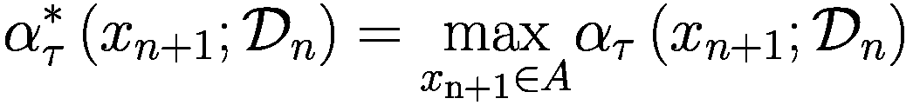

代入`{\alpha}_{\tau}\left({x}_{n+1};{\mathcal{D}}_n\right)`的定义可得

![$$ {\alpha}_{\tau}^{\ast}\left({x}_{n+1};{\mathcal{D}}_n\right)=\underset{x_{n+1}\in A}{\max}\left\{{\alpha}_1\left({x}_{n+1};{\mathcal{D}}_n\right)+\mathbbm{E}\left[{\alpha}_{\tau -1}^{\ast}\left({\mathcal{D}}_{n+1}\right)|{x}_{n+1},{\mathcal{D}}_n\right]\right\}=\underset{x_{n+1}\in A}{\max}\left\{{\alpha}_1\left({x}_{n+1};{\mathcal{D}}_n\right)+\mathbbm{E}\left[\underset{x_{n+2}\in A}{\max }{\alpha}_{\tau -1}\left({x}_{n+2};{\mathcal{D}}_{n+1}\right)|{x}_{n+1},{\mathcal{D}}_n\right]\right\} $$](images/527334_1_En_3_Chapter/527334_1_En_3_Chapter_TeX_Equp.png)

其中，我们也代入了`{\alpha}_{\tau -1}^{\ast}\left({\mathcal{D}}_{n+1}\right)`的定义，以将最优策略值`{\alpha}_{\tau}^{\ast}\left({x}_{n+1};{\mathcal{D}}_n\right)`明确表示为一连串嵌套的最大化和期望运算。这种递归定义被称为*贝尔曼方程*，它明确反映了做出最优行动的前提是所有后续行动也必须最优。

图 3-6 总结了多步前瞻策略的贝尔曼方程推导过程。同样，计算最优策略值需要计算未来子策略的期望最优值。由于该过程本质上是递归的，计算当前采集函数可以通过反向计算来实现，即从最终步骤开始，逆向执行计算。然而，随着前瞻范围的扩大，这仍然会带来指数级增长的计算负担。

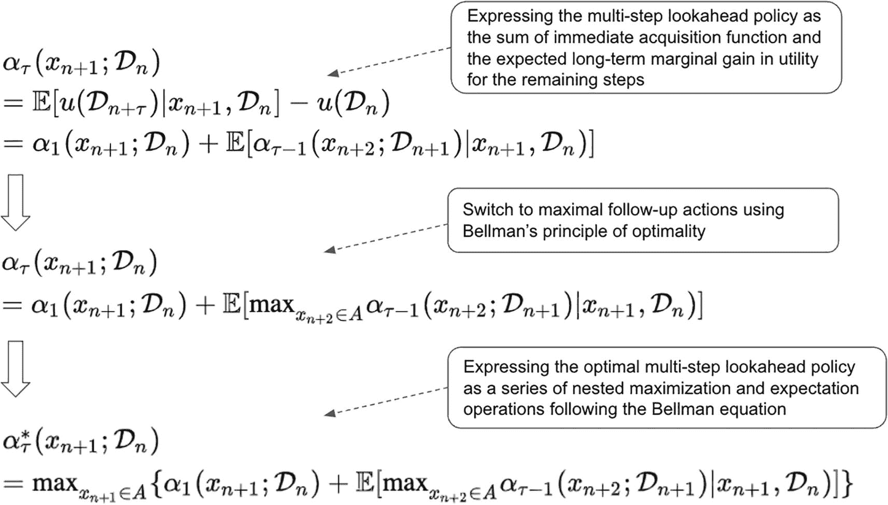
*图 3-6：说明多步前瞻策略的贝尔曼方程推导过程，其中最优策略被表示为一连串最大化和期望运算，假设所有后续行动都必须最优，以便在当前步骤做出最优行动。一组方程的多步示意图。图中标注了 3 个要点，分别表示：将多步前瞻策略表示为即时采集函数之和、利用贝尔曼最优性原理切换到最大后续行动、以及将最优多步前瞻策略表示为遵循贝尔曼方程的一系列嵌套最大化和期望运算。*

我们将在本书后面介绍加速计算这个*动态规划*问题的几种技巧，这里仅重点介绍两种常见方法。一种方法称为有限前瞻，它限制了未来的前瞻步数。另一种方法是使用基于基础策略的展开方法，它将最大化算子简化为一种快速的启发式计算。这两种方法都称为近似动态规划方法，如图 3-7 所示。关于此主题的更多讨论，请参阅 Roman Garnett 近期出版的著作《贝叶斯优化》。

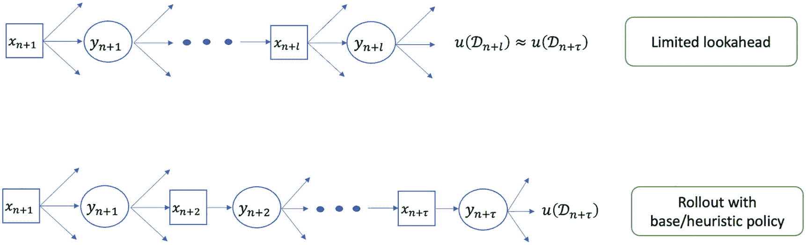
*图 3-7：两种常用于计算多步前瞻贝叶斯优化策略的近似动态规划方法。一组两幅插图。上方一幅表示有限前瞻，下方一幅表示基于基础策略或启发式策略的展开。*

在下一节中，我们将介绍期望改进采集函数，这是实际贝叶斯优化应用中使用最广泛且经验表现最佳的采集函数。

## 期望提升

采集函数在多个方面有所不同，包括效用函数的选择、前瞻步数、风险厌恶或偏好程度等。引入风险偏好直接受益于对潜在目标函数的后验信念。在以高斯过程回归作为代理模型的情况下，风险通过协方差函数进行量化，其置信区间表达了目标函数可能取值的不确定性程度。

关于已收集观测值的效用，期望提升在选择额外采样点时，将已观测到的最大值作为比较基准。它还隐含地假设在优化过程终止前只剩一次采样。效用的期望边际增益（即采集函数）就变成了最大观测值的期望提升，其计算方式为：在任意采样点进行额外采样后，观测到的最大值与新观测值之间的期望差值。

这些假设使得期望提升成为一种单步前瞻的采集函数，由于其前瞻视野较短，也被称为*短视*。此外，由于使用了后验分布的期望，期望提升也被认为是*风险中性*的，忽略了整个域上的不确定性估计。

具体来说，令`y*[1 : n]*` = `{y*[1]*, ..., y*[n]*}` 为在对应位置`x*[1 : n]*` = `{x*[1]*, ..., x*[n]*}` 处收集到的观测值集合。在无噪声设定下，实际观测值是精确的，即`y*[1 : n]*` = `f*[1 : n]*`。给定已收集的数据集`{\mathcal{D}}_n=\left\{{x}_{1:n},{y}_{1:n}\right\}`，相应的效用为`u\left({\mathcal{D}}_n\right)=\max \left\{{f}_{1:n}\right\}={f}_n^{\ast }`，其中`{f}_n^{\ast }`是迄今为止观测到的当前最优值。类似地，假设我们在新位置`x*[n + 1]*`处获得另一个观测值`y*[n + 1]*` = `f*[n + 1]*`，则由此产生的效用为`u\left({\mathcal{D}}_{n+1}\right)=u\left({\mathcal{D}}_n\cup \left\{{x}_{n+1},{f}_{n+1}\right\}\right)=\max \left\{{f}_{n+1},{f}_n^{\ast}\right\}`。取这两个效用的差值，即可得到因增加一个观测值而带来的效用增量：

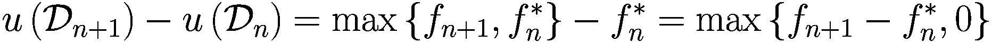

## 期望提升采集函数

上式返回了当 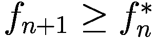 时当前最优值的边际增量，否则为零，这是观测到 `f[n + 1]` 的结果。熟悉神经网络中激活函数的读者会立刻将这种形式与 `ReLU`（修正线性单元）函数联系起来，该函数保留正信号，抑制负信号。

由于 `y[n + 1]` 具有随机性，我们可以引入期望算子对其进行积分，从而得到效用的期望边际增益，即期望提升采集函数：

![$$ {\alpha}_{EI}\left({x}_{n+1};{\mathcal{D}}_n\right)=\mathbbm{E}\left[u\left({\mathcal{D}}_{n+1}\right)-u\left({\mathcal{D}}_n\right)|{x}_{n+1},{\mathcal{D}}_n\right]\kern7em =\int \max \left\{{f}_{n+1}-{f}_n^{\ast },0\right\}p\left({f}_{n+1}|{x}_{n+1},{\mathcal{D}}_n\right)d{f}_{n+1} $$](images/527334_1_En_3_Chapter/527334_1_En_3_Chapter_TeX_Equr.png)

在高斯过程回归的框架下，我们可以得到期望提升采集函数的闭式表达式，如下一节所示。

### 推导闭式表达式

期望提升采集函数具有一个方便的闭式表达式，这可以显著加速其计算。推导闭式表达式需要用到从标准正态变量到任意正态变量的尺度-位置变换，这在之前的章节中已经介绍过。这也被称为 `重参数化技巧`，因为我们可以将感兴趣的对象转换为标准正态变量，以简化数学分析和实际计算。

精确地说，由于候选位置 `x[n + 1]` 处的观测值 `f[n + 1]` 服从均值为 `μ[n + 1]`、方差为  的正态分布，记作 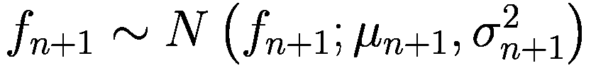，我们可以将其重参数化为 `f[n + 1] = μ[n + 1] + σ[n + 1]ε`，其中 `ε~N(ε; 0, 1)`。

图 3-8 给出了完整的推导过程，其中涉及一些技术细节，例如期望的线性性质、分部积分、标准正态分布和累积标准正态分布，以及微分中的变量替换。假设 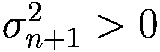，该过程首先将 `max` 算子转换为积分，然后将其分离为两个不同且易于计算的部分。这两个部分分别对应于利用和探索。利用意味着继续在具有高后验均值的已观测区域附近采样，而探索则鼓励在未访问的、后验不确定性高的区域采样。因此，期望提升采集函数隐式地平衡了这两种相反的力量。

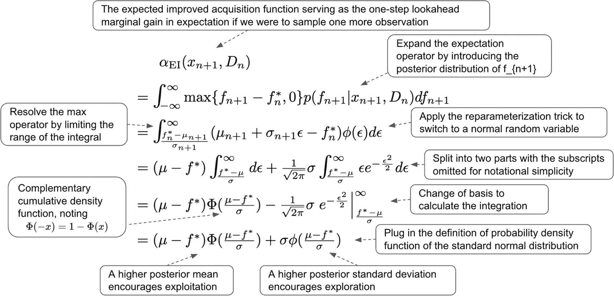

一幅插图展示了一组方程，并指出了名为期望提升采集函数的点，通过引入后验分布展开期望算子，应用重参数化技巧，拆分为两部分，以及改变积分计算的基础，以及其他要点。

图 3-8

推导期望提升的闭式表达式，该表达式自动平衡了基于现有知识对有希望区域的利用和对不确定区域的探索

为了进一步建立后验参数（`μ[n + 1]` 和 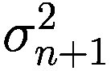）与期望提升值之间的单调关系，我们可以检查各自的偏导数。具体来说，我们有：

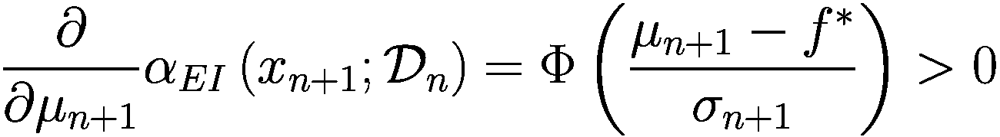

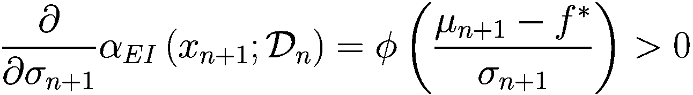

由于期望提升关于 `μ[n + 1]` 和 `σ[n + 1]` 的偏导数均为正，任一参数的增加都会导致期望提升值更高，从而在高斯过程回归框架下完成了利用与探索之间的自动权衡。

同样值得注意的是，当后验均值函数经过观测点时，`σ[n + 1] = 0` 成立。在这种情况下，我们有 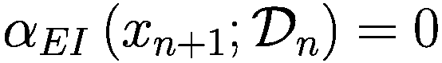。此外，在实际实现中，通常会引入一个超参数 `ξ` 来控制探索程度。通过从上述闭式表达式的 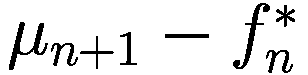 中减去 `ξ`，后验均值 `μ[n + 1]` 对整体改进的影响将小于后验标准差 `σ[n + 1]`。因此，期望改进采集函数的闭式表达式变为：


其中

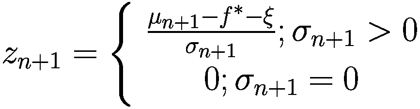

下一节将实现期望改进采集函数，并用它来寻找合成测试函数的全局最优解。

### 实现期望改进

在本节中，我们将首先基于纯 `NumPy` 和 `SciPy` 包从头实现期望改进采集函数，然后使用现成的 `BO` 包完成相同任务。真实的底层目标函数会提供给我们用于比较，但对优化器不可见，优化器的目标是从可能带有噪声的样本中逼近该目标函数。代码改编自 Martin Krasser 的教程博客（[`http://krasserm.github.io/2018/03/21/bayesian-optimization/#Optimization-algorithm`](http://krasserm.github.io/2018/03/21/bayesian-optimization/%2523Optimization-algorithm)）。

首先，我们将导入一些包来搭建环境：从 `scikit-learn` 导入高斯过程回归包，从 `SciPy` 导入数值优化包，以及其他用于绘图的工具函数。我们还设置了随机种子以确保结果可复现。

```python
import numpy as np
import random
import matplotlib.pyplot as plt
from scipy.stats import norm
from scipy.optimize import minimize
from sklearn.gaussian_process import GaussianProcessRegressor
from sklearn.gaussian_process.kernels import ConstantKernel, Matern
SEED = 8
random.seed(SEED)
np.random.seed(SEED)
%matplotlib inline
代码清单 3-1
搭建编码环境
```

接下来，我们将定义目标函数和搜索域。目标函数在搜索域内任意位置采样时，会提供带有噪声扰动的观测值。它还将用于生成无噪声的观测值，以便在绘图时作为参考。

## 搜索域与目标函数

如下列代码所示，我们根据域的维度从标准正态分布中生成一个随机数，通过 `*` 符号将元组解包为可接受的格式。然后将该值乘以观测模型的预设噪声水平。搜索域在 `bounds` 中指定为一个嵌套列表，其中内层列表包含每个维度的上下界；在本例中，我们处理的是一个一维搜索域。

```python
# 搜索域的边界
# 内层列表中的每个元素对应一个维度
bounds = np.array([[-1.0, 2.0]])
# 观测噪声
noise = 0.2
# 用于在采样时提供观测值的目标函数，可选地添加噪声
def f(x, noise=0):
    # 使用 * 将 x.shape 的元组解包后传入 np.random.randn
    return -np.sin(3*x) - x**2 + 0.7*x + noise*np.random.randn(*x.shape)
```
代码清单 3-2 定义搜索域和目标函数

## 可视化目标函数与初始样本

现在我们可以可视化目标函数，并在 `X_init` 和 `Y_init` 中生成两个随机带噪声的样本，以启动优化过程。请注意，绘制函数是通过在搜索边界内生成密集的网格点/位置 `X_plot`，计算每个位置对应的无噪声函数值 `Y_plot`，并将这些值平滑连接来完成的，如下列代码所示。

```python
# 初始化时的观测值
X_init = np.array([[-0.7], [1.6]])
Y_init = f(X_init, noise=noise)
# 用于绘图的边界内密集网格点
X_plot = np.arange(bounds[:, 0], bounds[:, 1], 0.01).reshape(-1, 1)
# 用于绘图的无噪声目标函数值
Y_plot = f(X_plot, noise=0)
# 绘制带有噪声观测值的目标函数
plt.plot(X_plot, Y_plot, 'y--', lw=2, label='目标函数')
plt.plot(X_init, Y_init, 'kx', mew=3, label='初始带噪声样本')
plt.legend()
```
代码清单 3-3 可视化底层目标函数和初始带噪声样本

结果如图 3-9 所示。请注意，这两个样本被选择为彼此距离足够远。在实践中，良好的初始设计应充分覆盖整个搜索域，以确保在优化开始前有一个良好的高斯过程先验。

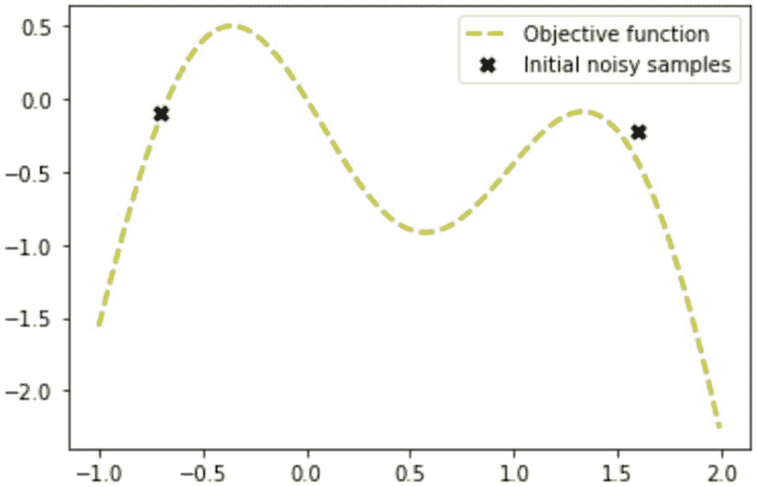

图 3-9 可视化底层目标函数与两个初始随机噪声样本。折线图展示了目标函数的变化趋势，并在线上标出了两个初始噪声样本点。y 轴范围从-2 到 0.5，x 轴范围从-1 到 2。

## 期望提升采集函数

现在，我们将期望提升采集函数定义为采样策略。该函数将每个采样位置输入映射为一个数值标量输出，即效用的预期边际增益。在以下代码清单中，除了 `X` 中的评估点外，输入还包括先前观测到的位置 `X_sample` 和值 `Y_sample`，以及一个拟合于训练样本的高斯过程回归器 `gpr`。此外，我们还引入了超参数 `xi` 来控制探索程度，其默认值为 0.01。

```python
def expected_improvement(X, X_sample, Y_sample, gpr, xi=0.01):
    # 在提议位置的后验均值和标准差
    mu, sigma = gpr.predict(X, return_std=True)
    # 在观测位置的后验均值
    mu_sample = gpr.predict(X_sample)
    # 重塑形状，使每个提议位置对应一个标准差
    sigma = sigma.reshape(-1, 1)
    # 由于噪声存在，使用最大后验均值而非实际观测值
    mu_sample_opt = np.max(mu_sample)
    # 忽略可能出现的除零警告
    with np.errstate(divide='warn'):
        # 若标准差大于 0，计算期望提升
        imp = mu - mu_sample_opt - xi
        Z = imp / sigma
        ei = imp * norm.cdf(Z) + sigma * norm.pdf(Z)
    # 若标准差为 0，则设为零
    ei[sigma == 0.0] = 0.0
    return ei
```
代码清单 3-4 定义期望提升采集函数

请注意，我们首先代入期望提升的定义，假设提议位置的后验分布标准差非零，然后将标准差为零的条目设为零。由于直接除以零会报错（如在计算 `Z = imp / sigma` 时所需），该计算被移入 `np.errstate(divide='warn')` 的上下文中。这是一种特殊安排，用于告知 Python 暂时忽略此类错误，因为后续会通过 `ei[sigma == 0.0] = 0.0` 进行处理。

## 提议下一个采样点与实用函数

至此，我们可以计算任意候选位置的期望提升值，而我们的目标是找到期望提升值最大的最优位置。为此，我们将使用 `SciPy` 中 `minimize` 函数提供的现成优化器“L-BFGS-B”，该优化器利用近似二阶导数来求解给定函数（即期望提升）的最优值。优化过程结束时即可获取最优位置。

以下代码清单定义了一个名为 `propose_location()` 的函数，该函数总共执行 `n_restarts` 轮优化以避免局部最优。通过维护一个运行中的最小值 `min_val` 及其位置 `min_x`，每轮优化通过 `min_obj()` 函数最小化采集函数值的负值来返回一个最优解；最大化正值等价于最小化其负值。最后，我们通过比较优化解来决定是否替换当前的运行最小值及其位置。该函数也完成了贝叶斯优化的*内循环*，如前所述。

```python
def propose_location(acquisition, X_sample, Y_sample, gpr, bounds, n_restarts=25):
    # 搜索域的维度
    dim = X_sample.shape[1]
    # 临时运行中的最佳最小值
    min_val = 1
    # 最佳最小值的临时位置
    min_x = None
    # 将任意位置映射到采集函数的负值
    def min_obj(X):
        # 最小化目标为采集函数的负值
        return -acquisition(X.reshape(-1, dim), X_sample, Y_sample, gpr)
    # 遍历 n_restart 个不同的随机点，返回最有希望的结果
    for x0 in np.random.uniform(bounds[:, 0], bounds[:, 1], size=(n_restarts, dim)):
        # 使用基于近似二阶导数的现成求解器
        res = minimize(min_obj, x0=x0, bounds=bounds, method='L-BFGS-B')
        # 若存在更优解，则替换运行中的最优值
        if res.fun < min_val:
            min_val = res.fun[0]
            min_x = res.x
    return min_x.reshape(-1, 1)
```
代码清单 3-5 通过优化采集函数提议下一个采样点

在进入贝叶斯优化的外循环以寻求全局最优之前，我们将定义几个实用函数，用于绘制各迭代轮次的策略表现。这包括：`plot_approximation()` 函数，用于绘制高斯过程后验均值及 95% 置信区间，同时展示已收集的样本和目标函数；`plot_acquisition()` 函数，用于绘制整个域上的期望提升值及最大值位置；以及 `plot_convergence()` 函数，用于绘制随优化进行，连续采样点之间的距离和运行中的最优值变化。这三个函数均在以下代码清单中定义。

### 主贝叶斯优化循环

现在我们可以进入主外循环，通过在每个阶段最大化期望提升来寻找全局最优解。在下面的代码清单中，我们首先实例化一个带有 Matérn 核的高斯过程回归器，该核接受两个超参数，可以通过最大化观测样本的边际似然来估计。这里我们固定这些超参数以简化流程。该高斯过程回归器还通过 `alpha` 参数接受未知的噪声水平，以将噪声纳入观测中。

```python
def plot_approximation(gpr, X_plot, Y_plot, X_sample, Y_sample,X_next=None, show_legend=False):
    # 获取密集网格上的后验均值和标准差
    mu, std = gpr.predict(X_plot, return_std=True)
    # 绘制均值及 95%置信区间
    plt.fill_between(X_plot.ravel(),
                     mu.ravel() + 1.96 * std,
                     mu.ravel() - 1.96 * std,
                     alpha=0.1)
    plt.plot(X_plot, Y_plot, 'y--', lw=1, label='无噪声目标函数')
    plt.plot(X_plot, mu, 'b-', lw=1, label='代理函数')
    plt.plot(X_sample, Y_sample, 'kx', mew=3, label='含噪声样本')
    # 用垂直线绘制下一个采样位置
    if X_next:
        plt.axvline(x=X_next, ls='--', c='k', lw=1)
    if show_legend:
        plt.legend()

def plot_acquisition(X_plot, acq_value, X_next, show_legend=False):
    # 绘制密集网格上的采集函数值
    plt.plot(X_plot, acq_value, 'r-', lw=1, label='采集函数')
    # 用垂直线绘制下一个采样位置
    plt.axvline(x=X_next, ls='--', c='k', lw=1, label='下一个采样位置')
    if show_legend:
        plt.legend()

def plot_convergence(X_sample, Y_sample, n_init=2):
    plt.figure(figsize=(12, 3))
    # 聚焦于优化策略查询的样本
    x = X_sample[n_init:].ravel()
    y = Y_sample[n_init:].ravel()
    r = range(1, len(x)+1)
    # 连续采样位置之间的距离
    x_neighbor_dist = [np.abs(a-b) for a, b in zip(x, x[1:])]
    # 截至当前时间点的最佳观测值
    y_max = np.maximum.accumulate(y)
    # 绘制连续采样位置之间的距离
    plt.subplot(1, 2, 1)
    plt.plot(r[1:], x_neighbor_dist, 'bo-')
    plt.xlabel('迭代次数')
    plt.ylabel('距离')
    plt.title('连续 x 值之间的距离')
    # 绘制当前观测最大值的演变过程
    plt.subplot(1, 2, 2)
    plt.plot(r, y_max, 'ro-')
    plt.xlabel('迭代次数')
    plt.ylabel('最佳 Y 值')
    plt.title('最佳选定样本的值')
```

代码清单 3-6 通过优化采集函数提议下一个采样点。

```python
# 使用 Matern 核的高斯过程作为代理模型
# 核参数可通过最大似然估计进行优化
m52 = ConstantKernel(1.0) * Matern(length_scale=1.0, nu=2.5)
# 指定观测噪声项，假设事先已知
gpr = GaussianProcessRegressor(kernel=m52, alpha=noise**2)
# 优化开始前的初始样本
X_sample = X_init
Y_sample = Y_init
# 优化迭代次数
n_iter = 20
# 指定图形尺寸
plt.figure(figsize=(12, n_iter * 3))
plt.subplots_adjust(hspace=0.4)
# 优化开始
for i in range(n_iter):
    # 根据现有样本更新高斯过程后验
    gpr.fit(X_sample, Y_sample)
    # 从采集函数（期望提升）获取下一个采样点
    X_next = propose_location(expected_improvement, X_sample, Y_sample, gpr, bounds)
    # 从目标函数获取下一个带噪声的样本
    Y_next = f(X_next, noise)
    # 绘制样本、代理函数、无噪声目标函数及下一个采样位置
    plt.subplot(n_iter, 2, 2 * i + 1)
    plot_approximation(gpr, X_plot, Y_plot, X_sample, Y_sample, X_next, show_legend=i==0)
    plt.title(f'迭代 {i+1}')
    plt.subplot(n_iter, 2, 2 * i + 2)
    plot_acquisition(X_plot, expected_improvement(X_plot, X_sample, Y_sample, gpr), X_next, show_legend=i==0)
    # 将新增样本追加到之前的样本中
    X_sample = np.vstack((X_sample, X_next))
    Y_sample = np.vstack((Y_sample, Y_next))
```

代码清单 3-7 主贝叶斯优化循环。

这里，我们使用 `X_sample` 和 `Y_sample` 作为运行中的数据集，随着优化持续进行总共 20 次迭代，不断加入新增样本。每次迭代包括更新高斯过程后验、定位最大期望提升点、在提议位置进行观测，以及将新增样本纳入训练集。

代码还使用 `plot_approximation()` 和 `plot_acquisition()` 生成图表，以展示每次迭代中优化的更多细节。图 3-10 显示了前三次迭代，优化器表现出探索性特征，提议的样本彼此相距较远。换句话说，在使用期望提升采集函数的优化初始阶段，高不确定性的区域会受到鼓励。

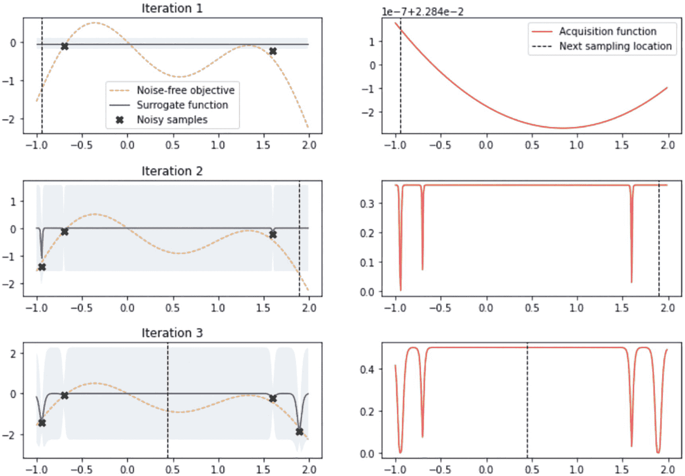

*一组 6 个折线图，排列成 2 列。左列的图代表 3 次迭代，线条和点分别表示无噪声目标函数、代理函数和带噪声样本。右列的图表示采集函数和下一个采样函数的线条。*

**图 3-10** 绘制前三次迭代，其中基于期望提升的贝叶斯优化在高不确定性区域进行了更多探索

随着优化进行，优化器逐渐解决了远处位置的不确定性，并开始更多地依赖基于现有知识对有希望的区域进行利用。这体现在采样位置集中在目标函数的左侧峰值附近，如图 3-11 中最后三次迭代所示。鉴于最后三次采样提议发生在相似位置，我们可以大致感觉到优化过程已经收敛，并且定位全局最大值的任务已成功完成。

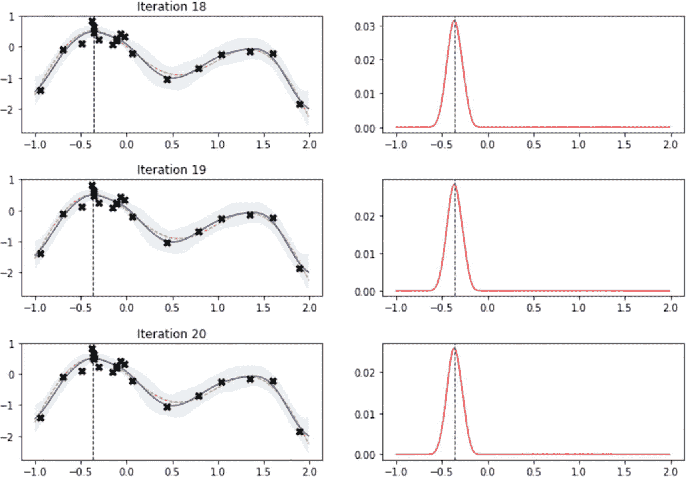

*一组 6 个折线图，排列成 2 列。左列的图代表第 18、19 和 20 次迭代。右列的图代表在 x 轴上 -0.5 到 0 之间几乎相同点处带有尖峰的平坦线条。*

**图 3-11** 采样位置集中在目标函数左侧峰值，这是优化过程收敛时利用行为的标志

如需查看所有迭代的中间图完整列表，请访问本章附带的笔记本，网址为 [`https://github.com/jackliu333/bayesian_optimization_theory_and_practice_with_python/blob/main/Chapter_3.ipynb`](https://github.com/jackliu333/bayesian_optimization_theory_and_practice_with_python/blob/main/Chapter_3.ipynb)。

优化完成后，我们可以使用 `plot_convergence()` 函数检查其收敛情况。如图 3-12 左侧图所示，距离越大对应探索越多，这主要发生在优化初始阶段，以及即使优化看似收敛时的第 17 和 18 次迭代。这种探索特性由期望提升自动启用，有助于跳出局部最优，以寻找可能更高的全局最优值。这也反映在右侧图中，由于探索，第 17 次迭代获得了更高的值。

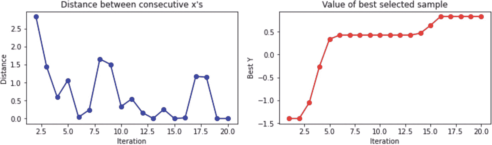

*一组 2 个图。左侧图表示连续 x 之间的距离，以距离与迭代次数的关系图呈现。线条有多个波峰和波谷。右侧图表示最佳选定样本的值，以最佳 y 值与迭代次数的关系图呈现。线条呈上升趋势。*

**图 3-12** 绘制优化过程中连续提议位置之间的距离以及最佳选定样本的值

至此，我们已经成功从头实现了使用期望提升的完整贝叶斯优化循环。接下来，我们将介绍几个有助于完成相同任务的贝叶斯优化库。

### 使用贝叶斯优化库

## 使用 `scikit-optimize` 进行贝叶斯优化

在本节中，我们将使用两个支持贝叶斯优化的公开 Python 库：`scikit-optimize` 和 `GPyOpt`。这两个包都提供了在指定相关输入参数后执行贝叶斯优化的实用函数。让我们看看如何使用 `gp_minimize`（`scikit-optimize` 中的一个函数，用于通过高斯过程执行贝叶斯优化）来优化与之前相同的函数。

在下面的代码清单中，我们为高斯过程实例 `gpr` 指定了相同的核函数和超参数设置，以及提供带噪声样本的函数 `f`、搜索边界 `dimensions`、采集函数 `acq_func`、初始样本、探索与利用权衡参数 `xi`、迭代次数 `n_calls`，以及 `x0` 和 `y0` 中的初始样本。在优化结束时，我们展示了近似图，以观察所提议样本的位置。

```python
from sklearn.base import clone
from skopt import gp_minimize
from skopt.learning import GaussianProcessRegressor
from skopt.learning.gaussian_process.kernels import ConstantKernel, Matern
# 使用自定义核函数和估计器以匹配之前的示例
m52 = ConstantKernel(1.0) * Matern(length_scale=1.0, nu=2.5)
g = GaussianProcessRegressor(kernel=m52, alpha=noise**2)
# 开始贝叶斯优化
r = gp_minimize(func=lambda x: -f(np.array(x), noise=noise)[0], # 要最小化的函数
dimensions=bounds.tolist(),    # 搜索边界
base_estimator=gpr, # 高斯过程先验
acq_func='EI',      # 期望改进
xi=0.01,            # 探索-利用权衡
n_calls=n_iter,     # 迭代次数
n_initial_points=0, # 提供了初始样本
x0=X_init.tolist(), # 初始样本
y0=-Y_init.ravel())
# 为绘图拟合高斯过程模型到样本
gpr.fit(r.x_iters, -r.func_vals)
# 绘制拟合模型和带噪声的样本
plot_approximation(gpr, X_plot, Y_plot, r.x_iters, -r.func_vals, show_legend=True)
```

代码清单 3-8 使用 `scikit-optimize` 进行贝叶斯优化

运行上述代码将生成图 3-13，该图显示了样本集中在左侧峰值的全局最大值附近。请注意，由于优化过程的非确定性以及观测模型中的随机性，样本与我们之前示例中的并不完全相同。

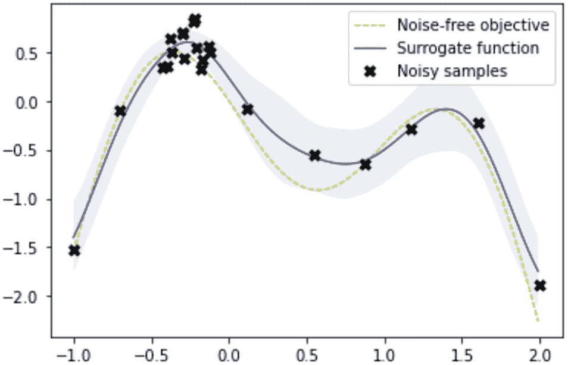

一幅折线图，表示两条曲线的趋势，并在曲线上标记了一些点。实线表示代理函数，虚线表示无噪声目标函数。点表示带噪声的样本。图 3-13 使用 `gp_minimize()` 函数可视化提议的样本

我们还可以展示连续提议点之间的距离图和最佳观测值图。如图 3-14 所示，尽管优化器在第二次迭代时就获得了较高的值，但它仍继续探索具有高不确定性的有希望区域，距离图中的两个峰值表明了这一点。

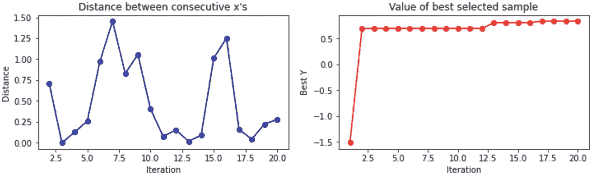

一组两个图表。左侧图表表示连续 `x` 之间的距离，绘制了距离与迭代次数的关系。线条有多个波峰和波谷。右侧图表表示最佳选定样本的值，绘制了最佳 `y` 与迭代次数的关系。线条呈上升趋势，变化幅度较小。图 3-14 可视化收敛图

## 总结

贝叶斯优化是经典贝叶斯决策理论的扩展。该扩展体现在其使用以及代理函数和采集函数的选择上。在本章中，我们涵盖了以下内容：

*   贝叶斯优化需要定义一个效用函数，用于衡量返回数据集在寻找全局最优解时的价值。
*   贝叶斯优化内层循环涉及寻找最大化采集函数的位置，而外层循环则寻找全局最优解的位置。
*   采集函数定义为效用的期望边际增益，可以是短视的（单步前瞻）或非短视的（多步前瞻）。
*   优化多步前瞻的期望边际效用增益遵循贝尔曼最优性原理，可以表示为递归形式，即当前期望边际效用增益与所有未来演化中最大期望边际增益之和。
*   期望改进是一种广泛使用的单步前瞻采集函数，当优化终止时推荐最佳观测值，并具有友好的闭式表达式以支持快速计算。

在下一章中，我们将重新审视高斯过程，并使用一个广泛使用的框架 `GPyTorch` 讨论高斯过程回归。