# 4. 使用 GPyTorch 进行高斯过程回归

到目前为止，我们已经掌握了贝叶斯优化过程的主要组成部分：一个提供底层目标函数均值和不确定性后验估计的代理模型，以及一个根据其期望边际效用增益指导搜索下一个采样位置的采集函数。在并行贝叶斯优化和蒙特卡洛采集函数的情况下，高效计算后验分布变得至关重要。这一分支涉及同时评估多个点，将在后续章节中讨论。

在本章中，我们将重点讨论构建和更新代理模型的第一个组成部分，以及其基于一个名为 GPyTorch 的高效、最先进包的具体实现。GPyTorch 包构建在 PyTorch 之上，并继承了其所有内置优势，例如 GPU 加速和自动微分。它是 BoTorch 的支柱，BoTorch 是研究和实践中广泛使用的最先进的贝叶斯优化包，将在下一章中介绍。

## 介绍 GPyTorch

高斯过程将底层目标函数建模为函数分布中的一个样本，该分布采用先验形式，并在揭示函数观测值后更新为后验分布。作为一种非参数模型，它具有无限的表现能力，可以从训练数据中学习，并以量化的不确定性水平进行预测。在选择核函数来编码我们对目标函数平滑性的先验假设后，我们可以拟合一个高斯过程模型，并将其应用于回归设置中，以获得任何新点的后验均值和方差，这是第 2 章涵盖的主题。

当我们关心估计新位置的值及其相关方差，进行插值或外推时，我们就是在进行高斯过程回归。根据结果的性质，该模型也可以扩展到分类设置。在下一节中，我们将简要介绍支撑 GPyTorch 库的 PyTorch 基础知识，然后简要回顾高斯过程回归的基础知识，并给出一个使用 GPyTorch 的实现案例。


### PyTorch 基础

PyTorch 依托 Torch 库，已成为深度学习任务中最流行的框架之一。它在机器学习研究人员和从业者中被广泛使用，这得益于其易用性、动态计算图以及比 TensorFlow 等其他替代框架更“Pythonic”的特性。也就是说，如果你习惯在继续之前编写一些 Python 代码并检查即时输出，那么用 PyTorch 编码的工作方式也大致相同。PyTorch 中的代码块是可检查和可中断的，这使得调试和打包非常方便。

PyTorch 的核心组件是其 *tensor* 数据结构，它在 CPU 中的行为类似于 NumPy 的 `ndarray`（多维数组），但在计算时驻留在 GPU 实例中，这使得它对于受益于图形处理的特定任务来说速度更快。它还支持*自动微分*，这使得在使用神经网络中的反向传播执行梯度下降优化时能够自动计算梯度。这种高效且精确的微分（假设目标函数是可微的）使得构建和训练现代神经网络模型变得更加容易和快速，并且可以通过并行计算进一步加速。

让我们看一个简单的例子来说明自动微分特性，即 *autograd*。首先，我们按如下方式从一个列表创建一个张量对象：

```
>>> import torch
>>> a = torch.tensor([1,2,3])
>>> print(a)
tensor([1, 2, 3])
```

请注意，输出中的数据类型可能因环境规范而异。输出表明变量 `a` 是一个张量对象。或者，我们也可以通过转换 NumPy 数组来创建一个张量：

```
>>> b = np.array([2,3,4])
>>> b = torch.from_numpy(b)
>>> print(b)
tensor([2, 3, 4])
```

常见的 NumPy 操作（如加法和乘法）在 PyTorch 中也有对应的函数，通常遵循相同的命名约定。例如，我们可以使用 `torch.add` 将 `a` 和 `b` 相加，如下所示：

```
>>> c = torch.add(a, b)
>>> print(c)
tensor([3, 5, 7])
```

在创建张量对象时，我们可以指定 `requires_grad=True` 来启用 autograd 功能。这意味着在从此变量开始的所有后续计算中，所有结果输出的计算历史都将被累积。让我们创建另一个变量 `a_grad`，这里我们使用浮点数，因为 autograd 不适用于整数：

```
>>> a_grad = torch.tensor([1.0,2.0,3.0], requires_grad=True)
>>> print(a_grad)
tensor([1., 2., 3.], requires_grad=True)
```

接下来，我们将通过对 `a_grad` 进行平方运算来创建另一个变量：

```
>>> c = a_grad**2
>>> print(c)
tensor([1., 4., 9.], grad_fn=<PowBackward0>)
```

这里，`grad_fn` 属性表明这是一个幂函数，用于执行反向传播和计算梯度。回想一下基础微积分，对于幂函数 *y* = *x*²，梯度（或一阶导数）是 *y*^′ = 2*x*。让我们对所有元素求和，将输入聚合为单个输出：

```
>>> out = c.sum()
>>> print(out)
tensor(14., grad_fn=<SumBackward0>)
```

除了求和结果为 14 之外，输出还表明此结果来自求和操作。在计算图中指定并配置了所有基本操作后，我们可以通过调用 `backward()` 函数，使用 autograd 功能执行反向传播：

```
>>> out.backward()
>>> print(a_grad.grad)
tensor([2., 4., 6.])
```

现在梯度已自动计算，并可通过 `grad` 属性访问，这与我们的预期输出相符。

在 BO 循环中执行内部优化时，即定位采集函数的最大值，通常使用基于梯度的方法。当这些梯度可以轻松计算时，优化就可以高效地进行管理。诸如多起点随机梯度上升（因为我们想要最大化采集函数）之类的方法严重依赖于 PyTorch 中的 autograd 功能，特别是 GPyTorch 和 BoTorch。我们将在后面的章节中讨论此算法。

接下来，让我们重新审视 GP 回归的基础知识。

### 重温 GP 回归

GP 回归依赖于在任何新采样位置 **x**[∗] 处随机变量 *y*[∗] 的预测均值和方差的闭式解。假设我们已经收集了一个包含 *n* 个观测值的训练集 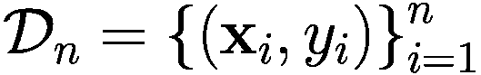，其中每个采样位置 **x**[*i*] ∈ ℝ^(*d*) 是紧集 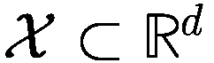 中的一个 *d* 维特征向量，而 *y*[*i*] ∈ ℝ 是一个受噪声扰动的标量观测值，满足 *y*[*i*] = *f* (**x**[*i*]) + *ϵ*[*i*]。我们通常假设在整个域内具有同质方差的标准高斯噪声，即 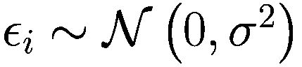。

在 GP 框架下，估计的目标函数由一个均值函数 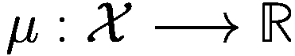 和一个协方差函数 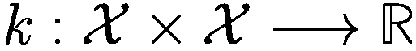 来表征，其中 ![$$ \mu \left(\textbf{x}\right)=\mathbbm{E}\left[\textrm{f}\left(\textbf{x}\right)\right] $$](images/527334_1_En_4_Chapter/527334_1_En_4_Chapter_TeX_IEq6.png) 且 ![$$ k\left(\textbf{x},{\textbf{x}}^{\prime}\right)=\mathbbm{E}\left[\left(\textrm{f}\left(\textbf{x}\right)-\mathbbm{E}\left[\textrm{f}\left(\textbf{x}\right)\right]\right)\left(\textrm{f}\left({\textbf{x}}^{\prime}\right)-\mathbbm{E}\left[\textrm{f}\left({\textbf{x}}^{\prime}\right)\right]\right)\right] $$](images/527334_1_En_4_Chapter/527334_1_En_4_Chapter_TeX_IEq7.png)。对于域内的任何有限随机变量集合，它们的联合分布遵循多元高斯分布，从而得到 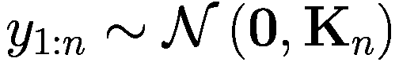，这里我们假设一个恒定的零均值函数 *μ* = 0，并且 **K**[*n*] = **K***n* 表示协方差矩阵，注意 **K***n*[*i*, *j*] = *k*(**x**[*i*], **x**[*j*])。

在新位置 **x**[∗] 处 *y*[∗] 的预测分布同样是正态分布的，即 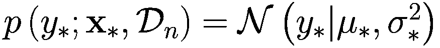，其中 *μ*[∗] = **k**(**x**[∗], **x**[1 : *n*])^(*T*)(**K**[*n*] + *σ*²**I**)^(−1)*y*[1 : *n*] 且 ，并且 **k**(**x**[∗], **x**[1 : *n*]) = [*k*(**x**[∗], **x**[∗]), …, *k*(**x**[∗], **x**[∗])]^(*T*)。

现在，我们将看看如何使用 GPyTorch 构建一个 GP 回归模型。


### 构建高斯过程回归模型

高斯过程为我们提供了一种对未观测随机变量进行推断的工具。当后验概率分布具有闭式表达式时，推断是精确的。然而，当精确推断在计算上难以处理时（例如计算高维积分），通常会使用近似推断作为精度与速度之间的权衡。当后验分布难以计算、难以采样或两者兼具时，我们可以使用有偏但更简单的近似来进行推断。

图 4-1 展示了在对新输入点集进行推断或预测时的这两种方法。

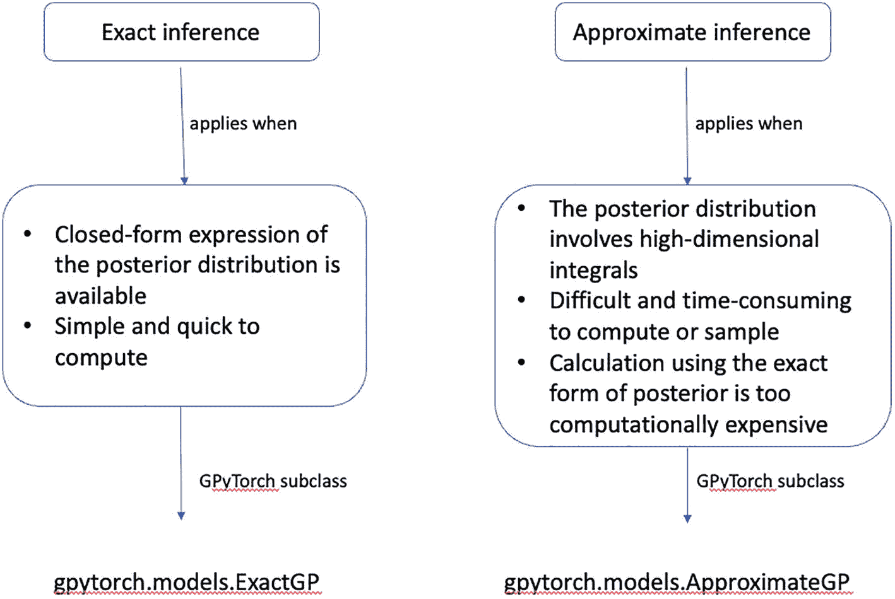

一个框图展示了精确推断应用的 2 个点和近似推断应用的 3 个点。

图 4-1
在 GPyTorch 中比较精确推断与近似推断

由于目标函数，例如 *f* (*x*) = −cos (*πx*) + sin (4*πx*)，是一个相对简单的一维函数，因此通过继承 `gpytorch.models.ExactGP` 进行精确 GP 推断足以满足本工作示例的需求。

在下面的代码清单中，我们首先定义了目标函数，然后用它在 0 到 1 的范围内生成十个带噪声的观测值。请注意，我们使用了 torch 函数，例如 `cos()`、`sin()`、`randn()` 和 `linspace()`，所有这些函数都与同名的 NumPy 函数对应。我们将噪声水平设置为 0.1。在绘制这十个带噪声的观测值时，变量 `X_init` 和 `y_init` 都通过内置的 `numpy()` 函数转换为 NumPy 格式。

```
# 定义目标函数
def f(x, noise=0):
    return -torch.cos(np.pi*x) + torch.sin(4*np.pi*x) + noise*torch.randn(*x.shape)
# 观测噪声
noise = 0.1
# 观测数量
N = 10
# 初始观测值
X_init = torch.linspace(0.05, 0.95, N)
y_init = f(X_init, noise=noise)
# 绘制带噪声的观测值
plt.figure(figsize=(8, 6))
plt.plot(X_init.numpy(), y_init.numpy(), 'o');
代码清单 4-1
生成带噪声的观测值
```

运行代码将生成图 4-2。

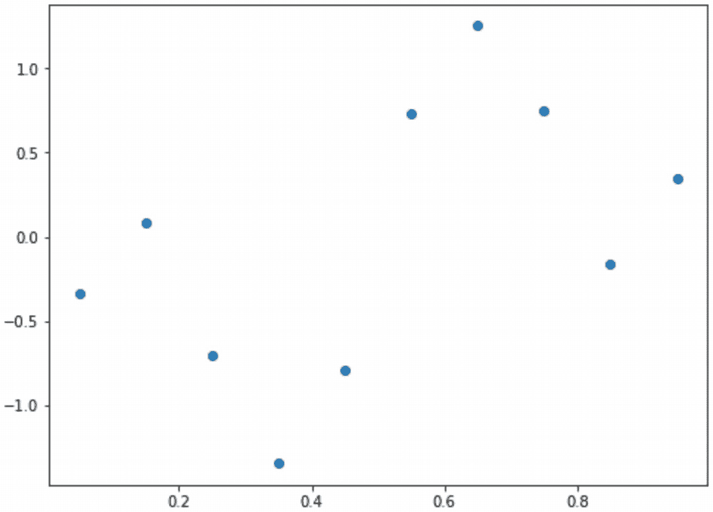

一个图表显示了散布在各处的多个点。y 轴范围从负 1 到正 1，而 x 轴范围在 0.2 到 0.8 之间。最高值出现在 0.6 到 0.8 之间。

图 4-2
可视化初始的十个带噪声观测值

在拟合 GP 模型之前，我们必须为先验 GP 定义均值函数和协方差（核）函数。GPyTorch 提供了多种均值函数，包括零均值函数 `gpytorch.means.ZeroMean()`、常数均值函数 `gpytorch.means.ConstantMean()` 和线性均值函数 `gpytorch.means.LinearMean()`。在此例中，我们使用常数均值函数，假设数据中没有系统性趋势。

至于核函数，我们选择最广泛使用的核之一：RBF 核，或称平方指数核 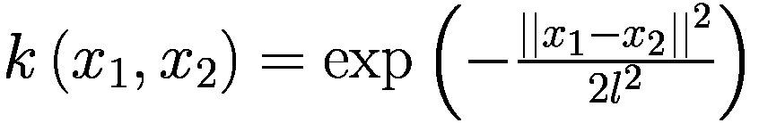，其中 *l* 是长度尺度参数，可以通过最大似然过程进行优化。RBF 核可以通过调用类 `gpytorch.kernels.RBFKernel()` 来实例化。我们还会为核函数的输出添加一个缩放系数，只需用 `kernels.ScaleKernel()` 将其包装起来即可。事实上，正如 GPyTorch 官方文档所建议的：如果你不知道使用什么核，我们建议你从 `gpytorch.kernels.ScaleKernel(gpytorch.kernels.RBFKernel)` 开始。下面的代码清单定义了均值函数和核函数。

```
mean_fn = gpytorch.means.ConstantMean()
kernel_fn = gpytorch.kernels.ScaleKernel(gpytorch.kernels.RBFKernel())
代码清单 4-2
定义均值函数和核函数
```

接下来，我们将定义一个类，基于精确 GP 推断类 `gpytorch.models.ExactGP` 来执行 GP 回归。如下面的代码清单所示，我们定义了一个名为 `GPRegressor` 的类，它继承自 `gpytorch.models.ExactGP`，用于执行简单的 GP 推断。该类包含三个函数：`__init__()`、`forward()` 和 `predict()`。`__init__()` 函数在实例化该类时被触发，并存储三个输入属性：先验均值函数、先验核函数以及似然函数。在 GP 回归的情况下，由于我们假设一个受噪声扰动的观测模型，高斯似然函数将底层函数分布 *p*(*f* | **x**) 映射到边缘分布 *p*(*y*| **x**)，其中 *y* = *f* (**x**) + *ϵ* 是任意位置 **x** 的带噪声观测值，且 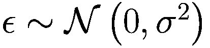。

```
class GPRegressor(gpytorch.models.ExactGP):
    def __init__(self, X, y, mean, kernel, likelihood=None):
        # 选择精确 GP 推断所需的标准观测模型
        if likelihood is None:
            likelihood = gpytorch.likelihoods.GaussianLikelihood()
        # 初始化超类 ExactGP 以刷新后验
        super().__init__(X, y, likelihood)
        # 存储属性
        self.mean = mean
        self.kernel = kernel
        self.likelihood = likelihood

    # 在训练数据条件下计算后验分布
    def forward(self, x):
        mean_x = self.mean(x)
        covar_x = self.kernel(x)
        # 返回后验多元正态分布
        return gpytorch.distributions.MultivariateNormal(mean_x, covar_x)

    # 计算给定 x 时 y 的边缘预测分布
    def predict(self, x):
        # 设置为评估模式
        self.eval()
        # 在不进行梯度传播的情况下执行推断
        with torch.no_grad():
            # 获取后验分布 p(f|x)
            pred = self(x)
            # 将后验分布 p(f|x) 转换为 p(y|x)
            return self.likelihood(pred)
代码清单 4-3
为 GP 推断定义自定义类
```

接下来，`forward()` 函数计算任意输入位置的后验分布，并返回一个由该特定位置的后验均值函数和核函数实现参数化的多元正态分布。当使用 `GPRegressor` 类的实例进行预测时，此函数会被自动调用。请注意，在 GPyTorch 的精确 GP 推断中，`MultivariateNormal` 是唯一允许的分布。

最后，`predict()` 函数接收来自 `forward()` 的输出 *p*(*f* | **x**)，并叠加一个观测模型以生成 *p*(*y*| **x**)。请注意，我们需要通过 `eval()` 函数将 GP 模型设置为推断模式，并在不计算梯度的情况下执行推断，如 `torch.no_grad()` 上下文管理器所示。

然后，我们可以通过向自定义类传递所需参数来创建模型，如下所示，这将基于提供的训练集以及均值函数和核函数的模型配置来训练一个 GP 模型：

```
>>> model = GPRegressor(X_init, y_init, mean_fn, kernel_fn)
```


现在，让我们将模型拟合到十个带噪声的观测值后，可视化后验高斯过程。如下列代码清单所示，我们创建了一个函数，该函数接受训练好的 GP 模型实例，并可选择性地接受存储在`xlim`中的 x 轴范围用于绘图。我们首先通过分别访问`train_inputs`和`train_targets`属性来提取训练数据，两者均转换为 NumPy 格式。当未提供`xlim`时，我们使用`X_train`的上下限并稍作扩展。接着，我们在`X_plot`中创建一组等间距的输入位置，并对它们进行评分以获得相应的后验预测分布，其均值、上界和下界用于绘图。

```
def plot_model(model, xlim=None):
"""
绘制一维 GP 模型
输入:
model : gpytorch.models.GP
xlim : x 轴范围，元组(float, float) 或 None
"""
# 以 NumPy 格式提取训练数据
X_train = model.train_inputs[0].cpu().numpy()
y_train = model.train_targets.cpu().numpy()
# 获取 x 轴范围
if xlim is None:
xmin = float(X_train.min())
xmax = float(X_train.max())
x_range = xmax - xmin
xlim = [xmin - 0.05 * x_range,
xmax + 0.05 * x_range]
# 创建等间距输入位置列表，数据类型与参数一致
model_tensor_example = list(model.parameters())[0]
X_plot = torch.linspace(xlim[0], xlim[1], 200).to(model_tensor_example)
# 生成后验预测分布
model.eval()
predictive_distribution = model.predict(X_plot)
# 获取均值、上界和下界
lower, upper = predictive_distribution.confidence_region()
prediction = predictive_distribution.mean.cpu().numpy()
X_plot = X_plot.numpy()
plt.scatter(X_train, y_train, marker='x', c='k')
plt.plot(X_plot, prediction)
plt.fill_between(X_plot, lower, upper, alpha=0.1)
plt.xlabel('x', fontsize=14)
plt.ylabel('y', fontsize=14)
代码清单 4-4
绘制拟合后的 GP 回归模型
```

将此函数应用于模型实例，生成图 4-3。

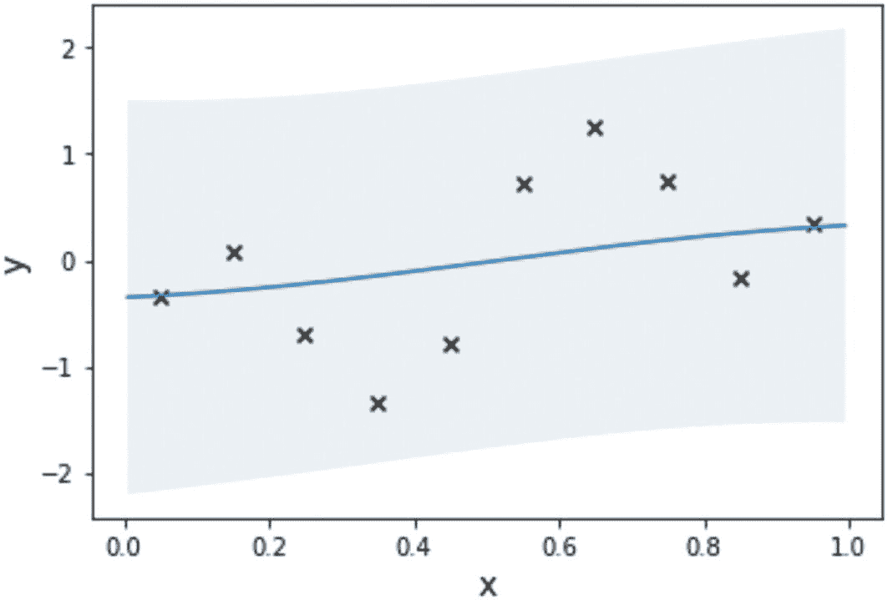

y 对 x 的散点图表示一组点，散布在 x 轴从 0 到 1 的线段上。该线段从 y 轴负 1 到 0 之间的点开始，y 轴范围在负 2 到正 2 之间。

图 4-3
可视化拟合后的 GP 回归模型

我们可以看到，GP 回归模型是一个粗略的拟合，在整个域内具有较宽的置信区间。由于核函数的长度尺度参数直接影响最终模型拟合的形状，我们将在下一节讨论如何微调此参数以提高预测性能。

### 微调核函数的长度尺度

回想一下，在前面的示例中，我们直接使用了核函数`kernel_fn`，而没有调整其长度尺度参数。该参数可以通过`lengthscale`属性访问，可以在进入主 GP 循环之前手动设置或通过最大似然过程进行优化。

在下面的代码清单中，我们更改核函数`lengthscale`参数的值，并观察所得核函数形状（更具体地说是平滑度）的变化。我们总共创建了六个长度尺度参数，存储在`all_lengthscale`中，其元素被依次迭代并传递给 RBF 核函数的`lengthscale`属性。我们还创建了一个`plot_kernel()`函数，通过将密集的输入位置列表（存储在`x`中）与值为 1 的输入位置（`torch.ones((1))`）进行比较来评估核函数。请注意，我们需要触发核函数的`evaluate()`函数来执行成对距离的实际评估。

```
def plot_kernel(kernel, xlim=None, ax=None):
if xlim is None:
xlim = [-3, 3]
x = torch.linspace(xlim[0], xlim[1], 100)
# 调用 evaluate() 函数执行实际评估
with torch.no_grad():
K = kernel(x, torch.ones((1))).evaluate().reshape(-1, 1)
if ax is None:
fig = plt.figure()
ax = fig.add_subplot(111)
ax.plot(x.numpy(), K.cpu().numpy())
k = gpytorch.kernels.RBFKernel()
all_lengthscale = np.asarray([0.2, 0.5, 1, 2, 4, 8])
figure, axes = plt.subplots(2, 3, figsize=(12, 8))
for tmp_lengthscale, ax in zip(all_lengthscale, axes.ravel()):
k.lengthscale = tmp_lengthscale
plot_kernel(k, ax=ax)
ax.set_ylim([0, 1])
ax.legend([tmp_lengthscale])
代码清单 4-5
使用不同长度尺度参数绘制核函数
```

运行此代码片段生成图 4-4。当长度尺度较小时，核函数对附近的点赋予更多权重，并通过将相似度值设为零来丢弃远处的点，从而显示出不太平滑的曲线。随着长度尺度的增加，核函数变得更加平滑。

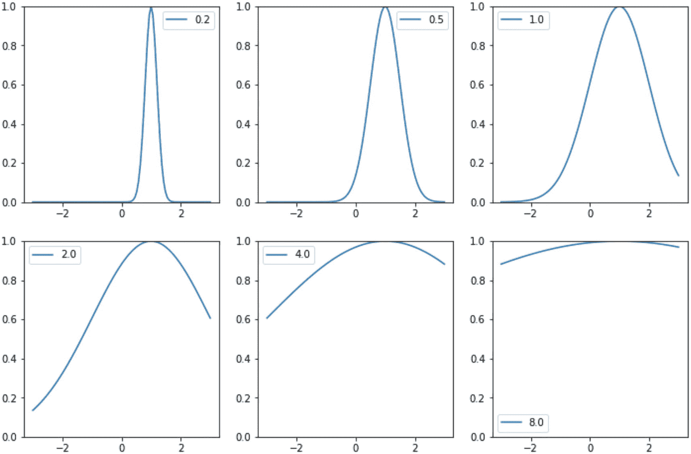

一组排列成 2 行的 6 个折线图表示一组线的趋势。上排图中的线表示值 0.2、0.5 和 1.0。下排图中的线表示值 2.0、4.0 和 8.0。上排的线保持平坦并具有单个尖峰，而下排的线则呈现上升趋势。

图 4-4
在不同长度尺度参数设置下可视化核函数

回到我们之前的示例。在`kernel_fn`中初始化核函数后，我们可以通过`base_kernel.lengthscale`属性访问其长度尺度参数，其中`base_kernel`指的是包装在缩放操作中的 RBF 核。如下所示，默认值为 0.6931，并且核对象具有一个梯度属性，该属性将用于从损失（负最大似然，稍后讨论）到长度尺度参数的梯度计算：

```
>>> kernel_fn.base_kernel.lengthscale
tensor([[0.6931]], grad_fn=)
```

更改此参数将导致不同的 GP 模型拟合。例如，我们可以通过以下代码片段手动将长度尺度参数设置为 0.1：

```
>>> kernel_fn.base_kernel.lengthscale = 0.1
>>> model = GPRegressor(X_init, y_init, mean_fn, kernel_fn)
>>> plot_model(model)
```

运行此代码片段生成图 4-5，其中模型拟合在沿观测数据点改变整体置信区间方面看起来更好。

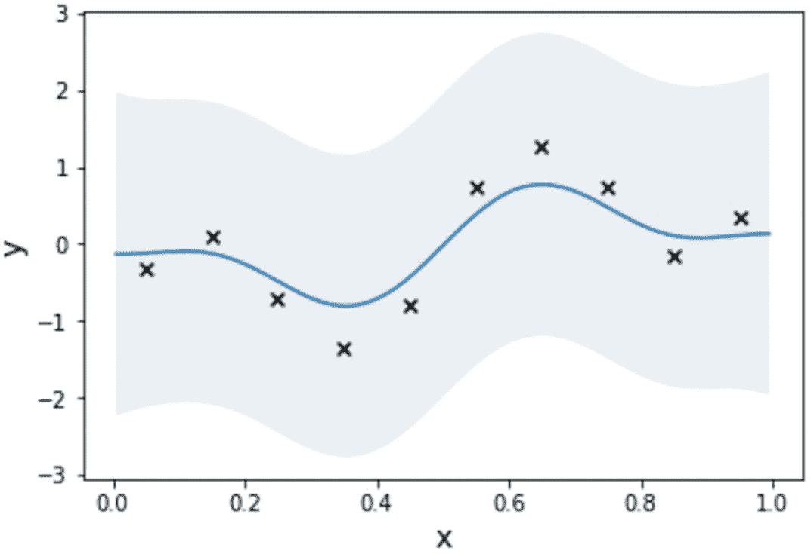


一张 y 对 x 的图表展示了曲线随波峰和波谷起伏的走势。y 轴范围从负值到正 3，x 轴范围从 0 到 1。曲线大致从 y 轴上的 0 点开始。

图 4-5

手动设置长度尺度参数后的 GP 回归模型

然而，手动设置长度尺度参数并观察拟合质量既耗时又低效。我们需要借助一种自动化的程序，通过优化特定指标（例如观测数据的似然）来寻找最优参数。

给定一个 GP 模型 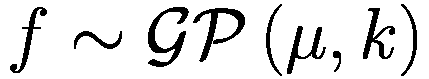 和一个训练集 (**X**, **y**)，观测到结果 **y** 的似然可以表示为

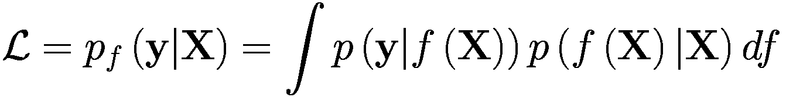

在精确 GP 推断设置中，即使用高斯似然模型的 GP 回归，这个似然可以被精确计算。对联合似然取负，就得到了优化过程中需要最小化的损失。在 GPyTorch 中，可以通过首先创建一个 `gpytorch.mlls.ExactMarginalLogLikelihood()` 实例来计算这个联合边际似然，该实例以高斯似然和精确 GP 模型作为输入，并基于后验分布 *p*(*f* | **X**) 和目标观测值 **y** 输出精确边际对数似然 (MLL)。

现在，让我们看看如何基于类似于最大似然估计 (MLE) 的优化过程来自动优化长度尺度，其中似然被取负并最小化。在下面的代码清单中，我们定义了一个函数，基于现有的训练数据集（`X` 和 `y`）、迭代轮数（`n_epochs`，每轮是训练集的一次完整遍历）、学习率（`lr`，由所选优化器使用）以及可选的训练日志指示器（`verbose`）来执行训练过程。请注意，高斯似然模型中用到的高斯噪声项的方差 *σ*² 也是另一个需要微调的超参数。*σ*² 和 `lengthscale` 都可以通过 `model.parameters()` 函数访问。

```
def train(model, X, y, n_epochs=100, lr=0.3, verbose=True):
# 切换到模型训练模式
model.train()
# 使用 Adam 优化器
training_parameters = model.parameters()
optimizer = torch.optim.Adamax(training_parameters, lr=lr)
# 初始化一个带有高斯似然的 GP 模型用于 MLL 计算
mll = gpytorch.mlls.ExactMarginalLogLikelihood(model.likelihood, model)
# 开始训练循环
for e in range(n_epochs):
# 清除梯度以防止梯度累积
optimizer.zero_grad()
# 获取后验分布 p(f|x)
out = model(X)
# 获取取负后的精确边际对数似然 p(y|x)
loss = -mll(out, y)n
# 使用 autograd 计算梯度
loss.backward()
# 执行梯度更新
optimizer.step()
# 打印优化日志
if verbose:
if e % 5 == 0:
lengthscale = model.kernel.base_kernel.lengthscale.squeeze(0).detach().cpu().numpy()
print(f"Epoch: {e}, loss: {loss.item():.3f}, lengthscale: {lengthscale[0]:.3f}, noise: {model.likelihood.noise.item():.3f}")
# print(f"Loss: {loss.item():.3f}, lengthscale: {lengthscale}")
代码清单 4-6
优化超参数
```

该函数首先将模型切换到训练模式。至于超参数的优化器，我们使用 Adam 优化器，这是一种因其稳定的更新和快速收敛而广受欢迎的选择。我们还创建了一个精确 GP 似然实例，用于计算联合边际似然，这是每次训练迭代中拟合优度的一个指标。梯度下降更新的每一步都包括清除现有梯度、计算损失函数、反向传播梯度以及执行权重更新。

如图 4-6 所示，在对模型总共训练 100 轮后，得到的 GP 拟合结果看起来好多了，置信区间比以前窄得多。训练完成后检查长度尺度，其值为 0.1279，如下面的代码片段所示。

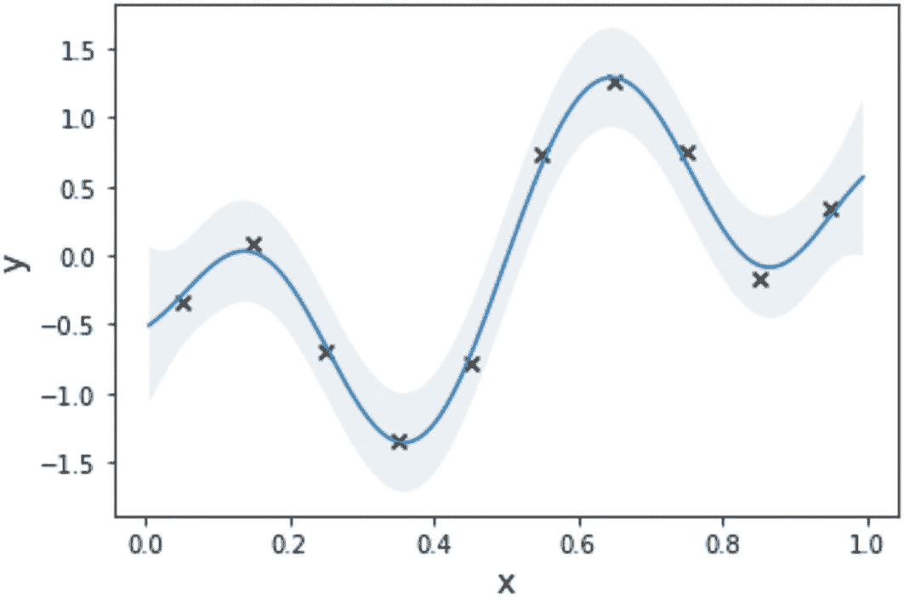

一张 y 对 x 的图表展示了曲线随波峰和波谷起伏的走势。y 轴范围从负值到正 1.5，x 轴范围从 0 到 1。曲线大致从 y 轴上的负 0.5 点开始。

图 4-6

优化模型超参数（即长度尺度和噪声方差）后的 GP 拟合可视化

```
>>> kernel_fn.base_kernel.lengthscale
tensor([[0.1279]], grad_fn=)
```

接下来，我们将研究噪声方差项，它是影响拟合 GP 回归模型平滑度的另一个超参数。


### 微调噪声方差

随机噪声的方差可以通过 `likelihood.noise` 属性访问。例如，上一示例优化后的最优方差为 0.0183：

```
>>> model.likelihood.noise
tensor([0.0183], grad_fn=)
```

我们也可以覆盖噪声方差，这会直接影响拟合后的 GP 回归模型的平滑度和置信区间。例如，图 4-7 展示了将噪声方差设置为 0.1 后拟合的 GP 模型，其置信区间比之前大得多。

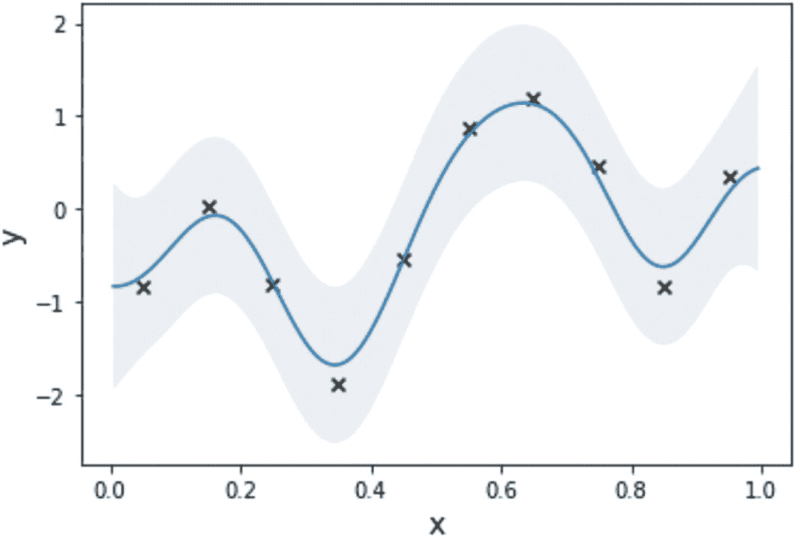

一张 y 对 x 的图表，表示一条曲线，有波峰和波谷。y 轴范围从负值到正值 2，x 轴范围从 0 到 1。曲线起始于 y 轴上接近负 1 的点。

图 4-7

覆盖噪声方差后拟合的 GP 模型可视化

```
>>> model.likelihood.noise = 0.1
>>> plot_model(model)
```

在前一个示例中，当噪声水平增加时，自动超参数调优过程也表现良好。在下面的代码清单中，我们将生成带噪声观测值时的噪声方差从之前的 0.1 增加到 0.5。其余代码保持不变。

```
y_init = f(X_init, noise=0.5)
model = GPRegressor(X_init, y_init, mean_fn, kernel_fn)
train(model, X_init, y_init)
plot_model(model)
代码清单 4-7
使用增加的噪声方差生成观测值
```

运行上述代码将生成图 4-8。置信区间比以前更窄且更具适应性。优化后的噪声现在为 0.0114，如下面的代码片段所示。

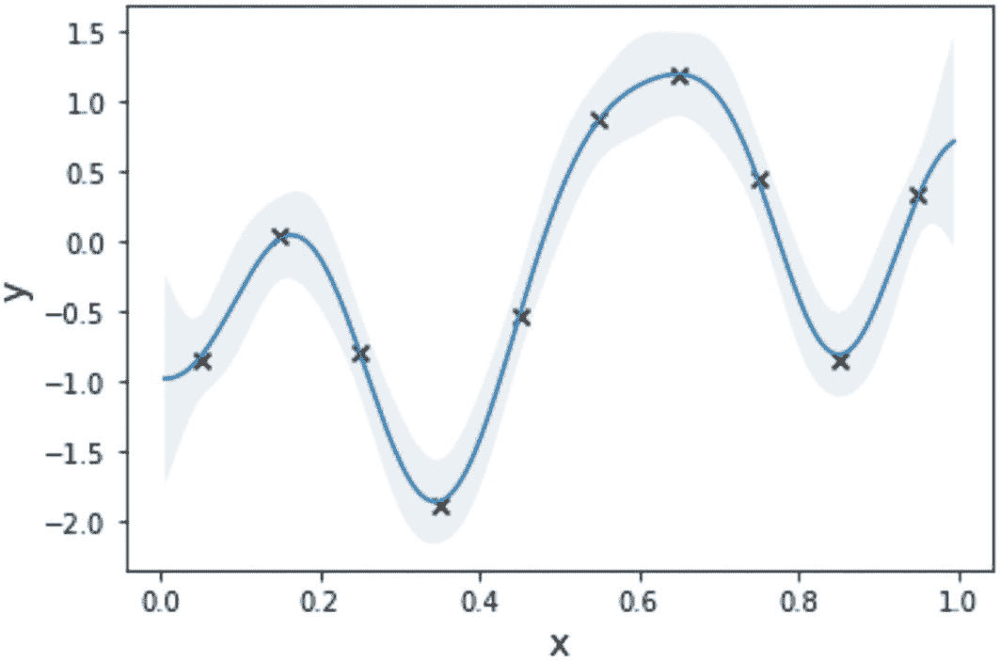

一张 y 对 x 的图表，表示一条曲线，有波峰和波谷。y 轴范围在负 2 到正 1.5 之间，x 轴范围从 0 到 1。曲线起始于 y 轴上大约负 1 的位置。

图 4-8

使用增加的噪声方差拟合的 GP 模型可视化

```
>>> model.likelihood.noise
tensor([0.0114], grad_fn=)
```

在某些情况下，我们希望在整个优化过程中保持噪声方差固定不变。当我们对噪声方差有一些先验知识时，就会出现这种情况。在这种情况下，我们可以将其排除在之前 `train()` 函数中 `training_parameters` 的可训练参数之外，只优化长度尺度。为此，我们可以添加一个额外的输入参数 `fixed_noise_variance` 来接收预期的噪声方差（如果有的话）。接下来，使用以下代码片段替换 `training_parameters` 的赋值：

```
if fixed_noise_variance is not None:
model.likelihood.noise = fixed_noise_variance
training_parameters = [p for name, p in model.named_parameters() if not name.startswith('likelihood')]
else:
training_parameters = model.parameters()
```

这里，我们使用了 `named_parameters()` 函数来提取参数及其名称，用于过滤掉那些以关键字“likelihood”开头的参数。然后，我们使用新的训练过程重新训练模型，并在图 4-9 中获得了固定噪声方差为 0.1 的结果。

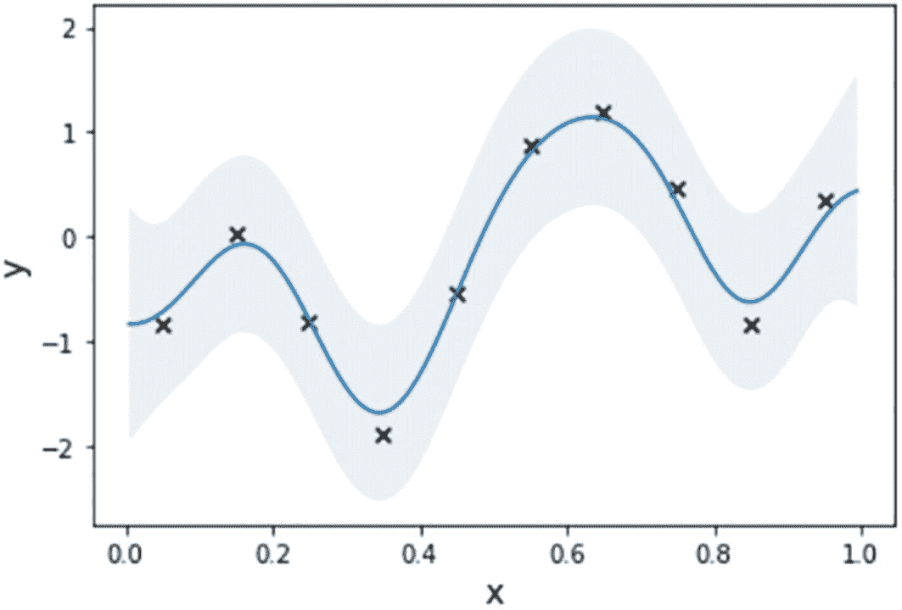

一张 y 对 x 的图表，表示一条曲线，有波峰和波谷。y 轴范围从负值到正值 2，x 轴范围从 0 到 1。曲线起始于 y 轴上略高于负 1 的点。

图 4-9

使用固定噪声方差和优化后的长度尺度拟合 GP 回归模型

欢迎查看随附笔记本中的完整训练代码，地址为 [`https://github.com/jackliu333/bayesian_optimization_theory_and_practice_with_python/blob/main/Chapter_4.ipynb`](https://github.com/jackliu333/bayesian_optimization_theory_and_practice_with_python/blob/main/Chapter_4.ipynb)。

前面的例子展示了选择合适的核函数并优化超参数以获得良好 GP 拟合的重要性。在下一节中，我们将了解 GPyTorch 中可用的不同核函数，以及它们如何组合使用以提升模型拟合性能。

## 深入探讨核函数

GPyTorch 中有多种核函数可用。常用的选择包括 RBF（径向基函数）核、有理二次核、Matern52 核、线性核、多项式核和周期核。每个核函数的定义如下所示，其中我们将噪声方差 *σ*² 作为缩放因子相乘，以确定函数偏离其均值的平均距离：

*   RBF 核

    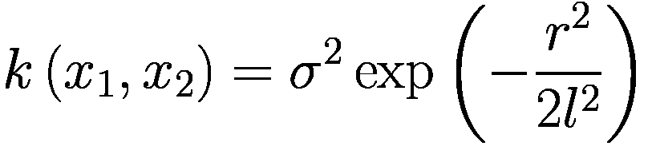

其中 *r* = ‖*x*[1] − *x*[2]‖。

*   有理二次核

    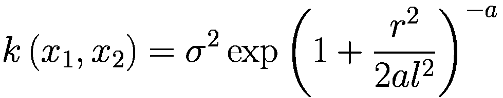

其中额外的超参数 *a* 决定了大规模和小规模变化的相对权重。

*   Matern52 核

    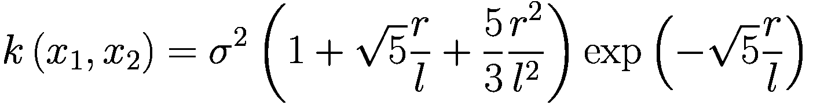

*   线性核

    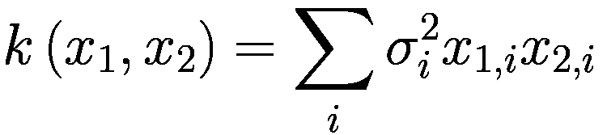

*   多项式核

    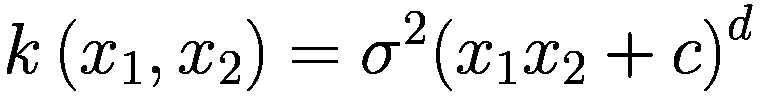

*   周期核

    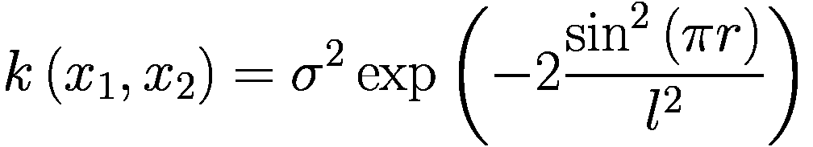

在下面的代码清单中，我们使用之前定义的 `plot_kernel()` 函数绘制每个核函数。请注意，我们使用了字符串匹配函数 `split()` 来提取核函数名称作为每个子图的标题。

```
covariance_functions = [gpytorch.kernels.RBFKernel(),
gpytorch.kernels.RQKernel(),
gpytorch.kernels.MaternKernel(nu=5/2),
gpytorch.kernels.LinearKernel(power=1),
gpytorch.kernels.PolynomialKernel(power=2),
gpytorch.kernels.PeriodicKernel()
]
figure, axes = plt.subplots(2, 3, figsize=(9, 6))
axes = axes.ravel()
for i, k in enumerate(covariance_functions):
plot_kernel(k, ax=axes[i])
axes[i].set_title(str(k).split('(')[0])
figure.tight_layout()
代码清单 4-8
可视化不同的核函数
```

运行上述代码将生成图 4-10。虽然每种类型的核显示出不同的特征，但我们还可以通过加法和乘法运算进一步组合它们，以创建更灵活的表示形式，我们将在下一节中展示这一点。

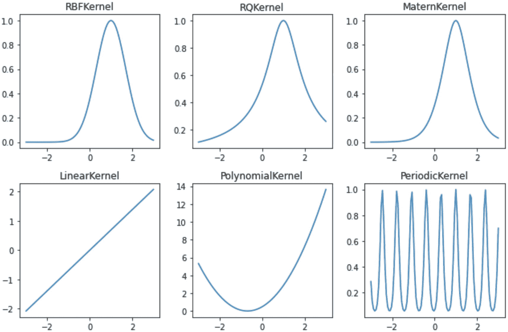

一组 6 个折线图，排列成 2 行。上面一行表示 RBF 核、RQ 核和 Matern 核，线条在中间有单个尖峰。下面一行表示线性核、多项式核和周期核。线性核和多项式核呈上升趋势，而周期核有多个尖峰。

图 4-10

可视化不同的核函数


### 组合核函数

在 GPyTorch 中，可以使用加法运算符 `+` 或乘法运算符 `*` 来组合核函数。这两种操作如下所示：

*   通过将两个核函数相加，推导出一个复合核函数

    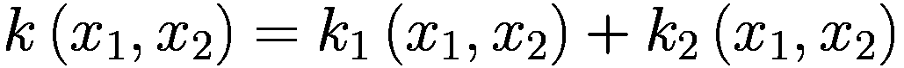

*   通过将两个核函数相乘，推导出一个复合核函数

    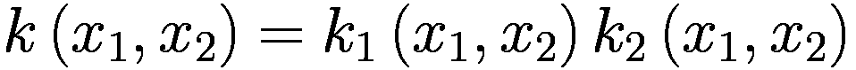

现在，让我们看看如何组合不同的核函数。我们首先创建一个列表 `kernel_functions` 来存储三个核函数：线性核、周期核和 RBF 核。我们还将 `+` 和 `*` 运算符重载为 lambda 函数，这样 `+(a,b)` 就变成了 `a+b`，而 `*(a,b)` 等价于 `a*b`。由于我们希望将这两个运算符应用于任意两个核函数的每一种唯一组合，因此使用 `itertools` 包中的 `combinations()` 函数来生成需要迭代的唯一组合。完整的实现细节请参见下面的代码清单。

```
kernel_functions = [gpytorch.kernels.LinearKernel(power=1),
gpytorch.kernels.PeriodicKernel(),
gpytorch.kernels.RBFKernel()]
# 重载 + 和 * 运算符
operations = {'+': lambda x, y: x + y,
'*': lambda x, y: x * y}
figure, axes = plt.subplots(len(operations), len(kernel_functions), figsize=(9, 6))
import itertools
axes = axes.ravel()
count = 0
# 遍历核函数和运算符的每一种唯一组合
for j, base_kernels in enumerate(itertools.combinations(kernel_functions, 2)):
for k, (op_name, op) in enumerate(operations.items()):
kernel = op(base_kernels[0], base_kernels[1])
plot_kernel(kernel, ax=axes[count])
kernel_names = [
str(base_kernels[i]).split('(')[0] for i in [0, 1]
]
axes[count].set_title('{} {} {}'.format(kernel_names[0], op_name,
kernel_names[1]), fontsize=12)
count += 1
figure.tight_layout()
代码清单 4-9
组合不同的核函数
```

运行上述代码将生成图 4-11。请注意，当将线性核与周期核相加时，生成的组合核同时显示出线性趋势和周期性。

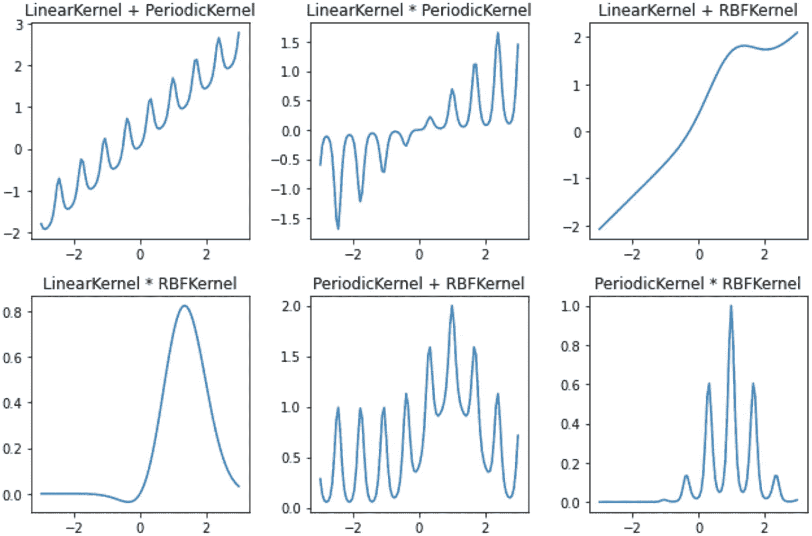

一组 6 个折线图，排列成 2 行。第一行表示线性核 + 周期核、线性核乘以周期核、以及线性核 + RBF 核。第二行表示线性核乘以 RBF 核、周期核 + RBF 核、以及周期核乘以 RBF 核的趋势。

图 4-11
可视化不同的组合核

当然，我们可以将组合扩展到两个以上的核，甚至应用一个自动程序，根据可用的训练数据搜索最佳的核组合。下一节将通过应用更复杂、更强大的核组合来展示模型学习能力的提升。

### 预测航空公司乘客数量

航空公司乘客数量数据集记录了 1949 年至 1960 年间每月国际航班的乘客数量。以下代码清单加载该数据集，并将其划分为训练集和测试集，其中中间 20 年的数据被分配为测试集。

```
data = np.load('airline.npz')
X = torch.tensor(data['X'])
y = torch.tensor(data['y']).squeeze()
train_indices = list(range(70)) + list(range(90, 129))
test_indices = range(70, 90)
X_train = X[train_indices]
y_train = y[train_indices]
X_test = X[test_indices]
y_test = y[test_indices]
plt.figure(figsize=(5, 3))
plt.plot(X_train.numpy(), y_train.numpy(), '.')
代码清单 4-10
加载航空公司乘客数量数据集
```

运行上述代码将生成图 4-12，显示了用于拟合 GP 回归模型的训练集。该图显示了一个带有季节性模式的增长趋势，这可以通过不断增长的旅行需求和一年内的季节性来解释。此外，垂直范围也在增加，表明不同月份之间存在异方差性。这些结构成分，即趋势、季节性和随机噪声，是时间序列预测文献中经常建模的基本要素。在本练习中，我们将探索不同的核组合，并最终使用三种复合核以加法方式对 GP 进行建模。

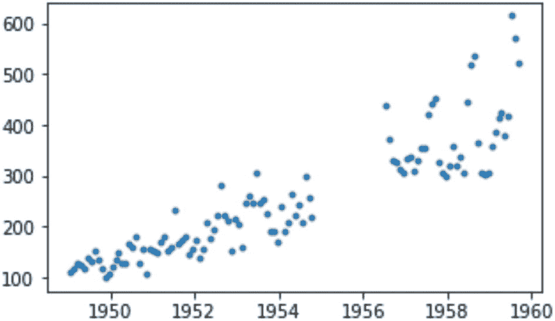

一个散点图，表示 1950 年至 1960 年间数量的计数。点的簇在整个年份中呈现增长趋势。y 轴上的值范围在 100 到 600 之间。

图 4-12
可视化月度航空公司乘客数量数据的训练集

让我们尝试一个普通的 RBF 核函数，并观察其拟合性能。以下代码清单使用了类似的超参数优化过程。唯一显著的区别是使用了 `double()` 函数将 GP 模型实例转换为双精度格式。

```
mean_fn = gpytorch.means.ConstantMean()
kernel_fn = gpytorch.kernels.ScaleKernel(gpytorch.kernels.RBFKernel())
model = GPRegressor(X_train, y_train, mean_fn, kernel_fn).double()
train(model, X_train, y_train)
plot_model(model, xlim = [1948, 1964])
代码清单 4-11
仅使用 RBF 核进行 GP 拟合
```

运行此代码清单将输出图 4-13，该图显示拟合性能较差，未能捕捉到结构成分。

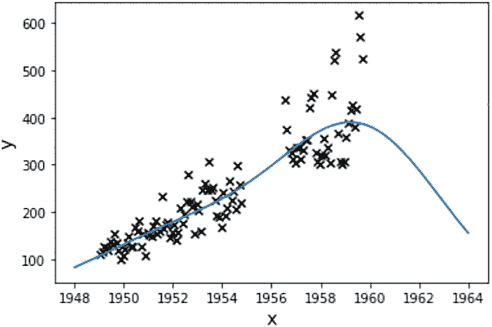

一个 y 对 x 的散点图，表示 1948 年至 1964 年间数量的计数。它显示了一条具有增长趋势的线，在 1958 年至 1960 年间达到峰值，之后下降。这些点具有与线相似的上升趋势，直至峰值点。

图 4-13
使用 RBF 核可视化 GP 回归拟合

拟合模型在插值区域（1949 年至 1960 年之间）显示出一个平滑的增长趋势，而在外推区域（1960 年之后）则显示出一个下降趋势。我们可以通过添加另一个一次多项式核来改善趋势分量的拟合性能，如下面的代码清单所示。

```
kernel_fn = gpytorch.kernels.ScaleKernel(gpytorch.kernels.PolynomialKernel(power=1)) + \
gpytorch.kernels.ScaleKernel(gpytorch.kernels.RBFKernel())
model = GPRegressor(X_train, y_train, mean_fn, kernel_fn).double()
train(model, X_train, y_train, verbose=False)
plot_model(model, xlim = [1948, 1964])
代码清单 4-12
添加 RBF 核和多项式核
```

运行上述代码将生成图 4-14，与之前相比，长期趋势显示出一定程度的灵活性。

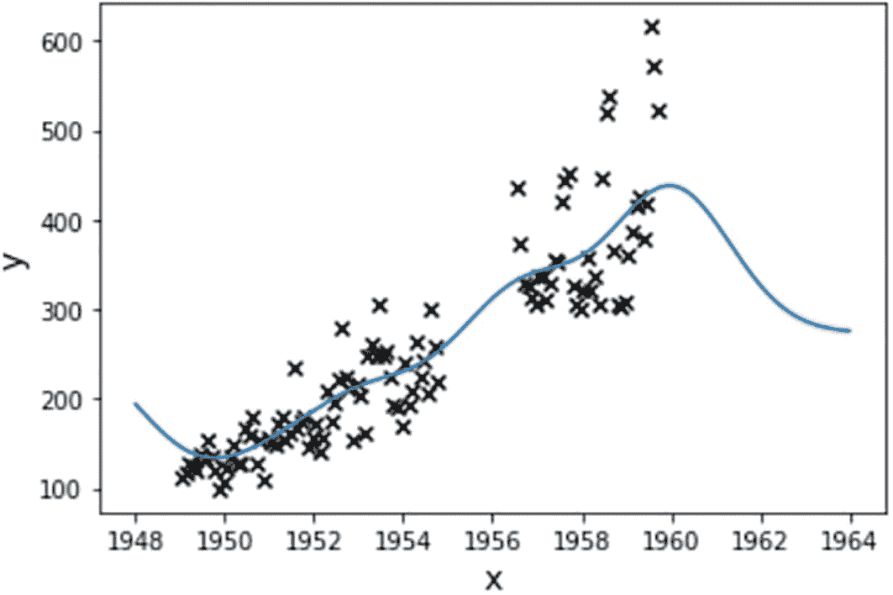


y 相对于 x 的散点图展示了 1948 年至 1964 年间数字的计数。图中呈现出一条呈上升趋势的曲线，大约在 1960 年达到峰值，随后下降。数据点在该峰值之前均遵循曲线的趋势。

图 4-14

使用 RBF 核与多项式核可视化高斯过程回归拟合

由于数据具有季节性，我们可以额外构建另一个核来捕捉这种季节性。在下面的代码清单中，我们通过组合周期核、线性核和 RBF 核，创建了一个名为 `k_seasonal` 的、用于捕捉季节性的核。然后，该核将通过 `AdditiveKernel()` 函数与之前的趋势捕捉核协同工作，`AdditiveKernel()` 是一个支持对多个分量核进行求和的实用函数。

```
k_trend = (gpytorch.kernels.ScaleKernel(gpytorch.kernels.PolynomialKernel(power=1)) +
gpytorch.kernels.ScaleKernel(gpytorch.kernels.RBFKernel()))
k_seasonal = (gpytorch.kernels.ScaleKernel(gpytorch.kernels.PeriodicKernel()) *
gpytorch.kernels.LinearKernel() *
gpytorch.kernels.ScaleKernel(gpytorch.kernels.RBFKernel()))
kernel_fn = gpytorch.kernels.AdditiveKernel(k_trend, k_seasonal)
gpytorch.kernels.ScaleKernel(gpytorch.kernels.RBFKernel())
model = GPRegressor(X_train, y_train, mean_fn, kernel_fn).double()
train(model, X_train, y_train, verbose=False)
plot_model(model, xlim = [1948, 1964])
代码清单 4-13
对趋势和季节性进行建模
```

运行上述代码将生成图 4-15，其中趋势和季节性成分被很好地捕捉到了。

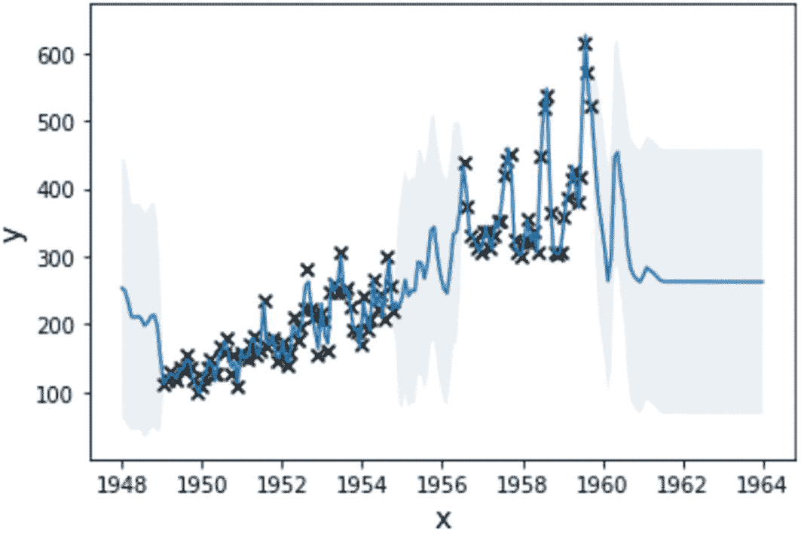

y 相对于 x 的折线图展示了 1948 年至 1964 年间数字的计数。该曲线经历了多个波峰和波谷，并呈现整体上升趋势。曲线上有几个点用十字标记标出。

图 4-15

使用趋势和季节性的复合核可视化高斯过程回归拟合

然而，由于在整个域上应用了均匀的噪声方差，拟合结果仍然显得有波动。在接下来的尝试中，我们将添加另一个核，该核会随着我们从左向右移动而增加噪声方差。这种核可以看作是白噪声核与线性核的乘积，其中白噪声核假设整个域上的方差恒定，而线性核在与白噪声核相乘时逐渐提升方差。

在下面的代码清单中，我们首先定义一个类作为白噪声核。当调用该类实例时，如果两个输入位置重叠，其 `forward()` 函数将返回预先指定的噪声方差（为效率起见，通过惰性张量格式包装），否则返回零。然后，该核与线性核相乘，以对异方差噪声分量进行建模，并将其添加到之前的两个复合核中，以联合建模高斯过程。

```
from gpytorch.lazy import DiagLazyTensor
class WhiteNoiseKernel(gpytorch.kernels.Kernel):
def __init__(self, noise=1):
super().__init__()
self.noise = noise
def forward(self, x1, x2, **params):
if torch.equal(x1, x2):
return DiagLazyTensor(torch.ones(x1.shape[0]).to(x1) * self.noise)
else:
return torch.zeros(x1.shape[0], x2.shape[0]).to(x1)
k_noise = gpytorch.kernels.ScaleKernel(WhiteNoiseKernel(noise=0.1)) * gpytorch.kernels.LinearKernel()
kernel_fn = gpytorch.kernels.AdditiveKernel(k_trend, k_seasonal, k_noise)
gpytorch.kernels.ScaleKernel(gpytorch.kernels.RBFKernel())
model = GPRegressor(X_train, y_train, mean_fn, kernel_fn).double()
train(model, X_train, y_train, verbose=False)
plot_model(model, xlim = [1948, 1964])
代码清单 4-14
对趋势、季节性和噪声进行建模
```

运行上述代码将生成图 4-16，此时高斯过程拟合看起来好多了。整体趋势、季节性和异方差噪声在内插区域被很好地捕捉，并在外推区域得以延续。

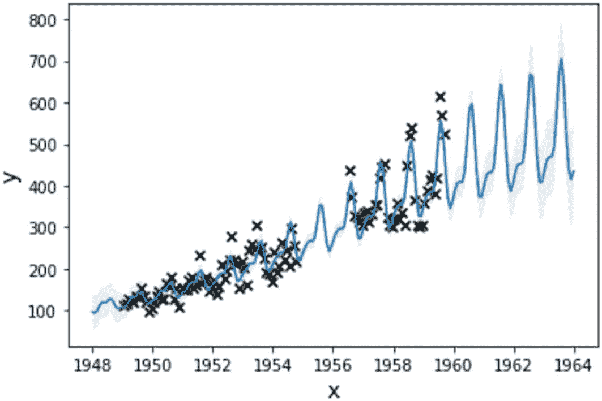

y 相对于 x 的折线图展示了 1948 年至 1964 年间数字的计数。该曲线经历了多个波峰和波谷，并呈现整体上升趋势。曲线上有几个点用十字标记标出，直至 1960 年。

图 4-16

使用趋势、季节性和异方差噪声的复合核可视化高斯过程回归拟合

## 总结

构建一个优秀的代理模型对于有效的贝叶斯优化至关重要。在本章中，我们讨论了最流行（且模块化）的高斯过程包之一 GPyTorch，及其在各个方面的应用。具体来说，我们涵盖了以下内容：

*   PyTorch 编码基础及其自动求导功能
*   精确高斯过程推断的逐步实现
*   通过最小化负对数边际似然来优化核函数和噪声方差的高斯过程超参数
*   形成复合核以实现更有效的高斯过程模型拟合
*   一个基于数据集特征开发近似核函数的案例研究

在下一章中，我们将研究蒙特卡洛采集函数，并介绍一系列优化技术，这些技术对于加速贝叶斯优化过程非常有用。

