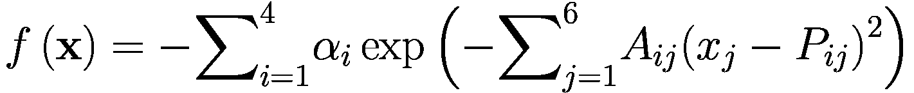
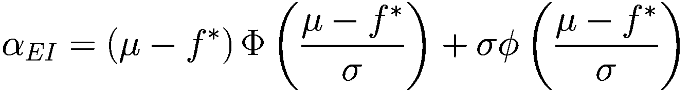
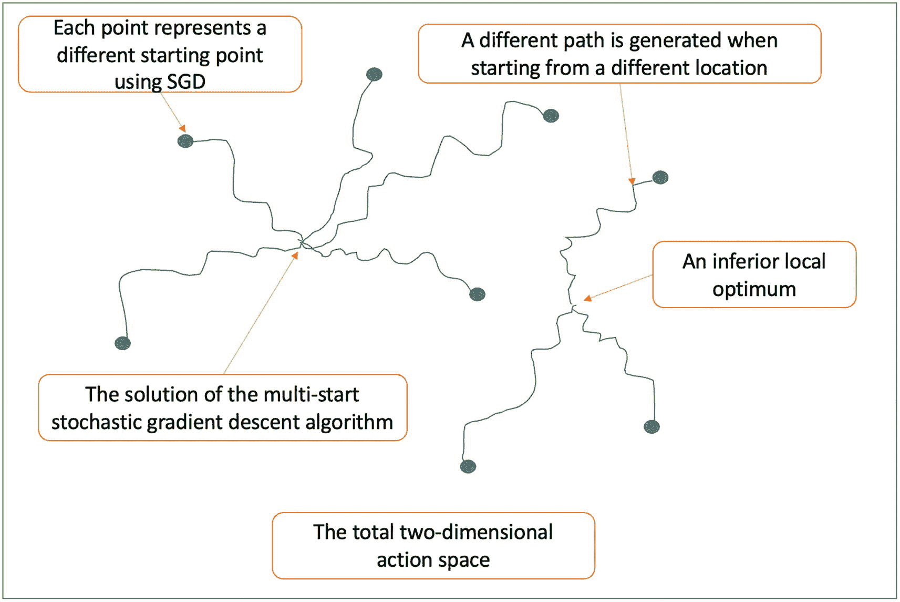
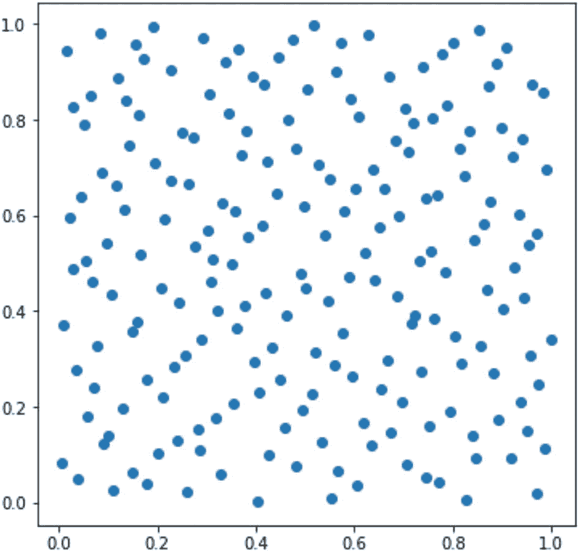
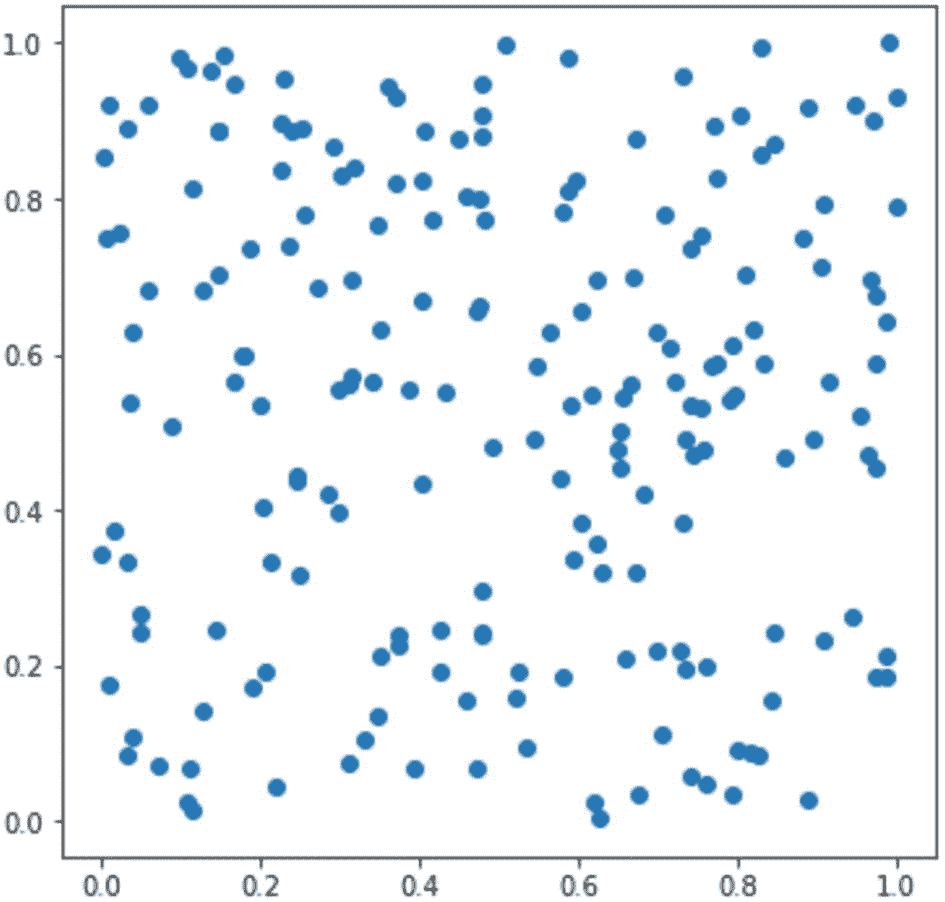
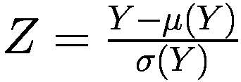
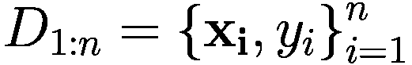
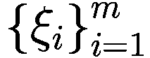
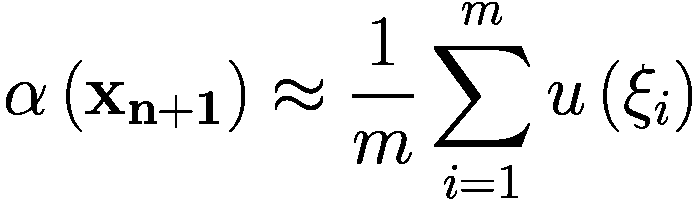
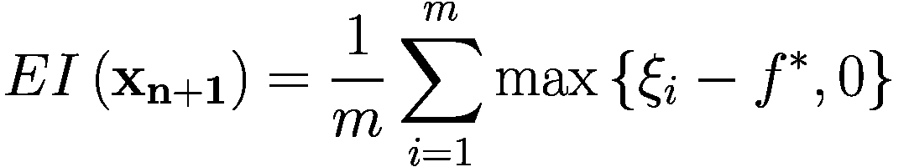

# 5. 使用 Sobol 序列和随机重启的蒙特卡洛采集函数

在上一章中，我们介绍了 GPyTorch，这是 BoTorch 用于使用 PyTorch 获取高斯过程后验的核心动力。这为我们介绍本章的主题 BoTorch 铺平了道路。具体来说，我们将重点介绍它如何实现第 3 章中介绍的期望提升采集函数，并执行内部优化以寻找下一个最佳采样位置候选。

此外，我们还将介绍另一种类型的采集函数，它没有解析解，只能通过蒙特卡洛方法计算。例子包括并行贝叶斯优化（其中每次外部优化会提出多个采样位置）以及非短视采集函数（如多步前瞻变体）。理解使用蒙特卡洛方法（包括准蒙特卡洛方法）在特定位置评估采集函数函数值的过程，是我们从本章开始研究 BoTorch 核心工作机制的基础。

## 使用 BoTorch 的解析期望提升

BoTorch 提供了多种类型的采集函数。虽然少数采集函数（如期望提升）具有解析形式，但大多数不具备此特性。我们将在本节中研究 BoTorch 中的解析期望提升，并在下一节切换到相应的基于蒙特卡洛的期望提升，后者需要蒙特卡洛估计来评估采集函数的函数值。

在下一节中，我们将介绍 Hartmann 函数，这是一个广泛使用的、用于基准测试优化算法性能的合成函数。


### 哈特曼函数简介

哈特曼函数是一个六维函数，包含六个局部极小值和一个全局极小值。有两件事值得我们立即关注。首先，该函数的定义域有六个维度，这比我们在第 3 章遇到的一维情况更复杂，并为搜索问题呈现了一个更具挑战性的状态空间。其次，函数形状是多模态的，具有多个局部极小值，这要求搜索算法能够高效探索，并避免陷入此类局部极小值。

哈特曼函数的形式如下：



其中 *α*[*i*]、*A*[*ij*] 和 *P*[*ij*] 均为常数。该函数通常在六维单位超立方体上进行评估，即对于所有 *j* = 1, …, 6，*x*[*j*] ∈ (0, 1)。全局极小值在 **x**^∗ = (0.20169, 0.150011, 0.476874, 0.275332, 0.311652, 0.6573) 处取得，此时 *f* (**x**^(**∗**)) = −3.32237。

让我们看看如何操作 BoTorch 中提供的哈特曼函数。首先，我们需要通过以下命令安装该包：

```
>>> !pip install botorch
```

接下来，我们将从 BoTorch 的 `test_function` 模块中导入它。此外，为了结果的可复现性，我们固定随机种子：

```
from botorch.test_functions import Hartmann
import numpy as np
import torch
import random
SEED = 8
random.seed(SEED)
np.random.seed(SEED)
torch.manual_seed(SEED)
```

我们可以在最大化设置中创建一个取反后的六维哈特曼函数实例。检查最优值返回 3.32237。

```
>>> neg_hartmann6 = Hartmann(dim=6, negate=True)
>>> neg_hartmann6.optimal_value
3.32237
代码清单 5-1
生成哈特曼实例
```

该实例将用于提供无噪声的函数评估。接下来，我们将在 `train_x` 中按照均匀分布创建十个随机采样位置，并在 `train_obj` 中获取相应的观测值，这里我们使用 `unsqueeze()` 函数将其转换为列向量：

```
# 从均匀分布创建 10x6 的随机数
train_x = torch.rand(10, 6)
# 获取相应的函数评估值作为列向量
train_obj = neg_hartmann6(train_x).unsqueeze(-1)
```

打印 `train_obj` 会得到包含在张量中的以下结果：

```
>>> train_obj
tensor([[0.1066],
[0.0032],
[0.0027],
[0.7279],
[0.0881],
[0.8750],
[0.0038],
[0.1098],
[0.0103],
[0.7158]])
```

接下来，我们将构建一个基于高斯过程的代理模型，并使用 GPyTorch 提供的工具优化相关的超参数，这是前一章讨论的主题。

### 具有优化超参数的 GP 代理模型

当底层代理模型是高斯过程，并且只有一个需要优化的目标值时，BoTorch 提供了 `SingleTaskGP` 类，用于在单任务设置下执行精确的 GP 推断。默认情况下，它使用带有 Matérn 核和常数均值函数的 GP 先验。下面，我们使用之前生成的初始训练数据实例化一个 GP 模型：

```
from botorch.models import SingleTaskGP
model = SingleTaskGP(train_X=train_x, train_Y=train_obj)
```

`model` 对象现在充当代理模型，并为单位超立方体内的任何采样位置提供后验均值和方差估计。

超参数可以通过 `named_hyperparameters()` 方法访问，如下所示，输出被包装在一个列表中以便打印生成器对象：

```
>>> list(model.named_hyperparameters())
[('likelihood.noise_covar.raw_noise', Parameter containing:
tensor([2.0000], requires_grad=True)),
('mean_module.constant', Parameter containing:
tensor([0.], requires_grad=True)),
('covar_module.raw_outputscale', Parameter containing:
tensor(0., requires_grad=True)),
('covar_module.base_kernel.raw_lengthscale', Parameter containing:
tensor([[0., 0., 0., 0., 0., 0.]], requires_grad=True))]
```

根据输出，长度尺度的默认值在所有六个维度上均为零，噪声方差为二。为了使用最大似然原理优化这些超参数，我们首先获取一个包含精确边际对数似然（存储在 `mll` 中）的实例，然后使用 `fit_gpytorch_model` 函数来优化 `GPyTorch` 模型实例的这些超参数。核心优化通过 `scipy.optimize.minimize()` 函数使用 L-BFGS-B 过程。以下代码片段执行了超参数的优化：

```
from gpytorch.mlls import ExactMarginalLogLikelihood
mll = ExactMarginalLogLikelihood(model.likelihood, model)
from botorch.fit import fit_gpytorch_model
fit_gpytorch_model(mll);
代码清单 5-2
优化 GP 模型的超参数
```

我们现在可以验证超参数，并检查这些值是否已更改。如下所示，超参数现在呈现不同的值，所有这些值都是通过最大化观测训练数据的边际对数似然而优化的：

```
>>> list(model.named_hyperparameters())
[('likelihood.noise_covar.raw_noise', Parameter containing:
tensor([0.0060], requires_grad=True)),
('mean_module.constant', Parameter containing:
tensor([0.2433], requires_grad=True)),
('covar_module.raw_outputscale', Parameter containing:
tensor(-2.1142, requires_grad=True)),
('covar_module.base_kernel.raw_lengthscale', Parameter containing:
tensor([[-0.7155, -0.7190, -0.7218, -0.8089, -1.1630, -0.5477]],
requires_grad=True))]
```

在下一节中，我们将使用期望改进采集函数的解析形式，并求解外部贝叶斯优化循环的解。


### 解析解析期望改进（Analytic EI）

`BoTorch` 提供了 `ExpectedImprovement` 类，它基于我们之前推导的解析公式，计算相对于当前最佳观测值的期望改进。它需要两个输入参数：一个具有单一输出且超参数已优化的 GP 模型，以及一个被视为无噪声的最佳观测标量值。该计算基于 GP 代理模型在单个特定采样位置的后验均值和方差。

让我们创建一个 `ExpectedImprovement` 实例，以计算任意给定位置的 EI。首先，我们将使用 `max()` 函数定位最佳观测值，并将结果存储在 `best_value` 中。如下代码片段所示，最高观测值为 0.875：

```
>>> best_value = train_obj.max()
>>> best_value
tensor(0.8750)
```

接下来，我们将基于 `best_value` 和后验 GP 模型对象实例化 EI 对象。在下面的代码片段中，我们将第一个观测值传递给 EI 对象，并得到一个几乎为零的结果 2.8202e-24。直观上看，这是合理的，因为从已采样位置获得的边际效用应该极小。

```
>>> from botorch.acquisition import ExpectedImprovement
>>> EI = ExpectedImprovement(model=model, best_f=best_value)
>>> EI(train_x[0].view(1,-1))
tensor([2.8202e-24], grad_fn=<AddBackward0>)
```

我们可以进一步检查 `BoTorch` 中 `ExpectedImprovement` 类的实现。下面，我们展示了该类 `forward()` 方法的定义，该定义来自 `BoTorch` 版本 0.6.5 的官方 GitHub 页面：

```
from torch import Tensor
from torch.distributions import Normal
def forward(self, X: Tensor) -> Tensor:
0# 将最佳观测值 best_f 的数据类型转换为候选点 X 的数据类型
self.best_f = self.best_f.to(X)
# 获取候选位置 X 处的后验实例
posterior = self.model.posterior(
X=X, posterior_transform=self.posterior_transform
)
# 获取后验均值
mean = posterior.mean
# 处理批量评估和广播
view_shape = mean.shape[:-2] if mean.shape[-2] == 1 else mean.shape[:-1]
mean = mean.view(view_shape)
# 获取后验标准差，并设置下限以避免除以零
sigma = posterior.variance.clamp_min(1e-9).sqrt().view(view_shape)
# 计算标准化单位改进，必要时广播 best_f
u = (mean - self.best_f.expand_as(mean)) / sigma
# 在最小化情况下切换符号
if not self.maximize:
u = -u
# 基于解析形式计算 ei
normal = Normal(torch.zeros_like(u), torch.ones_like(u))
ucdf = normal.cdf(u)
updf = torch.exp(normal.log_prob(u))
ei = sigma * (updf + u * ucdf)
return ei
代码清单 5-3
评估 EI 采集函数
```

在此函数中，我们首先使用张量对象的 `to()` 方法，将 `best_f` 的数据类型与候选位置 `X` 的数据类型对齐。然后，我们访问候选位置的后验均值和方差，其形状根据批量评估和广播需求进行调整，并且标准差设置了下限以避免除以零。通过计算出的单位改进 `u`，我们可以将其代入 EI 的解析形式（如下所示，便于参考）并执行相应计算：



其中 *f* ^∗ 是迄今为止的最佳观测值，*ϕ* 和 Φ 分别表示标准正态分布的概率密度函数和累积分布函数。请注意，代码提取出了公因子 *σ*，这使得实现更加容易。

接下来，我们将探讨如何使用 EI 优化黑箱 Hartmann 函数。

### 使用解析期望改进进行优化

由于大多数采集函数（如 EI）是非凸的且通常是平坦的，因此优化这些函数是一项不小的挑战。在这种情况下，设计一个能够在搜索全局最优值时跳出次优候选位置（如局部最优点或鞍点）的优化器至关重要。

优化能力主要由 `BoTorch` 中的 `optimize_acqf()` 函数提供，该函数使用基于随机梯度下降的多起点优化生成一组候选最优位置。特别地，多起点随机梯度下降方法被广泛用于许多机器学习和深度学习模型中的基于梯度的随机全局优化。让我们简要讨论一下这种优化方法。

随机梯度下降（SGD）是一种优化算法，它基于一个或一小批训练样本对变量执行基于梯度的更新。然而，当目标函数非凸时，基于 SGD 的方法难以定位全局最优点，反而容易收敛到鞍点或局部最优点。即使目标函数是凸的，当起始位置不利时，基于 SGD 的方法也难以收敛到全局最优点。

解决这些挑战的一个常见方法是，从多个起始位置（随机选择或根据某种自适应过程选择）执行 SGD。当起始位置的数量足够多样化时，我们可以并行运行多个 SGD 优化，并生成多条搜索路径。收敛后，我们将报告最有希望的候选位置（可被识别为具有最高采集函数值的位置）作为优化结果。通过这种方式，我们的基于 SGD 的方法更有可能跳出鞍点或局部最优点，并找到全局最优点。图 5-1 展示了多起点随机梯度下降算法。



该图展示了一个由二维动作空间组成的多起点随机梯度下降算法，使用多起点 SGD，每次重启可被视为一个独立的优化例程，在局部邻域内旨在定位一个局部最优点。

图 5-1

在二维动作空间中说明多起点随机梯度下降算法，其中选择多个起点以并行生成不同路径。最终解是通过收敛后聚合所有端点并取最佳候选点获得的。注意，在离散动作空间的情况下，需要额外投影到最近的采样位置

使用多起点 SGD，每次重启可被视为一个独立的优化例程，在局部邻域内旨在定位一个局部最优点。当聚合多次重启并取最佳解时，我们更有可能达到全局最优点。

当使用 `optimize_acqf()` 函数执行多起点优化时，起点数量通过 `num_restarts` 参数指定。此外，我们还需要通过 `bounds` 参数传递搜索空间的边界（一个六维单位超立方体），并通过 `raw_samples` 参数传递用于初始化的原始样本数量。由于我们在每次迭代中只提议一个采样位置，我们还需要设置 `q=1`。在每次迭代中提议多个位置涉及并行贝叶斯优化，这将在后续章节中讨论。

设置完所有这些输入参数后，我们可以运行以下代码片段来生成全局最优的最终解：


```
from botorch.optim import optimize_acqf
new_point_analytic, _ = optimize_acqf(
acq_function=EI, # 用于指导搜索的采集函数
bounds=torch.tensor([[0.0] * 6, [1.0] * 6]), # 六维单位超立方体
q=1, # 每次迭代生成一个候选位置
num_restarts=20, # 多起点优化的起始点数量
raw_samples=100, # 初始化的样本数量
options={}, # 其他选项（如有）
)
代码清单 5-4
获取使 EI 最大化的最佳采样位置
```

打印 `new_point_analytic` 中的候选解会得到以下结果。请注意，返回结果中通过下划线符号忽略了关联的采集函数值：

```
>>> new_point_analytic
tensor([[0.1715, 0.3180, 0.0816, 0.4204, 0.1985, 0.7727]])
```

`BoTorch` 的特点在于其优化不同采集函数时的计算效率。在下一节中，我们将深入探究 `optimize_acqf()` 函数的内部核心，并进一步了解其基于自动微分的优化流程。

### 深入理解内部优化流程

`BoTorch` 使用的默认优化器基于 `SciPy` 包中的 `scipy.optimize.minimize()` 函数，并采用了 `L-BFGS-B` 算法。该功能封装在 `gen_candidates_scipy()` 函数中，该函数从一组初始候选点出发，对预设的采集函数进行优化。但首先，让我们看看如何设置多起点优化流程的起始条件。由于底层实现封装得相当完善，且有多层函数相互调用，我们仅重点介绍与当前上下文相关的主要部分：优化解析 EI 并顺序提出候选搜索位置。

任何优化流程都始于初始条件，即优化器的起始点，该点可以随机设置，也可以遵循某种启发式方法设置。初始条件由 `optimize_acqf()` 中的可选参数 `batch_initial_conditions` 设定。由于该参数默认为 `None`，并且假设我们对生成初始优化条件没有先验偏好，`optimize_acqf()` 将使用 `gen_batch_initial_conditions()` 函数选择一组起始点，以运行基于梯度的多起点算法。

这组起始点（在 `BoTorch` 中也称为初始条件）是基于多项概率分布选择的，该分布的概率由采集函数的值决定，并额外通过一个温度超参数进行加权。选择初始条件涉及两个步骤：首先确定一个更大的随机位置集合（由 `raw_samples` 参数指定），以尽可能覆盖整个动作空间；然后从中选出一个有潜力的候选位置子集作为初始起点（由 `num_restarts` 指定）。让我们详细看看这两个步骤。

直观来说，一个好的初始条件在使用当前采集函数进行评估时，应具有相对较高的值。这需要构建一组空间填充点，以覆盖搜索空间的所有区域，避免遗漏任何大块搜索空间。尽管这些初始点是随机选择的，但直接遵循均匀分布并不能保证通过所提议的随机点集均匀覆盖整个搜索空间。相反，我们更希望得到一组彼此之间距离差异较小的拟随机序列点。

为此，`BoTorch` 使用 Sobol 序列沿每个维度对单位超立方体进行均匀划分。换句话说，使用 Sobol 序列生成的拟蒙特卡洛样本可以更均匀地填充空间，从而实现更快的收敛和更稳定的估计。Sobol 序列通过 `torch.quasirandom.SobolEngine` 类生成，该类接受三个输入参数：`dimension` 用于指定特征维度，`scramble` 用于指定序列是否进行加扰，`seed` 用于指定随机数生成器的种子。

在下面的代码片段中，我们在二维单位超立方体内生成了 200 个 Sobol 序列随机点。首先，通过指定相应的输入参数创建一个 `SobolEngine` 实例，并将其存储在 `sobol_engine` 中。然后调用 `draw()` 方法在 `sobol_samples` 中生成 200 个随机点，这些点进一步分解为 `xs_sobol` 和 `ys_sobol`，用于创建二维图：

```
from torch.quasirandom import SobolEngine
from matplotlib import pyplot as plt
plt.figure(figsize=(6,6))
sobol_engine = SobolEngine(dimension=2, scramble=True, seed=SEED)
sobol_samples = sobol_engine.draw(200)
xs_sobol = [x[0] for x in sobol_samples]
ys_sobol = [x[1] for x in sobol_samples]
plt.scatter(xs_sobol, ys_sobol)
代码清单 5-5
生成 Sobol 序列
```


运行这段代码片段将生成图 5-2。这些点似乎均匀分布在整个域中，提供了一个良好的空间填充设计，用于“热启动”优化过程。一个好的初始设计还能更好地估计期望算子等，并使用特定的优化例程更快地收敛到全局最优。



点的散点图显示其均匀分布在整个域中，提供了一个良好的空间填充设计，用于热启动优化过程。

图 5-2

由二维空间中 200 个拟随机点组成的 Sobol 序列。这些点均匀分布在整个空间中，在优化任务中提供了更好的估计和更快的收敛速度。

另一方面，按照均匀随机分布生成的空间填充设计可能无法均匀覆盖整个空间。以下代码片段在相同的二维单位超立方体中生成了 200 个均匀分布的点：

```
random_samples = torch.rand(200, 2)
xs_uniform = [x[0] for x in random_samples]
ys_uniform = [x[1] for x in random_samples]
plt.scatter(xs_uniform, ys_uniform)
清单 5-6
生成遵循均匀分布的随机样本
```

运行这段代码片段将生成图 5-3，其中空白区域比之前更明显。因此，遗漏这些区域将导致覆盖相对不足和次优的估计。



代码生成的散点图显示了在相同二维单位超立方体中均匀分布的 200 个点。

图 5-3

一个由 200 个点组成的空间填充设计，按照均匀分布生成，其覆盖的充分性明显低于 Sobol 序列。

在使用 Sobol 序列生成良好的覆盖后，下一步是获取采集函数的相应评估值。由于我们可以访问 EI 的解析解，计算这些评估值既廉价又直接。在 `Botorch` 中，Sobol 序列和相应的采集函数值分别存储在 `gen_batch_initial_conditions()` 函数内部的 `X_rnb` 和 `Y_rnb` 中。

最后一步是使用 `initialize_q_batch()` 函数生成一组初始条件，其输入参数包括 `X`（Sobol 序列集）、`Y`（相应的 EI 值）和 `n`（初始起点数量）。这里使用一种启发式方法，从 `X` Sobol 序列中无放回地选择 `n` 个初始条件，其中被选中的概率与 *e*^(*ηZ*) 成正比，*η* 是一个可选的输入温度参数，而  表示标准化后的 EI 值。换句话说，使用多项分布来选择 `n` 个初始条件，其中 EI 值高的位置更有可能被选中，从而为多起点优化过程提供良好的初始起点。

回到我们的运行示例。在以下代码片段中，我们使用 `gen_batch_initial_conditions()` 在一个六维单位超立方体中生成 20 个初始条件，其中通过 Sobol 序列创建了 100 个原始样本。打印返回结果 `Xinit` 的维度显示，它是一个 20x1x6 的张量，其中 20 表示初始条件的数量，1 表示每次 BO 外部迭代（即标准顺序 BO）中提议的采样位置数量，6 表示状态空间中的特征数量。

```
from botorch.optim.optimize import gen_batch_initial_conditions
Xinit = gen_batch_initial_conditions(acq_function=EI,
bounds=torch.tensor([[0.0] * 6, [1.0] * 6]),
q=1,
num_restarts=20,
raw_samples=100)
>>> Xinit.shape
torch.Size([20, 1, 6])
清单 5-7
在优化开始前生成一组初始条件
```

当在 `optimize_acqf()` 中使用时，`gen_batch_initial_conditions()` 在包装函数 `_gen_initial_conditions()` 内部被调用，该函数使用另一个条件来判断采集函数是否为知识梯度（KG），这是下一章将要讨论的主题。当没有提供特定的初始条件时，`_gen_initial_conditions()` 函数用于生成基于启发式的初始条件。作为参考，`optimize_acqf()` 中的以下代码段在优化开始前处理初始条件。另外，请注意，从这些初始起点开始的优化例程将并行执行，以提高计算效率。

```
def _gen_initial_conditions() -> Tensor:
ic_gen = (
gen_one_shot_kg_initial_conditions
if isinstance(acq_function, qKnowledgeGradient)
else gen_batch_initial_conditions
)
batch_initial_conditions = ic_gen(
acq_function=acq_function,
bounds=bounds,
q=q,
num_restarts=num_restarts,
raw_samples=raw_samples,
fixed_features=fixed_features,
options=options,
inequality_constraints=inequality_constraints,
equality_constraints=equality_constraints,
)
return batch_initial_conditions
if not initial_conditions_provided:
batch_initial_conditions = _gen_initial_conditions()
```

通过此函数生成的初始条件将存储在 `batch_initial_conditions` 变量中。按照惯例，仅在高级函数内部使用的函数以下划线开头，如 `_gen_initial_conditions()` 的情况。

基于上述启发式方法生成初始条件后，我们现在将进入核心优化阶段，使用基于梯度的方法和随机重启，这通过 `_gen_initial_conditions()` 函数中的另一个内置函数 `_optimize_batch_candidates()` 完成。

如前所述，实际的优化发生在 `gen_candidates_scipy()` 中，它基于 SciPy 提供的广泛使用的 `scipy.optimize.minimize()` 函数生成一组最优候选点。它从一组初始候选点开始，这些候选点作为优化的起点，并通过 `initial_conditions` 输入参数传入。它还将接受其他核心输入参数，例如采集函数 `acquisition_function`、`lower_bounds` 中的下界和 `upper_bounds` 中的上界。

让我们仔细检查核心优化例程。在以下代码中，我们演示了如何使用 `gen_candidates_scipy()` 生成一组最优候选点，并返回其中 EI 值最高的候选点：

```
from botorch.generation.gen import gen_candidates_scipy
batch_candidates, batch_acq_values = gen_candidates_scipy(
initial_conditions=Xinit,
acquisition_function=EI,
lower_bounds=torch.tensor([[0.0] * 6]),
upper_bounds=torch.tensor([[1.0] * 6]),
)
# 提取最佳候选点的索引
best = torch.argmax(batch_acq_values.view(-1), dim=0)
batch_candidates = batch_candidates[best]
```

打印 `batch_candidates` 中的最佳候选点，显示与之前完全相同的位置：

```
>>> batch_candidates
tensor([[0.1715, 0.3180, 0.0816, 0.4204, 0.1985, 0.7727]])
```


在 `gen_candidates_scipy()` 函数内部，损失（负 EI 值）相对于每个初始条件的梯度，会利用 PyTorch 的自动求导功能自动计算。具体来说，`f_np_wrapper()` 中的 `torch.autograd.grad(loss, X)` 这行代码用于对输入 `X` 执行 `loss` 的自动微分。以下代码片段展示了 `f_np_wrapper()` 的定义，方便参考，该函数返回候选位置处的 EI 评估值 `fval` 以及梯度 `gradf`。请注意，所有候选位置的损失被加在一起以加速计算，总损失将用于计算相对于每个单独位置的梯度。

```
def f_np_wrapper(x: np.ndarray, f: Callable):
"""给定一个 torch 可调用对象，根据 numpy 数组计算值 + 梯度。"""
if np.isnan(x).any():
raise RuntimeError(
f"在 {x.size} 个元素的数组 `x` 中，有 {np.isnan(x).sum()} 个元素是 NaN。"
)
X = (
torch.from_numpy(x)
.to(initial_conditions)
.view(shapeX)
.contiguous()
.requires_grad_(True)
)
X_fix = fix_features(X, fixed_features=fixed_features)
loss = f(X_fix).sum()
# 计算相对于输入的梯度（不会在叶节点中累积）
gradf = _arrayify(torch.autograd.grad(loss, X)[0].contiguous().view(-1))
if np.isnan(gradf).any():
msg = (
f"在 {x.size} 个元素的梯度数组 `gradf` 中，有 {np.isnan(gradf).sum()} 个元素是 NaN。"
"这通常表明存在数值问题。"
)
if initial_conditions.dtype != torch.double:
msg += " 请考虑使用 `dtype=torch.double`。"
raise RuntimeError(msg)
fval = loss.item()
return fval, gradf
代码清单 5-8
在候选位置评估 EI 及其梯度
```

由于在搜索空间的任意点都可以获得 EI 值和梯度，我们现在可以利用现成的优化器来执行基于梯度的优化。一个常见的做法是调用 `minimize()` 函数中的 “L-BFGS-B” 方法，这是一种拟牛顿法，用于估计目标函数（此处为解析 EI）的 Hessian 矩阵（二阶导数）。以下代码片段展示了 `gen_candidates_scipy()` 中执行优化的部分，其中初始条件存储在 `x0` 中，目标函数为 `f_np_wrapper`，优化结果存储在 `res` 中。有关完整的实现细节，建议读者参考官方的 `BoTorch` GitHub 仓库。

```
res = minimize(
fun=f_np_wrapper,
args=(f,),
x0=x0,
method=options.get("method", "SLSQP" if constraints else "L-BFGS-B"),
jac=True,
bounds=bounds,
constraints=constraints,
callback=options.get("callback", None),
options={k: v for k, v in options.items() if k not in ["method", "callback"]},
)
```

到目前为止，我们已经研究了在解析 EI 采集函数上进行优化的内部机制。请注意，在并行贝叶斯优化（即 `q>1`）的情况下，虽然提议的数量会增加，但解析解并非直接可得。在这种情况下，通常使用蒙特卡洛版本来近似指定输入位置处采集函数的真实值。我们将其称为 MC 采集函数，下一节将对此进行介绍。

## 使用 MC 采集函数

在寻找未知黑箱函数的全局最优解时，采集函数被用作一种启发式方法，用于衡量每个候选采样位置的相对效用。在这方面，有两种类型的采集函数：具有解析解的采集函数，以及没有解析表达式、其值只能通过蒙特卡洛估计进行近似以高效计算的采集函数。例如，涉及期望算子的采集函数，可以通过基于更新后的后验分布模拟的多个蒙特卡洛样本的平均值来近似。

假设我们已经观测到一个数据集 ，并且希望获得在任意下一个采样位置 **x**[**n + 1**] 处的采集函数 *α*(**x**[**n + 1**]) 的值。由于相应的观测值 *y*[*n* + 1] 尚未揭示，我们最好的策略是依赖期望效用，同时考虑在 **x**[**n + 1**] 处更新后的后验分布。具体来说，将 *ξ*~*P*(*f* (**x**[**n + 1**])| *D*[1 : *n*]) 表示为 **x**[**n + 1**] 处观测值的随机变量。采集函数 *α*(**x**[**n + 1**]) 的值将取决于 *ξ*，其效用记为 *u*(*ξ*)。为了积分掉 *ξ* 中的随机性，期望效用被用作采集函数的值，得到

![$$ \alpha \left({\textbf{x}}_{\textbf{n}+\textbf{1}}\right)=\mathbbm{E}\left[u\left(\xi \right)|\xi \sim P\left(f\left({\textbf{x}}_{\textbf{n}+\textbf{1}}\right)|{D}_{1:n}\right)\right] $$](images/527334_1_En_5_Chapter/527334_1_En_5_Chapter_TeX_Equc.png)

其中 *P*(*f* (**x**[**n + 1**])| *D*[1 : *n*]) 是在给定迄今为止观测到的 *D*[1 : *n*] 的条件下，*f* 在 **x**[**n + 1**] 处的后验分布。

然而，评估采集函数 *α*(**x**[**n + 1**]) 需要对后验分布进行积分，这通常在解析上难以处理且计算困难。在并行贝叶斯优化中提议多个采样位置时更是如此，因为此时通常不存在解析表达式。相反，我们只能通过在 **x**[**n + 1**] 处采样一组 *m* 个假定的蒙特卡洛观测值  来近似 *α*(**x**[**n + 1**])，得到



其中 *ξ*[*i*]~*P*(*f* (**x**[**n + 1**])| *D*[1 : *n*]) 是基于 **x**[**n + 1**] 处的后验分布采样的。在期望改进的背景下，我们将通过以下方式近似原始的闭式 EI：



其中 *f* ^∗ 是在无噪声观测模型中迄今为止收集到的最佳观测值。*ξ*[*i*]~*P*(*f* (**x**[**n + 1**])| *D*[1 : *n*]) 服从正态分布，其均值和方差分别记为 *μ*(**x**[**n + 1**]) 和 *σ*²(**x**[**n + 1**])。在实际实现中，通常使用重参数化技巧来解耦 *ξ*[*i*] 中的随机性。具体来说，我们可以将 *ξ*[*i*] 重新表示为 *μ*(**x**[**n + 1**]) + *L*(**x**[**n + 1**])*ϵ*[*i*]，其中 *L*(**x**[**n + 1**])*L*(**x**[**n + 1**])^(*T*)= *σ*²(**x**[**n + 1**]) 是 *σ*²(**x**[**n + 1**]) 的根分解，而 *ϵ*[*i*]~*N*(0, 1) 服从标准正态分布。

在 `BoTorch` 中，MC EI 由 `qExpectedImprovement` 类计算，其中 q 表示并行贝叶斯优化设置中的提议数量。


### 使用蒙特卡洛期望提升

`qExpectedImprovement` 类基于对多个点的蒙特卡洛模拟来计算批量 EI（称为 qEI）值，这些点是按照前述 Sobol 序列生成的样本。在此情况下，Sobol 序列是从给定采样位置的后验正态分布中采样得到的，该过程通过 `SobolQMCNormalSampler` 函数完成。

在下面的代码片段中，我们按照 Sobol 序列生成了总共 1024 个随机样本。首先，遵循重参数化方法，生成总共 1024 个基础样本并存储在 `sampler` 中。然后，这些样本经过由后验分布的均值和方差确定的缩放和平移操作，该后验分布是在第一个观测位置（即 `train_x[0][None, :]`）处评估的，并存储在 `posterior` 中。

```
from botorch.sampling import SobolQMCNormalSampler
sampler = SobolQMCNormalSampler(1024, seed=1234)
posterior = model.posterior(train_x[0][None, :])
samples = sampler(posterior)
```

我们可以通过将 `posterior` 传递给 `sampler` 来执行采样操作，结果打印如下：

```
>>> samples
tensor([[[0.0506]],
[[0.1386]],
[[0.1737]],
...,
[[0.1739]],
[[0.1384]],
[[0.0509]]], grad_fn=)
```

`samples` 的形状也显示共有 1024 个样本：

```
>>> samples.shape
torch.Size([1024, 1, 1])
```

有了这些随机样本，下一步是获取采集函数相应的评估值，以近似其期望值。然后对这些评估值进行平均，以生成在指定采样位置处采集函数的最终近似期望效用，因此得名蒙特卡洛采集函数。

这些计算通过 `qExpectedImprovement` 类完成，该类旨在并行 BO 框架中同时提出多个点。具体来说，执行以下四个步骤：

*   对 q 个输入点的联合后验分布进行采样

*   针对每个 MC 样本，评估相对于当前最佳值的提升

*   在 q 个点上进行最大化，并选择最佳值

*   对所有 MC 样本进行平均，以生成最终估计值

从数学上讲，*qEI*(**x**) 定义如下：

![$$ qEI\left(\textbf{x}\right)=\mathbbm{E}\left\{\underset{j=1,\dots, q}{\max}\left[\max \left({\xi}_j-{f}^{\ast },0\right)\right]\right\} $$](images/527334_1_En_5_Chapter/527334_1_En_5_Chapter_TeX_Equf.png)

其中 *ξ*[*i*]~*P*(*f* (**x**)| *D*)。使用 MC 近似结合重参数化技巧，我们可以近似 *qEI*(**x**) 如下：

![$$ qEI\left(\textbf{x}\right)\approx \frac{1}{m}\sum \limits_{i=1}^m\underset{j=1,\dots, q}{\max}\left[\max \left(\mu {\left(\textbf{x}\right)}_j+{\left(L\left(\textbf{x}\right){\epsilon}_i\right)}_j-{f}^{\ast },0\right)\right] $$](images/527334_1_En_5_Chapter/527334_1_En_5_Chapter_TeX_Equg.png)

其中 *ϵ*[*i*]~*N*(0, 1)。让我们看一个如何计算近似 qEI 值的示例。在下面的代码片段中，我们通过传入之前创建的 `model` 对象、`best_value` 中迄今为止观察到的最佳值以及 `sampler` 中的 qMC 采样器，来初始化一个 `qExpectedImprovement` 实例。然后，可以使用 `qEI` 中创建的实例在任何给定的采样位置提供评估。在这种情况下，当传入第一个观测位置时，评估值为零，这是合理的，因为任何观测位置的边际效用都应为零。

```
from botorch.acquisition import qExpectedImprovement
qEI = qExpectedImprovement(model, best_value, sampler)
>>> qEI(train_x[0][None, :])
tensor([0.], grad_fn=)
```

请注意，`[None, :]` 部分本质上为当前张量添加了一个大小为 1 的批次维度。

我们还可以插入存储在 `batch_candidates` 中的最佳候选位置，并观察 qEI 值，该值为 0.0538：

```
>>> qEI(batch_candidates[None, :])
tensor([0.0538], grad_fn=)
```

让我们使用闭式 EI 计算该值，如下所示：

```
>>> EI(batch_candidates[None, :])
tensor([0.0538], grad_fn=)
```

在 `qEI` 实例内部，前面提到的操作序列通过 `forward()` 函数执行，为了方便参考，将其包含如下：

```
def forward(self, X: Tensor) -> Tensor:
posterior = self.model.posterior(
X=X, posterior_transform=self.posterior_transform
)
samples = self.sampler(posterior)
obj = self.objective(samples, X=X)
obj = (obj - self.best_f.unsqueeze(-1).to(obj)).clamp_min(0)
q_ei = obj.max(dim=-1)[0].mean(dim=0)
return q_ei
代码清单 5-9
评估 qEI 采集函数
```

接下来，让我们应用这个 MC 版本的 EI 并寻找全局最优解。我们特别感兴趣的是，MC 采集函数是否会返回与解析版本相同的最优位置。在下面的代码片段中，我们首先实例化一个普通的采样器，它生成 500 个 Sobol 序列点，这些点将用于通过 `MC_EI` 对象估计每个提议位置的 MC EI 值。然后，这个采集函数将被传递到执行核心优化过程的同一个 `optimize_acqf()` 函数中。我们还设置了 PyTorch 的随机种子，以确保考虑到蒙特卡洛模拟中的随机性时结果可重现：

```
sampler = SobolQMCNormalSampler(num_samples=500, seed=0, resample=False)  # 500x100x1
MC_EI = qExpectedImprovement(
model, best_f=best_value, sampler=sampler
)
torch.manual_seed(seed=0) # 保持重启条件相同
new_point_mc, _ = optimize_acqf(
acq_function=MC_EI,
bounds=torch.tensor([[0.0] * 6, [1.0] * 6]),
q=1,
num_restarts=20,
raw_samples=100,
options={},
)
```

检查 `new_point_mc` 中的结果，发现该位置与解析 EI（保存在 `new_point_analytic` 中）的位置非常匹配：

```
>>> new_point_mc
tensor([[0.1715, 0.3181, 0.0816, 0.4204, 0.1985, 0.7726]])
```

我们还可以检查这两个向量之间差值的范数：

```
>>> torch.norm(new_point_mc - new_point_analytic)
tensor(0.0001)
```

请记得查看随附的笔记本，网址为 [`https://github.com/Apress/Bayesian-optimization/blob/main/Chapter_5.ipynb`](https://github.com/Apress/Bayesian-optimization/blob/main/Chapter_5.ipynb)。

## 总结

许多采集函数都涉及模型输出在特定采样位置处的某个实值函数的期望。蒙特卡洛版本的采集函数不是直接计算期望算子中的积分运算，而是提供了一种便捷的途径，通过 MC 模拟来评估原始采集函数的值，从而避免了积分并提供了更快的计算速度。具体来说，我们涵盖了以下内容：

*   使用 BoTorch 优化解析期望提升

*   用于通过多条路径并行寻找最优解的多起点优化过程，每条路径都从一个随机的、基于启发式的初始条件开始

*   与均匀随机采样相比，使用 Sobol 序列的优势

*   蒙特卡洛期望提升采集函数及其与对应版本的比较

在下一章中，我们将讨论另一种称为知识梯度（KG）的采集函数，以及在使用 KG 执行顺序搜索时的一次性优化技术。


