# 6. 知识梯度：嵌套优化 vs. 一次性学习

在上一章中，我们学习了使用 BoTorch 进行优化过程的内部机制，重点介绍了该框架的自动微分机制和模块化设计。这为我们插入和测试许多新的采集函数铺平了道路。在本章中，我们将把采集函数的工具包扩展到知识梯度（KG），这是一种非贪婪的采集函数，在许多情况下表现优于期望改进（EI）。

尽管经验上更优，但在任意位置计算 KG 值并非易事。KG 采集函数的非贪婪特性增加了计算复杂度，因为其解析形式不可用，并且每次 KG 评估都需要执行嵌套优化；因此需要借助近似方法来获得 KG 值的评估。除了介绍 KG 采集函数的公式外，本章还涵盖了用于计算 KG 值的主流近似方法。特别地，我们将阐述 BoTorch 框架中提出的*一次性 KG*（OKG）公式，该公式通过使用*样本平均近似*（SAA）等技术，将嵌套优化问题转化为确定性优化设置，从而显著加速计算。我们还将深入探讨 OKG 在 BoTorch 中的实现，揭示这种新颖优化技术的实际用法。

## 知识梯度简介

知识梯度（KG）是一种非贪婪的采集函数，它考虑了一个额外的假定观测对期望效用边际改进的影响，其形式基于风险中性视角下的 GP 代理模型的后验均值。这意味着随机变量是根据其期望值来评估的。

KG 采集函数最初由 Frazier 等人在其 2009 年题为“The Knowledge-Gradient Policy for Correlated Normal Beliefs”的论文中提出，由于其非贪婪的特性，在采集函数的大家族中广受欢迎。在该论文中，作者将知识量解释为基于已收集数据集 `D` 的全局奖励（最大后验均值），并将知识梯度采集函数 `alpha_KG(x; D)` 定义为在 **x** 处获得一次评估后知识的期望增量。

让我们从相同的设定开始，我们希望最大化一个未知的黑箱函数 `f: X -> R`，其中 `X ⊂ R^d` 是一个紧集。假设我们已经在 `D_n = { (x_i, y_i) }_{i=1}^n` 中收集了总共 n 对位置-值观测，并且 `y[i] = f(x[i]) + epsilon[i]` 是带有噪声的观测模型，其中 `epsilon_i ~ N(0, sigma^2)`。对于任意位置 `x ∈ X`，我们可以依赖后验均值函数的闭式表达式来计算其预测均值函数 `mu_{D_n}(x) = mu(x; D_n) = E(y | x, D_n)`。

### KG 采集函数的定义

采用与 EI 类似的方法，我们将已收集数据集 `D_n` 的效用定义为预测均值函数的最大值，即 `u(D_n) = mu_{D_n}^* = max_{x∈X} mu_{D_n}(x)`。如果最大后验均值增加，则效用增加，这与位置无关。敏锐的读者可能已经立即意识到这与 EI 中的效用函数的细微差别，EI 使用最大观测值作为当前观测数据集 `D_n` 的效用（假设为无噪声模型）。

理解预测均值函数 `mu(x; D_n)` 作用的另一种方式是，它作为我们对潜在目标函数 f(x) 的估计。也就是说，`mu(x; D_n)` 是对 f(x) 的最佳平均情况估计，而相应的预测标准差函数 `sigma(x; D_n)` 则量化了特定位置的不确定性水平。因此，预测均值函数的最大值 `mu_{D_n}^*` 近似于真实的全局最大值 `f^* = max_{x∈X} f(x)`。

现在假设我们要在 `x_{n+1}` 处获取一个额外的观测值，其对应的观测结果为 `y_{n+1}`。这个额外的观测值会将我们的训练数据集扩充为 `D_{n+1} = D_n ∪ { (x_{n+1}, y_{n+1}) }`。我们可以通过新预测函数的最大值来定量评估该位置（以及任意其他位置）的价值，或者等价地评估扩充后数据集的效用，即 `u(D_{n+1}) = mu_{D_{n+1}}^* = max_{x∈X} mu_{D_{n+1}}(x)`。那么，基于额外数据对 (`x_{n+1}`, `y_{n+1}`) 的改进可以计算为 `mu_{D_{n+1}}^* - mu_{D_n}^*`。

然后，我们可以将 KG 函数定义为在 `D_n` 和 `D_{n+1}` 之间效用的期望边际增量，其非短视特性体现在它是在各种未来模拟下的期望结果。具体来说，候选位置 **x** 处的 KG 函数 `alpha_KG(x; D_n)` 定义如下：

```
alpha_KG(x; D_n) = E[ u(D_{n+1}) | x_{n+1}=x, D_n ] - u(D_n)
```

## 知识梯度（KG）采集函数

![$$ {\alpha}_{KG}\left(\textbf{x};{\mathcal{D}}_n\right)={\mathbb{E}}_{p\Big(y\left|\textbf{x},{\mathcal{D}}_n\right)}\left[{\mu}_{{\mathcal{D}}_{n+1}}^{\ast }-{\mu}_{{\mathcal{D}}_n}^{\ast}\right] $$](images/527334_1_En_6_Chapter/527334_1_En_6_Chapter_TeX_Equa.png)

![$$ ={\mathbb{E}}_{p\Big(y\left|\textbf{x},{\mathcal{D}}_n\right)}\left[{\mu}_{{\mathcal{D}}_{n+1}}^{\ast}\right]-{\mu}_{{\mathcal{D}}_n}^{\ast } $$](images/527334_1_En_6_Chapter/527334_1_En_6_Chapter_TeX_Equb.png)

![$$ =\int \left[\underset{\textbf{x}^{\prime}\in \mathcal{X}}{\max }{\mu}_{{\mathcal{D}}_{n+1}}\left({\textbf{x}}^{\prime}\right)\right]p\Big(y\left|\textbf{x},{\mathcal{D}}_n\right) dy-\underset{\textbf{x}^{\prime}\in \mathcal{X}}{\max }{\mu}_{{\mathcal{D}}_n}\left({\textbf{x}}^{\prime}\right) $$](images/527334_1_En_6_Chapter/527334_1_En_6_Chapter_TeX_Equc.png)

这里，期望是针对给定位置 `x[n+1]` 处的随机变量 `y[n+1]` 来计算的。`y[n+1]` 的不同实现会导致效用函数边际增益的不同增加。通过对 `y[n+1]` 的随机性进行积分，我们得到了效用的期望平均边际增益。这种基于全局奖励效用的一步前瞻公式构成了 KG 采集函数。

KG 的全局性也意味着最后要评估的点不一定必须是之前评估过的位置之一；我们愿意在搜索过程终止时承诺一个新的位置。对于每个新位置，该积分实际上考虑了预测后验均值函数下所有可能的观测值。图 6-1 总结了 KG 采集函数的定义。

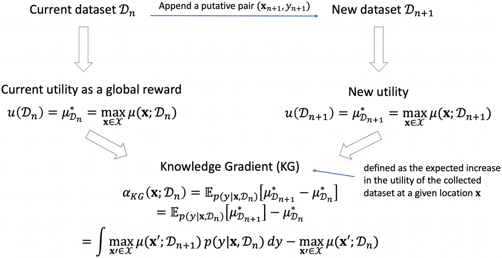

一个流程图总结了 KG 采集函数及其定义。当前数据集指向当前效用（作为全局奖励），新数据集指向新效用，两者都指向 KG。当前数据集通过附加一个假定的数据对得到新数据集。

图 6-1

知识梯度采集函数示意图

在制定了 KG 采集函数之后，我们将在下一节中研究其在优化过程中的计算方法。

### 蒙特卡洛估计

鉴于 KG 采集函数中涉及的期望算子，由于解析求解困难，在每个位置计算 KG 值并非易事。然而，我们可以使用蒙特卡洛（MC）模拟来近似特定位置的 KG 值。在这种情况下，KG 采集函数 $$ \hat{\alpha_{KG}}\left(\textbf{x};{\mathcal{D}}_n\right) $$ 可以通过从当前后验 GP 模型中总共生成 `M` 个随机样本来计算：

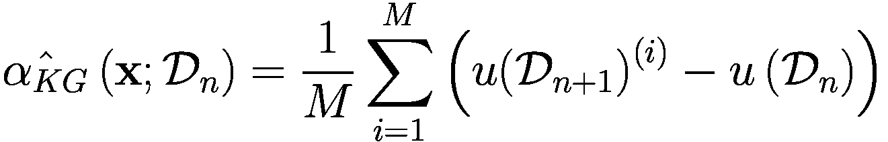

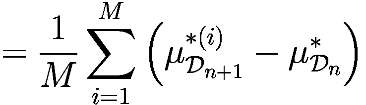

其中，每个第 `i` 个假设样本 `y^((i))` 是基于相应的 GP 后验生成的，即 $$ {y}^{(i)}\sim p\left(y|\textbf{x},{\mathcal{D}}_n\right) $$。此外，$$ {\mu}_{{\mathcal{D}}_{n+1}}^{\ast (i)}=\underset{\textbf{x}\in \mathcal{X}}{\max }{\mu}_{{\mathcal{D}}_{n+1}^{(i)}}\left(\textbf{x}\right) $$，并且 $$ {\mathcal{D}}_{n+1}^{(i)}={\mathcal{D}}_n\cup \left\{\left(\textbf{x},{y}^{\left(\boldsymbol{i}\right)}\right)\right\} $$ 是在获取额外数据对后的模拟增强数据集。随着蒙特卡洛样本数量 `M` 的增加，$$ \hat{\alpha_{KG}}\left(\textbf{x};{\mathcal{D}}_n\right) $$ 将更好地逼近 $$ {\alpha}_{KG}\left(\textbf{x};{\mathcal{D}}_n\right) $$。在极端情况下，当 `M` → ∞ 时，该近似将是无偏的，即 $$ \hat{\alpha_{KG}}\left(\textbf{x};{\mathcal{D}}_n\right)={\alpha}_{KG}\left(\textbf{x};{\mathcal{D}}_n\right) $$。

请注意，在定位最大后验均值时，我们可以使用非线性优化方法（例如 `L-BFGS-B`）来沿着后验均值曲线定位全局最大值。`L-BFGS-B` 是一种二阶优化算法，我们在之前使用 `SciPy` 提供的 `minimize()` 优化例程时曾遇到过。

图 6-2 展示了针对某些采集函数使用蒙特卡洛模拟进行优化的通用示意图，其中 $$ \hat{\alpha_{KG}}\left(\textbf{x};{\mathcal{D}}_n\right) $$ 中的 MC 积分用于通过来自后验分布的样本 $$ {\left\{{y}^{(i)}\right\}}_{i=1}^M $$ 来近似 $$ {\alpha}_{KG}\left(\textbf{x};{\mathcal{D}}_n\right) $$ 中的期望。

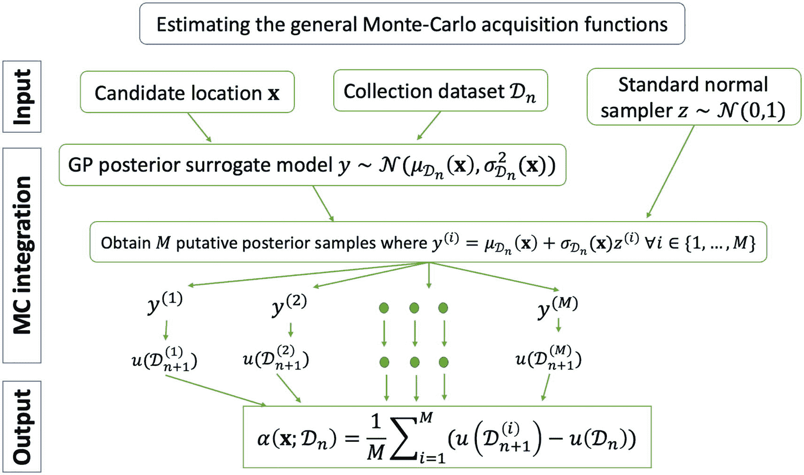

估计通用蒙特卡洛采集函数的示意图。输入是候选位置 `x`、收集的数据集 `D_n` 以及标准正态采样器 `z ~ N[0,1]`。MC 积分涉及 GP 后验代理模型和样本。输出，`α(x, D_n) = (1/M) * Σ_{i=1}^M [u(D_{n+1}^{(i)}) - u(D_n)]`。

图 6-2

优化通用蒙特卡洛采集函数的示意图

# KG值的评估算法与优化

让我们看看可用于评估给定采样位置 KG 值的算法。如图 6-3 所示，我们首先基于收集的数据集 `D_n` 计算最大后验均值 `μ_{D_n}^*`，然后进入主循环以基于模拟计算近似的 KG 值。在每次迭代中，我们在所考虑的位置 `x` 处，模拟一个均值为 `μ_{D_n}(x)`、方差为 `σ_{D_n}²(x)` 的正态分布随机变量的一个实现 `y`^((*i*))。等价地，我们可以首先生成一个标准正态实现 `z^{(i)} ~ N(0, 1)`，然后应用尺度平移变换得到 `y^{(i)} = μ_{D_n}(x) + σ_{D_n}(x)z^{(i)}`，这是第 2 章讨论的主题。在获得新的模拟值并将其附加到数据集以形成 `D_{n+1}^{(i)}` 后，我们可以获取一个新的最大后验均值 `μ_{D_{n+1}}^{*(i)}`，然后可以用它来计算效用的单次改进，即 `μ_{D_{n+1}}^{*(i)} - μ_{D_n}^*`。循环完成后，返回平均改进值作为近似的 KG 值，即 `α̂_{KG}(x; D_n) = (1/M) Σ_{i=1}^M (μ_{D_{n+1}}^{*(i)} - μ_{D_n}^*)`。

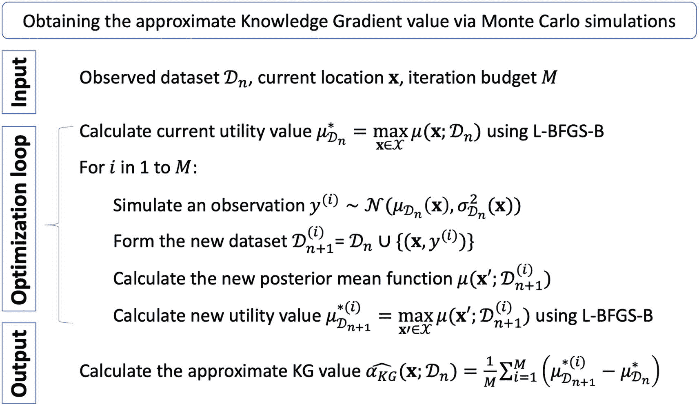
*图 6-3：通过蒙特卡洛模拟获取近似知识梯度值的图表，包括输入、优化循环和输出。输入过程涉及观测数据、当前位置和迭代预算。优化循环涉及计算当前效用值、模拟一个观测值、形成新数据集、计算新的后验均值函数以及计算新的效用值。输出给出近似的 KG 值。*

因此，使用蒙特卡洛模拟，我们本质上是在所有 `M` 次模拟中，计算增强数据集 `D_{n+1}^{(M)}` 与现有数据集 `D_n` 之间最大预测均值的平均差异。这也是涉及定位最大后验均值的内部优化过程，而外部优化过程则涉及在整个域内定位最大 KG 值。

然而，在高维问题中，计算成本极其高昂。在下一节中，我们将放大视角，审视使用 KG 的整体优化过程。

## 利用知识梯度进行优化

使用 KG 执行贝叶斯优化计算量很大。例如，我们首先需要模拟 `M` 个样本，以便在给定位置 `x` 处计算 `α̂_{KG}(x; D_n)`。每个模拟样本都需要执行一次最大化运算，以基于增强后的数据集定位最大后验均值。为了进一步增加算法的计算复杂度，我们需要评估不同的位置，从而确定具有最高 KG 值的最佳采样位置，即 `x_{n+1} = argmax_{x ∈ X} α̂_{KG}(x; D_n)`。

为了加速优化过程，我们可以采用上一章介绍的随机梯度下降（SGD）等一阶方法。在多起点方案下，我们会并行启动多个 SGD 运行，观察最终收敛的位置，并选择其中 KG 值最高的位置作为下一个采样点。

为了应用随机梯度下降法迭代地逼近局部最优点，我们需要获取（代理）目标函数相对于当前位置的梯度，即 `∇_x α_{KG}(x; D_n)`。由于 `α_{KG}(x; D_n)` 是通过 `α̂_{KG}(x; D_n)` 近似的，我们可以使用 SGD（更准确地说，是在最大化场景下的随机梯度上升）并计算 `∇_x α̂_{KG}(x; D_n)` 来引导搜索向局部最优进行。换句话说，我们希望使用以下迭代公式，从当前位置 `x[t]` 获得下一个评估位置 `x[t+1]`：

`x_{t+1} = x_t + α_t ∇_{x_t} α_{KG}(x_t; D_n)`

现在让我们来看梯度项 `∇_{x_t} α_{KG}(x_t; D_n)`。代入 `α_{KG}(x_t; D_n)` 的定义，得到：

`∇_{x_t} α_{KG}(x_t; D_n) = ∇_{x_t} E_{p(y | x_t, D_n)} [μ_{D_{n+1}}^* - μ_{D_n}^*] = ∇_{x_t} E_{p(y | x_t, D_n)} [μ_{D_{n+1}}^*]`

这里，我们移除了项
```
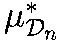
```
，因为梯度不依赖于一个固定的常数。

在计算期望项的梯度时，可以应用一种称为*无穷小扰动分析*的有用技术来简化计算，该技术本质上将梯度算子∇视为线性算子。具体来说，在底层目标函数满足充分正则性条件的情况下，我们可以交换梯度算子和期望算子，得到如下结果：

```
![$$ {\nabla}_{{\textbf{x}}_t}{\alpha}_{KG}\left({\textbf{x}}_t;{\mathcal{D}}_n\right)={\nabla}_{{\textbf{x}}_t}{\mathbb{E}}_{p\Big(y\left|{\textbf{x}}_t,{\mathcal{D}}_n\right)}\left[{\mu}_{{\mathcal{D}}_{n+1}}^{\ast}\right]={\mathbb{E}}_{p\Big(y\left|{\textbf{x}}_t,{\mathcal{D}}_n\right)}\left[{\nabla}_{{\textbf{x}}_t}{\mu}_{{\mathcal{D}}_{n+1}}^{\ast}\right] $$](images/527334_1_En_6_Chapter/527334_1_En_6_Chapter_TeX_Equh.png)
```

将期望算子移到外层后，我们可以应用相同的蒙特卡洛技术来采样一个包含`M`个梯度的列表
```
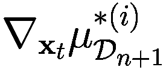
```
，其中`i` ∈ {1, …, `M`}，然后取平均值。

现在，问题是如何为给定的位置`x[t]`和模拟观测值`y^((i))`计算单个梯度
```

```
。回顾一下，
```
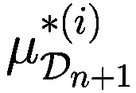
```
是在观测到假定的配对 (`x[t]`, `y^((i))`) 之后的最大后验均值，即：

```
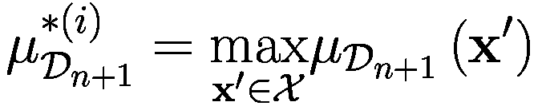
```

换句话说，我们正在计算一个最大值（该最大值取自位于不同`x'`处的无限多个后验均值）的梯度。这些后验均值也是`x[t]`（即当前正在考虑的位置）的函数。同样，在底层目标函数满足充分正则性条件的情况下，我们可以使用*包络定理*来简化梯度计算。具体来说，我们首先从无限多个后验均值中识别出最大的后验均值，然后对这个最大值（它是`x[t]`的函数）关于`x[t]`求导。

将
```
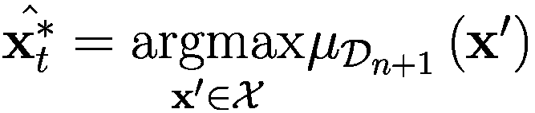
```
记为最大化后验均值函数
```
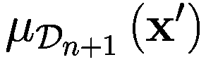
```
的位置。然后，我们可以保持
```

```
固定，并计算
```
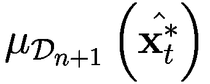
```
关于`x[t]`（当前正在考虑的位置）的梯度，即：

```

```

然后，我们可以利用 PyTorch 中的自动微分功能，在最大化位置
```
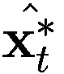
```
处评估后验均值函数后，计算关于当前位置`x[t]`的梯度。图 6-4 总结了梯度计算推导过程中涉及的技术。

```
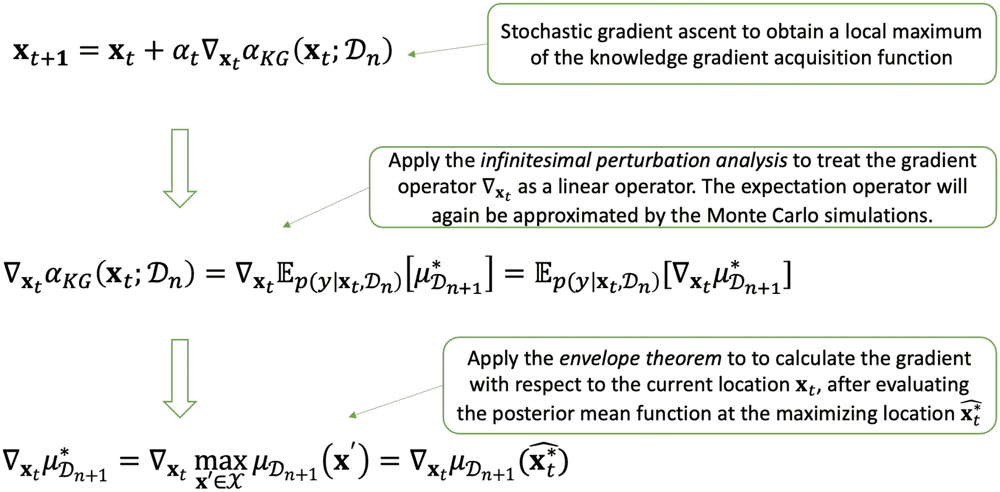
```

一个流程图总结了梯度计算推导中涉及的三个步骤。使用随机梯度上升法获取局部最大值。应用无穷小扰动分析来处理梯度算子。应用包络定理来计算梯度。

图 6-4

说明给定位置的梯度计算过程

请注意，我们仍然使用相同的蒙特卡洛技术，通过模拟来处理期望算子。在图 6-5 中，我们总结了用于计算 SGD 更新所需梯度元素的算法，其中使用 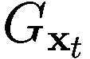 表示当前运行位置`x_t`处 KG 的梯度。在该算法中，我们总共执行`J`次模拟来近似 KG 梯度。在每次迭代中，我们首先在当前运行位置`x_t`处获得一个推测观测值 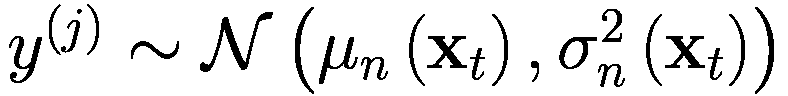，并形成新的后验均值函数 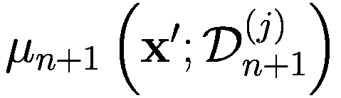。接着，我们使用常规优化协议`L-BFGS-B`来定位最大值点 ，并计算关于`x_t`的最大后验函数值的单个梯度 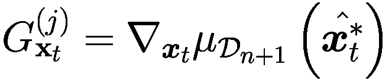。最后，我们对多个 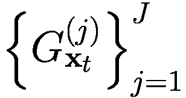 实例进行平均，并将其作为当前轮次 SGD 更新的近似 KG 梯度 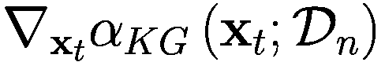 返回，即 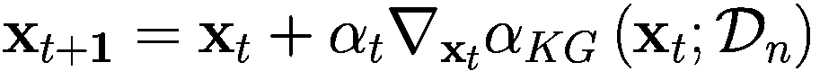。该平均操作具有理论保证，因为平均 KG 梯度的期望值等于 KG 值的真实梯度，即 ![$$ \mathbb{E}\left[{G}_{{\boldsymbol{x}}_t}\right]={\nabla}_{{\textbf{x}}_t}{\alpha}_{KG}\left({\textbf{x}}_t;{\mathcal{D}}_n\right) $$](images/527334_1_En_6_Chapter/527334_1_En_6_Chapter_TeX_IEq70.png)。

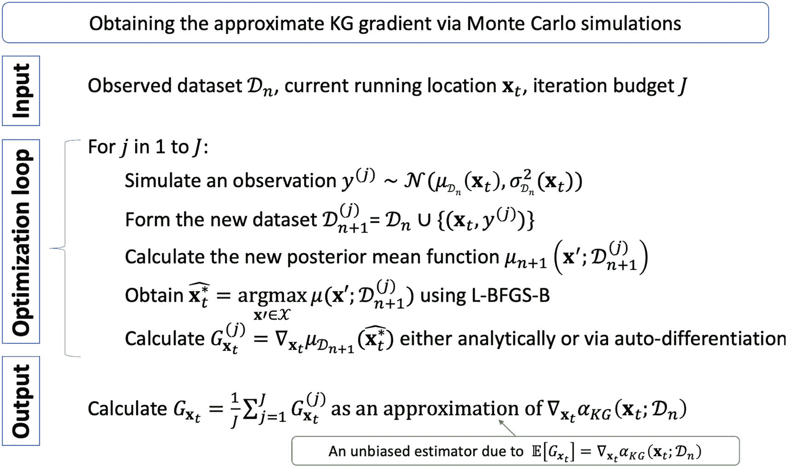

一个通过蒙特卡洛模拟计算 KG 梯度的算法流程图，包含输入、优化循环和输出。输入过程涉及观测数据、当前运行位置和迭代预算。优化循环包括模拟一个观测值、形成新数据集、计算新的后验均值函数以及计算新的效用值。输出给出近似的 KG 值。

**图 6-5**

说明使用蒙特卡洛模拟计算 KG 梯度的算法

同样，我们可以使用前一章提到的重参数化技巧来估计给定位置`x`处的梯度 。具体来说，基于给定已收集数据集 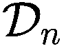 在位置`x`处的预测后验分布进行采样的随机变量 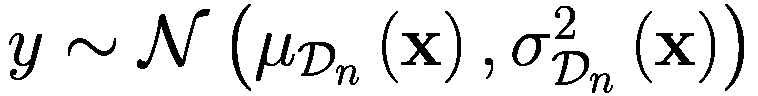 可以表示为 ，其中  且 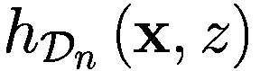 是关于`x`的可微函数。当 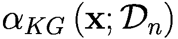 也关于`x`可微时，我们有 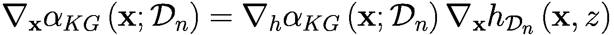。通过这种可微且确定性的变换引入辅助随机变量`z`，有助于使微分的链式法则更加明确，并且不受后验分布参数均值 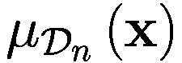 和方差 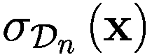 的混淆。有关用于获得 KG 采集函数梯度的无偏估计的重参数化技巧的说明，请参见图 6-6。

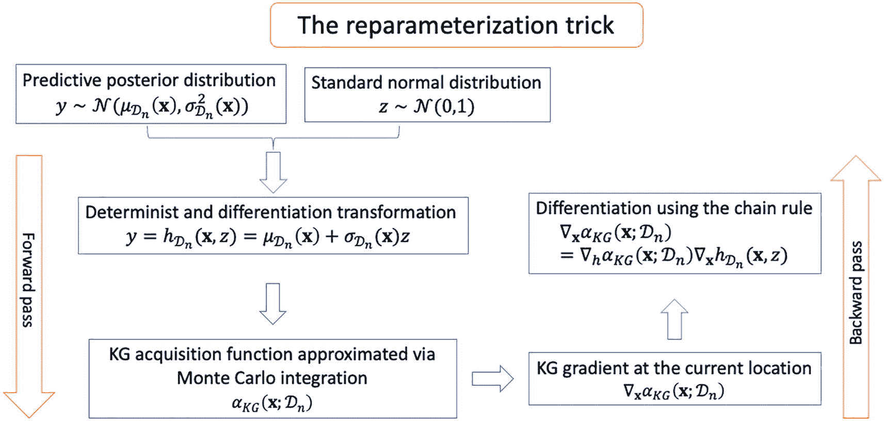

重参数化技巧的流程。它涉及预测后验分布和标准正态分布，经过确定性和可微变换，到通过蒙特卡洛积分近似的 KG 采集函数，再到当前位置的 KG 梯度，最后通过链式法则进行微分。

**图 6-6**

说明用于 KG 采集函数梯度计算的重参数化技巧

现在我们可以转向外部优化，从全局视角来看：导航至具有（局部）最大 KG 值的采样位置。如前所述，我们执行多起点随机梯度上升过程，并选择具有最高 KG 值的最佳候选点作为下一个采样位置。

图 6-7 提供了算法框架的详细信息。在优化开始前，我们准备已收集的数据集 、重启次数的总迭代预算`R`和梯度上升更新次数的总迭代预算`T`，以及梯度上升更新所用的步长。我们选择一个随机点 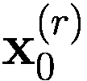 作为随机梯度上升更新每条路径的起点。每个起点将演变为 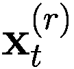 中的一系列更新序列，并最终收敛至 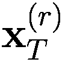 处的局部最小值。

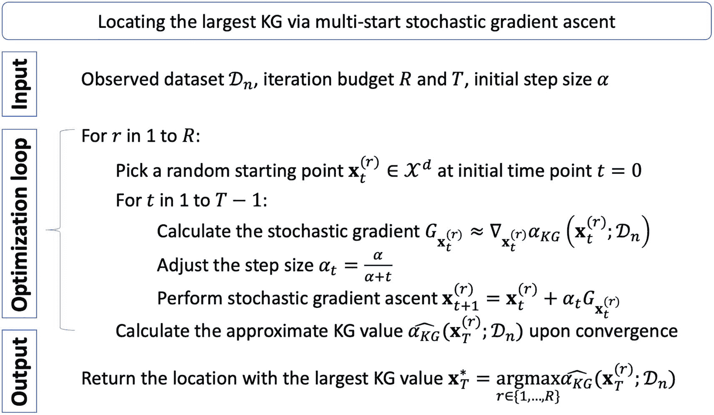

使用多起点随机梯度定位最大 KG 值的算法流程图包含输入、优化循环和输出。输入包括观测数据集 `D_n`、迭代预算 `R` 和 `T`，以及初始步长 `alpha`。优化循环：对于 `r` 从 1 到 `R`，选取随机起点 `x_t^{(r)}`；对于 `t` 从 1 到 `T-1`，步骤包括计算随机梯度、调整步长、执行随机梯度上升、计算近似 KG 值。输出：返回具有最大 KG 值的位置。

图 6-7

说明使用多起点随机梯度上升进行序贯采样时定位最大 KG 值的算法

```
输入包括观测数据集 D_n、迭代预算 R 和 T，以及初始步长 alpha。
优化循环：对于 r 从 1 到 R，选取随机起点 x_t^{(r)}；对于 t 从 1 到 T-1，步骤包括计算随机梯度、调整步长、执行随机梯度上升、计算近似 KG 值。
输出：返回具有最大 KG 值的位置。
```

为了执行上升，我们首先基于前述的蒙特卡洛模拟计算近似随机梯度 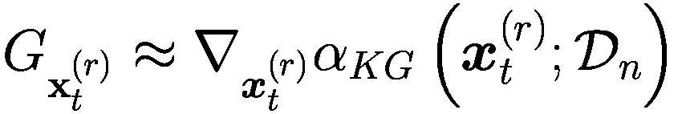，并执行迭代随机梯度上升更新 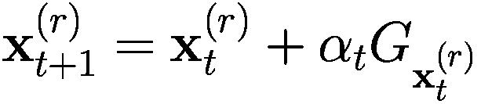 以移动到下一个位置。注意，步长通过 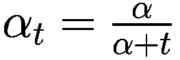 实现自适应调整，其大小随迭代进行而减小。每次随机梯度上升将总共运行 `T` 次迭代。最后，在上升更新（由超参数 `T` 设定）收敛时，我们评估近似 KG 值 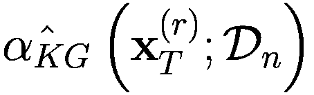，并返回具有最大近似 KG 值的位置，即 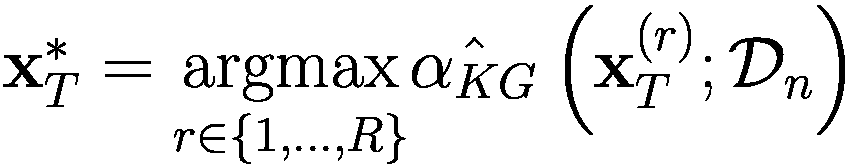。

由于该方法侧重于改进最大后验均值，所提议的下一个采样位置未必能获得比先前观测值更高的观测值。然而，在存在噪声观测的情况下，KG 的这一特性使其能够显著优于基于 EI 的搜索策略。

请注意，这套基于 KG 指导序贯搜索过程的算法套件比原始的直接计算方法高效得多。尽管如此，仍有改进空间，尤其是在需要同时提议多个点时——这是并行贝叶斯优化主题下的一个课题。相较于原始 KG 的相应最新改进被称为 `OKG`，将在下一节中介绍。

## 单次知识梯度

在评估 `KG` 采集函数及其梯度估计量时，我们反复使用蒙特卡洛模拟来近似期望运算。事实证明，我们可以在如何以及从何处抽取这些样本方面做出若干改进，而不是每次都重新随机抽取样本。

一项改进是我们在前一章中介绍的准蒙特卡洛技术。我们不再在均匀尺度上抽取样本，而是使用 `Sobol` 序列更均匀地填充采样空间，这使我们能够更快收敛并获得更稳定的估计值。模拟点之间的相互距离也将具有低差异，使其成为比均匀采样更有效的采样方法。在原始的 `BoTorch` 论文中，这种技术被称为随机准蒙特卡洛（`RQMC`）技术。

`BoTorch` 论文引入的另一项改进是样本平均近似（`SAA`），将在下一节中讨论。

### 样本均值近似

到目前为止所讨论的蒙特卡洛模拟技术，需要在随机梯度下降更新的每一轮中，通过 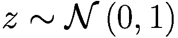 重新抽取基础样本 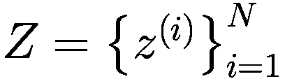，这种重复抽取新样本的做法似乎有些冗余。作为补救措施，样本均值近似技术避免了这种重新抽取，仅抽取一组固定的基础样本 。这组固定的基础样本将在整个优化过程中的每次蒙特卡洛评估中使用。换句话说，我们固定了一组公共随机数，这将优化近似 KG 函数 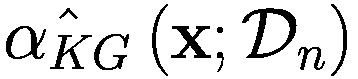 的问题转化为一个确定性优化问题。

请注意，由于这些基础样本是独立同分布的，因此最大 KG 值的估计量在理论上保证收敛到真实最大值，即 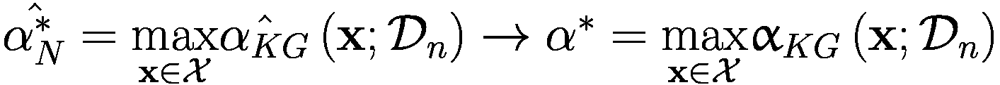。这一理论保证得到了关于 `SAA` 近似性质的大量文献的支持，这也为实施基于 `MC` 的近似提供了便利。

此外，我们还可以使用同一组基础样本来估计 KG 梯度值，尽管这种梯度估计量可能用于不同的目的。图 6-8 展示了在 `MC` 积分中用于 KG 值及其梯度估计量的 `SAA` 过程。公共随机数 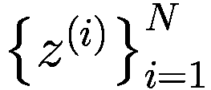 通过一个确定性变换 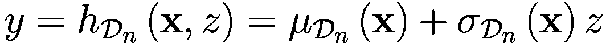 生成一组假设观测值 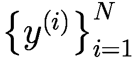，然后用于计算 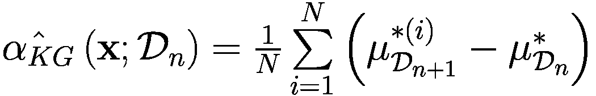 作为 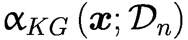 的近似，以及 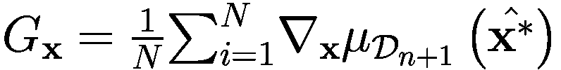 作为 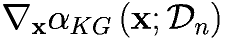 的近似。


一个流程图提供了样本均值近似的详细信息。它从生成一组固定的公共随机数开始，这些随机数用于近似 KG 值，但对于梯度则不一定如此。

图 6-8

在蒙特卡洛估计中使用的样本均值近似技术，同时用于 KG 值及其梯度估计量，并采用拟牛顿方法以实现更快的收敛速度和更稳健的优化

有了固定的基础样本集，我们现在可以使用二阶优化方法，例如拟牛顿法，来实现更快的收敛速度和更稳健的优化。这是因为一阶方法（如随机梯度下降）容易受到超参数调整（例如学习率）的影响，需要大量的调优工作才能获得可靠的优化结果。然而，在使用二阶方法时，这种调优并非必要。

在下一节中，我们将讨论使用 `SAA` 技术的 `KG` 单次公式化。

### 使用 `SAA` 的单次知识梯度公式

寻找下一个采样位置的优化过程 `$$ {\textbf{x}}^{\ast}=\underset{\textbf{x}\in \mathcal{X}}{\textrm{argmax}}{\upalpha}_{KG}\left(\textbf{x};{\mathcal{D}}_n\right) $$` 基于一个嵌套的优化循环。在外层循环中，我们使用多起点随机梯度上升法来定位具有最大 `KG` 值的采样位置，其中 `KG` 值及其梯度均通过蒙特卡洛模拟进行近似。在内层循环中，给定当前采样位置 `x` 和模拟观测值 `$$ {y}_{{\mathcal{D}}_n}\left(\textbf{x}\right) $$`，我们寻找具有最大后验均值的位置，即 `$$ {\textbf{x}}^{\ast}=\underset{\textbf{x}\in \mathcal{X}}{\textrm{argmax}}\mu \left(\textbf{x};{\mathcal{D}}_{n+1}\right) $$`。内层循环可以通过相同的一阶随机梯度上升算法或二阶 `L-BFGS-B` 过程来执行。

现在，让我们更详细地重新表述 `KG` 值，以便于推导单次 `KG` 公式。假设我们再取一个数据对 `$$ \left(\textbf{x},{y}_{{\mathcal{D}}_n}\left(\textbf{x}\right)\right) $$`，其中 `$$ {y}_{{\mathcal{D}}_n}\left(\textbf{x}\right)\sim \mathcal{N}\left({\mu}_{{\mathcal{D}}_n}\left(\textbf{x}\right),{\sigma}_{{\mathcal{D}}_n}\left(\textbf{x}\right)\right) $$` 且 `$$ \mathbb{E}\left[{y}_{{\mathcal{D}}_n}\left(\textbf{x}\right)\right]={\mu}_{{\mathcal{D}}_n}\left(\textbf{x}\right) $$`，并进一步形成一个更新后的（假设的）数据集 `$$ {\mathcal{D}}_{n+1}={\mathcal{D}}_n\cup \left\{\left(\textbf{x},{y}_{{\mathcal{D}}_n}\left(\textbf{x}\right)\right)\right\} $$`。那么 `KG` 采集函数可以表示如下：

`$$ {\alpha}_{KG}\left(\textbf{x};{\mathcal{D}}_n\right)={\mathbb{E}}_{p\Big(y\left|\textbf{x},{\mathcal{D}}_n\right)}\left[{\mu}_{{\mathcal{D}}_{n+1}}^{\ast}\right]-{\mu}_{{\mathcal{D}}_n}^{\ast } $$`

`$$ ={\mathbb{E}}_{p\Big(y\left|\textbf{x},{\mathcal{D}}_n\right)}\left[\underset{{\textbf{x}}^{\prime}\in \mathcal{X}}{\max }{\mu}_{{\mathcal{D}}_{n+1}}\left({\textbf{x}}^{\prime}\right)\right]-\underset{\textbf{x}^{\prime}\in \mathcal{X}}{\max }{\mu}_{{\mathcal{D}}_n}\left({\textbf{x}}^{\prime}\right) $$`

`$$ ={\mathbb{E}}_{p\Big(y\left|\textbf{x},{\mathcal{D}}_n\right)}\left[\underset{{\textbf{x}}^{\prime}\in \mathcal{X}}{\max }{\mathbb{E}}_{p\Big(y\prime \left|{\textbf{x}}^{\prime },{\mathcal{D}}_{n+1}\right)}\left[{y}_{{\mathcal{D}}_{n+1}}^{\prime}\left({\textbf{x}}^{\prime}\right)\right]\right]-\underset{{\textbf{x}}^{\prime}\in \mathcal{X}}{\max}\mathbb{E}\left[{y}_{{\mathcal{D}}_n}\left({\textbf{x}}^{\prime}\right)|{\mathcal{D}}_n\right] $$`

`$$ =\mathbb{E}\left[\underset{{\textbf{x}}^{\prime}\in \mathcal{X}}{\max}\mathbb{E}\left[{y}_{{\mathcal{D}}_{n+1}}^{\prime}\left({\textbf{x}}^{\prime}\right)|{\mathcal{D}}_{n+1}\right]|{\mathcal{D}}_n\right]-\underset{{\textbf{x}}^{\prime}\in \mathcal{X}}{\max}\mathbb{E}\left[{y}_{{\mathcal{D}}_n}\left({\textbf{x}}^{\prime}\right)|{\mathcal{D}}_n\right] $$`

换句话说，这个表达式本质上量化了在位置 `x` 采样后，最大后验均值的期望边际增量。使用 `SAA` 时，我们可以避免嵌套优化，并利用固定的基础样本将原始问题转化为确定性问题。具体来说，在抽取一组固定的基础样本 `$$ {\left\{{z}^{(i)}\right\}}_{i=1}^N $$` 后，我们可以如下近似 `KG` 采集函数：

`$$ \hat{\alpha_{KG}}\left(\textbf{x};{\mathcal{D}}_n\right)=\frac{1}{N}\sum \limits_{i=1}^N\underset{{\textbf{x}}^{(i)}\in \mathcal{X}}{\max}\mathbb{E}\left[{y}_{{\mathcal{D}}_{n+1}}\left({\textbf{x}}^{(i)}\right)|{\mathcal{D}}_{n+1}^{(i)}\right]-{\mu}_{{\mathcal{D}}_n}^{\ast } $$`

由于我们将最大化近似 KG 函数以获得下一个采样位置 ，在固定基础样本集条件下，我们可以将第二个内部最大化算子移到样本均值之外。换句话说，我们有

![$$ \underset{\textbf{x}\in \mathcal{X}}{\max}\hat{\alpha_{KG}}\left(\textbf{x};{\mathcal{D}}_n\right)=\underset{\textbf{x}\in \mathcal{X}}{\max}\frac{1}{N}\sum \limits_{i=1}^N\underset{{\textbf{x}}^{(i)}\in \mathcal{X}}{\max}\mathbb{E}\left[{y}_{{\mathcal{D}}_{n+1}}\left({\textbf{x}}^{(i)}\right)|{\mathcal{D}}_{n+1}^{(i)}\right]-{\mu}_{{\mathcal{D}}_n}^{\ast } $$](images/527334_1_En_6_Chapter/527334_1_En_6_Chapter_TeX_Equp.png)

![$$ =\underset{\textbf{x}\in \mathcal{X}}{\max}\underset{{\textbf{x}}^{(i)}\in \mathcal{X}}{\max}\frac{1}{N}\sum \limits_{i=1}^N\mathbb{E}\left[{y}_{{\mathcal{D}}_{n+1}}\left({\textbf{x}}^{(i)}\right)|{\mathcal{D}}_{n+1}^{(i)}\right]-{\mu}_{{\mathcal{D}}_n}^{\ast } $$](images/527334_1_En_6_Chapter/527334_1_En_6_Chapter_TeX_Equq.png)

![$$ =\underset{\textbf{x},\textbf{x}^{\prime}\in \mathcal{X}}{\max}\frac{1}{N}\sum \limits_{i=1}^N\mathbb{E}\left[{y}_{{\mathcal{D}}_{n+1}}\left({\textbf{x}}^{(i)}\right)|{\mathcal{D}}_{n+1}^{(i)}\right]-{\mu}_{{\mathcal{D}}_n}^{\ast } $$](images/527334_1_En_6_Chapter/527334_1_En_6_Chapter_TeX_Equr.png)

其中  是 *N* 个采样点的集合，代表最大后验均值的位置。这些点在 `BoTorch` 论文中也被称为幻想点，用于表示内层优化循环中的下一阶段解。通过这种重新表述，我们将原始问题转化为一个仅包含一个最大化算子的等价形式，这要求我们求解一个关于当前最大化位置 **x** 和下一阶段幻想点 **x**′ 的优化问题。

请注意，当前单一优化循环的唯一变化是每个循环需要求解一个更高维度的问题。也就是说，我们每次优化需要输出 *N* 个额外的位置。由于我们只处理一个单一的优化循环，这种公式因此被称为单次知识梯度（`OKG`）。图 6-9 总结了 `OKG` 的公式化过程。


一个流程图，展示了单次知识梯度公式的定义。原始的 `KG` 公式通过近似 `KG` 公式推导出 `OKG` 公式。

图 6-9 单次知识梯度公式示意图

在下一节中，我们将介绍 `OKG` 在 `BoTorch` 中的实现。

### 实践中的单次知识梯度

在本节中，我们将基于一个合成函数 *f* (*x*) = sin (2*πx*[1]) cos (2*πx*[2]) 来查看 `BoTorch` 中 `OKG` 的实现细节。这是一个二维函数，所有输入特征都限制在超立方体 [0, 1] 内。我们还向模拟观测值添加了一个正态分布随机噪声向量，以模拟受噪声扰动的观测值。此外，我们使用 `botorch.utils.transforms` 中的 `standardize()` 函数对含噪观测值进行标准化，以创建一个均值为零、方差为一的向量。请参阅以下实现这些操作并在标准化后创建 20 个含噪观测值的代码清单：

```
import os
import math
import torch
from botorch.utils.transforms import standardize
bounds = torch.stack([torch.zeros(2), torch.ones(2)])
train_X = bounds[0] + (bounds[1] - bounds[0]) * torch.rand(20, 2)
train_Y = torch.sin(2 * math.pi * train_X[:, [0]]) * torch.cos(2 * math.pi * train_X[:, [1]])
train_Y = standardize(train_Y + 0.05 * torch.randn_like(train_Y))
```

清单 6-1 模拟 20 个含噪观测值

接下来，我们将使用高斯过程构建一个代理模型，并优化 `GP` 模型的超参数。采用与前一章类似的方法，我们首先基于提供的训练数据集 `train_X` 和 `train_Y` 实例化一个 `SingleTaskGP` 模型，通过 `ExactMarginalLogLikelihood` 准备（闭式）边际似然计算器，最后使用 `fit_gpytorch_model()` 优化 `GP` 超参数。请参阅以下这些操作的代码清单：

```
from botorch.models import SingleTaskGP
from gpytorch.mlls import ExactMarginalLogLikelihood
from botorch.fit import fit_gpytorch_model
model = SingleTaskGP(train_X, train_Y)
mll = ExactMarginalLogLikelihood(model.likelihood, model)
fit_gpytorch_model(mll);
```

请注意，这里使用分号来抑制执行代码后的输出消息。接下来，我们将构建一个单次知识梯度实例来表示这个特定的采集函数。在 `BoTorch` 中，该类在 `qKnowledgeGradient` 中实现，它推广到并行贝叶斯优化设置，其中 *q* 表示要同时考虑的位置数量。此外，`qKnowledgeGradient` 执行批量贝叶斯优化，其中每个批次都经过单次优化过程。请参阅以下关于为后续 `OKG` 学习创建实例的代码清单：

```
from botorch.acquisition import qKnowledgeGradient
NUM_FANTASIES = 128
qKG = qKnowledgeGradient(model, num_fantasies=NUM_FANTASIES)
```

这里，我们将幻想样本的数量设置为 128，对应于前面讨论的外部期望算子的 `MC` 样本数量 *N*。更多的幻想样本将能更好地逼近真实的 `KG` 值，尽管这会增加 `RAM` 和运行时间（从开始到结束运行整个脚本）。至于内部期望，我们可以直接依赖闭式后验均值或使用另一个 `MC` 积分。

创建 `qKG` 实例后，我们可以使用它来评估搜索域中的任意位置。请注意，`OKG` 中的单次公式每次评估总共需要 129 个输入位置，包括外部优化考虑的一个位置以及 `MC` 积分中使用的剩余 128 个幻想位置。

以下代码清单测试了第一个训练位置的 `OKG` 值，以及按照 Sobol 序列采样的 128 个幻想位置。我们使用 `torch.cat()` 函数将原始位置与 128 个幻想位置合并，传递给 `qKG` 以评估近似的 `KG` 值，并通过调用 `item()` 方法输出返回结果中的最终内容：

让我们深入了解 `qKnowledgeGradient` 类的内部实现。默认情况下，它使用 `SobolQMCNormalSampler` 采样器，通过 Sobol 序列采样准 MC 基样本。这与前一章讨论的 `qExpectedImprovement` 类中使用的默认采样器相同，并使用重参数化技巧在给定位置生成后验样本。在这种情况下，我们生成总共 `num_fantasies` 个基样本，通过设置 `resample=False`，所有这些样本在整个优化过程中都是固定的，如下面的代码片段所示。在运行确定性优化算法时，固定基样本是必要的。

```python
sampler = SobolQMCNormalSampler(
    num_samples=num_fantasies, resample=False, collapse_batch_dims=True
)
```

现在，让我们看看当将候选位置传递给 `qKnowledgeGradient` 中的 `forward()` 函数时的评估代码。如下面的代码片段所示，我们首先使用 `_split_fantasy_points()` 函数将组合的位置向量拆分为 `X_actual` 中的实际位置和 `X_fantasies` 中的幻想位置：

```python
def forward(self, X: Tensor) -> Tensor:
    # 从正在评估的实际位置中拆分幻想位置
    X_actual, X_fantasies = _split_fantasy_points(X=X, n_f=self.num_fantasies)
    # 仅在拆分后将 X_pending 连接到 X 部分
    if self.X_pending is not None:
        X_actual = torch.cat(
            [X_actual, match_batch_shape(self.X_pending, X_actual)], dim=-2
        )
    # 构建形状为 `num_fantasies x b` 的幻想模型
    fantasy_model = self.model.fantasize(
        X=X_actual, sampler=self.sampler, observation_noise=True
    )
    # 获取价值函数
    value_function = _get_value_function(
        model=fantasy_model,
        objective=self.objective,
        posterior_transform=self.posterior_transform,
        sampler=self.inner_sampler,
    )
    # 确保将梯度传播到幻想模型训练输入
    with settings.propagate_grads(True):
        values = value_function(X=X_fantasies)  # num_fantasies x b
    if self.current_value is not None:
        values = values - self.current_value
    # 返回幻想样本的平均值
    return values.mean(dim=0)
```

清单 6-2 评估 `qKG` 采集函数

以下代码片段包含 BoTorch 中的 `_split_fantasy_points()` 函数。请注意，`X_fantasies` 变量经过重塑操作，以遵循 `num_fantasies x batch_size x feature_dim` 的形状，从而便于批量处理。

```python
def _split_fantasy_points(X: Tensor, n_f: int) -> Tuple[Tensor, Tensor]:
    if n_f > X.size(-2):
        raise ValueError(
            f"n_f ({n_f}) 必须小于 X 的 q-batch 维度 ({X.size(-2)})"
        )
    split_sizes = [X.size(-2) - n_f, n_f]
    X_actual, X_fantasies = torch.split(X, split_sizes, dim=-2)
    X_fantasies = X_fantasies.permute(-2, *range(X_fantasies.dim() - 2), -1)
    X_fantasies = X_fantasies.unsqueeze(dim=-2)
    return X_actual, X_fantasies
```

接下来，如果有的话，我们会将 `X_pending` 中潜在的待处理位置连接到 `X_actual`。然后，我们基于当前位置 `X_actual` 构建一个幻想模型，该幻想模型用于在给定模拟的（可能受噪声扰动的）观测值的情况下创建一个新的后验 GP 模型。具体来说，幻想模型的创建过程是：首先计算 `X_actual` 处的模型后验，使用提供的采样器从后验中采样以生成模拟观测值，最后将 GP 模型基于这些新的模拟观测值进行条件化，以形成更新的后验分布。

为了理解幻想模型的工作原理，让我们看一个创建幻想模型并生成幻想评估的示例。在以下代码片段中，我们使用 `SobolQMCNormalSampler` 类创建了一个采样器，通过指定 `num_samples=5`，生成了五个遵循 Sobol 序列的基础样本。这五个基础样本将与 GP 模型（位于 `model` 对象中）一起使用，在指定位置（本例中为 `train_X[0]`）创建人工观测值。这些操作通过模型的 `fantasize()` 方法完成，该方法在 `fantasy_model` 中返回另一个 GP 模型对象。

```python
from botorch.sampling import SobolQMCNormalSampler
sampler = SobolQMCNormalSampler(num_samples=5, seed=1234)
fantasy_model = model.fantasize(train_X[0].view(1,-1), sampler, observation_noise=True)
```

`model` 对象和 `fantasy_model` 对象都代表 GP 模型，该模型由均值函数和基于观测/模拟数据集的条件协方差函数参数化。换句话说，我们可以提供任意采样位置，并获得相应的后验均值和方差。例如，以下代码片段使用 `PosteriorMean()` 函数（一个用于从后验分布中计算闭式均值值的实用函数）评估第一个训练点位置的后验均值：

```python
from botorch.acquisition.analytic import PosteriorMean
>>> PosteriorMean(model)(train_X[0].view(1,-1))
tensor([-0.3386], grad_fn=<MeanBackward0>)
```

结果显示一个标量值 -0.3386，包含在一个带有 `grad_fn` 属性的张量对象中，该属性是该特定位置的梯度，稍后将用于梯度更新。我们也可以通过调用 `item()` 函数提取标量值：

```python
>>> PosteriorMean(model)(train_X[0].view(1,-1)).item()
-0.3386051654815674
```

我们可以对幻想模型应用相同的操作。如下代码片段所示，由于五个不同的幻想后验 GP 模型，幻想模型在后验均值上返回了五个不同的评估结果：

```python
>>> PosteriorMean(fantasy_model)(train_X[0].view(1,-1))
tensor([-0.4586, -0.2904, -0.2234, -0.3893, -0.3752], grad_fn=<MeanBackward0>)
```

接下来，我们使用 `_get_value_function()` 构建价值函数，该函数指定了特定采样位置的评分函数。在本例中，我们使用 `PosteriorMean()` 类将后验均值赋值为每个采样位置的价值。换句话说，我们使用后验均值来表示每个采样位置的绝对值。以下代码片段展示了 BoTorch 文档中 `_get_value_function()` 函数的定义：

# OKG 采集函数的计算与优化

```python
def _get_value_function(
    model: Model,
    objective: Optional[MCAcquisitionObjective] = None,
    posterior_transform: Optional[PosteriorTransform] = None,
    sampler: Optional[MCSampler] = None,
    project: Optional[Callable[[Tensor], Tensor]] = None,
    valfunc_cls: Optional[Type[AcquisitionFunction]] = None,
    valfunc_argfac: Optional[Callable[[Model, Dict[str, Any]]]] = None,
) -> AcquisitionFunction:
    r"""构建价值函数（即内部采集函数）。"""
    if valfunc_cls is not None:
        common_kwargs: Dict[str, Any] = {
            "model": model,
            "posterior_transform": posterior_transform,
        }
        if issubclass(valfunc_cls, MCAcquisitionFunction):
            common_kwargs["sampler"] = sampler
            common_kwargs["objective"] = objective
        kwargs = valfunc_argfac(model=model) if valfunc_argfac is not None else {}
        base_value_function = valfunc_cls(**common_kwargs, **kwargs)
    else:
        if objective is not None:
            base_value_function = qSimpleRegret(
                model=model,
                sampler=sampler,
                objective=objective,
                posterior_transform=posterior_transform,
            )
        else:
            base_value_function = PosteriorMean(
                model=model, posterior_transform=posterior_transform
            )
    if project is None:
        return base_value_function
    else:
        return ProjectedAcquisitionFunction(
            base_value_function=base_value_function,
            project=project,
        )
```

清单 6-3 获取任意采样位置的代理值。

请注意，我们将设置保持为最简单的情况；因此，返回的结果是`base_value_function=PosteriorMean(model=model, posterior_transform=posterior_transform)`。然后，`value_function`用于对所有幻想位置的后验均值进行评分，并返回平均分数作为`qKG`对象的最终结果。需要注意的是，使用`value_function`计算后验均值的过程是在`propagate_grads`设置下执行的，这确保了所有计算都会反向传播每个张量中的梯度值。

到目前为止，我们已经了解了计算平均后验均值的内部工作原理，即在一组位置（当前位置加上幻想位置）上近似 OKG 值，而不是像其他采集函数那样在单个当前位置上计算。在下一节中，我们将研究优化过程，以确定具有最高 OKG 值的位置集。

## 优化 OKG 采集函数

优化 OKG 采集函数遵循与上一章介绍的 EI 相同的模块化流程。如下代码片段所示，我们使用`optimize_acqf()`函数完成优化循环，其中我们指定`acq_function=qKG`来表示用于衡量每个采样位置效用的采集函数，`bounds=bounds`来表示每个特征维度的搜索边界，`q=2`来表示同时提出两个位置的并行 BO，`num_restarts=NUM_RESTARTS`来表示多起点优化过程中的起始点数量，以及`raw_samples=RAW_SAMPLES`来表示用于在整个搜索空间初始化的原始样本数量：

```python
from botorch.optim import optimize_acqf
from botorch.utils.sampling import manual_seed

NUM_RESTARTS = 10
RAW_SAMPLES = 512

with manual_seed(1234):
    candidates, acq_value = optimize_acqf(
        acq_function=qKG,
        bounds=bounds,
        q=2,
        num_restarts=NUM_RESTARTS,
        raw_samples=RAW_SAMPLES,
    )
```

清单 6-4 优化 OKG 采集函数。

我们可以按如下方式访问候选位置和相应的 OKG 值：

```python
>>> candidates
tensor([[0.3940, 1.0000], [0.0950, 0.0000]])
>>> acq_value
tensor(2.0358)
```

BoTorch 中的模块化设计使得插入新的采集函数并测试其性能变得容易。在底层，`optimize_acqf()`函数有一个独立的句柄来生成用于优化的初始条件，如下面来自 BoTorch 的`optimize_acqf()`函数定义中的代码片段所示：

```python
ic_gen = (
    gen_one_shot_kg_initial_conditions
    if isinstance(acq_function, qKnowledgeGradient)
    else gen_batch_initial_conditions
)
```

该片段要求在使用 OKG 采集函数时，使用`gen_one_shot_kg_initial_conditions()`函数生成初始条件。`gen_one_shot_kg_initial_conditions()`函数使用一种组合策略生成一组智能初始条件，其中一些初始条件是模拟幻想后验均值的最大化点。

以下代码片段展示了 BoTorch 中`gen_one_shot_kg_initial_conditions()`函数的定义。在这里，我们首先获取要同时选择的采样位置的总大小，其中`q`是要提出的并行位置数量。`get_augmented_q_batch_size()`函数的定义也如下所示，我们添加幻想点的数量以形成采样位置的总维度，并将结果保存在`q_aug`中：

# OKG 采集函数的初始条件

## 代码清单 6-5 生成 OKG 的初始条件

```python
def gen_one_shot_kg_initial_conditions(
    acq_function: qKnowledgeGradient,
    bounds: Tensor,
    q: int,
    num_restarts: int,
    raw_samples: int,
    fixed_features: Optional[Dict[int, float]] = None,
    options: Optional[Dict[str, Union[bool, float, int]]] = None,
    inequality_constraints: Optional[List[Tuple[Tensor, Tensor, float]]] = None,
    equality_constraints: Optional[List[Tuple[Tensor, Tensor, float]]] = None,
) -> Optional[Tensor]:
    options = options or {}
    frac_random: float = options.get("frac_random", 0.1)
    if not 0 < frac_random < 1:
        raise ValueError(
            f"frac_random 必须取值在 (0,1) 范围内。当前值：{frac_random}"
        )
    q_aug = acq_function.get_augmented_q_batch_size(q=q)
    ics = gen_batch_initial_conditions(
        acq_function=acq_function,
        bounds=bounds,
        q=q_aug,
        num_restarts=num_restarts,
        raw_samples=raw_samples,
        fixed_features=fixed_features,
        options=options,
        inequality_constraints=inequality_constraints,
        equality_constraints=equality_constraints,
    )
    # 计算价值函数的最大化器
    value_function = _get_value_function(
        model=acq_function.model,
        objective=acq_function.objective,
        posterior_transform=acq_function.posterior_transform,
        sampler=acq_function.inner_sampler,
        project=getattr(acq_function, "project", None),
    )
    from botorch.optim.optimize import optimize_acqf
    fantasy_cands, fantasy_vals = optimize_acqf(
        acq_function=value_function,
        bounds=bounds,
        q=1,
        num_restarts=options.get("num_inner_restarts", 20),
        raw_samples=options.get("raw_inner_samples", 1024),
        fixed_features=fixed_features,
        return_best_only=False,
        inequality_constraints=inequality_constraints,
        equality_constraints=equality_constraints,
    )
    # 从优化器中采样
    n_value = int((1 - frac_random) * (q_aug - q))  # 非随机初始条件的数量
    eta = options.get("eta", 2.0)
    weights = torch.exp(eta * standardize(fantasy_vals))
    idx = torch.multinomial(weights, num_restarts * n_value, replacement=True)
    # 将相应的初始条件设置为采样得到的优化器
    ics[..., -n_value:, :] = fantasy_cands[idx, 0].view(num_restarts, n_value, -1)
    return ics
```

```python
def get_augmented_q_batch_size(self, q: int) -> int:
    return q + self.num_fantasies
```

我们首先在总共 `q_aug` 个采样位置上优化 OKG 采集函数，遵循并行贝叶斯优化的设置。将原始 KG 公式中的嵌套优化问题等价转化为单次 KG 公式，并将其视为并行贝叶斯优化，是理解 OKG 采集函数的关键洞察。在此情况下，我们沿用前一章中用于生成基于启发式初始条件的 `gen_batch_initial_conditions()` 函数。这种标准类型的随机初始条件存储在 `ics` 中。

接下来，我们使用 OKG 中相同的 `_get_value_function()` 函数作为基于后验均值的评分函数。然后，该评分函数在 `optimize_acqf()` 中的另一个优化函数内部使用，以定位所有幻想模型后验均值的全局最大值（`q=1`）。换句话说，初始条件是基于幻想模型后验均值的最大化器来确定的，这些最大化器直观上应接近当前后验均值的最大化器。这种非随机初始条件存储在 `fantasy_cands` 中。

最后，我们会根据指定的输入参数 `frac_random`，从第二种非随机位置中选择一部分初始条件。具体来说，`fantasy_vals` 中的最大化后验均值在 softmax 变换后用于对多项分布进行加权，进而从 `fantasy_cands` 中采样并替换到 `ics` 中。也就是说，最终的初始条件（采样位置）是随机初始化与模拟幻想模型后验均值最大化位置的混合。

我们可以通过 `gen_one_shot_kg_initial_conditions()` 函数来生成一组初始条件。在以下代码片段中，我们通过设置 `options={"frac_random": 0.25}` 来生成初始条件。通过打印结果的大小，我们可以看到初始条件的维度遵循 `num_restarts x (q+num_fantasies) x num_features`。

```python
from botorch.optim.initializers import gen_one_shot_kg_initial_conditions
Xinit = gen_one_shot_kg_initial_conditions(qKG, bounds, q=2, num_restarts=10, raw_samples=512, options={"frac_random": 0.25})
>>> Xinit.size()
torch.Size([10, 130, 2])
```

请注意，我们到目前为止计算的最大化 OKG 值是基于模拟的后验幻想模型。根据定义，我们还需要减去当前最大后验均值，以推导出边际效用的预期增量。在以下代码片段中，我们通过在 `optimize_acqf()` 中设置 `acq_function=PosteriorMean(model)` 和 `q=1`，基于当前模型获得单个最大后验均值：

```python
from botorch.acquisition import PosteriorMean
NUM_RESTARTS = 20
RAW_SAMPLES = 2048
argmax_pmean, max_pmean = optimize_acqf(
    acq_function=PosteriorMean(model),
    bounds=bounds,
    q=1,
    num_restarts=NUM_RESTARTS,
    raw_samples=RAW_SAMPLES
)
```

我们可以如下观察最大后验均值的值。当前最大后验均值 1.9548 确实低于基于幻想模型的新最大后验均值 2.0358：

```python
>>> max_pmean
tensor(1.9548)
```

现在，我们可以通过在初始化代码中设置 `current_value=max_pmean` 来实例化一个正确的 OKG 版本，如下所示：

```python
qKG_proper = qKnowledgeGradient(
    model,
    num_fantasies=NUM_FANTASIES,
    sampler=qKG.sampler,
    current_value=max_pmean,
)
```

请注意，`current_value` 在 `qKnowledgeGradient()` 的定义内部被用于以下代码片段中，其中当前最大后验均值从新的幻想最大后验均值中减去：

```python
if self.current_value is not None:
    values = values - self.current_value
```

接下来，我们应用相同的优化过程，在 `candidates_proper` 和 `acq_value_proper` 中获取新的候选位置和 OKG 值：

```
with manual_seed(1234):
    candidates_proper, acq_value_proper = optimize_acqf(
        acq_function=qKG_proper,
        bounds=bounds,
        q=2,
        num_restarts=NUM_RESTARTS,
        raw_samples=RAW_SAMPLES,
    )
>>> candidates_proper
tensor([[0.2070, 1.0000],
        [0.0874, 0.0122]])
>>> acq_value_proper
tensor(0.0107)
```

关于完整的实现细节，请访问随附的笔记本：[`https://github.com/Apress/Bayesian-optimization/blob/main/Chapter_6.ipynb`](https://github.com/Apress/Bayesian-optimization/blob/main/Chapter_6.ipynb)。

## 总结

在本章中，我们深入探讨了单次知识梯度公式的内部工作原理及其在 BoTorch 中的实现细节。这种最近提出的采集函数具有吸引人的理论和实践特性。具体来说，我们涵盖了以下内容：

*   原始的 KG 公式及其嵌套优化过程

*   用于估计蒙特卡洛采集函数的重参数化技巧

*   用于近似计算 KG 采集函数中期望运算的蒙特卡洛估计技术

*   使用近似 KG 梯度估计器的多起点随机梯度上升算法来定位最大 KG 值

*   通过样本平均近似推导单次 KG 采集函数

*   BoTorch 中 OKG 优化过程的实现

在下一章中，我们将介绍一个案例研究，该案例在训练深度卷积神经网络时对学习率进行微调。