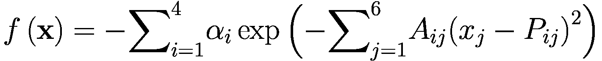
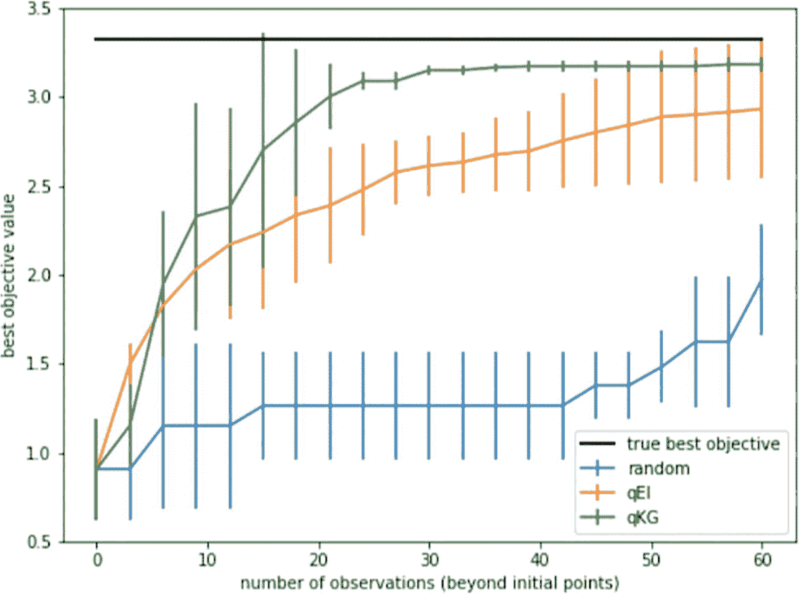
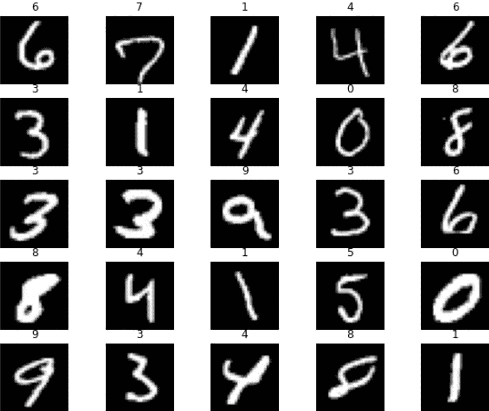
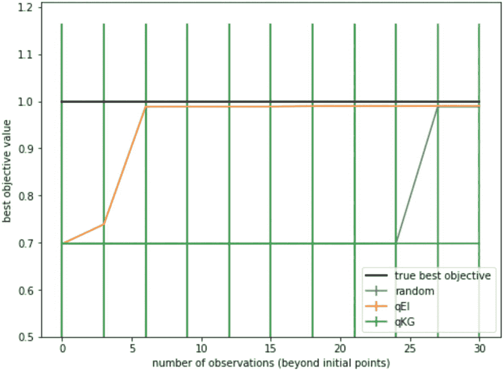

# 7. 案例研究：使用 BoTorch 调优 CNN 学习率

至此，我们已经为典型的贝叶斯优化过程的理论内部机制奠定了良好基础：一个近似底层真实函数并在新数据到达时更新的代理函数，以及一个在不确定性下指导序贯搜索的采集函数。我们已经介绍了流行的采集函数选择，包括期望提升（EI，其闭式表达式在第 3 章中推导得出）、更通用的蒙特卡洛采集函数（如知识梯度（KG，在第 6 章中通过多起点随机上升计算）），以及它们的并行版本（qEI 和 qKG）和多步前瞻扩展（均通过单次优化加速，同样在第 6 章中介绍）。这一基础使我们受益匪浅，我们将通过两个案例研究来证明：一个模拟案例，旨在寻找六维 Hartmann 函数的全局最大值；一个实证案例，旨在寻找用于分类广泛使用的 MNIST 数据集的卷积神经网络（CNN）的最优学习率。

我们希望强调本章的另一个重要目的：使用 BoTorch 展示完整的贝叶斯优化生态系统，并为有兴趣在其各自问题领域应用这种原则性搜索策略的用户提供一个模板。尽管存在更集成、更用户友好的选项（例如 Ax 平台），但我们仍将坚持本书“从头构建”的风格，这也让用户能够最大程度地掌控（并理解）其来龙去脉。

## 寻找 Hartmann 函数的全局最优解

我们在第 5 章中遇到过 Hartmann 函数。在那里，我们演示了使用 qEI 进行单步搜索。现在，我们将扩展到多步搜索，比较和对比多种采集函数，并随着优化过程的进行来衡量搜索质量。

为了唤起记忆，回想一下 Hartmann 函数是一个六维函数，有六个局部最小值和一个全局最小值。两个特点使其成为寻找该函数全局最小值的一项具有挑战性的任务：高维搜索空间和高度非凸的函数曲面。该函数形式如下：



其中 *α*[*i*]、*A*[*ij*] 和 *P*[*ij*] 均为常数。搜索空间是一个六维单位超立方体，每个动作 *x*[*j*] ∈ (0, 1)，其中 *j* = 1, …, 6。全局最小值在 **x**^∗ = (0.20169, 0.150011, 0.476874, 0.275332, 0.311652, 0.6573) 处获得，此时 *f* (**x**^(**∗**)) =  − 3.32237。

让我们首先导入几个常用包，如下所示。请注意，在开始编写任何代码*之前*，配置所有三个常用包（`random`、`numpy` 和 `torch`）的随机种子始终是一个好习惯。这里，我们将三个包的随机种子都设置为 8：

```
import os
import math
import torch
import random
import numpy as np
from matplotlib import pyplot as plt
%matplotlib inline
SEED = 8
random.seed(SEED)
np.random.seed(SEED)
torch.manual_seed(SEED)
```

我们还想配置两个元素：计算设备和张量对象的数据类型。在下面的代码片段中，我们指定如果 GPU 可用则使用 GPU；拥有 GPU 将显著加速 BO 循环和训练神经网络中的计算。此外，我们分配数据类型为双精度，以便进行更精确的计算：

```
device = torch.device("cuda" if torch.cuda.is_available() else "cpu")
dtype = torch.double
```

我们可以加载 Hartmann 函数作为我们的未知目标函数，并像之前一样对其取负以适配最大化设置：

```
# 未知目标函数
from botorch.test_functions import Hartmann
neg_hartmann6 = Hartmann(negate=True)
```

现在，我们可以以一组随机选择的输入位置和相应的含噪观测值的形式生成初始条件。

### 生成初始条件

我们希望定义一个函数，根据指定的观测数量为我们提供一组初始条件。每个条件成对出现：输入位置和相应的噪声干扰观测值。下面的代码片段定义了一个名为 `generate_initial_data()` 的函数，其中我们将噪声水平指定为 0.1，作为观测模型的标准差：

```
# 生成初始数据集
NOISE_SE = 0.1
def generate_initial_data(n=10):
# 生成随机初始位置
train_x = torch.rand(n, 6, device=device, dtype=dtype)
# 获取目标函数的精确值并添加输出维度
exact_obj = neg_hartmann6(train_x).unsqueeze(-1)
# 向观测模型添加高斯噪声
train_y = exact_obj + NOISE_SE * torch.randn_like(exact_obj)
# 获取当前最佳观测值，即可用数据集的效用
best_observed_value = train_y.max().item()
return train_x, train_y, best_observed_value
Listing 7-1
生成初始条件
```

让我们测试这个函数并生成五个初始条件，如下面的代码片段所示。结果显示，输入位置变量 `train_x` 和观测变量 `train_y` 都位于 GPU（`device='cuda:0'`）上，并采用浮点数据类型（`torch.float64`）。最佳观测值为 0.83，我们将在后续的序贯搜索中寻求改进该值。

```
>>>train_x, train_y, best_observed_value = generate_initial_data(n=5)
>>>print(train_x)
>>>print(train_y)
>>>print(best_observed_value)
tensor([[0.7109, 0.0106, 0.2621, 0.0697, 0.2866, 0.5305],
[0.0386, 0.5117, 0.8321, 0.8719, 0.2094, 0.1702],
[0.7290, 0.5147, 0.9309, 0.8339, 0.1056, 0.6658],
[0.6747, 0.4133, 0.5129, 0.3619, 0.6991, 0.8187],
[0.5215, 0.8842, 0.3067, 0.2046, 0.1769, 0.1818]], device='cuda:0',
dtype=torch.float64)
tensor([[ 0.8309],
[ 0.0752],
[-0.0698],
[ 0.0430],
[ 0.5490]], device='cuda:0', dtype=torch.float64)
0.8308929843287978
```

现在，我们使用这些初始条件来获取 GP 模型的后验分布。


### 更新高斯过程后验

在 BoTorch 框架中，我们关注与 GP 代理模型相关的两个对象：GP 模型本身，以及基于已收集观测数据集的对数边际似然。我们定义以下函数来处理初始条件数据集，并返回这两个对象：

```
# 初始化 GP 模型
from botorch.models import SingleTaskGP
from gpytorch.mlls import ExactMarginalLogLikelihood
def initialize_model(train_x, train_y):
# 创建一个单任务精确 GP 模型实例
# 默认使用 Matern 核函数和常数均值函数作为 GP 先验
model = SingleTaskGP(train_X=train_x, train_Y=train_y)
mll = ExactMarginalLogLikelihood(model.likelihood, model)
return mll, model
```

这里，我们使用`SingleTaskGP`类构建单输出 GP 模型，并通过`ExactMarginalLogLikelihood()`函数基于闭式表达式获取对数边际似然。随后，我们可以利用该函数创建两个变量，分别存储 GP 模型及其对数边际似然，同时打印 GP 模型的超参数值：

```
mll, model = initialize_model(train_x, train_y)
>>> list(model.named_hyperparameters())
[('likelihood.noise_covar.raw_noise', Parameter containing:
tensor([2.0000], device='cuda:0', dtype=torch.float64, requires_grad=True)),
('mean_module.raw_constant', Parameter containing:
tensor(0., device='cuda:0', dtype=torch.float64, requires_grad=True)),
('covar_module.raw_outputscale', Parameter containing:
tensor(0., device='cuda:0', dtype=torch.float64, requires_grad=True)),
('covar_module.base_kernel.raw_lengthscale', Parameter containing:
tensor([[0., 0., 0., 0., 0., 0.]], device='cuda:0', dtype=torch.float64,
requires_grad=True))]
```

优化 GP 模型的超参数（核参数和噪声方差）通过`fit_gpytorch_mll()`函数完成。但由于所有代码均在 Google Colab 中编写和运行，我们发现此步骤需要先将对数边际似然对象`mll`移至 CPU，再调用`fit_gpytorch_mll()`函数。如下代码片段所示，我们通过`mll.cpu()`执行移动操作，然后通过`mll.to(train_x)`将其移回 GPU，从而将`mll`转换为与`train_x`相同的数据类型和位置：

```
# 拟合 GP 超参数
from botorch.fit import fit_gpytorch_mll
# 拟合 GPyTorch 模型的超参数（核参数和噪声方差）
fit_gpytorch_mll(mll.cpu());
mll = mll.to(train_x)
model = model.to(train_x)
代码清单 7-2
优化 GP 超参数
```

我们还可以验证模型对象是否确实位于 GPU 中：

```
>>> print(next(model.parameters()).is_cuda)
True
```

优化超参数后的后验 GP 模型现在呈现不同状态：

```
>>> list(model.named_hyperparameters())
[('likelihood.noise_covar.raw_noise', Parameter containing:
tensor([0.0201], device='cuda:0', dtype=torch.float64, requires_grad=True)),
('mean_module.raw_constant', Parameter containing:
tensor(0.2875, device='cuda:0', dtype=torch.float64, requires_grad=True)),
('covar_module.raw_outputscale', Parameter containing:
tensor(-1.5489, device='cuda:0', dtype=torch.float64, requires_grad=True)),
('covar_module.base_kernel.raw_lengthscale', Parameter containing:
tensor([[-0.8988, -0.9278, -0.9508, -0.9579, -0.9429, -0.9305]],
device='cuda:0', dtype=torch.float64, requires_grad=True))]
```

接下来，我们将定义一个采集函数来执行序贯搜索。

### 创建蒙特卡洛采集函数

我们使用 qEI 采集函数演示单步序贯搜索，该函数在`botorch.acquisition`模块的`qExpectedImprovement`类中实现。由于 qEI 同时提出多个候选点且其闭式表达式不可用，我们需要调用蒙特卡洛技术来近似 qEI 定义所需的期望算子。

为此，我们使用`SobolQMCNormalSampler`类创建一个采样器实例，该实例通过采样 Sobol 序列实现更稳定的近似，每次蒙特卡洛估计采样 256 个点，如下代码片段所示：

```
# 定义 QMC 采样器以采样采集函数
from botorch.sampling.normal import SobolQMCNormalSampler
MC_SAMPLES = 256
qmc_sampler = SobolQMCNormalSampler(sample_shape=torch.Size([MC_SAMPLES]))
```

qEI 采集函数需要三个输入参数：GP 模型对象、当前最佳观测值以及准蒙特卡洛采样器：

```
# 使用 qEI 作为 MC 采集函数
from botorch.acquisition import qExpectedImprovement
qEI = qExpectedImprovement(model, best_observed_value, qmc_sampler)
```

现在让我们定义一个函数，该函数以指定的采集函数为输入，使用`optimize_acqf()`执行内部优化以获取采集函数的最大化点，并返回建议位置和含噪声观测值作为输出。

在以下代码片段中，我们定义边界变量，将上下界设置为单位超立方体，并预先指定计算设备和数据类型。我们还使用`BATCH_SIZE`表示每次贝叶斯优化迭代中生成的并行候选位置数量，`NUM_RESTARTS`表示多起点优化过程中使用的起始点数量，`RAW_SAMPLES`表示优化 MC 采集函数时用于初始化的样本数量：

```
# 优化并获取新观测值
from botorch.optim import optimize_acqf
# 6 维单位超立方体
bounds = torch.tensor([[0.0] * 6, [1.0] * 6], device=device, dtype=dtype)
# 每次迭代生成的并行候选位置
BATCH_SIZE = 3
# 多起点优化的起始点数量
NUM_RESTARTS = 10
# 用于初始化的样本数量
RAW_SAMPLES = 512
def optimize_acqf_and_get_observation(acq_func):
"""优化采集函数，并返回新候选点及含噪声观测值。"""
# 优化
candidates, _ = optimize_acqf(
acq_function=acq_func,
bounds=bounds,
q=BATCH_SIZE,
num_restarts=NUM_RESTARTS,
raw_samples=RAW_SAMPLES,  # 用于初始化启发式算法
options={"batch_limit": 5, "maxiter": 200},
)
# 观测新值
new_x = candidates.detach()
exact_obj = neg_hartmann6(new_x).unsqueeze(-1)  # 添加输出维度
new_y = exact_obj + NOISE_SE * torch.randn_like(exact_obj)
return new_x, new_y
代码清单 7-3
优化采集函数
```

现在让我们测试该函数，并观察从观测模型得到的下一批三个采样位置及观测值。结果显示`new_x`和`new_y`均包含三个元素，全部位于 GPU 中且采用浮点数据类型：

```
new_x, new_y = optimize_acqf_and_get_observation(qEI)
>>> print(new_x)
>>> print(new_y)
tensor([[0.9381, 0.0000, 0.2803, 0.0094, 0.3038, 0.4935],
[0.6015, 0.0000, 0.1978, 0.0167, 0.1881, 0.6974],
[0.5998, 0.0529, 0.2400, 0.1048, 0.2779, 0.3232]], device='cuda:0',
dtype=torch.float64)
tensor([[0.2815],
[0.6528],
[0.5882]], device='cuda:0', dtype=torch.float64)
```

现在我们进入主流程，开始完整的贝叶斯优化循环。


### 完整的贝叶斯优化循环

完整的贝叶斯优化循环指的是一个迭代顺序搜索过程，直到达到固定的迭代次数。为了比较多种搜索策略，我们使用了三种策略：qEI、qKG，以及每一步随机选取三个点的随机搜索策略。我们需要维护三个列表，分别记录每次贝叶斯优化迭代后观察到的最佳值。此外，我们打算多次运行完整的贝叶斯优化循环，以检查其在多次随机启动下的平均性能及其方差。

以下代码片段提供了完整贝叶斯优化循环的实现。首先，我们设置 `N_TRIALS = 3` 来重复所有实验三次，并评估最终性能的差异；设置 `verbose = True` 来打印实验诊断信息；设置 `N_BATCH = 20` 来表示外部贝叶斯优化循环中的迭代次数；并创建三个占位符（`best_observed_all_qei`、`best_observed_all_qkg` 和 `best_random_all`），分别用于保存三种搜索策略的实验结果：

```
import time
from botorch.acquisition import qKnowledgeGradient
# 运行次数，用于评估不同贝叶斯优化循环的标准差
N_TRIALS = 3
# 指示是否打印诊断信息的标志
verbose = True
# 外部贝叶斯优化循环中的步数
N_BATCH = 20
best_observed_all_qei, best_observed_all_qkg, best_random_all = [], [], []
# 在多次试验中取平均
for trial in range(1, N_TRIALS + 1):
print(f"\n 试验 {trial:>2} / {N_TRIALS} ", end="")
best_observed_qei, best_observed_qkg, best_random = [], [], []
# 调用辅助函数生成初始训练数据并初始化模型
train_x_qei, train_y_qei, best_observed_value_qei = generate_initial_data(n=10)
mll_qei, model_qei = initialize_model(train_x_qei, train_y_qei)
train_x_qkg, train_y_qkg = train_x_qei, train_y_qei
best_observed_value_qkg = best_observed_value_qei
mll_qkg, model_qkg = initialize_model(train_x_qkg, train_y_qkg)
best_observed_qei.append(best_observed_value_qei)
best_observed_qkg.append(best_observed_value_qkg)
best_random.append(best_observed_value_qei)
# 在初始随机批次之后运行 N_BATCH 轮贝叶斯优化
for iteration in range(1, N_BATCH + 1):
t0 = time.monotonic()
# 拟合模型
fit_gpytorch_mll(mll_qei.cpu());
mll_qei = mll_qei.to(train_x)
model_qei = model_qei.to(train_x)
fit_gpytorch_mll(mll_qkg.cpu());
mll_qkg = mll_qkg.to(train_x)
model_qkg = model_qkg.to(train_x)
# 使用 QMC 采样器定义 qEI 采集函数
qmc_sampler = SobolQMCNormalSampler(sample_shape=torch.Size([MC_SAMPLES]))
# 对于 best_f，我们使用观察到的最大含噪值作为近似
qEI = qExpectedImprovement(
model = model_qei,
best_f = train_y.max(),
sampler = qmc_sampler
)
qKG = qKnowledgeGradient(model_qkg, num_fantasies=MC_SAMPLES)
# 优化并获取新的观测值
new_x_qei, new_y_qei = optimize_acqf_and_get_observation(qEI)
new_x_qkg, new_y_qkg = optimize_acqf_and_get_observation(qKG)
# 更新训练点
train_x_qei = torch.cat([train_x_qei, new_x_qei])
train_y_qei = torch.cat([train_y_qei, new_y_qei])
train_x_qkg = torch.cat([train_x_qkg, new_x_qkg])
train_y_qkg = torch.cat([train_y_qkg, new_y_qkg])
# 更新进度
best_random = update_random_observations(best_random)
best_value_qei = neg_hartmann6(train_x_qei).max().item()
best_value_qkg = neg_hartmann6(train_x_qkg).max().item()
best_observed_qei.append(best_value_qei)
best_observed_qkg.append(best_value_qkg)
# 重新初始化模型，以便为下一次迭代的拟合做好准备
mll_qei, model_qei = initialize_model(
train_x_qei,
train_y_qei
)
mll_qkg, model_qkg = initialize_model(
train_x_qkg,
train_y_qkg
)
t1 = time.monotonic()
if verbose:
print(
f"\n 批次 {iteration:>2}: 最佳值 (随机, qEI, qKG) = "
f"({max(best_random):>4.2f}, {best_value_qei:>4.2f}, {best_value_qkg:>4.2f}),"
f"时间 = {t1-t0:>4.2f}.", end=""
)
else:
print(".", end="")
best_observed_all_qei.append(best_observed_qei)
best_observed_all_qkg.append(best_observed_qkg)
best_random_all.append(best_random)
代码清单 7-4
全局优化上的完整贝叶斯优化循环
```

请注意，在这个看似冗长的代码清单中，基本的贝叶斯优化流程保持不变。对于每次试验，我们都会使用 `generate_initial_data()` 生成一组初始条件，使用 `initialize_model()` 初始化高斯过程模型，使用 `fit_gpytorch_mll()` 优化其超参数，使用 `optimize_acqf_and_get_observation()` 为相应的搜索策略获取下一批采样位置和含噪观测值，最后在主列表中更新结果。

随机搜索策略是一种特殊且简单的策略；我们选择一组随机位置，收集含噪观测值，并记录当前的最佳候选点。以下函数提供了更新规则：

```
def update_random_observations(best_random):
"""通过抽取 BATCH_SIZE 个新的随机点来模拟随机策略，
观察它们的值，并将当前最佳候选点更新到运行列表中。
"""
rand_x = torch.rand(BATCH_SIZE, 6)
next_random_best = neg_hartmann6(rand_x).max().item()
best_random.append(max(best_random[-1], next_random_best))
return best_random
代码清单 7-5
随机策略
```

现在，让我们在一个地方绘制结果并分析它们的性能。以下代码片段生成了三条线，分别代表每个贝叶斯优化步骤中平均累积最佳候选点（观测值），垂直条表示与平均值的标准差：

```
# 绘制结果
def ci(y):
return 1.96 * y.std(axis=0) / np.sqrt(N_TRIALS)
GLOBAL_MAXIMUM = neg_hartmann6.optimal_value
iters = np.arange(N_BATCH + 1) * BATCH_SIZE
y_ei = np.asarray(best_observed_all_qei)
y_kg = np.asarray(best_observed_all_qkg)
y_rnd = np.asarray(best_random_all)
fig, ax = plt.subplots(1, 1, figsize=(8, 6))
ax.errorbar(iters, y_rnd.mean(axis=0), yerr=ci(y_rnd), label="随机", linewidth=1.5)
ax.errorbar(iters, y_ei.mean(axis=0), yerr=ci(y_ei), label="qEI", linewidth=1.5)
ax.errorbar(iters, y_kg.mean(axis=0), yerr=ci(y_kg), label="qKG", linewidth=1.5)
plt.plot([0, N_BATCH * BATCH_SIZE], [GLOBAL_MAXIMUM] * 2, 'k', label="真实最佳目标值", linewidth=2)
ax.set_ylim(bottom=0.5)
ax.set(xlabel='观测次数（超出初始点）', ylabel='最佳目标值')
ax.legend(loc="lower right")
```

运行这组代码会生成图 7-1。结果显示，qKG 采集函数性能最佳，这很可能是因为其较少的短视特性，能够评估全局域，而不仅仅关注已观测到的点。另一方面，qEI 仅在第一步占优，之后由于更具短视性和限制性（最佳候选点必须来自已观测数据集），其性能开始逊于 qKG。qEI 和 qKG 的性能都优于随机策略，这显示了在全局优化任务中采用这种辅助计算的好处。



一个多线图，展示了三种搜索策略（qEI 采集函数、qKG 和随机搜索）的最佳目标值与观测次数的关系。qKG 采集函数性能最佳。

图 7-1
比较三种搜索策略的性能：qEI、qKG 和随机搜索。qKG 采集函数因其较少的短视特性而性能最佳，而 qEI 仅在第一步占优，之后因其短视特性而性能开始逊于 qKG。qEI 和 qKG 的性能都优于随机策略，这显示了在全局优化任务中采用这种辅助计算的好处。

在下一节中，我们将转换方向，探讨训练和优化卷积神经网络。


## 卷积神经网络的超参数优化

卷积神经网络（CNN）是一种特殊的神经网络架构，已被证明在涉及图像数据的计算机视觉任务（如物体识别）中是一种极其强大的学习器。它是由多个层堆叠而成的序列，每一层由不同大小的节点组成，并通过多种操作之一与其他层连接：直接线性连接或非线性变换（如 ReLU）。CNN 利用卷积层来学习图像数据的图形结构（例如，在识别人脸时，鼻子位于眼睛下方），与普通的全连接网络（FCN）相比，它仅使用一小部分权重/参数，却能提供更高的预测精度。

请注意，这些参数是 CNN 模型的一部分，并且在训练 CNN 时是优化的对象。具体来说，当前的参数将用于为当前批次的数据生成一组预测，并获得相应的损失，这是拟合质量的一种度量。这完成了前向传播。在反向传播中，损失将通过计算每个参数的偏导数，流回之前的每一层。这些偏导数将用于使用著名的随机梯度下降（SGD）算法来更新参数。这完成了一次迭代。

理解 CNN 的内部工作原理并非本书的主要焦点。相反，我们将以 CNN 为例，演示如何使用贝叶斯优化（BO）来对众多超参数做出良好选择。超参数与参数不同，它们必须在每轮网络训练开始之前被选定并固定下来。超参数的示例包括 SGD 更新中使用的学习率、层中的节点数以及神经网络中的层数。由于在训练现代神经网络时，学习率通常是需要调整的首要超参数，我们将在下一节中专注于优化这个超参数。也就是说，我们希望为当前的网络架构找到最佳的学习率，使其对测试集具有最高的预测精度。

让我们首先熟悉一下我们将要使用的图像数据。

### 使用 MNIST

MNIST 数据集（改进的国家标准与技术研究所数据库）是一个手写数字数据库，广泛用于机器学习与深度学习模型的实验、原型设计和基准测试。它包含 60,000 张训练图像和 10,000 张测试图像，这些图像都经过了归一化和中心裁剪。可以通过`torch.datasets`类访问它们，无需单独下载。

我们将介绍使用 MNIST 训练一个简单 CNN 模型的分步实现。我们从使用 PyTorch `torchvision`包中的`datasets`和`dataloader`子类进行数据加载和预处理开始。使用这些实用函数可以显著加速模型开发过程，因为它们提供了对输入数据的一致处理和预处理。然后，我们将定义模型架构、代价函数和优化函数。最后，我们将使用训练集训练模型，并使用测试集测试其预测性能。

让我们使用`torchvision`中的`datasets`子包下载 MNIST 数据集，这是一个强大且方便的即用型工具，用于访问流行的图像数据集。它存储了图像样本及其对应的标签。在下面的代码片段中，我们首先导入`datasets`类并实例化它，将训练和测试数据下载到`Data`文件夹中。此外，下载的图像会被转换为张量对象，这是 PyTorch 中的多维 NumPy 数组。该转换还可以包括将图像像素从原始范围[0, 255]缩放到标准化范围[0.0, 1.0]。

```
# 下载 MNIST 数据集
from torchvision import datasets
from torchvision.transforms import ToTensor
train_data = datasets.MNIST(
root = 'data',
train = True,
transform = ToTensor(),
download = True,
)
test_data = datasets.MNIST(
root = 'data',
train = False,
transform = ToTensor()
)
清单 7-6
下载 MNIST 数据集
```

我们可以打印这些对象来访问它们的概要信息，包括观测数量：

```
>>> print(train_data)
数据集 MNIST
数据点数量: 60000
根目录: data
划分: 训练
标准变换
变换: ToTensor()
>>> print(test_data)
数据集 MNIST
数据点数量: 10000
根目录: data
划分: 测试
标准变换
变换: ToTensor()
```

将数据下载到`train_data`变量后，输入和输出分别存储在`data`和`targets`属性中。我们可以如下检查它们的形状：

```
>>> print(train_data.data.size())
>>> print(train_data.targets.size())
torch.Size([60000, 28, 28])
torch.Size([60000])
```

输出显示我们有 60,000 张图像，每张图像的形状为 28×28，对应于图像的宽度和高度。请注意，彩色图像会有第三个维度，称为深度或通道，通常取值为 3。由于我们处理的是灰度图像，因此省略了额外的维度 1。

我们可以可视化训练集中的几张图像。以下代码随机选择 25 张图像，并将它们绘制在 5×5 的网格画布上：

```
# 绘制多张图像
figure = plt.figure(figsize=(10, 8))
cols, rows = 5, 5
# 循环 25 个位置来绘制图像
for i in range(1, cols * rows + 1):
# 生成一个随机索引来选择图像
# item 函数将张量对象转换为标量值
sample_idx = torch.randint(len(train_data), size=(1,)).item()
# 提取图像数据和目标标签
img, label = train_data[sample_idx]
figure.add_subplot(rows, cols, i)
plt.title(label)
plt.axis("off")
# 压缩图像，将图像形状从[1,28,28]转换为[28,28]
plt.imshow(img.squeeze(), cmap="gray")
plt.show()
```

图 7-2 显示了这 25 个数字的输出。请注意，每张图像的形状为 28×28，因此每张图像总共有 784 个像素，即特征。



25 个数字输出的示意图。每个方块包含一个 0 到 9 之间的随机个位数。

图 7-2

可视化 25 个随机 MNIST 数字。每个数字是一张由 28*28=784 个像素组成的灰度图像

数据集下载完成后，下一步是加载它们用于模型训练。`torch.utils.data`模块中的`dataloader`类提供了一种便捷的方式来批量加载和迭代数据，并在需要时执行特定的变换。将数据集对象作为参数传递给`dataloader`，可以实现数据集的自动批处理、采样、打乱和多进程加载。以下代码在打乱所有图像后，以 100 的批量大小迭代加载训练集和测试集，并将它们存储在加载器对象中：

```
# 使用 DataLoader 准备训练数据
from torch.utils.data import DataLoader
loaders = {
'train' : torch.utils.data.DataLoader(train_data, # 要加载的数据源 batch_size=100, # 一次迭代中使用的训练样本数量 shuffle=True), # 样本被打乱并分批加载
'test'  : torch.utils.data.DataLoader(test_data,
batch_size=100,
shuffle=True)}
```

我们可以观察首次迭代`loaders`后加载数据的形状，如下所示：

```
>>> for X, y in loaders['train']:
>>>    print("X 的形状 [batch_size, channel, height, width]: ", X.shape)
>>>    print("y 的形状: ", y.shape)
>>>    break
X 的形状 [batch_size, channel, height, width]:  torch.Size([100, 1, 28, 28])
y 的形状:  torch.Size([100])
```

现在让我们定义 CNN 架构。


### 定义 CNN 架构

我们的预测模型是一个函数，它接收输入数据，通过一系列矩阵向量乘法和非线性变换与模型参数交互，并输出模型预测结果。该预测函数一次性实现了两个目标：定义模型参数和指定模型架构（即权重与输入之间的交互机制）。当问题规模较小且模型相对简单时，在一个函数中实现这两个目标尚可接受。然而，随着数据、模型、成本或整个模型训练过程的优化流程复杂度增加，明智的做法是将模型参数与模型架构分离，并根据具体用途将相应代码模块化。换句话说，模型参数和指定数据与参数之间交互方式的模型架构将各自拥有专用的函数。

常见的做法是使用一个类将所有不同的实用函数封装在一起。具体来说，我们可以将模型参数安排在一个函数中，这通常表现为类的默认`__init__`函数。`__init__`函数包含类首次实例化时的初始化属性，这意味着抽象类被转换为一个物理的、有形的对象。这些属性包括类的基本构建块，即神经网络的层以及由这些层隐含产生的参数。实例化类似于购买一套乐高玩具，所有零件都根据其图纸规格提供。这些零件也可以有不同的尺寸和结构；一个大组件可以由几个小组件组成。

此外，定义模型架构并规范数据流的函数则进入`forward`函数，它充当了组装零件的说明书。当类的对象被调用时，这个特殊函数会在底层自动执行。因此，它充当了默认的信息路线图，将`__init__`函数定义的各种组件串联起来，与输入数据结合，指定它们如何通过网络，并返回模型预测结果。

让我们通过创建一个名为`CNN`的模型类来看一个具体示例，这表明它是一个卷积神经网络。卷积是一种特殊类型的神经网络层，能有效处理图像数据。它采用小方形滤波器（也称为*卷积核*）的形式，通过反复扫描输入数据的局部区域来操作。以 MNIST 中的灰度图像数据为例，每个图像条目将表现为一个二维矩阵，其中每个单元格存储一个介于 0 到 255 之间的像素值。

常见的做法是在卷积层之后紧跟一个 ReLU 层（仅保留正元素）和一个池化层（用于减少参数）。池化操作与卷积类似，都涉及一个卷积核与输入的不同区域进行交互。然而，卷积核中没有权重。池化操作使用卷积核聚焦于特定的输入区域，选择一个代表值，如均值（平均池化）或最大值（最大池化），并将其存储在输出特征图中。这种操作降低了输入数据的维度，并仅保留（希望是）有意义的特征。

我们现在创建的 CNN 类将使用前面介绍的所有三种类型的层。如下面的代码清单所示，它继承自预定义的基类`torch.nn.Module`，该类管理神经网络模块的其他后端逻辑，而无需从头创建。CNN 类将有两个基本函数：`__init__`和`forward`。当将这个类实例化为一个对象时，例如`model = CNN()`，实际发生的是使用 CNN 的`__init__`方法创建模型对象。当使用模型对某些新数据进行预测时，例如`model(new_data)`，我们在底层将`new_data`输入传递给`forward`函数。这两个函数都是隐式调用的。

以下代码片段展示了模型类。从高层次来看，我们在`__init__`函数中初始化时定义了两个卷积块`conv1`和`conv2`。每个块依次应用三个层：通过`nn.Conv2d()`进行卷积，通过`nn.ReLU()`进行 ReLU 激活，以及通过`nn.MaxPool2d()`进行最大池化。请注意，在`nn.Conv2d()`中，`in_channels`指的是图像数据中的颜色通道数。由于我们处理的是灰度图像，因此将其设置为 1。`out_channels`参数指的是要创建的卷积核数量；这将决定最终特征图的深度。换句话说，将其设置为 16 意味着我们将创建 16 个不同的卷积核与输入数据进行卷积，每个卷积核从不同角度学习，并共同在输出中形成一个 16 层的特征图。`kernel_size`参数决定了方形卷积核的大小。较大的卷积核会促进更多特征共享，但包含更多需要调整的权重，而较小的卷积核则需要更多卷积操作，但能更好地关注输入中的局部特征。最后，我们有步长参数来控制移动卷积核与下一个区域进行卷积时的步长，以及填充参数，通过向输入的外围添加或填充零来调整输出的形状。

```
# 定义卷积神经网络模型类
import torch.nn as nn
class CNN(nn.Module):
# 指定实例化时自动创建的组件
def __init__(self):
super(CNN, self).__init__()
# 第一个卷积块
self.conv1 = nn.Sequential(
nn.Conv2d(
in_channels=1,
out_channels=16,
kernel_size=5,
stride=1,
padding=2,
),
nn.ReLU(),
nn.MaxPool2d(kernel_size=2),
)
# 第二个卷积块
self.conv2 = nn.Sequential(
nn.Conv2d(16, 32, 5, 1, 2),
nn.ReLU(),
nn.MaxPool2d(2),
)
# 最终的全连接层，输出 10 个类别
self.out = nn.Linear(32 * 7 * 7, 10)
# 指定信息流
def forward(self, x):
x = self.conv1(x)
x = self.conv2(x)
# 将输出展平为形状 (batch_size, 32 * 7 * 7)
x = x.view(x.size(0), -1)
output = self.out(x)
return output
代码清单 7-7
定义 CNN 模型架构
```

将多个简单层合并到一个块中，并以不同配置多次重复这样的块，是定义相对复杂神经网络的常见方法。卷积神经网络中的这种结构也有助于学习图像数据的组合性。一个经过充分训练的神经网络可以提取低级特征，例如早期层中的边缘，以及高级模式，例如底层中的物体。

此外，我们还在初始化函数中通过`nn.Linear()`定义了一个全连接层作为网络的最后一层。请注意，我们需要在第一个参数中传入正确的输入节点数，在第二个参数中传入正确的输出节点数。输入大小根据前面各层的网络配置确定，输出设置为 10，因为我们要对十类数字进行分类。


最后，`forward`函数将这些组件按顺序串联起来。在将卷积层与全连接层拼接时需特别注意：必须将每个图像条目对应的多维立方体特征图展平为一维向量。此处我们使用`view()`函数将数据重塑为单列形式（由`-1`参数指定），同时保持批次大小（通过`x.size(0)`获取的第一个维度）不变。

此外，使用 GPU 能显著加速训练过程。在 Colab（一个便捷的在线 Jupyter 笔记本平台）中运行配套笔记本时，只需将运行时类型中的硬件加速器选项改为 GPU，即可免费启用 GPU 资源（当然，有一定使用上限）。

在以下代码片段中，我们通过`model = CNN().to(device)`将类实例化为对象来创建模型，其中使用`device`变量判断是否可用 GPU。打印模型对象可得到由`__init__`函数定义的不同组件的规格说明，如下所示：

```
>>> device = "cuda" if torch.cuda.is_available() else "cpu"
>>> print(f"Using {device} device")
>>> model = CNN().to(device)
>>> print(model)
Using cuda device
CNN(
(conv1): Sequential(
(0): Conv2d(1, 16, kernel_size=(5, 5), stride=(1, 1), padding=(2, 2))
(1): ReLU()
(2): MaxPool2d(kernel_size=2, stride=2, padding=0, dilation=1, ceil_mode=False)
)
(conv2): Sequential(
(0): Conv2d(16, 32, kernel_size=(5, 5), stride=(1, 1), padding=(2, 2))
(1): ReLU()
(2): MaxPool2d(kernel_size=2, stride=2, padding=0, dilation=1, ceil_mode=False)
)
(out): Linear(in_features=1568, out_features=10, bias=True)
)
```

当神经网络架构开始扩展并变得复杂时，打印架构有助于更清晰地理解其组成。在以下代码片段中，我们借助`torchsummary`包，通过传入输入条目的大小来简化可视化任务。输出结果自上而下展示了模型架构，每层后依次带有整数后缀，同时提供了每层的输出形状和参数数量。模型共使用了 28,938 个（可训练）参数。注意，我们没有不可训练参数——这与迁移学习中的模型微调程度有关。

```
from torchsummary import summary
>>> summary(model_cnn, input_size=(1, 28, 28))

Layer (type)               Output Shape         Param #
================================================================
Conv2d-1           [-1, 16, 28, 28]             416
ReLU-2           [-1, 16, 28, 28]               0
MaxPool2d-3           [-1, 16, 14, 14]               0
Conv2d-4           [-1, 32, 14, 14]          12,832
ReLU-5           [-1, 32, 14, 14]               0
MaxPool2d-6             [-1, 32, 7, 7]               0
Linear-7                   [-1, 10]          15,690
================================================================
Total params: 28,938
Trainable params: 28,938
Non-trainable params: 0

Input size (MB): 0.00
Forward/backward pass size (MB): 0.32
Params size (MB): 0.11
Estimated Total Size (MB): 0.44

```

### 训练 CNN

CNN 模型包含预设的架构和初始权重，这些权重将在优化过程中得到优化。具体而言，这种优化由最小化训练集损失的方向引导。在对 MNIST 数字进行分类时，损失函数采用交叉熵损失的形式：

```
# 定义代价函数
loss = nn.CrossEntropyLoss().cuda()
```

回顾一下，优化过程是一个迭代过程。预测函数在每次迭代中基于当前权重生成输出。然后代价函数根据预测值和目标标签计算代价。优化步骤计算每个权重的代价梯度，并使用梯度下降类算法更新所有权重。此过程重复进行直至收敛，即权重或代价在训练迭代过程中基本保持不变。为了启动实际优化，我们定义以下 SGD 优化器：

```
# 定义优化器
from torch import optim
optimizer = optim.SGD(model_cnn.parameters(), lr = 0.01)
>>> optimizer
SGD (
Parameter Group 0
dampening: 0
differentiable: False
foreach: None
lr: 0.01
maximize: False
momentum: 0
nesterov: False
weight_decay: 0
)
```

现在我们可以将前述组件整合到一个完整的训练循环中。基于预定义的模型和数据加载器，以下代码清单定义了训练函数，该函数通过一次完整遍历训练数据集来执行 SGD 优化。我们还会跟踪权重在不同训练批次间更新时的代价演变过程，并根据指定的轮数重复此过程。

```
# 定义训练函数
def train(model, loaders, verbose=True):
# 通过指定训练模式控制某些层的行为
model.train()
# 提取图像总数以跟踪训练进度
total_img = len(loaders['train'].dataset)
# 提取并遍历每个训练数据批次
for batch, (X, y) in enumerate(loaders['train']):
# 传入 GPU 以加速处理
X, y = X.to(device), y.to(device)
# 调用前向方法（底层实现）生成预测
pred = model(X)
# 计算当前损失
loss_fn = nn.CrossEntropyLoss().cuda()
loss = loss_fn(pred, y)
# 清除现有梯度
optimizer.zero_grad()
# 执行反向传播并计算梯度
loss.backward()
# 使用 SGD 更新权重
optimizer.step()
# 每 100 个批次打印一次损失；每个批次包含 100 个图像-标签对
if(verbose):
if batch % 100 == 0:
loss, current_img_idx = loss.item(), batch * len(X)
print(f"loss: {loss:>7f}  [{current_img_idx:>5d}/{total_img:>5d}]")
代码清单 7-8
定义模型训练过程
```

我们还将定义一个函数来检查模型在测试集上的性能。以下代码清单生成模型预测，并通过与目标标签比较来计算测试准确率。由于无需学习，模型在生成预测时设置为评估模式，并置于`torch.no_grad()`上下文中。

```
# 定义测试函数
def test(model, loaders, verbose=True):
# 通过指定评估模式控制某些层的行为
model.eval()
# 提取测试集中的图像总数
total_img = len(loaders['test'].dataset)
correct = 0
# 禁用梯度计算
with torch.no_grad():
for X, y in loaders['test']:
X, y = X.to(device), y.to(device)
pred = model(X)
# 累加每个批次的正确预测数
correct += (pred.argmax(1) == y).type(torch.float).sum().item()
correct /= total_img
if verbose:
print(f"Test accuracy: {correct:>0.3f}")
return correct
代码清单 7-9
定义模型测试过程
```

现在让我们在三个轮次上测试这两个函数。注意，每个轮次意味着对整个数据集（包括训练集和测试集）的一次完整遍历：

```
num_epochs = 3
for t in range(num_epochs):
print(f"Epoch {t+1}\n-------------------------------")
train(model_cnn, loaders, verbose=False)
test_accuracy = test(model_cnn, loaders, verbose=True)
>>> print("Done!")
Epoch 1

Test accuracy: 0.914
Epoch 2

Test accuracy: 0.937
Epoch 3

Test accuracy: 0.957
Done!
```

结果显示，仅用三个轮次就达到了超过 95%的测试集准确率，考虑到当前的模型架构和学习率，这是一个相当不错的成绩。我们将在下一节回答以下问题：在当前训练预算下，哪个学习率能为我们提供最优的测试集准确率？


### 优化学习率

随着效用函数在规模和数量上都变得庞大，将相关函数封装在单个类中是一个好习惯，这有助于代码管理和抽象化。为此，我们定义了一个名为`CNN_CLASSIFIER`的类，用于管理所有与 CNN 相关的训练和性能检查。具体来说，我们希望将其视为一个黑盒函数，该函数接受特定的学习率并返回相应的测试集准确率。该类定义如下：

```
from torch.autograd import Variable
清单 7-10
定义自定义模块以管理模型训练和测试
```

```
class CNN_CLASSIFIER(nn.Module):
# 指定实例化时自动创建的组件
def __init__(self, loaders, num_epochs=10, verbose_train=False, verbose_test=False):
super(CNN_CLASSIFIER, self).__init__()
self.loaders = loaders
self.num_epochs = num_epochs
self.model = CNN().to(device)
self.criterion = nn.CrossEntropyLoss().cuda()
self.verbose_train = verbose_train
self.verbose_test = verbose_test
def forward(self, learning_rate):
self.optimizer = optim.SGD(self.model.parameters(), lr = learning_rate)
for t in range(self.num_epochs):
print(f"Epoch {t+1}\n-------------------------------")
self.train(verbose=self.verbose_train)
test_accuracy = self.test(verbose=self.verbose_test)
return test_accuracy
# 定义训练函数
def train(self, verbose=False):
# 通过指定训练模式来控制某些层的行为
self.model.train()
# 提取图像总数以跟踪训练进度
total_img = len(self.loaders['train'].dataset)
# 提取并遍历每批训练数据
for batch, (X, y) in enumerate(self.loaders['train']):
# 如果可用，发送到 GPU
X, y = Variable(X).cuda(), Variable(y).cuda()
# 在底层调用 forward 方法生成预测
pred = self.model(X)
# 计算当前损失
loss = self.criterion(pred, y)
# 清除现有梯度
self.optimizer.zero_grad()
# 执行反向传播并计算梯度
loss.backward()
# 使用 SGD 更新权重
self.optimizer.step()
# 每 100 个批次打印一次损失；每个批次包含 100 个图像-标签对
if(verbose):
if batch % 100 == 0:
loss, current_img_idx = loss.item(), batch * len(X)
print(f"loss: {loss:>7f}  [{current_img_idx:>5d}/{total_img:>5d}]")
return self
# 定义测试函数
def test(self, verbose=False):
# 通过指定评估模式来控制某些层的行为
self.model.eval()
# 提取测试集中的图像总数
total_img = len(self.loaders['test'].dataset)
correct = 0
# 禁用梯度计算
with torch.no_grad():
for X, y in self.loaders['test']:
X, y = X.to(device), y.to(device)
pred = self.model(X)
# 累加每批的正确预测数
correct += (pred.argmax(1) == y).type(torch.float).sum().item()
correct /= total_img
if verbose:
print(f"Test accuracy: {correct:>0.3f}")
return correct
```

一个需要特别注意的点是我们初始化 SGD 优化器的方式。在`forward()`函数中，我们将`self.model.parameters()`传递给`optim.SGD()`，以表明我们正在根据输入的学习率优化该类中模型的参数。如果移除了这种意识（即不将模型参数作为`self`属性的一部分进行访问），模型将不会得到更新。

现在，我们可以以更便捷的方式执行与之前相同的试验：

```
nn_classifier = CNN_CLASSIFIER(loaders=loaders, num_epochs=3, verbose_test=True)
>>> nn_classifier(learning_rate=0.01)
Epoch 1

Test accuracy: 0.902
Epoch 2

Test accuracy: 0.938
Epoch 3

Test accuracy: 0.953
0.9531
```

### 进入完整的贝叶斯优化循环

与之前一样，我们将首先生成一组初始条件。由于每次试验都需要使用训练集训练一个完整的 CNN 模型并在测试集上进行测试，我们需要留意潜在的运行时间。运行更多轮次肯定会让我们对（真实）观测值（即特定学习率的测试集准确率）有更准确的估计，尽管这会增加计算时间。在接下来的练习中，我们将所有运行的训练预算限制为三轮。

以下函数`generate_initial_data_cnn()`为我们提供了一个与之前类似的函数来生成初始条件，但有两个显著区别。第一个区别是，我们的随机样本现在从下界 0.0001 和上界 10 之间均匀采样。第二个区别是，所有相关对象现在都位于 GPU 中，并且类型为双精度浮点数，这是通过`.type(torch.DoubleTensor).cuda()`实现的。此外，请注意我们将噪声水平设置为零，因为观测值中不存在随机性。

```
# 生成初始数据集
NOISE_SE = 0
def generate_initial_data_cnn(n=5):
# 生成训练数据
# train_x = torch.rand(n, 1, device=device, dtype=dtype)
train_x = torch.distributions.uniform.Uniform(0.0001,10).sample([n,1]).type(torch.DoubleTensor).cuda()
train_y = []
for tmp_x in train_x:
print(f"\n 当前学习率: {tmp_x.item()}")
nn_classifier = CNN_CLASSIFIER(loaders=loaders, num_epochs=3, verbose_test=True)
tmp_y = nn_classifier(learning_rate=tmp_x.item())
train_y.append(tmp_y)
train_y = torch.tensor([[tmp] for tmp in train_y]).type(torch.DoubleTensor).cuda()
best_observed_value = train_y.max().item()
return train_x, train_y, best_observed_value
```

现在让我们生成三个初始观测值。运行以下代码的结果显示最高测试集准确率为 10%，这并不是一个好的开始。我们将看到如何在后文中获得更有意义的改进。

```
train_x, train_y, best_observed_value = generate_initial_data_cnn(n=3)
>>> print(train_x)
>>> print(train_y)
>>> print(best_observed_value)
tensor([[6.0103],
[2.8878],
[5.0346]], device='cuda:0', dtype=torch.float64)
tensor([[0.1032],
[0.1010],
[0.0980]], device='cuda:0', dtype=torch.float64)
0.10320000350475311
```

在初始化并更新高斯过程模型后，让我们以 qEI 为例作为采集函数来获取下一个学习率。以下函数`optimize_acqf_and_get_observation_cnn()`帮助我们实现这一点：

```
from botorch.optim import optimize_acqf
bounds = torch.tensor([[0.0001], [10.0]], device=device, dtype=dtype)
BATCH_SIZE = 3
NUM_RESTARTS = 10
RAW_SAMPLES = 512
def optimize_acqf_and_get_observation_cnn(acq_func):
"""优化采集函数，并返回一个新的候选点及其带噪声的观测值。"""
# 优化
candidates, _ = optimize_acqf(
acq_function=acq_func,
bounds=bounds,
q=BATCH_SIZE,
num_restarts=NUM_RESTARTS,
raw_samples=RAW_SAMPLES,  # 用于初始化启发式搜索
options={"batch_limit": 5, "maxiter": 200},
)
# 观测新值
new_x = candidates.detach()
# exact_obj = neg_hartmann6(new_x).unsqueeze(-1)  # 添加输出维度
# new_y = exact_obj + NOISE_SE * torch.randn_like(exact_obj)
new_y = []
for tmp_x in new_x:
print(f"\n 当前学习率: {tmp_x.item()}")
nn_classifier = CNN_CLASSIFIER(loaders=loaders, num_epochs=3, verbose_test=True)
tmp_y = nn_classifier(learning_rate=tmp_x.item())
new_y.append(tmp_y)
new_y = torch.tensor([[tmp] for tmp in new_y]).type(torch.DoubleTensor).cuda()
return new_x, new_y
清单 7-11
通过优化采集函数获取下一个学习率
```

请注意，我们使用了一个 for 循环来获取下一阶段的三个学习率中的每一个。如果我们能够访问多个 GPU 并设计相应的搜索策略，这可以进一步并行化。

让我们测试这个函数以获取接下来的三个学习率：


```
new_x_qei, new_y_qei = optimize_acqf_and_get_observation_cnn(qEI)
>>> print(new_x_qei)
>>> print(new_y_qei)
tensor([[ 0.1603],
[10.0000],
[ 7.9186]], device='cuda:0', dtype=torch.float64)
tensor([[0.9875],
[0.0958],
[0.1010]], device='cuda:0', dtype=torch.float64)
```

类似地，我们将修改函数，以使用随机搜索策略生成学习率。该函数 `update_random_observations_cnn()` 定义如下：

```
def update_random_observations_cnn(best_random):
"""通过抽取一批新随机点来模拟随机策略，
观察它们的值，并将当前最佳候选更新到运行列表中。
"""
rand_x = torch.distributions.uniform.Uniform(0.0001,10).sample([BATCH_SIZE,1]).type(torch.DoubleTensor).cuda()
rand_y = []
for tmp_x in rand_x:
print(f"\n 当前学习率: {tmp_x.item()}")
nn_classifier = CNN_CLASSIFIER(loaders=loaders, num_epochs=3, verbose_test=True)
tmp_y = nn_classifier(learning_rate=tmp_x.item())
rand_y.append(tmp_y)
rand_y = torch.tensor([[tmp] for tmp in rand_y]).type(torch.DoubleTensor).cuda()
next_random_best = rand_y.max().item()
best_random.append(max(best_random[-1], next_random_best))
return best_random
代码清单 7-12
随机选择学习率作为比较基准
```

最后，我们准备上主菜了。下面的代码片段介绍了三种相互竞争的搜索策略：qEI、qKG 和随机策略，它们都通过设置 `N_BATCH=10` 总共进行十步。请注意，在单个 GPU 实例上总运行时间大约为一小时，因此执行随附的笔记本后，请喝杯咖啡！

```
# 评估不同 BO 循环标准差的运行次数
N_TRIALS = 3
# 是否打印诊断信息的指示符
verbose = True
# 外部 BO 循环的步数
N_BATCH = 10
best_observed_all_qei, best_observed_all_qkg, best_random_all = [], [], []
# 对多次试验取平均
for trial in range(1, N_TRIALS + 1):
print(f"\n 试验 {trial:>2} / {N_TRIALS} ", end="")
best_observed_qei, best_observed_qkg, best_random = [], [], []
# 调用辅助函数生成初始训练数据并初始化模型
train_x_qei, train_y_qei, best_observed_value_qei = generate_initial_data_cnn(n=3)
mll_qei, model_qei = initialize_model(train_x_qei, train_y_qei)
train_x_qkg, train_y_qkg = train_x_qei, train_y_qei
best_observed_value_qkg = best_observed_value_qei
mll_qkg, model_qkg = initialize_model(train_x_qkg, train_y_qkg)
best_observed_qei.append(best_observed_value_qei)
best_observed_qkg.append(best_observed_value_qkg)
best_random.append(best_observed_value_qei)
t0_total = time.monotonic()
# 在初始随机批次之后运行 N_BATCH 轮贝叶斯优化
for iteration in range(1, N_BATCH + 1):
t0 = time.monotonic()
# 拟合模型
fit_gpytorch_mll(mll_qei.cpu());
mll_qei = mll_qei.to(train_x)
model_qei = model_qei.to(train_x)
fit_gpytorch_mll(mll_qkg.cpu());
mll_qkg = mll_qkg.to(train_x)
model_qkg = model_qkg.to(train_x)
# 使用 QMC 采样器定义 qEI 采集函数
qmc_sampler = SobolQMCNormalSampler(sample_shape=torch.Size([MC_SAMPLES]))
# 对于 best_f，我们使用观测到的最佳含噪值作为近似
qEI = qExpectedImprovement(
model = model_qei,
best_f = train_y.max(),
sampler = qmc_sampler
)
qKG = qKnowledgeGradient(model_qkg, num_fantasies=MC_SAMPLES)
# 优化并获取新观测值
new_x_qei, new_y_qei = optimize_acqf_and_get_observation_cnn(qEI)
new_x_qkg, new_y_qkg = optimize_acqf_and_get_observation_cnn(qKG)
# 更新训练点
train_x_qei = torch.cat([train_x_qei, new_x_qei])
train_y_qei = torch.cat([train_y_qei, new_y_qei])
train_x_qkg = torch.cat([train_x_qkg, new_x_qkg])
train_y_qkg = torch.cat([train_y_qkg, new_y_qkg])
# 更新进度
best_random = update_random_observations_cnn(best_random)
best_value_qei = max(best_observed_qei[-1], new_y_qei.max().item())
best_value_qkg = max(best_observed_qkg[-1], new_y_qkg.max().item())
best_observed_qei.append(best_value_qei)
best_observed_qkg.append(best_value_qkg)
# 重新初始化模型，以便为下一次迭代的拟合做好准备
mll_qei, model_qei = initialize_model(
train_x_qei,
train_y_qei
)
mll_qkg, model_qkg = initialize_model(
train_x_qkg,
train_y_qkg
)
t1 = time.monotonic()
if verbose:
print(
f"\n 批次 {iteration:>2}: 最佳值 (随机, qEI, qKG) = "
f"({max(best_random):>4.2f}, {best_value_qei:>4.2f}, {best_value_qkg:>4.2f}),"
f"时间 = {t1-t0:>4.2f}.", end=""
)
else:
print(".", end="")
best_observed_all_qei.append(best_observed_qei)
best_observed_all_qkg.append(best_observed_qkg)
best_random_all.append(best_random)
t1_total = time.monotonic()
print(f"总时间 = {t1_total-t0_total:>4.2f}.")
代码清单 7-13
三种竞争性超参数搜索策略的完整 BO 循环
```

我们绘制了三种搜索策略的累积最佳观测测试集准确率，如图 7-3 所示。请注意，由于每次实验的试验次数不足，标准差非常大，因此超过了最大值（即 100%），仅能提供指示性结果。



一个折线图，展示了三种搜索策略（qEI 采集函数、qKG 和随机搜索）的最佳目标值与观测次数的关系。真实最佳目标的线在 y 轴 1 处保持水平。

图 7-3

比较三种搜索策略在识别最优学习率方面的性能。qEI 采集函数仅用两步就找到了性能最高的学习率，而 qKG 在所有步骤中表现出更大的变化。随机策略仅在最后几步才赶上。

有关完整的实现规模，请访问随附的笔记本：[`https://github.com/Apress/Bayesian-optimization/blob/main/Chapter_7.ipynb`](https://github.com/Apress/Bayesian-optimization/blob/main/Chapter_7.ipynb)。

## 总结

在本章中，我们介绍了在完整 BO 循环中进行优化的过程，涵盖了使用 Hartmann 函数的合成案例和使用 CNN 的实际超参数调优案例。具体来说，我们涵盖了以下内容：

*   完整的 BO 循环包括生成一组初始条件、更新 GP 后验、初始化采集函数以及提出下一个采样点以完成一步，并重复多步。

*   在寻找 Hartmann 函数的全局最优值时，qKG 是比 qEI 性能更好的策略，而在优化 CNN 的学习率时，qEI 表现最佳。两者都优于随机搜索策略。

*   神经网络中的参数使用随机梯度下降进行优化，而其超参数则使用 BO 进行优化。


索引 A 采集函数 Adam 优化器 AdditiveKernel()函数 航空公司乘客计数数据集 航空公司乘客数量 BoTorch 中的解析 EI best_value ExpectedImprovement 类 具有优化超参数的高斯过程代理模型 Hartmann 函数 内部优化例程 优化 to()方法 近似动态规划方法 自动微分 Ax 平台 B backward()函数 batch_initial_conditions 变量 贝叶斯决策理论 贝尔曼最优性原理 多步前瞻策略 最优策略 效用驱动优化 贝叶斯公式 贝叶斯推断 实际观测 目标 贝叶斯公式 贝叶斯法则 贝叶斯定理 共轭 分母 正态分布 观测模型 后验分布 先验分布 先验均匀分布 概率密度函数 主观期望 贝叶斯优化 目标 BoTorch 特征 定义 全局优化 交互 库 循环 目标函数 整体流程 统计 参见贝叶斯统计 代理函数 贝叶斯优化工作流程 采集过程 显式条件化 完整贝叶斯优化循环 高斯过程 一维目标函数 预测后验分布 概率分布 随机过程 贝叶斯统计 贝叶斯推断 频率学派 *与* 贝叶斯方法 独立性 推断 联合概率、条件概率和边缘概率 长期效应 先验分布与后验预测分布 不确定性 贝尔曼方程 贝尔曼最优性原理 “黑箱”函数 BoTorch 幻想点 gen_one_shot_kg_initial_conditions()函数 _get_value_function()函数 OKG 参见单次知识梯度 OKG optimize_acqf()函数 qKnowledgeGradient _split_fantasy_points()函数 C 乔列斯基分解 闭式表达式 CNN 架构 添加/填充零 代码片段 组合性 卷积操作 forward 函数 __init__ 函数 初始化函数 合并模型参数 神经网络层 目标 池化操作 ReLU 层 torch.nn.Module 类 torchsummary 包 迁移学习 二维矩阵 view()函数 CNN_CLASSIFIER combinations()函数 常用包 常见概率分布 复合核 异方差噪声 季节性 趋势 条件概率分布 贝叶斯法则 独立随机变量 随机变量 卷积块 卷积神经网络 FCN 超参数 网络架构 神经网络架构 操作 参数 SGD 训练 代价函数 协方差函数 交叉熵损失 累积分布函数 累积遗憾 D 数据集对象 推导过程 直接数据记忆 动态规划 E 基于熵的惩罚 包络定理 ExactMarginalLogLikelihood()函数 期望算子 期望改进采集函数 贝叶斯优化库 BO, scikit-optimize 闭式表达式 收敛图 定义 期望边际增益，效用 gp_minimize()函数 初始随机 含噪样本 迭代 “L-BFGS-B” 主 BO 循环 最大观测值 近视 无噪声设置 NumPy 包 目标函数 单步前瞻采集函数 plot_acquisition()函数 plot_approximation()函数 plot_convergence()函数 propose_location() 风险 风险中性 采样位置 集中度 SciPy 包 搜索域 搭建编码环境 期望改进 开发 探索 F 幻想模型 fit_gpytorch_mll()函数 forward()函数 频率学派方法 频率学派 *与* 贝叶斯方法 完整 BO 循环 平均累积最优 累积最优观测值 测试集 全局优化 GP 模型 实现 初始条件 初始观测 迭代顺序搜索 学习率 过程 qKG 采集函数 随机搜索策略 搜索策略 搜索策略 全连接网络 函数评估 函数形式 G 高斯分布 二元 联合 多元 一元 高斯核/RBF 核 高斯似然模型 高斯噪声 高斯过程 系数向量 框架 高斯分布 超参数 核 参数 学习过程 数学性质 均值函数 建模问题 多元协方差矩阵 相互依赖 含噪观测 非参数模型 参数 后验 先验 采样 半正定协方差矩阵 代理模型 gen_batch_initial_conditions() gen_candidates_scipy() generate_initial_data() generate_initial_data_cnn()函数 _gen_initial_conditions()函数 gen_one_shot_kg_initial_conditions()函数 get_augmented_q_batch_size()函数 _get_observation_cnn()函数 _get_value_function()函数 全局优化 目标 最大化设置 目标函数 观测模型 一维目标函数 现实搜索 顺序 结构设计 gp_minimize()函数 GP 回归模型 协方差函数 扩展变量 forward()函数 拟合 GP 推断 GPRegressor 推断 核函数 均值函数 多个均值函数 含噪观测 非参数贝叶斯方法 目标函数 绘图 predict()函数 RBF 核 GPRegressor 类 GPyTorch 精确推断与近似推断 比较 GP 回归模型 核函数 参见核/协方差函数 长度尺度 噪声方差 PyTorch 最先进包 gpytorch.models.ExactGP grad_fn 属性 基于梯度的方法 基于梯度的优化过程 梯度计算过程 H Hartmann 函数 常用包 创建 蒙特卡洛采集函数 元素 完整 BO 循环 生成初始条件 GP 后验 非凸函数曲面 目标函数 观测模型 qEI 搜索空间 六维函数 无忧在线 Jupyter 笔记本平台 超参数优化，CNN 架构 学习率 优化 MNIST 数据集 训练 CNN 超参数 超参数调优 I 隐式 in_channels 参数 无穷小扰动分析 __init__()函数 initialize_model() initialize_q_batch()函数 内部优化例程 实例化 即时遗憾/简单遗憾 item()函数 J 联合多元高斯 联合概率分布 定义 事件 可交换性 MLE 随机变量 K 核/协方差函数 航空公司乘客数量 贝叶斯推断框架 组合 相关性 函数值 GPyTorch 独立随机变量 长度尺度参数 线性核 Matern52 核 负平方距离 无噪声观测 观测 周期核 多项式核 plot_kernel()函数 随机变量 有理二次核 RBF 核 相似度值 平方指数核 统计关系 变量 核参数 kernel_size 参数 *k-近邻* 知识梯度 定义 EI 蒙特卡洛估计 多起点随机梯度上升 非近视采集函数 非近视性质 OKG 参见单次知识梯度 单步前瞻 公式化 优化 预测均值函数 重参数化技巧，梯度计算 顺序搜索过程 值，任意位置 克里金法 L “L-BFGS-B”方法 有限前瞻 线性核 M 机器学习模型 边际对数似然 边缘概率分布 贝叶斯法则 *p*(数据) 随机变量 单个随机变量 Matern52 核 最大似然估计 MC 采集函数 期望算子 蒙特卡洛期望改进 无噪声观测模型 后验分布 MC 模拟 KG 梯度 KG 值 随机梯度 model = CNN() 模型收敛 建模趋势 model(new_data) 模型参数 模型性能 改进版国家标准与技术研究所数据库 数据加载器类 深度/通道 五乘五网格 画布 手写数字 多维 NumPy 数组 配置文件信息 torch.datasets 类 PyTorch torchvision 包 train_data 变量 蒙特卡洛采集函数 估计 期望改进 qExpectedImprovement 类 重参数化方法 模拟 参见 MC 模拟 多项分布 多种搜索策略 多起点随机梯度下降算法 多步前瞻采集函数 多步前瞻 BO 策略 多步前瞻最优策略 多步前瞻策略 多元协方差矩阵 多元高斯定理 N named_hyperparameters()方法 named_parameters()函数 负对数似然 负对数边际似然 嵌套最大化 神经网络架构 nn.MaxPool2d() 噪声污染的 实际观测 噪声干扰的观测 无噪声协方差矩阵 无噪声观测 无噪声训练数据点 噪声方差 非凸函数 非线性优化方法 非参数模型 正态/高斯先验分布 NumPy 数组操作 O 目标函数 属性 贝叶斯优化方法 凸 显式表达式 函数形式 梯度下降算法 超参数调优 学习率 非凸场景 观测模型 加性噪声项 函数评估 高斯/正态分布 高斯过程 同方差噪声 噪声引起的偏差 目标函数 统计近似 理论基础 单次知识梯度 采集函数 BoTorch 幻想模型 公式化 forward()函数，qKnowledgeGradient 高斯过程 _get_value_function() item()函数 含噪观测 优化 OKG 采集函数 SAA Sobol 序列 _split_fantasy_points()函数 torch.cat()函数 value_function 单步前瞻采集函数 单步前瞻策略 最优动作 最优决策 最优超参数 最优策略 最优概率分布 优化策略 过程 optimize_acqf()函数 optim.SGD() out_channels 参数 P 参数模型 周期核 plot_acquisition()函数 plot_approximation()函数 plot_convergence()函数 plot_kernel()函数 多项式核 PosteriorMean()函数 后验预测分布 贝叶斯法则 数据点 推导 边缘分布 参数 推理 简化 监督学习任务 预定义模型 predict()函数 先验预测分布 贝叶斯公式 推导 边缘化 正态分布 正态似然项 观测模型 观测 参数不确定性 概率密度函数 基于 Python 的库 PyTorch Q qEI 采集函数 qExpectedImprovement 类 qKG 采集函数 qKnowledgeGradient() 拟蒙特卡洛采样器 拟牛顿方法 R 随机拟蒙特卡洛 随机搜索策略 有理二次核 RBF 核 重参数化技巧 S 样本平均近似 样本高效方法 尺度-位置变换 scipy 包 scipy.optimize.minimize()函数 搜索域 二阶优化例程 自协方差项 self.model.parameters() 序列决策过程 采集函数 贝叶斯优化 内循环 外循环 另见贝叶斯决策理论 单 GPU 实例 SingleTaskGP 模型 六维 Hartmann 函数 SobolQMCNormalSampler 类 Sobol 序列 _split_fantasy_points()函数 平方指数距离 平方指数核函数 standardize()函数 标准正态分布 随机梯度下降优化 优化器 随机过程 代理模型 T 张量 TensorFlow 测试集准确率 测试集 torch.no_grad() torch.quasirandom.SobolEngine 类 torch.utils.data 模块 二维观测 .type(torch.DoubleTensor).cuda() U 不确定性区间 update_random_observations_cnn()函数 效用驱动优化 V, W, X, Y, Z 值/实现值
