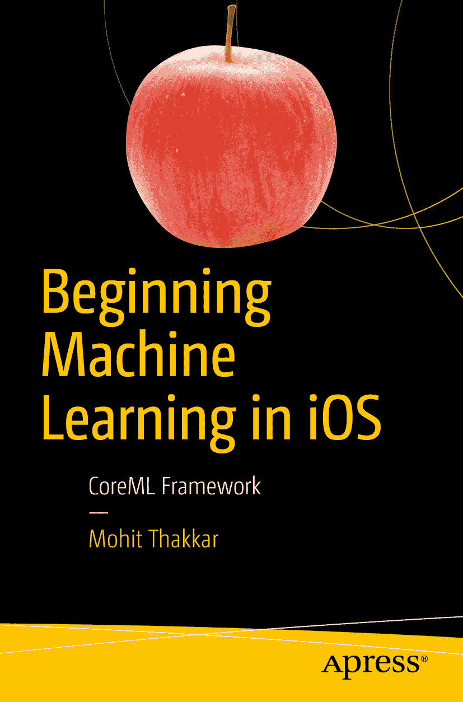

<!--

ISBN 978-1-4842-4296-4e-ISBN 978-1-4842-4297-1 [`doi.org/10.1007/978-1-4842-4297-1`](https://doi.org/10.1007/978-1-4842-4297-1) 美国国会图书馆控制号：2019932985 © Mohit Thakkar 2019 本作品受版权保护。出版商保留所有权利，无论是涉及材料的全部或部分，特别是翻译、重印、重用插图、朗诵、广播、以缩微胶片或任何其他物理方式复制，以及传输或信息存储与检索、电子改编、计算机软件，或现在已知或以后开发的类似或不同方法的权利。本书中可能出现商标名称、标识和图像。我们不以每次出现商标名称、标识或图像时都使用商标符号，而是仅以编辑方式使用这些名称、标识和图像，以利于商标所有者，且无意侵犯商标权。本出版物中使用的商品名称、商标、服务标志和类似术语，即使未标明为商标，也不应被视为对其是否受专有权利保护的表达意见。尽管本书中的建议和信息在出版时被认为是真实准确的，但作者、编辑和出版商均不对可能存在的任何错误或遗漏承担法律责任。出版商对本书所含内容不作任何明示或暗示的保证。本书通过 `Springer Science+Business Media New York` 在全球图书贸易中发行，地址：`233 Spring Street, 6th Floor, New York, NY 10013`。电话：`1-800-SPRINGER`，传真：`(201) 348-4505`，电子邮件：`orders-ny@springer-sbm.com`，或访问 `www.springeronline.com`。`Apress Media, LLC` 是一家加利福尼亚有限责任公司，其唯一成员（所有者）是 `Springer Science + Business Media Finance Inc (SSBM Finance Inc)`。`SSBM Finance Inc` 是一家特拉华州公司。

*深切怀念史蒂夫·保罗·乔布斯（1955 年至 2011 年）——那个疯狂到足以改变世界的人。*

*谨以此书献给所有试图在宇宙中留下印记的技术爱好者。正是你们，让这个世界对居住其中的人们来说变得更美好。*

*为你们喝彩！*

*爱你们的，*

*Mohit*
-->

# 致谢

我想借此机会衷心感谢为本书的编写做出贡献的人们：

Apress 的高级编辑 `Aaron Black` 和开发编辑 `James Markham`，他们看到了本书背后理念的潜力。他们凭借直觉性的建议帮助启动了本书，并确保本书的内容质量不受影响。

本书的技术审阅者 `Felipe Laso`，他确保了本书的实践部分达到标准。他富有洞察力的评论对本书的完善起到了极大的帮助。

Apress 的协调编辑 `Jessica Vakili`，她确保了从撰写到出版本书的整个过程顺畅无阻。

我的妈妈、爸爸和可爱的小妹妹，他们始终全力支持我写书的想法。他们一直在我身边，鼓励我实现自己的抱负。

无数导师和朋友，他们在人生的每一步都给予我指导。

还有你，希望通过阅读本书来提升自己的技能，从而能够改变周围人的生活。你激励我为协作教育做出贡献。

谢谢！

## 关于作者与关于技术审阅者

### 关于作者

### 关于技术审阅者