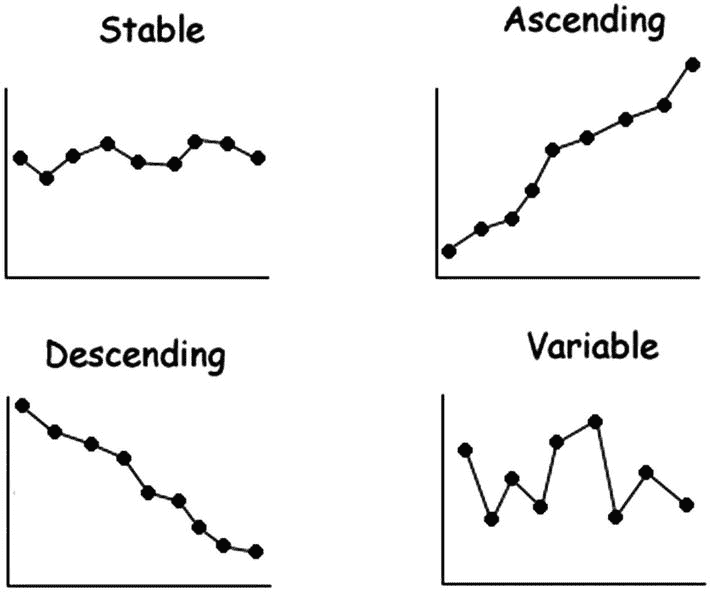
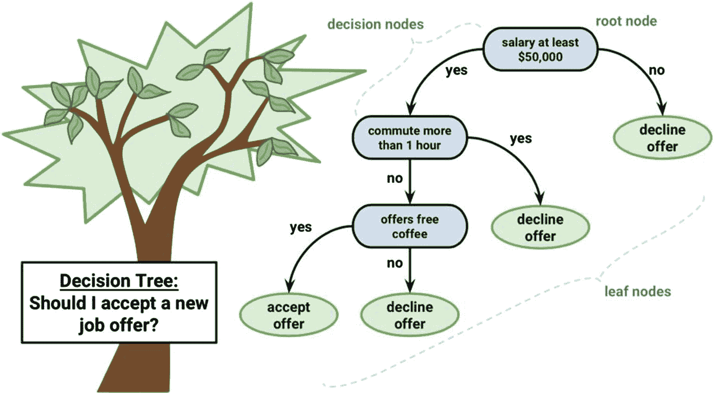
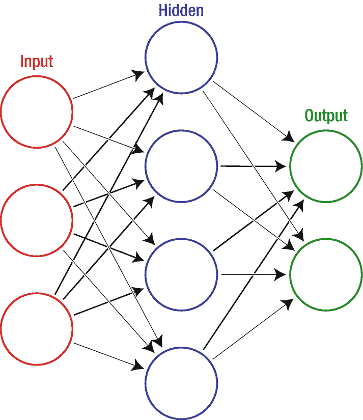
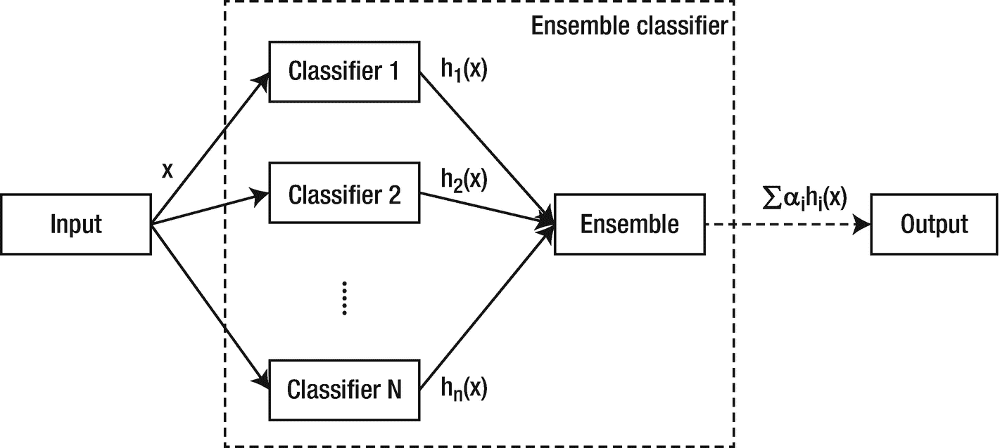
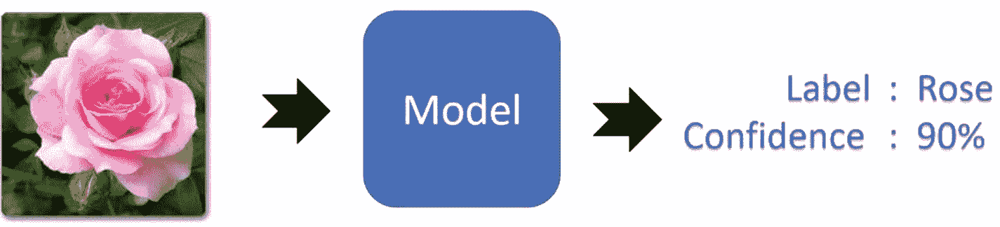
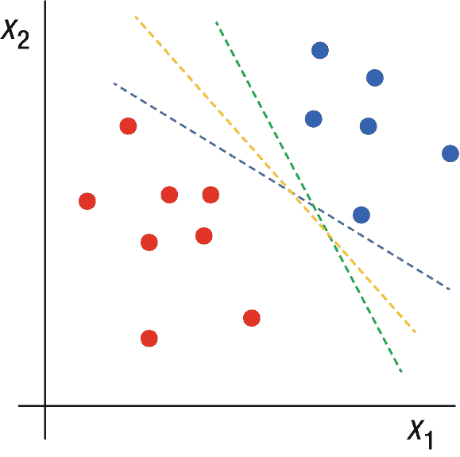

# 1. 机器学习简介

本章对机器学习（ML）的概念进行了基本解释，并介绍了其应用、ML 的类型、工作原理以及我们为何需要它。即使你是该概念的新手，本章也能为你提供开始学习 ML 所需的信息。这是一个有趣的章节，包含大量图片和示例，帮助你理解文本内容。

## 什么是机器学习？

在过去几年中，`ML`（也称为自动学习）一直是计算机科学和信息技术领域发展最快的领域之一。顾名思义，机器学习是一个机器学习给定输入数据集中重要模式的过程。现在你可能想知道“模式”一词在此语境中的含义。请参考图 1-1 以获得更清晰的概念。



图 1-1

此图展示了四组数据点在其对应图表上的映射。当我们这样做时，数据集中的数据点会形成独特的模式。图中观察到的模式有：稳定、上升、下降和可变。学习此类数据模式可用于开发一种算法，帮助机器在遇到陌生数据时进行适应并做出适当反应。ML 的目标是让机器基于学习到的内容对陌生数据自动做出反应。例如，如果机器观察到给定的数据集形成一种稳定模式，其中数据点在 -1 到 +1 之间波动，它就可以预测下一个将添加到数据集中的数据点的值。

总而言之，ML 是创建从数据中学习并进行预测的程序的过程。一些著名的 ML 模型如下：



图 1-5

- **决策树**：它使用树状图，根据对项目的观察来预测项目的目标值。图 1-5 展示了一个决策树，可帮助你决定是否接受工作邀请。



图 1-4

- **人工神经网络（`ANN`）**：它是一个相互连接的节点网络，旨在以与人脑相同的方式处理信息。信息以节点间互连的形式存储在 `ANN` 中。它接收输入，根据存储的信息处理输入，并生成输出。图 1-4 显示了 `ANN` 中节点之间的互连。


图 1-3

- **支持向量机（`SVM`）**：它是一种分类器，正式定义为一个分离超平面。给定一些带标签的训练数据，`SVM` 算法会输出一个最优超平面，用于对新示例进行分类。在二维空间中，这个超平面是一条将平面分成两部分的直线。请参考图 1-3 以获得更清晰的理解。



图 1-2

- **集成学习**：结合多种 ML 算法（分类器），以获得比单独使用任何一种 ML 算法更好的预测性能。图 1-2 展示了集成学习中的控制流程。

## 机器学习有哪些应用？

机器学习是一种我们在日常活动中有意或无意使用的工具。以下是一些常见的机器学习应用：

- 电子邮件服务过滤垃圾邮件。
- 数码相机检测人脸。
- 个人数字助理（`PDA`）识别语音指令。
- 光学字符识别（`OCR`）软件从图像中识别字符。
- 在线支付网关检测信用卡欺诈。
- 网站向用户展示个性化广告。

除了上述应用，机器学习还用于其他各种领域，例如医疗诊断、太空探索、野生动物保护、情感分析等等。

## 为什么我们需要机器学习？

假设我们想从用户的照片库中，在应用程序里展示所有玫瑰花的图片。这看起来是个简单的任务，所以我们可以编写一些程序。也许，我们会从颜色入手。如果图片中的主色调是红色，那它可能就是一朵玫瑰。

```
// 使用颜色
如果 颜色 == "偏红"
```

图 1-6 展示了不同类型的玫瑰。看着这张图，你会注意到有很多玫瑰是白色或黄色的。所以，我们会继续前进，开始描述形状。但很快我们就会意识到，即使编写这样一个简单的程序，用编程方式实现也非常困难。因此，这就是我们需要机器学习帮助的地方。我们不会用编程方式描述玫瑰的样子，而是通过经验来描述玫瑰。


图 1-6

机器学习有两个步骤。第一步，你收集玫瑰、百合、向日葵和其他花卉的图片，并给它们打上标签。你将它们通过一个学习算法运行，就会得到我们所说的模型。这个模型是对玫瑰外观的经验性表示。这一步被称为学习。第二步，你执行以下操作：

- 拍摄一张玫瑰的图片。
- 将第一步生成的模型嵌入到你的应用程序中。
- 将玫瑰的图片通过模型运行。

你会得到图片的标签和置信度。见图 1-7。这一步被称为推理。



图 1-7

这就是我们如何利用机器学习的潜力来简化任务。

## 机器学习是如何工作的？

通俗地说，机器学习可以被看作是将过去的经验转化为专业知识。让我们考虑识别垃圾邮件并为其打标签的任务。为了执行这个任务，机器会创建一个集合，包含所有之前由人类用户标记为垃圾邮件的电子邮件；然后，机器会识别出所有在邮件中出现即表明是垃圾邮件的词汇。现在，当一封新邮件出现时，机器会扫描它，查找从之前垃圾邮件集合中识别出的可疑词汇，以判断新邮件是否为垃圾邮件。通过这种方式，机器就能正确且自动地为新邮件打标签。

让我们考虑另一个涉及机器学习的任务，即相机应用程序检测人脸。这个功能有助于相机在拍照前确保所有脸部都对焦。见图 1-8。为了自动检测人脸，相机需要知道人脸的结构。为此，相机应用程序中应用了一个学习算法，在此过程中，它使用一个包含各种人脸的训练数据集进行工作。通过分析训练数据集中的所有人脸，相机观察到了训练数据集中所有数据成员的共同模式。例如，它可能观察到所有人脸都由两只眼睛、一个鼻子和一对嘴唇组成。除此之外，它还可能观察到这些元素的定位。通过学习这些，相机现在就能自动检测人脸了。


图 1-8

有许多算法用于机器学习。其中一种算法是感知机学习算法。下一节将讨论这个算法，以便更清晰地了解机器学习。

## 感知机学习算法

感知机是神经网络的一个经典例子，它根据接收到的输入产生二进制输出。我们可以将感知机用于分类任务，即需要将输入分为两个输出类别之一。例如，考虑图 1-9，它展示了一个线性可分问题。这里的目标是创建一个能够将红点与蓝点分开的感知机。为此，感知机必须首先分析训练数据集，并在图表上确定一条将蓝点与红点分开的直线。一旦完成，感知机就能通过确定新输入向量相对于该直线在图表上的位置，将其分类为蓝点或红点。



图 1-9

以下是感知机确定分隔两类输入向量的直线的学习过程：

- 目标是基于训练数据集获得一条将红点与蓝点分开的直线。那么，让我们考虑一条直线的方程：`ax + by + c = 0`，即 `x = -c/a - b/a * y`。
- 我们现在得到了一个直线方程。直线的位置完全取决于 `a`、`b` 和 `c` 的值。因此，我们可以根据需要调整权重（`a`、`b` 和 `c`）的值。
- 现在，将权重（`a`、`b` 和 `c`）初始化为随机的实数值。
- 遍历训练数据集，收集所有被当前权重集错误分类的数据成员。如果所有数据成员都被正确分类，则将权重的值代入直线方程。你就找到了分隔红点和蓝点的直线。
- 否则，根据错误分类的数据成员修改权重（`a`、`b` 和 `c`），并再次遍历训练数据集。重复此过程，直到所有数据成员都被正确分类。

## 机器学习类型

机器学习算法大致可分为三类：

1. *监督学习*：此类学习算法包含一个训练数据集，其中包含由输入值和期望输出值组成的配对。这类数据被称为标记训练数据。在此类算法中，会生成一个映射函数，将训练数据集中的输入值映射到其对应的输出值。监督学习代表了人类教授计算机的概念，主要用于执行分类任务。
2. *无监督学习*：此类学习算法包含一个训练数据集，其中仅有输入值，没有输出值。这类数据被称为未标记训练数据。在此类学习算法中，学习纯粹基于数据的结构进行。无监督学习代表了计算机自我学习的概念，主要用于解决聚类任务。
3. *强化学习*：此类学习算法通过与环境的交互来产生动作，并发现错误或成功。这种学习方式使机器能够自动确定特定环境中的理想行为。机器需要简单的反馈来学习哪个动作最佳；这被称为强化信号。

现在你已经了解了机器学习的基础知识，我们将讨论苹果公司提供的核心机器学习框架，用于将预训练的机器学习模型集成到 iOS 应用中。

## 总结

* 机器学习是一个过程，在此过程中，机器学习给定数据集中的显著模式，以便能够进行预测。
* 集成学习、支持向量机、人工神经网络和决策树是一些著名的机器学习模型。
* 垃圾邮件过滤、人脸检测、语音识别、光学字符识别、信用卡欺诈检测和个性化广告是机器学习的常见示例。
* 机器学习的高级应用包括医疗诊断、太空探索、野生动物保护和情感分析。
* 机器学习识别历史数据中的模式，并利用这些知识对未来可能遇到的任何陌生数据做出适当反应。
* 感知机是机器学习的一个经典示例，它根据接收到的输入给出二元输出，可用于解决线性可分问题。
* 机器学习算法大致分为三类：监督学习、无监督学习和强化学习。