# 2. Core ML 框架简介

在第 1 章中，你学习了机器学习的基本定义、工作原理、应用场景以及使用它所需的条件。本章将向你介绍 Core ML 框架，该框架由苹果公司于 2017 年推出，旨在允许应用程序开发人员在其 iOS 应用中实现机器学习。你还将学习训练和推理的概念，这将让你更清晰地了解机器学习的工作原理。

本章还提供了为 iOS 设备创建机器学习应用的分步指南。如果你之前没有创建过 iOS 应用，也无需担心，因为本章将指导你完成从零开始创建应用的整个过程。

## Core ML 概览

Core ML 是苹果公司发布的一个开创性的应用开发框架。它允许你在 iOS 应用中使用预训练的机器学习模型。

传统上，机器学习应用必须依赖云服务来运行第三方机器学习算法。这导致应用在移动设备上运行非常缓慢。但随着 Core ML 的推出，机器学习应用现在可以在设备上本地运行经过优化和训练的机器学习算法，从而带来更快的处理速度（图 2-1）。

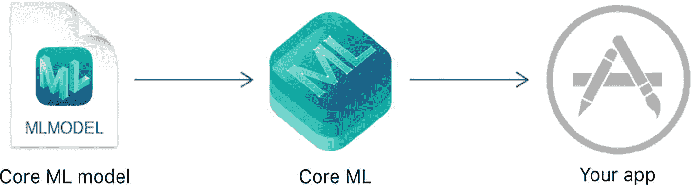

图 2-1

Core ML 应用带来更快的处理时间

Core ML 功能强大，可用于实现多种功能。然而，Core ML 有两个直接的应用：

*   首先，开发者可以使用 Core ML 中已有的预训练模型。

*   其次，他们可以使用 Caffe、Turi 和 Keras 等框架构建自己的自定义机器学习模型，然后将其转换为 Core ML 模型，以便在其 iOS 应用中使用。

一些使用 Core ML 提供功能的知名应用包括 Pinterest（基于图像的搜索）、iPhone 照片图库（将照片分组）和 Nude App（识别包含裸体的图片）。

图 2-2 展示了将使用第三方框架创建的机器学习模型转换为 Core ML 格式的过程，以便你可以在应用中使用它。

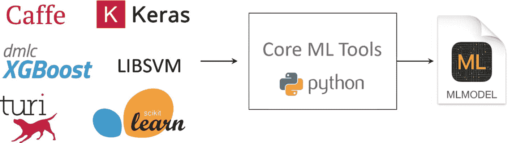

图 2-2

转换为 Core ML

Core ML 支持广泛的机器学习算法，例如集成学习、支持向量机、人工神经网络、线性模型等。但是，Core ML 仅运行使用标记数据训练的模型，不支持无监督模型。

## Core ML 组件

Core ML 是苹果的机器学习框架，适用于 macOS、iOS、watchOS 和 tvOS。它是苹果先前机器学习框架——Accelerate 和 Metal Performance Shaders——的基础，这两个框架通常用作性能基元。Accelerate 使用 CPU 处理内存密集型任务，而 MPS 使用 GPU 处理计算密集型任务。Core ML 根据应用的需求决定使用哪个底层框架。图 2-3 展示了 Core ML 框架的各种组件。除了 Accelerate 和 MPS 之外，Core ML 还支持以下特定领域的框架：

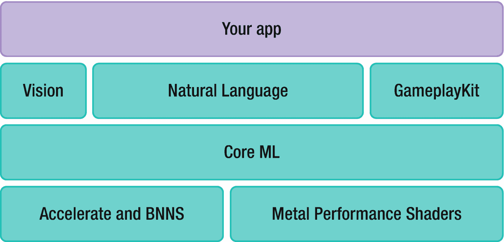

图 2-3

Core ML 组件

*   *Vision*：Vision 是苹果用于处理所有与计算机视觉和图像相关事务的一站式框架。它包含计算机视觉算法，有助于执行图像和视频的检测与分类等任务。它可以用于物体跟踪或基于深度学习的人脸检测等。

*   *Natural Language*：这是苹果用于文本处理的一站式框架。它可以用于分析自然语言并从中推断出一些元数据。它有助于执行命名实体识别、文本预测、语言识别和情感分析等任务。

*   *GameplayKit*：这是一个有助于在你的应用中融入常见游戏行为的框架，例如伪随机数生成、物体运动和寻路。它是一个面向对象的框架，包含可帮助你构建游戏的可重用组件。

你可以将 Core ML 视为一组工具，它帮助你整合多个机器学习模型，并将它们封装在一个接口中，以便你可以在应用代码中轻松使用它们。


## 训练与推理

在第 1 章中，你已经了解到机器学习是一个在给定数据集中发现模式以进行预测的过程。为此，我们需要以下实体：

*   *输入数据点*：假设我们要将学生分类为“通过/未通过”。在这种情况下，输入数据点将由不同学生的分数组成。

*   *给定输入点的预期输出*：继续我们之前的分类示例，预期输出将包括“通过”或“未通过”。

*   *学习算法*：这是一种学习如何将输入映射到输出，并创建可用于处理新输入（推理）的规则的算法。这些规则是通过称为训练的过程创建的。

让我们考虑一些例子来更清楚地理解这一点。

*示例 1（图像识别）*：一个正在学习识别街道上婴儿车的模型，使用数百万张街道图像进行训练。这些图像被称为训练数据集。其中一些图像完全没有行人，而另一些则多达 50 人。多个学习算法在这些数据（街道图像）上进行训练，每个算法都能访问正确答案。每个算法都会开发出不同的模型来识别街道上的婴儿车。这个过程被称为训练。之后，当一张新图像作为输入提供给算法时，它将应用适当的模型并确定图像中婴儿车的数量。这个过程被称为推理。

*示例 2（分拣）*：一个模型正在学习使用视觉识别来分拣物品。当物品在传送带上经过时，它会从一堆物品中挑出可回收物品。它将玻璃、塑料、纸张和金属等物品放入各自的回收箱中。这个过程被称为推理。每个物品都贴有一个识别号码。每天一次，人类专家检查回收箱，并告知机器人哪些物品被错误分拣。机器人利用这些反馈进行改进。这个过程被称为训练。

*示例 3（决策制定）*：一个模型正在学习评估与金融投资相关的风险。该模型被输入大量关于投资者过去进行的交易以及这些交易结果的数据。基于这些训练数据，模型计算风险回报比。这被称为训练。现在，当模型被输入关于某项投资的特定参数时，它可以预测与该投资相关的风险。这被称为推理。

## 机器学习模型

在机器学习中，模型不过是一个接收输入并返回输出的函数。它通过训练和推理的过程生成，即将训练数据集应用于学习算法。学习算法在训练数据中寻找模式，这些模式将数据集中的输入数据点映射到它们对应的输出数据点。然后，算法返回一个捕获这些数据模式的机器学习模型。

你可能希望在应用程序中使用的大多数模型，其核心都具备一些关键功能。机器学习模型提供的一些常见功能（见图 2-4）包括情感分析、手写识别、语言翻译、图像分类、风格迁移、音乐标记和文本预测。

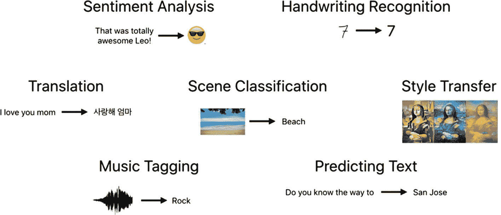

图 2-4

机器学习模型的关键功能

Core ML 支持多种模型，包括神经网络、树集成、支持向量机和线性模型。它要求机器学习模型采用 Core ML 格式，即扩展名为 `.mlmodel` 的文件。Apple 提供了几个已内置于 Core ML 框架中的开源机器学习模型。但是，你也可以创建自己的自定义机器学习模型，将其转换为 Core ML 格式，并在你的应用程序中使用。

在本章的后续部分，我们将学习如何创建一个简单的 iOS 应用程序，并在该应用程序中实现一个开源机器学习模型。


## 开始使用 Xcode

Xcode 与 Core ML 框架紧密集成，是苹果公司推出的一款功能极其强大的 IDE（集成开发环境），用于为 MacBook、iPhone、iPad、Apple Watch 和 Apple TV 构建应用程序。

以下是本章作为通用开发实践所使用的配置：

*   *Xcode*：9.4.1 或更高版本
*   *部署 SDK*：11.4 或更高版本
*   *编程语言*：Swift 4 或更高版本
*   *模拟器*：iPhone 8 Plus 或更高版本

假设你熟悉 Mac 环境，并且已在 MacBook 上安装了 Xcode，那么让我们开始构建第一个 iOS 应用程序。

*步骤 1*：启动 Xcode。它应该会显示一个欢迎对话框（图 2-5）。在此处，选择“创建一个新的 Xcode 项目”来开始一个新项目。

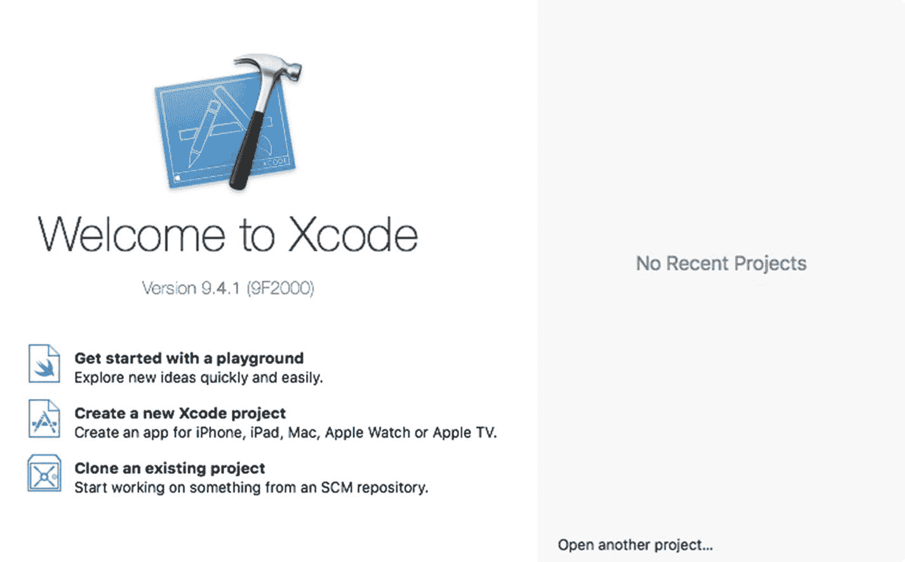

图 2-5

Xcode 欢迎对话框

*步骤 2*：Xcode 会显示各种设备和项目模板供你选择（图 2-6）。选择你的目标设备和合适的模板（单视图应用）。然后点击“下一步”。

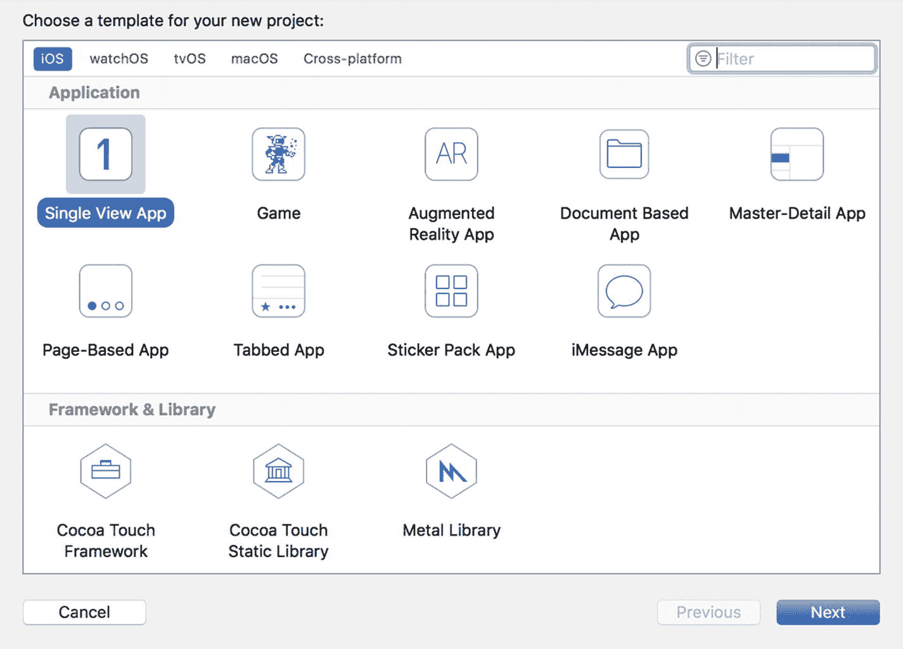

图 2-6

Xcode 模板选择

*步骤 3*：这将带你进入另一个屏幕，用于填写项目的所有必要选项（图 2-7）。这些选项包括：

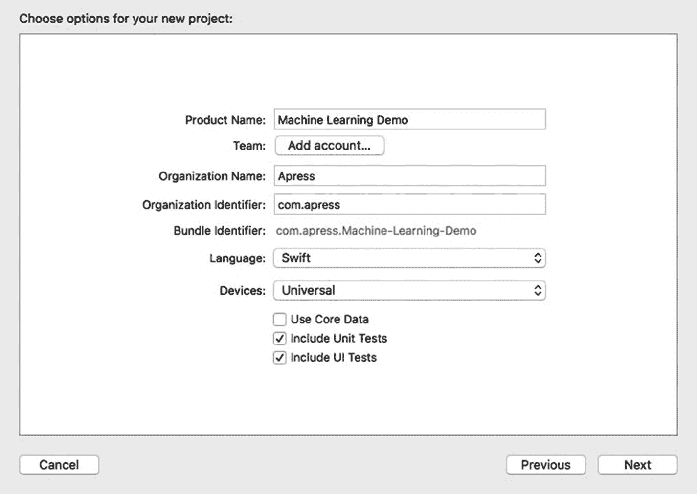

图 2-7

Xcode 项目选项

*   *产品名称*：你的应用程序的名称。
*   *组织名称*：你可以在此框中填写你的公司名称。
*   *组织标识符*：这是以反向顺序书写的域名。如果你有域名，可以使用你自己的域名。
*   *类前缀*：Xcode 使用类前缀自动命名类。你可以选择自己的前缀或将其留空。
*   *设备*：选择你希望应用程序在其上运行的设备。

*步骤 4*：然后 Xcode 会询问你希望将项目保存在哪里（图 2-8）。在你的 Mac 上选择一个文件夹（例如，桌面），然后点击“创建”。

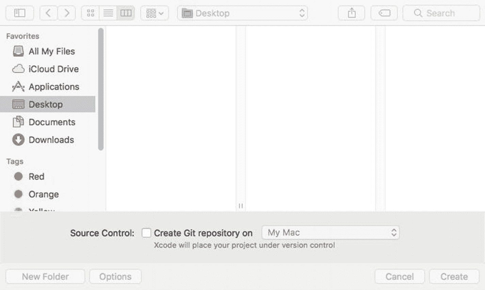

图 2-8

Xcode 文件夹选择器

*步骤 5*：确认后，Xcode 会根据你提供的所有选项自动创建项目。下一个屏幕将类似于图 2-9。

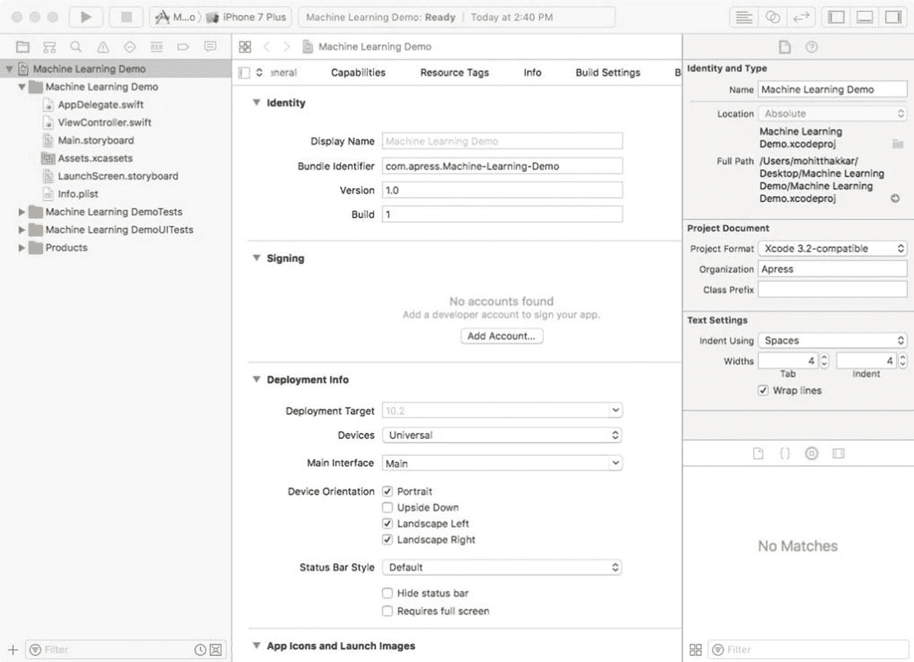

图 2-9

Xcode 主窗口

在进入代码部分之前，让我们先熟悉一下 Xcode 工作区（图 2-10）。

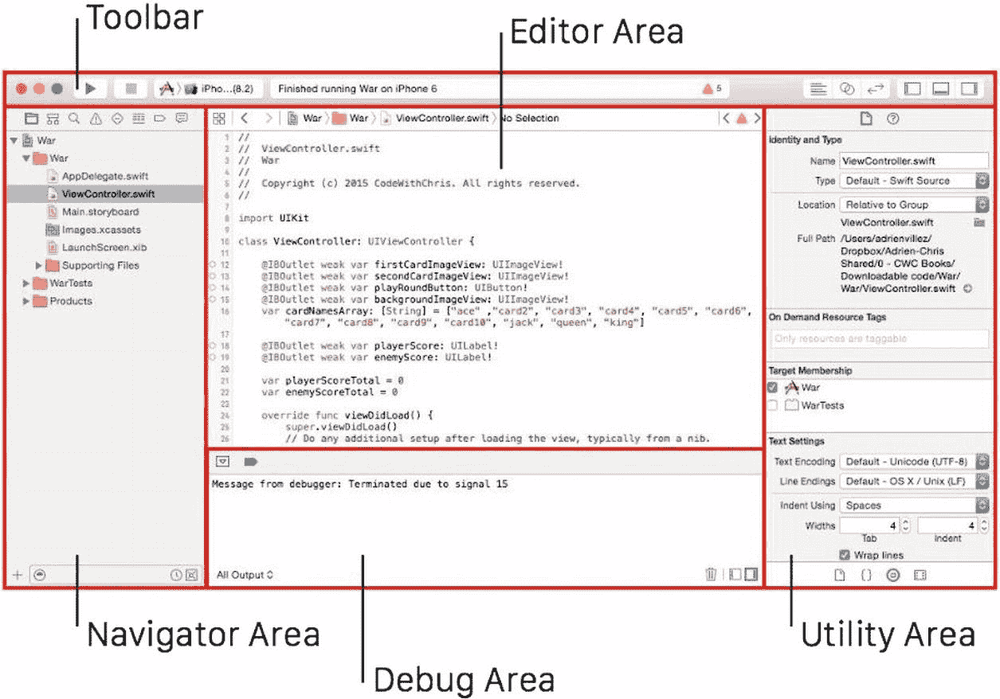

图 2-10

Xcode 工作区

*   左侧窗格是项目导航器。你可以在此区域找到所有文件。
*   工作区的中央部分是编辑器区域。
*   最右侧的窗格是工具区。此区域显示文件的属性，并允许你访问快速帮助。
*   顶部有一个工具栏，提供各种功能，用于运行应用程序、切换编辑器等。

*步骤 6*：在项目导航器区域，你会找到一个名为 `MainStoryboard.storyboard` 的文件。选择此文件，你会注意到编辑器区域变为一个界面构建器（图 2-11），其中显示了一个空白的应用程序屏幕。

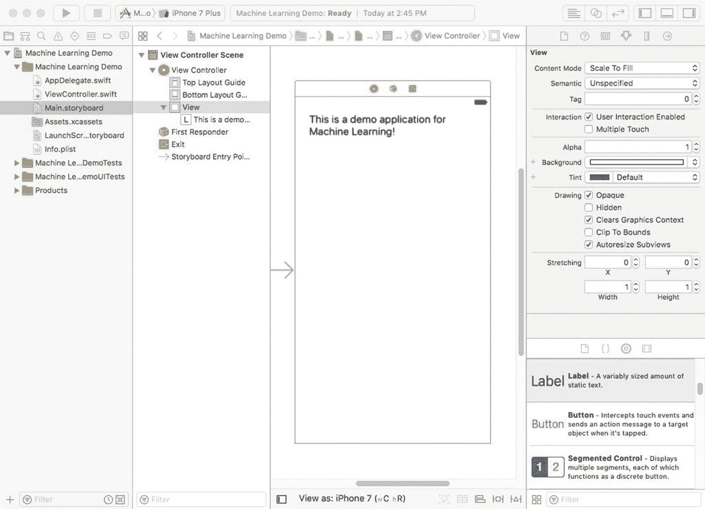

图 2-11

Xcode 界面构建器

*步骤 7*：在工具区的下部，你会找到对象库。在这里，你可以选择任意 UI 控件并将其拖放到视图中。让我们选择“标签”并将其拖入视图。你可以从工具区的对象属性中更改标签的文本。你还可以根据需要添加定位约束，以正确构建 UI 元素的结构。

*步骤 8*：现在是时候测试你的应用程序了。你可以使用工具栏上的运行图标来运行它。Xcode 会自动构建应用程序并在模拟器中运行它。如果一切正常，你的应用程序应该在模拟器中正常运行。

就是这样！我们刚刚创建了第一个 iOS 应用程序。在下一节中，我们将学习如何在此应用程序中集成一个开源的 ML 模型。


## 使用 Xcode 创建照片应用

现在，让我们创建一个应用，允许用户从照片库中选择一张图片，并在屏幕上显示所选图片。稍后我们将修改此应用，在其中加入一个机器学习模型。

*步骤 1*：启动 Xcode，打开我们之前创建的“Machine Learning Demo”应用。

*步骤 2*：从导航区域打开名为“MainStoryboard.storyboard”的文件，以启动界面构建器。

*步骤 3*：删除我们之前创建的标签。然后，通过从工具区域的对象库中将控件拖拽到界面构建器，向界面中添加一个按钮，随后再添加一个图像视图。请参考图 2-12。您可以通过工具区域的对象属性来更改按钮的颜色和文本。

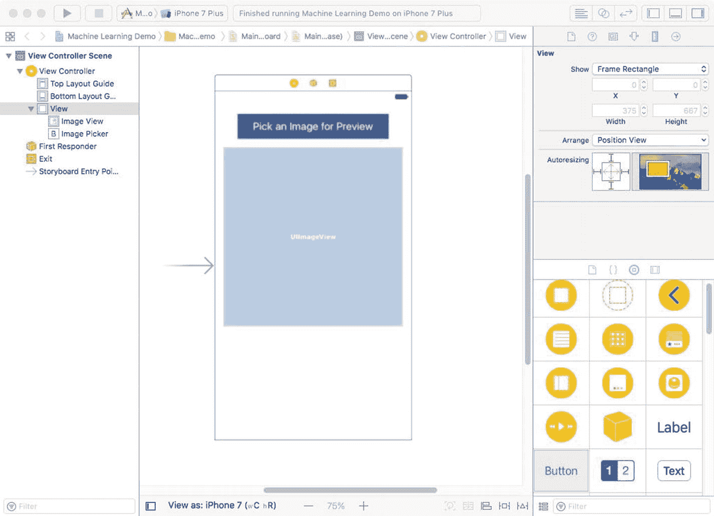

图 2-12

照片应用界面

*步骤 4*：界面创建完成后，我们将专注于应用的逻辑。点击工具栏右侧的图标打开辅助编辑器。在辅助编辑器中加载名为“ViewController.swift”的文件。您将同时看到窗口左侧的界面构建器和右侧的代码（“ViewController.swift”）。请参考图 2-13。

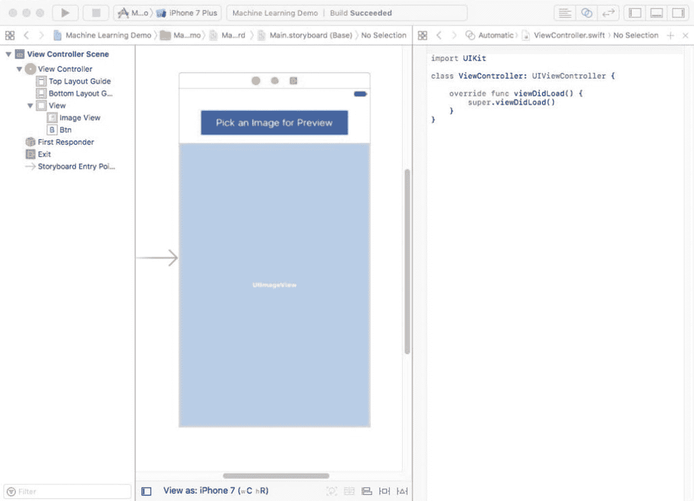

图 2-13

辅助编辑器

*步骤 5*：要将界面元素连接到代码，我们需要创建输出口和操作。输出口用于修改 UI 元素的属性，而操作则用于处理与 UI 元素相关的事件。我们将为按钮和图像视图创建输出口。为此，按住 Control 键并从按钮/图像视图拖拽到代码（“ViewController.swift”）中，然后创建一个 IBOutlet。在连接字段中，我们选择 Outlet；名称使用 btn 或 imageView；类型选择 UIButton 或 UIImageView。这将在您的 ViewController 类中生成以下 IBOutlet 代码：

```
@IBOutlet weak var btn: UIButton!
@IBOutlet weak var imageView: UIImageView!
```

*步骤 6*：当点击按钮时，应用应打开一个图像选择器，允许用户从照片库中选择一张图片并返回所选图片。现在，让我们创建一个操作来处理按钮的点击事件。为此，再次按住 Control 键并从按钮拖拽到代码。您应该会看到一个类似于图 2-14 的弹出窗口。在连接字段中，我们选择 Action；名称使用 pickImageBtnClick；触发操作的事件为“Touch Up Inside”；传递给方法的参数为 Sender。

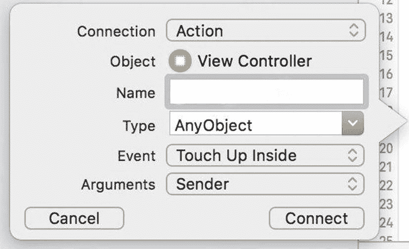

图 2-14

IBAction

这将在您的 ViewController 类中生成以下 IBAction 代码：

```
@IBAction func pickImageBtnClick(_ sender: Any) {
//code
}
```

*步骤 7*：现在，让我们添加处理按钮点击的代码。首先，由于我们需要用户与照片库交互，我们必须遵循 UIImagePickerControllerDelegate 协议以及 UINavigationControllerDelegate 协议。将这两个控制器添加到 ViewControllor.swift 文件中的类定义中：

```
class ViewController: UIViewController, UIImagePickerControllerDelegate, UINavigationControllerDelegate {
//code
}
```

*步骤 8*：当用户点击按钮时，我们需要创建一个 UIImagePickerController 实例，并将其委托设置为当前类。我们还需要将图像选择器的源指定为照片库。选择器创建后，我们需要使用 present 方法以模态方式呈现它。为此，将以下代码添加到 ViewControllor.swift 文件中的 pickImageBtnClick 方法中：

```
@IBAction func pickImageBtnClick(_ sender: Any) {
let imagePicker = UIImagePickerController()
imagePicker.delegate = self
imagePicker.allowsEditing = false
imagePicker.sourceType = .photoLibrary
present(imagePicker, animated: true, completion: nil)
}
```

*步骤 9*：由于我们遵循了 UIImagePickerControllerDelegate，我们需要实现两个委托方法：imagePickerController 和 imagePickerControllerDidCancel。当用户完成从库中选择图像时，会调用 imagePickerController 方法。因此，我们将使用此方法在应用的图像视图中设置所选图像。当用户取消图像选择器时，会调用 imagePickerControllerDidCancel 方法。因此，在此方法中，我们只需关闭选择器。将以下代码添加到 ViewControllor.swift 文件中的 ViewController 类中：

```
func imagePickerController(_ picker: UIImagePickerController, didFinishPickingMediaWithInfo info: [String : Any]) {
let pickedImage = info[UIImagePickerControllerOriginalImage] as! UIImage
imageView.image = pickedImage
self.dismiss(animated: true, completion: nil)
}
func imagePickerControllerDidCancel(_ picker: UIImagePickerController) {
self.dismiss(animated: true, completion: nil)
}
```

请注意，如果您使用的是 Swift 4.2，上述代码可能无法正常工作，因为它是用 Swift 4.0 编写的。以下是您将使用的替代代码：

```
func imagePickerController(_ picker: UIImagePickerController, didFinishPickingMediaWithInfo info: [UIImagePickerController.InfoKey : Any]) {
let pickedImage = info[UIImagePickerController.InfoKey.originalImage] as! UIImage
imageView.image = pickedImage
picker.dismiss(animated: true)
}
func imagePickerControllerDidCancel(_ picker: UIImagePickerController) {
self.dismiss(animated: true, completion: nil)
}
```

如果一切正常，您最终的 Swift 代码（Swift 4.0）应如下所示：

```
import UIKit
class ViewController: UIViewController, UIImagePickerControllerDelegate, UINavigationControllerDelegate {
@IBOutlet var btn: UIButton!
@IBOutlet var imageView: UIImageView!
override func viewDidLoad() {
super.viewDidLoad()
btn.layer.cornerRadius = 8
}
@IBAction func pickImageBtnClick(_ sender: Any) {
let imagePicker = UIImagePickerController()
imagePicker.delegate = self
imagePicker.allowsEditing = false
imagePicker.sourceType = .photoLibrary
present(imagePicker, animated: true, completion: nil)
}
//UIImagePickerControllerDelegate Methods
func imagePickerController(_ picker: UIImagePickerController, didFinishPickingMediaWithInfo info: [String : Any]) {
let pickedImage = info[UIImagePickerControllerOriginalImage] as! UIImage
imageView.image = pickedImage
self.dismiss(animated: true, completion: nil)
}
func imagePickerControllerDidCancel(_ picker: UIImagePickerController) {
self.dismiss(animated: true, completion: nil)
}
}
```

*步骤 10*：由于我们的应用需要访问用户设备的照片库，我们需要请求用户授予访问权限。否则，我们的应用可能会意外终止。为避免这种情况，我们需要在应用的“Info.plist”文件（图 2-15）中添加以下属性：

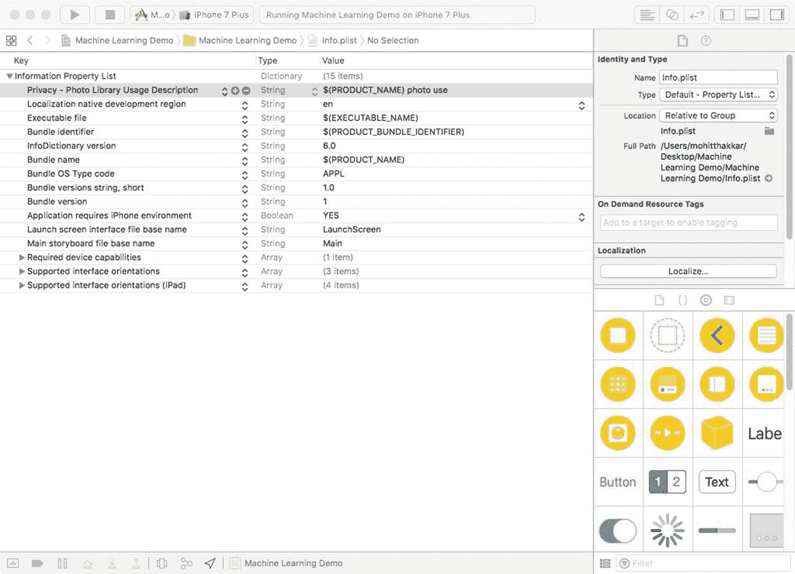

图 2-15

信息属性列表

*   *键*：隐私 – 照片库使用说明

*   *值*：$(PRODUCT_NAME) 照片使用


就是这样！我们刚刚创建了一个 iPhone 应用，它允许用户从照片库中选取图片，并将选中的图片显示在屏幕上。现在该测试我们的应用了。你可以使用工具栏上的运行图标来运行应用。Xcode 会自动构建应用并在模拟器中运行它（图 2-16）。如果一切正常，你的应用应该能在模拟器中顺利运行。

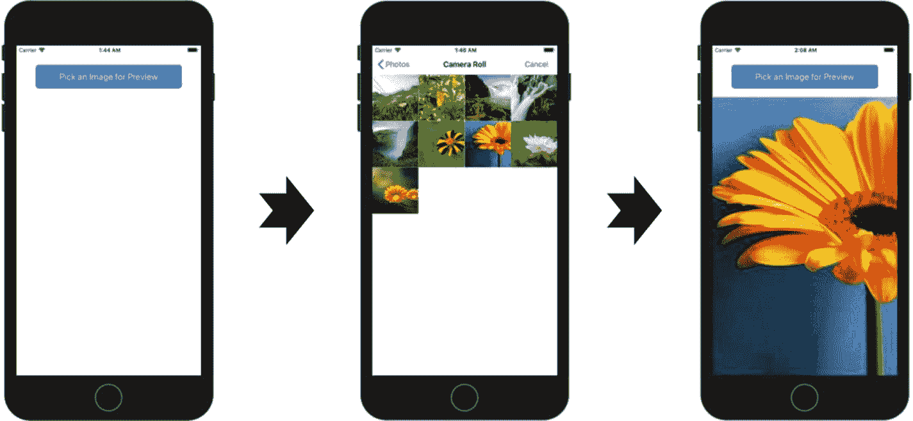

图 2-16

使用 Xcode 的照片应用

## 在应用中使用 Core ML 模型

Core ML 最精彩的部分在于，它让你能够将预训练模型集成到应用中。即使你对神经网络或机器学习没有深入了解，也能做到这一点。唯一的限制是，模型必须是 Core ML 格式才能集成到你的应用中。在本书的这一部分，我们将使用一个已经是 Core ML 格式且可在苹果官网获取的模型。

我们在本章上一节构建的应用允许用户从设备的照片库中选择图片。现在，我们将在这个应用中集成一个 Core ML 模型，该模型会尝试预测所选图片中物体的标签。为此，我们首先需要下载模型。前往苹果的机器学习开发者网站（[`https://developer.apple.com/machine-learning/build-run-models/`](https://developer.apple.com/machine-learning/build-run-models/)），并滚动到页面底部。你会看到一个区域，列出了所有可免费下载的预训练 Core ML 模型（图 2-17）。

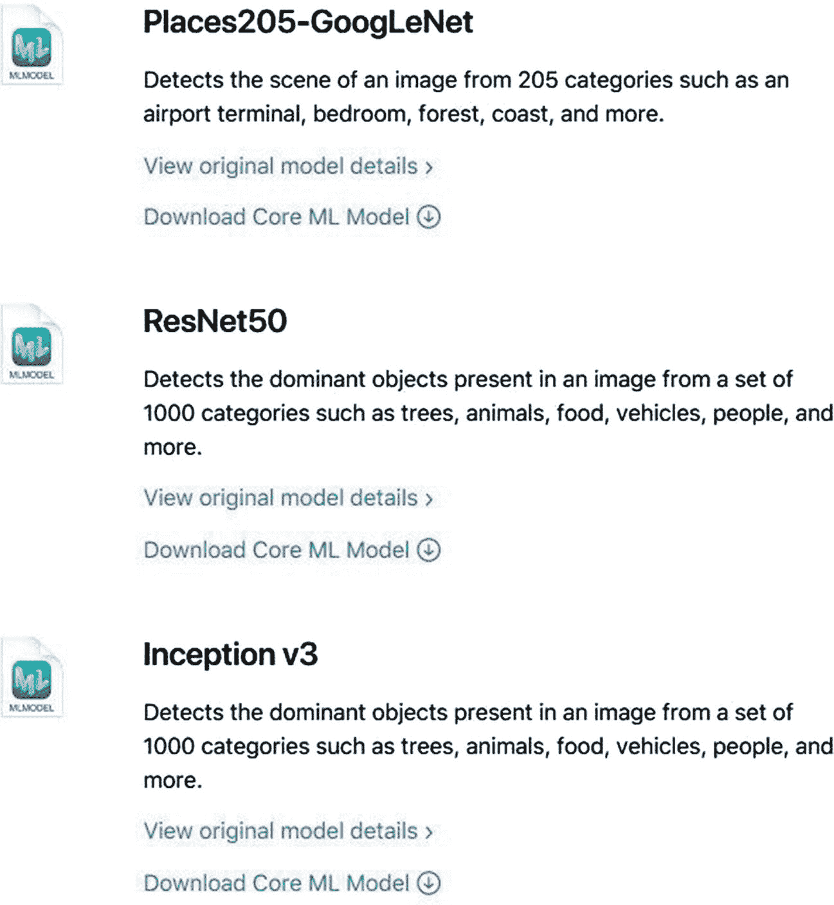

图 2-17

苹果 Core ML 模型

我们将在应用中使用的模型是 Inceptionv3。这个模型最初是用 Keras 构建的，并通过 Python 工具转换成了 Core ML 格式。它能够从超过 1000 个类别（例如树木、动物、食物、车辆、人物、花卉等）中检测图像中的主要物体。请随意使用列表中的其他模型代替 Inceptionv3，因为所有 Core ML 模型的处理过程几乎相同。下面我们来看看将这个模型集成到应用中的分步步骤。

*步骤 1*：首先，我们需要在应用界面上添加一个标签，用于显示所选图片的预测结果。为此，进入界面构建器，减小 imageView 的高度，以便在底部为标签腾出空间。然后，从对象库中拖拽一个标签放到界面上。参考图 2-18。

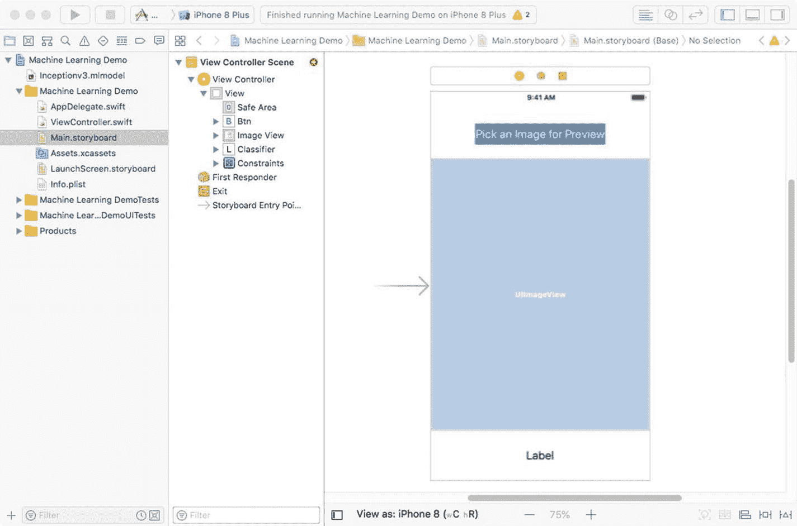

图 2-18

更新后的照片应用界面

*步骤 2*：为新创建的标签添加一个输出口，以便我们稍后可以更改其文本。

```
@IBOutlet weak var classifier: UILabel!
```

*步骤 3*：现在我们已经为预测准备好了界面，接下来让模型开始工作。你将拥有之前从苹果网站下载的 Inceptionv3.mlmodel 文件。将该文件拖拽到 Xcode 项目导航器中的项目文件夹下。这会将 Core ML 模型添加到你的应用中。

*步骤 4*：从导航器中选择模型文件，你会注意到 Xcode 会自动识别该文件为 ML 模型。它会显示模型的相关信息，例如模型类型（在我们的例子中是神经网络分类器）、作者详情、模型描述等（图 2-19）。

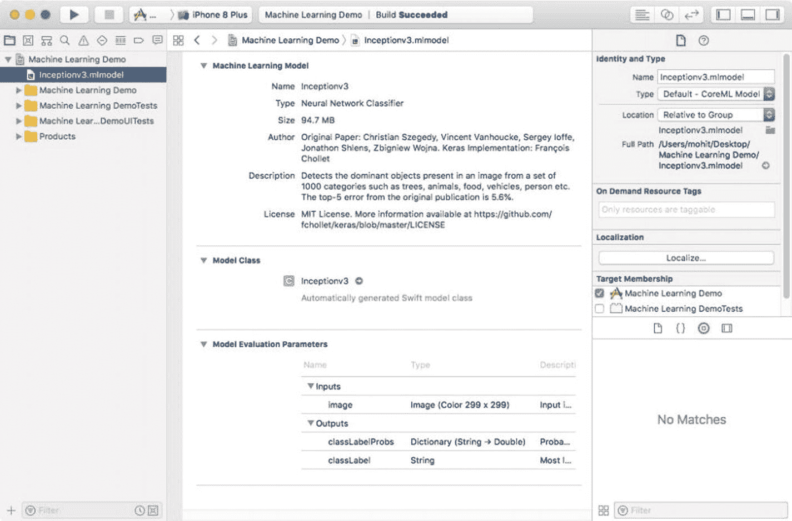

图 2-19

Core ML 模型（Inceptionv3）

它还会显示模型类，该类由 ML 模型自动生成，可以直接在我们的应用中使用。点击类名旁边的箭头，你将能看到模型类的实现代码。

Xcode 显示的其他重要信息是模型评估参数。这是关于模型接收的输入和返回的输出的信息。在我们的例子中，模型接收一张 299×299 大小的彩色图像作为输入，并返回一个字符串作为输出。

*步骤 5*：现在，让我们在应用中使用模型类来进行预测。打开 ViewController.swift 文件，并在文件最开头导入 Core ML 框架。

```
import CoreML
```

*步骤 6*：在 ViewController 类中声明一个模型变量，该变量将代表 Core ML 模型。

```
var model:Inceptionv3!
```

*步骤 7*：重写 ViewController 类的 viewWillAppear() 方法，并在该方法中初始化模型。

```
override func viewWillAppear(_ animated: Bool) {
model = Inceptionv3()
}
```

*步骤 8*：我们的模型接收的输入是一张 299×299 大小的图像。因此，在用户完成图片选择后，我们需要调整图片大小。我们将在委托方法 imagePickerController() 中编写相关代码。以下代码将为我们完成这项工作：


### 注意

以下代码行中的编号仅为后续解释而添加。

```
//resize image
1\. UIGraphicsBeginImageContextWithOptions (CGSize(width: 299, height: 299), true, 2.0)
2\. pickedImage.draw(in: CGRect(x: 0, y: 0, width: 299, height: 299))
3\. let newImage = UIGraphicsGetImageFromCurrentImageContext()!
4\. UIGraphicsEndImageContext()
5\. let attrs = [kCVPixelBufferCGImageCompatibilityKey: kCFBooleanTrue, kCVPixelBufferCGBitmapContextCompatibilityKey: kCFBooleanTrue] as CFDictionary
6\. var pixelBuffer : CVPixelBuffer?
7\. let status = CVPixelBufferCreate(kCFAllocatorDefault, Int(newImage.size.width), Int(newImage.size.height), kCVPixelFormatType_32ARGB, attrs, &pixelBuffer)
8\. guard (status == kCVReturnSuccess) else {
9\. return
10\. }
11\. CVPixelBufferLockBaseAddress(pixelBuffer!, CVPixelBufferLockFlags(rawValue: 0))
12\. let pixelData = CVPixelBufferGetBaseAddress(pixelBuffer!)
13\. let rgbColorSpace = CGColorSpaceCreateDeviceRGB()
14\. let context = CGContext(data: pixelData, width: Int(newImage.size.width), height: Int(newImage.size.height), bitsPerComponent: 8, bytesPerRow: CVPixelBufferGetBytesPerRow(pixelBuffer!), space: rgbColorSpace, bitmapInfo: CGImageAlphaInfo.noneSkipFirst.rawValue)
15\. context?.translateBy(x: 0, y: newImage.size.height)
16\. context?.scaleBy(x: 1.0, y: -1.0)
17\. UIGraphicsPushContext(context!)
18\. newImage.draw(in: CGRect(x: 0, y: 0, width: newImage.size.width, height: newImage.size.height))
19\. UIGraphicsPopContext()
20\. CVPixelBufferUnlockBaseAddress(pixelBuffer!, CVPixelBufferLockFlags(rawValue: 0))
```

现在，让我们理解上述代码中发生了什么。由于我们的模型接受大小为 299×299 的输入图像，第 1-4 行将所选图像转换为该尺寸，并将其赋值给一个名为 `newImage` 的新变量。

重要的是要知道，模型接受以像素形式表示的输入图像。因此，第 5-10 行将 `newImage` 以像素缓冲区的形式存储，该缓冲区本质上将图像以像素形式保存在内存中。此缓冲区将作为输入提供给预测过程。

然后，图像中的所有像素都被转换为设备相关的 RGB 色彩空间。第 11-13 行完成了这一操作。在第 14 行，我们将像素数据存储在 `CGContext` 中，以便轻松修改图像像素的某些属性。接着，我们在第 15-16 行根据需求缩放图像。第 17-20 行更新最终的图像缓冲区。

请注意，如果你不理解这段代码的大部分内容，这没关系。你只需要知道，我们获取了用户从相册中选择的图片，并将其转换为模型可接受用于预测的形式。

*步骤 9*：最后，是时候调用模型的预测方法了，该方法将为我们进行图像预测。在委托方法 `imagePickerController()` 中，紧接在图像调整大小代码之后，添加以下代码。

```
//predict image label
guard let prediction = try? model.prediction(image: pixelBuffer!) else {
classifier.text = "Can't Predict!"
return
}
classifier.text = "This is probably \(prediction.classLabel)."
```

预测方法以像素缓冲区作为参数传入。如果预测成功，该方法会返回一个对象，该对象提供输出标签。我们将此输出标签文本设置为我们之前添加到界面中的分类器标签。如果预测不成功，我们手动设置分类器标签文本，以告知用户模型无法预测所选图像的标签。

*步骤 10*：终于到了构建并运行应用程序的时候了。让我们看看我们的第一个 ML 应用程序表现如何。图 2-20 到图 2-24 展示了你在使用应用程序时应该会看到的不同屏幕。

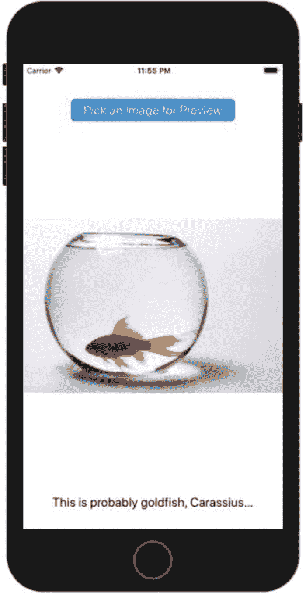

图 2-24

照片应用预测 (E)

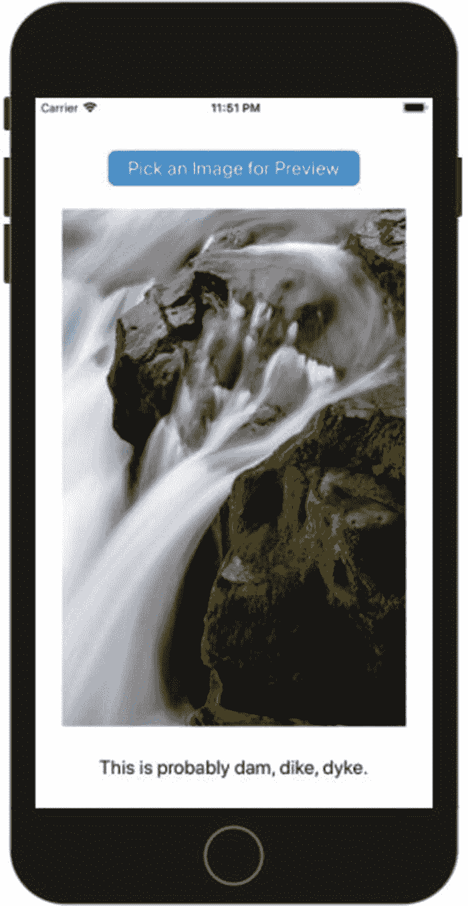

图 2-23

照片应用预测 (D)

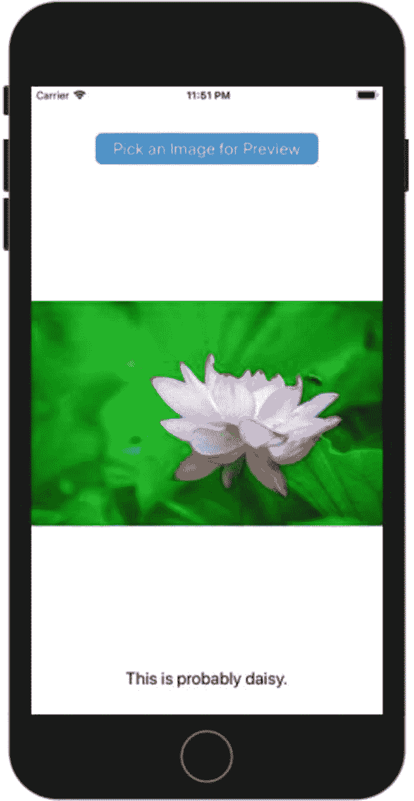

图 2-22

照片应用预测 (C)

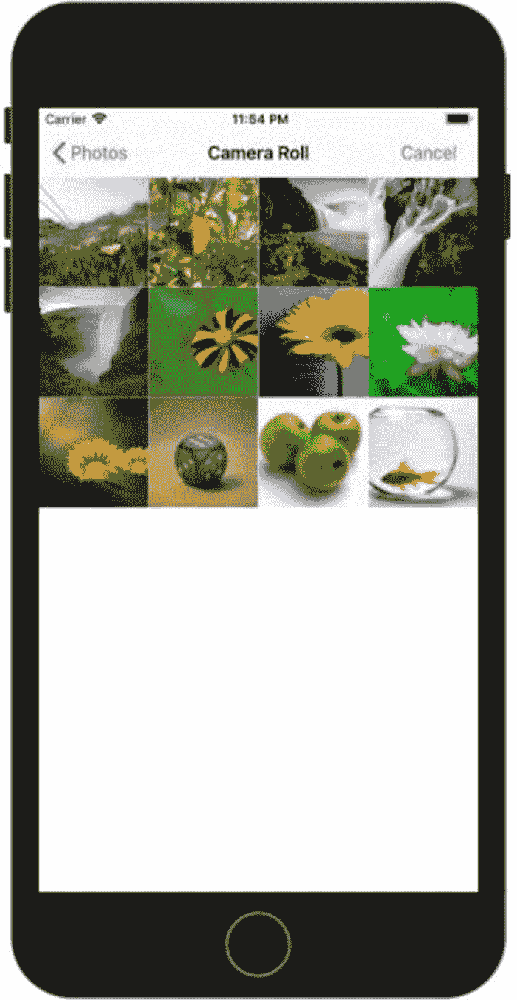

图 2-21

照片应用预测 (B)

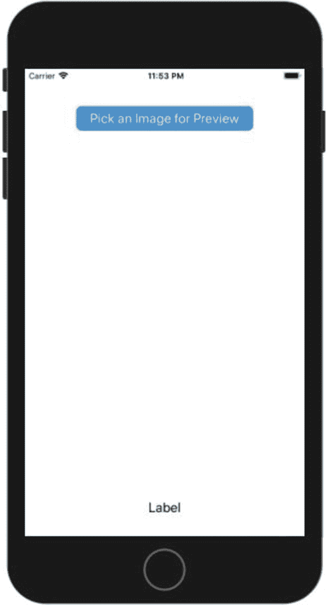

图 2-20

照片应用预测 (A)

## 总结

*   Core ML 是苹果公司的一个框架，可用于为 iPhone、iPad、MacBook、Apple TV 和 Apple Watch 等苹果产品开发机器学习应用程序。

*   Core ML 允许开发者使用已转换为 Core ML 格式的预训练 ML 模型，在其应用程序中实现 ML 功能。

*   Core ML 还允许开发者将自定义 ML 模型转换为 Core ML 格式，以便在其应用程序中使用。

*   Core ML 将模型集成到应用程序包中，使得 ML 算法可以在本地而非远程运行。这带来了更快的处理速度。

*   Core ML 基于苹果之前的框架——Accelerate 和 Metal Performance Shaders (MPS)——它们充当性能原语。

*   Core ML 的主要组件包括：
    *   *Vision*：图像和视频分类
    *   *Natural Language*：基于文本的预测和情感分析
    *   *GameplayKit*：实现游戏玩法行为

*   一个 ML 模型可以通过输入数据点、每个输入数据点对应的输出，以及一个将输入数据点映射到相应输出的学习算法来训练。一旦训练完成，模型便可用于推理。

*   ML 模型通常提供的功能包括情感分析、手写识别、语言翻译、图像分类、文本预测等。

