# 3. 使用 Turi Create 创建自定义 Core ML 模型

在第 2 章中，你学习了如何在应用程序中使用预训练的机器学习模型。在本章中，你将学习如何使用第三方框架 Turi Create 来训练你自己的模型。你还将找到一份逐步指南，了解如何将此训练好的模型转换为 Core ML 格式，并在你的应用程序中使用它。

## 自定义模型的必要性

ML 模型可以被视为一段代码，我们用它来为应用程序添加智能用户体验。正如我们在第 2 章中学到的，ML 模型可用于执行各种任务；并且就像任何其他代码片段一样，没有一个单一的模型可以执行所有智能任务。例如，考虑你可能希望在应用程序中实现的以下任务：

*   能够拍摄食物照片并了解你正在摄入多少卡路里
*   通过 iPhone 上的简单手势更改电视屏幕上的演示幻灯片
*   实时跟踪物体
*   在照片上尝试艺术滤镜
*   根据音乐文件的流派对其进行分类

这只是一个简短的列表；你可能希望应用程序执行的智能任务数不胜数。所有这些任务都展示了截然不同的用户体验；因此，没有一个单一的 ML 模型能够容纳所有这些任务。这就是自定义模型需求的来源。所有这些任务都有一些共同点——它们都使用 ML，并且它们都需要很少的数据即可在我们的应用程序中实现。因此，我们可以为每个想要执行的任务创建一个自定义 ML 模型。


## 自定义模型创建的生命周期

要创建自定义 Core ML 模型，首先需要确定要解决的问题，并收集有助于解决该问题的数据。例如，如果你要创建一个预测下个月电费的模型，你需要收集的数据就是历史电费账单以及相应时间段的用电量统计数据。

拥有数据集后，下一步是使用合适的算法训练模型。训练完成后，你可以通过评估模型来检查其准确性。最后，如果对评估结果满意，就可以构建模型。如果不满意，可以再次迭代训练过程。你可以重复此过程，直到对结果满意为止。图 3-1 展示了自定义模型创建的生命周期。

### 注意

Apple 引入了一种名为 ML Model (.mlmodel) 的标准化文件格式，允许开发者在应用中使用机器学习。所有机器学习模型最终都需要转换为 Core ML 格式 (.mlmodel)，才能在 Apple 产品中使用。

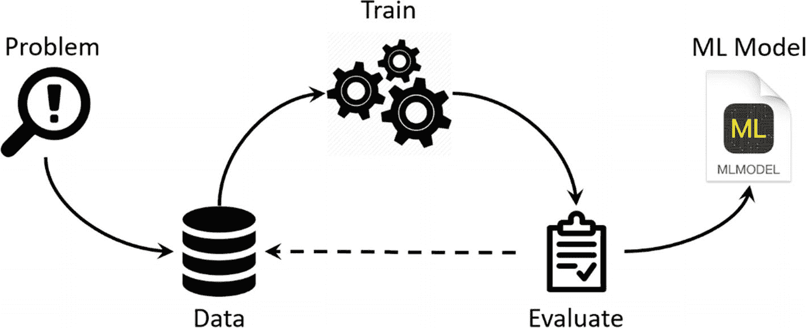

图 3-1

自定义模型创建的生命周期

以下是创建自定义 Core ML 模型所涉及的步骤：

1.  *问题*：自定义模型创建的第一步是确定要解决的问题，并从机器学习的角度理解它。请考虑表 3-1 中的任务及其对应的机器学习类别。

    表 3-1

    机器学习任务

    | **你想要完成的任务** | **机器学习术语** |
    | --- | --- |
    | 标记图像 | 图像分类 |
    | 识别图像中的物体 | 物体检测 |
    | 查找相似图像 | 图像相似度 |
    | 创建自定义风格头像 | 风格迁移 |
    | 个性化用户选择 | 推荐系统 |
    | 使用传感器检测活动 | 活动分类 |
    | 分析消息中的情感 | 文本分类器 |
    | 预测标签 | 分类器 |
    | 预测数值 | 回归 |
    | 将相似数据分组 | 聚类 |

2.  *数据*：确定问题后，下一步是确定完成此任务所需的数据类型和数据量。对于监督学习，数据将由输入和相应输出的配对组成。数据可以是任何形式，例如图片、文本文件、CSV 文件或表格。最后，我们收集用于训练模型的相关数据。

3.  *训练*：收集到所需数据后，我们就可以开始在数据上训练模型。

4.  *评估*：模型准备好后，我们可以通过评估模型在测试数据集上的成功率来确定其质量。如果结果不达标，模型尚未准备好投入生产，我们可以重复训练过程，直到模型变得更准确。

5.  *模型*：如果训练过程的结果令人满意，我们可以生成可在应用中使用的 .mlmodel 文件。

从头开始训练和评估模型可能是一项复杂的任务。为了简化这种复杂性，Apple 引入了 Turi Create。结合 Python 使用 Turi Create，我们可以用很少的代码行，基于现有的机器学习模型来训练自定义模型，但更多细节将在后面介绍。

## 组装数据

在了解组装数据之前，让我们先了解可以使用机器学习完成的基本任务类型。如果你有大量图像，你可能希望根据其内容对这些图像进行分类；如果你的应用向用户展示广告，你可能希望根据用户偏好定制这些广告；或者你可能希望提示用户通讯录中的重复联系人。

所有这些任务都需要不同类型的数据。为了便于理解，让我们考虑以下我们将尝试解决的问题陈述：

### 问题

给定一张狗的照片，应用程序应该能够预测狗的品种。

要创建一个能够完成此任务的模型，我们需要大量不同品种的狗的图像。然后，我们将从这些图像中创建一个数据集。别担心，这听起来并没有那么复杂。首先，在你的 MacBook 上创建一个名为 Dataset 的文件夹。在 Dataset 文件夹内，为你想要分类的每个狗品种创建子文件夹。然后，在每个子文件夹中放置一些该品种狗的图像。请注意，子文件夹的名称应为狗品种的名称。请参考图 3-2。

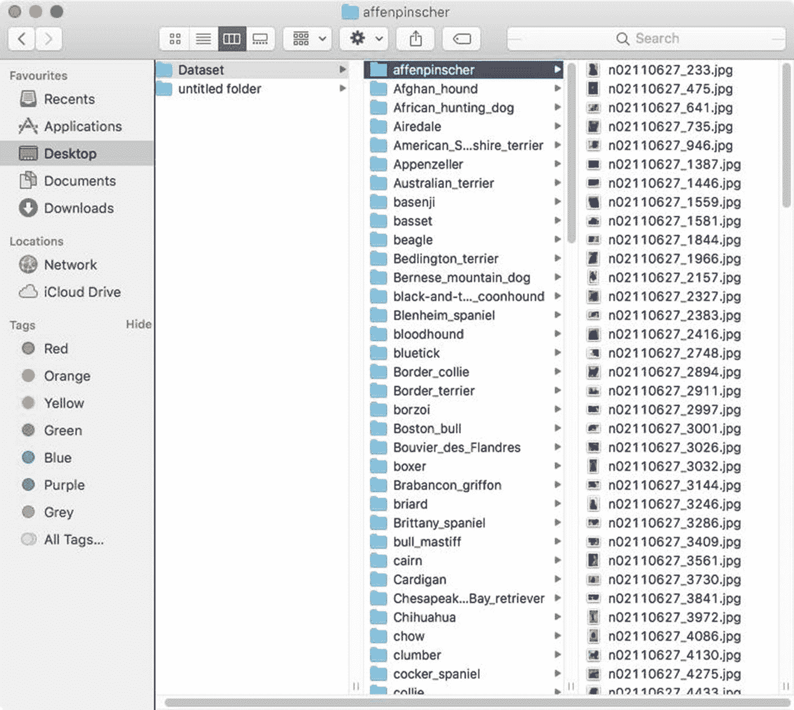

图 3-2

自定义机器学习模型的数据集

就这样。我们现在拥有了训练模型以执行分类任务所需的数据集。在本章的以下部分，我们将学习如何使用数据集训练机器学习模型。

## Turi Create 简介

Turi Create 是一个基于 Python 的框架，可帮助你直接从数据集创建 Core ML 模型。它是一个开源框架，可在 [`https://github.com/apple/turicreate`](https://github.com/apple/turicreate) 获取。它也是跨平台的，这意味着你可以在 MacOS 和 Linux 上使用它。

使用 Turi Create 的主要好处是，它允许我们在操作系统中已有的机器学习模型之上训练我们的模型，而不是从头开始训练。这通常被称为迁移学习。这一点很重要，因为从头开始训练模型需要数百万张图像、巨大的计算能力和大量的耐心。相反，使用 Turi Create，我们可以利用现有的机器学习模型（如 ResNet（残差网络）），并针对我们的特定数据训练该模型的最后几层。这样，我们就可以利用手头的数据量，及时创建一个足够好的机器学习模型。使用迁移学习还可以减小模型大小。


### 注意

我们后续的所有开发工作将使用 Mac OS Mojave 10.14 和 Xcode 10。

接下来，我们来学习如何在 Mac 上安装 Turi Create。

*步骤 1*：要安装 Turi Create，我们需要在 Mac 上安装 Python。默认情况下，Mac 系统已安装 Python 2.7，这足以满足 Turi Create 的安装需求。如果你愿意，也可以从 [`https://www.python.org`](https://www.python.org) 手动下载 Python 并安装到 Mac 上。但请注意，Turi Create 不支持最新版本的 Python（即 3.7 版）；因此，我们将使用系统默认安装的 Python 版本。要检查系统上的 Python 版本，可以打开终端窗口并运行“python”命令。参见图 3-3。

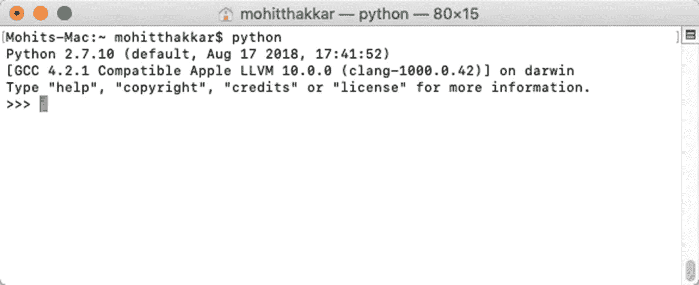

图 3-3

在 Mac 上检查 Python 版本

*步骤 2*：现在，为了使用 Python 安装包，你需要在系统上安装 Python 包管理器（通常称为 pip）。为此，请打开终端窗口并运行“sudo easy_install pip”命令。参见图 3-4。然后耐心等待包管理器安装到你的系统上。

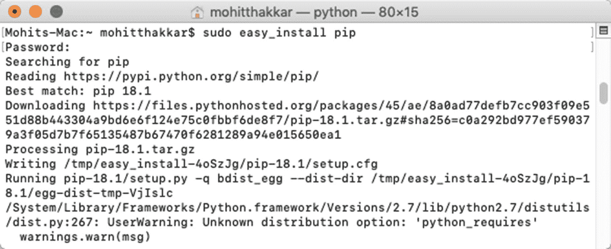

图 3-4

在 Mac 上安装 pip

*步骤 3*：再次打开终端窗口，运行“pip”命令，检查 Python 包管理器是否已成功安装到系统上。如果已安装，你将看到包管理器提供的命令列表（图 3-5）。如果没有，请在继续下一步之前尝试在 Mac 上重新安装 pip。

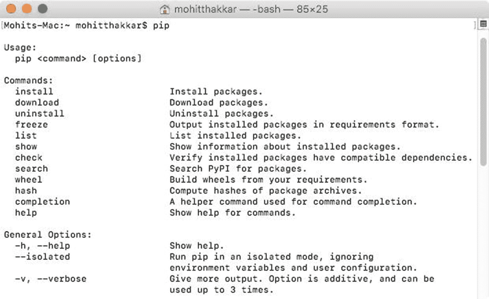

图 3-5

Python 命令

*步骤 4*：现在 pip 已成功安装在你的 Mac 上，你可以使用它来安装 Turi Create。打开终端窗口并运行以下命令，在你的机器上安装最新版本的 Turi Create（输出结果见图 3-6）：

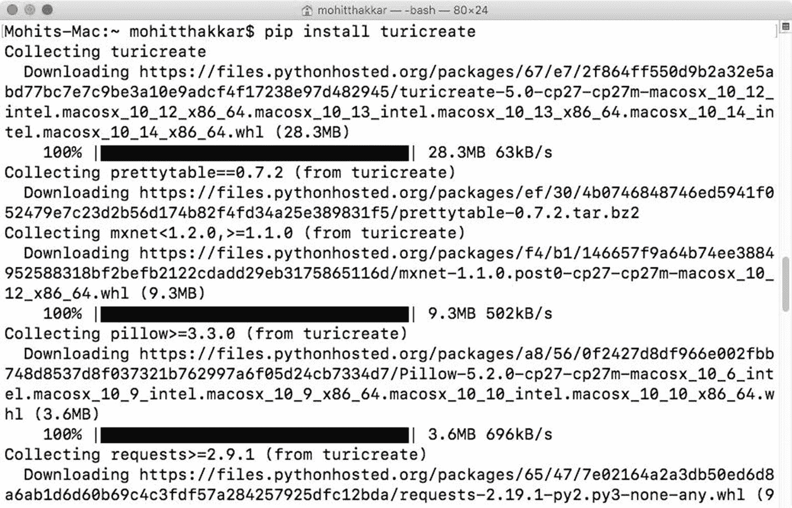

图 3-6

安装 Turi Create

```
pip install turicreate
```

现在，你已成功在机器上安装了 Turi Create。在下一节中，我们将学习如何使用它来创建自定义 ML 模型。

## 训练和评估自定义模型

以下是使用 Turi Create 创建自定义 ML 模型的步骤：

*步骤 1*：打开 Xcode；在菜单中选择 **文件 ➤ 新建 ➤ 文件**（图 3-7）。

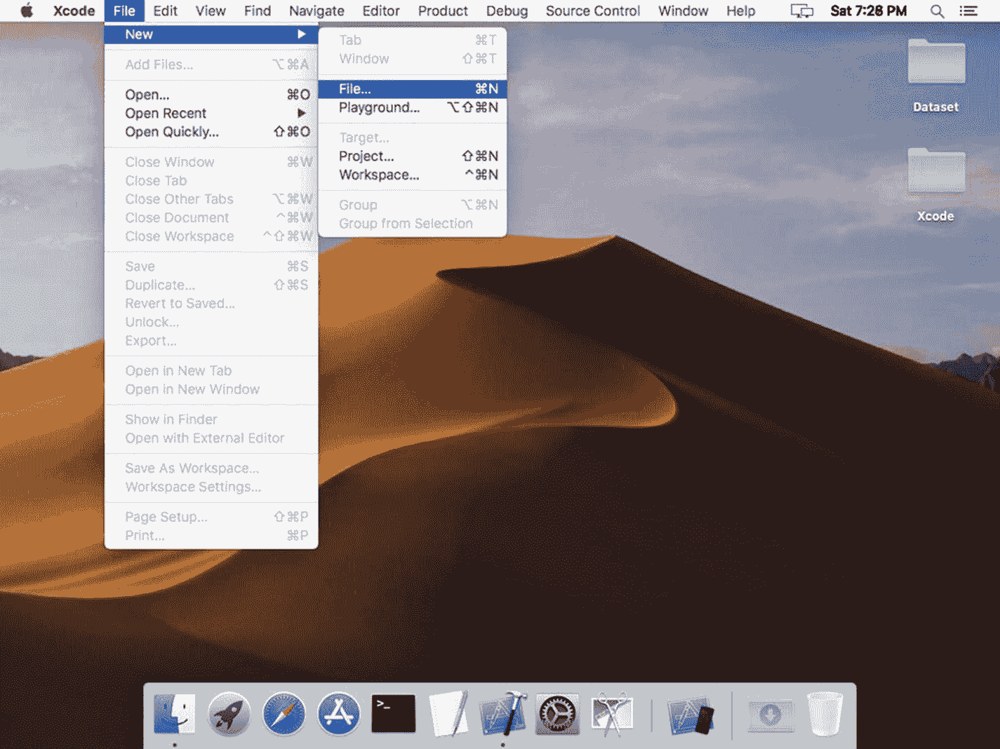

图 3-7

在 Xcode 中新建文件

*步骤 2*：从模板选择菜单中选择空白文件（图 3-8）。

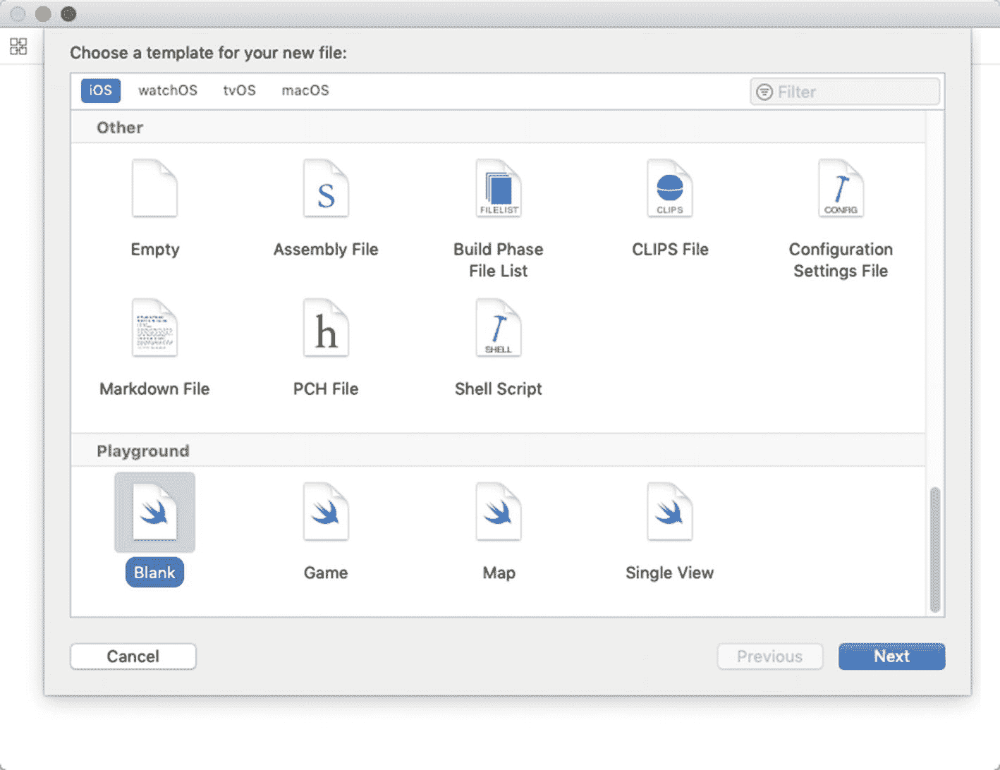

图 3-8

Xcode 模板选择

*步骤 3*：将文件命名为 **MyCustomModel.py**

*步骤 4*：将其保存到桌面。

*步骤 5*：通过添加以下代码行导入 Turi Create：

```
import turicreate as tc
```

*步骤 6*：通过添加以下代码定义训练数据集的路径：

```
url = "dataset/"
```

*步骤 7*：添加以下代码以搜索并从数据集文件夹加载图像：

```
data = tc.load_images(url)
```

*步骤 8*：现在我们将定义图像类别并将其保存在 **“dogBreed”** 属性中。我们将从图像的路径中获取文件夹名称来确定图像类别。为此，请添加以下代码：

```
data["dogBreed"] = data["path"].apply(lambda path: path.split('/')[1])
```

这将创建一个带标签的数据集，其中训练数据集中的每个图像都将有一个路径和一个名为 **“dogBreed”** 的属性。

*步骤 9*：现在，我们将新的带标签数据集保存为 SFrame。此 SFrame 将用于训练数据。添加以下代码将数据集保存为 SFrame：

```
data.save("dogBreed.sframe")
```

*步骤 10*：让我们在 Turi Create 上预览新的带标签数据。为此，请添加以下代码：

```
data.explore()
```

*步骤 11*：为了加载用于训练的 SFrame，编写以下代码：

```
dataBuffer = tc.SFrame("dogBreed.sframe")
```

*步骤 12*：现在，我们将使用 90% 的数据训练模型，并使用剩余的 10% 的数据测试模型。为此，请编写以下代码：

```
trainingBuffers, testingBuffers = dataBuffer.random_split(0.9)
model = tc.image_classifier.create(trainingBuffers, target="dogBreed", model="squeezenet_v1.1")
```

这里，我们是在已有的 **“Squeezenet”** 模型基础上训练我们的模型。你可以使用其他模型，如 **“ResNet-50”**，以获得更高的准确率。

*步骤 13*：现在是时候评估测试数据以确定模型的准确率了。为此，请添加以下代码：

```
evaluations = model.evaluate(testingBuffers)
print evaluations["accuracy"]
```

*步骤 14*：最后，添加以下代码以保存模型并将其导出为 Core ML 格式：

```
model.save("dogBreed.model")
model.export_CoreML("dogBreed.mlmodel")
```

你的 MyCustomModel.py 最终代码应如图 3-9 所示。

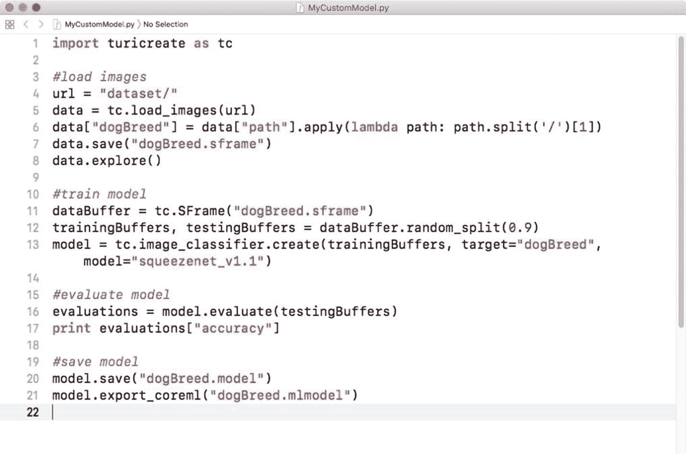

图 3-9

MyCustomModel Python 代码

要执行此代码，请打开 Mac 上的“终端”应用，并将当前目录更改为你的 Python 文件所在位置。然后使用以下命令执行代码：

```
python MyCustomModel.py
```

Python 代码执行可能需要几分钟时间。首先，代码会将图像从数据集加载到内存中，然后根据图像所在的文件夹进行标记，接着将它们转换为用于训练的 SFrame。请注意，你无需显式执行任何操作；一旦你在终端窗口中执行了 Python 代码，该过程将自动开始。你只需耐心等待代码为你生成一个 Core ML 模型即可。图 3-10 中的终端屏幕显示了该过程。

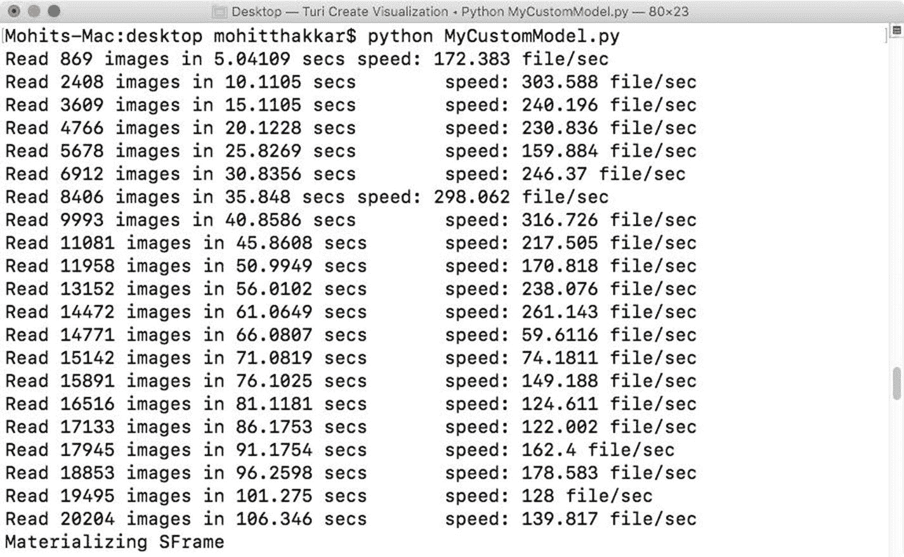

图 3-10

加载图像并创建 SFrame


现在，我们在第 10 步中用于预览已标注图像的 `explore()` 方法，将打开 Turi Create 可视化窗口（见图 3-11），该窗口会预览这些图像。

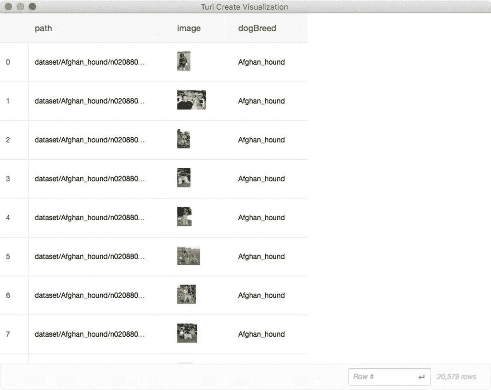

图 3-11

Turi Create 可视化

你可以在这里看到已标注的训练数据。与此同时，代码将继续在终端窗口中执行。代码现在将加载我们之前创建的 SFrame，下载基础 ML 模型（本例中为 Squeezenet），并开始在基础模型之上训练 SFrame。图 3-12 中的终端屏幕显示了这一过程。

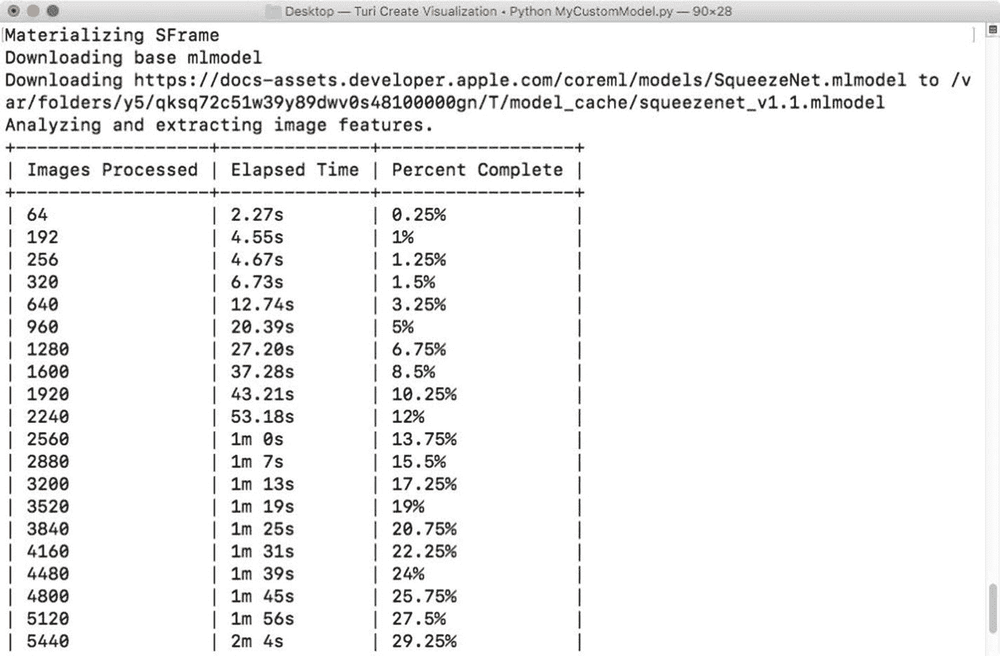

图 3-12

训练数据集

训练过程结束后，代码将评估模型，以判断其是否足够准确。此评估将在我们从数据集中随机选取的测试数据上进行。这种随机选取是通过我们编写的一行代码实现的，该代码将数据集按 (0.9, 0.1) 的比例拆分，即使用 90% 的数据集进行训练，10% 的数据集进行测试。评估过程会进行多次迭代，代码还会打印每次迭代的准确率。图 3-13 中的终端屏幕显示了这一过程。

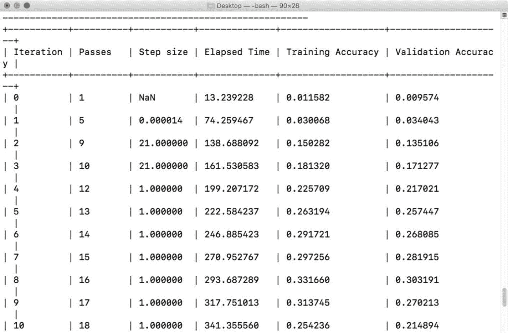

图 3-13

评估模型

评估完成后，代码将保存模型并将其转换为 Core ML 格式。你会在你的 Mac 上看到生成的一些新项目（图 3-14）。

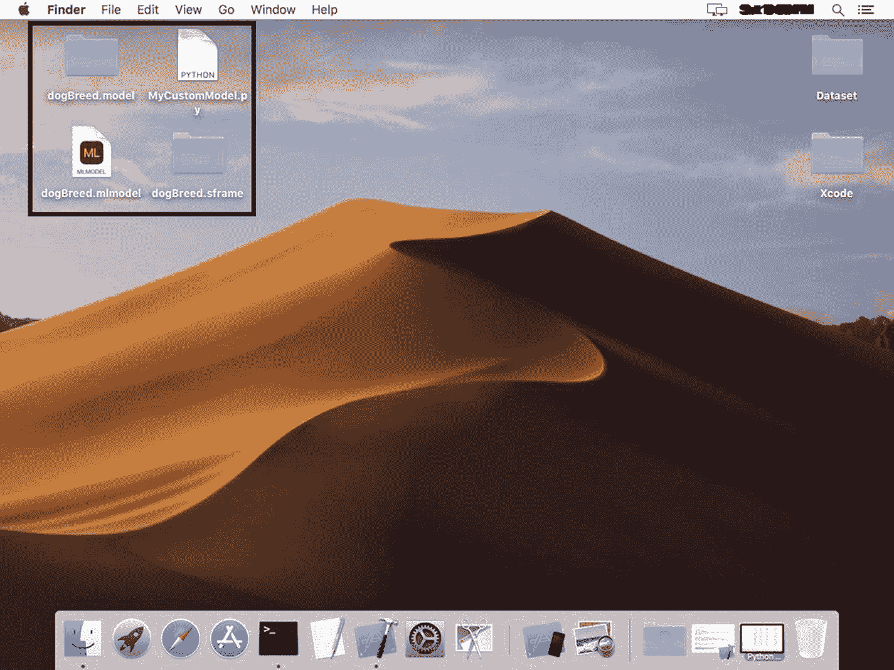

图 3-14

自定义模型文件

就是这样。你刚刚使用 Turi Create 创建了一个 Core ML 模型。现在，这个模型可以在你的 iOS 应用程序中使用，根据给定的图片来对狗的品种进行分类。

## 将自定义模型转换为 Core ML

如果你使用 Turi Create 从头生成模型，则无需担心转换问题，因为它已经以 Core ML 格式创建了模型；但如果你使用其他工具，如 Caffe、TensorFlow 或 Keras，你可能想知道如何将使用这些工具构建的模型转换为 Core ML 格式。为此，Apple 在推出 Core ML 的同时也推出了 Core ML Tools。它是一个开源的 Python 包，可以接收多种格式的 ML 模型，并将其转换为 Core ML 格式。

让我们学习如何使用 Core ML Tools 将模型转换为 Core ML 格式。为此，你需要在机器上安装 Python。如果没有安装，请从 [`https://www.python.org`](https://www.python.org) 安装最新版本的 Python。我们将以一个 Caffe 模型为例，将其转换为 Core ML 格式。为此，请考虑以下步骤：

*第 1 步*：在你的 Mac 上打开“终端”应用程序，并使用 Python 包管理器安装 Core ML Tools。为此，请输入以下命令：

```
pip install CoreMLtools
```

*第 2 步*：打开 Xcode；在菜单中选择 **File ➤ New ➤ File**（图 3-15）。

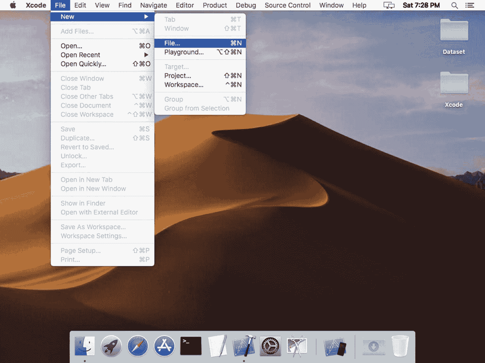

图 3-15

在 Xcode 中新建文件

*第 3 步*：从模板选择菜单中选择“空白文件”（图 3-16）。

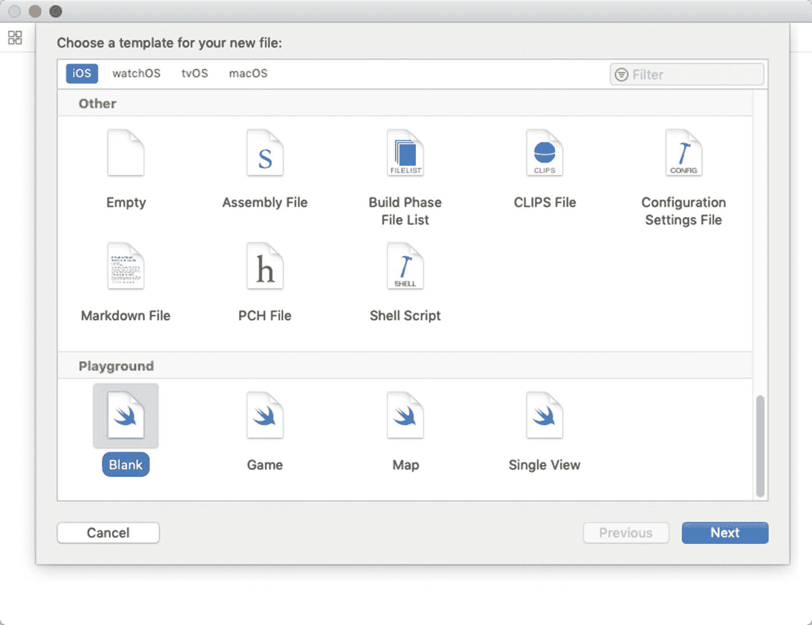

图 3-16

Xcode 模板选择

*第 4 步*：将文件命名为 **MyConverter.py**

*第 5 步*：将其保存到桌面。

*第 6 步*：下载你想要转换为 Core ML 格式的 Caffe 模型。请注意，当你下载 Caffe 模型时，你会得到三个不同的文件：

*   **modelName.caffemodel** – 模型文件

*   **deploy.prototxt** – 包含网络结构的文件

*   **labels.txt** – 包含预测输出值的文件

*第 7 步*：打开 MyConverter.py 文件，并添加以下代码以导入 Core MLtools：

```
import CoreMLtools
```

*第 8 步*：我们的 Caffe 模型由两个文件定义：“.caffemodel”和“.prototxt”。因此，让我们通过添加以下代码行将其添加到代码中：

```
caffe_model = ('oxford102.caffemodel', 'deploy.prototxt')
```

*第 9 步*：接下来，我们将通过添加以下代码来定义我们的类别标签文件：

```
labels = 'class_labels.txt'
```

*第 10 步*：现在，要将 Caffe 模型转换为 Core ML 格式，请添加以下代码行：

```
CoreML_model = Core MLtools.converters.caffe.convert
(caffe_model, class_labels = labels)
```

*第 11 步*：最后，我们可以通过将以下代码添加到我们的文件中来保存转换后的模型：

```
CoreML_model.save('MyCustomModel.mlmodel')
```

你的最终代码应如图 3-17 所示。

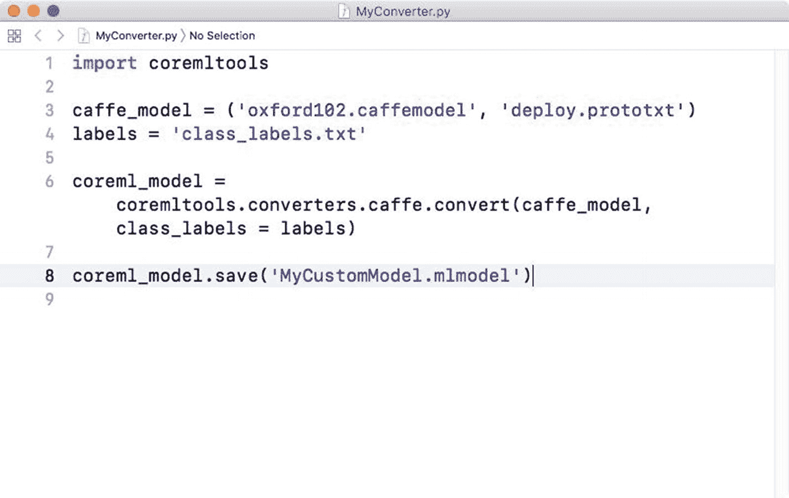

图 3-17

从 Caffe 转换为 Core ML（代码）

*第 12 步*：要执行代码，请在你的 Mac 上打开“终端”应用程序，将当前目录更改为你的 Python 文件所在位置，然后输入以下命令（输出结果见图 3-18）。

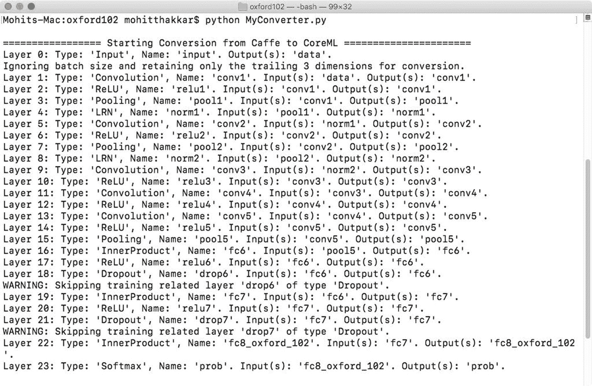

图 3-18

从 Caffe 转换为 Core ML（执行）

```
python MyConverter.py
```

当代码执行完成后，你将看到 Core ML 格式的输出模型文件（图 3-19）。

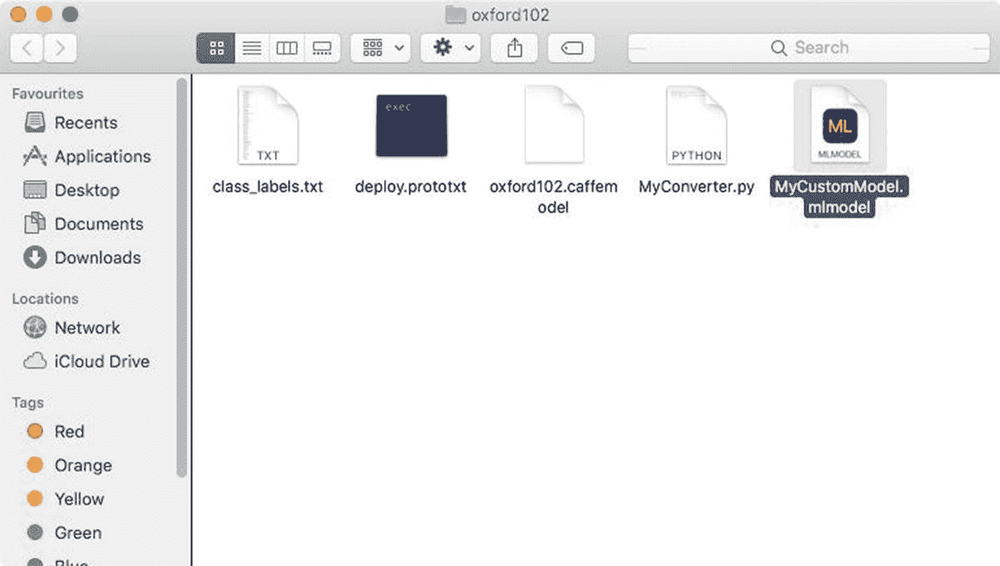

图 3-19

从 Caffe 转换为 Core ML（输出）

这就是使用 Core ML Tools 将 Caffe 模型转换为 Core ML 格式的过程。


## 在应用中使用自定义模型

一旦模型被创建或转换为 Core ML 格式，你就可以像使用苹果提供的 Core ML 模型一样，在应用中使用它。现在，让我们在应用中使用之前通过 Turi Create 创建的模型，该模型可以根据狗的图像预测其品种。为此，我们将使用 Xcode 10 创建一个应用，允许用户从设备的照片库中选取一张狗的图像。然后，应用将显示该图像以及图像中狗的品种。请按照以下步骤操作：

*步骤 1*：启动 Xcode 10。它应该会显示一个欢迎对话框。在此处，选择“Create a new Xcode project”以开始一个新项目（图 3-20）。

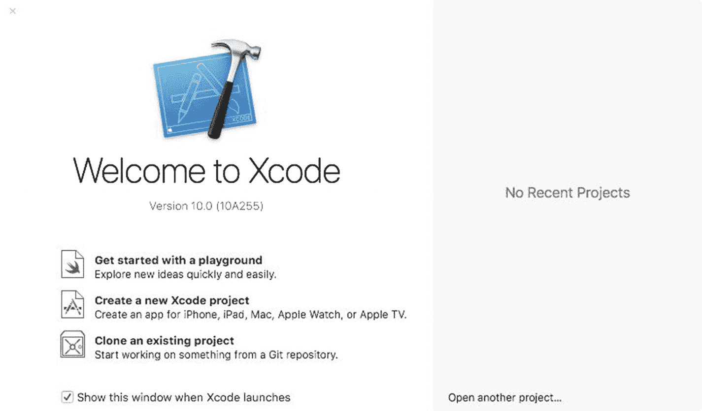

图 3-20

欢迎使用 Xcode

*步骤 2*：Xcode 会显示各种设备和项目模板供你选择（图 3-21）。选择你的目标设备和合适的模板（Single View Application）。然后点击“Next”。

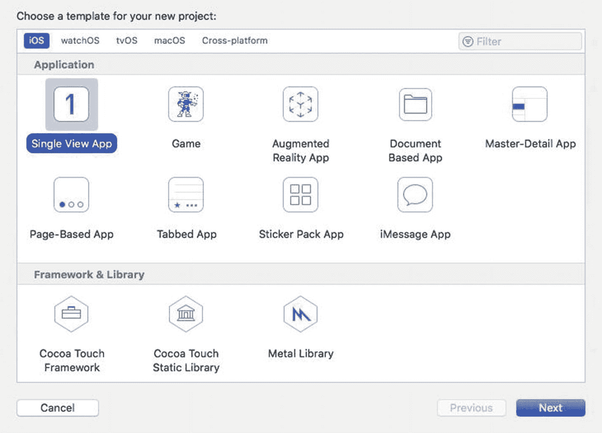

图 3-21

Xcode 模板选择

*步骤 3*：这将进入另一个屏幕，用于填写项目的所有必要选项（图 3-22）。这些选项包括 Product Name、Organization Name、Organization Identifier、Class Prefix、Devices 等。填写详细信息并进入下一步。

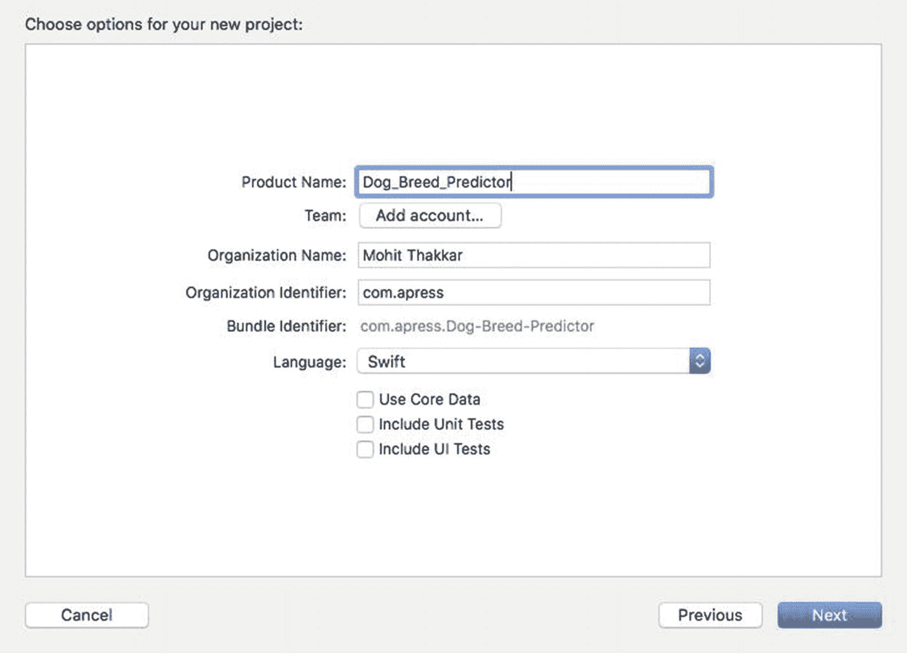

图 3-22

Xcode 项目选项

*步骤 4*：然后 Xcode 会询问你希望将项目保存在哪里（图 3-23）。在你的 Mac 上选择一个文件夹（例如桌面），然后点击“Create”。

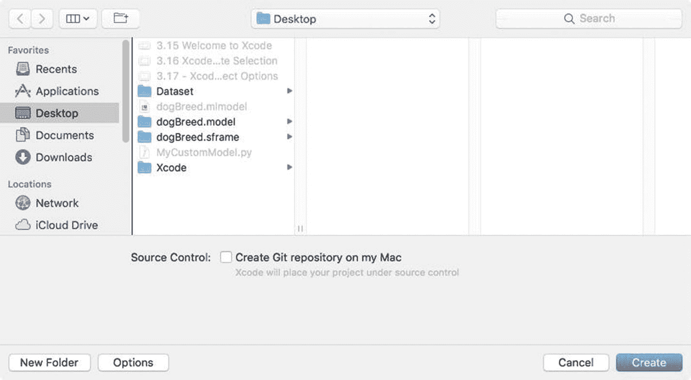

图 3-23

Xcode 文件夹选择器

*步骤 5*：确认后，Xcode 会根据你提供的所有选项自动创建项目。从导航窗格中选择 **“Main.storyboard”** 文件，打开应用的界面构建器。请参考图 3-24。

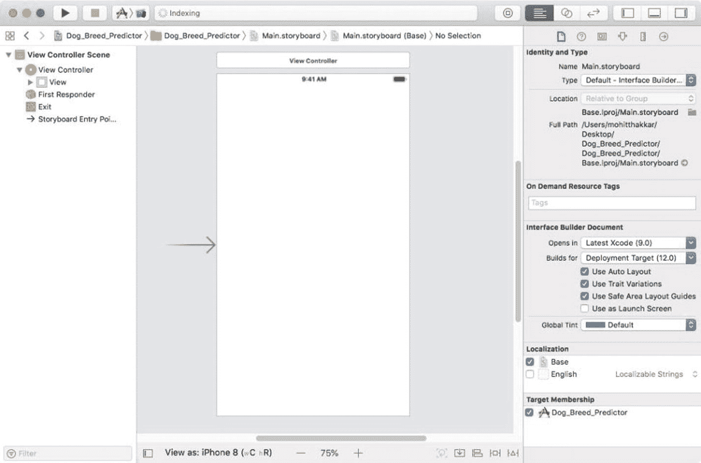

图 3-24

Xcode 界面构建器

*步骤 6*：通过从工具区域的控件库中将控件拖拽到界面构建器，依次添加一个 Button 和一个 Image View。你可以从工具区域的对象属性中更改按钮的颜色和文本。另外，在应用界面中添加一个标签，用于显示所选图像的预测结果。请参考图 3-25。

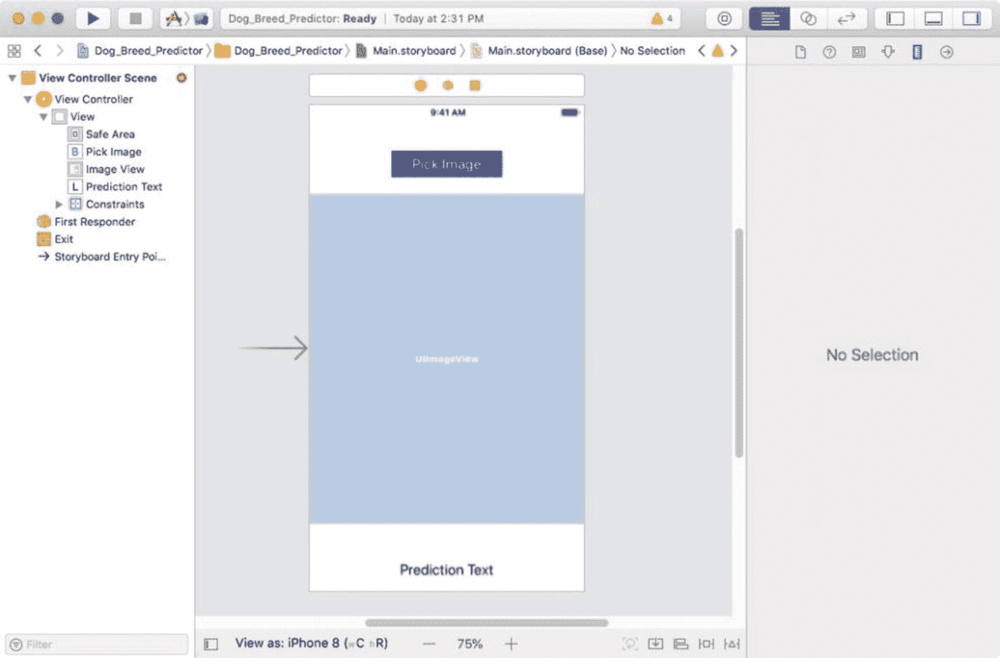

图 3-25

狗品种预测器应用界面

*步骤 7*：点击工具栏右侧的图标打开助理编辑器。在助理编辑器中加载名为 **“ViewController.swift”** 的文件。你将同时看到窗口左侧的界面构建器和右侧的代码（**‘ViewController.swift’**）。请参考图 3-26。

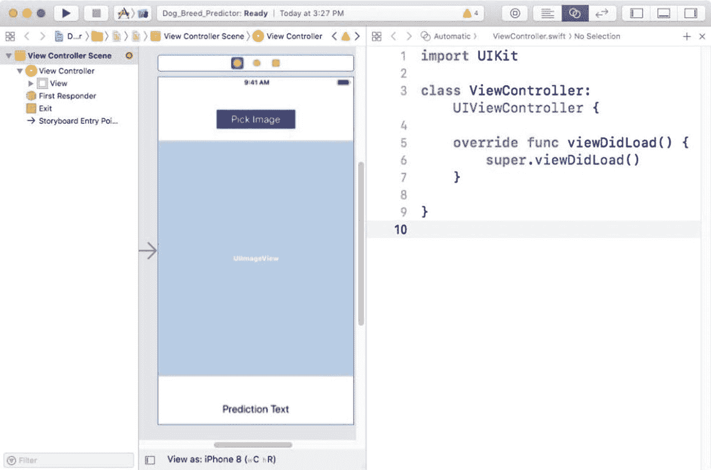

图 3-26

助理编辑器

*步骤 8*：要将界面元素连接到代码，我们需要创建 Outlet 和 Action。为 Button、ImageView 和 Label 创建 Outlet。同时为按钮创建一个 Action。为此，按住 Control 键并从 Button/Image View/Label 拖拽到代码（“ViewController.swift”）中。如果成功为 UI 元素创建了 Outlet 和 Action，以下代码将被添加到你的 ViewController 类中：

```
@IBOutlet weak var predictionText: UILabel!
@IBOutlet weak var imageView: UIImageView!
@IBOutlet weak var btn: UIButton!
@IBAction func btnClick(_ sender: Any) {
}
```

*步骤 9*：现在让我们添加处理按钮点击的代码。首先，由于我们需要用户与照片库交互，我们必须遵循 UIImagePickerControllerDelegate 协议以及 UINavigationControllerDelegate 协议。将这两个控制器添加到 ViewControllor.swift 文件的类定义中：

```
class ViewController: UIViewController, UIImagePickerControllerDelegate, UINavigationControllerDelegate {
//code
}
```

*步骤 10*：当用户点击按钮时，我们需要创建一个 UIImagePickerController 实例，并将其委托设置为当前类。我们还需要将图像选择器的源指定为照片库。创建选择器后，我们需要使用 present 方法以模态方式呈现它。为此，将以下代码添加到 ViewControllor.swift 文件的 pickImageBtnClick 方法中：

```
@IBAction func btnClick(_ sender: Any) {
let imagePicker = UIImagePickerController()
imagePicker.delegate = self
imagePicker.allowsEditing = false
imagePicker.sourceType = .photoLibrary
present(imagePicker, animated: true, completion: nil)
}
```

*步骤 11*：由于我们遵循了图像选择器的委托，我们需要实现两个委托方法：imagePickerController 和 imagePickerControllerDidCancel。当用户完成从库中选择图像时，会调用 imagePickerController 方法。因此，我们将使用此方法在应用的 Image View 中设置所选图像。当用户取消图像选择器时，会调用 imagePickerControllerDidCancel 方法。因此，在此方法中，我们只需关闭选择器。将以下代码添加到 ViewControllor.swift 文件的 ViewController 类中：

```
func imagePickerController(_ picker: UIImagePickerController, didFinishPickingMediaWithInfo info: [UIImagePickerController.InfoKey : Any]) {
let pickedImage = info[.originalImage]  as! UIImage
imageView.image = pickedImage
self.dismiss(animated: true, completion: nil)
}
func imagePickerControllerDidCancel(_ picker: UIImagePickerController) {
self.dismiss(animated: true, completion: nil)
}
```

*步骤 12*：由于我们的应用需要访问用户设备的照片库，我们需要请求用户授予访问权限。否则，我们的应用可能会意外终止。为避免这种情况，我们需要在应用的 **“Info.plist”** 文件中添加以下属性（图 3-27）：

*Key*: Privacy – Photo Library Usage Description

*Value*: (PRODUCT_NAME) photo use

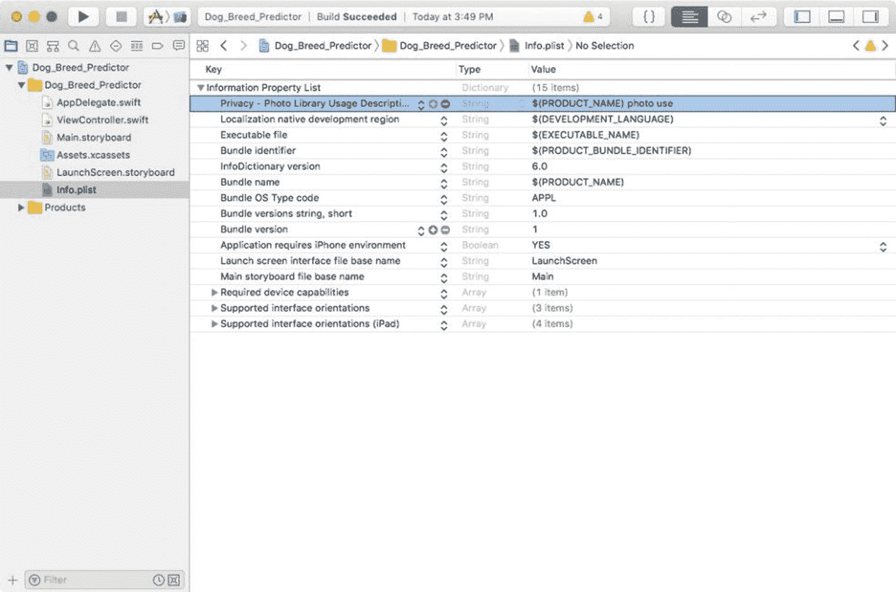

图 3-27

信息属性列表

*步骤 13*：现在我们已经创建了应用界面，让我们将自定义模型添加到项目中。为此，将模型文件拖拽到 Xcode 项目导航器中的项目文件夹下。这会将 Core ML 模型添加到你的应用中。

*步骤 14*：从导航器中选择模型文件，你会注意到 Xcode 会自动将该文件识别为 ML 模型。它会显示模型的相关信息，例如模型类型（在我们的例子中是 Neural Network Classifier）、模型大小、模型描述等。请参考图 3-28。


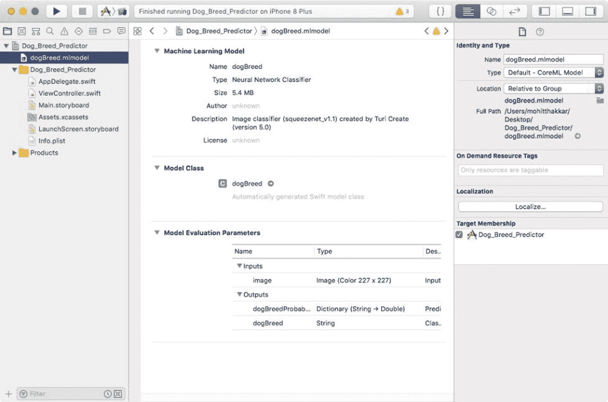

图 3-28

自定义 Core ML 模型（Dog_Breed_Predictor）

它还显示了**模型类**，该类由 ML 模型自动生成，可直接在我们的应用程序中使用。点击类名旁边的箭头，您将能够看到模型类的实现代码。

Xcode 显示的其他重要信息是**模型评估参数**。这是关于模型接收的输入和返回的输出的信息。在我们的案例中，模型接收一张大小为 227×227 的彩色图像作为输入，并返回一个字符串作为输出。

*步骤 15*：现在，让我们在应用程序中使用模型类来进行预测。转到 `ViewController.swift` 文件，并在最开头导入 Core ML 框架。

```
import CoreML
```

*步骤 16*：在 `ViewController` 类中声明一个模型变量，该变量将代表 Core ML 模型。

```
var model:dogBreed!
```

*步骤 17*：重写 `ViewController` 类的 `viewWillAppear()` 方法，并在该方法中初始化模型。

```
override func viewWillAppear(_ animated: Bool) {
model = dogBreed()
}
```

*步骤 18*：我们的模型接受的输入是一张大小为 227×227 的图像。因此，在用户完成图像选择后，我们需要调整图像大小。我们将在委托方法 `imagePickerController()` 中编写相关代码。以下代码将完成此任务：

### 注意

以下代码行中的编号仅用于后续解释，编号本身并非代码的一部分。

```
//调整图像大小
1\.  UIGraphicsBeginImageContextWithOptions (CGSize(width: 277, height: 277), true, 2.0)
2\.  pickedImage.draw(in: CGRect(x: 0, y: 0, width: 277, height: 277))
3\.  let newImage = UIGraphicsGetImageFromCurrentImageContext()!
4\.  UIGraphicsEndImageContext()
5\.  let attrs = [kCVPixelBufferCGImageCompatibilityKey: kCFBooleanTrue, kCVPixelBufferCGBitmapContextCompatibilityKey: kCFBooleanTrue] as CFDictionary
6\.  var pixelBuffer : CVPixelBuffer?
7\.  let status = CVPixelBufferCreate(kCFAllocatorDefault, Int(newImage.size.width), Int(newImage.size.height), kCVPixelFormatType_32ARGB, attrs, &pixelBuffer)
8\.  guard (status == kCVReturnSuccess) else {
9\.     return
10\.  }
11\.  CVPixelBufferLockBaseAddress(pixelBuffer!, CVPixelBufferLockFlags(rawValue: 0))
12\.  let pixelData = CVPixelBufferGetBaseAddress(pixelBuffer!)
13\.  let rgbColorSpace = CGColorSpaceCreateDeviceRGB()
14\.  let context = CGContext(data: pixelData, width: Int(newImage.size.width), height: Int(newImage.size.height), bitsPerComponent: 8, bytesPerRow: CVPixelBufferGetBytesPerRow(pixelBuffer!), space: rgbColorSpace, bitmapInfo: CGImageAlphaInfo.noneSkipFirst.rawValue)
15\.  context?.translateBy(x: 0, y: newImage.size.height)
16\.  context?.scaleBy(x: 1.0, y: -1.0)
17\.  UIGraphicsPushContext(context!)
18\.  newImage.draw(in: CGRect(x: 0, y: 0, width: newImage.size.width, height: newImage.size.height))
19\.  UIGraphicsPopContext()
20\.  CVPixelBufferUnlockBaseAddress(pixelBuffer!, CVPixelBufferLockFlags(rawValue: 0))
```

现在，让我们理解上述代码的作用。由于我们的模型接受大小为 227×227 的输入图像，第 1-4 行将所选图像转换为该大小，并将其赋值给一个名为 `newImage` 的新变量。

重要的是要知道模型接受像素形式的输入图像。因此，第 5-10 行将 `newImage` 以像素缓冲区的形式存储，该缓冲区基本上将图像以像素形式保存在内存中。此缓冲区将作为输入提供给预测过程。

然后，图像中的所有像素都被转换为设备相关的 RGB 颜色空间。第 11-13 行完成此操作。在第 14 行，我们将像素数据存储在 `CGContext` 中，以便我们可以轻松修改图像像素的某些属性。然后，我们在第 15-16 行根据需求缩放图像。第 17-20 行更新最终的图像缓冲区。

请注意，如果您不理解此代码的大部分内容，也没有关系。您只需要知道，我们获取了用户从照片库中选择的图片，并将其转换为模型可接受用于预测的形式。

*步骤 19*：最后，是时候调用模型的预测方法了，该方法将为我们进行图像预测。在委托方法 `imagePickerController()` 中，紧接在图像调整大小代码之后，添加以下代码。

```
//预测图像标签
guard let prediction = try? model.prediction(image: pixelBuffer!) else {
predictionText.text = "无法预测！"
return
}
predictionText.text = "犬种：\(prediction.dogBreed)。"
```

预测方法将像素缓冲区作为参数传入。如果预测成功，该方法返回一个对象，该对象为我们提供输出标签。我们将此输出标签文本设置为我们之前添加到界面的分类器标签。如果预测不成功，我们手动设置分类器标签文本，以告知用户模型无法预测所选图像的标签。

*步骤 20*：终于到了构建并运行应用程序的时候了。让我们看看我们的第一个 ML 应用程序表现如何。图 3-29 到图 3-33 展示了您在操作应用程序时应该会看到的不同屏幕。

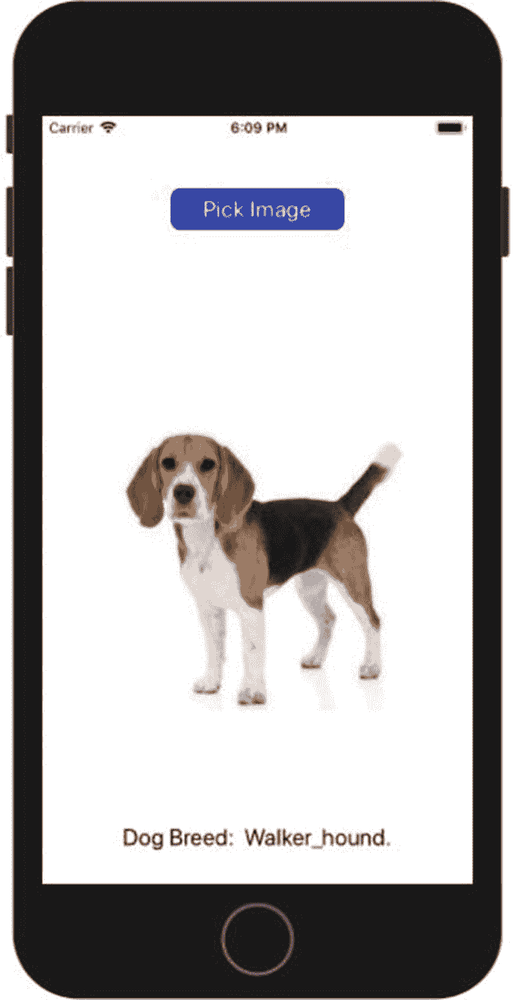

图 3-33

犬种预测（E）

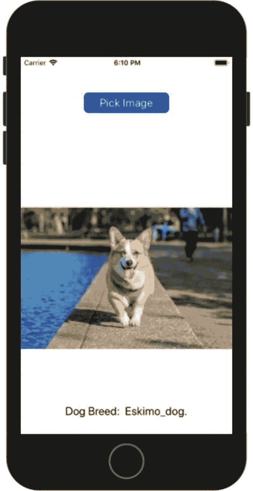

图 3-32

犬种预测（D）

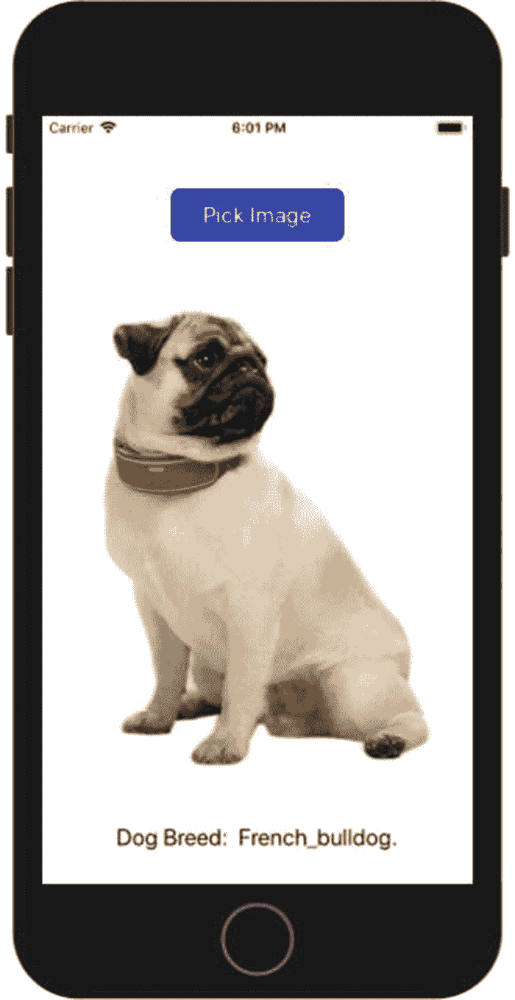

图 3-31

犬种预测（C）

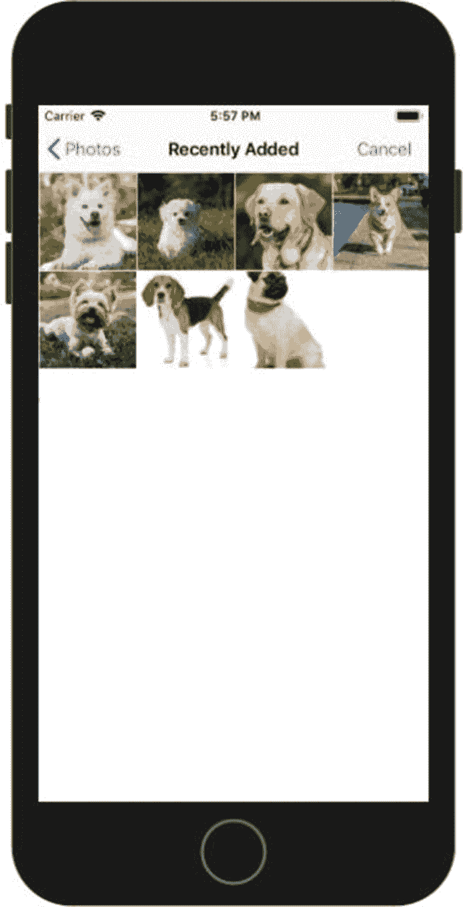

图 3-30

犬种预测（B）

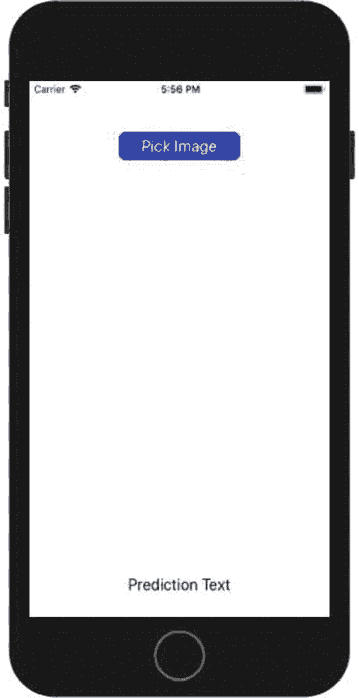

图 3-29

犬种预测（A）

## 总结

*   没有一个单一的模型可以用来执行所有智能任务。因此，我们需要针对不同任务使用不同的自定义模型。

*   自定义机器学习模型可以通过五个简单步骤创建：
    *   定义问题

    *   收集数据

    *   训练学习算法

    *   评估学习算法

    *   构建模型

*   Apple 引入了一个名为 Turi Create 的基于 Python 的包，它可以帮助我们直接从数据集创建自定义 ML 模型。

*   Turi Create 使用一种称为迁移学习的技术，也就是说，我们可以在现有模型的基础上训练我们的模型。现有模型的学习成果被迁移到我们的模型；因此，我们只需要训练模型的最后几层。这显著减少了训练时间以及模型的大小。

*   Apple 还引入了 Core ML Tools，这是一个 Python 包，可以使用很少的代码行将各种格式的模型转换为 Core ML 格式。

*   一旦您将 ML 模型转换为 Core ML 格式，它就可以像任何 Apple 提供的模型一样，轻松地在您的应用程序中使用。


