# 4. 使用 Create ML 自定义 Core ML 模型

在第 3 章中，你学习了如何使用名为`Turi Create`的第三方框架来训练自定义机器学习模型。本章将向你介绍苹果公司于 2018 年推出的`Create ML`框架，该框架允许开发者为`iOS`应用训练自定义`ML`模型。除了你在第 3 章中训练的图像分类模型外，本章还将介绍另外两种类型的模型：一种使用基于文本的数据进行训练，另一种使用表格数据进行训练。

## Create ML 简介

`Core ML`负责将`ML`模型集成到你的应用中，而`Create ML`则用于构建这些`ML`模型。虽然可以使用`Core ML`工具创建自定义`ML`模型（正如我们在第 3 章中所学的），但苹果公司在 2018 年推出了`Create ML`，以使事情变得更加简单。`Create ML`是苹果公司自己的`ML`框架。其理念是使用`Create ML`构建你的自定义`ML`模型，然后使用`Core ML`将其应用到你的应用中。

`Create ML`允许程序员用`Swift`实现端到端的机器学习，而不是用其他语言训练模型，然后再用`Swift`将其集成到`iOS`应用中。此外，你还可以直接在`Xcode Playground`中使用`Create ML`。以下是可使用`Create ML`训练成模型的数据类型。图 4-1 也展示了这些类型。

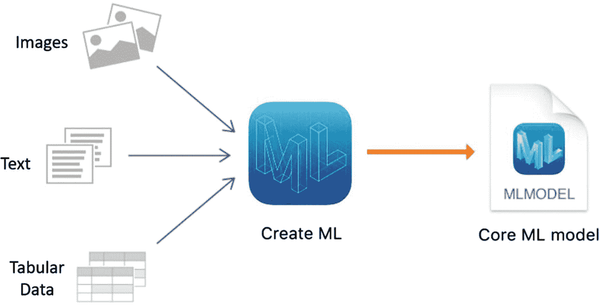

图 4-1 使用 Create ML 训练成模型的数据类型

*   *图像*：此类数据可用于训练自定义图像分类器模型，该模型能够识别图像中的物体。
*   *文本*：此类数据可用于训练自定义文本分类器模型，该模型可用于执行情感分析、主题分析和领域分析等任务。
*   *表格数据*：此类数据可用于训练自定义回归模型，该模型可用于执行多种类型的预测。

使用`Create ML`创建自定义模型的工作流程与我们在第 3 章中学到的自定义模型创建生命周期相同。步骤包括：问题识别、数据收集、训练模型、评估模型和生成模型。更多详情，请参阅第 3 章中的相关主题。

在本章的后续部分，我们将学习如何使用`Create ML`创建图像分类模型、文本分类模型以及回归模型。

### 图像分类

图像分类是一个确定要为给定图像应用什么标签的问题。我们将尝试解决上一章中解决的同一个问题，即犬种识别，但这次使用`Create ML`。以下是我们的问题陈述：

### 问题

*给定一张狗的照片，模型应能识别出狗的品种。*

现在，你可能已经拥有在第 3 章中创建的数据集。我们将为这个示例使用相同的数据集。如果你没有数据集，以下是需要做的：

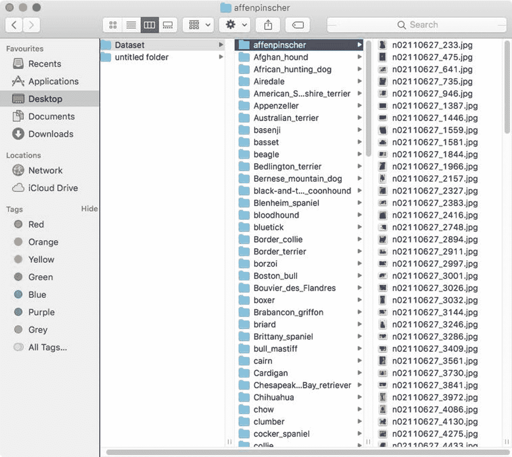

图 4-2 图像分类器的数据集

*   首先，在你的`MacBook`上创建一个名为`Dataset`的文件夹。
*   在`Dataset`文件夹内，为你想要分类的每种狗创建一个子文件夹。
*   然后，在每个子文件夹中放入一些该品种狗的图像。
*   请注意，子文件夹的名称应为该文件夹中包含的狗的品种。图 4-2 显示了数据集的文件夹结构。

就这样；你现在有了自己的数据集。下一步是使用这些数据训练你的模型。请注意，`Create ML`使用了我们在第 3 章学习`Turi Create`时了解到的相同迁移学习技术。这意味着，使用`Create ML`，我们可以在操作系统中已有的`ML`模型基础上训练我们的模型。这会导致更快的训练速度和更小的模型尺寸。以下是使用`Create ML`训练图像分类器模型的步骤：

*步骤 1*：打开`Xcode`；在菜单中选择`File ➤ New ➤ Playground`（图 4-3）。


图 4-3 Xcode 中的新 Playground

*步骤 2*：从模板选择菜单中选择空白文件（图 4-4）。请注意，你需要在`macOS`下选择空白文件，而不是`iOS`，因为`Create ML`框架不支持`iOS Playgrounds`。


图 4-4 Playground 模板选择

*步骤 3*：将其命名为`"DogBreedPredictor"`并保存到桌面。

*步骤 4*：现在，通过向`Playground`添加以下代码来导入`CreateMLUI`：

```
import CreateMLUI
```

`CreateMLUI`是一个类似于`Create ML`的框架；唯一的区别是，与`Create ML`不同，它带有用户界面。

*步骤 5*：接下来，我们将创建一个构建器，帮助我们训练模型。为此，添加以下代码：

```
let builder = MLImageClassifierBuilder()
```

*步骤 6*：要使用`CreateMLUI`的实时演示功能与构建器一起工作，我们将在代码中使用以下方法：

```
builder.showInLiveView()
```

通过从工具栏打开辅助编辑器来启用`Xcode`的实时演示功能。你会在代码的最后一行看到一个播放按钮。请参考图 4-5。点击该按钮可在实时演示中查看构建器界面。

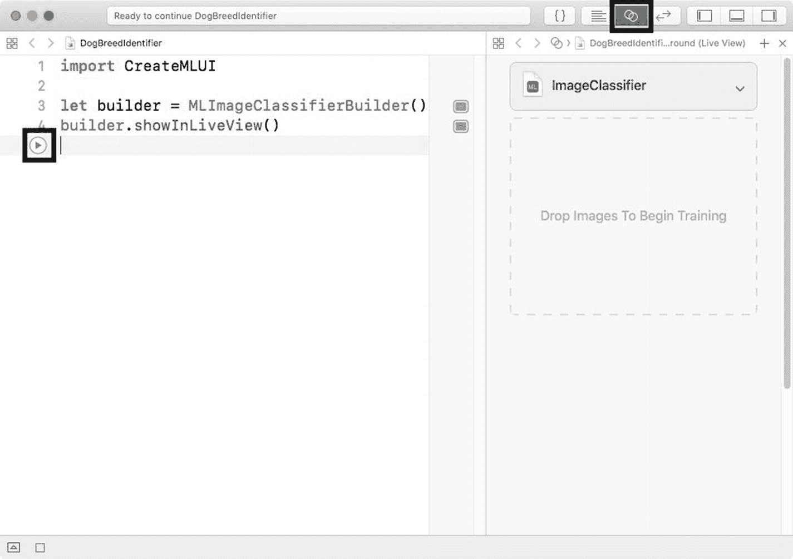

图 4-5 Xcode Playground 中的实时演示

*步骤 7*：你会注意到，我们需要将图像拖放到构建器 UI 中才能开始训练。这非常简单。选择`Dataset`文件夹，并将整个文件夹拖放到构建器 UI 中。一旦你这样做了，`Playground`就会开始训练模型。底部的控制台会显示已处理的图像数量、已用时间和任务完成百分比。请参考图 4-6。

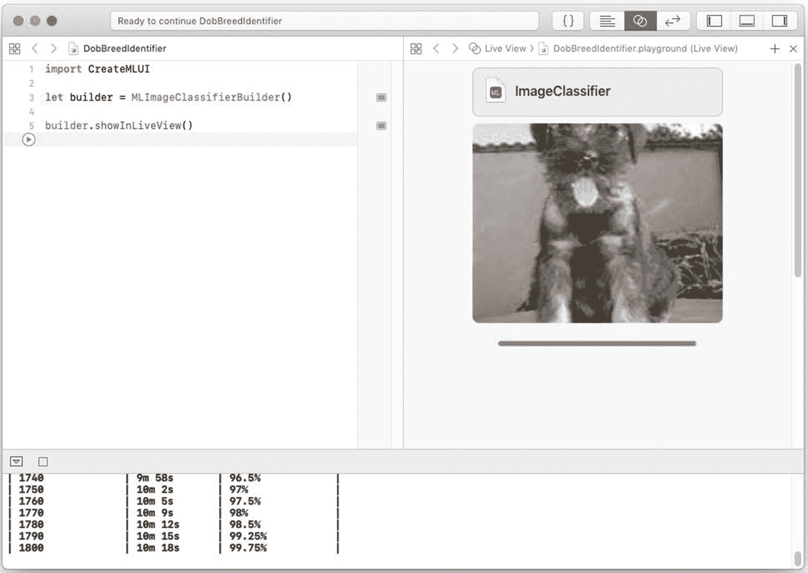

图 4-6 使用 Create ML 训练图像分类器 (A)

训练完成后，构建器 UI 会显示三个标签：训练、验证和评估。请参考图 4-7。

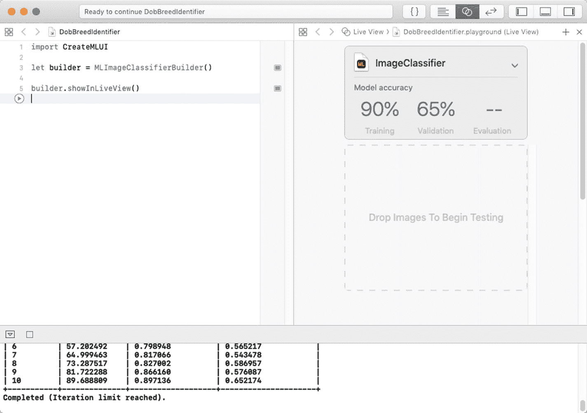

图 4-7 使用 Create ML 训练图像分类器 (B)

*   训练过程会显示`Playground`成功训练的数据量。该值应为 100%。
*   训练前，`Xcode`会从训练数据集中预留一部分图像，用于在模型训练完成后对其进行评估。验证过程会显示该评估的结果。
*   评估应为空白，因为我们没有明确地在任何数据上测试模型。

*步骤 8*：让我们看看模型在识别未见过的狗图像品种方面表现如何。为此，创建一个包含一些未见过的狗图像的文件夹（保持文件夹结构与训练数据集相同），并将其拖放到构建器 UI 中。`Playground`将开始测试模型。请参考图 4-8。

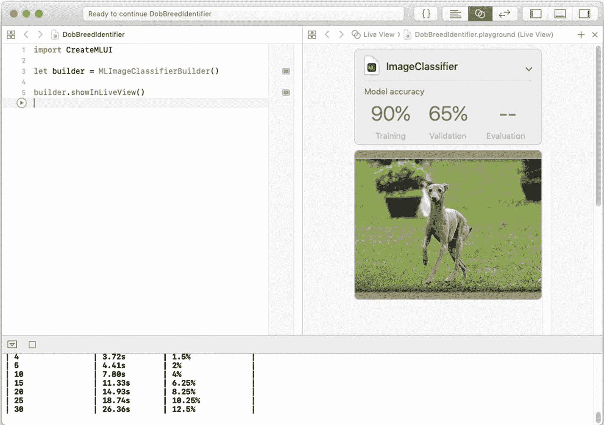

图 4-8 使用 Create ML 测试图像分类器 (A)

测试完成后，你将看到评估标签出现一个值。100% 表示模型正确分类了所有图像。请参考图 4-9。

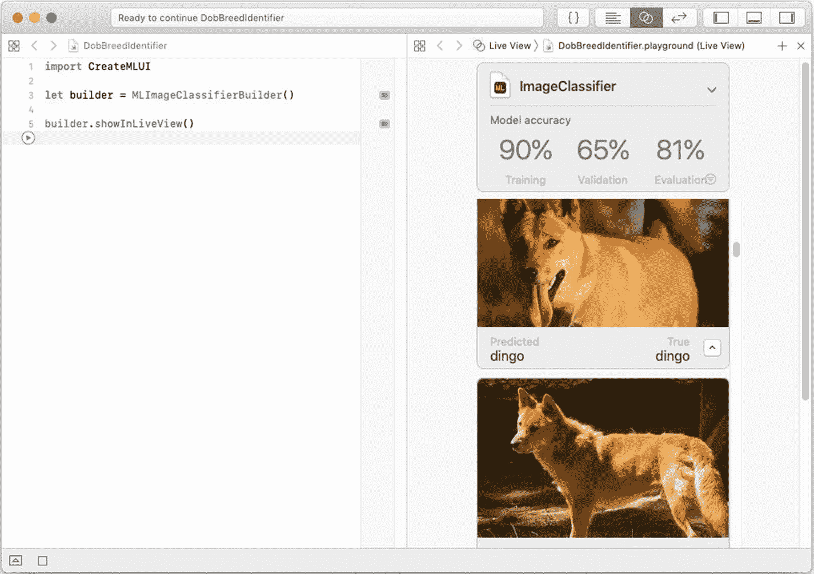

图 4-9 使用 Create ML 测试图像分类器 (B)

*步骤 9*：如果你对结果满意，接下来要做的就是保存模型。为此，请点击“实时演示”中“图像分类器”标题旁边的箭头。将出现一个下拉菜单，显示模型的所有元数据，如图 4-10 所示。根据你的偏好更改元数据，然后点击“保存”。

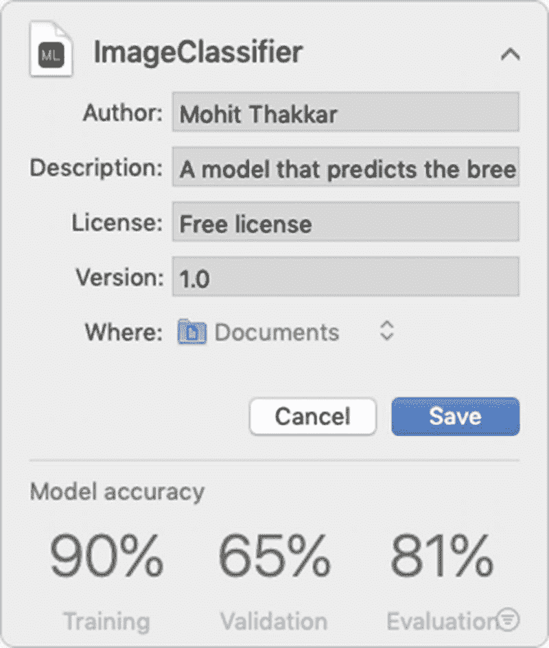

图 4-10 保存图像分类器

这就是我们使用`Create ML UI`构建`ML`模型的方法。如果你不想使用构建器 UI，而想通过编程方式完成，请按照以下步骤操作：

# 使用 Create ML

## 图像分类

*   步骤 1：打开 Xcode；在菜单中选择“文件”➤“新建”➤“Playground”。
*   步骤 2：从模板选择菜单中选择“空白”文件。请注意，你需要在 macOS 下选择空白文件，而不是 iOS，因为 iOS `Playground` 不支持 `Create ML` 框架。
*   步骤 3：将其命名为 **“DogBreedPredictor”** 并保存到桌面。
*   步骤 4：现在，通过向 `Playground` 添加以下代码来导入 `Create ML` 和 `Foundation`：

```swift
import CreateML
import Foundation
```

*   步骤 5：通过添加以下代码定义训练数据集和测试数据集的位置：

```swift
let trainingLoc = URL(fileURLWithPath: "/Users/yourusername/Desktop/MyDataset" )
let testLoc = URL(fileURLWithPath: "/Users/yourusername/Desktop/MyTestData")
```

*   步骤 6：通过添加以下代码定义模型：

```swift
let model = try MLImageClassifier(trainingData: .labledDirectories(at: trainingLoc))
```

要开始训练，请按 `Shift+Enter`。底部的控制台将显示已处理的图像数量、已用时间和任务完成百分比。请参考图 4-11。

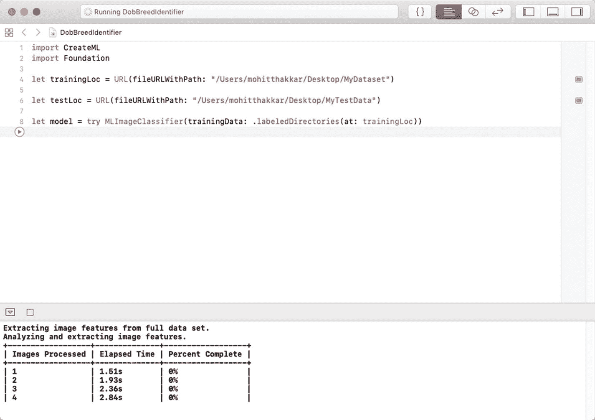
*图 4-11 使用 `Create ML` 训练图像分类器 (C)*

*   步骤 7：训练完成后，你可能希望基于测试数据评估模型。为此，请添加以下代码：

```swift
let evaluation = model.evaluation(on:     .labledDirectories(at: testLoc))
```

要开始测试，请按 `Shift+Enter`。底部的控制台将显示评估输出。请参考图 4-12。

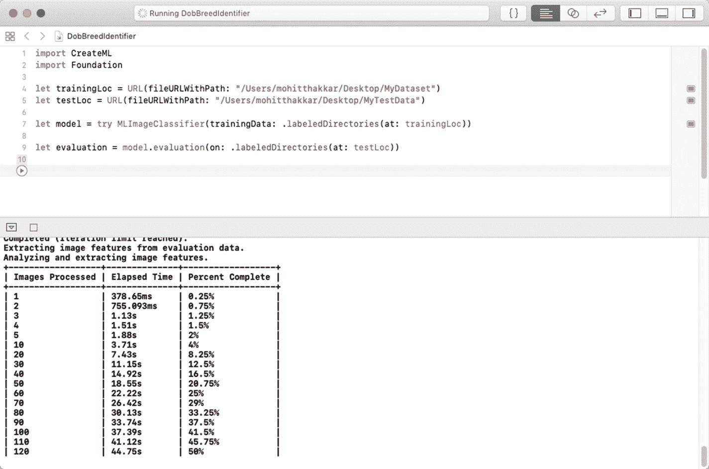
*图 4-12 使用 `Create ML` 测试图像分类器 (C)*

*   步骤 8：如果你对评估结果满意，就该保存模型了。为此，请添加以下代码：

```swift
try model.write(to: URL(fileURLWithPath: "/Users/yourusername/Desktop/DogBreedPredictor"))
```

按 `Shift+Enter`，模型将保存到你提供的路径。你的最终代码应如图 4-13 所示。

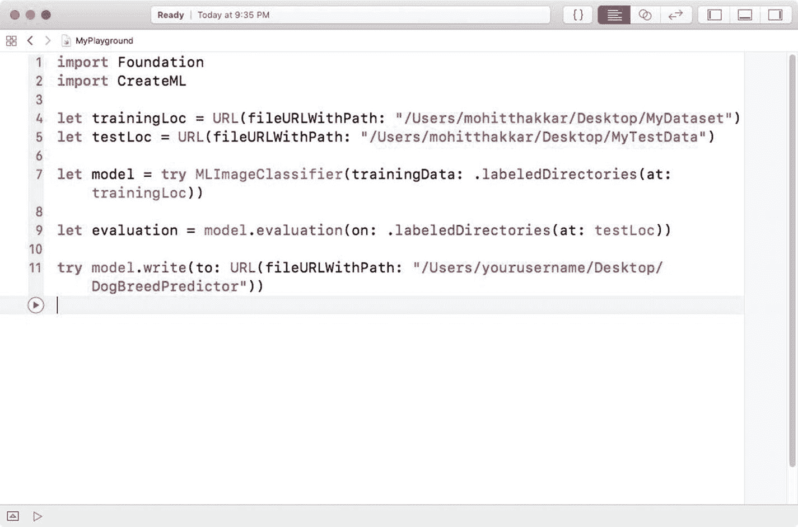
*图 4-13 使用 `Create ML` 的图像分类器*

就是这样。我们刚刚使用 `Create ML` 创建了一个图像分类器，它可以根据给定的图片预测狗的品种。你可以将此模型导入你的 iOS 应用程序，并查看其性能表现。

## 文本分类

现在你已经了解了如何处理图像，你可能希望基于文本数据（自然语言）实现一些机器学习任务。这类任务包括情感分析、垃圾邮件过滤、主题分析等。这些任务通常被称为文本分类任务，而执行这些任务的机器学习模型则被称为文本分类器。接下来，我们将学习如何创建一个能够通过分类文本片段来执行情感分析的机器学习模型。

为此，我们首先需要一些数据作为训练模型的基础。这些数据可以通过以下形式提供：

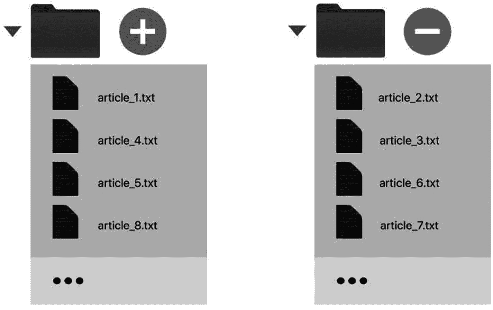
*图 4-14 用于训练的文本数据*

*   **原始文本文件**：你可以像图像分类器示例中那样创建带标签的目录。每个带标签的目录都包含原始文本文件，其中的文本内容与标签相符。请参考图 4-14 中的示例。

这里，我们有两个带标签的目录：一个用于正面数据，一个用于负面数据。标有“加号”的目录包含正面文本的原始文章，而标有“减号”的目录则包含负面文本的原始文章。

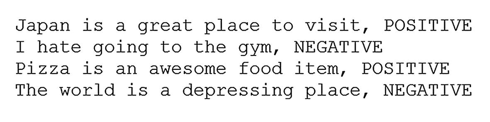
*图 4-15 用于训练的 CSV 数据*

*   **CSV 文件**：另一种组织训练数据的方式是创建一个 CSV（逗号分隔值）文件。在这里，所有数据都包含在一个单独的文件中，而不是分散在多个文件中。请参考图 4-15 中的示例。

这里，我们有一个单独的文件，其中包含原始文本条目及其对应的真实标签，两者用逗号分隔。该文件可以独立用于训练我们的机器学习模型。

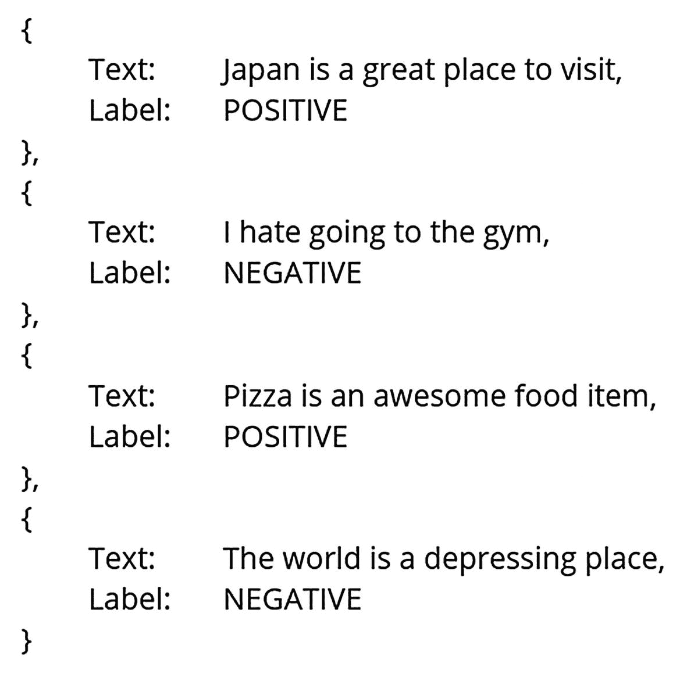
*图 4-16 用于训练的 JSON 数据*

*   **JSON 文件**：JSON 代表 JavaScript 对象表示法。它是 CSV 的一种替代数据格式。与 CSV 文件一样，JSON 文件也将所有数据包含在一个单独的文件中。它使用键值对来表示带标签的数据。请参考图 4-16 中的示例以获得更清晰的理解。

这里，每条数据有两个键：“Text”表示数据内容，“Label”表示对应数据的真实标签。该文件也可以独立用于训练我们的机器学习模型。

现在我们已经了解了可用于训练文本分类模型的数据类型，接下来让我们学习训练过程中涉及的典型步骤。以下是训练文本分类器的典型工作流程步骤（如图 4-17 所示）：

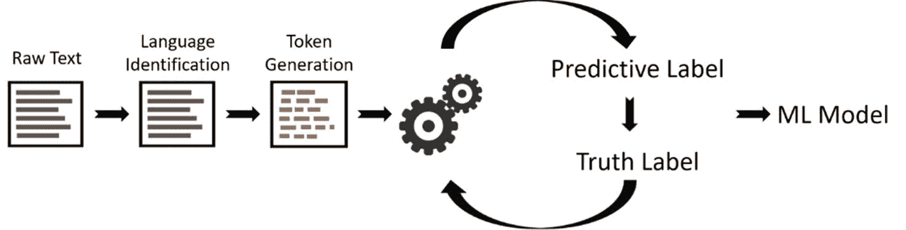
*图 4-17 训练文本分类器的典型工作流程*

1.  **原始数据**：首先，我们收集用于训练的原始数据。
2.  **语言识别**：然后，我们从原始文本中识别出语言。
3.  **生成词元**：接着，我们需要从文本中生成词元，学习算法会将这些词元与某些标签进行映射。
4.  **应用学习算法**：学习算法将词元作为输入，并对它们进行一些处理。
5.  **获取预测标签**：然后，学习算法会给出输入词元的预测标签。
6.  **与真实标签比较**：现在，我们将预测标签与原始文本的实际标签进行比较。
7.  **重复迭代**：如果预测不够准确，我们将重复训练过程。
8.  **生成模型**：如果预测足够准确，我们将生成模型。

然而，使用 `Create ML`，可以将该过程中涉及的所有复杂性简化为非常少的几个简单步骤。让我们学习如何使用 `Create ML` 创建一个文本分类器，如果输入文本是乐观的，则返回“Positive”；如果输入文本是悲观的，则返回“Negative”。为此，我们首先需要收集并整理数据。

### 数据准备

*   步骤 1：在你的 Macbook 上创建两个文件夹：**“MyDataset”** 和 **“MyTestDataset”**。
*   步骤 2：为上一步创建的两个文件夹分别创建两个子文件夹：**“Positive”** 和 **“Negative”**。
*   步骤 3：在名为 **“Positive”** 的文件夹中，放入包含正面评论样本的文本文件。在名为 **“Negative”** 的文件夹中，放入包含负面评论样本的文本文件。文件夹结构请参考图 4-18。

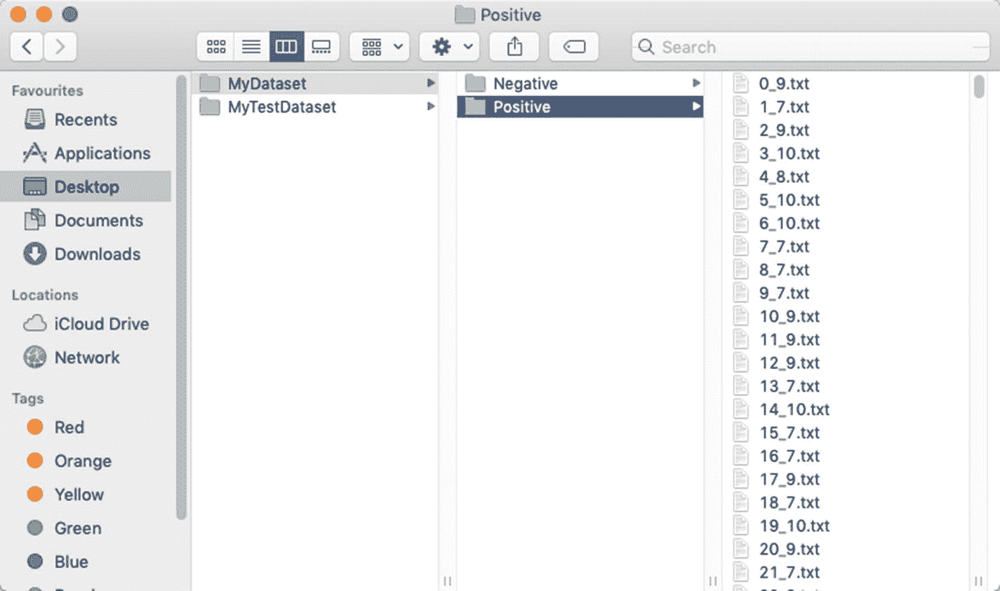
*图 4-18 文本分类器的数据集*

就是这样。我们现在拥有了训练模型以执行文本分类任务所需的数据集。现在，让我们使用整理好的数据来训练模型。

### 训练模型

*   步骤 1：打开 `Xcode`；在菜单中选择 **File ➤ New ➤ Playground**（图 4-19）。

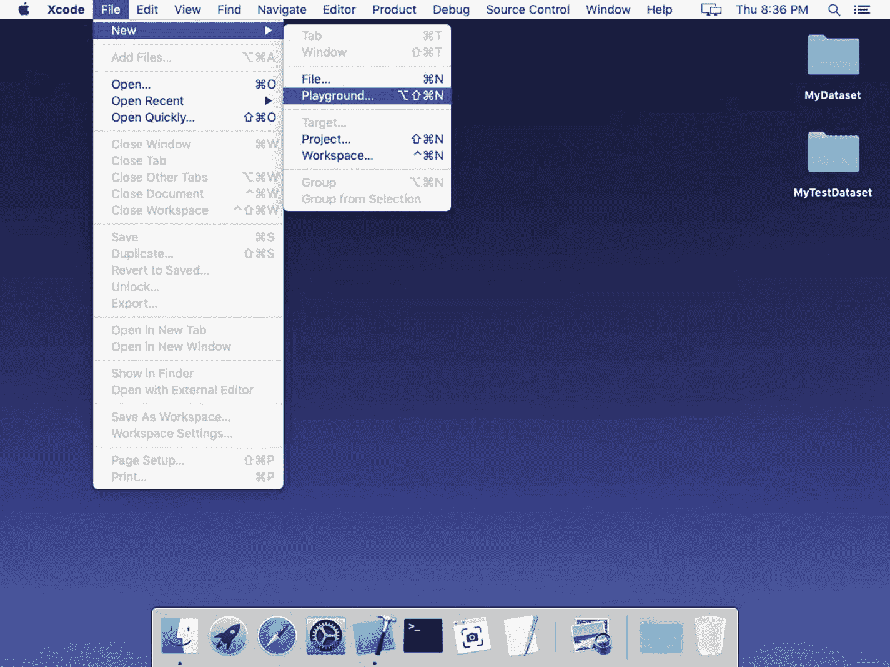
*图 4-19 `Xcode` 中的新建 Playground*

*   步骤 2：从模板选择菜单中选择空白文件（图 4-20）。请注意，你需要在 MacOS 下选择空白文件，而不是 iOS，因为 iOS `Playgrounds` 不支持 `Create ML` 框架。

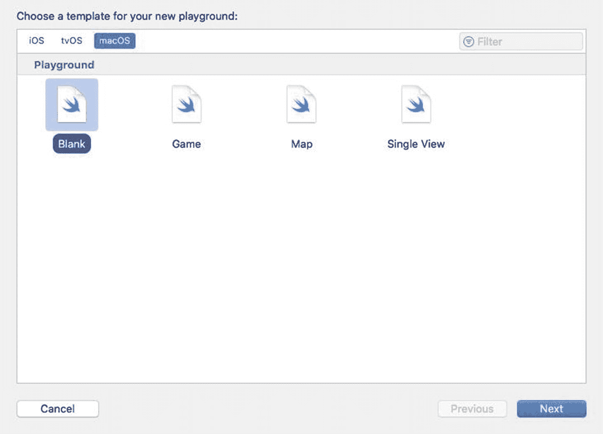
图 4-20 Playground 模板选择

*步骤 3*：将其命名为`"SentimentAnalyzer"`并保存到桌面。

*步骤 4*：请注意，截至目前，`Create MLUI`仅适用于图像分类器，不适用于其他类型的 ML 模型。因此，我们必须使用`Create ML`而不是`Create MLUI`。将以下代码添加到`Playground`以导入`Create ML`和`Foundation`：
```swift
import CreateML
import Foundation
```

*步骤 5*：通过添加以下代码来定义训练数据集和测试数据集的位置：
```swift
let trainingLoc = URL(fileURLWithPath: "/Users/yourusername/Desktop/MyDataset" )
let testLoc = URL(fileURLWithPath: "/Users/yourusername/Desktop/MyTestDataset")
```

*步骤 6*：通过添加以下代码来定义模型：
```swift
let model = try MLTextClassifier(trainingData: .labledDirectories(at: trainingLoc))
```

要开始训练，请按`Shift+Enter`。底部的控制台将显示训练迭代次数以及每次迭代的准确率。请参考图 4-21。

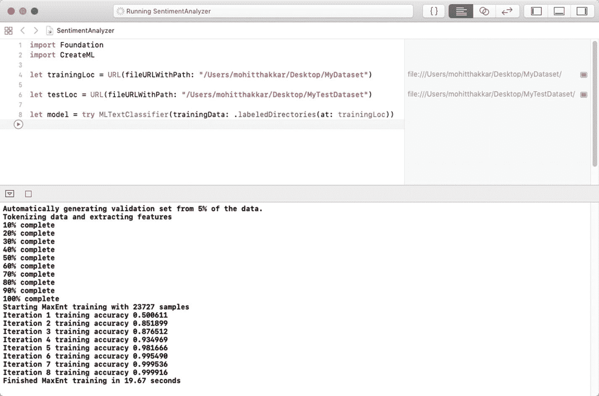
图 4-21 使用`Create ML`训练文本分类器

*步骤 7*：训练完成后，你可能希望基于测试数据评估模型。为此，请添加以下代码：
```swift
let evaluation = model.evaluation(on: .labledDirectories(at: testLoc))
```

要开始测试，请按`Shift+Enter`。

*步骤 8*：评估完成后，就该保存模型了。为此，请添加以下代码：
```swift
try model.write(to: URL(fileURLWithPath: "/Users/yourusername/Desktop/SentimentAnalyzer.mlmodel"))
```

按`Shift+Enter`，模型将保存到你提供的路径。你最终的代码应如图 4-22 所示。

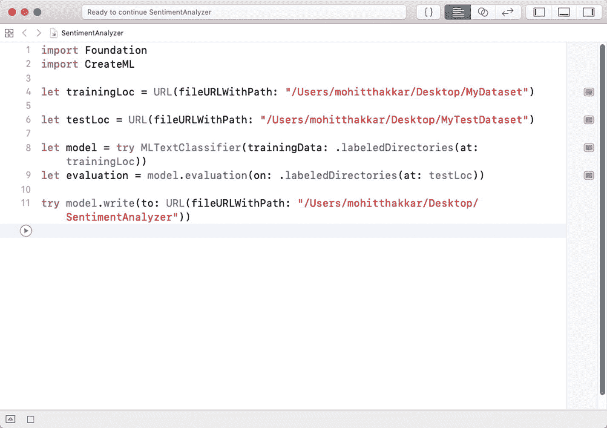
图 4-22 使用`Create ML`的文本分类器

如果你成功执行了代码，你将在桌面上找到一个名为`"SentimentAnalyzer"`的 ML 模型（图 4-23）。

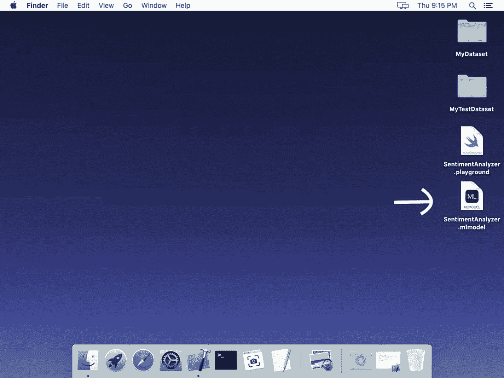
图 4-23 情感分析模型

就是这样。我们刚刚使用`Create ML`创建了一个文本分类器，它能够根据文本输入预测用户的情绪。现在，让我们创建一个应用程序来测试这个模型。我们将创建一个允许用户输入文本的应用程序，并根据输入的文本预测用户的情绪状态。如果情绪是积极的，我们将启用一个按钮，用户可以用它在某个社交网站上发布文本。如果情绪是消极的，我们将禁用该按钮，这样用户就无法在网站上发布消极内容。

*步骤 1*：打开`Xcode`，按照本书之前学习的步骤创建一个 iOS 应用程序项目。

*步骤 2*：打开`"Main.storyboard"`文件以访问应用程序界面。添加一个文本视图、一个标签和一个按钮。请参考图 4-24。

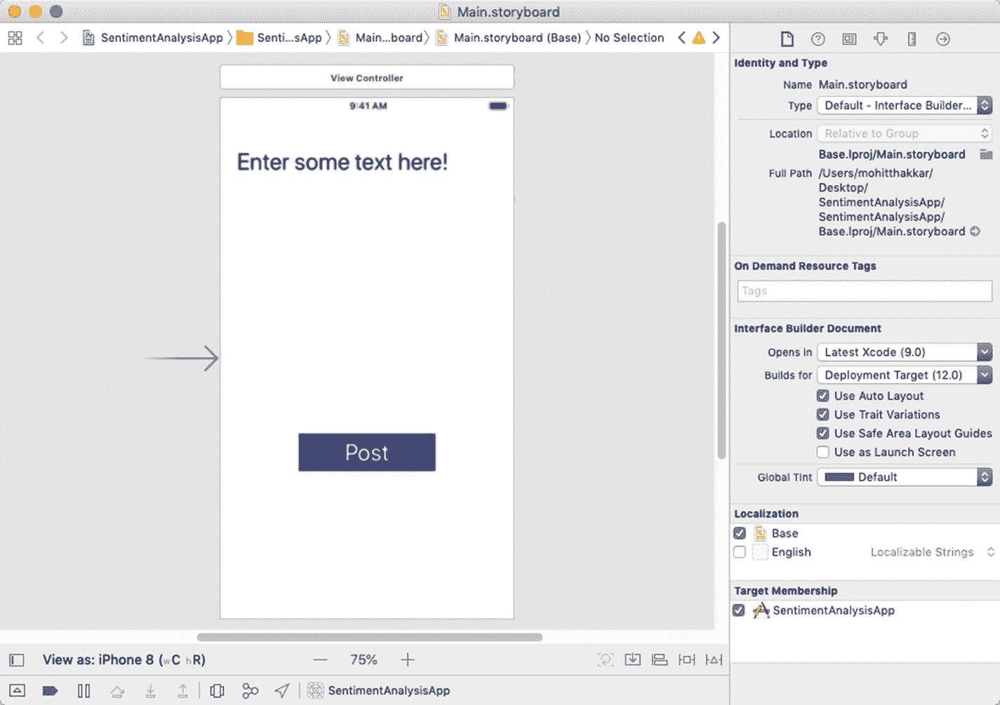
图 4-24 情感分析应用程序界面

*步骤 3*：为 UI 元素创建必要的输出口，以便我们在代码中访问它们。

*步骤 4*：现在，为了捕获文本视图的文本变化事件，我们需要让`ViewController`类遵循`UITextViewDelegate`协议。我们还需要在`viewDidLoad`方法中为文本视图设置代理。为此，请将以下代码添加到`ViewController.swift`文件中：
```swift
class ViewController: UIViewController, UITextViewDelegate {
    @IBOutlet weak var textView: UITextView!
    override func viewDidLoad() {
        super.viewDidLoad()
        textView.delegate = self;
    }
}
```

*步骤 5*：现在，为了在`textView`中的文本发生变化时执行某些操作，我们需要实现`UITextViewDelegate`协议的`textViewDidChange`方法。为此，请将以下代码添加到`ViewController`类中：
```swift
func textViewDidChange(_ textView: UITextView){
}
```

*步骤 6*：现在是时候将我们的 ML 模型添加到应用程序中了。将模型文件拖放到`Xcode`导航窗格中的项目文件夹中。选择模型文件后，您将看到各种信息，例如模型的名称、类型、大小、作者和描述。您可以通过单击“模型类”部分下的模型名称来查看模型的 Swift 代码。在“模型评估参数”下，您还会看到该模型将字符串作为输入文本，并返回一个字符串作为输出标签。在应用程序中使用此模型之前，请确保在右侧窗格中已为您的项目勾选了目标成员资格。请参考图 4-25。

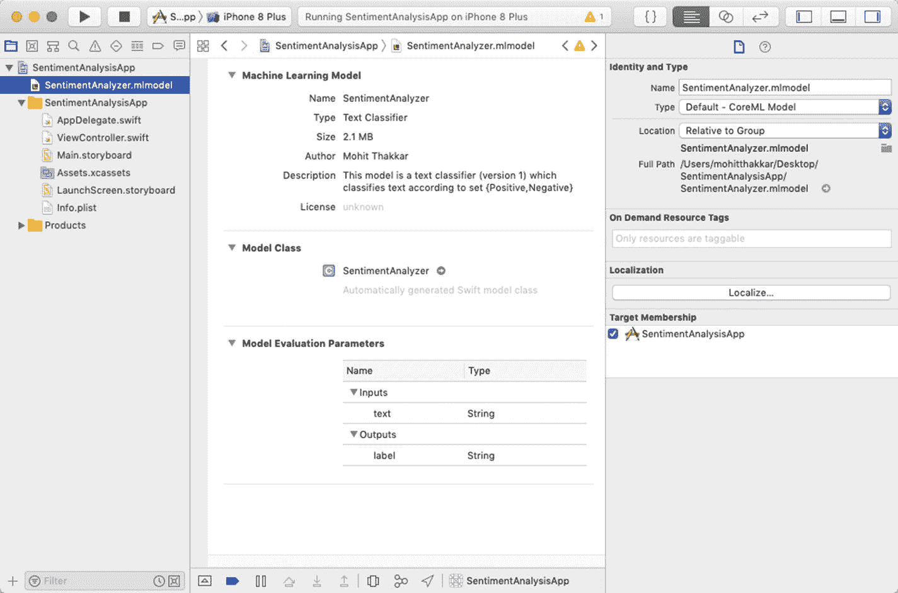
图 4-25 `Xcode`中的文本分类器

*步骤 7*：现在，为了在代码中使用该模型，我们需要导入`Core ML`框架，并在`ViewController`类中声明一个代表该模型的模型变量。为此，请将以下代码添加到`ViewController.swift`文件中：
```swift
import CoreML
...
class ViewController: UIViewController, UITextViewDelegate {
    ...
    let model = SentimentAnalyzer()
    ...
}
...
```

*步骤 8*：现在，为了分析用户情绪，我们将在`TextView`中的文本每次更改时调用预测方法。为此，请将以下代码添加到`ViewController`类中：
```swift
func textViewDidChange(_ textView: UITextView) {
    if let prediction = try? model.prediction(text: textView.text){
        if (prediction.label.contains("Positive")){
            btn.isEnabled = true
            btn.backgroundColor = UIColor.green
            lbl.text = "可以发布了！"
        }
        else{
            btn.isEnabled = false
            btn.backgroundColor = UIColor.red
            lbl.text = "请输入积极文本！"
        }
    }
    else{
        btn.isEnabled = true
        btn.backgroundColor = UIColor.blue
        lbl.text = "中性情绪！"
    }
}
```

*步骤 9*：终于到了构建并运行应用程序的时候了。让我们看看我们的 ML 模型预测用户情绪的效果如何。图 4-26 到图 4-28 展示了您在操作应用程序时应该看到的不同界面。

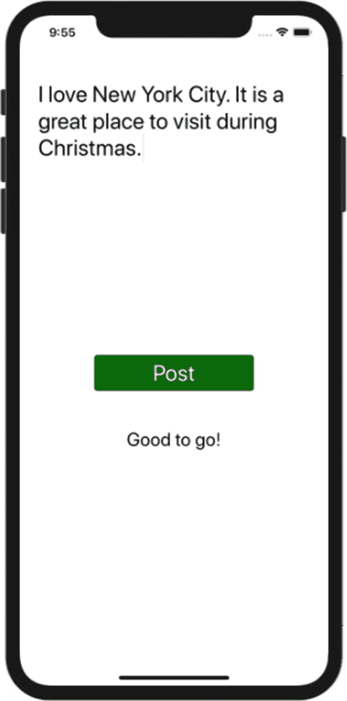
图 4-28 情感分析应用程序（C）

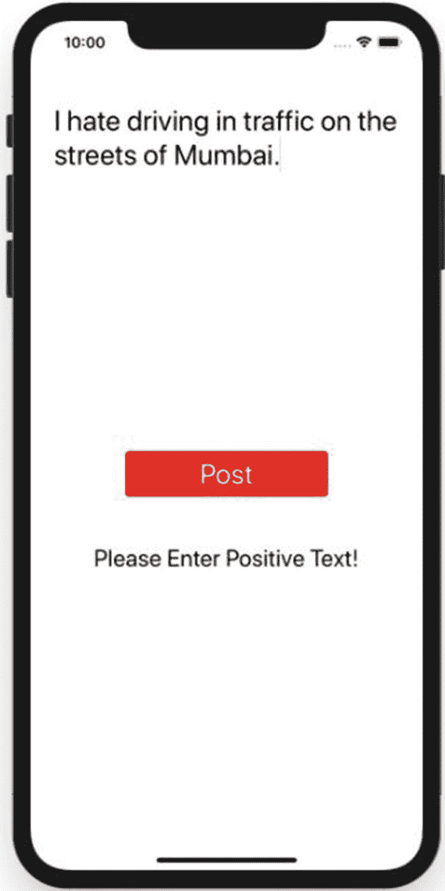
图 4-27 情感分析应用程序（B）

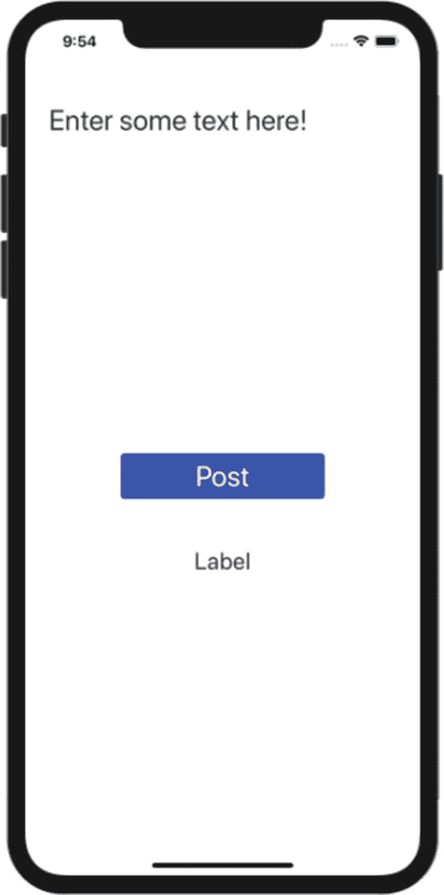

图 4-26

情感分析应用程序（A）

### 回归模型

既然你已经学会了如何处理图像和文本，你可能还想基于表格数据实现一些机器学习任务。当你需要根据多个参数进行预测时，通常会用到这类数据。例如，可以根据社区、房屋总面积、卧室和浴室数量、车库类型、房屋楼层数等参数来预测房价。接下来，让我们学习如何使用 Create ML 完成这项任务。

首先，我们需要准备表格格式的训练数据。我收集了一些表格数据，其中包含了美国不同社区房屋的价格。图 4-29 展示了数据的样子。

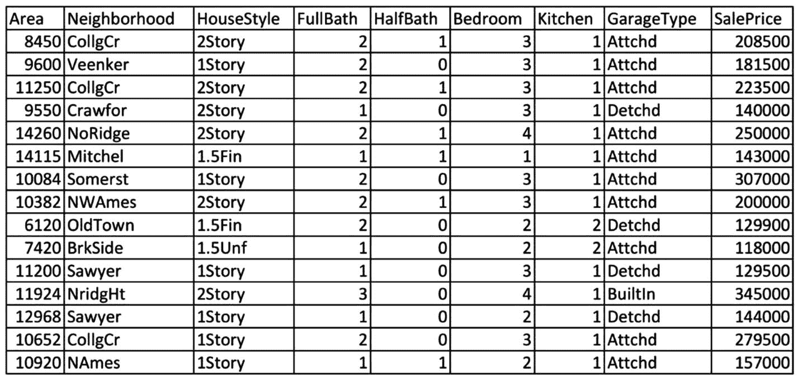

图 4-29

用于回归的表格数据

如你所见，数据描述了不同社区的房屋及其售价。我们将基于这些数据训练模型，以便根据给定的参数预测房价。你可以根据自己的偏好和需求选择不同的数据集。接下来，我们逐步了解训练回归模型的步骤。

*步骤 1*：在你的 Macbook 上创建一个名为 `"Dataset"` 的文件夹。

*步骤 2*：将表格训练数据存储在一个名为 `"train.csv"` 的 CSV 文件中。图 4-30 展示了文件夹结构。

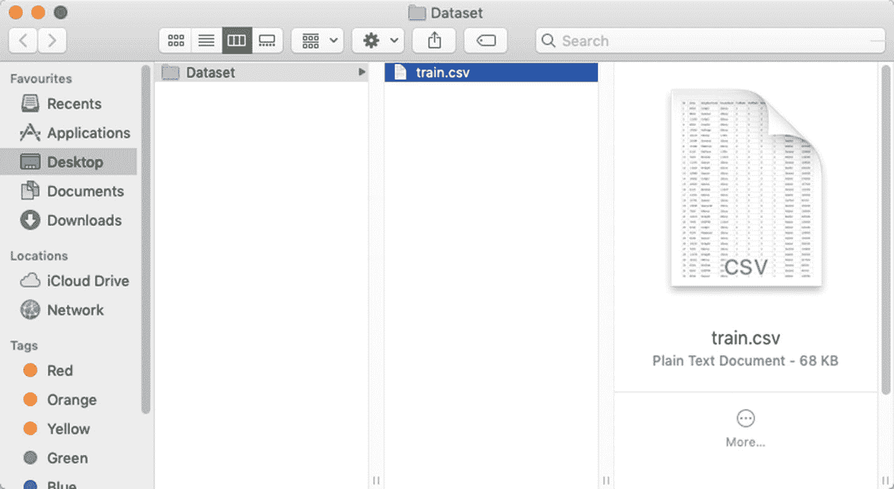

图 4-30

回归模型的数据集

*步骤 3*：打开 Xcode；在菜单中选择 **File ➤ New ➤ Playground**（图 4-31）。

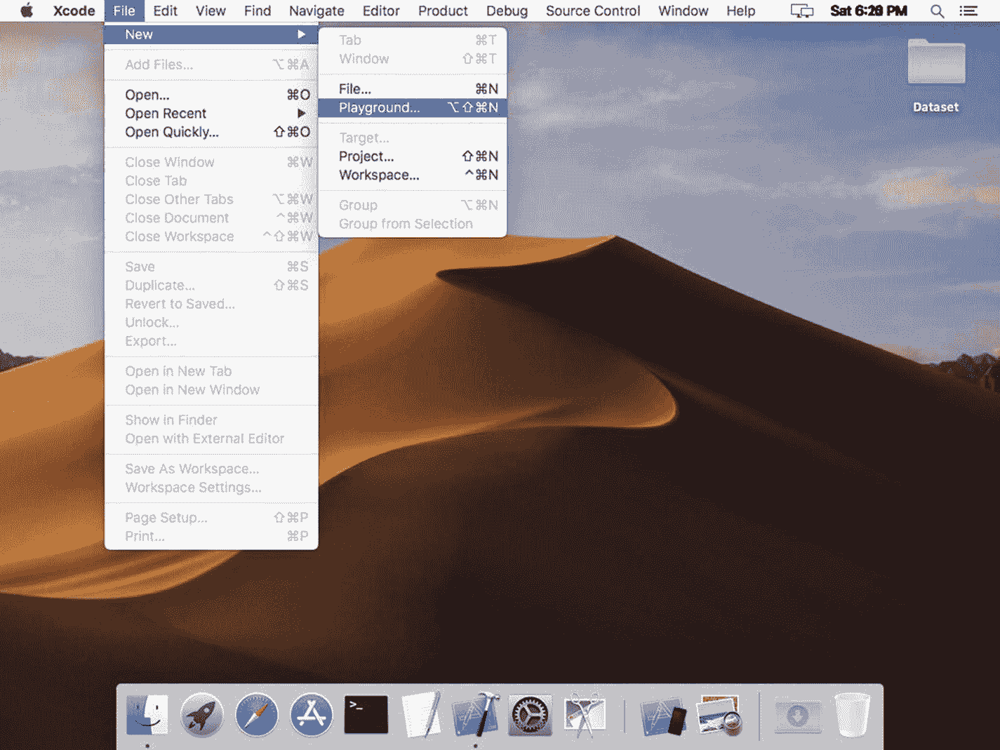

图 4-31

Xcode 中的新建 Playground

*步骤 4*：从模板选择菜单中选择空白文件（图 4-32）。请注意，你需要选择 macOS 下的空白文件，而不是 iOS 下的，因为 Create ML 框架不支持 iOS Playgrounds。


图 4-32

Playground 模板选择

*步骤 5*：将其命名为 `"HousePricePredictor"` 并保存到桌面。

*步骤 6*：请注意，目前 `Create MLUI` 仅适用于图像分类器，不适用于其他类型的机器学习模型。因此，我们必须使用 Create ML 而不是 `Create MLUI`。将以下代码添加到 Playground 中以导入 `Create ML` 和 `Foundation`：

```swift
import CreateML
import Foundation
```

*步骤 7*：通过添加以下代码来定义训练数据集的位置：

```swift
let trainingLoc = URL(fileURLWithPath: "/Users/yourusername/Desktop/Dataset/train.csv")
```

*步骤 8*：请注意，`Create ML` 包含一个名为 `MLDataTable` 的特殊数据结构，可以轻松处理表格数据。我们需要为训练数据创建 `MLDataTable`。为此，将以下代码添加到 Playground 中：

```swift
let houseData = try MLDataTable(contentsOf: trainingLoc)
```

*步骤 9*：从训练数据中拆分出一些测试数据，以便在模型训练完成后对其进行测试。为此，添加以下代码：

```swift
let (trainingData, testData) = houseData.randomSplit(by:0.8, seed: 0)
```

*步骤 10*：通过添加以下代码来定义模型：

```swift
let model = try MLRegressor(trainingData: trainingData, targetColumn: "SalePrice")
```

要开始训练，请按 `Shift+Enter`。底部的控制台将显示每次训练迭代的数据。请参考图 4-33。

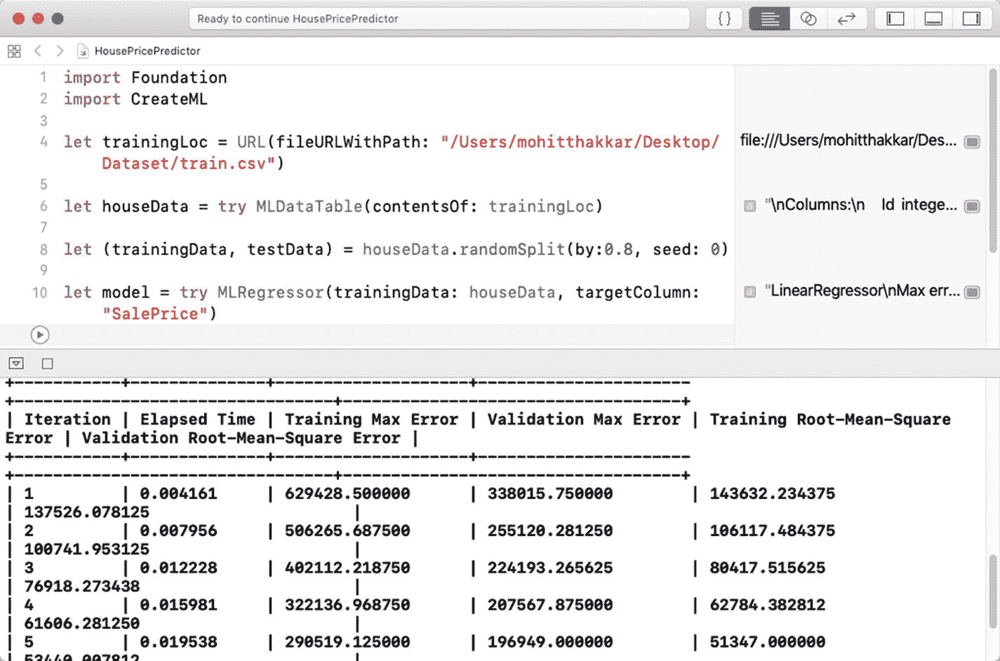

图 4-33

使用 Create ML 训练回归模型

*步骤 11*：训练完成后，你可能希望基于测试数据评估模型。为此，添加以下代码：

```swift
let evaluation = model.testingMetrics(on: testData)
```

要开始测试，请按 `Shift+Enter`。

*步骤 12*：评估完成后，就该添加一些元数据并保存模型了。为此，添加以下代码：

```swift
let modeldata = MLModelMetadata(author: "Mohit Thakkar", shortDescription: "Model that predicts house prices", license: "Open Source", version: "1.0")
try model.write(to: URL(fileURLWithPath: "/Users/mohitthakkar/Desktop/HousePricePredictor.mlmodel"), metadata: modeldata)
```

按 `Shift+Enter`，模型将保存到你提供的路径。你的最终代码应如图 4-34 所示。

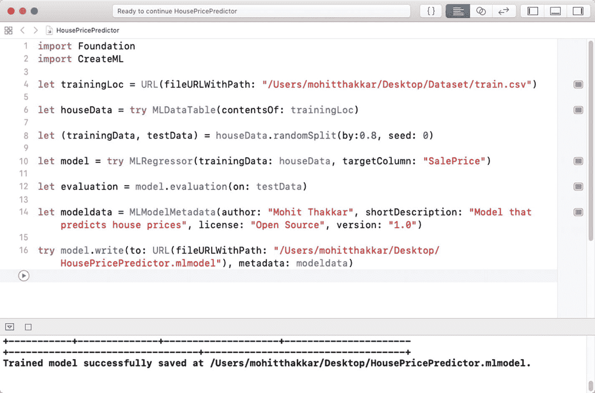

图 4-34

使用 Create ML 的回归模型

就是这样。我们的模型现在可以预测房价了。如果你打开 `MLModel` 文件（图 4-35），你会注意到该模型接收各种房屋参数，如社区、房屋总面积、卧室和浴室数量、车库类型以及房屋楼层数，并返回房价作为输出。

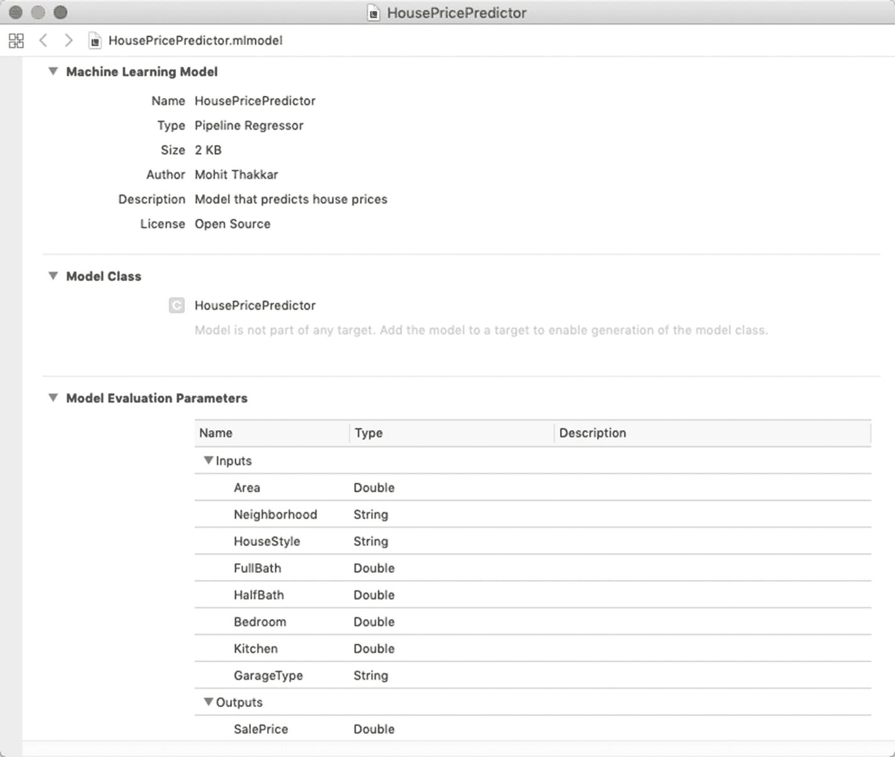

图 4-35

房价预测器

现在我们已经创建了回归模型，接下来创建一个 iOS 应用程序来验证模型是否真的有效。我们将创建一个应用程序，允许用户输入他们梦想中房屋的详细信息。点击按钮后，我们将获取这些详细信息，并使用我们的模型来预测价格。然后，我们将在应用程序界面上向用户显示房价。

*步骤 1*：打开 Xcode，按照本书之前学过的步骤创建一个 iOS 应用程序项目。你可以参考图 4-36 所示的界面。

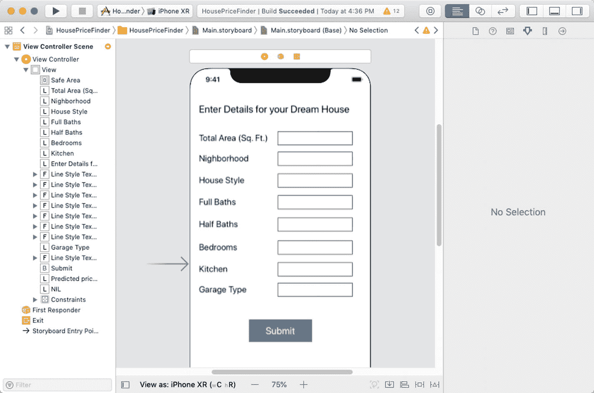

图 4-36

房价查找器应用程序界面

*步骤 2*：打开 `"Main.storyboard"` 文件以访问应用程序界面。

*步骤 3*：为描述房屋的字段以及显示预测房价的标签创建输出口。同时为按钮点击事件创建一个操作。这将在你的 `ViewController` 类中添加以下代码：

```swift
@IBOutlet weak var area: UITextField!
@IBOutlet weak var neighborhood: UITextField!
@IBOutlet weak var houseStyle: UITextField!
@IBOutlet weak var fullBaths: UITextField!
@IBOutlet weak var halfBaths: UITextField!
@IBOutlet weak var bedrooms: UITextField!
@IBOutlet weak var kitchen: UITextField!
@IBOutlet weak var garageType: UITextField!
@IBOutlet weak var housePrice: UILabel!
@IBAction func onDataSubmit(_ sender: Any) {
}
```

# 步骤 4：将模型文件拖放到 Xcode 导航窗格中的项目文件夹中。
选择模型文件后，你将看到各种信息，如模型的名称、类型、大小、作者和描述。你可以通过单击模型类部分下的模型名称来查看模型的 Swift 代码。在模型评估参数下，你还会看到模型接收的输入和返回的输出。在我们的应用程序中使用此模型之前，请确保在右侧窗格中为你的项目勾选了目标成员资格。

# 步骤 5：要在代码中使用该模型，我们需要导入 `Core ML` 框架，并在 `ViewController` 类中声明一个代表该模型的模型变量。
为此，将以下代码添加到你的 `ViewController.swift` 文件中：

```swift
import CoreML
...
class ViewController: UIViewController {
...
let model = SentimentAnalyzer()
...
}
...
```

# 步骤 6：现在，为了预测房价，我们将在点击提交按钮时调用预测方法。
同时，我们还会将标签的值设置为模型返回的预测价格。为此，请在 `ViewController` 类中添加以下代码：

```swift
@IBAction func onDataSubmit(_ sender: Any) {
    let prediction = try? model.prediction(Area: Double(area.text!) ?? 0,
                                           Neighborhood: neighborhood.text!,
                                           HouseStyle: houseStyle.text!,
                                           FullBath: Double(fullBaths.text!) ?? 0,
                                           HalfBath: Double(halfBaths.text!) ?? 0,
                                           Bedroom: Double(bedrooms.text!) ?? 0,
                                           Kitchen: Double(kitchen.text!) ?? 0,
                                           GarageType: garageType.text!)
    housePrice.text = "\(String(describing: prediction!.SalePrice))"
}
```

# 步骤 7：终于到了构建并运行应用程序的时候了。
让我们看看我们的 ML 模型在预测用户梦想之家的房价方面表现如何。图 4-37 和图 4-38 展示了你在操作应用程序时应该看到的不同界面。

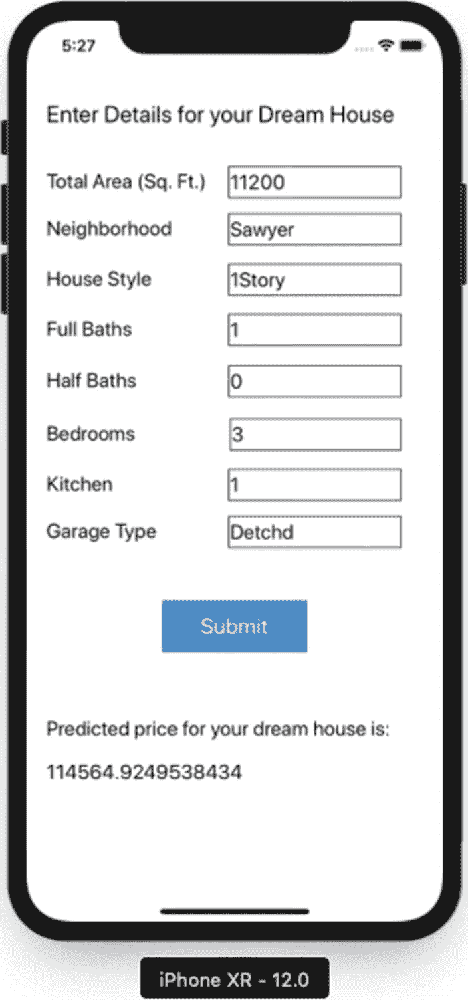

图 4-38

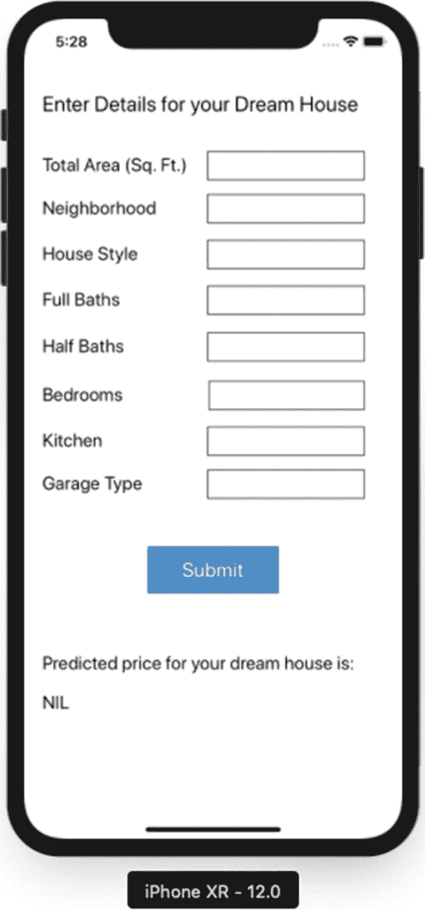

图 4-37

# 总结
- Apple 在 2018 年推出了 `Create ML`，为开发者提供了在 `Swift` 中实现端到端机器学习的能力。
- 虽然可以使用之前推出的 `Core ML` 工具创建 ML 模型，但 `Create ML` 通过与 `Xcode Playgrounds` 的直接集成，使这项工作变得更加简单。
- 使用 `Create ML` 可以训练成模型的主要数据类型包括图像、文本和表格数据。
- 使用 `Create ML` 创建自定义模型的工作流程与我们之前在第三章中学到的自定义模型创建生命周期相同。具体如下：
    - 定义问题
    - 收集数据
    - 训练学习算法
    - 评估学习算法
    - 构建模型
- 可以构建图像分类器模型来完成诸如根据狗的图像预测其品种等任务。
- 可以构建文本分类器模型来完成诸如根据用户输入的文本预测其情感等任务。
- 可以构建回归模型来完成诸如根据房屋所在地、净面积、房屋类型及其他多种因素预测房价等任务。