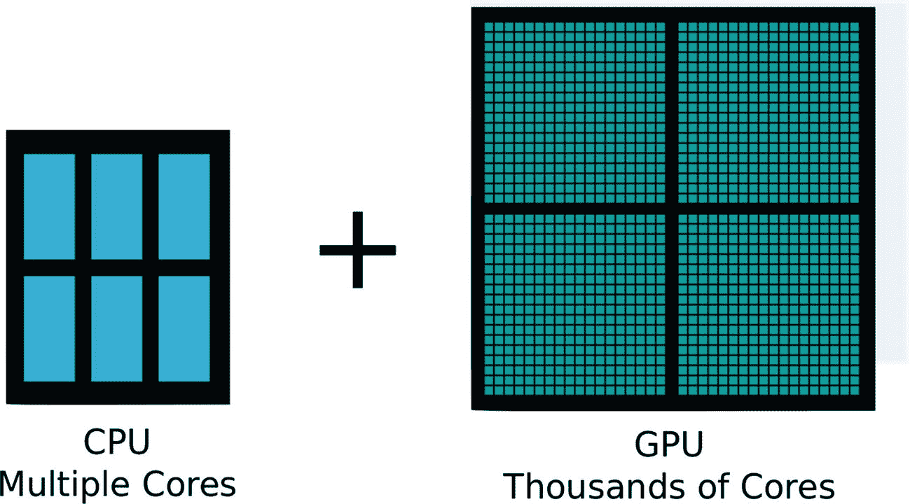
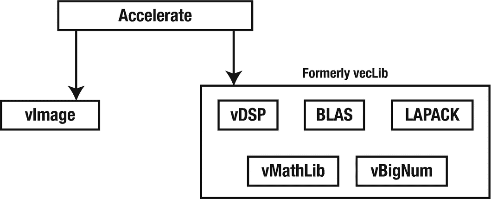
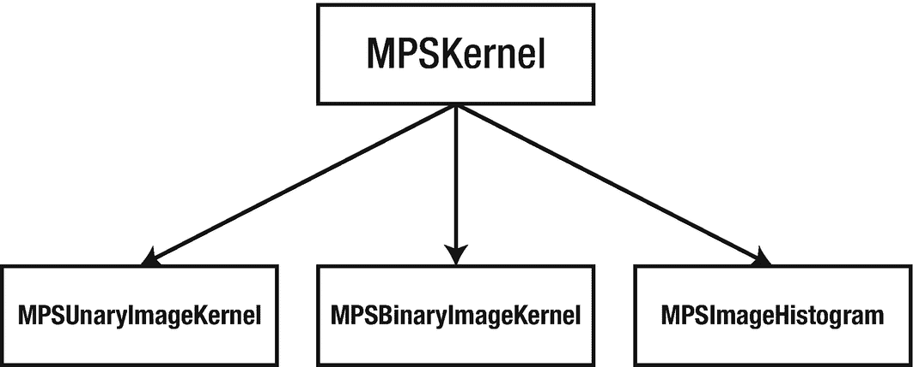
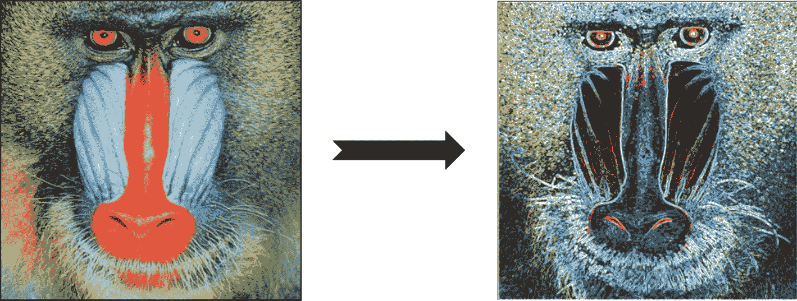
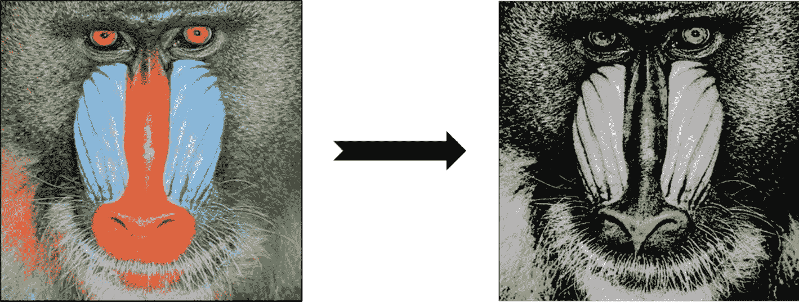
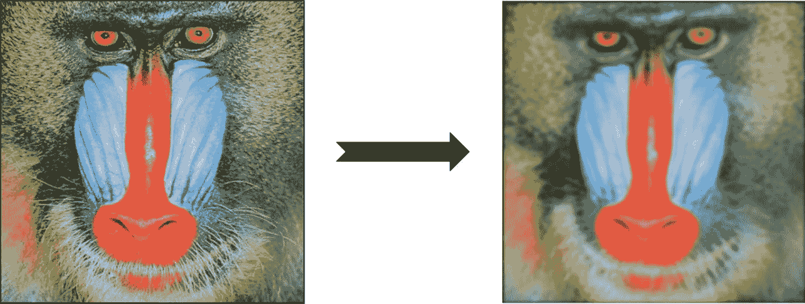
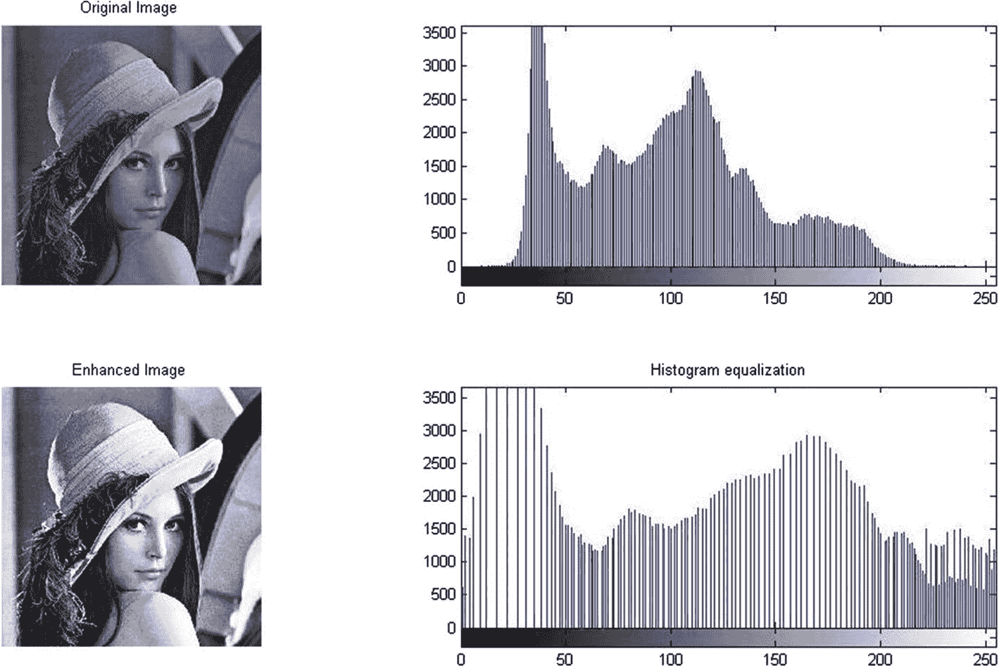

# 5. 提高计算效率

本章向读者介绍一些杂项主题的信息，例如 GPU 与 CPU 处理的区别，以及在实现机器学习时需要考虑的事项。

更重要的是，本章涵盖了 Core ML 框架所基于的两个重要框架：Accelerate 和 Metal Performance Shaders (MPS)。没有在代码中使用这两个框架的实际示例，因为在使用 Core ML 实现机器学习时会隐式地使用它们。不过，本章涵盖了这两个框架所包含的库的抽象信息。

## GPU 与 CPU 处理

CPU（中央处理器）通常被称为机器的“大脑”。机器上的大多数软件都需要 CPU 才能运行。然而，有些软件需要强大的计算能力。CPU 无法高效地支持此类软件的运行。这时，GPU（图形处理器）就派上了用场。

GPU 是一种特殊的微处理器，专为快速图像渲染而设计。GPU 最初是作为图形密集型应用的解决方案而推出的，这些应用会消耗大量 CPU 资源并降低整体机器性能。然而，现代 GPU 甚至能够处理需要强大数学计算能力的应用。通过使用 GPU，每当软件需要强大计算能力时，处理过程就会从 CPU 转移到 GPU，以保持机器的整体性能质量。图 5-1 展示了 CPU 和 GPU 的抽象结构。



图 5-1

CPU 与 GPU 对比

尽管 CPU 和 GPU 都是基于硅的微处理器，但它们处理任务的方式截然不同。CPU 被称为机器的“大脑”，而 GPU 则被称为机器的“肌肉”。CPU 擅长执行多种不同类型的任务，但由于其核心数量有限，一次只能运行少量任务。而 GPU 则将其所有计算能力集中在执行一种特定类型的任务上，但由于其拥有大量核心，它可以同时运行多个相似的任务实例。CPU 最多拥有 24 个核心，这些核心旨在优化作业中单个任务的性能。另一方面，GPU 拥有数千个更小的核心，这些核心针对并行架构中处理多个任务进行了优化。现代 GPU 被用于处理诸如机器学习和大数据分析等任务。

## 实现机器学习时的关键考虑因素

在移动设备上实现机器学习时，我们往往会失去在计算机上实现时所拥有的一些便利条件。以下是在移动应用程序中实现机器学习时需要考虑的一些要点：

*   `模型大小`：在前面的章节中，我们介绍了构建一些简单 ML 模型的过程，这些模型在内存需求方面可以忽略不计。但是，随着你深入 ML 世界，经常会遇到大小达数百兆字节的模型。例如，VGG16 模型是一个 16 层神经网络架构，在用于图像分类的 ImageNet 数据集上训练而成。它在 Apple 的网站上可用，大小约为 500 兆字节。要求用户下载如此大的文件可能会让他们望而却步。

*   `内存`：除了模型的整体大小之外，你还需要关注模型可能需要的运行内存量。台式计算机通常拥有 16 到 32 GB 的内存，但最新的 iPhone（iPhone XS Max）仅有 4 GB 的 RAM。在为你的移动应用程序选择 ML 模型时，应牢记这一限制。

*   `处理速度`：这是一个取决于多种因素的因素。加载输入数据并进行推理并不是工作流程的全部。应用程序的运行还涉及某些预处理和后处理。例如，如果输入文本是字符串格式，而你的模型只接受数组输入，你可能需要在推理之前将字符串转换为数组。这被称为预处理。同样，如果模型返回一个字符串标签作为输出，但你希望向用户显示一个表情符号，你可能需要在向用户显示之前将字符串映射到相应的表情符号。这被称为后处理。有时，你可能不得不在处理速度和较大的模型大小之间进行权衡。

## Accelerate

`Accelerate` 是一个框架，最早由苹果公司在 2003 年随 Mac OS X v10.3 Panther 引入。它是一个高性能向量加速库的集合，让你可以在应用中执行基于向量的操作，而无需显式使用底层向量指令。你无需关心用户的机器，因为 `Accelerate` 框架被设计为能根据代码运行机器的架构自动调用相应的指令集。图 5-2 展示了 `Accelerate` 框架所包含的库。



图 5-2

Panther 中的 Accelerate 框架

### vImage – 图像变换

`vImage` 库包含用于对图形和图像执行操作的例程。这些例程能充分利用可用的硬件。它们可以执行如下操作：

*   `格式转换`：`vImage` 库主要支持 Planar8、PlanarF、ARGB8888 和 ARGBFFFF 等图像格式，并支持这些格式之间的图像转换。

*   `卷积`：这是一个术语，指根据像素周围像素的值来修改像素值的过程。卷积可用于实现模糊、锐化、浮雕等图像效果。`vImage` 库还支持反卷积，这是一个逆转卷积效果的过程。

*   `形态学操作`：这些操作用于修改图像的结构。`vImage` 库支持两种形态学操作：膨胀（像素尺寸逐渐增大）和腐蚀（像素尺寸逐渐减小）。

*   `直方图`：图像的直方图用于以图形方式描述图像像素的强度。`vImage` 库支持创建图像直方图。此外，还可以变换图像，使其像素强度与特定直方图一致。

*   `几何操作`：`vImage` 库提供了可以对图像进行几何变换的子程序。这些操作包括旋转、翻转、扭曲、镜像、缩放等。

*   `Alpha 合成`：图像中的每个像素都有一个 alpha 值，用于确定该像素的不透明度。Alpha 合成是将两个具有不同 alpha 值的图像合并，产生一个图像，效果如同将一个图像放置在另一个图像之上。

*   `变换操作`：`vImage` 库还支持不依赖于其他像素值的像素变换函数。这些函数包括矩阵乘法和伽马校正。

### vDSP – 数字信号处理

`vDSP` 库主要专注于傅里叶变换、矩阵运算和向量操作。`vDSP` 库的应用包括语音处理、音频处理、数字图像处理、密码学以及其他向量操作，例如求向量的绝对值、单精度向量与双精度向量之间的转换、压缩向量值等。`vDSP` 子程序操作于基本的 C 数据类型，如 float、integer、double、short integer 和 character。

### BLAS 和 LAPACK

基本线性代数子程序（`BLAS`）和线性代数包（`LAPACK`）库包含用于执行基于矩阵的线性代数计算的子程序，例如特征值问题和矩阵乘法。`BLAS` 作为 `LAPACK` 的基础库，用于执行高级代数计算。

### vMathLib

`vMathLib` 是标准数学库 libm 的以向量为中心的版本。它们之间的区别在于 `vMathLib` 使用 128 位硬件向量来执行数学运算。

### vBigNum

`vBigNum` 库使用 1024 位整数操作数执行整数加法、减法、除法和乘法等运算。

要在你的 Xcode 项目中使用 `Accelerate` 库，你需要通过添加以下代码将 `Accelerate` 头文件添加到你的项目中：

```
#include 
或者
import Accelerate
```

你还需要从系统框架文件夹中将该框架添加到你的项目中：

```
.../System/Library/Frameworks/Accelerate.framework
```

### 注意

`Accelerate` 是一个复杂的框架，不建议作为在 iOS 中开始机器学习的方式。作为初学者，你只需要知道 Core ML（最新的机器学习框架）是基于 `Accelerate` 的，并且利用了 `Accelerate` 框架的计算能力。

## Metal Performance Shaders

`MPS` 是苹果公司在 2015 年 WWDC 大会上宣布的一个框架。它是一组针对 iOS 9 优化的高性能图像处理算法集合。`MPS` 利用设备 GPU 处理计算密集型任务。`MPS` 框架中的函数实现了大多数常见的图像处理任务，例如模糊、卷积、直方图、重采样等。这些函数对开发者来说就像一个黑盒。这样做的主要好处是，苹果可以根据更好的硬件可用性来修改和改进框架，而开发者无需担心框架代码。图 5-3 展示了 `MPS` 框架的类层次结构。



图 5-3

MPS 框架架构

`MPS` 框架中的所有类都派生自一个名为 `MPSKernel` 的类。此处的核（kernel）指的是一组权重，这些权重与源图像结合以生成输出图像。`MPSKernel` 作为一个类，除了创建核的副本并为其命名之外，不做其他任何事情。真正的工作是由 `MPSKernel` 的三个子类完成的：`MPSUnaryImageKernel`、`MPSBinaryImageKernel` 和 `MPSImageHistogram`。

# 一元图像核与二元图像核

## 一元图像核

一元图像核（unary image kernel）接收单个纹理作为输入，并生成单个输出纹理。可以使用 `MPSUnaryImageKernel` 执行多种一元操作。每个操作都有自己继承自 `MPSUnaryImageKernel` 的类。这些子类的命名约定是：操作名称以 `MPSImage` 为前缀。例如，如果要执行的操作是高斯模糊，则类名将为 `MPSImageGaussianBlur`。以下是 `MPSUnaryImageKernel` 支持的操作：


图 5-6：使用 MPS 进行 Sobel 边缘检测


图 5-5：使用 MPS 进行阈值归零


图 5-4：使用 MPS 进行高斯模糊

- `卷积操作`：`Box`、`Tent`、`GaussianBlur`（图 5-4）、`Sobel`（图 5-6）、`Convolution`（通用）
- `阈值处理`：`ThresholdBinary`、`ThresholdBinaryInverse`、`ThresholdToZero`（图 5-5）、`ThresholdToZeroInverse`、`ThresholdTruncate`
- `Lanczos 重采样`：`LanczosScale`（缩小、放大、挤压、拉伸）
- `形态学操作`：腐蚀、膨胀、最小值、最大值
- `滑动邻域操作`：`Integral`、`IntegralOfSquares`、`AreaMax`、`AreaMin`、`Median`、`Threshold`

## 二元图像核

二元图像核（binary image kernel）与一元图像核不同，它接收两个纹理作为输入以生成单个输出纹理。尽管有一个名为 `MPSBinaryImageKernel` 的类专门用于处理二元图像，但没有具体的子类继承自该类。因此，我们只能假设这个类是供开发者继承并编写他们想要执行的二元图像操作的自定义代码的。

## MPSImageHistogram

`MPSImageHistogram` 是一个用于计算图像直方图的类。与 `MPSUnaryImageKernel` 一样，`MPSImageHistogram` 也作用于单输入纹理。通常，图像的直方图随后会被传递给 `MPSImageHistogramEqualization` 或 `MPSImageHistogramSpecification`。均衡滤波器允许将图像中的颜色强度均衡为一组统一的值（图 5-7），而规格化滤波器则用于修改图像直方图以匹配您指定的直方图。


图 5-7：使用 MPS 进行直方图均衡化

作为 ML 初学者，您需要知道的是，当您使用 `Create ML` 创建图像分类器模型，或使用 `Core ML` 进行推理时，MPS 框架在底层过程中扮演着至关重要的角色。

# 总结

- 中央处理器（`CPU`）用于不需要大量计算能力的轻量级应用程序，而图形处理器（`GPU`）则用于图形或数学密集型应用程序，如果使用 CPU 处理，可能会降低整体机器性能。
- 模型大小、内存和处理速度是在移动应用中实现 ML 时需要考虑的三个重要因素。
- ML 模型的大小可能高达 500 兆字节。根据目标机器的计算能力选择模型是一个好习惯。
- 在为您的应用选择 ML 模型时，您还需要记住，计算机设备的工作内存可能在 16 到 32 GB 之间，但移动设备的工作内存可能仅限于 4 MB。
- `Accelerate` 是苹果公司在 2003 年发布的一个框架，用于提供向量计算、信号处理和代数计算的库。
- `Accelerate` 框架包含多个库，例如 `vImage`、`vDSP`、`BLAS`、`LAPACK`、`vMathLib` 和 `vBigNum`。
- `Metal Performance Shaders (MPS)` 是苹果公司在 2015 年发布的一个框架。它是一组针对 iOS 9 优化的高性能图像处理算法集合，利用设备 GPU 处理计算密集型任务。
- MPS 提供了用于图像处理任务的类，例如卷积、阈值处理、重采样、形态学操作、直方图生成、均衡化等。
- 苹果最新的 ML 框架 `Core ML` 基于 `Accelerate` 和 `MPS`。

# 索引

## A

- `Accelerate` 框架
- `BLAS` 和 `LAPACK` 库
- 低级向量指令
- `vBigNum` 库
- `vDSP` 库
- `vImage` 库
- `vMathLib` 库
- 苹果的 ML 框架
- 人工神经网络 (ANNs)
- 组装数据

## B

- 基本线性代数子程序 (`BLAS`)
- 二元图像核

## C

- 中央处理器 (`CPU`)
- 逗号分隔值 (`CSV`)
- 核心机器学习 (`Core ML`)
- 应用
- 云服务
- 组件
- 领域特定框架
- `Inceptionv3`
- 照片应用
- 预测
- 预测方法
- 预训练模型，集成
- 更新后的接口 `viewWillAppear()` 方法
- `Core ML`，转换 `caffe` 模型
- 执行，`caffe` 模型
- 从零开始
- 工具 `Xcode`
- `Create ML` 框架
- 自定义 ML 模型
- 自定义模型创建
- 数据类型
- 训练成模型
- 端到端 ML，Swift
- 图像分类（参见 *图像分类模型*）
- 回归模型（参见 *回归模型*）
- 测试图像分类器
- 文本分类（参见 *文本分类模型*）
- 训练图像分类器
- 训练回归模型
- 训练文本分类器
- `CSV` 数据
- 自定义模型
- 苹果提供的 `Core ML` 模型
- 辅助编辑器
- 构建并运行应用
- 按钮点击
- `CGContext`
- 控制器
- 核心 ML 模型
- 狗品种预测器应用
- 接口
- 图像缓冲区
- `imagePickerControllerDidCancel()` 方法
- `imagePickerController()` 方法
- 信息属性列表
- 生命周期
- `ML` 任务
- 模型
- 输出口和动作
- `pickImageBtnClick()` 方法
- 像素缓冲区
- 任务
- 训练和评估（参见 *训练和评估，自定义模型*）
- `UIImagePickerController`
- `viewWillAppear()` 方法
- `Xcode`
- `Xcode` 文件夹选择器
- `Xcode` 接口构建器
- `Xcode` 项目选项
- `Xcode` 模板选择

## D

- 决策树
- 数字信号处理 (`vDSP`)

## E, F

- 集成学习

## G

- `GPU` 与 `CPU` 处理
- 图形处理器 (`GPU`)

## H

- 房价查找器应用

## I

- 图像分类模型
  - `Create ML`
  - 数据集现场演示，`Xcode`
  - `ML` 模型，构建
  - `Playground`，`Xcode`
  - `Playground` 模板选择与保存
  - 图像分类器测试训练
  - `imagePickerController()` 方法
  - `imagePickerControllerDidCancel` 方法
  - 图像变换 (`vImage`)
  - 推理

## J, K

- `JSON` 数据

## L

- 线性代数包（`LAPACK`）

## M

- 机器学习（`ML`）
  - 应用
  - 数据模式定义
  - 人脸识别
  - 人脸检测
  - 移动应用模型
  - 识别垃圾邮件类型
  - 强化学习
  - 监督学习
  - 无监督学习
  - `Metal Performance Shaders`（`MPS`）
    - 架构
    - `GaussianBlur`
    - `MPSBinaryImageKernel` 类
    - `MPSImageHistogram` 类
    - `MPSKernel` 类
    - 操作
    - `Sobel` 边缘检测
    - `ThresholdToZero`
    - 一元图像核
  - `ML` 模型创建
    - 数据评估
    - 问题训练
    - `MPSBinaryImageKernel` 类
    - `MPS` 框架
    - `MPSImageHistogram` 类
    - `MPSKernel` 类

## N

- 命名实体识别（`NER`）

## O

- 光学字符识别（`OCR`）

## P, Q

- 感知器学习过程
- 线性可分问题
- 个人数字助理（`PDA`）
- 照片应用
- `Xcode` 助理编辑器创建
- 委托方法
- `IBAction`
- 信息属性列表
- 界面构建器

## R

- 回归模型
  - `Create ML` 数据集
  - 房价查找器应用
  - 房价预测器
  - `MLDataTable`
  - `ML` 任务
  - `Playground`
  - `Xcode Playground` 模板
  - 表格数据
  - 训练数据集
  - `ViewController.swift` 文件
  - 强化学习

## S

- 情感分析应用界面
- 情感分析器模型
- 监督学习
- 支持向量机（`SVM`）

# 关键术语

## 概念与数据
表格数据，回归，测试图像分类器，文本分类模型 Create ML，CSV 文件数据集，JSON 文件，ML 任务，模型评估参数，Playground，Xcode Playground 模板选择，原始文本文件，情感分析应用，情感分析器模型，用于训练的文字数据，训练，训练与测试数据集，`ViewController` 类，`ViewController.swift` 文件，工作流程，在 Xcode 中训练，文字数据，训练，`TextViewDelegate` 协议，训练与评估，自定义模型，Core ML 格式，Core ML 模型，数据集，训练过程，`explore()` 方法，迭代次数，`MyCustomModel`，Python 代码，SFrame，可视化，Xcode，训练与推理，决策实体，机器学习，图像识别，排序，训练图像分类器，训练回归模型，训练文本分类器，Turi Create，优势，数据集，安装命令，最新版本，Mac 上的 pip，Mac 上的 Python 版本，迁移学习

## U
`UIImagePickerController`，`UINavigationControllerDelegate` 协议，`UITextViewDelegate` 协议，一元图像核，无监督学习

## V, W
`ViewController` 类，`ViewController.swift` 文件

## X, Y, Z
Xcode，创建文件夹选择器，界面构建器，项目选项，模板选择，测试应用，工作区