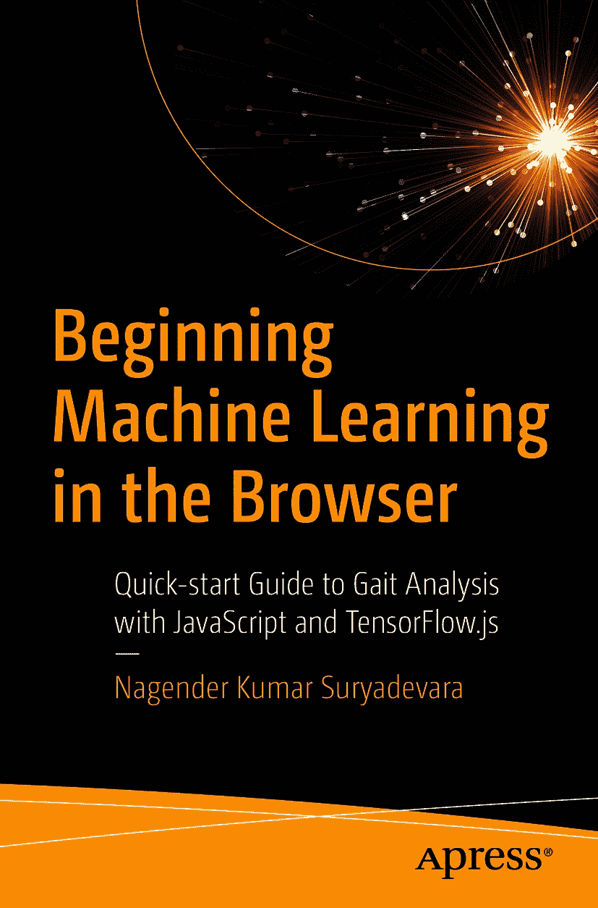

ISBN 978-1-4842-6842-1 e-ISBN 978-1-4842-6843-8 [`doi.org/10.1007/978-1-4842-6843-8`](https://doi.org/10.1007/978-1-4842-6843-8) Apress 标准 © Nagender Kumar Suryadevara 2021 本作品受版权保护。所有权利均由出版商独家许可，无论涉及材料的全部或部分，具体包括翻译、重印、插图复用、朗诵、广播、以缩微胶片或任何其他物理形式复制、传输或信息存储与检索、电子改编、计算机软件，或目前已知或未来开发的任何类似或不同方法的权利。本出版物中使用通用描述性名称、注册商标名称、商标、服务标志等，即使未作明确声明，也不意味着这些名称不受相关保护法律和法规的约束，因此可自由用于一般用途。出版商、作者和编辑可假定本书中的建议和信息在出版之日是真实准确的。出版商、作者或编辑均不对本书所含材料或可能存在的任何错误或遗漏提供明示或暗示的担保。出版商在已出版地图和机构归属方面的管辖权主张上保持中立。本书通过 Springer Science+Business Media New York 在全球图书贸易中发行，地址：1 NY Plazar, New York, NY 10014。电话：1-800-SPRINGER，传真：(201) 348-4505，电子邮件：orders-ny@springer-sbm.com，或访问 www.springeronline.com。Apress Media, LLC 是一家加利福尼亚有限责任公司，其唯一成员（所有者）是 Springer Science + Business Media Finance Inc (SSBM Finance Inc)。SSBM Finance Inc 是一家特拉华州公司。

前言

近年来，人工智能（AI）和机器学习（ML）技术已广泛应用于众多领域，例如环境参数监测、工业场景监控与控制、智能交通、结构健康监测、医疗保健等。电子技术、嵌入式控制、智能传感、网络和通信的进步使得开发低成本智能系统成为可能。尽管存在智能系统，但其计算能力非常有限，因此被视为资源受限的计算设备（例如手机、智能手表和小型电子设备）。

在资源受限的计算设备和浏览器上应用涉及 AI 和 ML 方法复杂数学运算的智能策略颇具挑战性。互联网技术，尤其是 JavaScript 技能的进步，使得在浏览器和资源计算设备上执行 AI/ML 模型成为可能。市面上已有许多关于 AI、ML 和 JavaScript 的出版物，但本书提供了有益的信息和实践知识，帮助读者从零开始开发智能方法/模型，并将其部署到浏览器和资源受限的计算设备上。

全书共分为六章：

第 1 章描述了 Web 开发的基础知识。本章简要介绍了使用 Web 构建块设计和开发 Web 应用程序的方法。对于开发 AI/ML 模型并在浏览器或资源受限计算设备上运行而言，本章的实践知识至关重要。对于任何研究领域的初学者以及有兴趣开发 Web 应用程序的人来说，本章提供了必要的实践技能，以便更好地实现 Web 应用程序。

第 2 章介绍了在计算机浏览器应用程序层面处理数据所需执行的步骤以及需要考虑的必要 JavaScript 库。本章涵盖了最新的 JavaScript 库（p5.js 和 ml5.js），这些库有助于通过实践步骤构建 AI/ML 模型。

第 3 章以人体姿态估计应用程序为例，帮助读者理解如何让涉及复杂数学运算的 AI/ML 模型在浏览器中运行。分步流程将教您如何实现 ML 方法来估计个体的姿态。

第 4 章介绍了开源 JavaScript 库 TensorFlow.js，该库有助于在浏览器中构建和部署 AI/ML 模型。本章解释了 TensorFlow.js 的架构，包括其支持在浏览器中进行大规模数据处理的加速器。通过 TensorFlow.js 库，本章阐明了执行神经网络模型以完成有用分类任务的实践示例。

第 5 章探讨了如何在 Web 浏览器应用程序中结合 JavaScript 库应用 AI/ML 方法来确定步态参数。本章将引导您了解步态分析的基础知识，并详细阐述在浏览器中使用 AI 确定分析关键参数时所考虑的观察方法。

第 6 章提供了更多在浏览器上应用 AI/ML 方法运行的高级应用程序。本章鼓励读者思考在浏览器中运行 AI/ML 模型时可能实现的进步。

希望您喜欢阅读本书。如果您在实践方面需要任何帮助，请随时与我联系。

S. Nagender Kumar Suryadevara 博士

印度海得拉巴大学计算机与信息科学学院副教授

致谢

没有我的家人、教授、导师和朋友的支持，这段旅程是不可能完成的。我特别感谢我的父母，他们给予了我情感上的支持。感谢我的家人，感谢你们鼓励我追求一切，并激励我追随梦想。

我要向 **Vishwesh Ravi Shrimali** 表示诚挚的感谢和衷心的谢意，感谢他抽出时间负责审阅本书各章节，并提供了宝贵的评论和有益的建议。

感谢出版团队的所有成员，特别是 **Aaron Black**，他帮助我将书稿内容打磨得更好；**James Markham**，他为润色本书付出了巨大努力；以及 **Jessica Vakili**，她确保了本书的写作过程顺利且按时完成。

我感激多年来参与各种项目的许多学生和同事，本书中使用了他们的一些工作成果。我特别要感谢我的学生 Ashish Gupta，他帮助我执行了第 5 章中的程序。

关于作者 关于技术审校者

