# 1. Web 开发

本章向您介绍机器学习（ML）的基础知识，并为完全初学者提供 Web 设计与开发的实用入门指南。本章涵盖的主题包括：

*   超文本标记语言（HTML）

*   层叠样式表（CSS）

*   JavaScript（JS）

*   文档对象模型（DOM）

*   jQuery

这些 Web 开发的构建块使您能够在 Web 设计中实现丰富的用户功能。


## 机器学习概述

机器学习是人工智能的一个子集，旨在让计算机无需与特定程序交互即可学习。机器学习使计算机能够开发出可以访问数据并利用数据进行自我学习的程序（从而像人类一样执行任务）。

阿瑟·塞缪尔认为计算机无需特定程序即可学习，他在 1959 年推广了*机器学习*这一术语。1997 年，汤姆·米切尔进一步阐明了机器学习的概念，指出计算机可以在处理某些任务时，根据涉及过往表现的某种相对度量进行学习，从而赋予计算机一些*经验*。

如今，各类电子产品都配备了尖端的高灵敏度传感器。此外，互联网连接使得各种设备之间能够进行通信，以实现更好的环境状况监测。因此，这些设备产生的海量数据推动了物联网概念的发展。利用人工智能和机器学习策略，可以处理、缩放、排序所收集的广泛信息，并用于预测事件。

在传统的机器学习方法中，数据被发送到中央服务器进行处理，这会导致通信开销、延迟、保护损失和安全问题。为了克服这些困难，可以通过在数据源附近部署更好的机器学习技术（例如，利用浏览器环境的能力）来对物联网领域收集的数据进行推断。在资源受限的计算设备上通过浏览器利用机器学习策略，有助于相关实体实时做出更好的决策，以增强功能。

当前人工智能策略的巨大计算需求以及越来越多人工智能增强型应用的开发，预示着更多的数据处理问题。毕竟，基于计算机的智能系统功能要求更高，因为它们力求减少资源利用、加快资源可访问性，并利用资源利用来提高精度。

软件开发者现在可以更有效地利用人工智能来构思高度响应式的应用程序，这些应用能够实时响应用户提供的信息，例如语音或面部识别。他们还可以制作能够从用户行为中学习的更智能的应用程序。基于计算机的智能使我们能够自动化应用程序，以纳入实质性建议、响应语音请求或身体动作、使用手机摄像头识别物品或地点，并找出如何帮助用户处理日常活动的方法。

过去，许多最佳的机器学习和深度学习系统都需要熟悉 Python 及其相关的库系统。机器学习模型的生成需要独特的推理设备和编程工具，例如 NVIDIA 图形处理单元和 CUDA。然而，现在将机器学习集成到 JavaScript 应用程序中，通常涉及将机器学习部分部署在远程云系统上（例如亚马逊云服务），并通过应用程序编程接口调用让模型在本地系统上运行。这种非本地的、以后端为中心的方法可能使许多网络工程师无法利用人工智能为前端改进提供的丰富前景。

在用户本地设备（即数据源附近）运行人工智能策略的主要优势在于，信息永远不会离开用户的设备。这一点至关重要，因为用户理所当然地担心他们的数据隐私，尤其是在广为人知且令人尴尬的信息泄露和安全漏洞事件之后。

借助 TensorFlow.js 软件工具，开发者/用户无需将信息发送到可能被外部人员获取的系统，就能利用人工智能。这些工具使得开发符合信息安全准则的安全应用程序变得更加简单，例如读取可穿戴临床传感器的医疗保健应用程序。这些工具还使得人工智能程序增强成为可能，从而允许在保护用户行为/信息的同时进行升级。

在一个简单的界面中将 JavaScript 编程特性与人工智能策略相结合，可以更直接地访问来自物联网设备的丰富传感器信息。可以根据与设备信息源（如语音或网络摄像头）的交互性来对用户行为进行建模。由于类似的编程代码可以在例如利用加速度计、陀螺仪和全球定位系统的手机上运行，因此将人工智能计算能力集成到用户设备本身中可以证明是非常有益的。

## 网络通信

图 1-1 展示了在用户设备上运行的人工智能应用的整体网络基础知识。

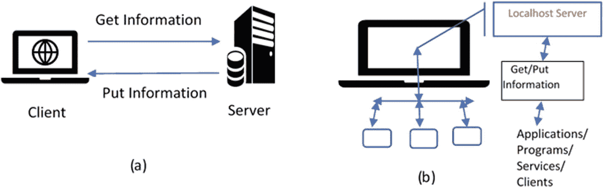

图 1-1

通过互联网和本地主机的网络通信

三个网络开发要点如下：

*   客户端（用于浏览网页的网络浏览器）
*   服务器系统（用于向浏览器提供信息）
*   计算机网络（用于支持浏览器-服务器通信）

图 1-1(a) 所示的网络活动说明了互联网互连原理，其中客户端和服务器之间的通信通过诸如互联网协议、传输控制协议、超文本传输协议和文件传输协议等协议完成。图 1-1(b) 显示客户端（浏览器/服务/应用程序）和服务器（本地主机）之间的通信在本地进行，并向相应的应用程序（客户端/浏览器/服务）提供所需信息。

以下术语与通信相关：

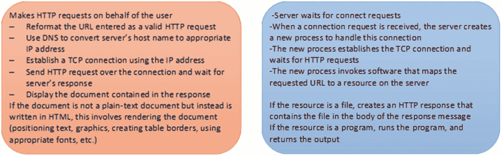

图 1-2

网络客户端（浏览器）与网络服务器之间的通信

*   *万维网*：一个运行在互联网上的、相互链接的超文本文档系统。有两种类型的软件：客户端和服务器。想要访问服务器提供信息的系统必须运行客户端软件（例如，网络浏览器），而想要向他人提供信息的联网计算机必须运行服务器软件。客户端和服务器应用程序通过遵循基于 TCP/IP 的协议（即 HTTP）在互联网上进行通信（图 1-2）。

*   *超文本*：一种信息格式，允许人们通过超链接从一个文档的一部分移动到另一部分，或从一个文档移动到另一个文档。

*   *统一资源定位符*：用于定位网络上特定资源的唯一标识符。

*   *标记语言*：定义超文本文档的结构和内容。

### 使用 HTML 组织网页

要设计和开发网页，你需要彻底熟悉超文本标记语言。HTML 使你能够定义网页的结构，包括章节、列表、标题、连接点、图片、混合媒体播放器等。

HTML 不是一种编程语言。它是一种标记语言，告诉互联网浏览器如何构建用户访问的网页。HTML 由各种组件组成，你可以使用这些组件来操作实质性页面元素，使其以特定方式显示。例如，封装标签可以将内容转换为链接到另一个页面的超链接，或者用于强调单词/术语。


## 使用 IDE/编辑器进行 Web 开发

集成开发环境（IDE）与文本编辑器在 Web 开发中的区别在于，IDE 能够完成从基础内容管理到高级开发的所有工作，而这些是文本编辑器无法做到的。

例如，[***Sublime***](https://www.sublimetext.com/)、[***Notepad++***](https://notepad-plus-plus.org/downloads/) 和 [***Atom***](https://atom.io/) 等编辑器可用于编写网页设计代码中的 HTML 和层叠样式表（CSS）。这些编辑器包含许多优秀功能（例如，包含可适应界面的语言结构，以及为需要增强应用能力的 Web 开发者提供的全面导航工具）。例如，Web 开发者可能需要调试器和编译器来高效开发 Web 应用。图 1-3 展示了这三种编辑器的编程环境。

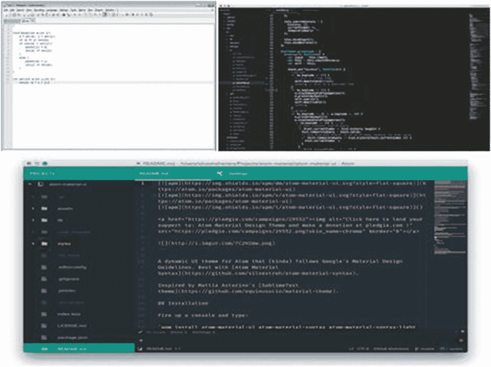

图 1-3

Notepad++、Sublime 和 Atom 编辑器环境

然而，使用最好的 IDE 时，你无需过多担忧。它们通常在一个应用程序中集成了全面的开发工具，包括自动化、测试和预测功能。主要而言，它们为 Web 开发者提供了将代码转化为可运行应用的必要支持。以下是一些较为流行的 IDE：

*   [*Visual Studio Code*](https://code.visualstudio.com/)：Visual Studio Code 或许是适用于 Windows、Mac 和 Linux 平台的最佳 JavaScript IDE。除了支持 JS 功能外，它还支持 Node.js 和 TypeScript 特性，并包含一个针对不同编程语言（包括 C++、C#、Python 和 PHP）的扩展系统。Visual Studio Code 凭借出色的语法特性和 IntelliSense 自动补全功能（可响应多种因素、单词定义和导入模块），实现了对程序员友好的操作。

*   [*NetBeans*](https://netbeans.org/)：NetBeans 是最佳的 Web 开发 IDE 之一，因为它能让你创建一个整洁且多功能的工作区，并快速开发 Web 应用。它还能很好地与 JS、HTML5、PHP 和 C/C++ 配合使用。它是一款免费的 JS IDE，也是一款日常使用中出色的 HTML5 IDE。该 IDE 允许你审查代码中的错误，并在必要时自动修复语法（包括 Java 8 特性，如 lambda 表达式）。

*   *PyCharm*：PyCharm 并非最佳的免费 JS IDE。然而，如果你正在寻找一款用于 Python 的可靠 Web 开发 IDE，其付费的专业版值得考虑。

*   *IntelliJ IDEA*：IntelliJ IDEA 是一款出色的 Web 开发 IDE。它提供免费版本，但如果你想要其提供的所有 JS 功能，可以考虑付费的终极版。IntelliJ IDEA 能在 Web 开发中为你节省时间和精力，并且它也是一款出色的 CSS IDE。此外，请注意它支持多种编程语言。

### Web 开发的构建模块

Web 开发的三大构建模块如下：

*   *HTML*：通过 HTML5，计算机现在不仅能动态显示网站内容，还能理解网站上的内容。早期的 HTML 版本向用户提供静态或动态信息。网站内容通过 HTML 代码显示。

*   *CSS*：CSS 决定了网站/页面的外观。HTML 用于制作内容，而 CSS 用于以你想要的方式展示内容（即设计；不同的样式、颜色、背景和布局）。CSS 让网站/页面看起来更有趣。

*   *JavaScript*：JS 是一种用于操作 HTML 和 CSS 的编程语言。其主要功能是为用户提供交互特性。它很健壮，可用于创建完整的 Web 应用。

注意

要开发和测试本书中的应用/代码，建议使用 Google 的 Chrome 浏览器，该浏览器有适用于 Mac、Windows 和 Linux 的版本。

### HTML 和 CSS 编程

一个连贯的 Web 开发过程要求你首先定义*要说什么*（HTML），然后定义*怎么说*（CSS）。一个 HTML 组件（元素）由开始标签、其特性（属性）、结束标签以及两者之间的所有内容组成。HTML 标签——无论是开始标签（`< >`）还是结束标签（`</ >`）——用于标识组件（元素）的开始或结束。以下代码展示了 HTML 文档的结构及其一些基本元素：

第一行 `<!DOCTYPE html>` 告知浏览器这是一个 HTML5 版本的网页。整个网页内容需要包裹在 `<html>` 标签内。实际的 `<html>` 文本称为*开始标签*，而 `</html>` 称为*结束标签*。这些标签内的所有内容都被视为 `<html>` *元素*的一部分，该元素是当 Web 浏览器解析你的 HTML 标签时实际创建的东西。在 `<html>` 元素内部，还有两个元素：`<head>` 和 `<body>`。网页的 `<head>` 包含其所有元数据，例如页面标题、任何 CSS 样式表以及渲染页面所需的其他内容，但这些内容你通常不希望用户看到。我们大部分的 HTML 标记将位于 `<body>` 元素中，该元素代表页面的可见内容。

注释写在标签 `<!--` 和 `-->` 之间。清单 1-1 展示了一个更完整的 HTML 示例，图 1-4 显示了相应的输出。

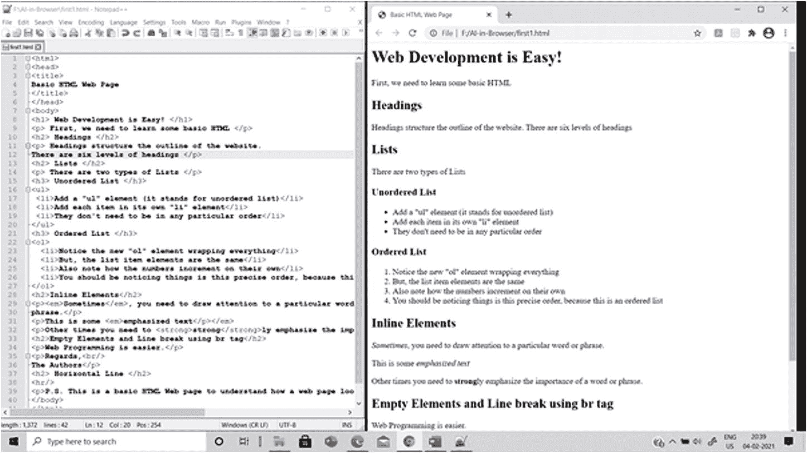

图 1-4

基本 HTML 代码及其输出的截图

```

Basic HTML Web Page

 Web Development is Easy! 
 First, we need to learn some basic HTML 
 Headings 
 Headings structure the outline of the website.
There are six levels of headings 
 Lists 
 There are two types of Lists 
 Unordered List 

Add a "ul" element (it stands for unordered list)
Add each item in its own "li" element
They don't need to be in any particular order

 Ordered List 

Notice the new "ol" element wrapping everything
But, the list item elements are the same
Also note how the numbers increment on their own
You should be noticing things is this precise order, because this is an ordered list

Inline Elements
Sometimes, you need to draw attention to a particular word or
phrase.
This is some emphasized text
Other times you need to strongly emphasize the importance of a word or phrase.
Empty Elements and Line break using br tag
Web Programming is easier.
Regards,
The Authors
 Horizontal Line 

P.S. This is a basic HTML Web page to understand how a web page looks like. 

清单 1-1
网页的基本 HTML 内容
```

#### 动态 HTML

动态 HTML（DHTML）使开发者能够控制浏览器窗口中 HTML 元素的显示和位置。HTML 用于创建静态网页，而 DHTML 用于创建动态网页。HTML 由简单的 HTML 标签组成，而 DHTML 由 HTML 标签加上 CSS 和 JS 组成。

#### 层叠样式表

CSS 帮助我们指定网页上的元素应如何呈现。通过 CSS，我们可以确定网页的样式和布局。使用样式表有三种方式：

*   内联样式表（清单 1-2）

*   嵌入式样式表（清单 1-3）

*   外部样式表（清单 1-4）


#### 内联样式表

内联样式表用于为单个元素应用各种独特的样式。你也可以使用内联样式表为特殊类型的元素定义样式，或为元素添加类属性。清单 1-2 展示了如何将内联样式与 HTML 元素结合使用。图 1-5 显示了相应的输出结果。

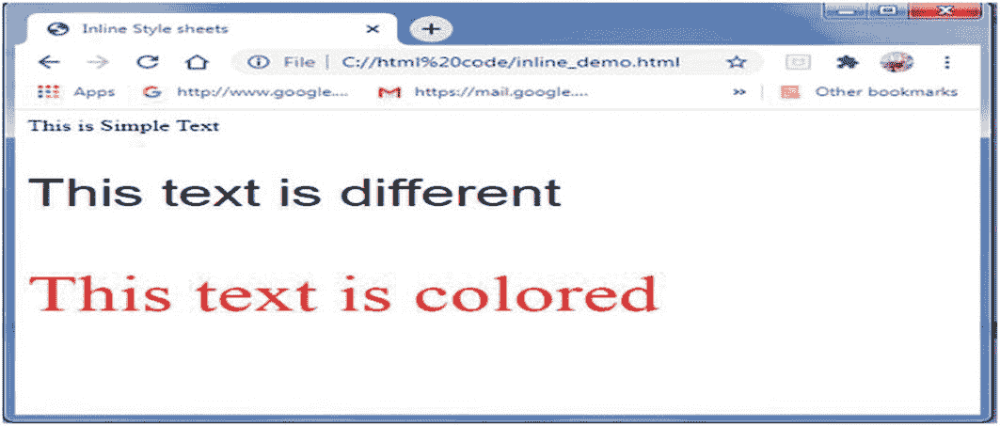

图 1-5

内联 CSS 样式设置的输出

```

 Inline Style sheets 

 This is Simple Text 
 This text is different 
 This text is colored 

清单 1-2
内联样式表示例
```

#### 嵌入式样式表

对于嵌入式样式表，我们将所有所需的选择器及其属性和值写在 head 部分。然后，在 body 部分，使用新定义的选择器标签与实际内容结合。清单 1-3 中的 DHTML 脚本定义了 `h1`、`h2`、`h3` 和 `p` 选择器，并设置了不同的属性和值。图 1-6 显示了嵌入式样式设置与 HTML 代码对应的输出结果。

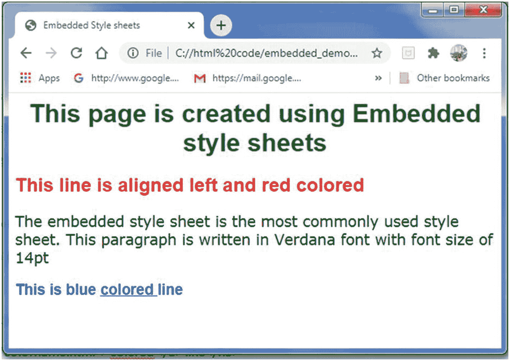

图 1-6

嵌入式样式设置的输出

请注意，要定义嵌入式样式表，我们必须在 `head` 部分中注明 `style type= "test/css"`。

```

 Embedded Style sheets 

h1,h2,h3{font-family:arial;}
h2 {color:red;left:20px }
h3 {color:blue;}
p {font-size:14pt;font-family:verdana;}
.special {color:green}

This page is created using Embedded style sheets  
 This line is aligned left and red colored 
 The embedded style sheet is the most commonly used style sheet. This paragraph is written in Verdana font with font size of 14pt
 This is blue
 colored  line

清单 1-3
嵌入式样式表示例
```

#### 外部样式表

当我们想将特定样式应用于多个网页时，可以使用外部样式表。这种样式表存储在一个 .css 文件中，并且我们必须在相关网页中提及该文件的名称。这样做之后，.css 文件中定义的样式就会应用到这些网页上。清单 1-4 是一个使用外部样式表的简单程序。

```

 External Style sheets 

This page is created using External style sheets  
 This line is aligned left and red colored 
 The embedded style sheet is the most commonly used style sheet. This paragraph is written in Verdana font with font size of 14pt
This is blue
 colored  line

清单 1-4
外部样式表示例
```

外部样式表在 `href` 属性中被引用，其值为指向 ex1.css 的链接。在同一文件夹中创建一个名为 ex1.css 的文件：

```
h1 {font-family:arial;}
h2 {
font-family:times new roman;
color:red;
left:20px;
}
h3 {
font-family:arial;
color:blue
}
p {
font-size:14pt;
font-family:cambria;
}
special {color:green }
```

## JavaScript 基础

JavaScript 是一种脚本语言（一种轻量级编程语言）和一种解释型语言（无需预先编译即可执行）。它通常直接嵌入到 HTML 页面中，旨在为页面增加交互性。Java 和 JS 是不同的。

JS 属性包括以下内容：

*   JS 为 HTML 设计者提供了一种编程工具。
*   JS 可以将动态文本放入 HTML 页面。
*   JS 可以对事件做出反应。
*   JS 可以读取和写入 HTML 元素。
*   JS 可用于验证数据。
*   JavaScript 可用于在浏览器中应用 AI、ML 和 DL 技术。
*   JavaScript 可用于创建 Cookie（在访问者的计算机上存储和检索信息）。

### 包含 JavaScript

HTML `<script>` 标签用于将脚本（JS）插入到 HTML 页面中：

```
document.write("Hello World!");

```

`<script>` 标签用于嵌入客户端脚本。`<script>` 元素要么包含脚本语句，要么通过 `src` 属性指向一个外部脚本文件。

### 在哪里插入 JS 脚本

你可以将脚本包含在 head、body 或外部 JavaScript 文件 (.js) 中。`head` 部分中的脚本（清单 1-5）将在调用 `head` 部分时执行。图 1-7 显示了相应的输出结果。`body` 部分中的脚本在页面加载时执行（清单 1-6），图 1-8 显示了相应的输出结果。

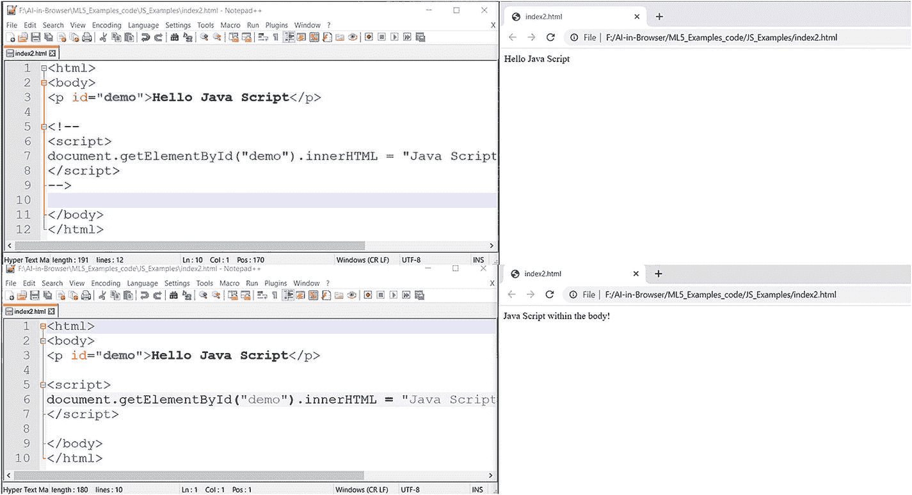

图 1-8

body 部分中的 JavaScript

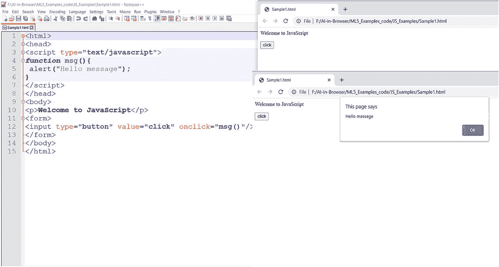

图 1-7

head 部分中的 JavaScript

```

function msg(){
alert("Hello message");
}

Welcome to JavaScript

清单 1-5
head 部分中的 JavaScript
```

```

Hello Java Script

document.getElementById("demo").innerHTML = "Java Script within the body!";

清单 1-6
body 部分中的 JavaScript
```

清单 1-7 提供了程序外部的 JS 函数，清单 1-8 显示了图 1-9 中相应输出的 HTML。

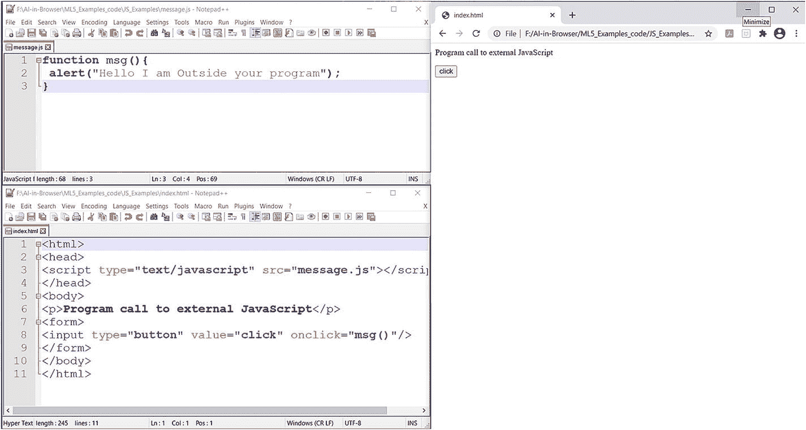

图 1-9

程序外部的 JS

```

Program call to external JavaScript

清单 1-8
点击按钮的 HTML
```

```
function msg(){
alert("Hello I am Outside your program");
}
清单 1-7
Message.js
```

### 用于事件驱动过程的 JavaScript

通过利用 JS 进行事件驱动编程，可以实现动态网站开发。通常，在网站页面加载完成后，JS 程序会持续运行（并等待事件发生）。如果你与网页进行交互，JS 脚本会执行与该交互（事件）对应的代码，并且页面的行为会根据事件而改变。图 1-10 借助 JS 功能展示了一个典型的事件驱动过程。

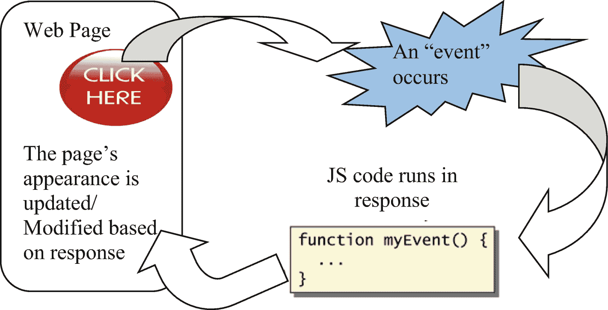

图 1-10

借助 JS 代码在网页上实现的事件驱动过程


## 文档对象模型操作

当网页加载时，浏览器（程序）会创建该页面的文档对象模型（DOM）。HTML DOM 被构建成一个*对象树*。通过 DOM，可以操作 HTML 的元素（组件），在网页中移动它们并进行高效处理。

HTML DOM 是 HTML 的对象模型：

*   HTML 组件作为项目（元素）
*   所有 HTML 组件的属性
*   所有 HTML 组件的技术
*   所有 HTML 组件的事件

HTML DOM 是 JavaScript 的应用程序编程接口（API）：

*   JS 可以添加/更改/删除 HTML 组件。
*   JS 可以添加/更改/删除 HTML 特性。
*   JS 可以添加/更改/删除 CSS 样式。
*   JS 可以响应 HTML 事件。
*   JS 可以添加/更改/删除 HTML 事件。

在创建网站页面和应用程序时，你必须做的主要事情之一就是控制文档结构。开发人员通常通过使用 DOM 来实现，DOM 包含大量用于控制 HTML 的 API，以及使用文档对象来设置样式数据。

`发现 HTML 元素`：当你需要使用 JS 访问 HTML 元素时，首先需要发现这些元素。你可以通过以下几种不同的方式来实现：

*   通过 ID 发现 HTML 元素
*   通过标签名发现 HTML 元素
*   通过类名发现 HTML 元素
*   通过 CSS 选择器发现 HTML 元素
*   通过 HTML 对象集合发现 HTML 元素

在 JS 中使用的网页是一个文档，JS 提供了一个名为 `document` 的对象，它被视为一个完整的网页。`document` 对象提供了各种属性和方法，用于在浏览器加载网页时识别、访问和修改网页组件/元素。为了识别和访问 DOM 元素，JS 使用了前面描述的发现能力。

以下 HTML 源代码展示了这种发现机制的实际应用：

```

通过 Id 查找 HTML 元素
Hello World!
此示例演示了 getElementsById 方法。

DOM 非常有用。
此示例演示了 getElementsByClassName 方法。

var myElement = document.getElementById("intro");
document.getElementById("demo1").innerHTML =
"intro 段落中的文本是 " + myElement.innerHTML;
var x = document.getElementsByTagName("p");
document.getElementById("demo2").innerHTML =
'第一个段落（索引 0）中的文本是：' + x[0].innerHTML;
var x1 = document.getElementsByClassName("intro");
document.getElementById("demo").innerHTML =
'第一个 class="intro" 的段落（索引 0）：' + x1[0].innerHTML;

```

## jQuery 简介

jQuery 是一个轻量级的 JS 库，它使开发人员能够编写更少的代码，但完成更多的工作。jQuery 库使 Web 程序员能够轻松地完成以下任务：

*   HTML 和 DOM 元素操作
*   CSS 管理和控制
*   提供事件驱动技术，用于触发和响应网页上的事件，例如鼠标点击、按钮点击、按键等
*   改进异步 JavaScript 和 XML（AJAX）调用的功能，用于两个实体（例如客户端和服务器）之间的信息交换

在你的程序中使用 jQuery 库有两种方式：

1.  从 jQuery.com 下载 jQuery 库

([`https://code.jquery.com/jquery-3.5.1.min.js`](https://code.jquery.com/jquery-3.5.1.min.js)) 并将其存储在与源代码（HTML 和 CSS 代码）相同的位置，然后按如下方式使用：

*或者*

1.  如果你已连接到互联网，请使用以下来自 Google CDN 的链接来包含 jQuery 功能：

清单 1-9 展示了如何使用 jQuery 库及其功能，图 1-11 和 1-12 展示了其相应的输出。

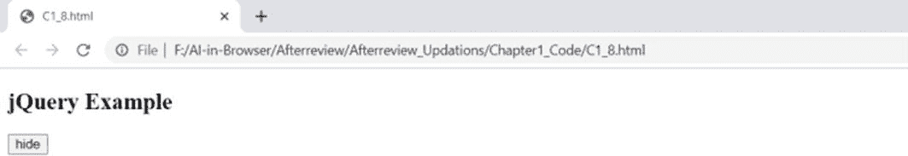

图 1-12

点击“隐藏”按钮后，清单 1-9 的输出

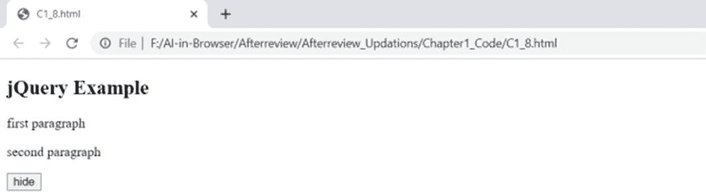

图 1-11

点击“隐藏”按钮前，清单 1-9 的输出

```

$(document).ready(function(){
$("button").click(function(){
$("p").hide();
});
});

jQuery 示例
第一个段落
第二个段落
隐藏

清单 1-9
使用 jQuery 库
```

## 总结

本章介绍了机器学习，并提供了网页设计和开发的实用概述。以下是一些关键要点：

*   HTML 是我们用来构建内容各个部分并定义其重要性的语言。
*   CSS 是我们用来为网页内容设置样式和设计，使其更生动的语言。
*   JS 是我们用来为网站页面添加动态实用性的脚本语言。
*   DOM 描述了文档（网页）的逻辑结构，以及使用组件（网页元素）访问和操作文档的方式。
*   jQuery 是一个小型 JavaScript 库，它简化了 HTML 文档（网页）的遍历、操作、事件处理和动画。

现在，你应该能够开始设计和开发在其网页组件中集成 AI/ML 的应用程序了。

