# 2. 基于浏览器的数据处理

既然你已经了解了 Web 开发的基础知识，本章将介绍两个 JavaScript (`JS`) 库：`p5.js` 和 `ml5.js`。本章还将深入探讨与各种问题解决和应用程序开发实现相关的 `JS` 特性和语法。然后，讨论使用图形和机器学习 (`ML`) 应用程序处理接口方法在浏览器中实现人工智能 (`AI`) 的各种方式。

还将讨论与 `JS` 编程相关的浏览器计算机视觉技术，例如图像分类。在本章中，你还将通过使用 `Node.js` 和 `Python` 超文本传输协议 (`HTTP`) 服务器程序运行 Web 应用程序的实践示例进行学习。

## 用于 Web 上 `ML` 的 `JavaScript` 库和 `API`

`AI` 和 `ML` 处于现代计算的前沿，并且是当前的热门话题。你的计算框架的“智能”程度可以影响应用程序数据处理的成功或失败（或优化）。

`ML` 通过软计算接口比通过硬连线接口更好。尽管 `AI/ML` 正变得无处不在，但大多数 Web 开发人员尚未掌握它。然而，`ML` 是人机交互发展中不可避免的进步。我对此唯一的问题与某些软件供应商有关。任何人都可以开始在 Web 上开发应用程序（这个无与伦比、真正开放且分散的阶段），并且目前开源技术在很大程度上支持 Web 应用程序的设计和开发。然而，现在关键的事情是将智能概念应用到 `ML` 接口上的能力。

目前，Web 上的 `ML` 看起来比我期望的要开放得多，并且不那么以标准为中心。要训练模型或尝试从模型中获取数据片段，你必须使用 `API` 库。

### `W3C` WebML `CG`（社区组）

`W3C` 呼吁创建并整合针对机器学习优化的 `API` 到 Web 开发领域，这将最终使开发者能够在各种平台上创建可互操作的机器学习内容。英特尔和微软启动了这项工作，我很高兴一些 `API` 已经开发出来，但现在我们需要有效利用这些特性，使 Web 上的机器学习成为现实，从而实现以下目标：

* 更优的执行效率：从准备好的模型中快速返回结果，系统不会出现卡顿。
* 离线可用性：在设备/小工具上运行的查询不依赖于与云计算管理的关联（从而避免了云计算中固有的延迟、吞吐量和连接性问题）。
* 更强的隐私保护：令人难以置信的是，许多云服务提供已经准备好的模型来运行我们的请求。我们无需将隐私信息发送给他人。

尽管集成浏览器智能带来了令人兴奋的功能，但请务必记住，某些限制也同样适用，包括：

* 文件大小：预先准备好的模型通常非常大（例如，通常有数兆字节）。客户端如此大的文件大小将导致 `I/O` 延迟，并受限于内存限制。
* 性能受限：早期的浏览器程序仅限于单线程 `JavaScript` 执行实例，无法利用设备/小工具的核心计算功能。

目前，你可以使用 `JS` 库与现有的 `AI/ML` 模型进行交互，或者开发你自己的智能程序在浏览器或电子设备/小工具上运行。借助一个利用 `JS` 库软件的机器学习模型，稍加思考，再编写几行代码，你现在就可以开发出能在浏览器中引入智能的应用程序。

## 使用 `JS` 库操作 `HTML` 元素

以下小节展示了如何使用两个最流行的 `JS` 库（`p5.js` 和 `ml5.js`）在浏览器上实现图形和机器学习等各种功能。

`ml5.js` 库使机器学习对广大受众（包括艺术家、创意编码者和学生）变得平易近人。该库提供了在浏览器中访问机器学习算法和模型的途径。`p5.js` 库用于处理机器学习算法的图形处理单元（`GPU`）加速数学运算和内存管理。

## [p5.js](https://p5js.org/)

`p5.js` 库是一个用于创意编码的 `JavaScript` 库，旨在为设计师、开发者、教师、学生等提供全面的编码能力。它是免费且开源的编程工具；每个人都可以获得学习 `p5.js` 的工具。`p5.js` 库将 [Processing](https://processing.org/) 的原则融入现代 Web。一个 `p5.js` 库可以是任何扩展或补充现有 `JS` 代码的 `JS` 代码。

`p5.js` 库被分类为[核心库或贡献库](https://p5js.org/libraries/)。与程序员的 `JS` 代码一样，`p5.js` 拥有一个完整的绘图工具集，支持用于文本、输入、视频、网络摄像头和声音的 `HTML5` 对象。要将 `p5.js` 库包含在程序中，请将其链接到你的 `HTML` 文件。以下代码片段展示了链接了 `p5.js` 库的 `HTML` 文件的样子：

**注意**

你可以从此[链接](https://p5js.org/download/)下载 `p5.js`（单个文件，完整未压缩版本）或 `p5.min.js`（单个文件，压缩版本）库。你需要确保 `p5.js/p5.min.js` 库和 `HTML` 文件位于同一个文件夹（计算机系统路径）中。

要使用 `p5.js` 库功能开发和执行程序，你需要一个编辑器（`Notepad++`）和一个 Web 浏览器（`Chrome` 或 `Firefox`）。

### 绘制图形对象

清单 2-1a 和 2-1b 展示了在用户代码 `p5ex1_index.html` 中包含 `p5.js` 库的情况。图 2-1 显示了相应的输出。

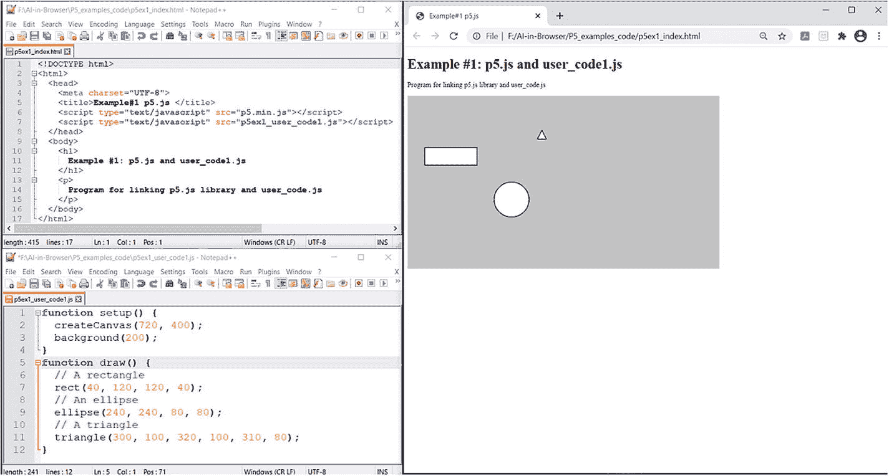

图 2-1

在用户 `JS` 代码中包含 `p5.min.js` 库

```
// p5ex1_user_code1.js
function setup() {
  createCanvas(720, 400);
  background(200);
}
function draw() {
  rect(40, 120, 120, 40); // 一个矩形
  ellipse(240, 240, 80, 80);  // 一个椭圆
  triangle(300, 100, 320, 100, 310, 80); //一个三角形
}
```

清单 2-1a `p5ex1_index.html`

```
<!DOCTYPE html>
<html>
<head>
  <title>示例#1 p5.js</title>
  <script src="https://cdnjs.cloudflare.com/ajax/libs/p5.js/1.4.0/p5.js"></script>
  <script src="p5ex1_user_code1.js"></script>
</head>
<body>
</body>
</html>
```

示例#1 `p5.js` 和 `user_code1.js` 用于链接 `p5.js` 库和 `user_code.js` 的程序

### 操作 `DOM` 对象

清单 2-2a 和 2-2b 展示了如何使用 `JS` 库（此处为 `p5.js`）创建 `DOM` 对象：`p5ex2_index.html`。图 2-2 显示了相应的输出。

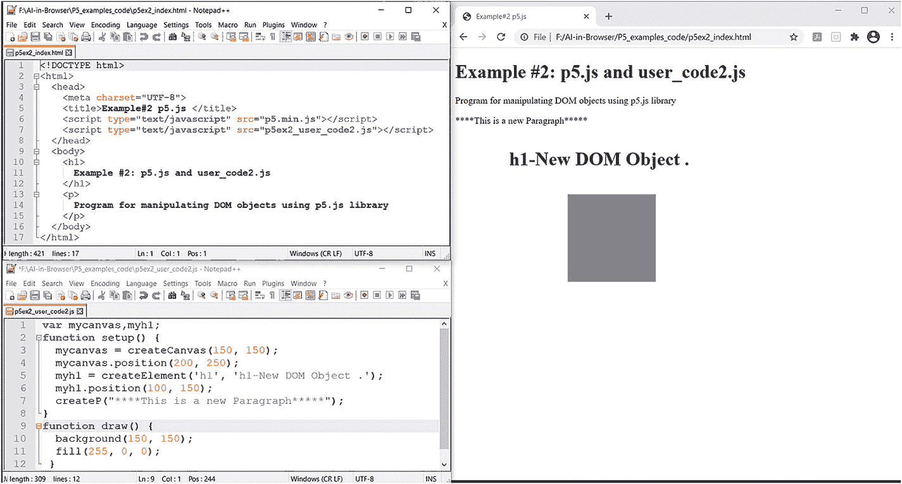

图 2-2

使用 `JS` 库（此处为 `p5.js`）创建 `DOM` 对象

```
// p5ex2_user_code2.js
var mycanvas,myh1;
function setup() {
  mycanvas = createCanvas(150, 150);
  mycanvas.position(200, 250);
  myh1 = createElement('h1', 'h1-新的 DOM 对象。');
  myh1.position(100, 150);
  createP("****这是一个新的段落*****");
}
function draw() {
  background(150, 150);
  fill(255, 0, 0);
}
```

清单 2-2a `p5ex2_index.html`

```
<!DOCTYPE html>
<html>
<head>
  <title>示例#2 p5.js</title>
  <script src="https://cdnjs.cloudflare.com/ajax/libs/p5.js/1.4.0/p5.js"></script>
  <script src="p5ex2_user_code2.js"></script>
</head>
<body>
</body>
</html>
```

示例 #2：`p5.js` 和 `user_code2.js` 使用 `p5.js` 库操作 `DOM` 对象的程序

### `DOM` 事件（`mousePressed`）处理

清单 2-3a 和 2-3b 提供了使用 `p5.js` 库基于事件调用 `DOM` 对象的程序。图 2-3 显示了相应的输出。

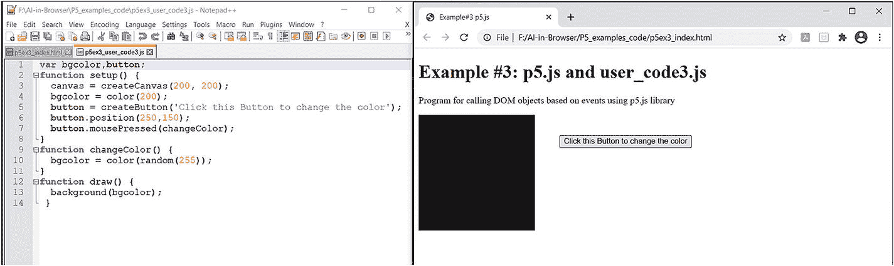

图 2-3

使用 `p5.js` 库基于事件调用 `DOM` 对象

```
// p5ex3_user_code3.js
var bgcolor,button;
function setup() {
  canvas = createCanvas(200, 200);
  bgcolor = color(200);
  button = createButton('点击此按钮更改颜色');
  button.position(250,150);
  button.mousePressed(changeColor);
}
function changeColor() {
  bgcolor = color(random(255));
}
function draw() {
  background(bgcolor);
}
```

清单 2-3a `p5ex3_index.html`

```
<!DOCTYPE html>
<html>
<head>
  <title>示例#3 p5.js</title>
  <script src="https://cdnjs.cloudflare.com/ajax/libs/p5.js/1.4.0/p5.js"></script>
  <script src="p5ex3_user_code3.js"></script>
</head>
<body>
</body>
</html>
```

示例 #3：`p5.js` 和 `user_code3.js` 使用 `p5.js` 库基于事件调用 `DOM` 对象的程序

### 多个 `DOM` 对象的事件处理

清单 2-4a 和 2-4b 展示了使用 `p5.js` 库实现各种 HTML 元素之间的交互。图 2-4 显示了相应的输出。

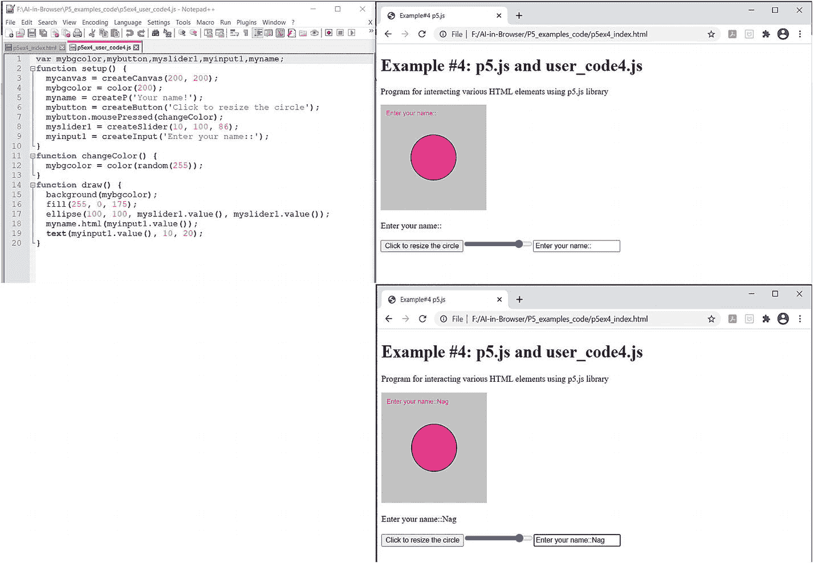

图 2-4

使用 `p5.js` 库创建各种 HTML 元素之间的交互性

清单 2-4b
`p5ex4_user_code4.js`

```javascript
var mybgcolor, mybutton, myslider1, myinput1, myname;

function setup() {
  mycanvas = createCanvas(200, 200);
  mybgcolor = color(200);
  myname = createP('你的名字！');
  mybutton = createButton('点击调整圆形大小');
  mybutton.mousePressed(changeColor);
  myslider1 = createSlider(10, 100, 86);
  myinput1 = createInput('输入你的名字::');
}

function changeColor() {
  mybgcolor = color(random(255));
}

function draw() {
  background(mybgcolor);
  fill(255, 0, 175);
  ellipse(100, 100, myslider1.value(), myslider1.value());
  myname.html(myinput1.value());
  text(myinput1.value(), 10, 20);
}
```

示例 #4：`p5.js` 和 `user_code4.js`
使用 `p5.js` 库交互各种 HTML 元素的程序

清单 2-4a
`p5ex4_index.html`

### HTML 交互元素

清单 2-5a 和 2-5b 展示了另一个使用 `p5.js` 库与各种 HTML 元素交互的示例。图 2-5 显示了相应的输出。

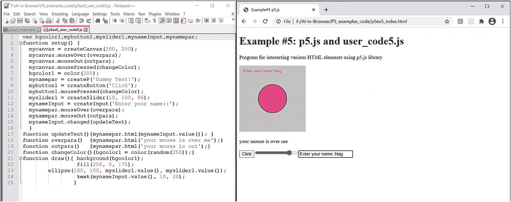

图 2-5

使用 `p5.js` 库创建 HTML 交互元素

清单 2-5b
`p5ex5_user_code5.js`

```javascript
var bgcolor1, mybutton1, myslider1, mynameInput, mynamepar;

function setup() {
  mycanvas = createCanvas(200, 200);
  mycanvas.mouseOver(overpara);
  mycanvas.mouseOut(outpara);
  mycanvas.mousePressed(changeColor);
  bgcolor1 = color(200);
  mynamepar = createP('Dummy Text!');
  mybutton1 = createButton('Click');
  mybutton1.mousePressed(changeColor);
  myslider1 = createSlider(10, 100, 86);
  mynameInput = createInput('Enter your name::');
  mynamepar.mouseOver(overpara);
  mynamepar.mouseOut(outpara);
  mynameInput.changed(updateText);
}

function updateText() { mynamepar.html(mynameInput.value()); }
function overpara() { mynamepar.html('your mouse is over me'); }
function outpara() { mynamepar.html('your mouse is out'); }
function changeColor() { bgcolor1 = color(random(255)); }
function draw() {
  background(bgcolor1);
  fill(255, 0, 175);
  ellipse(100, 100, myslider1.value(), myslider1.value());
  text(mynameInput.value(), 10, 20);
}
```

示例 #5：`p5.js` 和 `user_code5.js`
使用 `p5.js` 库与各种 HTML 元素交互的程序

清单 2-5a
`p5ex5_index.html`

#### 与 HTML 和 CSS 元素的交互

清单 2-6a 和 2-6b 展示了使用 `p5.js` 库结合 CSS 元素与各种 HTML 元素进行交互。图 2-6 显示了相应的输出。

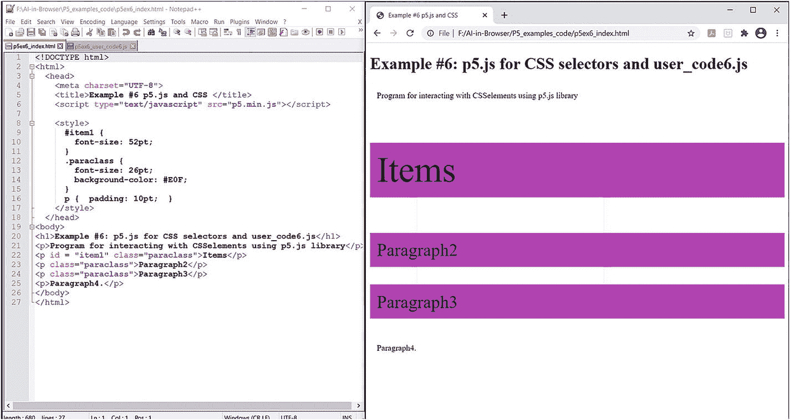

图 2-6

`p5.js` 与 CSS 元素示例

清单 2-6b
`p5ex6_user_code6.js`

```javascript
function setup() {}
function draw() {}
```

示例 #6：`p5.js` 和 CSS
用于 CSS 选择器的 `p5.js` 和 `user_code6.js`
使用 `p5.js` 库与 CSS 元素交互的程序

```css
#item1 {
  font-size: 52pt;
}
.paraclass {
  font-size: 26pt;
  background-color: #E0F;
}
p {
  padding: 10pt;
}
```

项目
段落 2
段落 3
段落 4.

清单 2-6a
`p5ex6_index.html`

### DOM 元素的层级（父子）交互

清单 2-7a 和 2-7b 展示了 `p5.js` 与父子 DOM 元素的交互。图 2-7 显示了相应的输出。

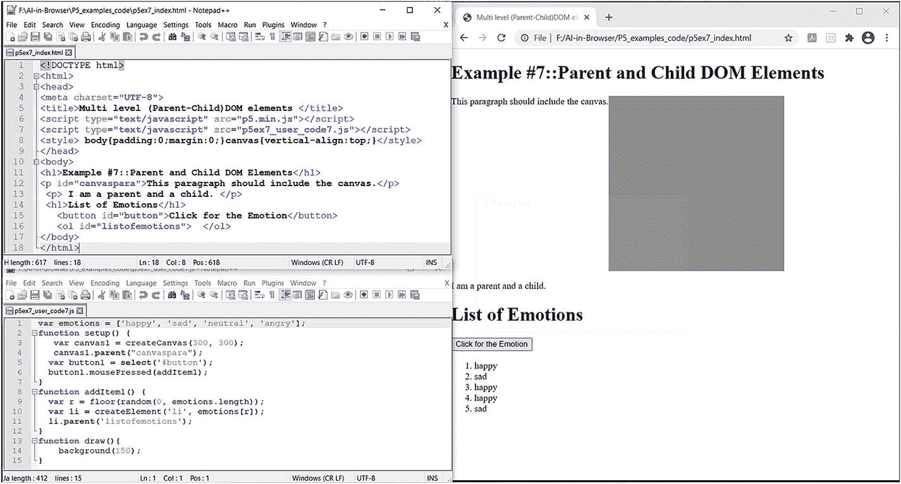

图 2-7

使用 `p5.js` 与父子 DOM 元素

清单 2-7b
`p5ex7_user_code7.js`

```javascript
var emotions = ['happy', 'sad', 'neutral', 'angry'];

function setup() {
  var canvas1 = createCanvas(300, 300);
  canvas1.parent("canvaspara");
  var button1 = select('#button');
  button1.mousePressed(addItem1);
}

function addItem1() {
  var r = floor(random(0, emotions.length));
  var li = createElement('li', emotions[r]);
  li.parent('listofemotions');
}

function draw() {
  background(150);
}
```

多层级（父子）DOM 元素

```html
<style>
body {
  padding: 0;
  margin: 0;
}
canvas {
  vertical-align: top;
}
</style>
```

示例 #7：父元素和子元素 DOM
此段落应包含画布。
我是父元素也是子元素。
情感列表
点击获取情感

清单 2-7a
`p5ex7_index.html`

### 使用变量访问 DOM 父子元素

清单 2-8a 和 2-8b 展示了使用 `p5.js` 通过变量操作父子元素。图 2-8 显示了相应的输出。

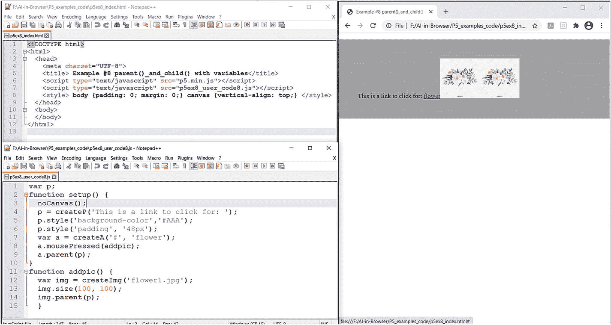

图 2-8

`p5.js` 与父子变量示例

## 使用 p5.js 在浏览器中进行图形与交互处理

本节提供示例，展示如何使用 p5.js 库实现浏览器的交互和图形功能。清单 2-9a 和 2-9b 展示了如何使用 p5.js 库实现图形函数以说明鼠标按下事件。图 2-9 显示了相应的输出。

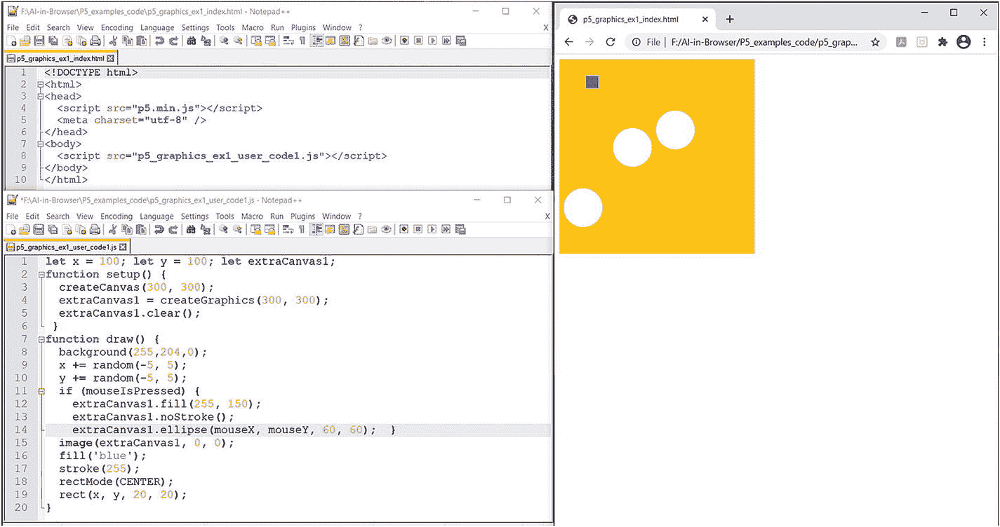

**图 2-9**
使用 p5.js 库实现带鼠标按下事件的图形函数

```javascript
let x = 100;
let y = 100;
let extraCanvas1;
function setup()
{
createCanvas(300, 300);
extraCanvas1 = createGraphics(300, 300);
extraCanvas1.clear();
}
function draw()
{
background(255,204,0);
x += random(-5, 5);
y += random(-5, 5);
if (mouseIsPressed) {
extraCanvas1.fill(255, 150);
extraCanvas1.noStroke();
extraCanvas1.ellipse(mouseX, mouseY, 60, 60);
}
image(extraCanvas1, 0, 0);
fill('blue');  stroke(255);
rectMode(CENTER);  rect(x, y, 20, 20);
}
```
清单 2-9b `p5_graphics_ex1_user_code1.js`

```html
```
清单 2-9a `p5_graphics_ex_index.html`

### 交互式图形应用

清单 2-10a 和 2-10b 展示了一个使用 p5.js 库实现弹球演示的图形脚本。图 2-10 显示了相应的输出。

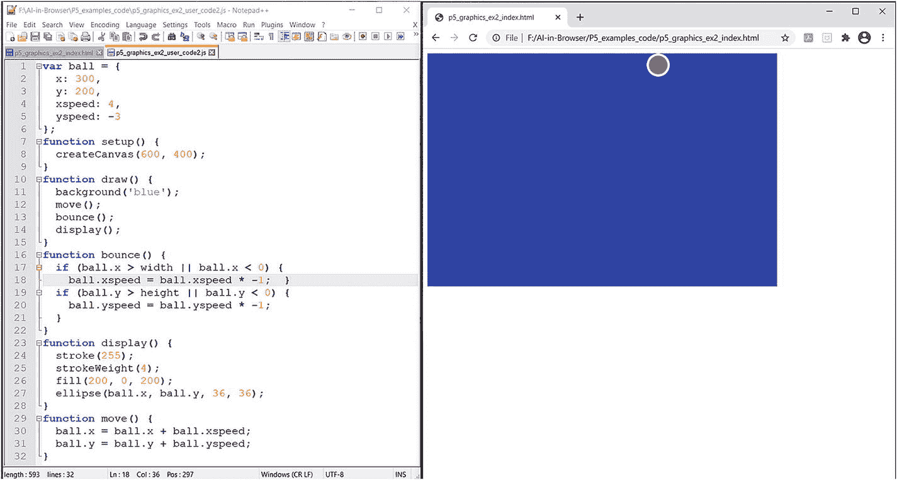

**图 2-10**
用于弹球的 p5.js 图形脚本

```javascript
var ball = {
x: 300,
y: 200,
xspeed: 4,
yspeed: -3
};
function setup() {
createCanvas(600, 400);
}
function draw() {
background('blue');
move();
bounce();
display();
}
function bounce() {
if (ball.x > width || ball.x < 0 || ball.y > height || ball.y < 0) {
ball.yspeed = ball.yspeed * -1;
}
}
function display() {
stroke(255);
strokeWeight(4);
fill(200, 0, 200);
ellipse(ball.x, ball.y, 36, 36);
}
function move() {
ball.x = ball.x + ball.xspeed;
ball.y = ball.y + ball.yspeed;
}
```
清单 2-10b `p5_graphics_ex2_user_code2.js`

```html
```
清单 2-10a `p5_graphics_ex2_index.html`

### 对象实例、多值存储与对象遍历

清单 2-11a 和 2-11b 展示了一个使用类、对象、数组和循环特性的 p5.js 图形函数。图 2-11 显示了相应的输出。

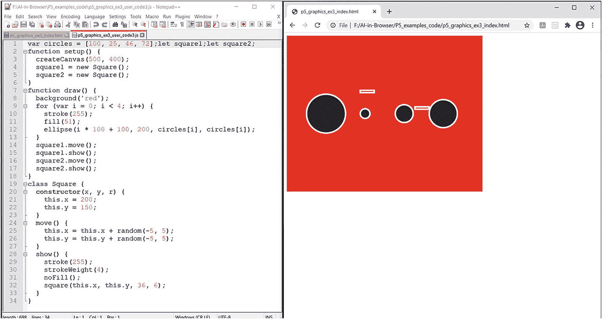

**图 2-11**
使用类、对象、数组和循环特性的 p5.js 图形函数

```javascript
var circles = [100, 25, 46, 72];
let square1;
let square2;
function setup() {
createCanvas(500, 400);
square1 = new Square();
square2 = new Square();
}
function draw() {
background('red');
for (var i = 0; i < 4; i++) {
stroke(255);
fill(51);
ellipse(i * 100 + 100, 200, circles[i], circles[i]);
}
square1.move();
square1.show();
square2.move();
square2.show();
}
class Square {
constructor(x, y, r) {
this.x = 200;
this.y = 150;
}
move() {
this.x = this.x + random(-5, 5);
this.y = this.y + random(-5, 5);
}
show() {
stroke(255);
strokeWeight(4);
noFill();
square(this.x, this.y, 36, 6);
}
}
```
清单 2-11b `p5_graphics_ex3_user_code3.js`

```html
```
清单 2-11a `p5_graphics_ex3_index.html`

## 在浏览器中使用 ml5.js 和 p5.js 入门机器学习

ml5.js 库让创意编程者能够轻松使用 AI。该库由纽约大学创建，并于 2018 年 7 月公开发布。该库基于 `TensorFlow.js` 扩展，无需其他外部依赖，即可在程序中访问 AI 方法和模型。[ml5.js](https://ml5js.org/) 库让机器学习领域的新手生活更简单。你可以通过此[链接](https://ml5js.org/)找到更多信息。

要开发和执行包含 p5.js 和 ml5.js 库的程序，你需要以下工具：
* 编辑器：Visual Studio Code 或 Notepad++
* 网页浏览器：Chrome 或 Firefox
* 用于开发机器学习应用的示例图像和数据集

## 在本地设计、开发和执行程序

在你的计算机上运行本地 Web 服务器，以在本地计算机上开发和执行程序，有两种方法。

### 方法 1：使用 Python – HTTP 服务器

1. 在你的计算机上安装 Python 3+。
2. `cd /path_to/ml5_p5-examples`（在命令提示符下，进入存放 ml5/p5 程序的文件夹。）
3. `python -m http.server 8081`
4. 在浏览器 URL 中，输入以下内容：`localhost:8081/indexfilename`

清单 2-12a 和 2-12b 展示了使用 Python Web 服务器进行图像分类的 ml5.js 库。图 2-12 显示了相应的输出。

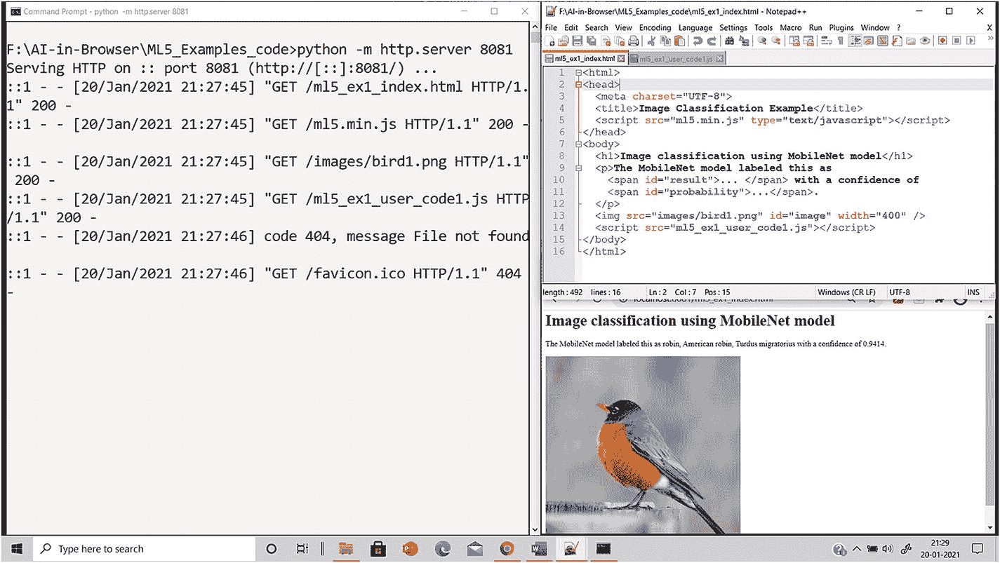

**图 2-12**
ml5.js 库与 Python 服务器和 Notepad++ 的使用（与图像分类相关的示例）

# 使用 Node.js Live Server 进行图像分类

### 方法 2：使用带有 Node.js Live Server 的 Visual Studio Code 编辑器

1.  从此[链接](https://nodejs.org/en/download/)下载并安装 Node.js。
2.  从此[链接](https://www.guru99.com/download-install-node-js.html%25232)安装 Node 包管理器 (NPM)。
3.  从此[链接](https://code.visualstudio.com/docs/setup/windows)下载并安装 Visual Studio Code。
4.  打开 Visual Studio Code 编辑器，点击 GoLive 按钮，即可在浏览器中看到程序的输出。

以下示例展示了在此方法下程序的执行情况。清单 2-13 是一个使用 Node.js 服务器进行图像分类的示例。与不同图像相关的输出如图 2-13(a)、图 2-13(b)、图 2-13(c) 和图 2-13(d) 所示。

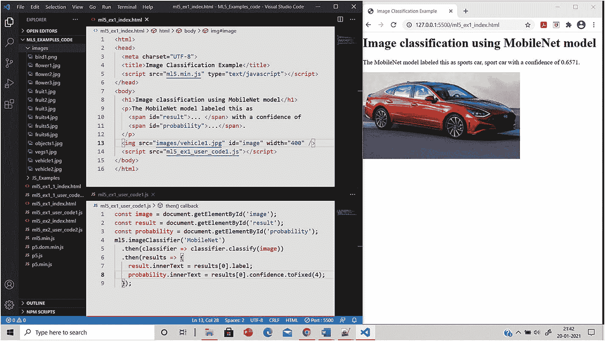

**图 2-13(d).** 使用 Node.js 服务器和 Visual Studio Code 进行图像分类（示例：车辆）

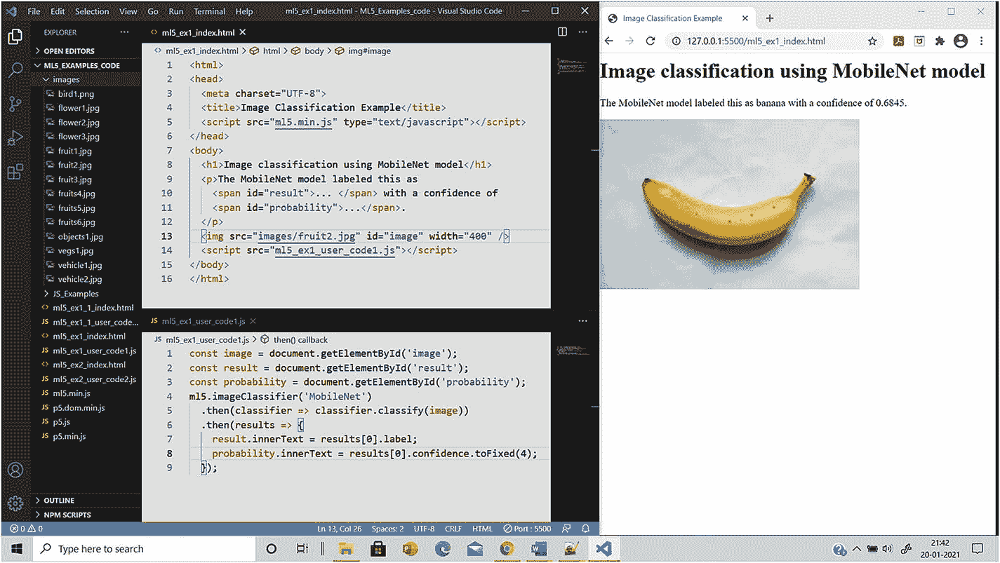

**图 2-13(c).** 使用 Node.js 服务器和 Visual Studio Code 进行图像分类（示例：水果）

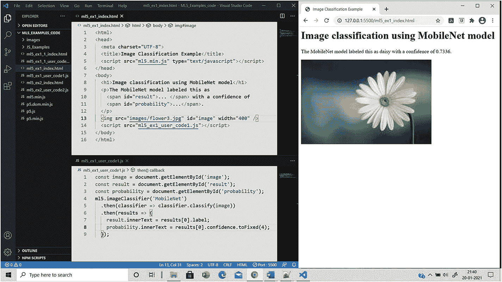

**图 2-13(b).** 使用 Node.js 服务器和 Visual Studio Code 进行图像分类（示例：花）

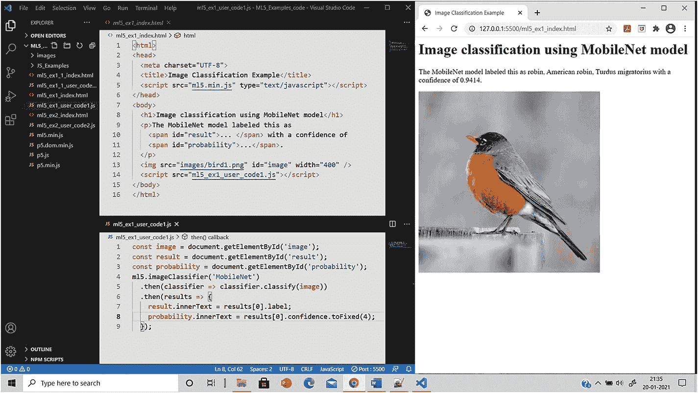

**图 2-13(a).** 使用 Node.js 服务器和 Visual Studio Code 进行图像分类（示例：鸟）

```javascript
// 清单 2-12b: ml5_ex1_user_code1.js
const image = document.getElementById('image');
const result = document.getElementById('result');
const probability = document.getElementById('probability');
ml5.imageClassifier('MobileNet')
  .then(classifier => classifier.classify(image))
  .then(results => {
    result.innerText = results[0].label;
    probability.innerText = results[0].confidence.toFixed(4);
  });
```

```html
<!-- 图像分类示例
使用 MobileNet 模型进行图像分类
MobileNet 模型将此标记为 ... 置信度为 ...
清单 2-12a: ml5_ex1_index.html -->
```

清单 2-13: 使用 Node.js 服务器进行图像分类

```javascript
// ml5_ex1_1_user_code1.js
const image = document.getElementById('image');
const result = document.getElementById('result');
const probability = document.getElementById('probability');
ml5.imageClassifier('MobileNet')
  .then(classifier => classifier.classify(image))
  .then(results => {
    result.innerText = results[0].label;
    probability.innerText = results[0].confidence.toFixed(4);
  });
```

`ml5.js` 库的方法和函数是异步的（因为机器学习模型可能需要大量时间来处理输入并生成输出）。

使用 Promise `ml5.js` 库也支持 `promise`。如果未向任何异步函数提供回调，则会返回一个 `promise`。使用 `promise`，可以按以下方式使用图像分类示例。

**注意**
在前面的示例中，使用了 `MobileNet` 库进行说明。`MobileNet` 是一种用于图像分类和移动视觉的卷积神经网络 (CNN) 架构模型。它最适合用于网页浏览器，因为浏览器在计算、图形处理和存储方面存在限制。

## 总结

AI/ML 研究人员以库的形式为我们提供了大量功能，使得实现 AI/ML 就像在我们的解决方案空间中包含各种库一样简单。

在本章中，你学习了如何使用两个 JS 库（`p5.js` 和 `ml5.js`），它们使你能够在浏览器上构建和部署交互式图形和机器学习应用。这些新的、改进后的库已在众多用例中证明了自己的有效性。

通过使用这些库，你可以以更简单、更自然直观的方式，在浏览器上为各种实时应用编写代码。