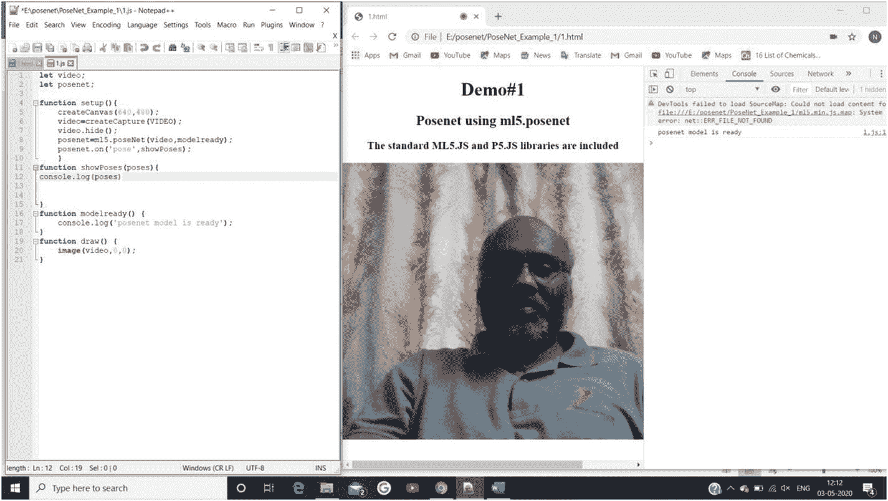
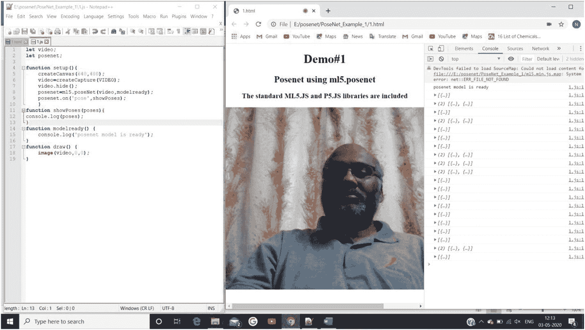
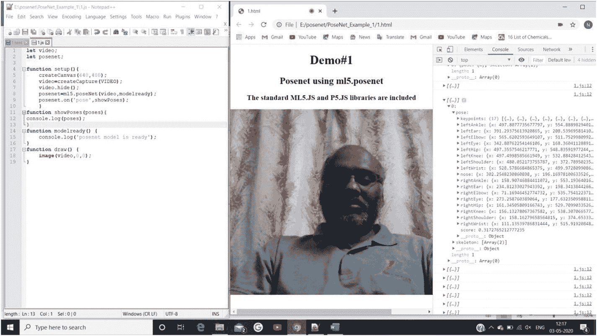
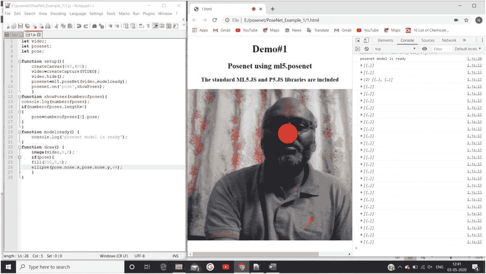
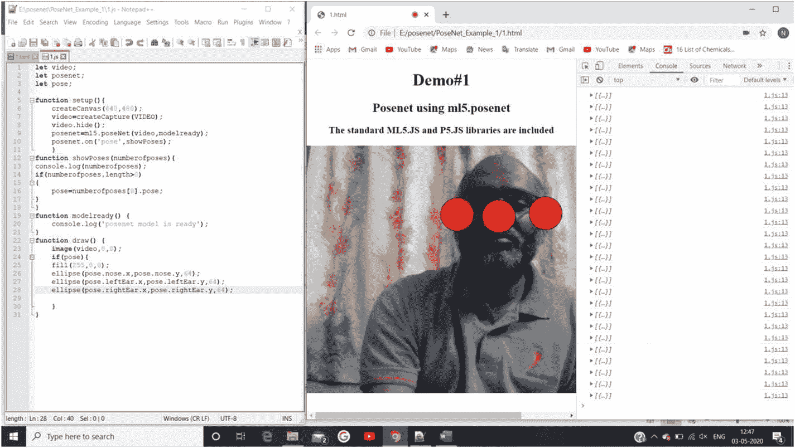
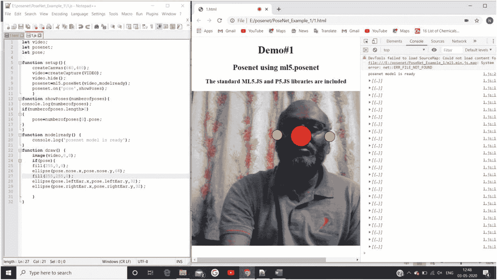
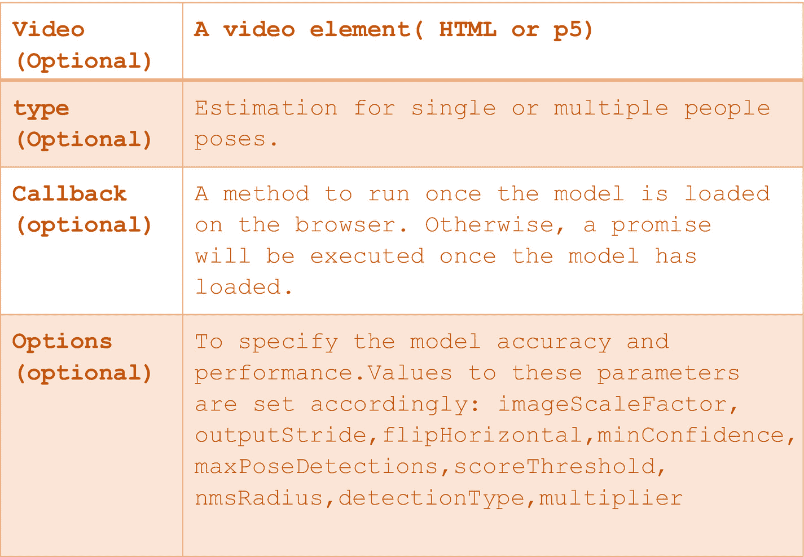

# 3. 浏览器中的人体姿态估计

本章介绍人体姿态估计，这是一项旨在通过图片和视频理解人体运动的计算机视觉技术。本章讨论了通过机器学习方法估计人体姿态的各种方式，重点介绍了 Dan Oved 的 PoseNet 方法。

PoseNet 是一个机器学习模型，通过识别人体和面部的不同关键点，实现实时人体姿态估计。本章将逐步指导你编写代码，以识别人脸的各种姿态（关键点）。编程指令将教你如何收集和管理与这些关键点相关的数据。此过程将帮助你估计其他重要的人体姿态关键点，并理解其分类模式，后续章节将对此进行讨论。

## 人体姿态概览

人体姿态评估是计算机视觉领域在过去几十年中一直努力攻克的重要课题。它是理解图片和视频中个体的关键性进步。

人体姿态估计是通过在静态图像或视频中定义人体关节（也称为`关键点`：如肘部、手腕等）来完成的。它也被描述为在所有姿态空间中寻找特定姿态的过程。

人体二维姿态的基础是从 RGB（红、绿、蓝）图像中为人体姿态的每个关节估计一个二维坐标 `(x, y)`。人体二维姿态估计可用于评估（并分析，有望改进）足球运动员（或其他运动员）在比赛中的特定动作。步态分析可用于监测并早期诊断与此相关的潜在问题。

### PoseNet 与 OpenPose 对比

你可以利用各种库在计算设备上实现人体姿态估计，例如由 Ross Wightman 开发以及来自卡内基梅隆大学的 PoseNet。PoseNet 专为在浏览器和手机等轻量级计算设备上运行而构建，而 OpenPose 则精确得多，旨在图形处理单元（GPU）驱动的系统上运行。

> **注意**
> 与在非 GPU 电子设备上运行相比，在 GPU 驱动的系统上运行 AI/ML 程序成本更高、更复杂（且灵活性更低）。

PoseNet 对二维系统的输出处理速度很快，但可能会在视频中遗漏一些姿态，你可以通过骨架的闪烁和消失来判断这一点。尽管如此，如果你确实需要在资源受限的设备上（例如手机或计算资源较少的嵌入式系统，如处理能力有限、存储空间小、通信负载少且需要快速响应）使用 PoseNet，那么 PoseNet 是正确的选择。当 AI 方法在浏览器或轻量级计算资源上执行时，使用 PoseNet 进行人体姿态估计将使用户能够近乎实时地做出智能决策。

你可以通过在 Web 应用程序中采用更好的数据处理流程来提高 PoseNet 的估计精度，从而生成更优的推理结果。

## 使用神经网络进行人体姿态估计

在文献中，许多人体姿态估计方法都采用了不同研究团队提出的神经网络原理。以下各节简要描述了人体姿态估计方法的演变。

### DeepPose：通过深度神经网络进行人体姿态估计

DeepPose 是将深度学习应用于人体姿态评估的主要开创性论文。它实现了最先进的性能，并超越了现有模型。在该方法中，姿态评估被详细描述为一种基于卷积神经网络（CNN）的针对身体关节的回归问题。此外，该方法利用一系列回归器来细化姿态评估并改进估计值。该方法的一个重要之处在于，它从整体设计上解释姿态（即，某些关节是否被遮挡；如果从整体上考虑姿态，这些关节也可以被评估）。该论文认为，CNN 通常能提供可行的姿态并显示可靠的结果。作者指定的方法生成的 xy 坐标值并不精确，因为它显示的多方面（多组值）不足以描述人体的特定关节。

### 使用卷积网络进行高效目标定位

该方法通过以多种分辨率处理图像来生成热力图，从而在不同尺度上捕捉关节。其输出是离散的热力图，而非连续的回归值。热力图预测每个像素处关节出现的概率。这种输出模型很有用，后续许多论文都采用了预测热力图而非直接回归的方法。作者考虑了 CNN 与图形模型的联合使用。

### 卷积姿态机

卷积姿态机是可微分的，其多阶段架构可以端到端地进行训练。它们为学习丰富的特定空间模型提供了一个顺序预测框架，并且在人体姿态方面表现非常出色。该论文的主要动机之一是学习长距离的空间关系，并且他们表明这可以通过使用深度多阶段网络来实现。论文在每个阶段之后使用了中间监督，以避免梯度消失问题，这是深度多阶段组织中的一个常见问题。

### 基于迭代误差反馈的人体姿态估计

该方法一次性直接预测结果。它利用一个自调整模型，通过处理反馈数据逐步修正初始排列，这个过程被称为`迭代误差反馈`。

### 用于人体姿态估计的堆叠沙漏网络

堆叠沙漏网络是一种新颖且直观的设计，它超越了以往所有技术。之所以称为堆叠沙漏网络，是因为该组织由池化和上采样层（形似沙漏）的步骤组成，并且这些步骤被堆叠在一起。沙漏的设计源于捕捉每个尺度上信息的需求。

### 人体姿态估计与跟踪的简单基线

早期方法整体表现良好，但较为复杂。在 COCO 数据集上实现了 73.7% 的平均精度（mAP）的最优结果。该网络结构简单，由残差神经网络（ResNet）和末尾的几个反卷积层组成。

### 用于人体姿态估计的深度高分辨率表示学习

在使用特定数据集进行单人关键点检测和多人姿态估计方面，高分辨率网络模型优于之前的方法。与前述方法相比，该方法表现良好。

本节简要描述了人体姿态估计领域中最突出和最具影响力的模型。这些方法基于深度学习技术，具有不同的准确率百分比。

## 使用 `ml5.js` 的 `posenet()` 方法

尽管有多种方法可以估算人体姿态关键点，但 Dan Oved 的 PoseNet 模型能够在浏览器和资源受限的计算设备上进行[实时人体姿态估计](https://medium.com/tensorflow/real-time-human-pose-estimation-in-the-browser-with-tensorflow-js-7dd0bc881cd5)。本节概述了使用 `ml5.posenet` 方法收集人体姿态估计的步骤。

> **注意**
> 我们将逐步在 `1.js` 脚本文件中添加指令（代码），以捕获视频并识别人体姿态关键点，以便您更好地理解浏览器应用程序的开发过程。

**步骤 1A.** 为 PoseNet 模型引入 `ml5.js` 和 `p5.js` 库（列表 3-1a）。

```html
Demo#1
  使用 m15.posenet 的 Posenet
  引入了标准的 ML5.JS 和 P5.JS 库

列表 3-1a
1.html
```

**步骤 1B.** 查看用于捕获视频的 `1.js` 脚本（列表 3-1b）。主文件（`1.html`）的编程指令保持不变。

```javascript
Let video;
Function setup() {
createCanvas(640,480);
video=createCapture(VIDEO);
}
Function draw() {
Image(video,0,0);
}
列表 3-1b
1.js
```

图 3-1 显示了代码对应的输出。您必须点击“允许”按钮才能查看面部。


**步骤 2.** 在 `1.js` 脚本中添加 `video.hide()` 函数，以隐藏捕获的视频，仅显示画布上的视频（列表 3-2）。图 3-2 显示了对应的输出。


```javascript
Let video;
Function setup() {
createCanvas(640,480);
video=createCapture(VIDEO);
video.hide();
}
Function draw() {
Image(video,0,0);
}
列表 3-2
添加 video.hide()
```

**步骤 3.** 在 `1.js` 脚本中调用 `ml5.poseNet()` 方法（列表 3-3）。图 3-3 显示了输出。


```javascript
Let video;
Let posenet;
Function setup() {
createCanvas(640,480);
video=createCapture(VIDEO);
video.hide();
posenet=m15.poseNet(video.modelready);
}
Function modelready() {
Console.log('posenet model is ready');
}
Function draw() {
Image(video,0,0);
}
列表 3-3
调用 ml5.poseNet()
```

**步骤 4.** 在 `1.js` 中，通过 `poseNet.on()` 方法（即监听新的姿态）来估计实时姿态（列表 3-4）。图 3-4 显示了对应的输出。


图 3-4，PoseNet 模型加载后，`poseNet.on()` 监听用户新姿态时的截图（输出）。

```
Let video;
Let posenet;
Function setup() {
createCanvas(640,480);
video=createCapture(VIDEO);
video.hide();
posenet=m15.poseNet(video.modelready);
posenet.on('pose',showPoses);
}
Function showPoses(poses) {
console.log(poses)
}
Function modelready() {
console.log('posenet model is ready');
}
Function draw() {
Image(video,0,0);
}
列表 3-4
poseNet.on( )
```

**步骤 5.** 在 `1.js` 脚本文件中添加 `showPoses()` 函数，以便将与姿态相关的数据存储到相应的张量中，这些数据将显示在浏览器控制台中（列表 3-5）。图 3-5 显示了对应的输出。


图 3-5，截图（输出）。收集在张量中的数据显示在浏览器控制台中。

```
Let video;
Let posenet;
Function setup() {
createCanvas(640,480);
video=createCapture(VIDEO);
video.hide();
posenet=m15.poseNet(video.modelready);
posenet.on('pose',showPoses);
}
Function showPoses(poses) {
console.log(poses)
}
Function modelready() {
console.log('posenet model is ready');
}
Function draw() {
Image(video,0,0);
}
列表 3-5
添加 showPoses()
```

**步骤 6.** 在 `1.js` 脚本文件中，向 `poses` 对象添加一个收集到的姿态数组（列表 3-6）。图 3-6 显示了对应的输出。


图 3-6，截图（输出）。收集在 `poses` 对象中的姿态数组显示在浏览器控制台中。

```
Let video;
Let posenet;
Function setup() {
createCanvas(640,480);
video=createCapture(VIDEO);
video.hide();
posenet=m15.poseNet(video.modelready);
posenet.on('pose',showPoses);
}
Function showPoses(poses) {
console.log(poses)
}
Function modelready() {
console.log('posenet model is ready');
}
Function draw() {
Image(video,0,0);
}
列表 3-6
收集在 poses 对象中的姿态数组
```

**步骤 7.** `poseNet.on()` 返回一个包含单个对象（包含多个姿态关键点）的数组，并通过修改 `1.js` 脚本文件中的 `draw()` 函数来识别诸如鼻子 x 和 y 坐标等姿态（列表 3-7）。图 3-7 显示了对应的输出。


图 3-7，截图（输出），显示一个包含多个姿态的单个对象，并识别出特定姿态（关键点）：用红色椭圆标记的鼻子 x 和 y 坐标。

```
Let video;
Let posenet;
Let pose;
Function setup() {
createCanvas(640,480);
video=createCapture(VIDEO);
video.hide();
posenet=m15.poseNet(video.modelready);
posenet.on('pose',showPoses);
}
Function showPoses(numberofposes) {
console.log(numberofposes);
if(numberofposes.length>0)
{
Pose=numberofposes[0].pose;
}
}
Function modelready() {
console.log('posenet model is ready');
}
Function draw() {
Image(video,0,0);
If(pose) {
fill(255,0,0);
ellipse(pose.nose.x,pose.y,64);}
}
列表 3-7
通过添加 ellipse 方法修改 draw() 函数以显示特定关键点
```

**步骤 8.** 在 `1.js` 脚本文件的 `draw()` 函数中添加指令（代码），以识别两种不同的人体姿态（关键点）：鼻子和耳朵（列表 3-8）。图 3-8 显示了对应的输出。


图 3-8，截图（输出），用于识别两种不同的姿态（关键点）：鼻子和耳朵。

```
Let video;
Let posenet;
Let pose;
Function setup() {
createCanvas(640,480);
video=createCapture(VIDEO);
video.hide();
posenet=m15.poseNet(video.modelready);
posenet.on('pose',showPoses);
}
Function showPoses(numberofposes) {
console.log(numberofposes);
if(numberofposes.length>0)
{
Pose=numberofposes[0].pose;
}
}
Function modelready() {
console.log('posenet model is ready');
}
Function draw() {
Image(video,0,0);
If(pose) {
fill(255,0,0);
ellipse(pose.nose.x,pose.nose.y,64);
ellipse(pose.leftEar.x.pose.leftEar.y,64);
ellipse(pose.rightEar.x.pose.rightEar.y,64);
}
}
清单 3-8
突出显示鼻子和耳朵
```

**步骤 9.** 修改 `1.js` 脚本文件中的 `draw()` 函数，用多种颜色区分姿态（关键点）（清单 3-9）。图 3-9 显示了相应的输出。


图 3-9，用多种颜色区分姿态的截图（输出）。

## PoseNet 模型的输入、输出和数据结构

本节涵盖当输入为视频数据时程序中可用的各种函数。这将帮助你理解可用于在浏览器上渲染（加载）视频并在发生任何移动（变化）时识别各种姿态的各种函数（方法）。

PoseNet 使你能够评估图片或视频中的单一姿态（即一个人的单个姿态）或多人的多种姿态，这意味着该算法的一种版本只能识别图片/视频中的一个人，而另一种版本则可以识别图片/视频中的多个人。

### 输入

在这种情况下，输入是 HTML 视频或图像元素（图片），或页面的 `p5` 图像/视频元素。如果未提供特定输入，PoseNet 默认使用浏览器的网络摄像头作为输入。以下代码片段展示了如何读取一个人的输入（姿态）：

```javascript
const video = document.getElementById("video");
// 创建一个新的 myposeNet 方法
const myposeNet = ml5.poseNet(video, modelLoaded);
// 当模型在浏览器中加载完成时
function modelLoaded() {
  console.log("模型已加载！");
}
```

PoseNet 方法的各种参数如下：

*   `ml5.poseNet(video[可选], type[可选], callback[可选])`

*   `ml5.poseNet(video[可选], options[可选], callback[可选])`

*   `ml5.poseNet(callback[可选], options[可选])`

表 3-1 描述了 `ml5.poseNet` 方法的参数。

**表 3-1** ml5.poseNet 参数



### 输出

当一个人的姿态在浏览器上加载时（即浏览器网络摄像头读取视频流数据），相应的姿态（关键点）会由 `poseNet()` 函数作为结果（输出）给出。这些结果（输出）随后被传递给临时程序变量 `myposes`，如下所示：

```javascript
// 当姿态方向发生变化时，监听新的 'pose' 事件。
myposeNet.on("pose", function(results) {
  myposes = results;
});
```

### .on() 函数

`.on ('pose', function(results))` 方法在检测到新姿态时触发一个事件。该方法持续监听视频帧中姿态的变化。函数（`results`）以包含姿态识别结果的对象数组形式返回结果。

### 总结

本章逐步向你展示了如何使用 Dan Oved 的 `PoseNet` 模型在浏览器中实时描绘人体姿态估计。

你学习了 `PoseNet` 模型的细节，例如姿态包含的内容：姿态置信度分数、一个包含 17 个关键点的数组，以及每个关键点又包含关键点位置、关键点置信度分数以及输入图像空间。

本章还涵盖了处理收集到的关键点数据所需的编程结构。在接下来的章节中，你将学习开发多种应用（如人体姿态分类和步态分析）所需的编程技能。