# 4. 人体姿态分类

本章涵盖各种人体姿态估计实验。在前一章中，你已经学习了在浏览器中进行人体姿态估计的基础知识。

本章首先探讨为何需要在浏览器中进行人体姿态估计，随后将讨论各种可以在浏览器中执行的人工智能（`AI`）和机器学习（`ML`）分类技术。

本章还提供了对开源 `JavaScript`（`JS`）库 `TensorFlow.js` 的高级概述。你将学习如何使用它在浏览器中实现和部署深度学习（`DL`）系统。讨论涵盖了 `TensorFlow.js` 框架的架构及其构建模块张量，并包含两个使用该库在浏览器上运行神经网络程序的实践示例。请注意，`TensorFlow.js` 是一个用于 `JS` 中 `ML` 的库，它使你能够用 `JS` 开发 `ML` 模型，并直接在浏览器或 `Node.js` 中使用 `ML`。

本章还包含实践示例，涵盖通过浏览器摄像头和本地存储的图片（图像）检测个体关键点。

## 在浏览器中进行人体姿态估计的必要性

人体姿态估计是评估人体姿态分类以预测可能出现的异常所需的一项任务。人体姿态评估将指示个体在进行日常活动时的分类水平。人们希望在不泄露隐私的情况下计算自己的姿态；因此，人体姿态计算更倾向于在客户端而非数据收集的服务器端进行。所以，借助 `AI` 方法进行的人体姿态分类（判定）应在客户端（即浏览器应用程序）执行。

在浏览器中应用 `ML` 技术进行人体姿态估计并评估分类性能的必要性如下：

*   **隐私**：在浏览器中执行 `ML` 方法和用户数据的规定将确保数据不会传输到服务器。与敏感文档、医疗应用数据（如用户身份识别）以及特定领域的用户文本相关的数据将仅在客户端（用户端）处理。因此，通过在客户端应用程序（即浏览器）本身实现 `ML` 方法，可以维护用户隐私。
*   **无需跨多个软件共享数据（分发）**：可以避免依赖多个软件/工具来执行数据。无需安装额外的软件/工具。应用程序将在用户端执行，因此导航到多种方法将变得容易。
*   **低延迟**：`ML` 模型可以进行优化，以实现高效的存储和速度，从而在资源受限的设备上非常高效地运行。因此，可以减少/避免等待服务器响应的时间（客户端/服务器模型 `Web` 应用程序中的往返时间）。如果应用程序仅在客户端执行，运行速度会更快。
*   **可靠性**：由于不存在间歇性的连接步骤，可以避免可靠性问题。数据不会传输到另一个位置（服务器）。因此，在客户端处理的数据非常可靠。
*   **用户交互性**：当今的技术浏览器与摄像头和屏幕等输入输出设备集成。这种集成支持丰富的用户交互体验。`ML` 可以轻松增强用户交互性，尤其是在实时操作中。

此外，在浏览器（客户端）上执行 `ML` 方法（模型）适用于迁移学习、现有模型的参数调整以及输出解释等任务。

## 浏览器中的 `ML` 分类技术

神经网络概念是一组 `ML` 方法/算法，其行为方式类似于大脑的工作方式，使用人工神经元结构。神经网络是多种有助于解决分类问题的 `ML` 方法之一。其新颖之处在于能够强有力地做出详细预测，并在合理执行时间内模仿人类思考。本章不会深入探讨神经网络的细节，但你将学习神经网络的基础知识，以便更好地理解所呈现的问题。

有许多强大的方法可以自动分类实体。应用需求决定了解决分类问题的理想选择，以及应用神经系统的努力是否值得。人工神经网络（`ANN`）和深度神经网络（`DNN`）在解决复杂维度问题方面是成功的；然而，它们本身在理论上也很复杂。一些深度学习系统，即 `DL` 框架，如 `TensorFlow`，可以帮助你更快地设置深度神经系统，只需几行代码。

分类模型预测类标签，使其属于特定实体。一些分类器是成对的，产生是/否的选择。其他的是多类分类器，能够将事物分类到几个类别之一。特征化是 `AI` 的另一个常见用例。例如，分类算法用于解决电子邮件垃圾邮件过滤、文档分类、语音识别、图像识别和手写识别。在这种特定情况下，神经系统是一些可以帮助解决分组问题的 `AI` 计算。其独特品质在于能够逐步做出详细预测并模仿人类推理，这是其他算法无法做到的。在与分类问题相关的许多案例中，神经系统已经产生了最佳结果。

要理解使用神经系统的分类问题，有必要弄清楚其他顺序计算的工作原理，并理解它们的独特品质。对于某些问题，神经系统可能是不合适或无意义的练习。对于其他问题，它可能是核心解决方案。`ANN` 由称为神经元的基本组件构成，这些神经元接收值，乘以权重，然后通过一个非线性激活函数运行。只要存在足够的计算能力，神经网络就能高效地学习非线性属性。该系统可以学习极其复杂的能力。理论上，只要有足够的计算能力，神经系统就能学习几乎任何能力的状态。

*   **`ANN` 优点**：对于解决大维度问题极其强大，能够处理因素之间的复杂关系、非彻底分类集以及与产出因素相关的复杂能力。有出色的调整选项来防止过拟合和欠拟合。
*   **`ANN` 缺点**：理论上复杂，难以实现，并且需要专业知识来调整参数以获得更好的分类。有时，需要大量的训练样本集才能更好地实现（获得更好的输出）。

注意：使用 `TensorFlow.js` 库在程序中制作你的神经网络并训练它。收集数据并准备你的神经组织，或利用现有信息逐步准备你的神经组织。当它准备好时，你的神经网络将相应地执行分类或回归任务。

通过浏览器完全在客户端运行 `AI`/`ML` 程序是一个交互式应用程序，这很智能。诸如人体姿态估计之类的应用程序可以使用开源 `JS` 库 `TensorFlow.js` 来实现。

## 使用 `TensorFlow.js` 进行机器学习

`TensorFlow.js` 用于完全在浏览器中，通过 `JavaScript` 和应用程序编程接口（`API`）方法来描述、训练和运行 `AI` 模型。如果你是一名 `JavaScript` 网页开发者，并且是机器学习新手，那么 `TensorFlow.js` 是开始学习和开发在浏览器中融入智能的应用程序的绝佳方式。然而，如果你是一名机器学习设计师，并且是 `JavaScript` 新手，本书中的材料将为你提供一个快速入门指南，介绍 `TensorFlow.js` 资源如何帮助你开发智能应用程序。

在使用 `TensorFlow.js` 开发应用程序时，你可能会倾向于以下方法之一：

*   你可以导入一个预训练模型用于推导（推理）。如果你有一个 `TensorFlow` 或 `Keras` 的现有模型，并且该模型是在离线模式下准备的，你可以将其转换为 `TensorFlow.js` 格式，并加载到浏览器中进行推理。
*   对于快速开发应用程序，迁移学习方法可能很合适。这种方法允许你使用 `TensorFlow.js`，通过 `JavaScript` 和 `API` 层，完全在浏览器中描述、训练和运行模型。如果你熟悉 `Keras`，那么 `API` 层应该会让你感到熟悉，可以轻松地将其转换为新模型。
*   网页开发者可以使用 `TensorFlow.js`，利用 `JavaScript` 特性，完全在浏览器中描述、训练和执行模型。

`TensorFlow.js` 是一个用于 `AI` 的 `JavaScript` 库系统，它取代了 `deeplearn.js`，后者现在被称为 `TensorFlow.js Core`。`TensorFlow.js` 还包含一个 `Layers API`，这是一个用于构建利用 `Core`（例如，用于移植 `TensorFlow` 和 `Keras` 模型的设备）的 `AI` 模型的高级库。图 4-1 展示了 `TensorFlow.js` 的概览。

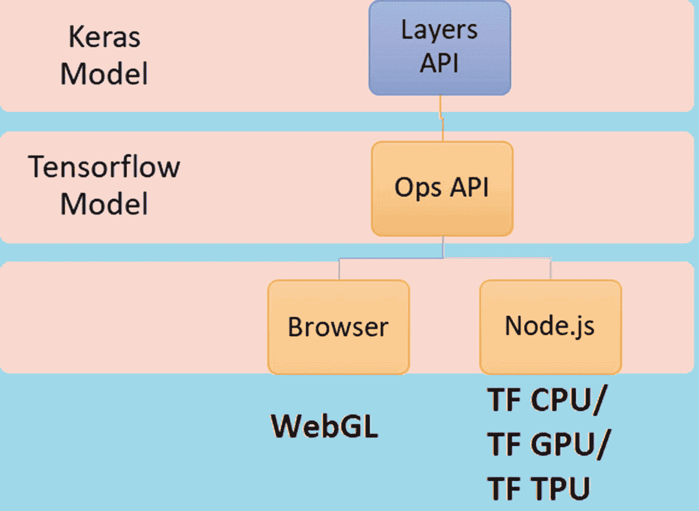

图 4-1 TensorFlow.js 概览

你可以直接在浏览器中创建/构建模型。此外，你还可以从 `Python` 导入现有的、先前准备好的模型，并对其进行重新训练。如果你已经在使用 `JavaScript` 技术栈，并涉及非关系型数据库（`NoSQL`）和 `JavaScript` 对象表示法（`JSON`），那么你应该考虑的一个用例是利用 `TensorFlow.js` 在浏览器中构建模型。`TensorFlow.js` 包含了 `Keras API`，这是一个用于构建 `AI`/`ML` 学习模型的简单软件工具。它同样包含一个较低级别的 `API`，以前称为 `deeplearn.js`，可用于直接的基于变量的数学运算和编程式微分。`Ops API` 支持即时执行模式。在底层，`TensorFlow.js` 由 `WebGL` 驱动，`WebGL` 是一个 `JavaScript API`，用于在任何互联网浏览器中渲染 `2D` 和 `3D` 图形，而无需插件模块。

注意：`TensorFlow` 即时执行模式是一种命令式编程环境，它会立即评估操作，而无需构建计算图。相反，操作会返回具体的值，而不是构建一个稍后运行的计算图。这使得入门 `TensorFlow` 和调试模型变得容易。`TF CPU`（中央处理器）、`TF GPU`（图形处理器）和 `TF TPU`（张量处理器）是分布式策略，模型可以在相应的设备上执行。

# TensorFlow.js 简介与后端

如果神经网络学习过程的信息有限，那么像`Tensorflow`这样的工具在计算上是高效的，可以实现更好的实现。假设需要处理大型数据集，那么像`NVIDIA GPU`/`Google TPU`或现场可编程门阵列（`FPGA`）这样的统一计算设备架构（`CUDA`）系统就非常必要。基本上，`Tensorflow`工具基于JavaScript（`JS`）编程执行。它将通过`WebGL` API支持`GPU`进行高效的数据处理，这比`CUDA`系统更好。

`TensorFlow.js`是一个用于在JavaScript中创建和准备`AI`模型，并将其发送到程序或`Node.js`上的库。你可以利用现有模型，转换`Python TensorFlow`模型，使用迁移学习用你的信息重新训练现有模型，以及从头开始创建模型。`TensorFlow.js Node.js`环境支持使用`Python/C TensorFlow`的引入工作作为后端，这可能会利用机器的可用设备加速，例如`CUDA`。`Node.js`也有一个基于`JS`的后端。然而，其能力是有限的。`TensorFlow.js`有多个具有不同特性的后端。`WebGL`后端利用`WebGL`表面进行存储，利用`WebGL`着色器进行执行，从而提供`GPU`支持，并且其速度可比直接的`CPU`后端快100倍。`WebGL`不需要`CUDA`，因此它可以利用任何可用的`GPU`。

## 不同后端性能比较

用于程序的`WebAssembly（WASM）TensorFlow.js`后端利用`XNNPACK`库来提升神经网络管理器的`CPU`执行性能。`WASM`后端通常比`JS CPU`后端快得多（10倍到30倍），但通常比`WebGL`后端慢（除了小型模型）。你的实际效果可能会有所不同，因此请在你的设备上为你的模型测试`WASM`和`WebGL`两种后端。

## 基本用法示例：线性回归

示例：`TensorFlow.js`的基本用法，考虑一个关于薪资和经验属性关系的线性回归问题，如图4-2所示。

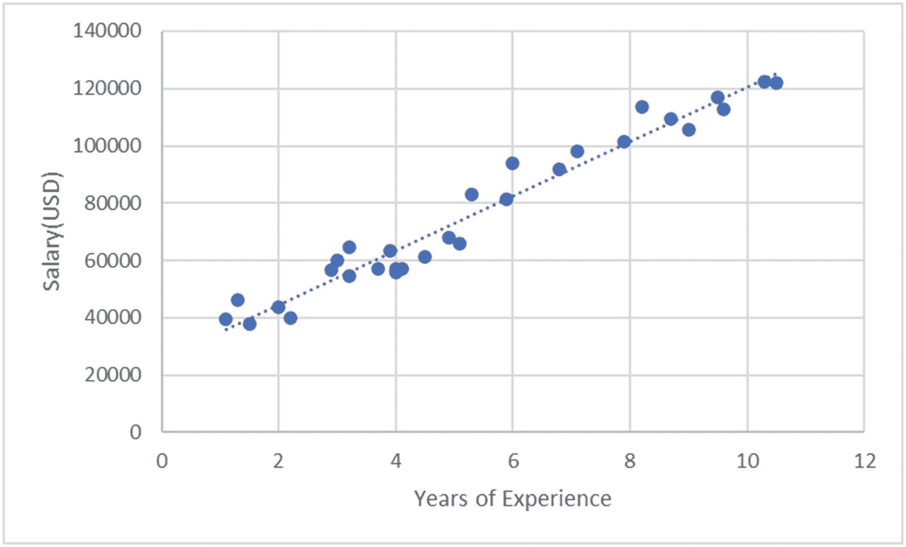

图4-2 线性回归问题（工作年限 vs. 薪资）

即使我们没有确切的数据，我们也可以从图4-2推断出特定`x`值对应的`y`值。在机器学习中，我们可以基于输入数据训练一个模型，我们在浏览器中借助JavaScript特性来完成这项工作。图4-3显示了趋势线以及`x`和`y`之间的关系。

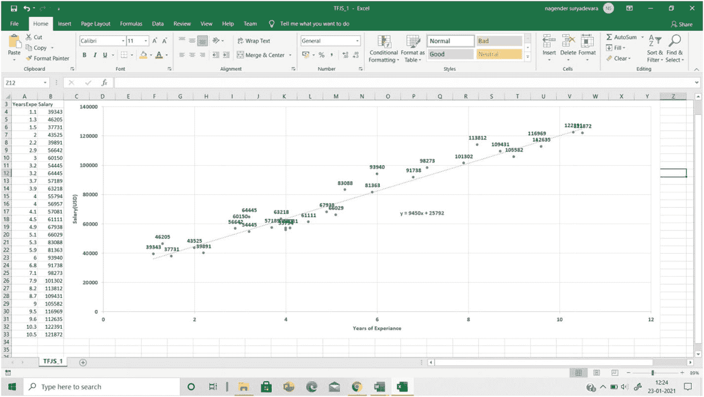

图4-3 `x`和`y`之间的关系（工作年限 vs. 薪资）

清单4-1a和4-1b提供了使用`TensorFlow.js`来说明前述回归问题的相应代码。主文件包含了`TensorFlow.js`并调用了相应的脚本文件。

**清单4-1a `TF_JS_1.html`**
```
async function learnLinear() {
const model= tf.sequential();
model.add(tf.layers.dense({units: 1,inputShape: [1]}));
model.compile({
loss: 'meanSquaredError',
optimizer: 'sgd'
});
const
```

**清单4-1b `TF_JS_1.js`**
```

```

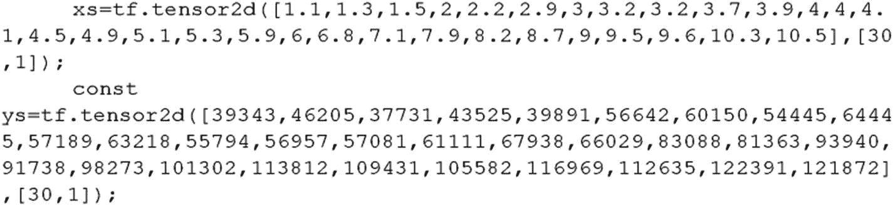

```
await model.fit(xs,ys,{epochs: 400});
document.getElementById('Predicted_Y_Value').innerText=model.predict(tf.tensor2d([11],[1,1]));
}
learnLinear();
```

图4-4展示了回归表达式的截图（输出）。

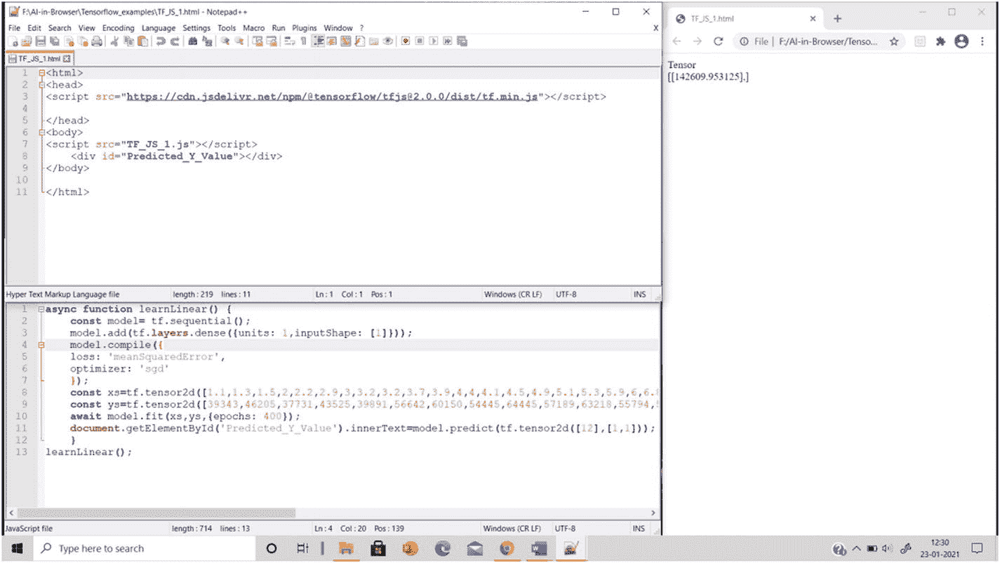

图4-4 与回归问题相关的源代码及对应输出的截图

## 将平面文件数据转换为TensorFlow.js格式

以鸢尾花数据集为例，该数据集包含与多种花卉相关的15个样本（行）的数据项。鸢尾花数据集采用`JSON`格式，如图4-5所示。为了将数据（即一个扁平的`file(Array)`）转换为`TensorFlow.js`格式，`tf.tensor2D()`函数有助于创建`TensorFlow.js`能够理解的数据。`setup()`函数中的`loadJSON()`函数会将`iris.json`数据读取到浏览器应用的模型中。浏览器图形用户界面（`GUI`）可以自定义，以便与用户交互，接收诸如训练轮次和其他参数值等输入。

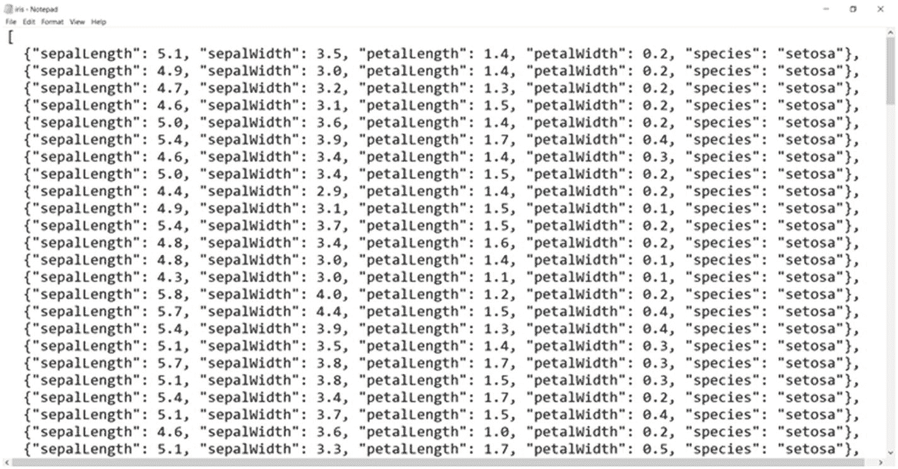

图4-5 JSON格式的鸢尾花数据集

基本上，`JSON`文件包含了鸢尾花各种实例的属性-值对。清单4-2a是主文件，它调用了包含操作功能的相应脚本文件，这些功能在清单4-2b中给出。

脚本文件中的`setup()`函数负责设置画布窗口的大小以进行用户交互操作，加载`JSON`数据文件进行处理，并提供用户交互按钮来启动模型。

将`JSON`数据文件内容加载到用户定义的临时变量中，由`loaddata()`函数完成。存储在用户定义变量中的临时数据，由`convertToTensor()`函数转换为张量数据结构。

神经网络学习过程完成后（即执行`trainModel()`和`nn_model()`函数之后），模型数据存储在张量数据结构中。模型通过学习张量中存在的相应数据而得到训练，该过程由神经网络配置借助`trainModel()`和`nn_model()`函数执行。

**注意** 你可以从 [`https://www.kaggle.com/rtatman/iris-dataset-json-versio`](https://www.kaggle.com/rtatman/iris-dataset-json-versio) 下载`iris.json`数据集。

# 在浏览器中使用 TensorFlow.js 的人工神经网络模型

以下是实现步骤：
1. 加载或准备数据。
2. 设置你的神经网络结构。
3. 向神经网络添加配置信息。
4. 训练你的神经网络。
5. 利用训练好的模型进行预测。
6. 利用获得的结果完成某些任务（分类/预测）。

下一节将简要描述一个简单的神经网络，然后介绍通过 TensorFlow.js 编程原理开发人工神经网络的复杂性。

## 简单神经网络

考虑一个神经网络结构，它包含一个隐藏层，用于实现函数 `y(output)=x'`（x 的逆函数），隐藏层有四个神经元，输入层有两个神经元，输出层有一个神经元，其中 `x` 是输入集（见图 4-7）。

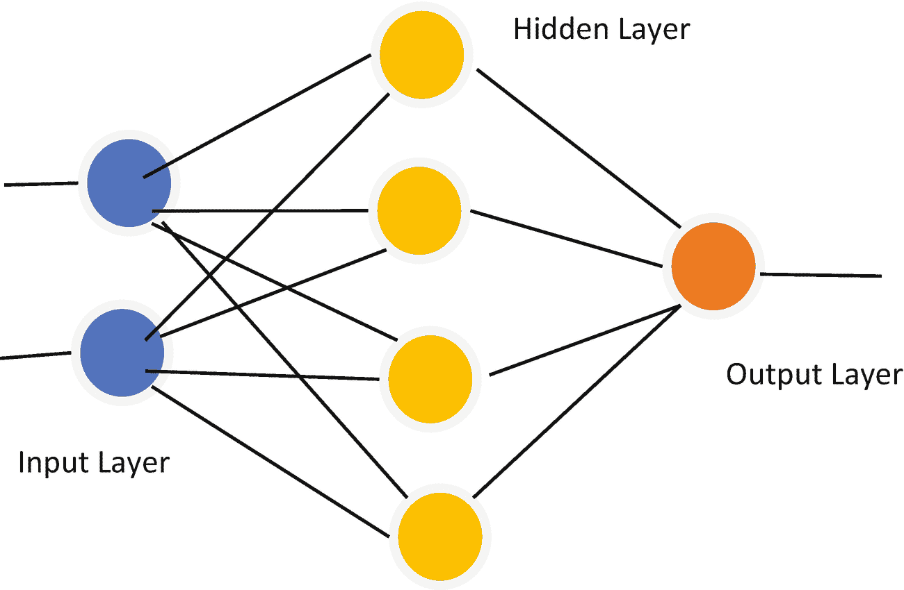
图 4-7 人工神经网络的基本结构

构建神经网络通常是通过堆叠层来完成的。TensorFlow.js 提供了一个 API 来堆叠各种类型的层。需要考虑配置的各种参数数量比你预期的要多。原因之一是此模型包含了权重和偏置值。目前，你可以通过那些有助于改进模型的参数，来考虑从一层到另一层的倾向。在整个训练过程中，误差会不断减小；这意味着我们的模型正在学习。

## 示例 1：TensorFlow.js 中的神经网络模型

清单 4-3a 位于主索引文件中，清单 4-3b 是脚本文件，其中包含用于在张量中保存数据的数据结构，以及用于实现逆运算功能的神经网络模型的设置和配置。

以下是清单 4-2b `script10.js` 的代码示例：

```javascript
let input, button
let IRIS_NUM_CLASSES =3
let nn_model;
let train_x;
let train_y;
let epoch_val;
function setup()
{
  createCanvas(710, 400);
  // Loading Data
  loadJSON('iris.json',loadData)
  // GUI Form Elements
  fill(0);
  textSize(30)
  text('Train Model',10,50)
  textSize(18)
  text('Train Epochs:',10,90)
  input = createInput();
  input.position(140, 80);
  button = createButton('Train Model From Scratch');
  button.position(20,110, 200);
  let col = color(255,127,80)
  button.style('background-color', col);
  button.size(200,40)
  button.mousePressed(greet);
}
//The functions loaddata() and converttoTensor() to convert the data into tensorflow objects (tensor2D() objects):
function loadData(data)
{
  const values = data.map(item => ({
    a: item.sepalLength,
    b: item.sepalWidth,
    c: item.petalLength,
    d: item.petalWidth,
    label: item.species
  }));
  const dataset = values.filter(item => (
    item.a != null && item.b != null && item.c != null && item.d != null && item.label != null
  ));
  const {inputs, labels} = convertToTensor(dataset);
  train_x = inputs
  train_y = labels
  console.log(train_x.shape[0])
}
function convertToTensor(dataset)
{
  return tf.tidy(() => {
    tf.util.shuffle(dataset);
    const inputs = dataset.map(item => [item.a, item.b, item.c, item.d])
    const labels=[];
    for(i=0;i<dataset.length;i++){
      if(dataset[i].label==0){
        labels.push([1,0,0])
      }else if(dataset[i].label==1){
        labels.push([0,1,0])
      }else{
        labels.push([0,0,1])
      }
    }
    const xs = tf.tensor2d(inputs,[inputs.length, 4]);
    const ys = tf.tensor2d(labels,[labels.length, 3]);
    return {inputs: xs, labels: ys}
  })
}
function greet(){
  epoch_val = parseInt(input.value());
  if(epoch_val>0)
  {
    nn_model = createModel()
    tfvis.show.modelSummary({name: 'Model Summary'}, nn_model);
    if(train_x.shape[0] >0 && train_y.shape[0] >0 )
      trainModel(nn_model)
  }
}
// Function createModel() tf.sequential(), adding input layers through tf.layers.dense and trainModel() with the model.fit() methods
function createModel()
{
  const model = tf.sequential();
  model.add(tf.layers.dense({inputShape: [4], units: 50, useBias: true, activation:'relu'}));
  model.add(tf.layers.dense({units: 20, activation: 'relu'}));
  //model.add(tf.layers.dense({units: 10, activation: 'relu'}));
  model.add(tf.layers.dense({units: 3, activation: 'softmax'}));
  return model;
}
async function trainModel(model)
{
  model.compile({
    optimizer: tf.train.adam(),
    loss: tf.losses.softmaxCrossEntropy,
    metrics: ['accuracy'],
  });
  const batchSize = 32;
  const epochs = epoch_val;
  const validationSplit =0.3;
  return await model.fit(train_x, train_y, {
    batchSize,
    epochs,
    validationSplit,
    shuffle: true,
    callbacks: tfvis.show.fitCallbacks(
      { name: 'Training Performance' },
      ['loss', 'val_loss','acc','val_acc'],
      { height: 200, callbacks: ['onEpochEnd'] })
  });
}
```

清单 4-2a TensorFlow.js `index.html` 的 `function setup()` 用于加载 `.json` 数据。

图 4-6 展示了使用 TensorFlow.js 可视化工具得到的训练过程及轮次准确率的相关输出。

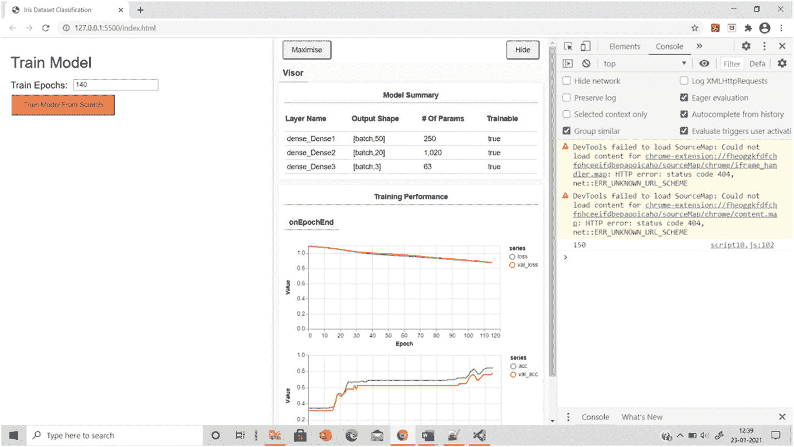
图 4-6

### 示例 1：一个简单的神经网络模型

用于演示 y=x'（Y 等于 X 的逆）的神经网络

清单 4-3a
Demo1.html（主文件）

清单 4-3b
Script.js（脚本文件）

```javascript
//Step 1:load data, xs=Input and ys=Output
const xs=tf.tensor2d([[0,0],[0.5,0.5],[1,1]]);
const ys=tf.tensor2d([[1],[0.5],[0]]);
//Step 2: Set your neural network structure
const model =tf.sequential();
const confighidden={
inputShape:[2],
units:4,
activation:'sigmoid'
}
const configoutput={
units:1,
activation:'sigmoid'
}
const hidden =tf.layers.dense(confighidden);
const output=tf.layers.dense(configoutput);
model.add(hidden);
model.add(output);
//Step 3: add configuration information
const sgdopt=tf.train.sgd(0.1);
const config={
optimizer:sgdopt,
loss:'meanSquaredError'
}
//Step 4: Train your neural organization
model.compile(config);
async function train()
{
for(let i=0;i<100;i++){
const res=await model.fit(xs,ys);
}
console.log('training complete');
}
train();
//Step 5: Predict the output for the given input
model.predict(xs).print();
```

图 4-8 显示了上述代码在浏览器控制台中的输出。

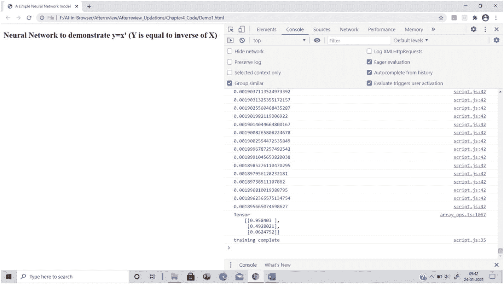

图 4-8：使用 TensorFlow.js 通过人工神经网络实现 y=x' 的截图（输出）

### 示例 2：一个实现“与非”（NAND）布尔运算的简单人工神经网络

“与非”（NAND）布尔运算规则很简单：给定两个布尔值（真/假），如果两者都为真，则返回假；否则返回真。基于输入值实现此运算的神经网络可以通过应用 TensorFlow.js 脚本库中的顺序模型来演示。

图 4-9 显示了基本的逻辑与非运算，其对应的功能如真值表所示。

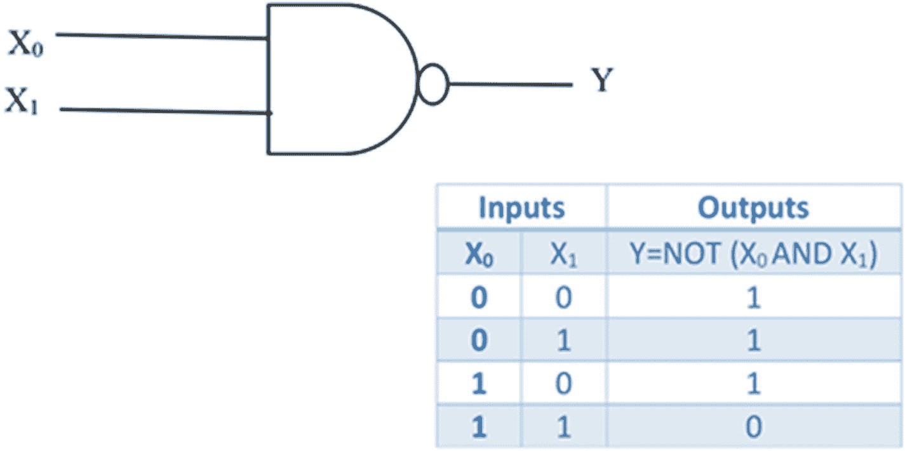

图 4-9：基本逻辑与非门及其真值表

用于实现 NAND 布尔运算的训练数据使用两个数组，一个用于输入（X0 和 X1），另一个用于输出（Y）。这两个数组是可在神经网络结构中使用的张量：

```javascript
//Step 1: Load or prepare the data
const xs=tf.tensor2d([[0,0],[0,1],[1,0],[1,1]],[4,2]);
const ys=tf.oneHot(tf.tensor1d([1,1,1,0]).toInt(),2);
```

因此，输入数组的形状是 [4,2]，因为有一个包含 4 个值的数组，并且每个数组有 2 个值。最好使用适当的 TensorFlow.js 函数来提及这些数组（输入和输出）。

一旦定义了输入和输出，就可以以层的形式构建神经系统。由于数据从输入层到输出层沿一个方向向前移动，我们可以考虑为神经系统结构使用一个顺序模型，如前面的示例所示。由 X0 和 X1 组成的输入被传递到下一层（隐藏层），该层由 5 个神经元组成。然后它们被传递到由 2 个神经元组成的输出层，这向我们显示了相关输出（真或假）的确定性百分比（介于 1 和 0 之间的值）：

```javascript
//Step 2: Set up the NN structure
const model =tf.sequential();
const confighidden={
inputShape:[2],
units:5,
activation:'sigmoid'
}
const configoutput={
units:2,
activation:'sigmoid'
}
const hidden =tf.layers.dense(confighidden);
const output=tf.layers.dense(configoutput);
model.add(hidden);
model.add(output);
```

神经网络模型可以使用优化器函数 `Adam` 以及损失函数 `categoricalCrossentropy` 进行训练。这将使模型能够通过将给定的输入值与相应的输出值相关联来进行训练：

```javascript
//Step 3: Add configuration parameters to the NN //structure
const admopt=tf.train.adam(0.1);
const config={
optimizer:admopt,
loss:'categoricalCrossentropy' }
//Step 4: Train the NN organization
model.compile(config);
```

训练通过模型对象的 `.fit()` 函数执行。此方法接收 `xs` 和 `ys` 训练数据以及配置对象。配置包括 `epochs`。当模型开始训练时，`.fit()` 方法返回一个 promise 函数。通过调用对训练方法的异步调用来检索输出数据：

```javascript
async function train()
{
for(let i=0;i<100;i++){
const res=await model.fit(xs,ys);
}
console.log('training complete');
}
train();
//Step 5: Predict the output for the given input
let outputs=model.predict(xs);
outputs.print();
```

输出：

```javascript
Tensor
[[0, 1],
[0.0004133, 0.9995866],
[0.0004822 , 0.9995178],
[0.9984748, 0.0015252]]
```

在此示例中，对于输入 [0,0]、[0,1] 和 [1,0]，预测输出分别为 [0, 1]、[0.0004153, 0.9995866] 和 [0.0004822, 0.9995178]，这意味着 FALSE 的确定性为 0.0%，TRUE 的确定性为 99.9%；而对于输入 [1,1]，输出为 [0.9984748, 0.0015252]，意味着 FALSE 的确定性为 99%，TRUE 的确定性为 0.0%。

图 4-10 显示了上述代码在浏览器控制台中的输出。

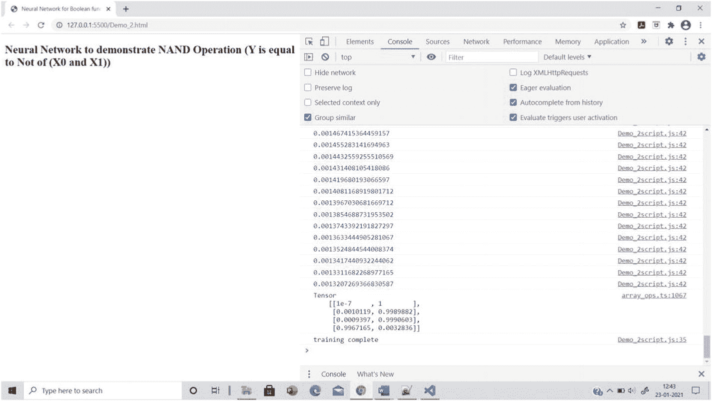

图 4-10：使用 TensorFlow.js 通过人工神经网络实现 NAND 布尔运算的截图（输出）

## 使用 PoseNet 进行人体姿态分类

“PoseNet 是一种视觉模型”，可用于通过评估关键身体关节的位置来测量图片或视频中个体的姿势。模型术语见图 4-11。

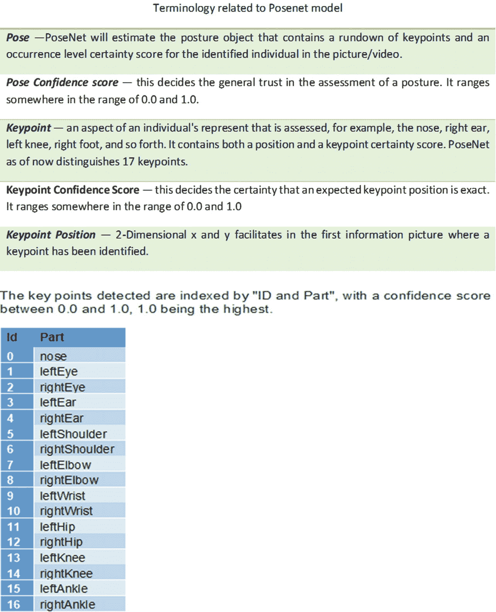

图 4-11：与 PoseNet 模型相关的术语

PoseNet 无法感知图片/视频中的人是谁。该估计实际上是评估人体关键关节的位置。PoseNet 可用于评估图片/视频中单个人的姿势或众多人的姿态。PoseNet 的估计可以区分图片/视频中的单个个体，也可以识别图片/视频中的不同人。单人姿势识别器更快、更直接，但要求图片中只存在一个主体。姿势评估分两个阶段进行：
1. 一个信息 RGB 图片通过一个卷积神经系统进行处理。
2. 利用姿势估计从模型输出中解释关键点位置和关键点置信度分数。

### 设置 PoseNet 项目

步骤 1：在 HTML 程序（主文件）中包含 TensorFlow.js 和 PoseNet 库

```markdown
posenet.load().then(function(net) {
// posenet model loaded
});
```

图 4-12 显示了主文件中库文件的包含情况以及浏览器中的相应输出。ml5.js 与 TensorFlow.js 一起提供了 PoseNet 模型。一个即用型模型，内部包含一个预先准备好的卷积神经网络（CNN），它接受一张图片作为信息，并输出一个关键点热图和相应的向量。

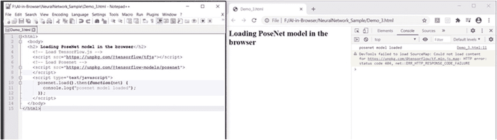

**图 4-12** 库加载到浏览器后，浏览器及其控制台窗口中呈现的输出文本

### 步骤 2：使用浏览器摄像头进行单人姿态估计

完整代码包含两个文件：`Demo_3.html`（显示输出的主网页）和 `Demo_3script.js`（用于捕获用户视频的 JS 代码）。`Demo_3.html` 是显示带关键点输出的主页面，因此库文件被添加在该文件中：

```html
Demo on Posenet Model

Demo of PoseNet ML model in the browser
 Loading Model....
```

`Demo3_script.js` 包含三个方法（函数）：

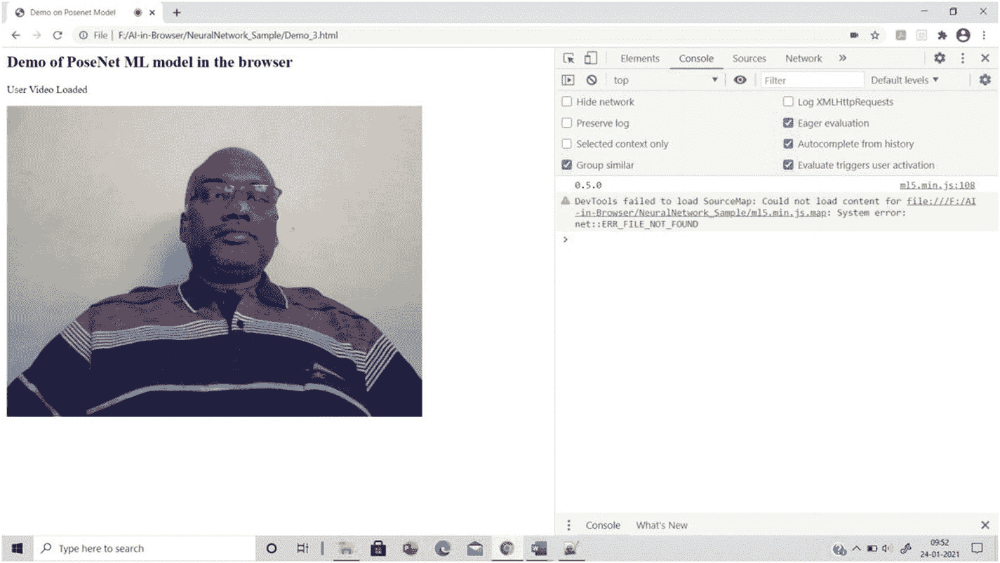

**图 4-13** 使用浏览器摄像头进行单人姿态估计

1.  `function setup()`：初始设置，用于通过浏览器摄像头捕获视频，并通过调用 PoseNet 模型将用户视频放置在指定位置。此第一个函数执行且仅运行一次。

    ```javascript
    function setup() {
    createCanvas(640,480);
    webcam_output=createCapture(VIDEO);
    webcam_output.size=(width,height);
    myposenet=ml5.poseNet(webcam_output,function(){
    select('#uservideo').html('User Video Loaded')});
    myposenet.on('pose',function(results) {
    poses=results; });
    webcam_output.hide();
    }
    ```

    p5.js 库的 `createCanvas(width, height)` 用于在浏览器中创建一个窗口（框）来显示输出。窗口（画布）的大小设置为 `width:640px` 和 `height:480px`。

    `createCapture(VIDEO)` 用于捕获摄像头视频流并返回一个 p5 对象，该对象存储在用户定义的变量 `webcam_output` 中。摄像头视频的高度和宽度与画布相同。

    `poseNet()` 方法创建一个新的 PoseNet 模型，该模型以 `webcam_output` 作为输入，并加载到主 .html 页面中以显示用户视频。

    `poseNet.on()` 方法是一个事件监听器。每当用户位置/视频发生变化时，就会向 `myposenet` 模型提供一张新图像。`poseNet` 函数进而调用 `function(results)`，模型在该函数中给出关键点及其对应的置信度分数。结果存储在名为 `poses` 的数组中。

    函数 `webcam_output.hide()` 隐藏实际的摄像头输出，浏览器上仅显示带有关键点作为输出的画布。

2.  `function draw()`：该函数被调用并无限重复，直到浏览器关闭。此方法进而调用以识别关键点：

    ```javascript
    function draw() {
    image(webcam_output,0,0,width,height);
    displayKeypoints();
    }
    ```

    `draw()` 函数持续运行以在画布中显示图像。它有五个参数：`webcam_output`（要显示的视频）、相对于画布左上角的 xy 坐标，以及用于绘制视频的 `width,height`。此函数调用 `displayKeypoints()` 以将识别出的关键点显示为点（椭圆）。

3.  `function displayKeypoints()`：此方法显示来自数组 `poses` 的已识别关键点。识别出的点以圆圈形式显示，以表明存在关键点：

    ```javascript
    function displayKeypoints() {
    for(let i=0;i<poses.length;i++) {
    let pose=poses[i].pose;
    for(let j=0;j<pose.keypoints.length;j++) {
    let point=pose.keypoints[j];
    fill(0,0,255);
    noStroke();
    ellipse(point.position.x,point.position.y,10,10);
    }
    }
    }
    ```

    图 4-13 显示了相应的输出。

**使用图片进行单人姿态估计：** `function setup()` 包含一个 `createImg` 方法，用于从本地硬盘加载图片（图像）到浏览器，以识别图像上的关键点。图 4-14 显示了相应的输出。

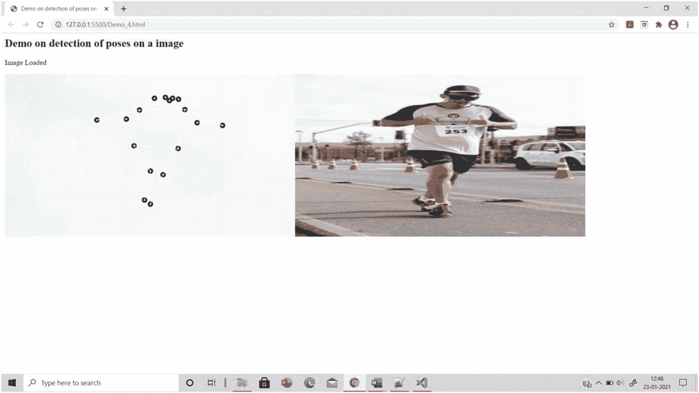

**图 4-14** 从图片显示关键点

函数中的以下指令集需要写入 `Demo_4script.js`。主文件 `Demo_4.html` 保持不变：

```javascript
function setup() {
createCanvas(640, 360);
img= createImg('pics/pexels-derick-santos-2773934.jpg');
img.size(width, height);
myposenet = ml5.poseNet(img, function(){
select('#userpic').html('Image Loaded');
myposenet.singlePose(img);});
myposenet.on('pose', function (results) {
poses = results; });
}
```

`function draw()` 包含基于 `poses` 数组显示关键点以及显示骨架（与关键点连接相关的草图）的方法：

```javascript
function draw() {
if (poses.length > 0) {
image(img, 0, 0, width, height);
displayKeypoints(poses);
displaySkeleton(poses);
}
}
```

`displayKeypoints` 的逻辑与前面示例中讨论的相同。函数 `displaySkeleton()` 用于在当前图像上绘制线条。`draw()` 在一个无限循环中执行此操作，因此向用户显示连续输出。

## PoseNet 模型置信度值

`draw` 函数执行并遍历属于身体的每个关键点，关键点数组 `poses` 包含以下信息：

*   `"part"`：识别出的身体部位名称。
*   `"position.x"` 和 `"position.y"`：图像中某个点的值。
*   `"score"`：置信度值，表示检测的准确性。

图 4-15 显示了浏览器控制台上的输出。

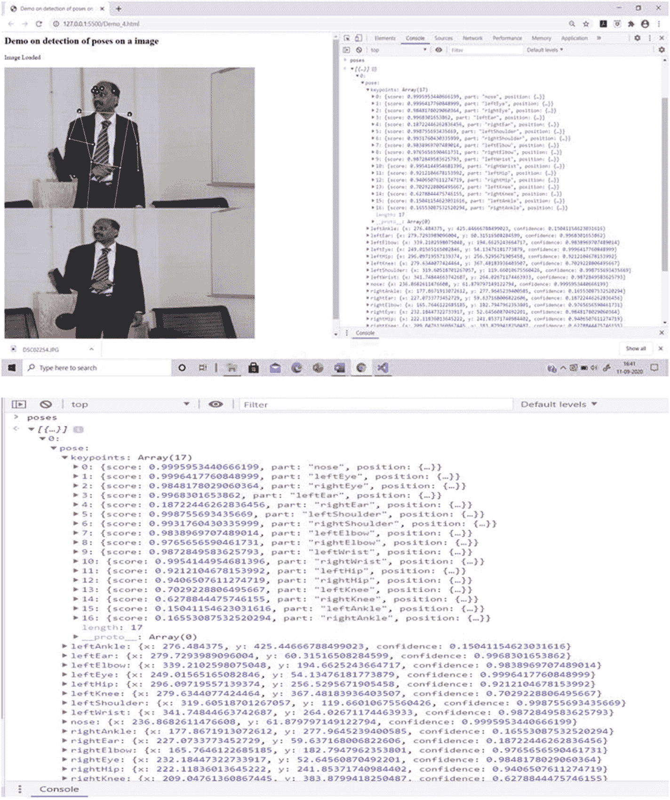

**图 4-15** 从浏览器控制台中的 `poses` 看到的置信度值

如果检测准确性大于某个值（例如，当您关注某些点时，`0.2 或 0.3，或 0.7 及以上`），我们可以绘制一个 `point`。图 4-16 显示了与绘制的骨架相关的分数。

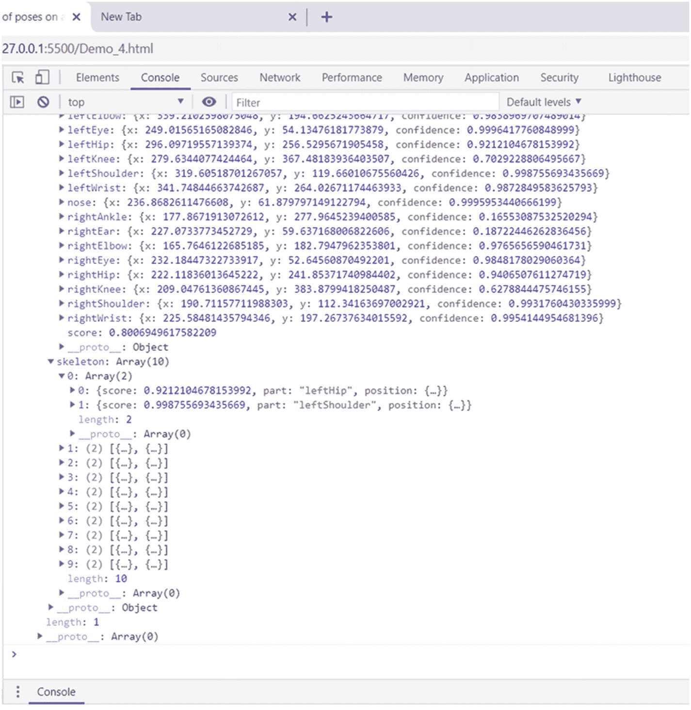

**图 4-16** 在浏览器控制台的 `poses` 对象中看到的特定阈值分数

**注意**

当使用与 PoseNet 模型输出相关的 JSON 格式存储数据时，步骤需要写入 `Demo_4script.js`。主文件 `Demo_4.html` 保持不变。要以 JSON 格式将关键点捕获到单独的文件中，您可以按如下方式使用 p5 库函数。
```

步骤 1. 声明一个全局变量：

```
let writer;
```

步骤 2. 在 `setup` 函数中，使用 `createWriter` 以及用于以 JSON 格式存储数据的文件名来初始化 `writer` 变量：

```
// writer 对象通过 createWriter 函数初始化
writer=createWriter('data_keypoints.json');
```

步骤 3. 在 `displayKeypoints` 方法中，通过使用 `writer` 对象调用 `print` 函数：

```
writer.print("keypoint: "+keypoint.part+" x:"+keypoint.position.x+" y:"+keypoint.position.y);
```

步骤 4. 定义一个函数用于触发事件，例如 `mouseclick`，以便该事件将触发 `print` 方法来存储连续 `draw()` 方法的值：

```
function mouseClicked() {
    writer.close();
}
```

输出存储在一个 `.json` 文件中，如图 4-17 所示。

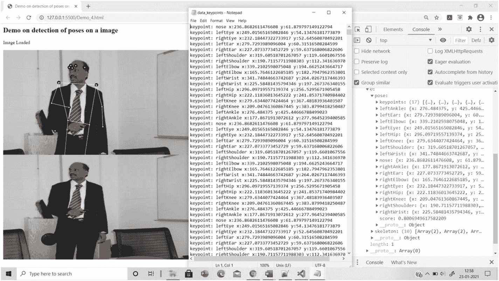

**图 4-17**

在 `.json` 文件中存储关键点数据

## 总结

本章涵盖了人工神经网络（ANN）在人体姿态估计的机器学习建模中的重要性及其策略。通过本章的理论和示例，您学习了 ANN 的基础知识，以及如何通过 `TensorFlow.js` 编程在浏览器中实现它。这种理解无疑将帮助您在浏览器中实现诸如 PoseNet 之类的各种机器学习模型。

本章介绍的 PoseNet 模型是一种机器学习模型，可在浏览器中实时估计人体姿态关键点。本章还介绍了相应的实现细节。

这些信息将作为在浏览器中执行复杂数据分析的基础（您将在后续章节中学习）。