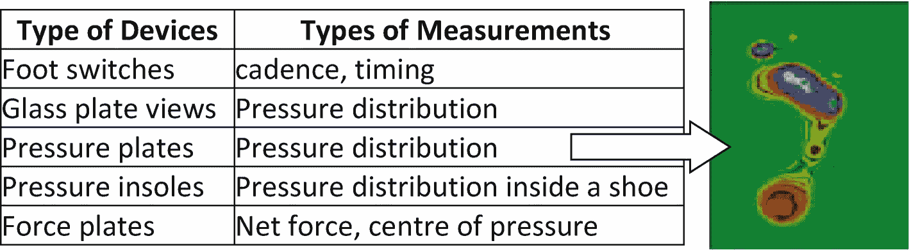
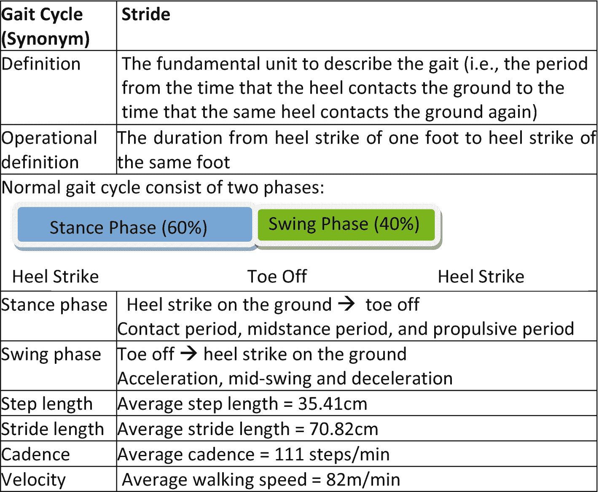
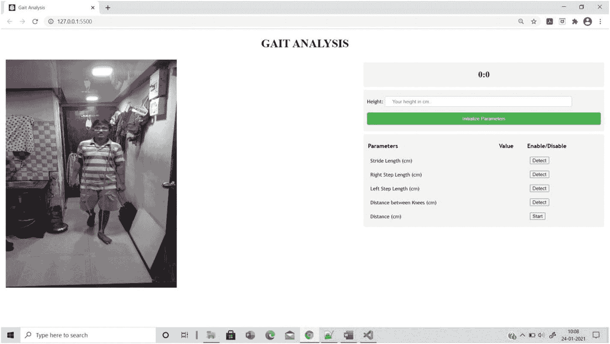
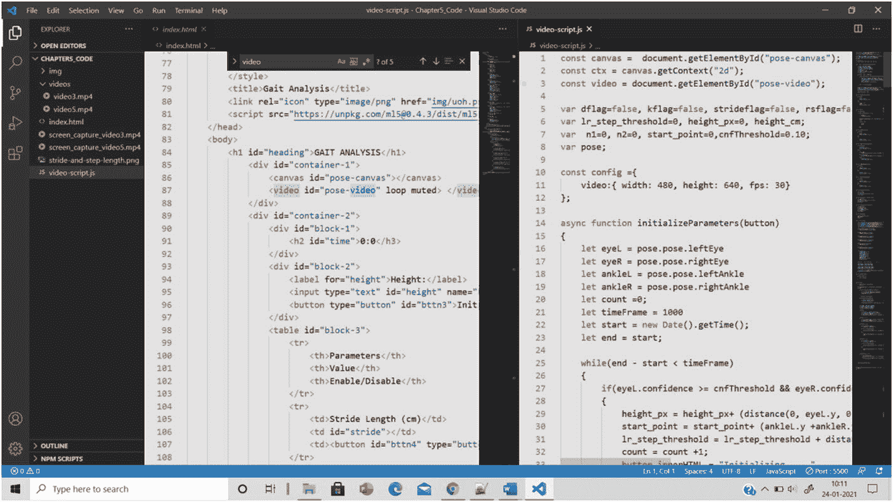
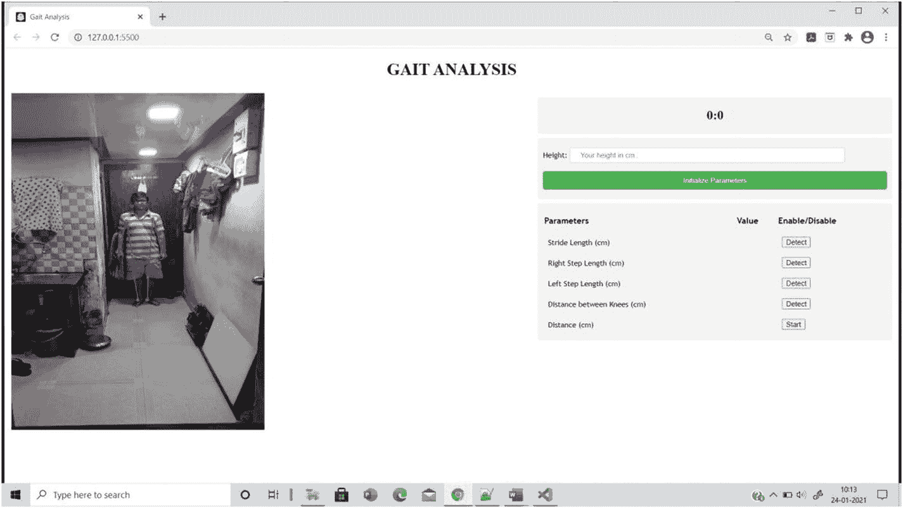
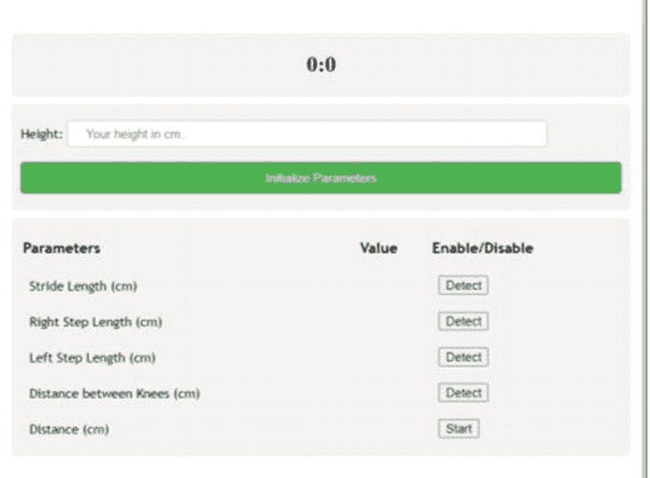
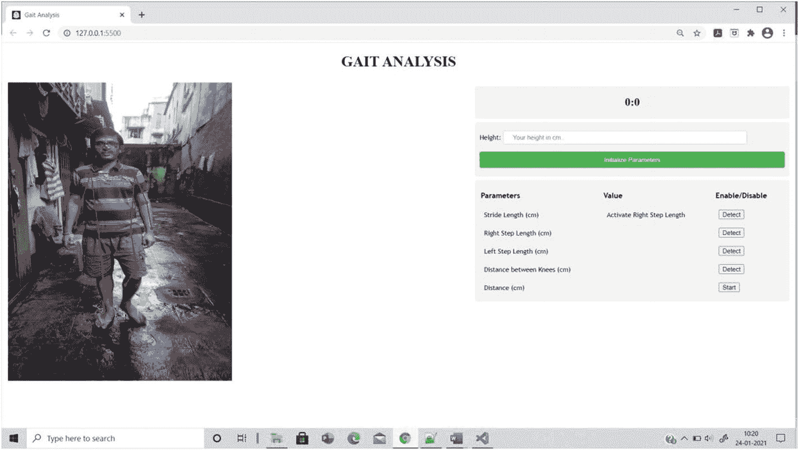
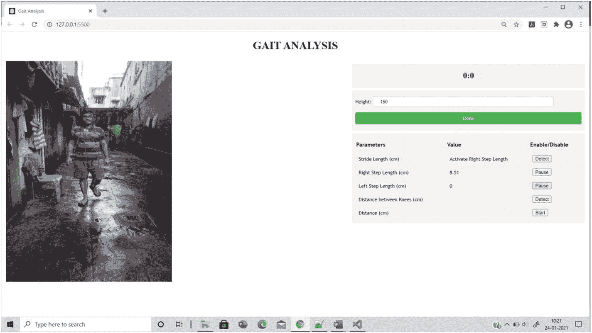
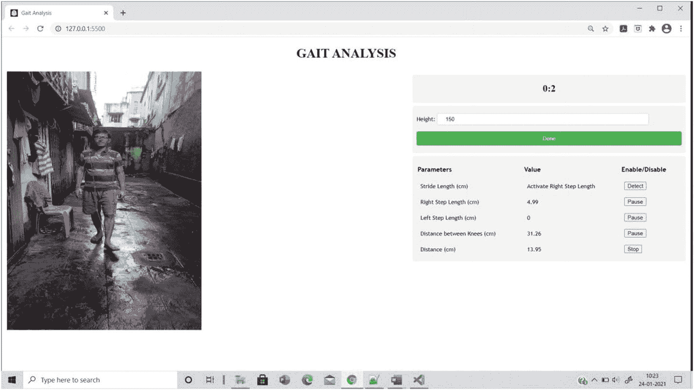

# 5. 步态分析

步态分析是指利用观察者的眼睛和大脑，辅以测量身体运动、身体力学和肌肉活动的仪器，对动物运动（更具体地说是人类运动）进行系统研究。步态分析用于评估和治疗影响行走能力的医疗状况患者。

步态分析涵盖了测量（步态可量化边界的呈现与探究）以及基于个人步态模式的解读。

## 步态测量技术

步态分析涉及测量，其中引入、分析并解释可测量的参数，以得出受试者的步行风格（模式）。表 5-1 描述了压力测量，表 5-2 列出了运动测量。

**表 5-2**

**运动测量**

| **设备类型** | **测量类型** |
| --- | --- |
| 测角仪 | 关节活动范围 |
| 电子测角仪 | 连续时刻的关节角度 |
| 观察性步态分析：使用摄像机的导电走道 | 步幅、步频、速度和动态基底 |
| 高速视频 | 定格运动测量 |
| 加速度计 | 加速度 |
| 陀螺仪 | 方向变化 |
| 3D 标记系统 | 所有可能的运动学测量，使用• 被动（反射器）和主动（灯光）• 标记点位于身体标志点（通过“连接点”得到关节角度） |
| 电磁场 | 所有可能的运动学测量，有噪声且为定性，指示肌肉何时活动的指标，表面肌电图（sEMG）（最常见）：便宜、简单，因串扰和噪声难以解释，细线和针式肌电图：穿透皮肤，隔离单块肌肉 |

**表 5-1**

**使用力/压力测量**



**注意**

关于观察性步态分析，本书考虑使用摄像机技术的导电走道方法，通过低成本、资源受限的计算设备（如树莓派或移动设备）来分析个体的步态模式。为便于理解，程序可在笔记本电脑的浏览器上运行。

## 步态周期测量参数与术语

表 5-3 提供了步态周期测量的基本术语和正常条件。为了通过浏览器中的人工智能（AI）理解个体的步行模式，将考虑以下正常步态模式的条件。

**表 5-3**

**基本步态周期术语**



下一节中通过浏览器设计和开发的图形用户界面（GUI）将使我们能够测量个体的步态参数。

## 用于监测步态参数的 Web 用户界面

图 5-1 展示了使用 ml5.js 库借助 PoseNet 模型得到的关键点、骨架和步态参数值的初始输出。



**图 5-1**

在浏览器上监测步态参数

源代码包含以下两个文件：

*   `index.html`：显示输出的主页面，如图 5-1 所示
*   `video-script.js`：使用 ml5 库函数运行的 JavaScript（JS）代码

图 5-2 展示了在 Visual Studio Code 中对应的源代码截图。



**图 5-2**

步态参数监测源代码截图


### index.html

这是用于显示输出（PoseNet 骨架和测量参数）的前端页面。ml5.js 库通过 `index.html` 文件头部区域的 script 标签引入：

用户界面的前端页面在 HTML 文件的 body 部分定义。我们自己的 JS 代码位于 body 内部。在 Visual Studio Code 中运行 `index.html` 文件即可查看输出（列表 5-1）。

注意

开发的程序从录制的视频文件中获取输入。如果用户希望从浏览器摄像头获取输入，则适用第 4 章中给出的步骤来收集用户数据。

```
步态分析

0:0

身高：

初始化参数

参数
数值
启用/禁用

步幅（厘米）

检测

右步长（厘米）

检测

左步长（厘米）

检测

膝间距（厘米）

检测

距离（厘米）

开始

列表 5-1
index.html 文件的 body 部分
```

图 5-3 显示了程序在浏览器上运行时的初始输出。



图 5-3

初始输出。用户必须输入身高值并点击相应按钮来查看步态参数

`index.html` 的 head 部分包含了 Web 界面前端页面的层叠样式表（CSS）样式（列表 5-2）。

```

#heading{
text-align: center;
}
#pose-canvas{
position: absolute;
}
#pose-video{
display: none;
}
#container-1{
float: left;
width: 50%;
padding: 5px;
}
#container-2{
float: right;
width: 40%;
padding: 5px;
}
#block-1{
text-align: center;
border-radius: 5px;
background-color: #f2f2f2;
padding: 1px;
margin: 8px 0;
}
#block-2{
border-radius: 5px;
background-color: #f2f2f2;
padding: 10px;
}
#block-2 input[type=text] {
width: 80%;
padding: 6px 20px;
margin: 8px 0;
display: inline-block;
border: 1px solid #ccc;
border-radius: 4px;
box-sizing: border-box;
}
#block-2 button{
width: 100%;
background-color: #4CAF50;
color: white;
padding: 10px 20px;
margin: 8px 0;
border: none;
border-radius: 4px;
cursor: pointer;
}
#block-2 label{
font-family: "Trebuchet MS", Arial, Helvetica, sans-serif;
font-size: 14px;
}
#block-3{
font-family: "Trebuchet MS", Arial, Helvetica, sans-serif;
width: 100%;
margin: 8px 0;
border-radius: 5px;
background-color: #f2f2f2;
padding: 10px;
}
#block-3 td, #gait-details th {
padding: 8px;
}
#block-3 td{
font-size: 14px;
}
#block-3 th{
padding-top: 12px;
padding-bottom: 12px;
text-align: left;
}

步态分析

列表 5-2
index.html 文件的 head 部分
```

接下来的 `Video-script.js` 文件包含以下函数：

*   `async function main()`：此函数仅执行并运行一次。当用户通过点击按钮从视频文件中读取相应数值进行交互时，初始设置在此处完成。视频文件的宽度和高度在此初始化。`ml5.poseNet()` 创建一个新的 PoseNet 模型，以视频文件作为输入。

*   `function modelReady()`：在视频文件被读取后，调用 `draw()` 函数来识别关键点。`video.play()` 函数会重复播放视频文件。

*   `function draw()`：此函数无限循环调用 `drawImage()` 函数，以逐帧图像的方式显示视频，并指定宽度、高度、x 位置、y 位置以及要显示的视频。关键点和骨架用于在当前图像上绘制点和线。由于 `draw()` 在无限循环中执行此操作，它会向用户显示连续输出，使其看起来像视频一样。

*   针对行走特定距离所识别的测量值（针对关键点），是借助视频关键点的位置来测量的。

*   `function document.addEventListener()`：为事件类型属性值为 `type` 的事件添加一个事件监听器。`callback` 参数设置了在事件触发时将调用的回调函数。该回调函数是 `main()` 函数。

```
async function main()
{
const initializeBttn = document.getElementById("bttn3");
const strideBttn = document.getElementById("bttn4");
const rightStepBttn = document.getElementById("bttn5");
const leftStepBttn = document.getElementById("bttn6");
const kneeBttn = document.getElementById("bttn7")
const distanceBttn = document.getElementById("bttn8");
initializeBttn.onclick = function(){
initializeParameters(initializeBttn)
}
// 当用户点击按钮时，调用相应的方法
strideBttn.onclick = function(){
toggleStrideLength(strideBttn)
}
rightStepBttn.onclick = function(){
toggleRightStep(rightStepBttn)
}
leftStepBttn.onclick = function(){
toggleLeftStep(leftStepBttn)
}
kneeBttn.onclick = function(){
toggleKnee(kneeBttn)
}
distanceBttn.onclick = function(){
toggleDistance(distanceBttn)
}
const options = {
imageScaleFactor: 0.3,
outputStride: 16,
flipHorizontal: false,
minConfidence: 0.5,
maxPoseDetections: 2,
scoreThreshold: 0.5,
nmsRadius: 20,
detectionType: 'multiple',
multiplier: 0.75,
}
video.src = "videos/video5.mp4"; // 视频文件
video.width = conFigure video.width;
video.height= conFigure video.height;
canvas.width = conFigure video.width;
canvas.height = conFigure video.height;
console.log("Canvas initialized");
const poseNet = ml5.poseNet(video,options, modelReady);
poseNet.on('pose',gotPoses);
}
function modelReady()
{
console.log('Model Ready')
video.play();
draw();
}
function draw()
{
if (video.paused || video.ended) {
return;
}
ctx.drawImage(video,0, 0, video.width, video.height)
// 对于每个姿态，测量身体部位相应关键点之间的距离。
if(pose)
{
for(i=0;i 0 && n2 > 0 )
document.getElementById("stride").innerHTML = (n1+n2).toFixed(2)
else
document.getElementById("stride").innerHTML = "无法检测到脚部";
}
}
requestAnimationFrame(draw);
}
document.addEventListener("DOMContentLoaded",function(){
main();
});
```


## 在浏览器上实时可视化步态参数（模式）

我们有一个在图像上绘制检测点的函数。我们将 PoseNet 输出的所有结果保存在 `poses` 数组中。在这里，我们遍历图像中人物的每一个姿态并获取其关键点：

```
function gotPoses(poses)
{
if(poses.length > 0)
{
pose = poses[0]
}
}
```

我们遍历 `keypoints` 数组中的每一个身体部位点，该数组进一步包含以下内容：

*   *部位*：被检测到的部位名称
*   *位置*：图像上点的 x 和 y 值
*   *置信度*：检测的准确度

我们仅使用填充色（红、绿、蓝）来绘制点，采用 0 到 255 的 RGB 强度值来决定点的颜色：

```
function drawPoint(x, y, radius, color)
{
ctx.beginPath();
ctx.arc(x, y, radius, 0, 2 * Math.PI);
ctx.fillStyle = color;
ctx.fill();
}
function drawLine(x1,y1,x2,y2,color)
{
ctx.beginPath();
ctx.moveTo(x1, y1);
ctx.lineTo(x2, y2);
ctx.strokeStyle = color;
ctx.lineWidth = 2;
ctx.stroke();
}
//类似地，函数 initializeParameters 用于调整置信度阈值
async function initializeParameters(button)
{
let eyeL = pose.pose.leftEye
let eyeR = pose.pose.rightEye
let ankleL = pose.pose.leftAnkle
let ankleR = pose.pose.rightAnkle
let count =0;
let timeFrame = 1000
let start = new Date().getTime();
let end = start;
while(end - start = cnfThreshold && eyeR.confidence >= cnfThreshold && ankleL.confidence >= cnfThreshold && ankleR.confidence>=cnfThreshold)
{
height_px = height_px+ (distance(0, eyeL.y, 0, ankleL.y) + distance(0, eyeR.y, 0, ankleR.y))/2
start_point = start_point+ (ankleL.y +ankleR.y)/2
lr_step_threshold = lr_step_threshold + distance(0, ankleL.y, 0, ankleR.y)
count = count +1;
button.innerHTML = "Initializing ...."
}
end = new Date().getTime();
}
height_cm = document.getElementById("height").value;
height_px  = (height_px / count).toFixed(2);
lr_step_threshold = ((lr_step_threshold/count) * (height_cm / height_px)).toFixed(2)
start_point = (start_point / count).toFixed(2)
button.innerHTML = "Done"
}
function toggleDistance(button)
{
if (dflag)
{
dflag = false;
button.innerHTML= "Start";
}
else
{
dflag = true;
timer()
button.innerHTML= "Stop";
}
}
function timer()
{
let sec=0,min=0;
var time = setInterval(function(){
if (!dflag) {
clearInterval(time);
}
document.getElementById('time').innerHTML=min+":"+sec;
sec++;
if(sec == 60)
{
sec=0;
min++;
}
}, 1000);
}
function toggleKnee(button)
{
if (kflag)
{
kflag = false;
button.innerHTML= "Detect";
}
else
{
kflag = true;
button.innerHTML= "Pause";
}
}
function toggleStrideLength(button)
{
if (strideflag)
{
strideflag = false;
button.innerHTML= "Detect";
}
else {
if(!rsflag){
document.getElementById("stride").innerHTML= "Activate Right Step Length"
}
else if(!lsflag){
document.getElementById("stride").innerHTML = "Activate Left Step Length"
}
else{
strideflag = true;
button.innerHTML= "Pause";
}
}
}
function toggleRightStep(button)
{
if (rsflag)
{
rsflag = false;
button.innerHTML= "Detect";
}
else
{
rsflag = true;
button.innerHTML= "Pause";
}
}
function toggleLeftStep(button)
{
if (lsflag)
{
lsflag = false;
button.innerHTML= "Detect";
}
else
{
lsflag = true;
button.innerHTML= "Pause";
}
}
function distance(x1,y1,x2,y2)
{
let a = x2-x1;
let b = y2-y1;
let result = Math.sqrt( a*a + b*b);
return result;
}
```

图 5-4 显示了输入人物身高前的初始参数界面。



图 5-4

浏览器上显示的初始输出。用户需要在用户界面中手动输入身高，并点击“检测”按钮来测量参数。

图 5-5 显示了输入用户身高（以厘米为单位）、点击“初始化参数”按钮，然后点击步幅的“检测”按钮后的输出。



图 5-5

点击相应按钮后显示的步幅值。

当用户点击“右步长”和“左步长”按钮时，显示的值如图 5-6 所示。



图 5-6

用户点击按钮后显示的右步长和左步长值。

行走时覆盖的总距离会在点击“距离”按钮后显示，如图 5-7 所示。



图 5-7

网页浏览器上显示的步态参数。

## 使用阈值确定步态模式

`options` 变量中的阈值置信度可以设置为某个值，以便仅显示置信度高于该阈值的对应姿态：

```
const options = {
imageScaleFactor: 0.3,outputStride: 16,
flipHorizontal: false,minConfidence: 0.5,
maxPoseDetections: 2,scoreThreshold: 0.5,
nmsRadius: 20,detectionType: 'multiple',
multiplier: 0.75,
}
while(end - start = cnfThreshold && eyeR.confidence >= cnfThreshold && ankleL.confidence >= cnfThreshold && ankleR.confidence>=cnfThreshold)
{
height_px = height_px+ (distance(0, eyeL.y, 0, ankleL.y) + distance(0, eyeR.y, 0, ankleR.y))/2
start_point = start_point+ (ankleL.y +ankleR.y)/2
lr_step_threshold = lr_step_threshold + distance(0, ankleL.y, 0, ankleR.y)
count = count +1;
button.innerHTML = "Initializing ...."
}
end = new Date().getTime();
}
height_cm = document.getElementById("height").value;
height_px  = (height_px / count).toFixed(2);
lr_step_threshold = ((lr_step_threshold/count) * (height_cm / height_px)).toFixed(2)
start_point = (start_point / count).toFixed(2)
button.innerHTML = "Done"
```

## 总结

用于步幅和步态（行走姿态）检查的深度神经网络是一个前沿的想法。这些测量有助于评估步幅异常，这些异常可以定量地指示影响行走和姿态的医学状况的严重程度。这些测量将有助于评估步态、运动、平衡方面的障碍以及跌倒风险。当前在浏览器中使用人工智能的方法将有助于以下方面：

*   确定是否需要辅助、适应、矫形、保护、支持或假肢装置或设备
*   评估整合感觉、运动和神经过程的困难
*   建立诊断、预后、护理计划、转诊至其他服务
*   足部开关步幅分析
*   定义时间和距离因素，对患者的行走能力进行分类
*   测量对治疗计划的反应，计算速度、步幅、步频、单支撑相、初始和终末双支撑相、总支撑相、步态周期持续时间。

本书的读者将能够通过实施从第 1 章到第 4 章学到的特性，开发如本章所述的步态分析等应用程序。在步态分析应用程序的设计和开发中需要考虑的主要特性和工具包括 JS、DOM、jQuery、p5.js、ml5.js 和 TensorFlow.js。

