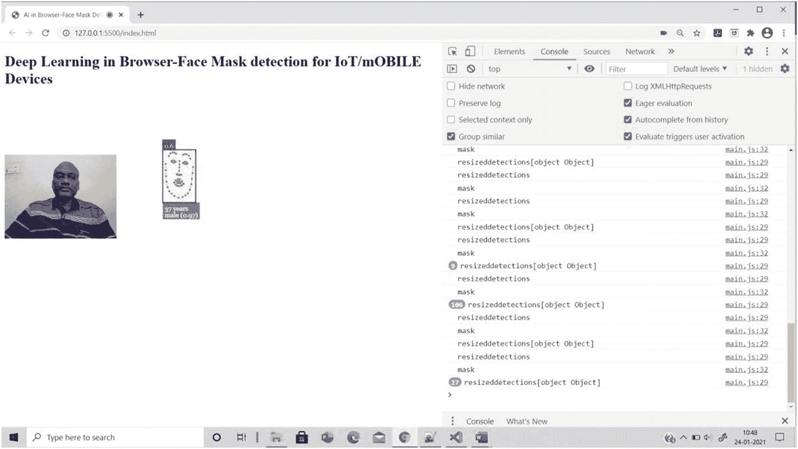
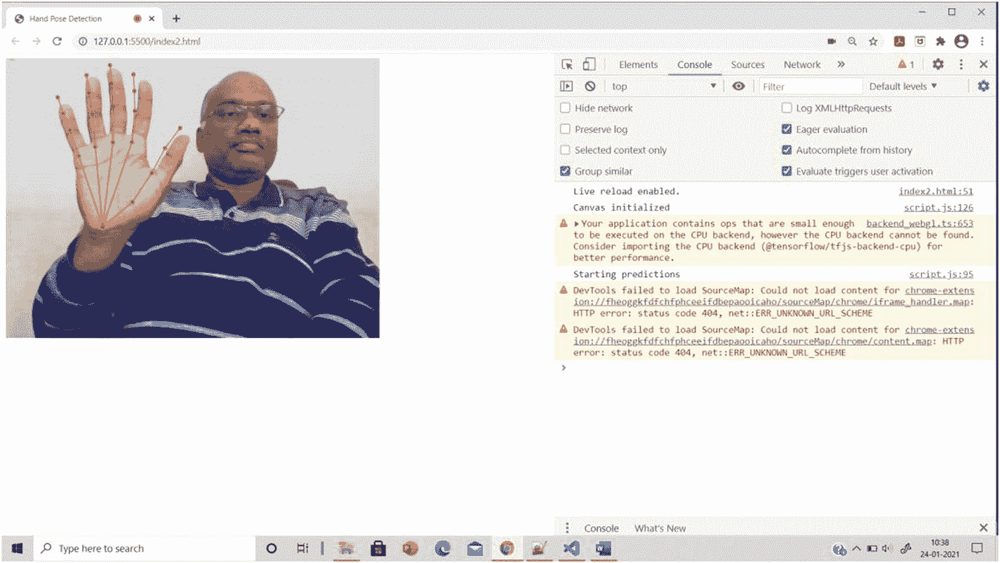
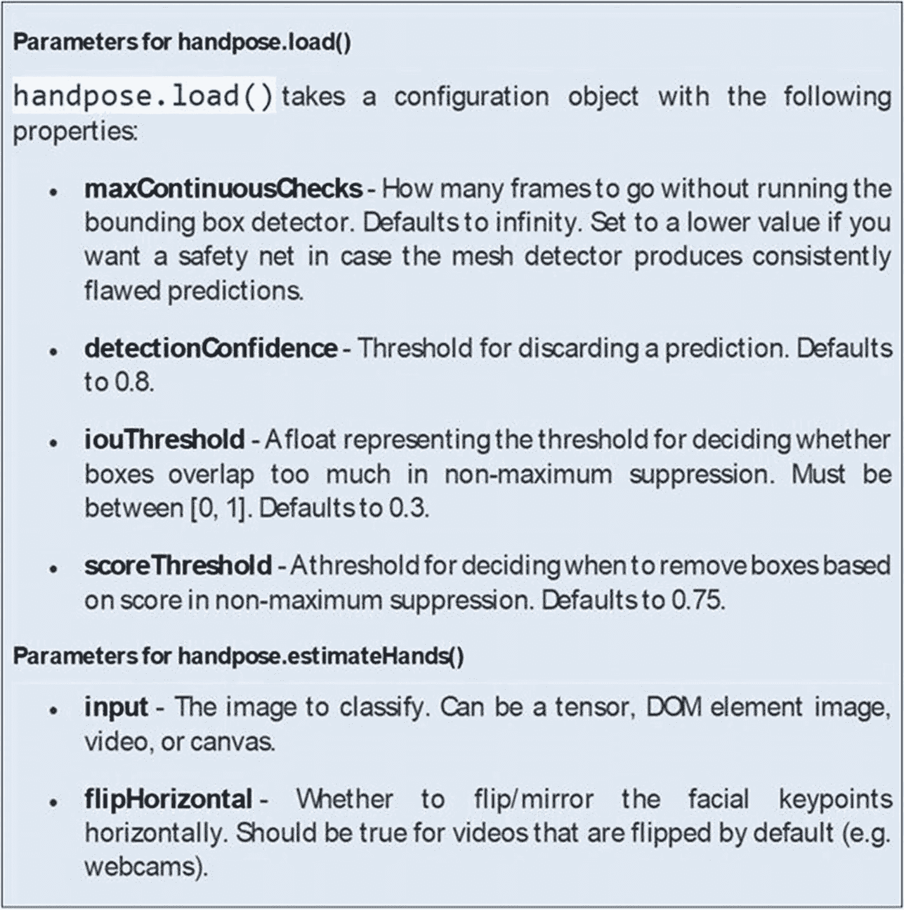

# 6. 在浏览器中运行人工智能方法的未来可能性

本章介绍两个在`TensorFlow.js`框架帮助下运行的新JavaScript (JS) 库：`face-api.js`和`handpose`。不断发展的JS库展示了一条探索可在浏览器和计算资源设备（计算能力较低的电子设备）上运行的实时响应式应用程序的路径。

## 引言

如前面章节所述，人体姿态评估与其他基础计算机视觉任务存在显著差异。物体识别是在图像中定位物体，但这通常是粗粒度的，仅包含一个包围物体的边界框。而姿态评估更进一步，能够预测与人体相关的关键点的精确位置。

本质上，二维（2D）评估测量的是关键点在二维空间中相对于图像或视频帧的位置。该模型会为人体每个关键点估算一个x和y坐标。三维（3D）评估则试图通过为预测结果添加z坐标，将二维图像中的物体转换为三维物体。

3D评估使我们能够预测个人或物体的真实空间位置。正如你所料，考虑到制作数据集和算法时需要考虑图像或视频背景场景或光照条件的多种变量，3D评估目前对机器学习（ML）研究者来说仍是一个具有挑战性的问题。

在识别图像或视频中的一个或多个区域时存在区别。2D和3D方法可分别称为单人评估和多人评估。单人评估方法用于识别和追踪一个人或物体，而多人评估方法则用于识别和追踪多个人或物体。

通过思考姿态评估在各个方面的应用，我们可以清晰地想象其强大之处：从虚拟游戏教练和人工智能（AI）驱动的健身教练，到追踪工厂车间动态以确保工人安全。当前的`PoseNet`评估方法可能会催生大量旨在测量人体运动精度的自动化工具。

`PoseNet`评估方法在多个领域（例如增强现实、动画、游戏和机器人技术）开辟了应用前景。这并非详尽无遗的列表，但涵盖了当前评估技术塑造我们未来的一些主要方式。

`TensorFlow.js`使机器学习研究者能够更轻松地让其他人使用他们的算法。例如，`Magenta.js`库（Roberts等人，2018）提供了对Magenta团队创建并借助`TensorFlow.js`移植到网页的生成式音乐模型的应用内访问。`Magenta.js`提高了其作品在目标受众（特别是音乐人）中的可见度。这催生了由社区构建的多种基于机器学习的音乐应用。示例包括`Latent Cycles` Parviainen (2018a) 和 `Neural Drum Machine` Parviainen (2018b)。你可以在 `https://magenta.tensorflow.org/demos` 找到这些及更多模型。

`TensorFlow.js`的一项基本技术贡献在于，它提供了一套方法，用于重新利用Web平台架构应用程序编程接口（API）以实现高性能数值计算，同时保持与大量设备和执行环境的兼容性。

我们认为，扩展和增强`TensorFlow.js`存在诸多机会。鉴于浏览器技术的快速发展，很可能会有额外的GPU编程模型出现。具体来说，浏览器开发者正在讨论实现通用的GPU编程API（Apple 2017, W3C 2017），这将使这类工具箱性能更高、更易于维护。未来的工作将专注于提升性能、推进设备兼容性（尤其是手机），并扩大与Python `TensorFlow`实现的等价性。我们还注意到，需要为完整的AI工作流程提供支持，包括数据输入、输出和转换。

## 使用 TensorFlow 的其他机器学习应用

接下来的部分将讨论借助各种JS库在浏览器中运行的AI应用。

### 使用 face-api.js 进行人脸识别

在浏览器中使用`TensorFlow`进行机器学习的面部检测和识别。`face-api.js` JS模块执行卷积神经网络（CNN）来检测面部并识别人脸标记（关键点）。`face-api.js`使用`TensorFlow.js`，并针对桌面端和移动端网页进行了优化。

除了面部检测和识别，`face-api.js`还提供了一些模型，可用于面部表情识别、个人年龄评估和性别判断。

要开始使用`face-api.js`，Web开发者需要引入`face-api.js`的最新JS库，或使用`npm`进行安装。`face-api.js`是根据MIT许可证提供的开源软件。

使用`face-api.js`进行面部检测和人脸标记（关键点）的可视化结果可以在浏览器中查看，如图6-1所示。



图6-1
使用`face-api.js`库将检测结果绘制到画布上进行可视化

该应用包含两个文件：`index1.html`（列表6-1）和`main.js`，你可以从 `https://justadudewhohacks.github.io/face-api.js/docs/index.html` 下载。

```
AI in Browser-Face Mask Detection
Deep Learning in Browser-Face Mask detection for IoT/mOBILE Devices
```

列表 6-1
`Index1.html`

### 手部姿态估计

能够看到手部的形状和运动，有助于在众多创新领域和阶段提升客户体验。例如，它可以为基于手势的理解和手部信号控制奠定基础，同时还能在增强现实中实现数字内容与数据在物理世界中的叠加。尽管对人类来说轻而易举，但鲁棒的实时手部识别却是一项极具挑战性的计算机视觉任务，因为手部经常相互遮挡（例如，手指/手掌遮挡和握手），并且需要高对比度的图案。

该工程与我们近期发布的用于面部处理的机器学习流水线以及其他人用于姿态评估的技术类似。为手部关键点模型提供精确裁剪的手掌图像，可以减少对数据增强（例如旋转、平移和缩放）的需求，从而使网络能够将其大部分能力用于提高预测精度。

当输入手掌图像或视频时，手部姿态估计方法会确定关节（关键点）。基本上，手语精度可以很容易地通过手部姿态估计来理解。

图6-2显示了在浏览器中运行AI程序后的截图（输出）。



图6-2
带有关键点的手部姿态估计

我们打算通过更稳定、更鲁棒的跟踪来扩展这项技术，并增加手部信号的数量。借助手部姿态估计，可以探索新颖的应用，我们渴望看到使用该方法能产生的最佳成果。

清单6-2和6-3提供了手部姿态估计的源代码（`index2.html`和`script.js`）。

```javascript
const config ={
video:{ width: 640, height: 480, fps: 50}
};
function drawPoint(ctx, x, y, radius, color)
{
ctx.beginPath();
ctx.arc(x, y, radius, 0, 2 * Math.PI);
ctx.fillStyle = color;
ctx.fill();
}
function drawLine(ctx,x1,y1,x2,y2,color)
{
ctx.beginPath();
ctx.moveTo(x1, y1);
ctx.lineTo(x2, y2);
ctx.strokeStyle = color;
ctx.stroke();
}
function draw(ctx,part,radius,color)
{
let k=0;
for(k=0; k 0)
{
for(let i=0; i {
video.srcObject = stream;
main();
});
}
function init_canvas()
{
const canvas =  document.getElementById("pose-canvas");
canvas.width = conFigure video.width;
canvas.height = conFigure video.height;
console.log("Canvas initialized");
}
document.addEventListener('DOMContentLoaded',function(){
init_canvas();
init_camera();
});
```

Listing 6-3
`script.js`

```css
Hand Pose Detection
#pose-canvas{
position: absolute;
top: 0;
left: 0;
}
```

Listing 6-2
`Index2.html`

以下是`async`函数中`handpose.load`的参数：



## 总结
TensorFlow.js 使 Web 开发者能够完全在浏览器或资源受限的设备中准备和运行 AI 模型。对于 JS 开发者来说，这是探索 AI 世界进步的一个绝佳方式。最棒的是，它不像 CoreML 那样只能在 Apple 环境中运行。TensorFlow.js 可以运行在 iOS、macOS、Linux、Android 以及任何支持浏览器的平台上。
我相信本章中提到的库会激励你开始构建令人惊叹的 AI 驱动的 Web 应用程序。