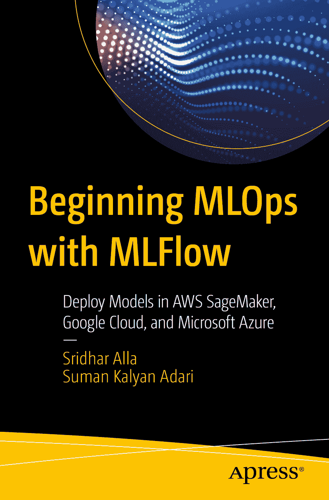

ISBN 978-1-4842-6548-2 e-ISBN 978-1-4842-6549-9 [`doi.org/10.1007/978-1-4842-6549-9`](https://doi.org/10.1007/978-1-4842-6549-9) © Sridhar Alla, Suman Kalyan Adari 2021 Apress 标准版 本出版物中使用的通用描述性名称、注册商标、商标、服务标记等，即使未作特别声明，也不意味着这些名称不受相关保护性法律和法规的约束，因此可自由使用。出版商、作者和编辑假定本书中的建议和信息在出版之日是真实准确的。出版商、作者或编辑均不对本书所含材料或可能存在的任何错误或遗漏提供明示或暗示的担保。出版商对已出版地图中的管辖权主张和机构归属保持中立。本书通过 Springer Science+Business Media New York 在全球图书贸易中发行，地址：1 New York Plaza, Suite 4600, New York, NY 10004-1562, USA。电话：1-800-SPRINGER，传真：(201) 348-4505，电子邮件：orders-ny@springer-sbm.com，或访问 www.springeronline.com。Apress Media, LLC 是一家加利福尼亚有限责任公司，其唯一成员（所有者）是 Springer Science + Business Media Finance Inc (SSBM Finance Inc)。SSBM Finance Inc 是一家特拉华州公司。

引言

本书面向所有读者，从机器学习初学者到高级机器学习工程师，甚至到希望学习如何更好地组织实验的机器学习研究人员。

前两章介绍了本书所探讨问题的前提，即如何将 MLOps 原则集成到基于信用卡数据集的异常检测模型中。第三章介绍了 MLOps 究竟是什么、它是如何工作的，以及它为何有用。

第四章详细介绍了如何在现有项目中实现和利用 MLFlow，仅需几行代码即可享受 MLOps 带来的好处。

第五、六、七章分别介绍了如何将模型投入生产，并将其部署到 AWS、Microsoft Azure 和 Google Cloud 上。第七章介绍了如何在虚拟机上托管模型，并从外部源连接到服务器进行预测，因此，如果本书中描述的任何 MLFlow 功能过时，您始终可以采用这种方法，简单地在云上的某个集群上提供模型服务。

最后一章（附录）介绍了如何利用 MLFlow 的创建者 Databricks 来组织您的 MLFlow 实验并部署模型。

本书的目标是希望向您（读者）传授如何利用 MLFlow 的强大功能，将 MLOps 原则轻松集成到现有项目中。此外，我们希望您能更加熟悉如何将模型部署到云端，从而只要能够连接到托管模型的云服务器，就能在地球上的任何地方进行模型推理。

至少，我们希望更多人开始采用 MLFlow 并将其集成到工作流程中，因为即使仅作为组织工作空间的工具，它也能极大地改进机器学习实验的管理，并允许您跟踪项目的整个模型历史。

研究人员可能会发现 MLFlow 在进行实验时非常有用，因为它允许您在任意自定义指标之上记录图表。原型设计变得更加容易，因为您可以跟踪那个作为概念验证完美运行的模型，并在调整超参数的同时随时恢复到相同的权重。超参数调优变得更加简单和有条理，允许您运行一个复杂的脚本，一次性搜索多个不同的超参数，并使用 MLFlow 记录所有结果。

鉴于 MLFlow 及相应的 MLOps 原则为所有职业的机器学习爱好者带来的所有好处，将其集成到当前工作环境中确实没有任何缺点。至此，我们希望您能享受本书的其余部分！

致谢

**Sridhar Alla**

我要感谢我出色的妻子 Rosie Sarkaria，以及我美丽可爱的女儿 Evelyn 和 Madelyn，感谢她们在我撰写本书的几个月里给予我的所有爱和耐心。我还要感谢我的父母 Ravi 和 Lakshmi Alla，感谢他们一直以来给予我的支持和鼓励。

**Suman Kalyan Adari**

我要感谢我的父母 Venkata 和 Jyothi Adari，以及我心爱的狗 Pinky，感谢他们在我整个写作过程中给予的支持。我特别要感谢我的姐姐 Niharika Adari，感谢她帮助我进行编辑和校对，并帮助我撰写附录章节。

关于作者 关于技术审校

