# 1.  入门：数据分析

在本章中，我们将介绍我们试图通过机器学习解决方案来解决的问题的前提，该解决方案是我们希望投入生产的。我们还将开始对数据集进行数据分析和特征工程。


## 引言与前提

欢迎阅读《基于 MLFlow 的 MLOps 入门》！在本书中，我们将以一个示例问题为起点，为其开发机器学习解决方案，并在 AWS SageMaker、Microsoft Azure、Google Cloud 和 Datarobots 上实现模型的生产化部署。我们将探讨的问题是对信用卡数据集进行异常检测。本章将探索该数据集，展示其整体结构，并讲解一些分析该数据的技术。该数据集可在[`www.kaggle.com/mlg-ulb/creditcardfraud`](http://www.kaggle.com/mlg-ulb/creditcardfraud)找到。

如果你已经熟悉如何分析数据和构建机器学习模型，可以直接获取数据集，跳至第 3 章，直接进入 MLOps 部分。

否则，我们将首先介绍机器学习解决方案通常的创建流程。该流程大致如下：

1.  **问题识别：** 首先，你需要明确问题是什么，可以采取什么措施，已经采取了哪些措施，以及为什么这是一个值得解决的问题。

以下是一个问题示例：一种对当地环境有害的入侵蛇类在某地区泛滥成灾。这种蛇毒性极强，且与当地一种无毒蛇类外形极为相似。此外，入侵物种对当地环境具有破坏性，并在与本地物种的竞争中占据优势。

作为回应，当地政府发表声明，鼓励市民见即杀之，消灭这种有毒的入侵物种。但问题在于，由于两种蛇极易混淆，市民们也在误杀本地物种。

对此可以采取什么措施？一个可能的解决方案是利用机器学习的力量，构建一个应用程序来帮助市民识别蛇的种类。已经采取了哪些措施？也许有人发布了一款应用，但在区分两种蛇方面效果不佳，无助于改善现状。也许已经发放了宣传单，但仅凭一张图片很难准确识别每一个物种的个体。

为什么这是一个值得解决的问题？本地物种对当地环境至关重要。误杀错误物种可能会加剧问题，导致入侵物种取代本地物种占据环境优势。因此，构建一个基于计算机视觉的应用，能够区分各种蛇类（尤其是与问题相关的两种蛇），将是帮助市民消灭正确蛇类的绝佳方法。

2.  **数据收集：** 确定问题后，你需要收集相关数据。在蛇类分类问题中，你需要寻找所在地区各种蛇类的图像。具体地点取决于你的项目规模：是要识别世界上任何地方的蛇，还是仅限佛罗里达州的蛇？

如果条件允许，收集的数据越多，潜在的训练效果就越好。更多的训练样本可以为模型引入更多样性，从长远来看使其表现更佳。深度学习模型的性能会随着数据量的增加而提升，请牢记这一点。

3.  **数据分析：** 收集完所有原始数据后，你需要对其进行清洗、处理和格式化，以便更好地分析数据。

对于图像，这可能涉及应用算法裁剪掉图像中不必要的部分，仅聚焦于蛇本身。此外，你可能还想对图像进行中心裁剪，以去除数据样本中所有多余的视觉信息。无论如何，原始图像数据很少能直接使用；几乎总是需要处理才能获得所需的关联数据。

对于图像这类非结构化数据，将其格式化为足以分析的形式，可能包括创建一个包含所有相应蛇类及其相关图像数据的目录。然后，你可以查看每个蛇类类别的图像数量，并判断是否需要为特定物种获取更多样本。

对于结构化数据，例如信用卡数据集，处理原始数据可能意味着删除任何包含空值的条目。为了便于分析，可以应用降维技术，如主成分分析（PCA）。注意：事实证明，信用卡数据集中的大部分数据已经过 PCA 处理，部分原因是为了保护数据来源用户的隐私。

至于分析，你可以构建多个不同特征的图表，以了解整体分布情况以及特征之间的相互关系。这样，你就能发现某些特征之间的显著关系，在创建训练数据时加以留意。

有一些工具可以帮助你找出对标签影响最大的特征，例如**phi-k 相关系数**。通过查看各个特征与目标标签之间的不同相关系数值，你可以更深入地理解数据集中特征之间的关系。如有必要，你还可以从数据中剔除影响不大的特征。在此步骤中，你确实需要扎实地理解数据，以便应用最适合它的模型架构。

4.  **特征工程与数据处理：** 现在，你可以利用从分析各种特征及其相互关系中获得的知识，通过组合多个现有特征来构建新特征。例如，泰坦尼克号数据集就是一个非常适合应用特征工程的绝佳例子。在这种情况下，你可以利用诸如舱位等级、年龄、票价、兄弟姐妹数量、父母数量等信息，创建尽可能多的特征。

特征工程的核心在于为模型提供更深入的上下文，使其能更好地学习任务。你不必为了创建特征而随意创建，而应创建一些可能相关的特征，例如女性亲属的数量。（由于女性在泰坦尼克号沉没事件中幸存的可能性更高，那么如果一个人有更多女性亲属，他们幸存的可能性是否会更低，因为优先权给了他们的女性亲属？）

特征工程之后的下一步是数据处理，这一步涉及为将数据传入模型而进行的所有准备工作。在蛇类图像数据中，这可能包括将所有值归一化到 0 到 1 之间，以及将数据“分批”处理。

这一步通常还会从初始数据中创建几个子集：**训练数据集**、**测试数据集**和**验证数据集**。我们稍后将详细说明每个数据集的目的。目前，**训练数据集**包含你希望模型从中学习的数据，**测试数据集**包含用于评估模型性能的数据，而**验证数据集**则用于选择模型或帮助调整模型的超参数以获得更佳性能。


5.  **构建模型：** 数据处理完成后，这一步的重点是选择合适的架构并构建模型。对于蛇类图像数据，使用卷积神经网络（CNN）是一个不错的选择，因为它在处理图像相关任务时表现非常出色。接下来，你需要根据模型的层结构来定义其具体架构。

6.  **训练、评估与验证：** 在训练 CNN 模型时，通常会分批传入数据，直到整个数据集完整地通过模型一次。根据这次“前向传播”的结果，模型会进行计算，指导如何调整权重，这些调整通过所谓的“反向传播”在网络中逆向进行。训练过程本质上是模型学习如何执行任务，并且随着它看到更多样本，其表现会越来越好。

训练过程结束后，接下来可以进行评估或验证步骤。只要测试集和验证集来自不同的数据分布（验证集可以从训练集中划分，而测试集可以从原始数据中划分），从技术上讲，模型在评估和验证过程中看到的是新数据。模型永远不会从评估数据中学习任何内容，因此你可以随时测试模型。

模型评估是指在模型从未见过的数据集上评估其性能指标，例如准确率、精确率、召回率等。我们将在下一章（第 2 章）中更详细地介绍评估步骤，届时其相关性会更强。

根据具体情境，验证的确切目的可能有所不同，同时训练后是否应先进行评估的问题也会变化。让我们定义几个需要使用验证的示例场景：
    *   **选择模型架构：** 对于多种模型类型或架构，你可以使用例如 k 折交叉验证，在验证集的某个数据分区上快速训练和评估每个模型，以了解它们的表现。这样，你就能清楚哪个模型表现最佳，从而选择该模型并继续后续流程。

*   **选择最佳模型：** 对于多个训练好的模型，你可以使用类似 k 折交叉验证的方法，在验证数据上快速评估每个模型，从而了解哪些模型表现最好。

*   **调整超参数：** 快速训练一个模型，并用不同的超参数设置进行测试，以了解哪些配置效果更好。你可以从较宽的超参数范围开始，然后根据结果缩小范围，直到找到满意的配置。例如，深度学习模型可能有很多超参数，因此使用验证来调整这些超参数在深度学习环境中效果很好。但要注意收益递减现象。当超参数设置达到一定精度后，模型性能的提升就不会那么显著了。

*   **高方差的指示：** 这个验证数据与前三个示例略有不同。在神经网络的情况下，该数据是从训练数据中划分出的一小部分。在训练数据完整通过一次后，模型会在这个验证数据上进行评估，以计算损失和准确率等指标。

如果训练准确率高且训练损失低，但验证准确率低且验证损失高，这表明你的模型存在**高方差**问题。这意味着模型没有学会将其“学习”到的内容泛化到新数据上，因为此处的验证数据由它从未见过的数据组成。换句话说，你的模型正在**过拟合**。模型无法在新数据上复现其在训练数据上获得的表现。

如果模型训练准确率低且训练损失高，则表明模型存在**高偏差**问题，这意味着它根本没有学会如何在训练数据上正确执行任务。

训练过程中的这一小部分验证拆分可以让你及早发现过拟合何时发生。

7.  **进行预测：** 一旦模型经过训练、评估和验证，就可以进行预测了。在蛇类检测器的场景中，这一步涉及输入相关蛇类的视觉图像，以获得某种预测结果。例如，如果模型需要检测蛇、在其周围画框并标注（在目标检测任务中），它就会执行这些操作，并在应用中实时显示结果。

如果模型只是对图片中的蛇进行分类，用户只需通过应用将蛇的照片发送给模型，即可获得物种分类预测结果，可能还会附带一个概率置信度分数。

希望现在你对创建机器学习解决方案的过程有了更清晰的认识。

了解了这些之后，让我们开始示例部分，你将使用信用卡数据集，利用这些数据构建简单的异常检测模型。

## 信用卡数据集

在执行任何数据分析之前，你首先需要收集数据。同样，该数据集可以在以下链接找到：[`www.kaggle.com/mlg-ulb/creditcardfraud`](https://www.kaggle.com/mlg-ulb/creditcardfraud)。

点击链接后，你应该会看到类似下图 1-1 的内容。

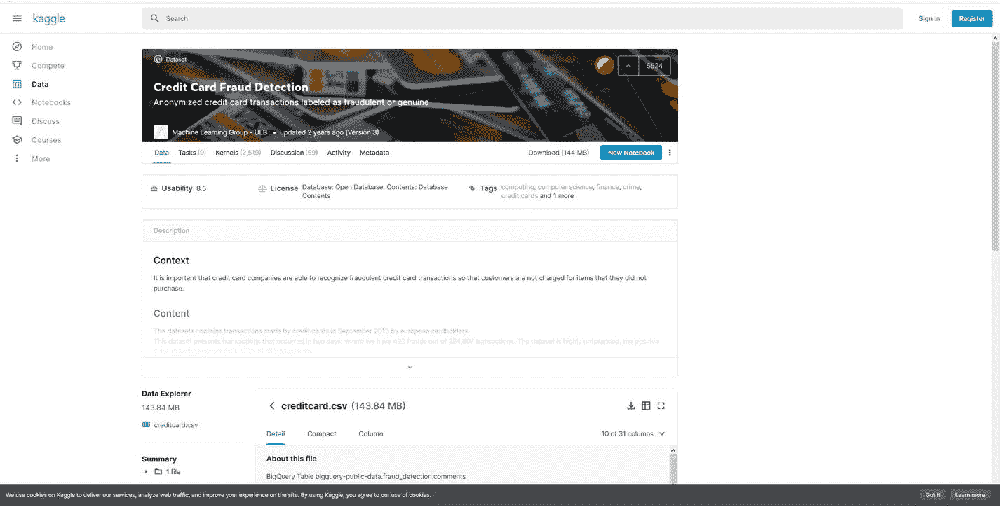

图 1-1

Kaggle 网站上关于信用卡数据的页面

接下来，你需要点击“新建笔记本”旁边的“下载（144 MB）”按钮来下载数据集。如果你尚未登录，系统会跳转到登录页面，但登录后你应该就能下载数据集了。

下载完成后，将 zip 文件解压到某个位置，即可获得信用卡数据集。现在，让我们打开 Jupyter 并探索这个数据集。在开始这一步之前，我们先了解一下所需的具体包及其版本：

*   Python 3.6.5

*   numpy 1.18.3

*   pandas 0.24.2

*   matplotlib 3.2.1

要检查你的包版本，可以运行如下命令：

```
pip show package_name
```

或者，你也可以在笔记本中运行以下代码来显示版本：

```
import module_name
print(module_name.__version__)
```

在此例中，`module_name` 是你导入的包名，例如 numpy。


### 加载数据集

让我们开始吧！首先，打开一个新的笔记本，导入所有依赖项，并为该笔记本设置全局参数：

```
%matplotlib inline
import numpy as np
import pandas as pd
import matplotlib.pyplot as plt
from pylab import rcParams
rcParams['figure.figsize'] = 14, 8
```

请参考图 1-2。

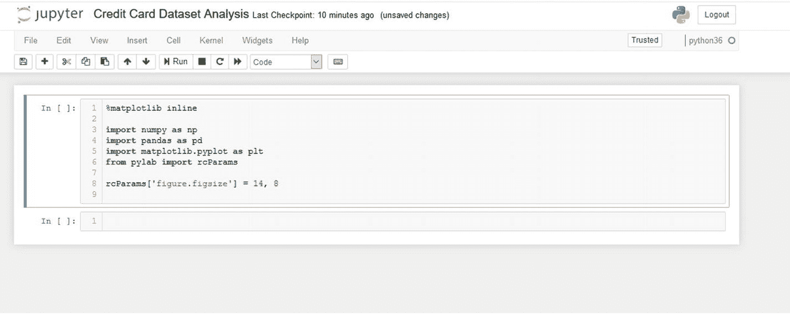

图 1-2

Jupyter 笔记本单元格，包含一些导入语句以及所有 matplotlib 图表尺寸的全局参数定义

现在你已经导入了必要的库，可以加载数据集了。在本例中，`data` 文件夹与笔记本文件位于同一目录下，其中包含 `creditcard.csv` 文件。代码如下：

```
data_path = "data/creditcard.csv"
df = pd.read_csv(data_path)
```

请参考图 1-3。

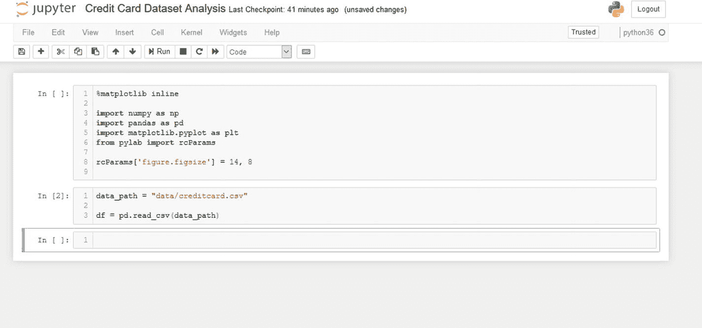

图 1-3

定义信用卡数据集 .csv 文件的数据路径，读取其内容，并创建一个 pandas 数据框对象

现在数据框已加载完毕，让我们查看一下它的内容：

```
df.head()
```

请参考图 1-4。

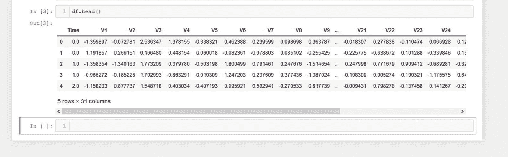

图 1-4

在数据框上调用 `head()` 函数，以显示数据框的前五行

如果你不熟悉 `df.head(n)` 函数，它本质上会打印数据框的前 n 行。如果像上图那样没有传入任何参数，则该函数默认值为 5，即打印数据框的前五行。

你可以随意尝试使用该函数，也可以使用滚动条探索其余特征。

现在，让我们查看一些与该数据框中数值相关的基本统计值：

```
df.describe()
```

请参考图 1-5。

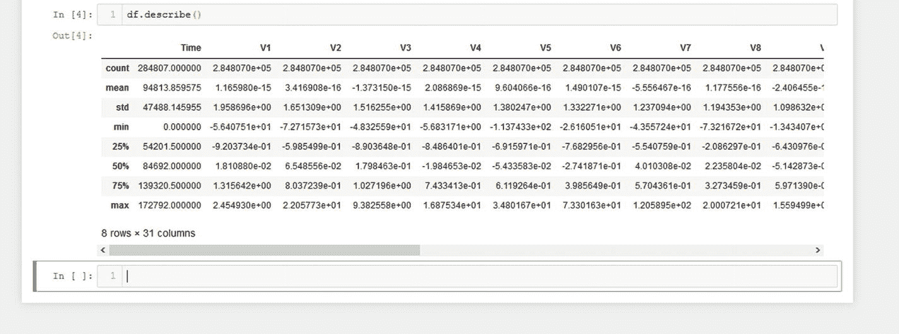

图 1-5

在数据框上调用 `describe()` 函数，以获取每列数据的统计摘要

你可以随意向右滚动，查看其余列的各种统计信息。如图 1-5 所示，该函数会为数据框中每一列的数据生成统计摘要。

这里的主要收获是数据点数量巨大。事实上，你可以通过简单调用以下代码来检查数据框的形状：

```
df.shape
```

请参考图 1-6。

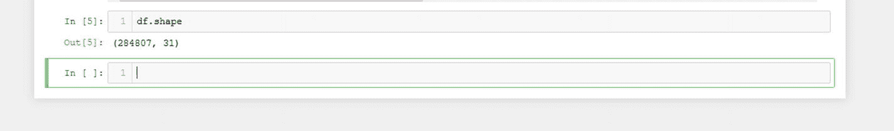

图 1-6

在数据框上调用 `shape()` 函数，以获取格式为 (行数, 列数) 的输出

该数据框有 284,807 行和 31 列。条目非常多！不仅如此，如果你查看图 1-5，你会发现 `Time` 列的值可能非常大。事实上，继续向右滚动，你会发现 `Amount` 列的值也可能非常大。请参考图 1-7。

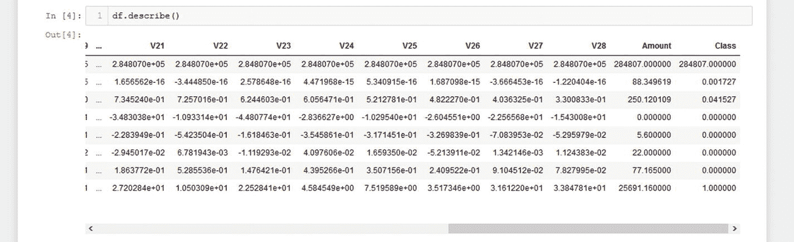

图 1-7

在 describe 函数的输出中向右滚动，发现 Amount 列的最大数据值也非常大，就像 Time 列的最大数据值一样

如你所见，至少有两列的值非常大。这告诉我们，在后续为模型训练过程构建各种数据集时，绝对需要对数据进行缩放。否则，如此大的数据值可能会扰乱训练过程。

### 正常数据与欺诈数据

由于只有两个类别，即 `normal` 和 `fraud`，让我们按类别拆分数据框，并继续进行数据分析。在异常检测的上下文中，`fraud` 类别也是 `anomaly` 类别，因此我们选择将表示欺诈交易数据的数据框命名为 `anomalies`，并且可以互换地将此类称为 `fraud` 或 `anomaly`。

代码如下：

```
anomalies = df[df.Class == 1]
normal = df[df.Class == 0]
```

之后，在另一个单元格中运行以下代码：

```
print(f"Anomalies: {anomalies.shape}")
print(f"Normal: {normal.shape}")
```

请参考图 1-8。

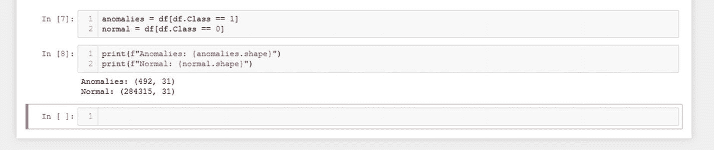

图 1-8

为欺诈/异常数据和正常数据定义数据框，并打印它们的形状

从这里可以看出，数据严重偏向于正常数据，而异常数据在整个数据集中仅占极小部分。这告诉我们，必须更仔细地构建训练集、评估集和验证集，以便每个集合都能很好地代表异常数据。

事实上，让我们以图形方式查看这种差异，看看差距有多大：

```
class_counts = pd.value_counts(df['Class'], sort = True)
class_counts.plot(kind = 'bar', rot=0)
plt.title("Class Distribution")
plt.xticks(range(2), ["Normal", "Anomaly"])
plt.xlabel("Label")
plt.ylabel("Counts")
```

请参考图 1-9。

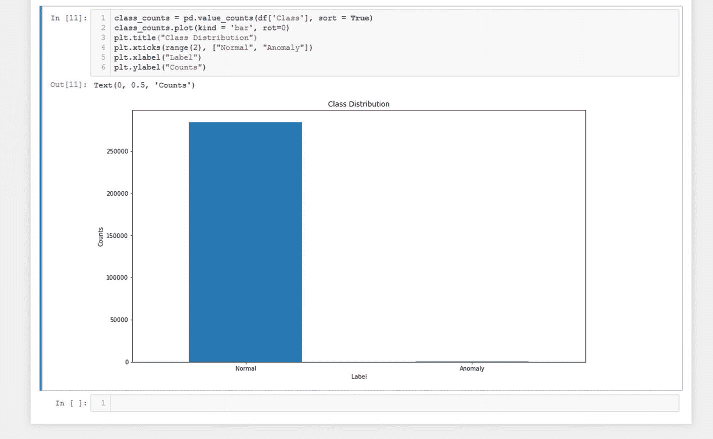

图 1-9

直观展示正常数据和异常数据数量差异的图表

该图表直观地显示了两个类别数据值数量的巨大差异。

现在，你可以开始分析每个类别中数据点的一些特征。首先，该数据集中的列是 `Time`、`V1` 到 `V28` 的值、`Amount` 和 `Class`。

那么，异常数据值是否包含金额过大的交易？让我们查看一下 `Amount` 的一些统计摘要值：

```
anomalies.Amount.describe()
```

输出请参考图 1-10。

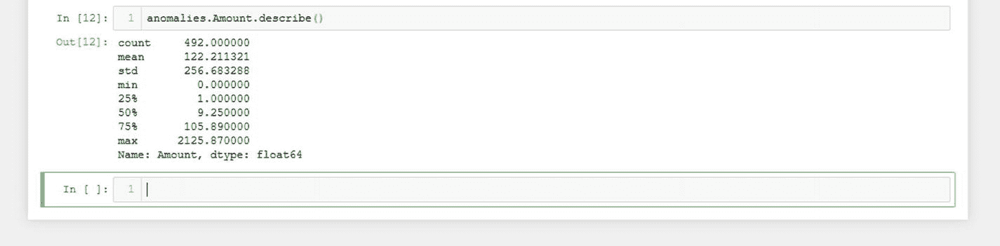

图 1-10

在欺诈数据框的 Amount 列上调用 `describe()` 函数的输出

数据似乎呈右偏态，异常交易包含的值并不很高。事实上，大多数交易金额低于 100 美元，所以欺诈交易并非高价值交易。

```
normal.Amount.describe()
```

输出请参考图 1-11。

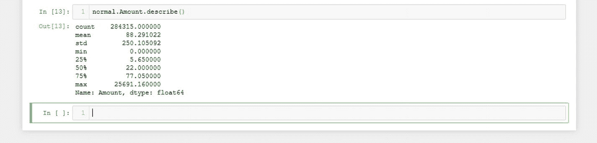

图 1-11

在正常数据框的 Amount 列上调用 `describe()` 函数的输出

如果你查看正常数据，它比异常数据更呈右偏态。大多数交易金额低于 100 美元，但有些金额可能非常高，达到 25,000 美元。


### 绘制图表

现在，让我们采用图形化的方法来更直观地说明这一点。首先，定义一些函数来帮助绘制数据中的各个列，以便更轻松地可视化各种关系：

```
def plot_histogram(df, bins, column, log_scale=False):
bins = 100
anomalies = df[df.Class == 1]
normal = df[df.Class == 0]
fig, (ax1, ax2) = plt.subplots(2, 1, sharex=True)
fig.suptitle(f'Counts of {column} by Class')
ax1.hist(anomalies[column], bins = bins, color="red")
ax1.set_title('Anomaly')
ax2.hist(normal[column], bins = bins, color="orange")
ax2.set_title('Normal')
plt.xlabel(f'{column}')
plt.ylabel('Count')
if log_scale:
plt.yscale('log')
plt.xlim((np.min(df[column]), np.max(df[column])))
plt.show()
def plot_scatter(df, x_col, y_col, sharey = False):
anomalies = df[df.Class == 1]
normal = df[df.Class == 0]
fig, (ax1, ax2) = plt.subplots(2, 1, sharex=True, sharey=sharey)
fig.suptitle(f'{y_col} over {x_col} by Class')
ax1.scatter(anomalies[x_col], anomalies[y_col], color="red")
ax1.set_title('Anomaly')
ax2.scatter(normal[x_col], normal[y_col], color="orange")
ax2.set_title('Normal')
plt.xlabel(x_col)
plt.ylabel(y_col)
plt.show()
```

请参考图 1-12 查看单元格中的代码。

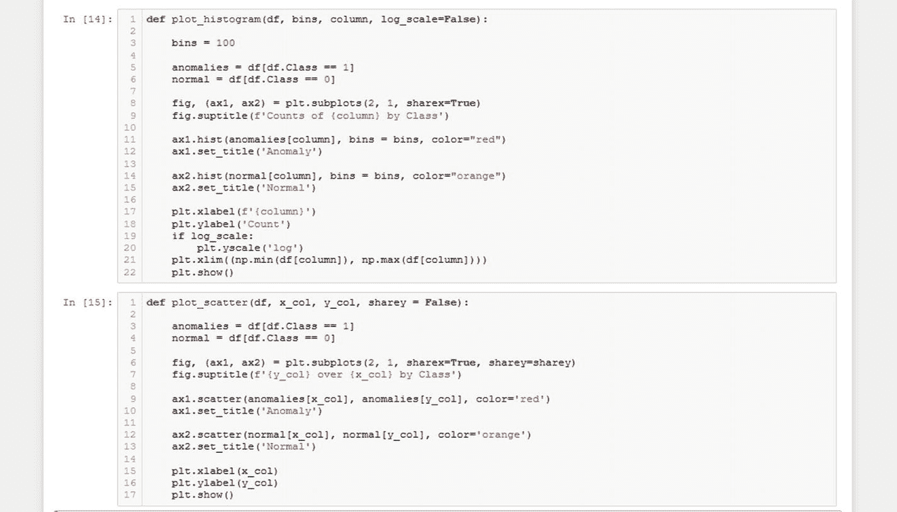

图 1-12

每个绘图函数都位于各自的 Jupyter 单元格中

现在，让我们开始为整个数据框绘制按 `Class` 分组的 `Amount` 值：

```
plt.scatter(df.Amount, df.Class)
plt.title("Transaction Amounts by Class")
plt.ylabel("Class")
plt.yticks(range(2), ["Normal", "Anomaly"])
plt.xlabel("Transaction Amounts ($)")
plt.show()
```

请参考图 1-13。

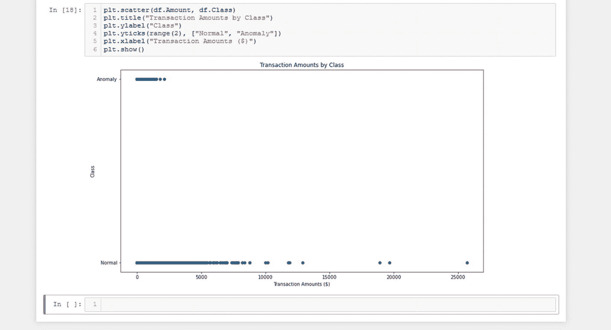

图 1-13

数据框中包含所有数据值的散点图。绘制的列是 x 轴上的 Amount 和 y 轴上的 Class

正如所料，正常数据集中似乎存在一些巨大的异常值。然而，该图在展示数值计数方面信息量不大，因此让我们使用之前定义的绘图函数来绘制能提供更多背景信息的图表：

```
bins = 100
plot_histogram(df, bins, "Amount", log_scale=True)
```

请参考图 1-14。

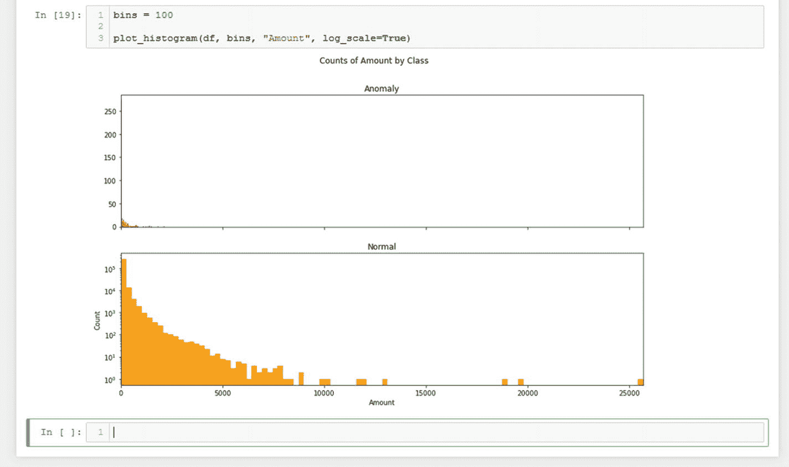

图 1-14

数据框中 Amount 列按区间组织的数据值的计数直方图。区间数量为 100，意味着直方图中每个柱子的区间是 Amount 列数据的范围除以区间数量

由此，你肯定能注意到右偏以及正常数据中存在的巨大异常值。由于你几乎看不到异常数据，让我们再绘制另一张图：

```
plt.hist(anomalies.Amount, bins = bins, color="red")
plt.show()
```

请参考图 1-15。

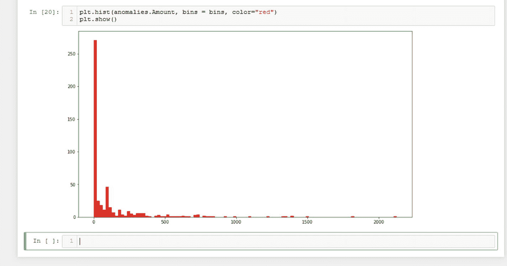

图 1-15

仅针对异常数据框中 Amount 列数值的直方图。这里的区间数量也是 100，后续示例中也将如此

异常数据似乎也呈右偏分布，但程度要严重得多。这意味着大多数异常交易的金额实际上非常低。

好了，那么时间维度呢？让我们再绘制一个基础的散点图：

```
plt.scatter(df.Time, df.Class)
plt.title("Transactions over Time by Class")
plt.ylabel("Class")
plt.yticks(range(2), ["Normal", "Anomaly"])
plt.xlabel("Time (s)")
plt.show()
```

请参考图 1-16。


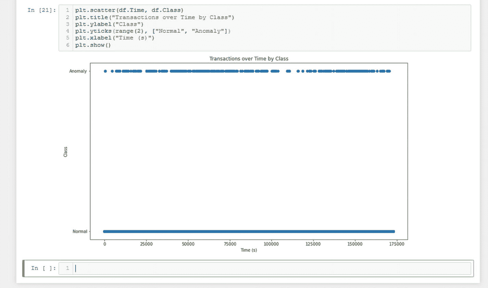

图 1-16

数据框 `df` 中数值的散点图，x 轴为 `Time` 列数据，y 轴为 `Class` 列数据

这张图信息量不大，但它确实表明欺诈交易在整个时间线上分布相当分散。我们再次使用绘图函数来了解计数情况：

```
plot_scatter(df, "Time", "Amount")
```

请参考图 1-17。

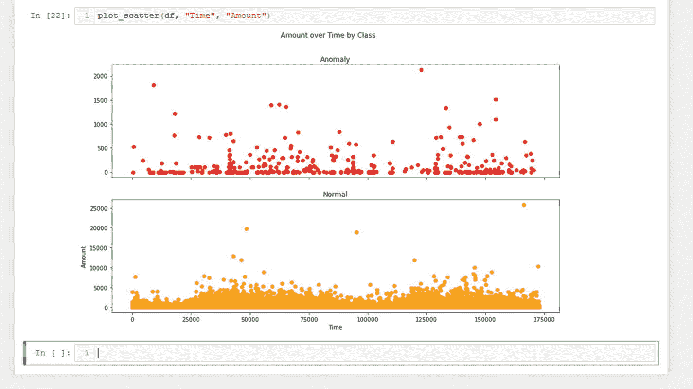

图 1-17

使用 `plot_scatter()` 函数绘制数据框 `df` 中 x 轴为 `Time` 列、y 轴为 `Amount` 列的数据值

现在你有了更好的背景信息，但似乎并没有揭示太多内容。你可以看到欺诈交易贯穿整个时间线，并且没有特定的时间段出现高价值交易。确实似乎存在两个主要集群，但这也可能是由于与正常数据点相比，数据点数量不足所致。

现在让我们查看直方图以考虑频率：

```
plot_scatter(df, "Time", "Amount")
```

请参考图 1-18。

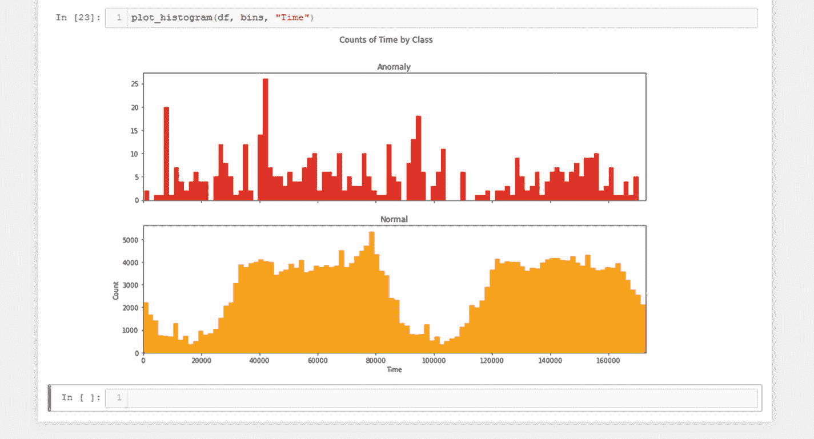

图 1-18

使用 `plot_histogram()` 函数绘制数据框 `df` 中 `Time` 列的数据值

由此，你可以很好地了解欺诈/异常交易随时间推移的数量情况。对于正常数据，它们似乎呈波浪状出现。对于异常数据，似乎没有特定的高峰时间；它们只是在整个时间跨度内出现。

确实，在首次交易开始附近出现了明显的峰值，并且某些峰值恰好出现在正常交易处于波浪模式“低谷”的位置。然而，仍有相当一部分欺诈交易发生在正常交易达到最大值的时间点。

那么其他列的数据是什么样的呢？让我们看看 `V1` 的一些有趣图表：

```
plot_histogram(df, bins, "V1")
```

请参考图 1-19。

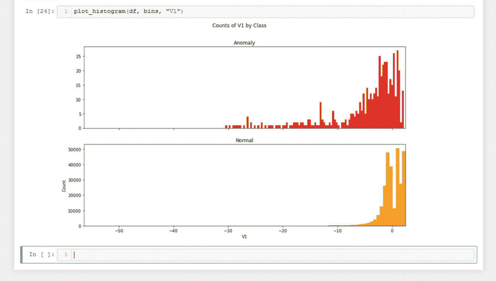

图 1-19

使用 `plot_histogram()` 函数绘制数据框 `df` 中 `V1` 列的数据

在这里，你可以看到在相同的 `V1` 值范围内，每个类别的数据点分布存在明显差异。欺诈交易所涵盖的值范围延伸到了 `V1` 的数值区间。让我们继续探索，看看 `Amount` 的值与 `V1` 的关系：

```
plot_scatter(df, "Amount", "V1", sharey=True)
```

`sharey` 参数的作用是强制两个子图共享相同的 y 轴，这意味着图表将在同一比例尺下显示。你指定此参数是为了更容易看出异常点与正常点相比的分布情况。请参考图 1-20。

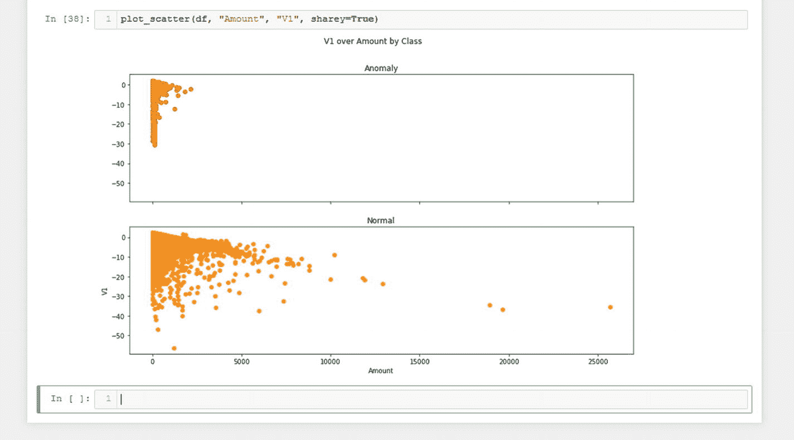

图 1-20

使用 `plot_scatter()` 函数绘制数据框 `df` 中 x 轴为 `Amount` 列、y 轴为 `V1` 列的数据值

从这张图来看，与所有其他正常点相比，欺诈点似乎并不显得突兀。

我们继续看看时间与 `V1` 值的关系：

```
plot_scatter(df, "Time", "V1", sharey=True)
```

请参考图 1-21。

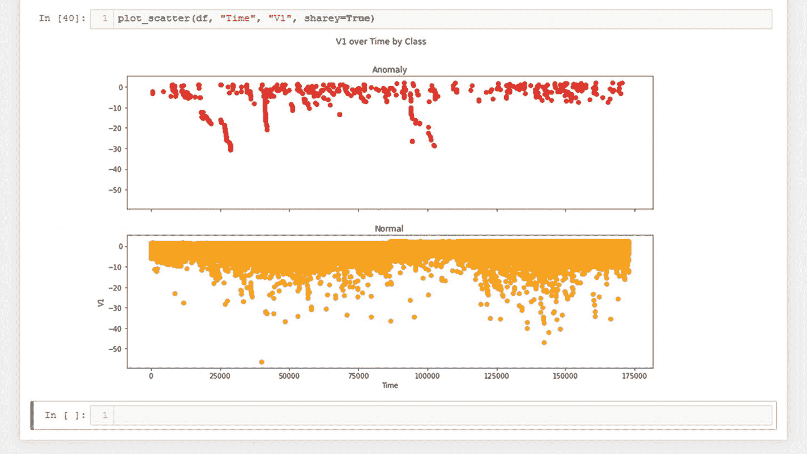

图 1-21


使用 `plot_scatter()` 函数绘制 `df` 中 `Time` 列（x 轴）与 `V1` 列（y 轴）的数值。

除了少数几个从正常数据点中突显出来的尖峰外，此场景中的大部分欺诈数据似乎都与正常数据混在一起。

逐个处理所有其他数值会很繁琐，因此我们用一个简单的脚本一次性绘制它们。以下是绘制从 `V1` 到 `V28` 各列频率计数的代码：

```
for f in range(1, 29):
print(f'V{f} Counts')
plot_histogram(df, bins, f'V{f}')
```

请参考图 1-22。

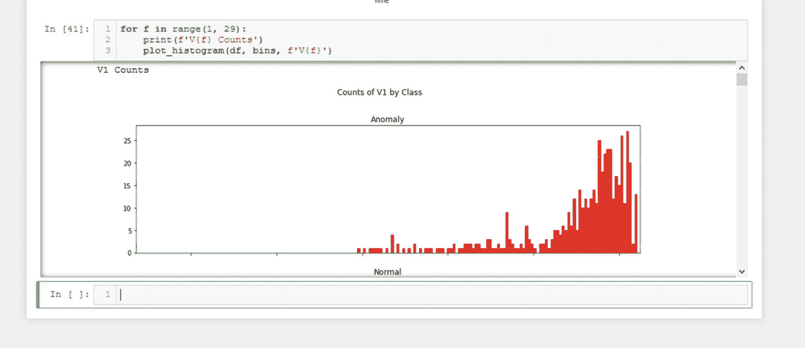

图 1-22

一个使用 `plot_histogram()` 函数为 `df` 中从 `V1` 到 `V28` 各列数据绘制直方图的脚本

由于输出已被最小化，请将鼠标悬停在条形图变暗处并点击以展开输出，这样您就能更清晰地查看图表。请参考图 1-23。

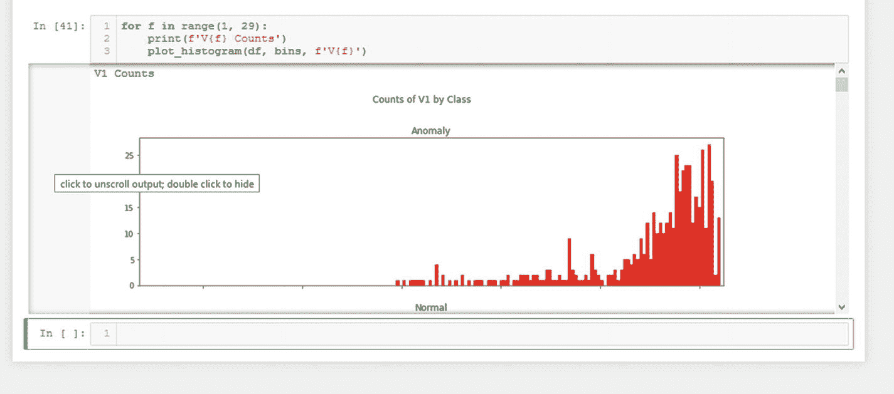

图 1-23

将鼠标悬停在图表左侧的条形上（它会变暗并显示如图所示的工具提示），然后点击以展开输出

现在您应该会看到类似图 1-24 所示的内容。

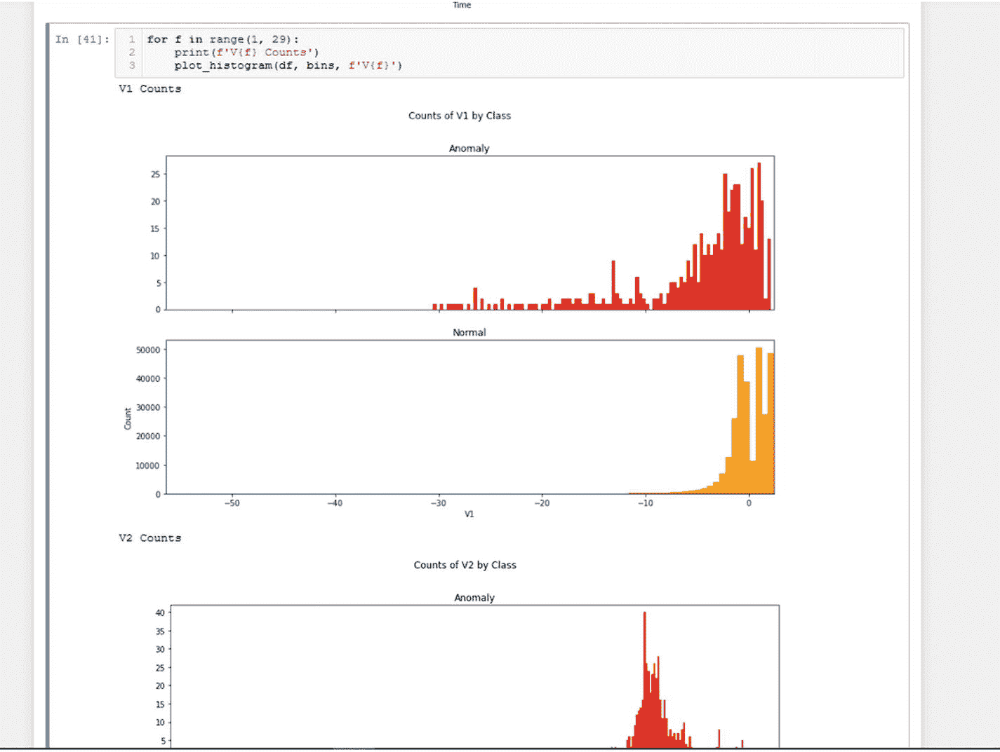

图 1-24

展开后的输出应呈现的样子。所有图表应如图中所示连续显示

滚动浏览，您会看到许多有趣的图表，例如图 1-25 和图 1-26。

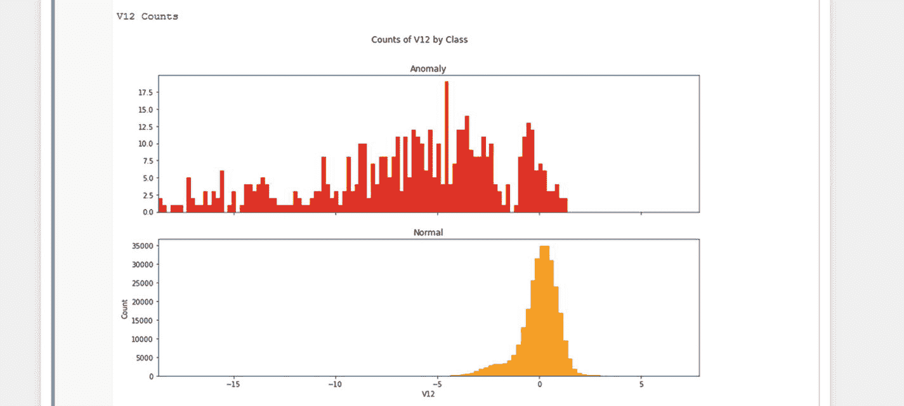

图 1-25

`df` 中 `V12` 列数据的直方图。如您所见，异常值与正常值相比存在非常明显的偏差。两个图共享相同的 x 轴刻度，因此虽然异常值的计数可能远低于正常值，但在相同的 `V12` 列数值范围内，它们的分布范围却比正常值广泛得多

在这种情况下，您可以清楚地看到欺诈数据与正常数据之间的区别，这是您之前在图中所看不到的。因此，像 `V12` 这样的特征在帮助模型提供更好的上下文方面无疑更为重要。

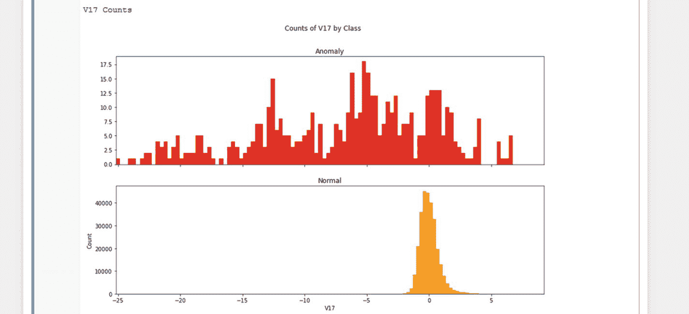

图 1-26

`df` 中 `V17` 列数据的直方图。与 `V12` 列类似，异常值与正常值相比也存在明显的偏差。这表明，与那些未显示此类偏差的其他列相比，`V17` 列更有可能帮助模型学习如何区分正常交易和欺诈交易

这次您可以看到欺诈数据与正常数据之间存在更大的差异。再次强调，正是像 `V12` 和 `V17` 这样的特征所包含的数据，将帮助模型理解如何区分异常点和正常点。

要最小化输出，请点击之前展开输出时点击过的同一个条形。现在，让我们看看所有这些数据点如何随时间变化：

```
for f in range(1, 29):
print(f'V{f} vs Time')
plot_scatter(df, "Time", f'V{f}', sharey=True)
```

再次展开输出并探索图表。请参考图 1-27 和图 1-28 以查看一些有趣的结果。

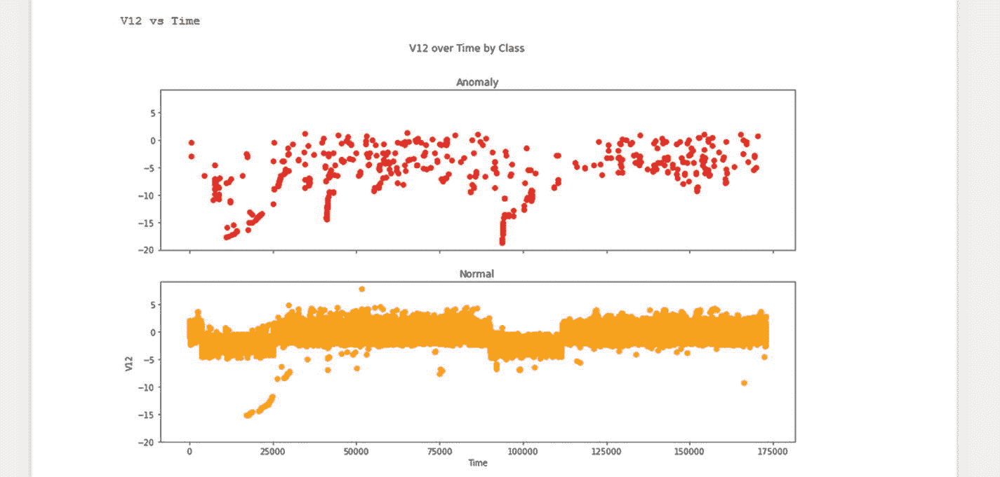

图 1-27

x 轴为 Time、y 轴为 V12 的散点图显示了异常点与正常数据点之间的偏差。尽管相当一部分异常点落在正常点的带状区域内，但仍有不少异常点超出了该范围。因此，您可以看到，相对于 Time，`V12` 列的数据也显示出与正常数据点的这种偏差

再次，对于 `V12`，您可以看到异常点与正常数据点之间存在显著差异。相当一部分异常点隐藏在正常数据点中，但仍有大量异常点可以与其余数据区分开来。

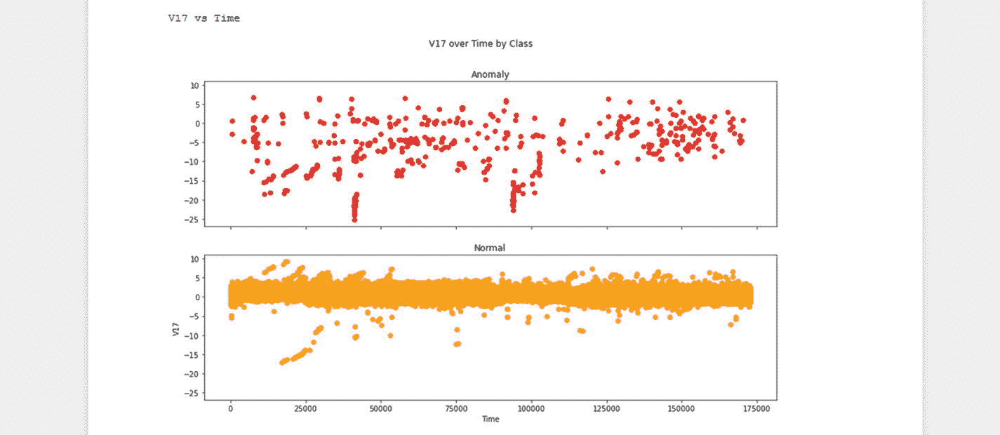

图 1-28

x 轴为 Time、y 轴为 V17 的散点图显示了异常点与正常数据点之间的偏差。与 `V12` 的值一样，您可以观察到正常点与欺诈点之间的另一种偏差。在这种情况下，差异似乎更为明显，因为异常点比图 1-27 中分布得更分散

在查看 `V17` 时，异常点与正常点之间的差异更加突出。似乎即使在与时间的关系中，`V12` 和 `V17` 列所包含的数据也最能帮助区分欺诈交易与正常交易。您可以在图中看到，一些正常点也与异常点混在一起，但希望模型在考虑所有数据后能够学习到真正的差异。

最后，让我们看看这些列与 `Amount` 之间的关系：

```
for f in range(1, 29):
print(f'Amount vs V{f}')
plot_scatter(df,  f'V{f}', "Amount", sharey=True)
```

这次似乎有更多的图表更清晰地显示了正常点与欺诈点之间的差异。请参考图 1-29、图 1-30 和图 1-31。

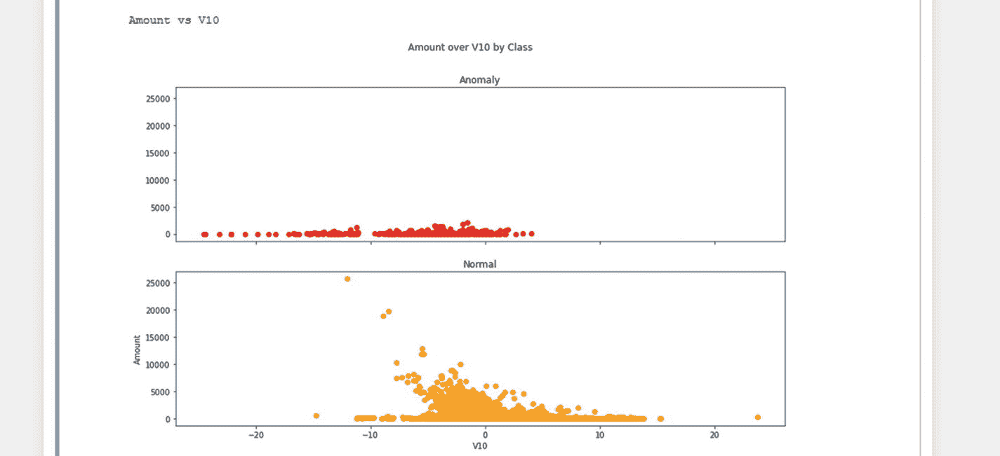

图 1-29

查看 y 轴为 Amount、x 轴为 V10 的散点图，您可以看到欺诈点与正常点之间存在明显的偏差。对于 V 列与 Amount 的关系，与之前的图相比，似乎有更多的列显示出更大的偏差。这种差异并非特别巨大，因为您仍然可以看到相当一部分异常点位于正常数据簇内。然而，这仍然为模型提供了关于欺诈交易与正常交易差异的一些上下文

从 `V9` 到 `V12` 的图表都显示了异常点与正常点之间的明显区分，即使相当一部分异常点位于正常点簇内。需要注意的一点是，每次在图表中表现出差异的异常点可能并不相同，这使得模型能够更好地学习如何区分异常点和正常点。

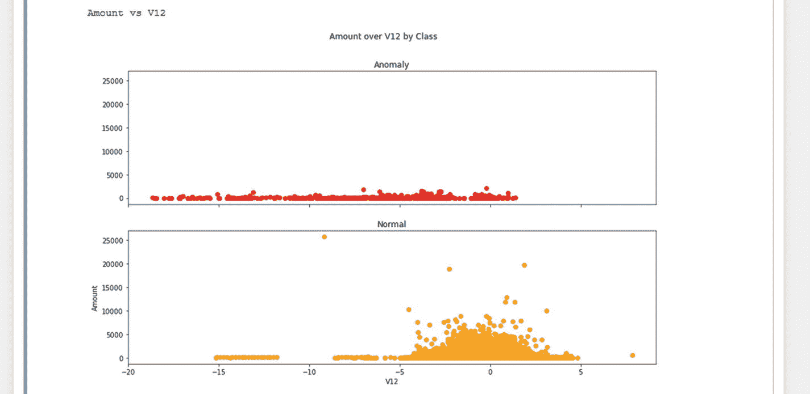

图 1-30

y 轴为 Amount、x 轴为 V12 的散点图。再次，您可以看到欺诈点与正常点之间存在明显的偏差。在这种情况下，大多数欺诈点似乎偏离了正常点簇。您还可以看到，在远离主簇的地方有一条正常点带，并且该点带与异常数据点重合。如果模型将此类点归类为异常，这是一个可能需要牢记的可能原因


你可以再次看到，`V12` 能够持续区分异常数据和正常数据。然而，仍然存在一个问题，即相当一部分异常数据隐藏在正常数据簇中。

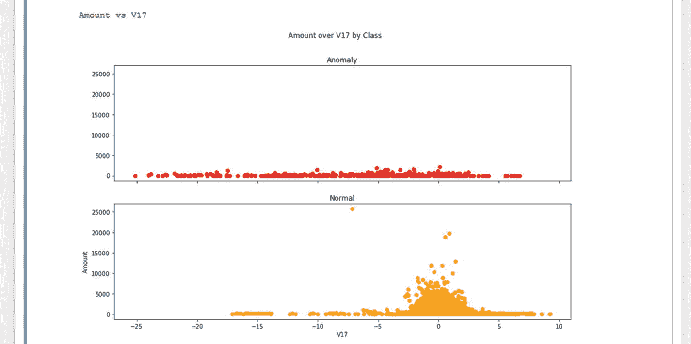

图 1-31

一个散点图，y 轴为 Amount 列，x 轴为 V17 列。与图 1-30 类似，你可以再次看到欺诈点偏离了正常点簇。同样，大多数欺诈点都表现出这种偏离，但你也可以看到一些正常点与这些异常点重合。

你还可以看到，这种正常点与欺诈点之间的区分在 `V17` 列上，结合交易金额来看，也是成立的。

你也可以查看每个 V 列的数据，并将它们相互绘制成图，但这更有助于识别趋势的精确变化，如果你希望进一步训练模型以提高其在新数据上的性能，了解这些变化会更有用。首先，并非每个特征都非常重要。因此，即使趋势发生变化，也不一定意味着模型性能会下降。

对数据进行透彻分析，有助于数据科学家更好地理解各个数据列之间的相互关系，并让他们能够识别趋势是否随时间推移而发生变化。随着数据持续不断地被收集，数据偏差和趋势必然会发生变化。所以，也许一年后，是 `V18` 列在异常点和正常点之间显示出显著差异，而 `V17` 列则显示大多数异常点都包含在正常点簇中。

## 总结

数据分析是创建机器学习解决方案过程中的关键步骤。它不仅决定了模型的类型，并影响将为训练过程选择的特征集，还有助于识别随时间推移的任何趋势变化，这些变化可能表明模型需要进一步训练。你探索并分析了信用卡数据集中的数据，生成了许多图表以了解两个绘制变量之间的关系，并识别出了一些区分正常点和异常点的特征。在下一章中，你将处理数据以创建各种子集，从而帮助训练几种类型的机器学习模型。

