# 2. 构建模型

在本章中，我们将介绍如何在 `scikit-learn` 和 `PySpark` 中构建一个简单的逻辑回归模型。我们还将介绍在 `scikit-learn` 中使用 k 折交叉验证来调整超参数的过程。

## 引言

在上一章中，你加载了信用卡数据集并分析了其数据分布。你还查看了特征之间的关系，并对它们对标签的影响程度有了大致了解。

既然你已经对数据集有了更好的理解，接下来将继续构建模型本身。你将使用与上一章相同的信用卡数据集。在本章中，你将了解两个框架：`scikit-learn` 和 `PySpark`。你在 `scikit-learn` 和 `PySpark` 中构建的模型将在本书的其余部分中持续使用，因为稍后你将把它们托管在云服务上进行预测。我们将保持简单，在这两个框架中构建逻辑回归模型。由于这两个框架的输入数据格式不同，你不能提前进行数据处理，然后为这两个框架使用相同的训练/测试/验证集。然而，例如，对于 `scikit-learn` 和 Keras，这是可能的，具体取决于 Keras 模型中最后一层的构建方式。

你将使用 `scikit-learn` 模型执行验证步骤来调整超参数。`超参数`可以被视为影响训练过程和结果的模型相关参数。

话不多说，让我们开始使用 `scikit-learn` 并构建一个逻辑回归模型。需要注意的一点是，我们将在 `scikit-learn` 模型中提供大量注释，而在 PySpark 示例中可能会跳过这些注释，所以请务必至少通读 `scikit-learn` 的流程，以大致了解训练-测试-验证是如何工作的。

## Scikit-Learn

在开始之前，这里是你需要的包及其版本。我们将提供一种简单的方法，让你在代码内部检查包的版本。

以下是我们配置的版本：

*   Python 3.6.5

*   numpy 1.18.5

*   pandas 1.1.0

*   matplotlib 3.2.1

*   seaborn 0.10.1

*   sklearn 0.22.1.post1

在下面的代码中，你会发现一些导入是不必要的，例如当你只使用 sklearn 的一小部分功能时却导入了整个 sklearn。这样做是为了显示版本信息，此类语句旁边会有一个 # 号。

### 数据处理

那么现在，我们从 `import` 语句开始：

```python
import numpy as np
import pandas as pd
import matplotlib #
import matplotlib.pyplot as plt
import seaborn as sns
import sklearn #
from sklearn.linear_model import LogisticRegression
from sklearn.model_selection import train_test_split
from sklearn.preprocessing import StandardScaler
from sklearn.metrics import roc_auc_score, plot_roc_curve, confusion_matrix
from sklearn.model_selection import KFold
print("numpy: {}".format(np.__version__))
print("pandas: {}".format(pd.__version__))
print("matplotlib: {}".format(matplotlib.__version__))
print("seaborn: {}".format(sns.__version__))
print("sklearn: {}".format(sklearn.__version__))
```

请参考图 2-1 查看输出结果。

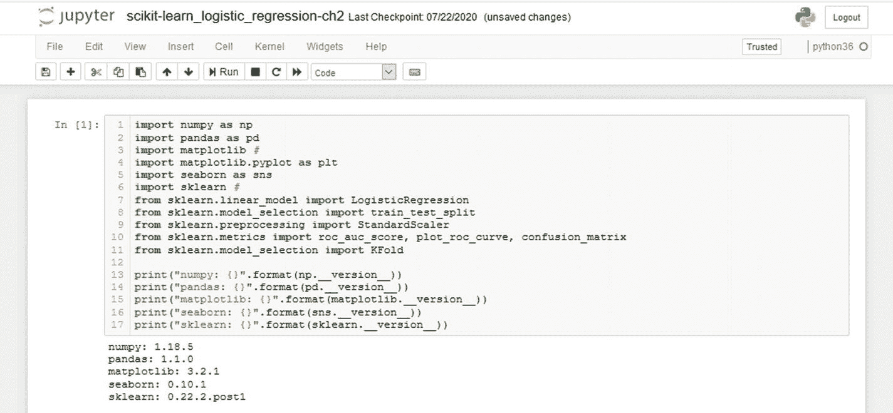

图 2-1

输出显示了所需模块的打印版本。部分模块仅为了打印版本而导入，并在其旁边用 `#` 标记，表示它们并非运行代码所必需。

现在你可以继续加载数据了。你将使用与上一章相同的信用卡数据集：

```python
data_path = "data/creditcard.csv"
df = pd.read_csv(data_path)
```

请参考图 2-2 查看单元格中的这段代码。

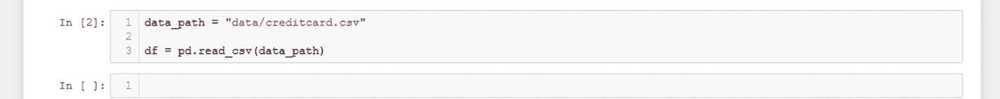

图 2-2

使用 pandas 加载数据框。信用卡数据集位于名为 `data` 的文件夹中，该文件夹与笔记本文件位于同一目录下。

加载数据框时不应有任何输出。要查看刚刚加载的数据框，请调用以下代码以确保其正确读取了数据：

```python
df.head()
```

你应该会看到类似图 2-3 所示的内容。

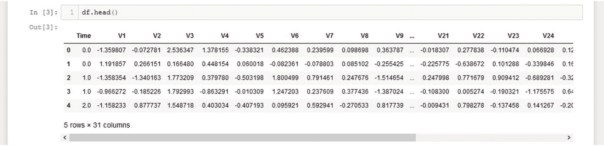

图 2-3

`head()` 函数的输出。数据已正确加载，你可以看到数据框的前五行。

如果你还记得上一章的内容，正常数据与异常数据之间的分布存在严重不平衡。因此，你将采用一种略有不同的方法来处理这些数据。

这就是数据分析发挥作用的地方。由于你知道每个类别的数据量存在巨大差异，现在你需要特别小心地构建数据集，以确保每个数据集中都包含足够数量的异常数据。如果你只是简单地从 `df` 中选取 100,000 个数据点，然后将其拆分为训练集、测试集和验证集，那么很有可能其中一个或多个集合中只包含极少甚至没有异常数据。到那时，你将很难让模型正确学习这个任务。

这就是为什么你要将异常点和正常点分开，来创建训练集、测试集和验证集。

考虑到这一点，让我们为正常点和欺诈点创建数据框：

```python
normal = df[df.Class == 0].sample(frac=0.5, random_state=2020).reset_index(drop=True)
anomaly = df[df.Class == 1]
```

你将 `random_state` 设置为一个特定值，这样无论重复多少次随机采样，结果都应该相同，这有助于结果的可复现性。不幸的是，鉴于模型学习方式的特性，你不能期望每次都能得到相同的结果，例如对于神经网络这类模型。

在这段代码中，你按类别筛选出相应的值，并抽取整个数据框中 50% 的正常点，以此构成当前上下文中的正常数据。

请参考图 2-4 查看单元格中的这段代码。


图 2-4

按类别过滤数据框的值，以创建正常数据框和异常数据框。正常数据框包含所有正常数据点中的 50%，这些数据点是根据种子（`random_state`）随机选择的。

你还可以添加一些代码来检查形状：

```python
print(f"Normal: {normal.shape}")
print(f"Anomaly: {anomaly.shape}")
```

输出结果请参考图 2-5。

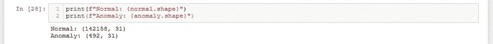

图 2-5

打印正常数据框和异常数据框的形状。两个数据框中的条目数量存在明显差异。

如你所见，正常数据点与异常数据点之间仍然存在巨大差异。以逻辑回归为例，模型仍然能够学习如何区分两者；但以神经网络为例，这种差异意味着模型永远无法真正学会如何对异常进行分类。不过，正如你将在本章后面看到的，你可以告诉模型，在其学习过程中，对异常数据点的权重远高于正常数据点。

现在，你可以开始创建训练集/测试集/验证集的分割。然而，`scikit-learn` 仅提供创建训练集/测试集分割的功能。为了解决这个问题，你将先创建训练集和测试集，然后将训练集再次分割为训练集和验证集。

首先，你将数据分割为训练数据和测试数据，并保持正常数据点和异常数据点分离。为此，你将使用 `scikit-learn` 的 `train_test_split()` 函数。常用的参数包括：

*   `x`：你想要分割的 x 集合

*   `y`：与 x 集合对应的、你想要分割的 y 集合

*   `test_size`：你希望从 x 和 y 中随机抽取用于测试集的数据比例。

因此，要将 x 和 y 分割为训练集和测试集，你可能会看到如下代码：

```python
x_train, x_test, y_train, y_test = train_test_split(x, y, test_size=0.2, random_state = 2020)
```

和之前一样，`random_state` 用于设置随机种子，这样每次运行时，数据都会以相同的方式分割。

如果你不传入 `y` 参数，则只会对 `x` 数据进行分割。记住这一点，现在让我们将你的正常数据点和异常数据点分割为训练集和测试集：

```
normal_train, normal_test = train_test_split(normal, test_size = 0.2, random_state = 2020)
anomaly_train, anomaly_test = train_test_split(anomaly, test_size = 0.2, random_state = 2020)
```

应该不会有输出，但请参考图 2-6 查看单元格中的代码。

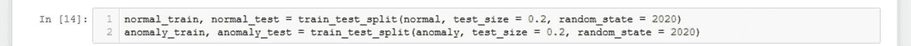
图 2-6

将正常数据框和异常数据框分割为训练子集和测试子集。各自的测试集占原始数据集的 20%。

现在，你可以通过对各自的训练集调用相同的函数来创建训练集和验证集。不过，你不想再次按 20% 进行分割，因为训练集已经是原始数据集的 80%。如果你再次使用 20% 的分割，验证集将占原始数据的 16%，而训练集将占原始数据的 64%。相反，你将按照 60-20-20 的比例分别分割训练数据、测试数据和验证数据，因此你将使用新的 `test_size` 值 0.25 来确保这些比例成立（`0.25 * 0.8 = 0.2`）。

记住这一点，让我们创建训练集和验证集的分割：

```
normal_train, normal_validate = train_test_split(normal_train, test_size = 0.25, random_state = 2020)
anomaly_train, anomaly_validate = train_test_split(anomaly_train, test_size = 0.25, random_state = 2020)
```

请参考图 2-7 查看单元格中的代码。

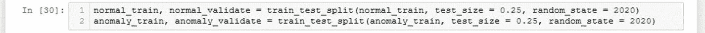
图 2-7

你从训练数据中创建了训练集和验证集的分割。你选择让验证集占各自原始训练集的 25%。由于这些原始训练集本身占原始正常数据框和异常数据框的 80%，因此各自的验证集分割占其原始正常数据框和异常数据框的 20%（`0.25 * 0.8`）。因此，最终的训练集分割也变为原始数据的 60%，因为 `0.75 * 0.8 = 0.6`。

为了创建最终的训练集、测试集和验证集，你必须将各自的正常数据分割和异常数据分割连接起来。

首先，定义 `x_train`、`x_test` 和 `x_validate`：

```
x_train = pd.concat((normal_train, anomaly_train))
x_test = pd.concat((normal_test, anomaly_test))
x_validate = pd.concat((normal_validate, anomaly_validate))
```

接下来，定义 `y_train`、`y_test` 和 `y_validate`：

```
y_train = np.array(x_train["Class"])
y_test = np.array(x_test["Class"])
y_validate = np.array(x_validate["Class"])
```

最后，你必须删除 `x` 集合中的 `Class` 列，因为如果你直接给出标签，就违背了教模型学习如何区分正常交易和欺诈交易的目的：

```
x_train = x_train.drop("Class", axis=1)
x_test = x_test.drop("Class", axis=1)
x_validate = x_validate.drop("Class", axis=1)
```

要查看单元格中的所有代码，请参考图 2-8。

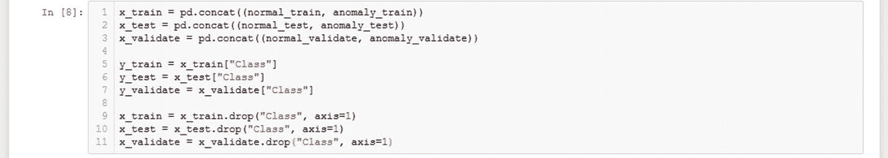
图 2-8

创建训练集、测试集和验证集各自的 `x` 和 `y` 分割。对于每个分割（训练、测试、验证），`x` 集合是正常集合和异常集合的组合，而 `y` 集合只是这些 `x` 集合中 `Class` 列的数据。然后，你从 `x` 集合中删除标签列。

让我们获取刚刚创建的集合的形状：

```
print("Training sets:\nx_train: {} y_train: {}".format(x_train.shape, y_train.shape))
print("\nTesting sets:\nx_test: {} y_test: {}".format(x_test.shape, y_test.shape))
print("\nValidation sets:\nx_validate: {} y_validate: {}".format(x_validate.shape, y_validate.shape))
```

请参考图 2-9 查看输出结果。

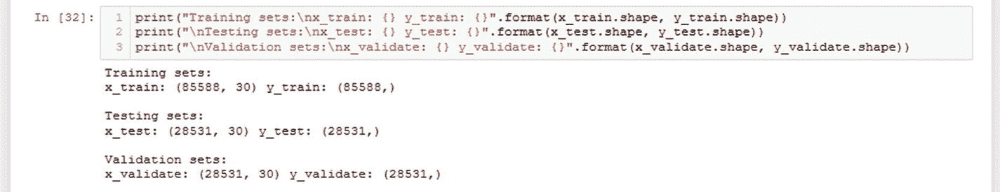
图 2-9

打印不同集合的输出结果。这三个集合应分别占原始正常集合和异常集合并集的 60%、20% 和 20%。

查看数据分析，你会发现有些值变得非常大。具体细节超出了本书的范围，但当某些特征的范围相对较小，而其他特征的范围极大时（想想上一章中 `V1` 和 `Time` 的范围），模型的学习将变得困难得多。

更详细地说，模型将难以优化成本函数，并且可能需要更多步骤才能收敛（如果它能够收敛的话）。

因此，最好通过归一化数据来将所有数据缩放到一个合适的范围。你将使用 `scikit-learn` 的 `StandardScaler`，它会将所有数据归一化，使得均值为 0，标准差为 1。

以下是标准化数据的代码：

```
scaler = StandardScaler()
scaler.fit(pd.concat((normal, anomaly)).drop("Class", axis=1))
x_train = scaler.transform(x_train)
x_test = scaler.transform(x_test)
x_validate = scaler.transform(x_validate)
```

需要注意的是，你是在整个数据框上拟合缩放器，以便以相同的方式标准化所有数据。这是为了确保最佳结果，因为你不想以各自的方式标准化 `x_train`、`x_test` 和 `x_validate`，因为这会在数据中造成差异，并对模型产生问题。当然，一旦你部署了模型并开始接收新数据，你仍然会使用训练过程中的缩放器对其进行标准化，但这些新数据可能来自与训练数据略有不同的分布。如果趋势开始发生变化，这种情况尤其会发生——这种新的标准化数据可能会让模型更难处理，因为它不太适合模型训练时所依据的分布。

请参考图 2-10 查看单元格中的代码。

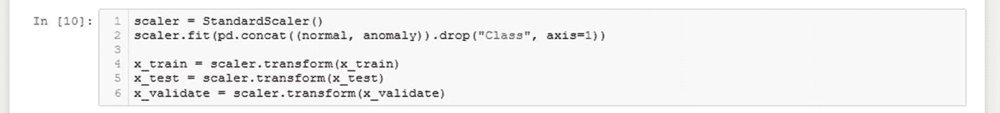
图 2-10

在正常数据框和异常数据框的拼接上拟合一个标准缩放器对象。这样做是为了让训练集、测试集和验证集各自根据相同的标准进行缩放，确保数据缩放之间没有差异。

### 模型训练

最后，你现在可以定义你的逻辑回归模型了：

```
sk_model = LogisticRegression(random_state=None, max_iter=400, solver='newton-cg').fit(x_train, y_train)
```

请参考图 2-11 查看单元格中的代码。如果一切顺利，执行后不应有任何输出。你可能看到的任何错误都可能涉及收敛失败。为此，更改 `max_iter` 参数可能会有所帮助，更改 `solver` 算法也可能有帮助。

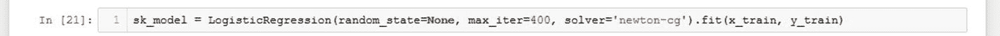
图 2-11

定义逻辑回归模型并在训练数据上对其进行训练

训练过程之后，接下来可以是评估步骤或验证步骤。只要测试集和验证集来自不同的分布（验证集源自训练集，而测试集源自原始数据），模型在技术层面上就是在评估和验证过程中看到新数据。

上下文也很重要。如果你使用验证过程从一组训练好的模型中选择最佳模型，那么验证过程可以在训练过程之后进行。你仍然可以评估一个或所有训练好的模型，但这可能是不必要的，因为在这种情况下，你正在尝试为代码找到最佳模型。

在你试图为将要坚持使用的模型调整超参数的情况下，先进行评估还是先进行验证并不重要。像你即将做的那样先进行评估，可以在开始验证步骤之前让你很好地了解模型当前的表现。模型永远不会从评估数据中学习，因此在此数据上评估模型没有坏处。

在这个例子中，你正在考虑调整类别权重的超参数（正常样本的权重和欺诈样本的权重）。但首先，让我们评估一下你的模型，以便更深入地了解一切是如何运作的。

### 模型评估

你现在可以查看准确率和 AUC 分数。首先，使用模型内置的评分函数找到准确率：

```
eval_acc = sk_model.score(x_test, y_test)
```

接下来，让我们从模型中获取预测列表，以帮助计算 AUC 分数。AUC 通常是一个更好的指标，因为它能更好地解释模型的性能。其大致要点是，一个能完美分类每个数据点的模型，其 AUC 分数将为 100%。

在这种情况下，准确率的问题在于，如果有 100,000 个正常点和大约 100 个异常点，模型可以正确分类所有正常点，而一个异常点也分不对，但仍然能获得高于 99% 的非常高准确率。然而，AUC 分数会显示一个低得多的值，大约在 0.5 左右。AUC 为 0.5 意味着模型一无所知，实际上只是在随机猜测，但在这个案例中，这意味着模型对于它看到的任何点都只预测为“正常”。换句话说，如果模型不知道如何预测异常点，它实际上并没有学到什么。

还值得一提的是，AUC 并不是判断模型价值的唯一指标，因为上下文很重要。在这种情况下，正常点的数量远远超过异常点，因此准确率是一个相对较差的、仅凭其判断模型性能的指标。在这种情况下，AUC 分数能很好地反映模型的性能，但也可能出现 AUC 分数较高而准确率较低的情况。这仅仅意味着你必须仔细查看结果，以准确理解正在发生的事情。为了帮助解决这个问题，你稍后将查看一个“混淆矩阵”。

现在，让我们获取预测并计算 AUC 分数：

```
preds = sk_model.predict(x_test)
auc_score = roc_auc_score(y_test, preds)
```

最后，让我们打印出分数：

```
print(f"Auc Score: {auc_score:.3%}")
print(f"Eval Accuracy: {eval_acc:.3%}")
```

请参考图 2-12 查看上述三个单元格及其输出结果。

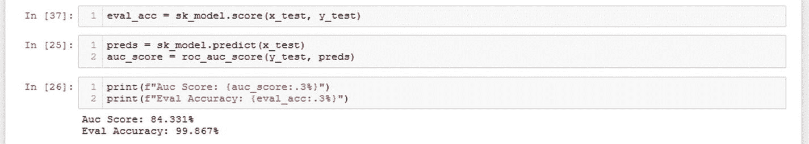

图 2-12 打印出 scikit-learn 逻辑回归模型的 AUC 分数和准确率

在这种情况下，AUC 分数和准确率分数都很高。两者之间，准确率分数肯定因存在的正常点数量而被夸大，但 AUC 分数表明该模型在区分异常点和正常点方面做得相当不错。

Scikit-learn 实际上提供了一个函数，让你可以查看 ROC 曲线——即从中得出 AUC 分数（或“曲线下面积”）的图形。运行以下代码：

```
roc_plot = plot_roc_curve(sk_model, x_test, y_test, name='Scikit-learn ROC Curve')
```

输出结果请参考图 2-13。

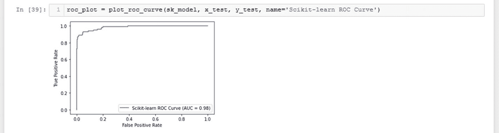

图 2-13 为你刚刚训练的逻辑回归模型生成的 ROC 曲线。理论上，一条在假阳性率为 0.0 时真阳性率起始值为 1.0 的 ROC 曲线是最佳曲线。从该点开始，它应该保持其值向右延伸，直到在 x 轴上达到 1.0。此图非常接近该理想状态，因此 AUC 分数高达 0.98。此处 AUC 分数与你之前计算时的差异与值的实际计算方式有关。

基本上发生的事情是，scikit-learn 接收模型和评估集，在测试集上进行预测时动态生成曲线。你在坐标轴上看到的指标源自模型正确预测每个值的程度。“真阳性率”和“假阳性率”源自你将在下面看到的混淆矩阵上的值。从该图表中，生成了 AUC 分数。你可以看到它与之前计算的分数有所不同，但这可归因于两个函数计算分数的方式略有差异。

现在，让我们构建混淆矩阵并使用 seaborn 绘制它：

```
conf_matrix = confusion_matrix(y_test, preds)
ax = sns.heatmap(conf_matrix, annot=True,fmt='g')
ax.invert_xaxis()
ax.invert_yaxis()
plt.ylabel('Actual')
plt.xlabel('Predicted')
```

输出结果请参考图 2-14。

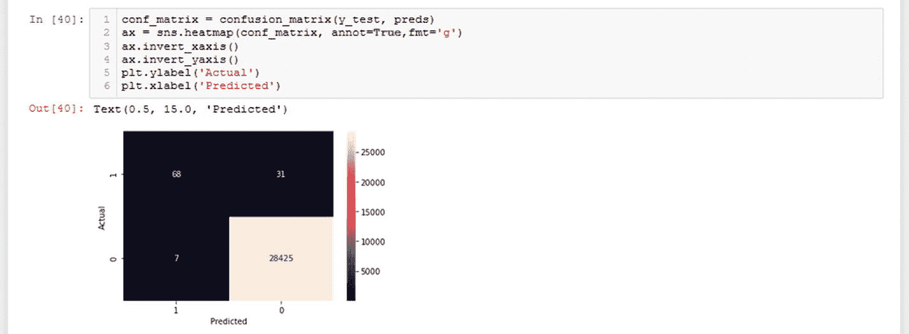

图 2-14 训练结果的混淆矩阵图。正常点的准确率非常高，但异常点的准确率尚可。从这些结果来看，仍有进一步改进的空间，因为你尚未调整模型的超参数，但它在检测异常方面已经表现不错。现在的目标是尽可能保持正常点的准确率，或将其维持在一个可接受的高水平，同时尽可能提高异常点的准确率。基于这个混淆矩阵图，你现在可以看到，较低的 AUC 分数更能准确反映模型的真实性能。你可以看到，有相当数量的异常点被错误地分类为正常点，因此，0.84 的 AUC 分数比图表上显示的 0.98 分数更能指示模型的性能。

这就是混淆矩阵的样子。y 轴由真实标签组成，而 x 轴由预测标签组成。当真实标签为“0”且模型预测为“0”时，我们称之为`真负例`。“真”指的是真实标签，“负”指的是模型预测的标签。什么算作“正例”，什么算作“负例”可能有所不同。在疾病检测等任务中，如果测试发现某人患有疾病，则称其“检测呈阳性”。否则，他们“检测呈阴性”。异常检测与此类似。当模型认为某个点是异常点时，它会用标签“1”标记它。因此，如果模型认为某个点是异常点，则该点被标记为“正例”；如果模型认为不是，则标记为“负例”。

你可能注意到我们在代码中反转了坐标轴。这只是为了使其格式符合要求，使得矩阵的左上角对应`真正例`，右上角对应`假负例`，左下角对应`假正例`，右下角对应`真负例`。快速回顾这些概念：

*   `真正例`是模型预测为正例且实际为正例的值。
*   `假负例`是模型预测为负例但实际为正例的值。
*   `假正例`是模型预测为正例但实际为负例的值。
*   `真负例`是模型预测为负例且实际为负例的值。

要查看模型识别异常点的效果，请查看 y 轴上的`1`行。该行的总和应等于测试集中异常点的总数：99 个异常点。模型正确预测了约 68.7%的异常点（`68/(68+31)`），并正确预测了 99.98%的正常点（`28425/(28425 + 7)`），查看底行即可。

如你所见，混淆矩阵让我们很好地了解了模型的真实性能。你现在知道它在预测正常点方面做得非常好，但在预测异常点方面表现尚可。话虽如此，该模型仍然可以正确预测大多数异常点。因此，你可以看到，0.84 的 AUC 分数在指示模型性能方面比 AUC 为 0.98 的图表准确得多。对于 0.98 的 AUC，你可以预期假负例或假正例的实例非常非常少。

### 模型验证

现在，让我们看看如何使用 k 折交叉验证过程来比较几个超参数值。验证过程结束后，你将比较评估指标，以便更好地了解哪种超参数设置效果最佳。

你想要调整的超参数是相对于正常数据点，对异常点赋予多少权重。默认情况下，两者权重相等。让我们定义一个要迭代的权重列表：

```
anomaly_weights = [1, 5, 10, 15]
```

接下来，定义折数并初始化数据折生成器：

```
num_folds = 5
kfold = KFold(n_splits=num_folds, shuffle=True, random_state=2020)
```

这个`KFold()`函数的作用是将传入的数据分割成`num_folds`个不同的分区。单个折在每次迭代中充当验证集，而其余折用于训练。在此上下文中，“验证折”基本上就是模型将要评估的数据。它被称为“验证”，因为它有助于我们了解模型在从未见过的数据上的表现。

如果你之前构建过深度学习模型，你可能知道在训练过程中，可以将训练集的一小部分分割出来作为验证集。这让你在训练期间就能知道是否过拟合，因为训练损失下降而验证损失上升就表明了这一点。

请参考图 2-15 查看上述代码在单元格中的形式。

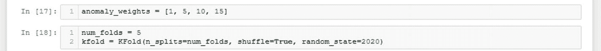

图 2-15

设置不同的异常权重值以使用验证脚本进行测试，并构建`KFold`数据生成器。在本例中，你使用了五折，因此传入的数据将被分成五份。

现在定义验证脚本：

```python
logs = []
for f in range(len(anomaly_weights)):
    fold = 1
    accuracies = []
    auc_scores= []
    for train, test in kfold.split(x_validate, y_validate):
        weight = anomaly_weights[f]
        class_weights= {
            0:1,
            1: weight
        }
        sk_model = LogisticRegression(random_state=None,
                          max_iter=400,
                          solver='newton-cg',
                          class_weight=class_weights).fit(x_validate[train], y_validate[train])
        for h in range(40): print('-', end="")
        print(f"\nfold {fold}\nAnomaly Weight: {weight}")
        eval_acc = sk_model.score(x_validate[test], y_validate[test])
        preds = sk_model.predict(x_validate[test])
        try:
            auc_score = roc_auc_score(y_validate[test], preds)
        except:
            auc_score = -1
        print("AUC: {}\neval_acc: {}".format(auc_score, eval_acc))
        accuracies.append(eval_acc)
        auc_scores.append(auc_score)
        log = [sk_model, x_validate[test], y_validate[test], preds]
        logs.append(log)
        fold = fold + 1
    print("\nAverages: ")
    print("Accuracy: ", np.mean(accuracies))
    print("AUC: ", np.mean(auc_scores))
    print("Best: ")
    print("Accuracy: ", np.max(accuracies))
    print("AUC: ", np.max(auc_scores))
```

一下子要理解这么多内容，所以请务必参考图 2-16 以确保你的代码格式正确。

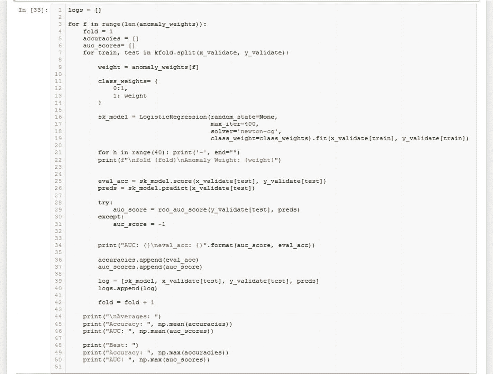
*图 2-16*

单元格中的验证脚本。脚本相当长，因此请确保其格式正确，因为单个空格错位都可能导致问题。

在运行脚本之前，让我们回顾一下代码的作用，因为一下子抛出了很多代码。

第一个循环遍历每个异常权重。你将折数在此处设置为 1，并定义空列表来存储每次使用当前权重参数运行时的准确率和AUC分数。

第二个循环遍历了`KFold()`对象定义的五个折。你需要设置`class_weights`字典，并将其作为超参数传入模型。训练过程结束后，照常进行评估。这里有一个用于AUC分数的try-except块，以防生成的某个折只包含单一类别的值（即实际上只有正常数据，没有异常数据）。如果任何折的AUC分数为-1，则表明该折存在问题。

你可以保存模型、验证数据和预测结果，以便随时查看混淆矩阵并绘制ROC曲线。在五个折全部结束后，脚本会显示平均值和最佳分数。

运行此脚本时，输出会被截断，因此别忘了像上一章那样展开输出，以查看所有运行结果。你可以自由探索输出，甚至更改折数，但要注意结果，因为增加折数意味着异常数据必须分散到更多的分区中。在这种特定情况下，由于异常点极少，使用较少的折数可能效果更好。

当你仔细查看输出时，会发现当异常权重设置为 10 时，结果最佳。此设置的平均AUC分数最高，最佳AUC分数也最高，输出结果如图 2-17 所示。

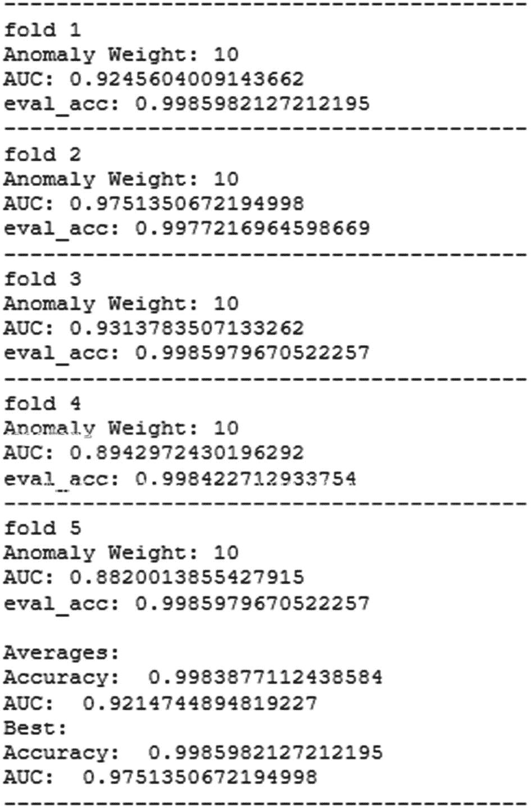
*图 2-17*

查看验证脚本输出中最佳设置的结果。事实证明，最佳设置是将异常权重设为 10，因为它在所有异常权重参数中拥有最高的平均AUC分数和最佳AUC分数。真正的权重最佳值可能就在异常权重 10 附近，不过你需要在一个更窄的范围内进行另一次超参数搜索，才能找到绝对最佳设置。你可以根据需要不断缩小搜索范围，但超过一定精度后，你会发现收益会递减。

让我们检查一下这个设置的图表，因为它在所有设置中平均表现最佳。

首先，在日志列表中加载正确的日志。由于异常权重为 10，且第二个折表现最佳，你需要查看日志条目中的第十二个索引。（前五个对应索引 0-4，接下来五个对应索引 5-9。从索引 10 开始，是权重为 10 的第一个折，因此第二个折位于索引 11。）

```python
sk_model, x_val, y_val, preds = logs[11]
```

让我们看看ROC曲线。请记住，由于验证集中的数据非常少，AUC分数可能不太准确。代码如下：

```python
roc_plot = plot_roc_curve(sk_model, x_val, y_val, name='Scikit-learn ROC Curve')
```

请参考图 2-18 查看上述两个单元格的输出。

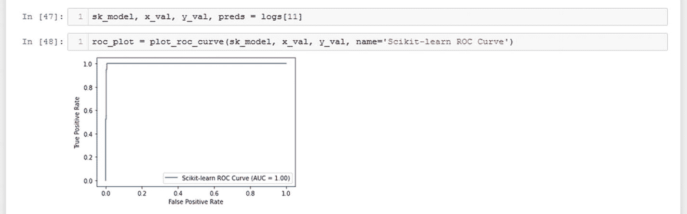
*图 2-18*

查看特定验证折的ROC曲线。如你所见，ROC曲线非常理想。完美的ROC曲线会尽可能从y轴上的 1.0 开始，并在到达x轴上的 1.0 时保持该水平。这样的ROC图意味着AUC将尽可能接近 1.0。在这种情况下，你几乎看到了完美的AUC曲线，并且AUC显示为 1.0。图 2-19 中的混淆矩阵将更详细地揭示AUC分数为何如此之低。

这张图与你之前看到的ROC图看起来不同。事实上，它几乎堪称完美。

让我们查看混淆矩阵，以便更好地了解模型在此折上的表现：

```python
conf_matrix = confusion_matrix(y_val, preds)
ax = sns.heatmap(conf_matrix, annot=True,fmt='g')
ax.invert_xaxis()
ax.invert_yaxis()
plt.ylabel('实际')
plt.xlabel('预测')
```

得到的混淆矩阵如图 2-19 所示。

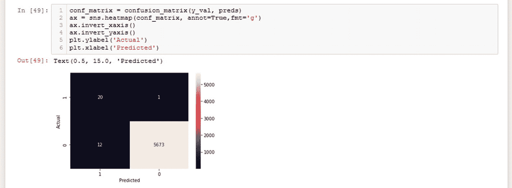
*图 2-19*

特定验证折的混淆矩阵。它在标记正常数据点方面具有很高的准确性，并且在处理异常点方面也表现良好。此外，如果你数一下顶行的条目，会发现这个验证折中几乎没有异常点：21 个异常点对 5685 个正常点。因此，对异常点赋予更高的权重有助于模型在学习过程中考虑这些异常点，从而在异常检测中取得更好的性能，这就不足为奇了。

模型在对异常点进行正确分类方面做得相当好，但此处的验证目标仅仅是帮助将超参数设置调整到正确的方向。基于验证过程的结果，你知道最佳超参数值位于 10 和 15 之间，因为这两个设置产生了最佳结果。

当然，你可以进一步缩小范围，将异常权重在 10 到 15 之间的值包含进来，并重复此过程，不断缩小范围，直到找到一个良好、最优的值。然而，超过一定精度后，你会发现收益递减，投入超参数调优的努力只能带来近乎可以忽略的性能提升。

至此，你现在已经知道如何在`scikit-learn`中训练、评估和验证逻辑回归模型了。

## PySpark

我们提供了将要使用的模块版本。安装PySpark可能有点复杂，因为根据版本不同，并非简单地执行`pip install PySpark`即可，请注意这一点。

以下是我们的配置版本：
- Python 3.6.5
- PySpark 3.0.0
- matplotlib 3.2.1
- seaborn 0.10.1
- sklearn 0.22.1.post1

那么，让我们开始吧。再次说明，我们不会像`scikit-learn`示例那样提供详细的注释，因此请务必回顾`scikit-learn`中的整个过程，以便对其流程有清晰的认识。此外，在此示例中，我们不会在PySpark中验证模型。

### 数据处理

以下是`import`语句：

# PySpark 异常检测实践：数据处理与特征工程

```
import pyspark
from pyspark.sql import SparkSession
from pyspark import SparkConf, SparkContext
from pyspark.sql.types import *
from pyspark.ml.feature import VectorAssembler
from pyspark.ml import Pipeline
from pyspark.ml.classification import LogisticRegression as LogisticRegressionPySpark
import pyspark.sql.functions as F
import os
import seaborn as sns
import sklearn
from sklearn.metrics import confusion_matrix
from sklearn.metrics import roc_auc_score
import matplotlib
import matplotlib.pyplot as plt
os.environ["SPARK_LOCAL_IP"]='127.0.0.1'
spark = SparkSession.builder.master("local[*]").getOrCreate()
spark.sparkContext._conf.getAll()
print("pyspark: {}".format(pyspark.__version__))
print("matplotlib: {}".format(matplotlib.__version__))
print("seaborn: {}".format(sns.__version__))
print("sklearn: {}".format(sklearn.__version__))
```

输出结果应类似于图 2-20。

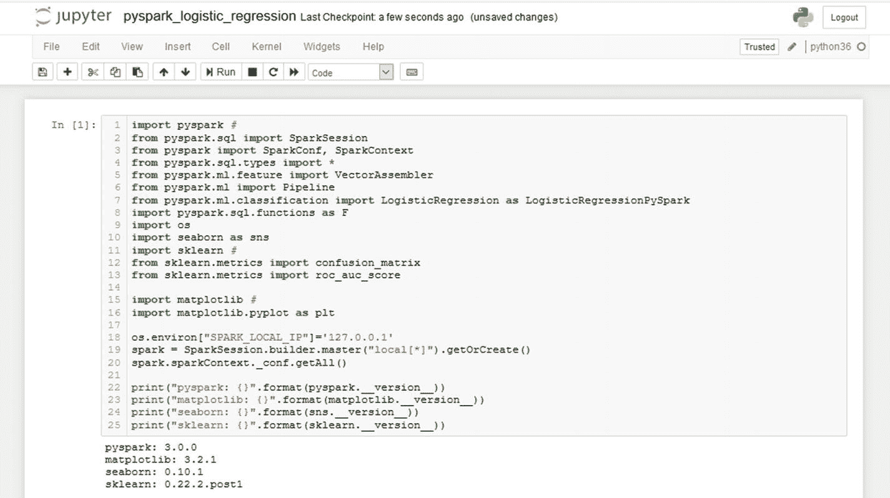

图 2-20

导入必要的模块并打印其版本。再次说明，仅用于显示版本的模块已用 `#` 标记，如果需要，你可以删除它们以及相应的打印语句。

你会注意到，这里定义了一些与 PySpark 相关的额外代码。使用 PySpark 时，你必须定义一个 Spark 上下文并创建一个 Spark 会话。这实际上意味着你正在创建一个与 Spark 引擎的连接点，使引擎能够运行所有与 Spark 功能相关的代码。

现在让我们加载数据集。PySpark 有自己的创建数据框的功能，因此你不会使用 pandas。执行以下代码：

```
data_path = 'data/creditcard.csv'
df = spark.read.csv(data_path, header = True, inferSchema = True)
labelColumn = "Class"
columns = df.columns
numericCols = columns
numericCols.remove(labelColumn)
print(numericCols)
```

你应该会看到类似图 2-21 的内容。

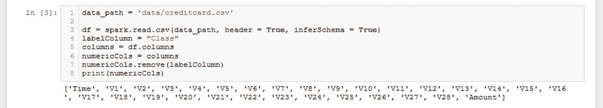

图 2-21

在 PySpark 中读取信用卡数据集，并从列列表中移除 `Class` 列。这样做是因为你不希望 `Class` 列包含在特征向量中，你将在图 2-22 中看到这一点。

打印列只是为了确保标签列已被成功移除。

你现在可以查看数据框，以确保它已正确加载。你必须使用内置功能将其转换为 pandas 数据框，因为 Spark 数据框的显示效果不太清晰。

查看以下两个单元格及其输出：

```
df.show(2)
```

请参考图 2-22。

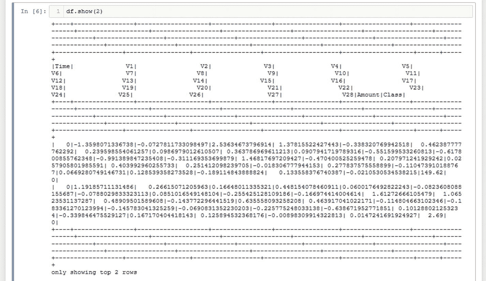

图 2-22

Spark 数据框的输出。由于数据框中有很多列，输出非常混乱且难以阅读。幸运的是，有内置功能可以将 PySpark 数据框转换为 pandas 数据框，这使得查看 Spark 数据框中的行变得容易得多。

现在将其与以下内容进行比较：

```
df.toPandas().head()
```

请参考图 2-23。

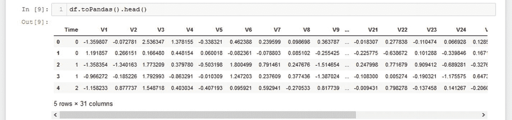

图 2-23

使用 PySpark 的内置功能将 Spark 数据框转换为 pandas 数据框以便于查看。如图 2-22 所示，直接读取 Spark 数据框的输出非常困难。

因此，每当你想要检查 Spark 数据框时，如果它有很多列，请确保将其转换为 pandas。

PySpark 的数据处理过程与 pandas 略有不同。要训练模型，你必须传入一个名为 `features` 的向量。查看以下代码：

```
stages = []
assemblerInputs = numericCols
assembler = VectorAssembler(inputCols=assemblerInputs, outputCol="features")
stages += [assembler]
dfFeatures = df.select(F.col(labelColumn).alias('label'), *numericCols)
```

这定义了组装器的输入，使其知道要将哪些列转换为 `features` 向量。

接下来，让我们在上面的单元格中添加代码，并像 scikit-learn 示例那样创建正常数据和异常数据的分割。

```
normal = dfFeatures.filter("Class == 0").sample(withReplacement=False, fraction=0.5, seed=2020)
anomaly = dfFeatures.filter("Class == 1")
normal_train, normal_test = normal.randomSplit([0.8, 0.2], seed = 2020)
anomaly_train, anomaly_test = anomaly.randomSplit([0.8, 0.2], seed = 2020)
```

该单元格应如图 2-24 所示。

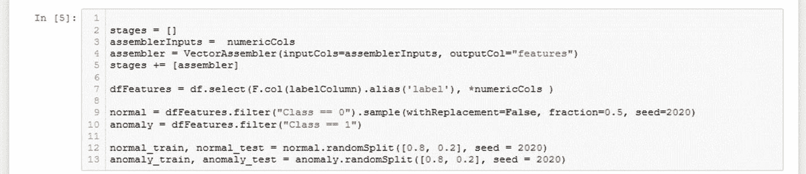

图 2-24

构建 `VectorAssembler`，稍后将用于从输入数据创建特征向量。你还创建了正常数据和异常数据的分割，类似于在 scikit-learn 中的做法，并以类似的方式将其分割为训练子集和测试子集。

就像在 scikit-learn 示例中一样，你将相应的正常数据和异常数据分割合并起来，形成训练集和测试集。不过，这次你不会使用验证集，因此训练数据和测试数据之间是 80-20 的分割。

```
train = normal_train.union(anomaly_train)
test = normal_test.union(anomaly_test)
```

请参考图 2-25 查看该单元格。

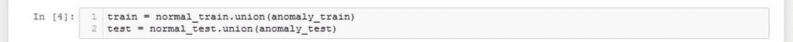

图 2-25

以类似于在 scikit-learn 中的方式创建训练集和测试集，但使用的是 PySpark 的功能。

让我们完成管道的其余部分并创建 `feature` 向量：

```
pipeline = Pipeline(stages = stages)
pipelineModel = pipeline.fit(dfFeatures)
train = pipelineModel.transform(train)
test = pipelineModel.transform(test)
selectedCols = ['label', 'features'] + numericCols
train = train.select(selectedCols)
test = test.select(selectedCols)
print("Training Dataset Count: ", train.count())
print("Test Dataset Count: ", test.count())
```

请参考图 2-26 查看输出。

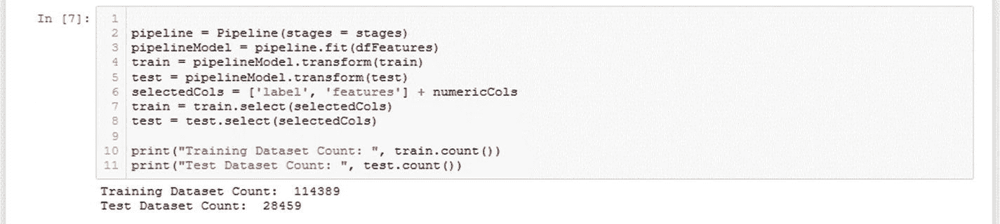
图 2-26
使用管道从数据框创建特征向量。这个特征向量就是逻辑回归模型将要训练的数据

### 模型训练

现在你可以定义并训练模型：
```
lr = LogisticRegressionPySpark(featuresCol = 'features', labelCol = 'label', maxIter=10)
lrModel = lr.fit(train)
trainingSummary = lrModel.summary
pyspark_auc_score = trainingSummary.areaUnderROC
```

请参考图 2-27 查看上述代码在单元格中的样子。

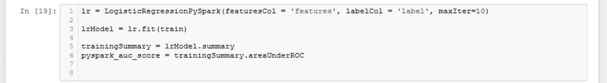
图 2-27
定义 `PySpark` 逻辑回归模型，训练该模型，并使用模型的内置函数计算 `AUC` 分数

### 模型评估

模型训练完成后，运行评估代码：
```
predictions = lrModel.transform(test)
y_true = predictions.select(['label']).collect()
y_pred = predictions.select(['prediction']).collect()
evaluations = lrModel.evaluate(test)
accuracy = evaluations.accuracy
```

添加以下代码以显示指标：
```
print(f"AUC Score: {roc_auc_score(y_pred, y_true):.3%}")
print(f"PySpark AUC Score: {pyspark_auc_score:.3%}")
print(f"Accuracy Score: {accuracy:.3%}")
```

请参考图 2-28 查看输出结果。

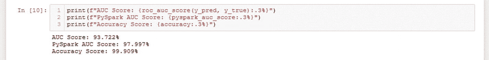
图 2-28
输出指标。`AUC` 分数使用 `scikit-learn` 的评分算法计算，而 `PySpark` `AUC` 分数指标来自 `PySpark` 模型的训练摘要。最后，还输出了准确率分数

你可以看到 `AUC` 分数和准确率都相当高，那么让我们来检查一下图表。

首先，我们来看 ROC 曲线：
```
pyspark_roc = trainingSummary.roc.toPandas()
plt.xlabel('False Positive Rate')
plt.ylabel('True Positive Rate')
plt.title('PySpark ROC Curve')
plt.plot(pyspark_roc['FPR'],pyspark_roc['TPR'])
```

要查看图表，请参考图 2-29。

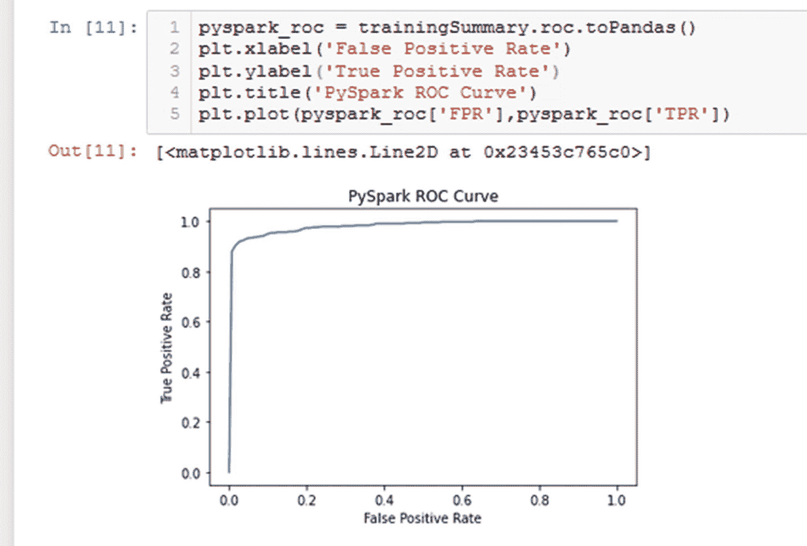
图 2-29
你刚刚训练的 `PySpark` 逻辑回归模型的 ROC 曲线。完美的 ROC 曲线会从真正率 1.0 开始，然后一直延伸到假正率 1.0。这条曲线非常接近这个标准，因此 `PySpark` 认为其面积（`AUC`）约为 0.97997，请记住完美的 `AUC` 分数是 1.00

这条曲线看起来相当理想。现在让我们查看混淆矩阵，以详细了解模型的表现：
```
conf_matrix = confusion_matrix(y_true, y_pred)
ax = sns.heatmap(conf_matrix, annot=True,fmt='g')
ax.invert_xaxis()
ax.invert_yaxis()
plt.ylabel('Actual')
plt.xlabel('Predicted')
```

请参考图 2-30 查看混淆矩阵图。

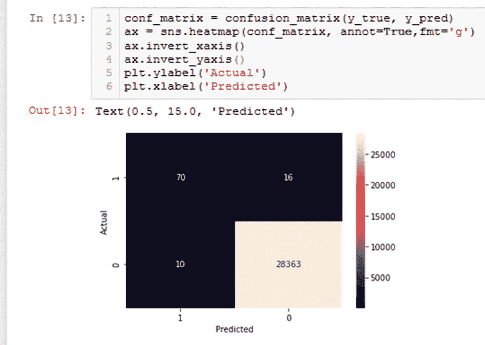
图 2-30
你刚刚训练的 `PySpark` 逻辑回归模型的混淆矩阵图。对于正常数据，正确标记点的准确率非常高，而对于异常数据，准确率也尚可

由此，你可以更详细地了解模型的表现。仅看异常点，你会发现模型预测异常的准确率为 81.4%（70/(70+16)）。这比你之前在 `scikit-learn` 中训练的模型要好，尽管你还没有调整超参数以达到最佳性能。

`PySpark` 确实提供了对数据进行加权的选项，但这是基于每个样本进行的。这意味着，不是为每个类别传入一个权重字典，而是需要在数据框中创建一个列，例如，将每个异常点加权为某个值，每个正常点加权为 1。默认情况下，所有点的权重都是 1，这意味着 `PySpark` 模型在性能上可能比 `scikit-learn` 模型有更大的潜力。

再来看正常点，你会发现准确率非常高，达到了 99.96%（28363/(28363+10)），因此它能够非常好地识别正常点。

## 总结

利用从数据分析中获得的见解，你在 `scikit-learn` 和 `PySpark` 中将数据处理成了训练集、测试集和验证集（在 `PySpark` 中你只做了训练-测试拆分，但你可以像在 `scikit-learn` 中一样，将训练数据拆分为训练集和验证集）。接着，你在每个框架中构建了逻辑回归模型，并进行了训练和评估。你查看了准确率和 `AUC` 分数作为指标，并通过观察 ROC 曲线和混淆矩阵来更深入地了解模型的表现。对于 `scikit-learn` 模型，你执行了 k 折交叉验证来帮助调整超参数。在下一章中，你将带着数据分析和模型创建的经验，学习 `MLOps` 以及如何将模型投入生产。