# 3. 什么是 MLOps？

在本章中，我们将介绍“MLOps”这一术语背后的概念，并详细说明它是什么、为什么有用以及如何实现。

## 引言

为各种问题创建机器学习解决方案可能是一项相当艰巨的任务。让我们设身处地地想象一下，一个团队正试图用机器学习来解决某个问题。如果你读过第 1 章，可能对这个过程很熟悉，但为了建立上下文，我们将再次回顾整个过程。如果你已经熟悉，可以跳过本节。整个过程大致如下：

*   **收集并处理原始数据：** 原始数据很少是易于训练模型的格式。通常，它需要经过处理，以移除异常数据点，例如空值和错误数据值。其他时候，你可能需要处理原始数据，以便从所有噪声中仅提取你需要的信息。

*   **分析数据：** 这一步涉及查看数据点并理解其特征。数据是如何结构的？数据点的分布看起来如何？数据中是否存在任何可识别的趋势或偏差？这一步至关重要，因为它决定了你将如何着手解决问题。如果你已有想要更新的训练模型，它还能告诉你数据中是否存在任何模型需要更新以考虑的新趋势。如果你识别出了一些对输出没有实际影响的“无用特征”，你可以丢弃它们并训练一个新模型，以提高训练速度，同时可能提升性能。

*   **处理数据以用于训练：** 在这一步，你可能会将数据缩放到更合适的范围，并可能移除任何可能干扰模型性能的离群值和/或异常值。此外，你还可能应用特征工程，从现有数据点创建新特征，或许能在训练期间为模型提供更多或更好的上下文。这也是你创建训练集和测试集的地方，尽管最佳实践是创建训练集、测试集和验证集。

*   **构建、训练和测试模型：** 在这一步，你创建模型、设置超参数并训练模型。对于深度学习，你还可以选择训练集的一个子集作为数据验证集。该验证集的目的是在每个训练周期（epoch）结束时，或每次数据完整前向传播通过模型后，对模型进行评估。通过比较模型在训练期间多次见过的数据与从未见过的数据（或者说，对权重调整没有影响的数据）上的性能，你可以判断模型是否真正学会了泛化，还是仅仅在过拟合。

**过拟合**是指模型在训练集上的表现显著优于在从未见过的数据上的表现。正如刚才讨论的，一种早期指示过拟合的方法是在训练阶段留出一部分训练集作为验证数据。这可以在训练过程结束前就给出过拟合的早期信号，而无需等到训练完成后才发现——训练过程根据模型深度和所用设备，可能需要几分钟到几天不等。因此，当模型在测试数据或验证数据上评估时，如果观察到这些数据集与训练集之间存在性能差异，也表明可能发生了过拟合。

过拟合现象的部分原因可能是模型在训练期间没有接收到足够的数据点来反映它预期会看到的多样性，因此通过引入更多多样性甚至增加数据点数量来修正训练集可能会有所帮助。此外，在模型架构中加入正则化或丢弃法（dropout）等方法，也有助于在深度学习模型中对抗过拟合。

*   需要讨论的一个重要问题是**测试集**和**验证集**的用途。测试集保留用于评估模型在从未见过的数据上的性能。

验证集保留用于帮助选择模型、选择模型架构、调整超参数，或者仅仅是在训练过程中指示模型在从未见过的数据上的性能。

验证的一个例子是 k 折交叉验证，它从验证数据中生成 k 个随机的训练-测试数据划分，并可用于在所有划分上训练/评估模型，以了解在不同超参数设置下能达到的最佳性能。当然，我们也可以使用 k 折交叉验证来执行验证所帮助的其他功能。你在第 2 章中看到了一个使用这种验证方法的例子，当时你用它来帮助调整异常值的权重。

将这种技术与一个包含一组超参数的脚本相结合，可以得到一个具有合适超参数的最优模型。然后，可以重新训练该模型，并再次在测试集上进行评估，以获得最终的性能基准。

不过，执行这些步骤的具体顺序可能有所不同。例如，训练好的模型也可以先评估再验证，而不是反过来。这是因为，在评估阶段反映出某种性能差异后，或者训练过程中的验证数据揭示可能发生过拟合后，训练过程很可能会以调整后的超参数重复进行。无论如何，这确实取决于具体情况，但好的做法是至少同时使用测试数据和验证数据，以最佳地调整模型。

*   **验证和调优模型：** 如前所述，验证集可以是另一个模型从未见过的“测试”集，并且可以用于前面以及第 1 章中描述的几种方式中的任何一种。一旦你的模型在验证集上达到了可接受的性能水平，并经过重新训练和再次评估，你就可以考虑部署模型了。

*   **部署并监控模型：** 在这一步，模型终于离开了机器学习/数据科学团队之手。现在，工程和运维团队的工作是将此模型集成到应用程序中并投入使用。运维团队负责持续监控模型的性能，性能下降可能表明需要重复整个流程来更新模型，使其理解新的趋势。运维团队还负责向数据科学团队报告任何错误和意外的模型预测，这些反馈也促成了整个周期的重新开始，因为模型需要修复。

希望你现在能清楚整个过程是多么耗费精力，尤其是它很可能需要重复多次。虽然第二次可能会更容易一些，因为你只是在更新模型以适应新的数据模式和趋势，但这仍然是一个可能占用数小时手动劳动的问题，而这些时间本可以更好地用在其他地方。毕竟，在软件开发过程中，应用程序的维护通常是资金和资源投入最多的地方，而不是最初的构建和发布。这一点同样适用于机器学习模型，并且会加剧总体维护成本，因为已部署机器学习模型的成本是在使用这些模型服务的软件应用程序成本之上额外增加的。

想象一下，如果你能完全自动化整个流程，从而无需繁琐操作就能充分利用高性能机器学习模型，那该多好。这正是 MLOps 的用武之地，它可以被视为机器学习与 DevOps 实践的交汇点。**DevOps**，即开发运维，是指一套将软件开发人员的工作流程与运维团队的工作流程相结合，形成一种兼具两者角色的通用实践集。其结果是，软件的开发周期得以加快，并确保了软件产品的持续交付。由于工作流效率提升降低了维护软件应用的成本，总成本也随之下降。请参考图 3-1 查看展示 DevOps 工作流的图表。

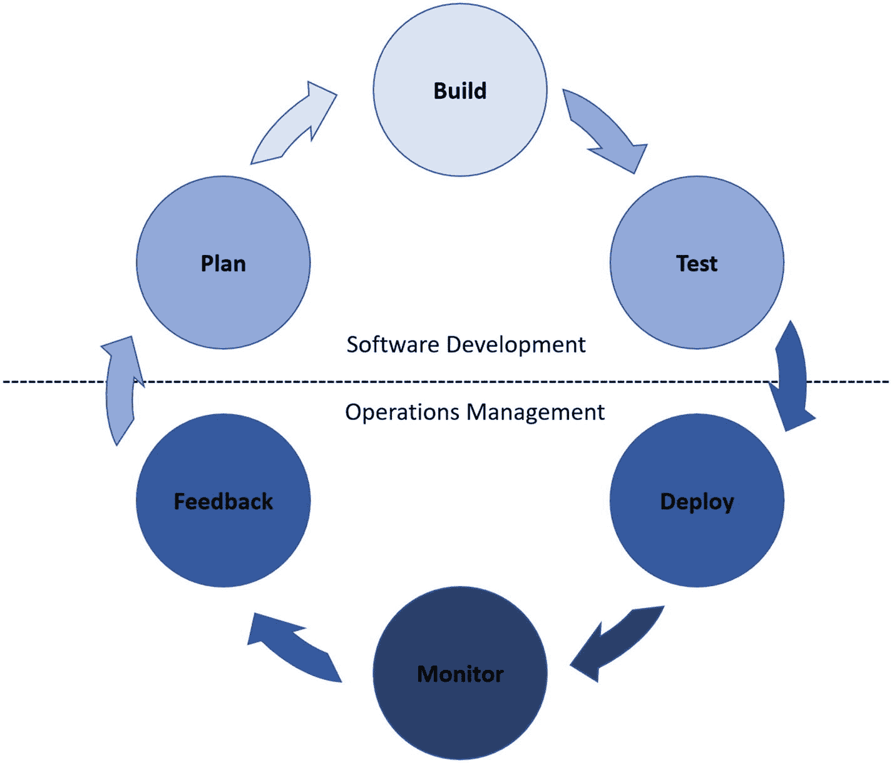

图 3-1

一张描述 DevOps 环境中工作流的图表。软件开发团队通常采用敏捷软件开发方法，如上图通过规划、构建和测试阶段所总结的那样。运维团队负责部署、维护以及收集反馈（以错误报告和用户反馈的形式），并将这些信息传递给开发团队。随后，开发团队进入应用的维护阶段，在此阶段他们规划、构建、测试并推送下一个补丁/更新。此外，自动化测试和部署流程实现了软件产品的持续集成和交付，我们将在本章后续部分对此进行详细阐述。

类似地，MLOps 采纳了 DevOps 原则，并将其应用于机器学习模型而非软件，将数据科学家和机器学习工程师的开发周期与运维团队的周期相结合，以帮助确保高性能机器学习模型的持续交付。在所谓的**实验阶段**（我们将在本章后面详细探讨）中的模型开发过程，可能会产生令人印象深刻的表现，并看似非常有前景的解决方案。然而，现实情况是，大多数模型根本无法超越这个实验阶段，因为部署它们本身就是一项艰巨的任务。不幸的是，一旦部署，维护模型也会消耗资源，因为每次新更新都需要重新集成到应用中。这意味着即使模型已部署，所有团队也都有大量工作要做。基于这些原因，大多数模型根本无法超越原型阶段。

在 MLOps 原则出现之前，由于所需资源庞大，部署使用最新机器学习技术创建的解决方案对企业来说是一项重大挑战。**这就是 MLOps 如此关键的原因**。它通过为你自动化大部分困难环节，显著简化了机器学习解决方案的部署和维护，极大地加快了开发和维护流程。借助完全自动化的设置，团队可以跟上最新的机器学习技术，并快速部署新模型。服务可以保持其高水平性能，甚至可能在这方面有所提升，因为团队可以部署更新、更有前景的模型架构。

现在你对 MLOps 是什么以及它为何如此重要有了更好的了解，让我们深入细节，看看理想的 MLOps 实现是如何设置的。

## MLOps 设置

在查看任何具体的 MLOps 设置之前，让我们先确立三种代表不同自动化阶段的设置：**手动实现**、**持续模型交付**和**管道的持续集成/持续交付**。

**手动实现**指的是未应用任何 MLOps 原则、所有操作均手动执行的设置。上述创建机器学习模型的步骤全部手动完成。软件工程团队必须手动将模型集成到应用中，运维团队必须帮助确保所有功能得以保留，同时收集模型的数据和性能指标。

**持续模型交付**是手动设置与完全自动化设置之间的一个良好中间地带。在此，我们看到了**管道**的出现，它允许自动化流程中机器学习方面的操作。请注意，我们将在下文中频繁提及这个术语。如果你想更好地了解什么是管道，请参考本章后面“管道与自动化”一节。目前，**管道**是一种基础设施，包含一系列组件，用于处理流经管道的信息。管道在不同设置中的功能可能略有不同，因此请务必参考图表和解释，以更好地理解示例中管道的功能。

这种设置的主要特点是，已部署的模型建立了管道，即使在部署后也能持续用新数据进行训练。实验阶段（即模型开发阶段）的自动化也随之出现，同时代码实现模块化，以便在后续步骤中实现进一步自动化。在这种设置中，**持续交付**指的是加快新机器学习模型的开发和部署。由于自动化消除了快速部署的障碍（实验阶段手动工作的繁琐性），现在可以以更快的速度创建或更新模型。

**管道的持续集成/持续交付**指的是一种设置，其中实验阶段的管道在自动化流程中经过全面测试，以确保所有组件按预期工作。随后，管道被打包并部署，部署团队将管道部署到测试环境，进行额外测试以确保兼容性和功能性，然后将其部署到生产环境。在这种设置中，管道可以快速创建和部署，使得团队能够持续创建围绕最新机器学习架构构建的新管道，而无需面对与手动测试和集成相关的资源障碍。

### 手动实现

既然我们已经确立了三种不同的设置方案，接下来让我们看看机器学习模型三种部署方案中的第一种，该方案未集成任何 MLOps 原则。

在这种情况下，有一个由数据科学家和机器学习工程师组成的团队（以下称为“模型开发团队”），他们手动执行数据分析，并构建、训练、测试和验证他们的模型。一旦模型最终确定，他们必须创建一个模型类并将其推送到代码仓库。软件工程师提取这个模型类，并将其集成到现有的应用程序或系统中，而运维团队则负责监控应用程序、维护功能，并向软件和模型开发团队提供反馈。

这里的一切都是手动的，这意味着数据中的任何新趋势都会导致模型开发团队必须更新模型并重复整个流程。考虑到每天有大量用户与你的模型交互，这种情况很可能会发生。结合性能指标和用户数据收集，这些信息将揭示关于你的模型以及模型所服务的用户群体的许多方面。你很可能会需要更新模型以保持其在新数据上的性能。在您按照图表中的流程进行操作时，请牢记这一点。

请参考图 3-2 以了解该设置的图形表示。

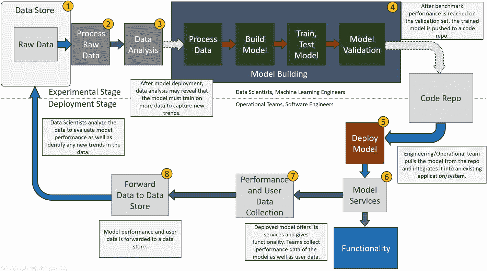

图 3-2

该图描绘了一种未遵循 MLOps 原则的机器学习模型可能的部署设置。带有虚线边框的箭头表示进入下一步取决于当前步骤中的某个条件。例如，在模型验证步骤中，机器学习工程师必须确保模型在将模型类推送到仓库之前达到最低性能基准。

让我们一步步来看。我们可以将流程大致分为两部分：**实验阶段**，涉及整个工作流程中的机器学习方面；以及**部署阶段**，负责将模型集成到应用程序中并维持运维。

#### 实验阶段

1.  **数据存储：** 数据存储指的是存储与数据分析和模型开发相关的数据的地方。数据存储的一个例子是使用 Hadoop 来存储大量数据，这些数据可以被多个模型开发团队使用。在这个例子中，数据科学家可以从这个数据存储中提取原始数据，开始进行实验和数据分析。

2.  **处理原始数据：** 如前所述，必须处理原始数据以收集相关信息。此外，还必须清除其中的错误和损坏数据。当一家公司每天收集海量数据时，其中一些数据最终必然会以某种方式损坏或出错，清除这些数据点很重要，因为它们可能会损害数据分析和模型开发过程。例如，一个空值条目就可能完全破坏用于回归（值预测）任务的神经网络的训练过程。

3.  **数据分析：** 此步骤涉及分析数据的各个方面。前面已经讨论过其大致要点，但在更新模型的背景下，数据科学家希望查看数据中是否存在他们认为模型应该更新的任何新趋势或变化。由于初始训练过程可以被视为真实世界环境的一个小样本，模型在初始部署后不久就需要更新的可能性很大。当然，这取决于原始训练集捕获了多少真实用户群体的特征，但用户群体会随时间变化，模型也必须随之变化。这里所说的“用户群体”，指的是使用模型预测服务的实际客户。

4.  **模型构建阶段：** 这个阶段与我们之前讨论的大致相同。在第二次更新模型时，可能需要对模型层进行细微调整。在最坏的情况下，即使使用新数据或进行架构调整，当前使用的模型架构也无法达到足够高的性能。可能必须构建、训练和验证一个全新的模型。如果没有此类问题，那么模型将只需进一步训练、测试、验证，并在满足某些性能标准后推送到代码仓库。

    关于这个实验阶段，需要注意的一点是，使用 `Jupyter notebook` 进行实验非常普遍。当模型开发团队达到目标性能水平时，他们必须着手构建一个可被其他代码调用的、可工作的模型。例如，可以通过创建一个包含各种函数的模型类来实现，这些函数提供诸如 `load_weights`、`predict`，甚至可能还有 `evaluate` 等功能，以便更容易地收集性能指标。由于在实时环境中无法获知真实标签，评估指标可以简单地是均方根误差之类的东西。

#### 部署阶段

1.  **模型部署：** 在此情况下，这一步是软件工程师必须手动将模型集成到他们正在开发的系统/应用程序中。每当模型开发团队完成实验、构建出可工作的模型并将其推送到代码仓库时，工程团队都必须再次手动集成。虽然第二次执行该过程可能没那么糟糕，但仍然存在修复新模型可能带来的任何潜在错误的问题。此外，工程团队不仅需要处理模型集成到应用程序后的测试，还需要处理应用程序其余部分的测试。

2.  **模型服务：** 这一步是模型最终部署并与用户群体实时交互的阶段。这也是运维团队介入以帮助维护软件功能的阶段。例如，如果模型功能的某个方面出现问题，运维团队必须记录该错误并将其转发给模型开发团队。

3.  **数据收集：** 运维团队还可以收集原始数据和性能指标。这些数据对于公司的运营至关重要，因为公司正是基于这些数据做出决策。例如，公司可能想知道哪种服务在用户群体中最受欢迎，或者机器学习模型到目前为止表现如何。这项工作也可以由应用程序执行，将所有相关数据存储在与该应用程序相关的某个特定数据存储中。

4.  **数据转发至数据存储：** 这一步是运维团队将数据发送到数据存储的阶段。由于可能收集到海量数据，可以合理地假设运维团队在这方面会采用一定程度的自动化。此外，应用程序本身也可以负责将其收集的数据转发到相关的数据存储。

#### 对设置的反思

你马上就能注意到这种实现方式可能引发的一些问题。首先需要意识到的是，整个实验阶段都是手动的，这意味着数据科学家和机器学习工程师每次都必须重复这些步骤。当模型不断接触到很可能未被原始训练集捕获的新数据时，模型必须频繁地重新训练，以便始终跟上用户数据的最新趋势。不幸的是，当分析新趋势、训练、测试和验证数据的整个过程都是手动时，随着时间的推移，这可能需要大量的资源，对于没有多余资源的公司来说，这可能会变得不可行。此外，数据趋势会随时间变化。例如，登录网站用户数量最多的年龄段可能是二十岁出头的人群。一年后，主导年龄段可能变成了青少年。过去正常的情况现在不再正常，这可能会导致广告收入损失，例如，如果本案例中的模型提供的服务是定向广告的话。

另一个问题是，像 `Jupyter notebook` 这样的工具在机器学习和深度学习模型的原型设计和实验阶段非常流行。即使实验不是在 notebook 上进行的，也可能需要做一些工作才能将模型推送到源代码仓库。例如，为模型类构建一些重要的函数，如 `load_weights`、`predict` 和 `evaluate`，对于模型类来说是理想的。一些外部代码可能会调用 `load_weights()` 来从不同的训练实例中设置模型权重（因此，如果模型经过进一步训练和更新，只需调用此函数即可获取新模型）。然后会调用 `predict()` 函数根据一些输入数据进行预测，并提供应用程序所需的服务，而 `evaluate()` 函数则有助于跟踪性能指标。实时数据几乎永远不会带有真实标签（除非用户提供即时反馈，比如谷歌验证码中让你选择正确图片），因此，在跟踪性能时，像均方根误差这样的评分指标会很有用。

一旦模型类完成并推送，软件工程团队必须将模型类集成到整个应用程序/系统中。第一次这样做可能会很困难，但一旦集成完成，更新模型就可以简单到加载新的权重。不幸的是，模型架构可能会发生变化，因此软件团队必须将新的模型类重新集成到应用程序中。

此外，深度学习是一个复杂且快速发展的领域。几年前最先进的模型可能被当前最先进的模型远远超越，因此不断更新模型架构并充分利用该领域的新发展非常重要。这意味着团队必须持续重复模型构建过程，以跟上该领域的发展。

希望现在更清楚了：这种实现方式存在很大缺陷，不仅在于最初创建和部署模型需要大量工作，还在于持续维护和使其保持最佳状态也需要大量工作。

好了，那么我们该如何改进它呢？MLOps 在这里又扮演什么角色？为了回答这些问题，让我们看看前面定义的三种设置中的第二种。

### 持续模型交付

这种设置包含用于自动训练已部署模型以及加速实验过程的**流水线**。请参考图 3-3 查看此设置的图形表示。

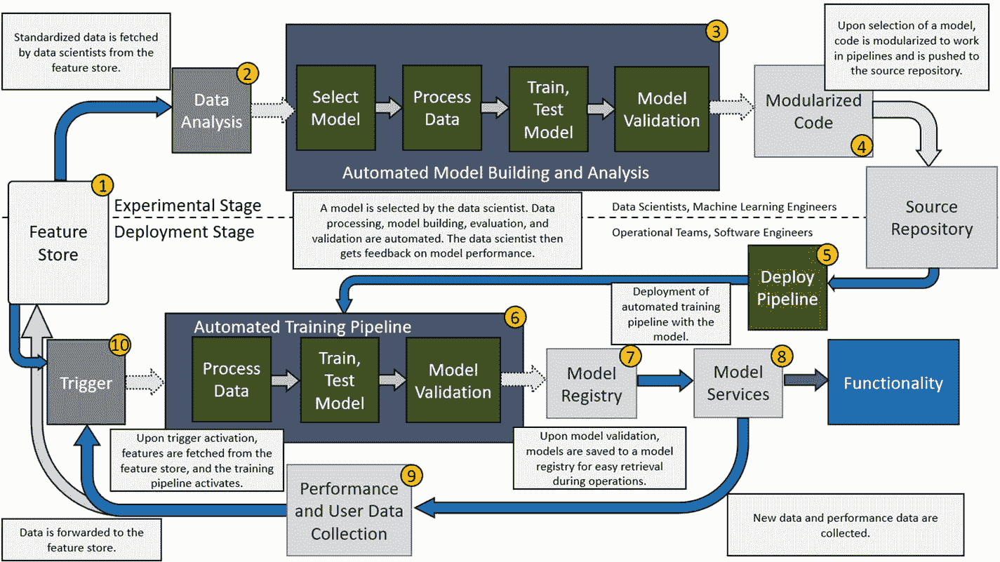

图 3-3

描述通过流水线实现自动化的机器学习模型可能部署设置的图表

这信息量很大，让我们分解一下，并按照图表上的编号来理解。

# 自动化机器学习流水线架构详解

## 1. 特征存储
这是一个数据存储库，取代了之前示例中的数据存储。所有数据现在都可以标准化为一个通用定义，所有流程都可以在此实例中使用。例如，实验阶段的流程将使用与已部署训练流水线相同的输入数据，因为所有数据都遵循相同的定义。

**通用定义**的含义是，原始数据以一种适用于所有相关原始数据的过程化方式进行清洗和处理。这些处理后的特征随后被保存在特征存储中，供流水线提取，并且确保每个流水线都使用根据此标准处理的特征。这样，两个不同流水线之间感知到的任何趋势差异都不会归因于处理流程的偏差。

假设你正在尝试提供一个目标检测服务，用于检测和识别国家公园中的各种动物。来自步道摄像头的所有视频源（视频可以看作是一系列帧）可以作为原始数据存储，但不同的步道摄像头可能有不同的分辨率。与其重复相同的数据处理过程，你可以简单地将相同的过程（例如，对帧进行归一化、缩放和批处理）应用于原始视频，并存储你知道所有流水线都会使用的特征。

## 2. 数据分析
在此步骤中，仍然会进行数据分析，让数据科学家和机器学习工程师了解数据的样子、分布情况等，就像手动设置中一样。同样，此步骤可以决定是继续构建新模型还是仅更新当前模型。

## 3. 自动化模型构建与分析
在此步骤中，数据科学家和机器学习工程师可以选择一个模型，设置任何特定的超参数，然后让流水线自动化整个流程。流水线将根据此模型的规格自动处理数据（例如，特征是 `331x331x3` 的图像，但特定模型只接受 `224x224x3` 的图像），构建模型，训练它，评估它并验证它。在验证期间，流水线可能会自动调整超参数以优化性能。在某些情况下可能需要人工干预（例如，当模型特别庞大复杂，或者模型具有新颖架构时进行调试），但自动化应该负责生成最优模型。一旦完成，模块化代码会自动创建，以便此流水线可以轻松部署。

此阶段的一切设置都是为了实验阶段能够非常顺利地进行，只需要构建模型即可。根据实现的自动化程度，也许只需要选择模型架构并指定一些超参数，自动化就会处理其余部分。无论哪种方式，实验阶段的开发过程都大大加快了。随着这个阶段速度加快，也可以进行更多的实验，从而可能提高整体效率，因为生产力提高了，并且可以更快地找到最优解决方案。

## 4. 模块化代码
实验阶段的设置使得流水线及其组件实现模块化。在此特定情境下，数据科学家/机器学习工程师定义并构建某些模型，数据则按照某种定义进行标准化。基本上，流水线应能接受任何构建好的模型，并在给定数据的情况下执行相应步骤，而无需硬编码任何内容。（这意味着不存在任何仅适用于特定模型和特定数据的代码。该代码适用于模型和数据的通用情况。）

这就是**模块化**，即整个系统被划分为各自拥有独立功能的单个组件，并且这些组件可以根据不同的输入变量进行替换。得益于模块化代码，当流水线部署后，它能够根据需要接受任何新的特征数据，以便更新已部署的模型。此外，这种结构还允许它根据需要替换模型，因此无需为每一种新的模型架构重新构建整个流水线。

可以这样理解：流水线是一个拼图块，而模型及其特征数据是各种不同的拼图块，它们都能嵌入到流水线中。每个拼图块上都有自己的“图像”，其他边可能有不同的形状，但重要的是它们能与流水线契合，并且可以轻松地替换为其他拼图块。

## 5. 部署流水线
在此步骤中，流水线被手动部署并从源代码中获取。得益于其模块化，流水线设置能够独立运行，并在需要时自动使用任何新数据训练已部署的模型。应用程序是围绕流水线的代码结构构建的，因此所有组件都能相互协同工作。工程团队在首次部署时需要围绕流水线及其模块化组件构建部分应用程序，但此后，只要结构保持不变，流水线就应与应用程序无缝协作。模型只需被简单替换，而不像以前那样需要手动将模型集成到应用程序中。这一次，流水线必须集成到应用程序中，而模型则被简单替换。

然而，需要指出的是，流水线结构可能会根据模型的不同而改变。这里的主要要点是，与之前“替换”模型仅意味着加载更新权重的设置相比，流水线在需要重构之前应能处理更多的模型。现在，如果多个架构都拥有共同的训练、测试和验证代码，它们都可以在同一个流水线下使用。

## 6. 自动化训练流水线
此流水线包含提供服务的模型，并设置为在触发器激活时自动获取新特征。触发器激活的条件将在第 10 项中讨论。当流水线完成更新训练好的模型后，该模型会被保存到模型注册表中，这是一种存储单元，用于保存训练好的模型以便于访问。

## 7. 模型注册表
这是一个专门保存模型类和/或权重的存储单元。该单元的目的是保存训练好的模型，以便于应用程序（例如）轻松检索，并且它是添加到自动化设置中的一个好组件。如果没有模型注册表，模型类和权重将只能保存到已建立的任何源代码仓库中，但通过这种方式，我们为这些模型提供了一个集中的存储区域，从而简化了流程。由于每个人都可以访问它，它还有助于弥合模型开发团队、软件开发团队和运维团队之间的鸿沟，而这正是我们在理想的自动化设置中最终想要的。

该注册表与自动化训练流水线一起确保了**模型服务的持续交付**，因为模型可以频繁更新、推送到此注册表并部署，而无需经历整个实验阶段。

## 8. 模型服务
在此，应用程序从模型注册表中拉取最新、性能最佳的模型，并利用其预测服务。然后，此操作继续在应用程序中提供所需的功能。

## 9. 性能与用户数据收集
像往常一样收集新数据以及与模型相关的性能指标。这些数据会进入特征存储，在那里新数据被处理和标准化，以便在实验阶段和部署阶段都能使用，并且两个阶段使用的数据之间没有差异。性能数据被存储起来，以便数据科学家能够了解模型在部署后的表现。基于这些数据，可以做出重要决策，例如是否要构建具有新架构的新模型。

## 10. 训练流水线触发器
此触发器在激活后，会为已部署的模型启动自动化训练流水线，并允许流水线从特征存储中检索特征。触发器可以包含以下任何一种条件，但不限于这些条件：

*   **手动触发：** 可能只有在手动启动该过程时才会训练模型。例如，数据科学团队可以在审查性能和数据并得出结论认为已部署的模型需要使用新批次的数据进行训练后，选择启动此过程。
*   **定时训练：** 可能模型被设置为按特定时间表进行训练。这可以是周末的某个时间、每晚流量最低时段、每月一次，等等。
*   **性能问题：** 可能性能数据表明模型的性能已低于某个基准。这可以自动激活训练过程，以尝试使性能恢复到正常水平。如果这不可能或消耗过多资源，数据科学家和机器学习工程师可以选择构建并部署一个新模型。
*   **数据模式变化：** 可能是在特征存储中创建特征时注意到了数据趋势的变化。当然，特征存储并非唯一可以分析数据并识别任何新趋势或数据变化的地方。可以有一个专门负责此任务的独立进程/程序，它可以决定是否激活触发器。

这也是开始训练过程的一个好条件，因为数据中的新趋势很可能导致性能下降。无需等待性能下降来激活触发器，模型可以在充分检测到数据中的此类变化后立即开始对新数据进行训练，从而使公司将此类情况可能造成的任何潜在损失降至最低。

## 对当前设置的反思
这一实现方案解决了先前设置中的许多问题。得益于实验阶段对流水线的整合，之前整个阶段完全由人工流程构成的问题已不复存在。流水线实现了模型训练、评估和验证全流程的自动化。模型开发团队现在只需构建模型，并复用任何仍适用于该模型的通用训练、评估和验证流程。在模型开发流水线的末端，相关的模型指标会被收集并展示给操作人员。这些指标能帮助模型开发团队快速构建原型，甚至比没有自动化时更快地找到最优解决方案，因为他们可以在不同模型上运行多条流水线，并一次性对所有结果进行比较。

实验阶段的自动化模型创建流水线使团队能够更快地响应数据的重大变化，或已部署模型需要解决的任何问题。与之前只能通过加载同一模型的更新权重来替换模型不同，这些流水线的结构允许使用不同架构的多种模型，只要它们都使用相同的训练、评估和验证流程即可。得益于模块化代码，流水线在部署后只需替换模型类及其各自的权重。模块化使得流水线的部署更加容易，并且可以轻松替换模型，以便在部署期间对任何模型进行进一步训练。如果某个模型需要模型开发团队的特殊关注，团队可以对其进行进一步训练，待准备就绪后再替换回来。现在，团队能够通过这种模型替换方式，实现更快速的响应。

流水线还使得软件工程团队和运维团队能够更轻松地部署流水线和模型。由于一切都是模块化的，团队无需每次都费力将新的模型类集成到应用程序中。每个人都从中受益，模型开发团队也不必对实现新架构过于犹豫，只要新模型仍使用与现有流水线相同的训练、评估和验证代码即可。

虽然这一设置解决了困扰原始设置的大部分问题，但仍有一些重要问题有待解决。首先，没有现成的机制来测试和调试流水线，因此在推送到源代码仓库之前，所有这些工作都必须手动完成。当你试图推送多个迭代版本的流水线时，比如在构建不同架构的模型，而这些模型的训练、测试和验证方式又各不相同的情况下，这就会成为一个问题。也许最新的模型相比旧的最先进模型有了巨大改进，你的团队希望尽快实现这些新方案。在这种情况下，团队在将流水线推送到源代码进行部署之前，需要频繁地进行调试和测试。这意味着，在避免人工工作方面，仍有部分自动化工作需要完成。

流水线也是手动部署的，因此如果代码结构发生变化，工程团队必须重建应用程序的部分组件，以适应新的流水线及其模块化代码。当所有组件都清楚彼此之间的预期时，模块化运行会很顺畅；但如果某个组件的代码发生变化导致不再兼容，那么要么必须重建应用程序以适应新的变化，要么必须重写该组件以使其与原始流水线兼容。不幸的是，新的模型架构可能要求重写流水线本身的部分内容，因此很可能需要对应用程序本身进行修改，以适应新的流水线。

希望你能开始看到自动化在这一设置中带来的巨大改进，同时也看到仍有待解决的问题。自动化解决了构建和创建新模型的问题，但构建和创建新流水线的问题依然存在。

为了找到这个问题的答案，让我们来看看前面定义的三种设置中的最后一种。

## 管道的持续集成/持续交付

在此设置中，我们将引入一个系统，用于在管道组件打包并准备部署之前对其进行全面测试。这将确保`管道代码的持续集成`以及`管道的持续交付`，这是先前设置所缺失的自动化流程的关键要素。请参考图 3-4 查看此类设置的图形表示。

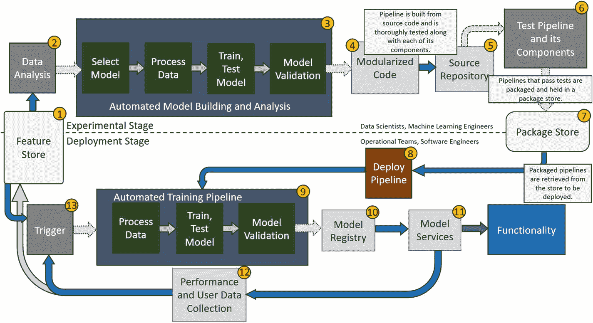

图 3-4

描述在图 3-2 的自动化设置中新增的测试系统和包存储的图表

虽然这与之前的设置基本相同，但我们将逐步重新介绍，并重点强调新引入的元素。

1.  **特征存储**：`特征存储`包含已处理为标准格式的数据特征。数据科学家可以提取这些特征用于离线数据分析。当触发器被激活时，特征也可以被发送到自动化训练管道，以进一步训练已部署的模型。

2.  **数据分析**：此步骤由数据科学家对从`特征存储`中提取的特征执行。分析结果可以决定是构建新模型，还是调整现有模型的架构并在此基础上重新训练。

3.  **自动化模型构建与分析**：此步骤由模型开发团队执行。团队可以构建模型并将其传入管道，前提是它们与训练、测试和验证代码兼容，整个过程会自动进行，并在最后生成模型分析报告。如果团队想要实现一些最新的机器学习架构，则必须从头开始创建模型，并考虑到与管道的集成以保持模块化。管道代码的某些部分可能也需要更改，这是可以接受的，因为此设置的新组件可以自动处理这些更改。

4.  **模块化代码**：一旦模型在验证步骤中达到最低性能水平，管道、其组件和模型就可以被模块化并存储在源代码仓库中。

5.  **源代码仓库**：`源代码仓库`保存了不同管道和不同模型的所有打包后的管道和模型代码。团队可以同时为不同目的创建多个副本并全部存储在此处。在旧的设置中，管道和模型会从这里被拉取，并由软件工程团队手动集成和部署。在此设置中，模块化代码现在必须经过测试，以确保所有组件都能正常工作。

6.  **测试**：此步骤对于实现`持续集成`至关重要，或者说是自动化的结果，即新组件和元素在新环境中被持续设计、构建和部署。

管道及其组件（包括模型）必须经过全面测试，以确保所有输出都是正确的。此外，管道本身也必须经过测试，以保证它们能够与应用程序及其设计方式协同工作。例如，管道中不应存在会破坏其与应用程序兼容性的错误。应用程序被编程为期望管道具有特定行为，而管道必须相应地运行。

如果你熟悉软件开发，那么管道组件和模型的测试类似于开发人员编写的用于检查应用程序各个功能部分的自动化测试。一个简单的例子是自动化测试，以确保各种类型的数据被服务器成功接收并添加到正确的数据库中。

对于管道和机器学习模型，测试的一些示例包括：

    *   验证测试过程是否会导致超参数的正确调整？

*   每个管道组件是否正常工作？它是否输出了预期的元素？例如，在模型评估之后，它是否正确启动了验证步骤？（或者，如果模型评估在模型验证之后，评估步骤是否正确启动？）

*   数据处理是否正确执行？数据后处理是否存在任何可能导致模型性能不佳的问题？最好避免这种结果，因为修复数据处理组件会浪费资源。如果业务依赖于快速管道部署，那么避免此类情况就更为关键。

*   数据处理组件是否正确执行了数据缩放？它是否正确执行了特征工程？它是否正确转换了图像？

*   模型分析是否正常工作？你需要确保你的决策基于准确的数据。如果模型实际表现良好，但管道中模型分析组件的缺陷导致数据科学家/机器学习工程师认为模型表现不佳，那么可能会导致管道部署速度变慢的问题。同样，你也不希望模型分析显示错误信息，即使它错误地将精确度显示为准确率。

自动化测试越彻底，就越能保证管道在应用程序中无问题地运行。（这不一定包括模型性能，因为模型性能更多与模型架构、模型的开发方式及其能力有关。）

一旦管道通过了所有测试，它就会被自动打包并发送到`包存储`。现在，管道的持续集成得以实现，因为团队可以更快地构建经过测试的模块化管道，并使其准备好部署。

7.  **包存储**：`包存储`是一个容纳各种打包后管道的容器。它是可选的，但在此设置中包含它，以便有一个集中区域，所有团队都可以访问准备部署的打包管道。模型开发团队将内容推送到此`包存储`，软件工程师和运维团队可以检索打包的管道并进行部署。通过这种方式，它类似于`模型注册中心`，两者都有助于实现`持续交付`。`包存储`有助于实现管道的持续交付，就像`模型注册中心`有助于实现模型和模型服务的持续交付一样。

得益于自动化测试提供的管道持续集成以及通过`包存储`实现的管道持续交付，运维团队和软件工程师也可以快速部署管道。有了这些，企业可以轻松跟上机器学习架构的最新趋势和进步，从而实现越来越好的性能和更复杂的服务。

8.  **部署管道**：在此步骤中，可以从`包存储`中检索管道并进行部署。软件工程和运维团队必须确保管道能够无故障地集成到应用程序中。因此，软件工程团队可能需要进行更多测试，以确保管道的正确集成。例如，一项测试可以是确保应用程序中考虑了管道的依赖关系（例如，如果`TensorFlow`已更新并包含管道现在使用的新功能，应用程序也应更新其`TensorFlow`版本）。

团队通常希望将流水线部署到测试环境中，以便对其进行进一步的自动化测试，确保与应用程序完全兼容。这一过程可以自动完成（流水线从`包存储`库进入测试环境），也可以手动完成（由团队决定何时将流水线部署到测试环境）。当流水线通过所有测试后，团队可以选择手动将其部署到生产环境，或让其自动完成。

无论采用哪种方式，流水线的创建和部署现在都变得快得多，尤其是因为团队无需手动测试流水线，也无需每次都为适配流水线而构建或修改应用程序。

9.  **自动化训练流水线**：`自动化训练流水线`一旦部署，其作用是在触发器激活后进一步训练模型。这有助于使模型尽可能紧跟数据的新趋势，并在更长时间内保持高性能。模型经过验证后，会被发送到`模型注册中心`，在那里保存，直到服务需要时再被调用。

10. **模型注册中心**：`模型注册中心`保存已训练的模型，直到服务需要时再被调用。同样，由于`自动化训练流水线`持续为`模型注册中心`提供高性能的机器学习模型以执行各种服务，因此实现了模型服务的持续交付。

11. **模型服务**：从`模型注册中心`中提取最佳模型，为应用程序执行各种服务。

12. **性能与用户数据收集**：收集模型性能数据和用户数据，分别发送给模型开发团队和`特征存储库`。团队可以利用模型性能指标以及数据分析结果，帮助决定下一步的行动方案。

13. **训练流水线触发器**：此步骤涉及满足某个条件（参考之前的设置，*持续模型交付*），以启动已部署流水线的训练过程，并向其提供从`特征存储库`中提取的新特征数据。

### 对设置的反思

此设置修复了之前设置的主要问题，即流水线部署问题。以前，流水线需要由机器学习团队和运维团队手动测试，以确保流水线及其组件能够正常工作，并且与应用程序兼容。然而，在此设置中，测试是自动化的，使得团队能够比以往更轻松地构建和部署流水线。这样做最大的优势在于，企业现在能够跟上需要创建新模型和新流水线的重大数据变化，并且能够利用最新的机器学习趋势和架构，这一切都得益于快速的流水线创建和部署，以及之前设置中模型服务的持续交付。

从所有这些示例中需要理解的重要一点是，自动化是未来的方向。仅在过去十年中，机器学习技术就取得了令人难以置信的进步，而最终，让您能够利用这些进步的基础设施也正在迎头赶上。

希望看完这三种可能的 MLOps 设置后，您能对 MLOps 以及 MLOps 原则的实现方式有更深入的了解。您可能已经注意到，在描述这些设置时，经常提到“流水线”，您可能会想：“什么是流水线？为什么它们对自动化如此关键？”

为了回答这个问题，让我们来看看“流水线”到底是什么。

## 流水线与自动化

流水线是采用 DevOps 原则的自动化设置中的重要组成部分。理解`流水线`的一种方式是，它是一个特定的、通常是顺序执行的过程，规定了信息在流经流水线时的流向。要查看软件开发环境中测试流水线的示例，请参考图 3-5。

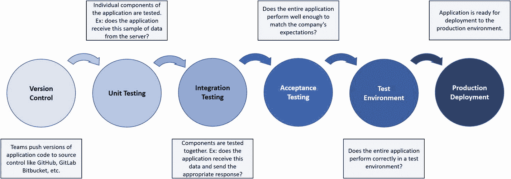

图 3-5

软件开发环境中的测试流水线。上述最优设置中用于测试打包模型流水线的流水线与此类似：必须测试单个组件，必须分组测试组件，并且流水线首先部署到测试环境，在那里进行进一步测试，然后才部署到生产环境。

在上述MLOps设置中，您已经看到了用于自动化训练已部署模型过程的流水线，用于构建、测试和打包流水线的流水线，以及用于在将打包流水线部署到生产环境之前测试其集成的流水线。

那么，这到底意味着什么呢？为了更好地理解流水线内部的具体运作，让我们在实验阶段跟随数据流经一条流水线。即使您了解流水线的工作原理，也值得跟随这个示例走一遍，因为我们现在将结合使用MLOps API的上下文来审视这条流水线。

### 流水线之旅

我们将关注实验阶段的模型开发流水线。在开始之前，需要说明的是，我们将在本流水线中引用API调用。这是因为在模型开发的关键节点，可以在执行脚本甚至Jupyter单元格时调用某些API，从而向MLOps监控软件提供关于模型训练、模型评估和模型验证的信息。在流水线的末端，MLOps软件还会通过API提供的功能，为模型部署做好准备。

您将在下一章（第4章）中了解更多关于此API的信息，但现在，在跟随示例的过程中，您可以假设API会处理自动化工作。

#### 模型选择

如图3-4所示，实验流水线从选择模型开始。这取决于操作者，他必须选择并构建一个模型。一些API允许您在构建模型时调用其功能，以便在后续流程中与MLOps软件建立连接。然后，该软件会跟踪与模型开发相关的所有指标以及模型本身，以便启动部署过程。

在本例中，操作者选择使用逻辑回归模型。请参考图3-6。

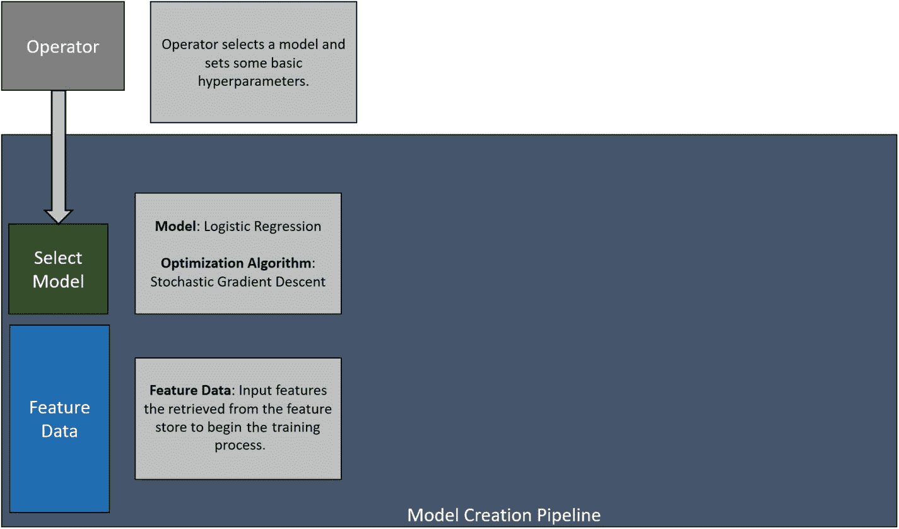

图3-6

流水线的图形化表示，其中操作者选择了逻辑回归模型。其余步骤暂时隐藏，随着我们逐步深入流水线，它们将依次显现。

#### 数据预处理

选定并构建好模型，且特征存储提供了特征数据后，流程便可进入流水线的下一阶段：数据预处理。请参考图3-7。

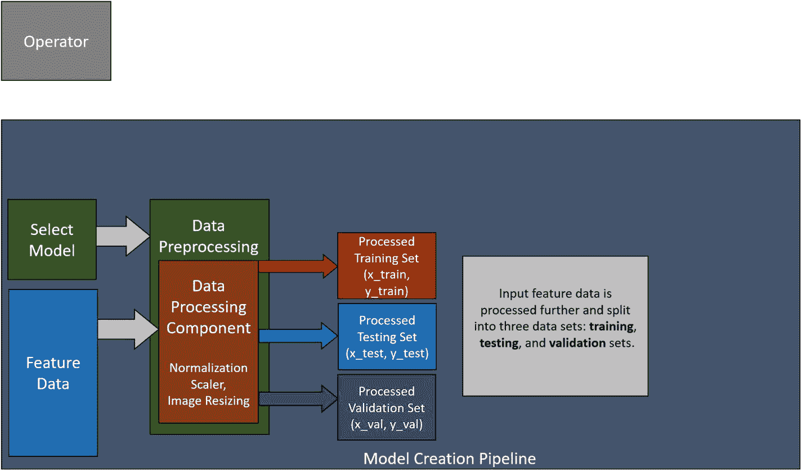

图3-7

操作员选择对图像数据进行归一化和调整大小。该过程会创建训练集、测试集和验证集。

数据预处理可以手动完成，也可以自动完成。在本例中，数据预处理仅涉及图像特征数据的归一化和大小调整，因此操作员可以手动实现。根据自动化程度的不同，操作员也可以调用某个函数，该函数接收数据并根据数据类型和提供的任何其他参数自动处理数据。

无论采用哪种方式，处理阶段结束时，数据都会被分割成若干子集。在此示例中，操作员选择创建训练集、测试集和验证集。现在，操作员可以开始训练过程了。

#### 训练过程

根据所使用的框架，操作员可以进一步将训练数据拆分为训练集和数据验证集，并在训练过程中同时使用两者。数据验证集与训练集完全分离（尽管它源自训练集），因为模型在训练期间从未见过它。其目的是定期评估模型在从未见过的数据集上的性能。请参考图3-8。

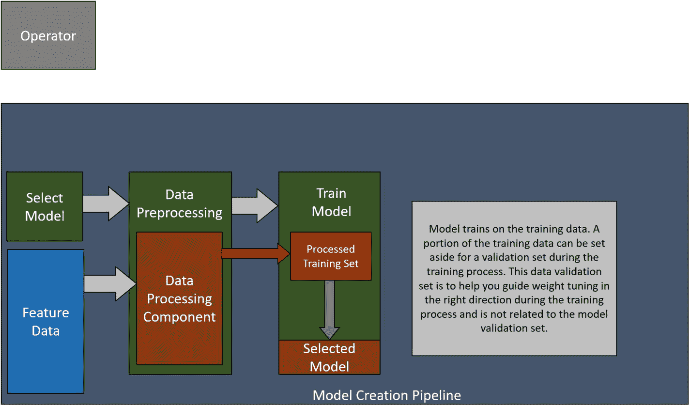

图3-8

模型训练过程开始

例如，在深度学习的背景下，模型可以在每个`epoch`结束时对验证集进行评估，生成一些指标数据供操作员查看。基于此，操作员可以判断模型的表现如何，是否存在过拟合的风险，并在需要时调整超参数或模型结构。

还可以告知API要运行哪个脚本以启动整个流水线过程。该脚本可以同时包含训练、评估和验证代码，以便API在需要时运行整个流水线。

训练过程完成后，流程进入评估阶段。

#### 模型评估

在评估阶段，使用模型从未见过的测试数据集来衡量其性能。该性能将向操作员表明模型是否过拟合，特别是当模型在训练中表现极佳，但在此阶段难以复现相同结果时。这也是为什么训练数据可以被拆分以包含一些验证数据的原因之一，因为它可以作为过拟合的早期指标。如果模型运行需要大量时间，这一点可能至关重要。你宁愿在训练中途尽早知道模型是否过拟合，而不是等它运行一整夜后，在第二天早上评估时才发现。请参考图3-9。

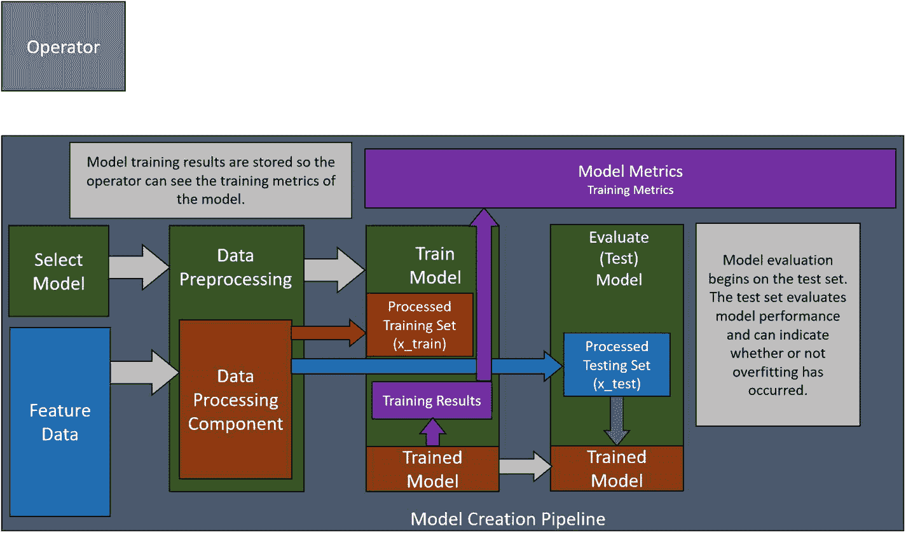

图3-9

训练结果存储在一个公共区域（例如，可以调用API来监控这些结果），用于记录当前模型的指标。使用测试集对训练好的模型开始进行模型评估。

另需再次注意，验证阶段可能在评估阶段之前，但在本例中，训练好的模型将首先在测试数据集上进行评估，然后才开始验证阶段。这只是为了在超参数调优开始前，了解模型在测试集上的表现。当然，也可以在最终模型评估之前，先通过验证步骤进行超参数调优，但在某些框架中，模型评估会先进行。一个例子是像`scikit-learn`的交叉验证这样的验证过程。当然，你也可以再次在测试集上评估调优后的模型，以获得最终的性能评估。

评估完成后，指标由API或团队实施的其他机制存储，流程进入验证阶段。

#### 模型验证

在此阶段，模型开始验证过程，旨在寻找最佳超参数。例如，你可以结合使用脚本来迭代各种超参数值配置，并利用`k`折交叉验证来帮助确定最佳超参数。请参考图3-10。

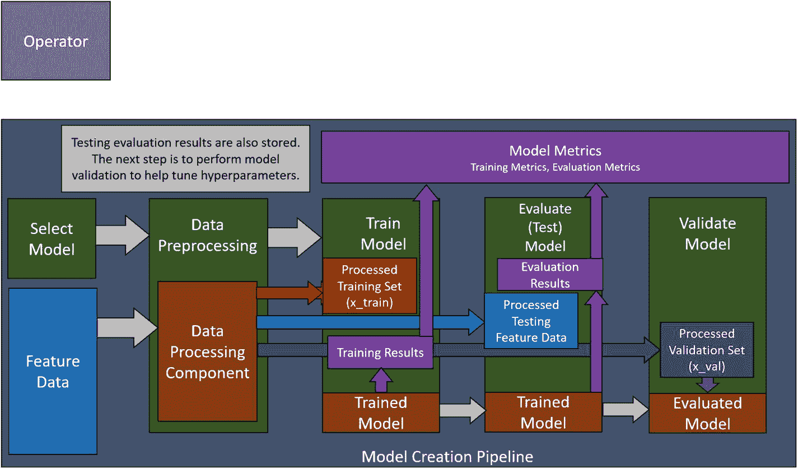

图3-10

评估指标与训练指标一起由API存储，验证过程开始

无论如何，验证集的作用是帮助调整模型的超参数。如果团队倾向于训练大量同类型的模型，他们甚至可以完全自动化这个过程，通过自动化该组模型的验证和超参数调优过程，从长远来看可以节省时间和资源。

最后，一旦模型达到良好的性能水平并完成验证阶段，验证结果将被存储，所有相关数据将以摘要形式显示给操作员。同样，根据自动化程度，也许模型会基于验证阶段发现的最佳超参数设置进行重新训练和评估。API只需要被告知要跟踪哪些指标，它就会自动执行。

#### 模型总结

此时，操作员可以将此实验的结果与其他模型的结果进行比较，使用指标作为比较的基准。API可以跟踪不同模型运行的相关指标，并可以同时比较它们。如果操作员决定继续使用这个特定模型，API和MLOps软件可以允许通过单击按钮进行部署。通常，首先部署到预发布环境，在那里可以进一步测试功能，然后再直接进入生产环境。一切都是可配置的，API可以适应业务及其工作流程的需求。如果开发人员想直接部署到生产环境，当然也可以，但考虑到失败的情况，这可能是不明智的。请参考图3-11。

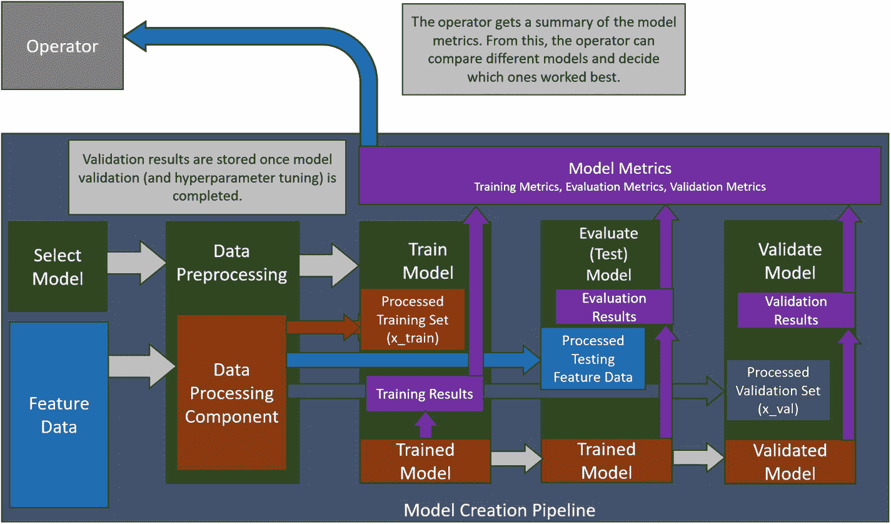

图3-11

验证完成，所有指标都显示给操作员

模型通过预发布环境的测试后，就可以部署到生产环境，在那里软件可以对其进行进一步监控。

希望现在你对流水线到底是什么有了更好的理解。模型流水线和流水线集成测试是相似的，区别在于它们得到了MLOps软件和API（例如`Databricks`和`MLFlow`）的辅助。现在，让我们看看如何使用这些API和软件来帮助你实施MLOps。

## 如何实施 MLOps

MLOps听起来很棒。它可以帮助你快速部署机器学习模型，并在模型部署后对其进行维护。然而，目前最大的问题似乎是如何实现这一目标。描述中的自动化水平需要工作流中“ML”和“Ops”双方付出大量努力才能实现。短期内，手动构建和部署模型似乎比投入资源搭建整个基础设施更好，但从长远来看，这根本不可持续。

此外，Jupyter非常适合进行实验，那么有没有办法也能追踪这些实验呢？这种功能会非常有用，尤其是当团队从头开始实现高级机器学习架构时，因为它可以让他们将新模型与已部署的模型或当前架构在所有相关指标上进行对比。像这样的任务在笔记本中操作更为便捷，而将所有内容转换为合适的模型文件则只是额外的工作。

这里的要点是，考虑到这些因素以及更多因素，需要投入大量资源进行规划、开发和测试。对于规模较小的企业来说，这可能是一项超出其能力范围的任务。那么，现在该怎么办呢？

好消息是，现在有大量可用的工具，它们基本上为你实现了所有的自动化功能，例如我们在之前的管道示例中看到的API。我们将在后续章节中探讨的几个此类工具的例子包括`MLFlow`、`Databricks`、`AWS SageMaker`、`Microsoft Azure`、`Google Cloud`和`Datarobots`。使用这些工具，将MLOps原则应用到你的工作流中将变得容易得多。

以`MLFlow`为例，将其集成到代码中非常简单。你只需编写几行代码，就能追踪所有需要的指标。我们在之前的管道示例中看到的API功能全部由`MLFlow`提供。此外，`MLFlow`还会为你保存模型，提供模型服务功能，即给定一些数据，模型就能返回其预测结果。

MLFlow 还可以集成到 Databricks、AWS SageMaker、Microsoft Azure 中，并且也可以部署到 Google Cloud 上，所有这些工具都能帮助你管理 MLOps 设置，并作为部署模型的平台。虽然这些云平台确实提供了一些 MLOps 功能，且每个平台的功能范围各不相同，但使用 MLFlow 的优势在于，它让你在选择承诺使用的平台时拥有自由选择权。此外，它还为你提供了更大程度的自由度，因为你可以在本地和离线状态下进行所有实验，并且可以支持来自许多不同框架的模型。MLFlow 还提供了功能，帮助你模块化任何自定义构建的模型或由其他未明确支持的框架制作的模型。

因此，为了真正回答如何实施 MLOps 的问题，你需要熟悉 MLFlow 并探索这些工具。目标是让我们在第 2 章中构建的模型一路走到部署及后续阶段。

## 总结

MLOps 是一套从 DevOps 借鉴并应用于机器学习的原理和实践。你探索了三种不同类型的 MLOps 设置，它们具有不同程度的自动化：手动实现、持续模型交付以及管道的持续集成/持续交付。你发现手动实现在可扩展性和效率方面存在诸多问题，并探索了一种确保持续模型交付的设置。尽管这种设置解决了手动设置中的许多问题，但在管道集成测试方面仍存在一些问题需要解决。最终的设置也解决了这个问题，并确保了管道的持续集成和交付，完成了完全的自动化设置。

你还了解了管道究竟是什么，以便理解为什么它们对自动化设置如此关键。最后，你学习了一些可以帮助你在工作区中实施 MLOps 的工具，避免了从头开始实现所有自动化的麻烦。在下一章中，你将了解 MLFlow，这是一个出色的 API，它允许你实现自己的 MLOps 设置，并且与许多平台和框架兼容。