# 4. MLFlow 简介

在本章中，我们将介绍 MLFlow 是什么、它能做什么，以及如何在你现有的项目中实施 MLOps 设置。更具体地说，我们将介绍如何将 MLFlow 与 scikit-learn、TensorFlow 2.0+/Keras、PyTorch 和 PySpark 集成。我们将介绍实验创建；指标、参数和工件记录；模型记录；以及如何在本地服务器上部署模型并查询其预测结果。


## 引言

在上一章中，我们探讨了理想的 MLOps 配置是什么样的。然而，要达到所展示的自动化水平，需要为项目投入大量资源。幸运的是，有一些 API 可以为你完成这项工作，例如 **MLFlow**。MLFlow 是一个 API，它允许你以最小的代码改动将 MLOps 原则集成到你的项目中。只需在代码中零星添加几行，你就可以追踪所有你关心的项目相关细节。此外，你还可以保存模型以供将来部署使用，例如，你可以比较各个模型之间的所有指标，从而帮助你选择最佳模型。

MLFlow 的妙处在于它为你抽象了所有细节。它为你打包并模块化模型，这样当你部署模型并进行预测时，你只需以特定格式传入输入数据即可。我们在上一章中讨论的所有关于流水线的模块化工作，都由 MLFlow 处理。如果你的模型预测代码需要有所不同，MLFlow 还允许你为模型创建一个包装器。我们将在下一章中将模型部署到 Amazon SageMaker 时详细探讨此功能。即使使用自定义代码，MLFlow 也会将其模块化，这样一旦部署并准备好进行预测，它就能像任何其他模型一样工作。

具体来说，我们将在本章中介绍以下内容：

*   **创建实验：** MLFlow 中的实验本质上允许你对模型和任何相关指标进行分组。例如，你可以比较用 TensorFlow 和 PyTorch 构建的模型，并将此实验命名为 `pytorch_tensorflow`。在异常检测的背景下，你可以创建一个名为 `model_prototyping` 的实验，并通过在设置 `model_prototyping` 作为实验名称后运行训练流水线，来分组所有你想要测试的模型。

你很快就会看到，按实验对模型训练会话进行分组确实有助于组织你的工作空间，因为你能清晰地了解已训练模型背后的上下文。

*   **模型与指标记录：** MLFlow 允许你以模块化形式保存模型，并记录与**模型运行**相关的所有指标。模型运行可以理解为上一章中的模型训练、测试和验证流水线。在 MLFlow 中，你可以标记每次运行的开始和结束，并决定要保存哪些指标。此外，你还可以保存图表，因此你也能查看混淆矩阵和 ROC 曲线等图形。**模型运行**基本上就是 MLFlow 执行你指定代码的实例，所以如果你愿意，你可以只训练模型，然后就此打住。

你可以训练、评估甚至验证你的模型，并记录整个过程中每个相应步骤的所有指标。MLFlow 在如何定义模型运行方面给了你很大的灵活性。你可以在简单训练后结束运行，也可以在训练和评估后结束运行。如果你愿意，你甚至可以设置一个完整的验证脚本来为你记录整个过程，从而让你能够更轻松地在 MLFlow 中一次性比较不同的超参数设置。当我们稍后重新审视第 2 章的 scikit-learn 实验时，我们将探讨如何使用 MLFlow 进行模型验证。

*   **比较模型指标：** MLFlow 还允许你一次性比较不同的模型及其指标。因此，在执行验证以帮助调整模型的超参数时，你可以使用 MLFlow 的用户界面，将所有选定的指标放在一起比较。在上一章中，你打印了所有内容，如果脚本涉及大量超参数设置，单元格的输出可能会非常大。

*   **模型注册表：** MLFlow 还增加了实现模型注册表的功能，允许你定义特定模型所处的阶段。Databricks 与 MLFlow 集成得非常好，提供了内置的模型注册表功能。当你查看附录中的 Databricks 时，你将探索如何使用 MLFlow 模型注册表。

*   **本地部署：** MLFlow 还允许你在本地服务器上部署，以便测试**模型推理**。模型推理基本上就是模型的预测过程。数据以几种标准化格式之一发送给模型，MLFlow 返回模型做出的预测。

这样的设置也可以轻松转换到托管服务器上运行。正如你将在接下来的几章中看到的，MLFlow 还允许你将模型部署到流行的云服务上，例如 Amazon SageMaker、Microsoft Azure、Google Cloud 和 Databricks。其核心过程与你执行本地模型服务的方式相似。唯一的区别在于你托管模型的位置以及查询它的特定程序。

话虽如此，让我们从重新审视 scikit-learn 逻辑回归模型并将 MLFlow 集成到其中开始。

## MLFlow 与 Scikit-Learn

在开始之前，以下是所使用的 Python 和包的版本：

*   **Python**：3.6.5
*   **numpy**：1.18.5
*   **scikit-learn**：0.22.2.post1
*   **pandas**：1.1.0
*   **Matplotlib**：3.2.1
*   **Seaborn**：0.10.1
*   **MLFlow**：1.10.0

你不需要使用与我们完全相同的包版本，但以防某些功能在新版本中被移除、重命名或更改，导致代码运行出错，你可以尝试使用我们提供的模块的确切版本来运行代码。

特别是 MLFlow 更新非常频繁，因此与 numpy 这样的包相比，你在使用 MLFlow 运行代码时更可能遇到问题。

话虽如此，让我们深入第一个示例。在这种情况下，让我们重新审视上一章中的 scikit-learn 代码，并向其中添加 MLFlow 集成。


### 数据处理

首先，从导入所有库开始：

```
import numpy as np
import pandas as pd
import matplotlib #
import matplotlib.pyplot as plt
import seaborn as sns
import sklearn #
from sklearn.linear_model import LogisticRegression
from sklearn.model_selection import train_test_split
from sklearn.preprocessing import StandardScaler
from sklearn.metrics import roc_auc_score, plot_roc_curve, confusion_matrix
from sklearn.model_selection import KFold
import mlflow
import mlflow.sklearn
print("Numpy: {}".format(np.__version__))
print("Pandas: {}".format(pd.__version__))
print("matplotlib: {}".format(matplotlib.__version__))
print("seaborn: {}".format(sns.__version__))
print("Scikit-Learn: {}".format(sklearn.__version__))
print("MLFlow: {}".format(mlflow.__version__))
```

输出结果应类似于图 4-1。

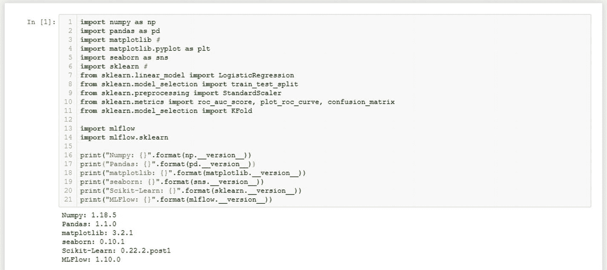

图 4-1

导入必要模块并打印其版本号的输出结果

现在可以继续加载数据：

```
data_path = "data/creditcard.csv"
df = pd.read_csv(data_path)
df = df.drop("Time", axis=1)
```

请参考图 4-2 查看单元格中的代码。

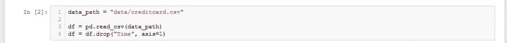

图 4-2

加载数据集并删除名为 Time 的列，因为它添加了非常大的数据值，而这些值与 Class 列的相关性不大。仅通过删除无关信息，模型性能就略有提升

请注意，你再次删除了 Time 列。

现在可以检查数据是否加载正确：

```
df.head()
```

请参考图 4-3 查看 `head()` 函数。

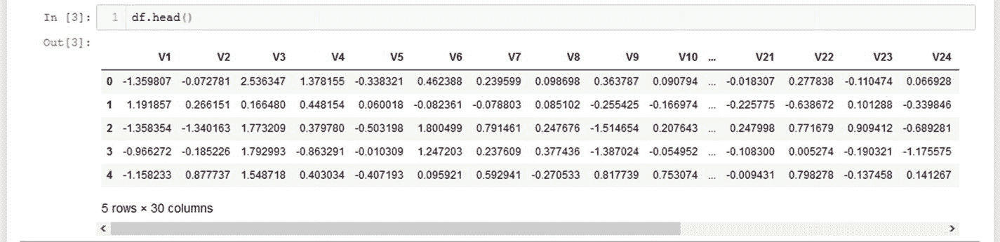

图 4-3

通过使用 head() 函数验证数据是否加载正确。如你所见，列和数据都已正确加载

再次强调，这次你从数据框中删除了 `Time` 列。这是因为发现该列添加的数据对发现异常帮助不大，只会增加数据的复杂性。

对于深度学习模型，你的模型最终可能会学习到 `Time` 数据与 `Class` 标签的相关性不强，从而降低处理该数据的节点的重要性。最终，它甚至可能忽略 `Time` 数据。然而，你可以通过从训练集中剔除这类特征来加速学习过程。这是因为你节省了模型用于找出这一点所需的时间和资源。

接下来，你将分割正常点和异常点：

```
normal = df[df.Class == 0].sample(frac=0.5, random_state=2020).reset_index(drop=True)
anomaly = df[df.Class == 1]
```

让我们打印出它们各自的形状：

```
print(f"Normal: {normal.shape}")
print(f"Anomaly: {anomaly.shape}")
```

请参考图 4-4 查看 Jupyter 中上述两个单元格及其输出。

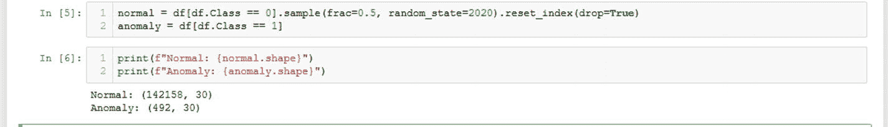

图 4-4

从数据框中随机抽取 50% 的正常数据点，并从中挑选出所有异常点，分别作为独立的数据框。然后，打印两个数据集的形状。如你所见，正常点的数量远远超过异常点

你将把正常集和异常集分割成训练-测试-验证子集。运行以下两个代码块：

```
normal_train, normal_test = train_test_split(normal, test_size = 0.2, random_state = 2020)
anomaly_train, anomaly_test = train_test_split(anomaly, test_size = 0.2, random_state = 2020)
normal_train, normal_validate = train_test_split(normal_train, test_size = 0.25, random_state = 2020)
anomaly_train, anomaly_validate = train_test_split(anomaly_train, test_size = 0.25, random_state = 2020)
```

请参考图 4-5 查看各自单元格中的两个代码块。

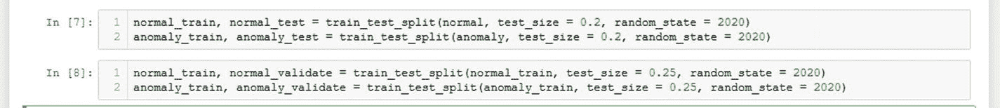

图 4-5

将正常和异常数据框分别划分为训练集、测试集和验证集。最初，20% 的正常点和异常点用作测试集。从剩余的 80% 数据中，再取该训练集的 25% 作为验证集，这意味着验证集占原始数据的 20%。最终，训练集占原始数据的 60%。最终，训练-测试-验证集的比例分别为 60-20-20

现在，你可以处理这些集合并创建 x-y 分割：

```
x_train = pd.concat((normal_train, anomaly_train))
x_test = pd.concat((normal_test, anomaly_test))
x_validate = pd.concat((normal_validate, anomaly_validate))
y_train = np.array(x_train["Class"])
y_test = np.array(x_test["Class"])
y_validate = np.array(x_validate["Class"])
x_train = x_train.drop("Class", axis=1)
x_test = x_test.drop("Class", axis=1)
x_validate = x_validate.drop("Class", axis=1)
```

请参考图 4-6 查看单元格中的上述代码块。

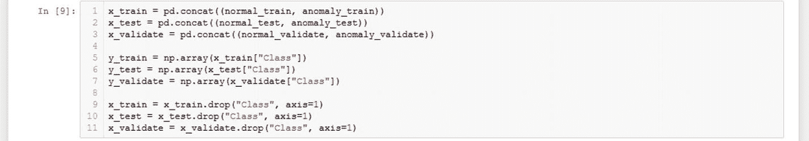

图 4-6

通过连接各自的正常集和异常集，创建训练集、测试集和验证集对应的 x 和 y 分割。你从 x 集中删除了 Class，因为否则直接给出标签就相当于作弊。你试图让模型通过读取 x 数据来学习标签，而不是学习如何读取 x 数据中的 Class 列

你可以打印这些集合的形状：

```
print("Training sets:\nx_train: {} \ny_train: {}".format(x_train.shape, y_train.shape))
print("\nTesting sets:\nx_test: {} \ny_test: {}".format(x_test.shape, y_test.shape))
print("\nValidation sets:\nx_validate: {} \ny_validate: {}".format(x_validate.shape, y_validate.shape))
```

请参考图 4-7 查看输出的形状。

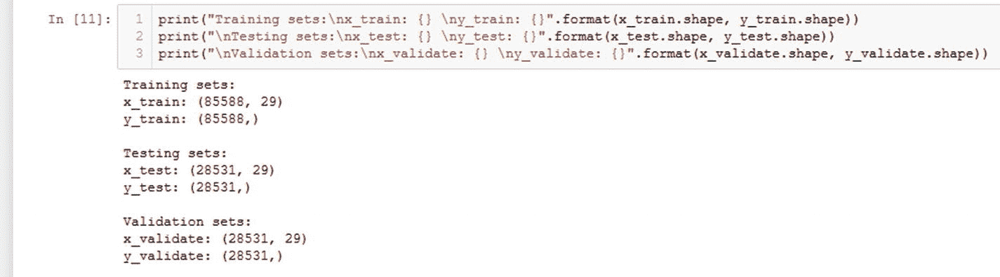

图 4-7

打印训练集、测试集和验证集的形状

最后，你使用 scikit-learn 的标准缩放器对数据进行缩放：

```
scaler = StandardScaler()
scaler.fit(pd.concat((normal, anomaly)).drop("Class", axis=1))
x_train = scaler.transform(x_train)
x_test = scaler.transform(x_test)
x_validate = scaler.transform(x_validate)
```

请参考图 4-8。

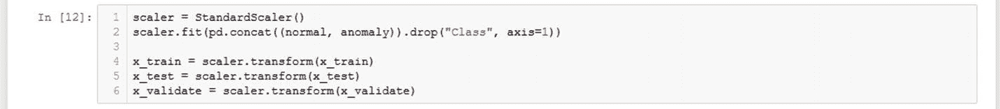

图 4-8

在删除 Class 后的正常点和异常点超集上拟合缩放器，以缩放 x 集


### 使用 MLFlow 进行训练与评估

现在只剩下训练和评估模型了。我们将稍后展示如何使用 MLFlow 功能进行验证，但首先，让我们定义训练和测试函数来组织代码。这也是你开始将 MLFlow 集成到代码中的地方。以下是 `train` 函数：

```
def train(sk_model, x_train, y_train):
sk_model = sk_model.fit(x_train, y_train)
train_acc = sk_model.score(x_train, y_train)
mlflow.log_metric("train_acc", train_acc)
print(f"Train Accuracy: {train_acc:.3%}")
```

请参考图 4-9 查看此代码在单元格中的样子。

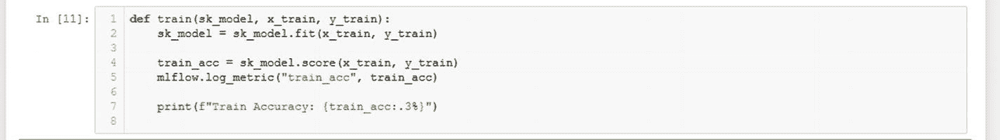

图 4-9

定义训练函数以更好地组织代码。此外，你正在定义一个训练准确率指标，该指标将由 MLFlow 记录

你可能已经注意到了这段新代码的第一行：

```
mlflow.log_metric("train_acc", train_acc)
```

你在这里专门为训练准确率创建了一个新指标，以便跟踪这个指标。此外，你告诉 MLFlow 记录这个指标，这样 MLFlow 就会在每次运行中跟踪这个值。当你记录多次运行时，你可以比较每次运行中的这个指标，从而选出例如 AUC 分数最高的模型。

现在让我们继续看 `evaluate` 函数：

```
def evaluate(sk_model, x_test, y_test):
eval_acc = sk_model.score(x_test, y_test)
preds = sk_model.predict(x_test)
auc_score = roc_auc_score(y_test, preds)
mlflow.log_metric("eval_acc", eval_acc)
mlflow.log_metric("auc_score", auc_score)
print(f"Auc Score: {auc_score:.3%}")
print(f"Eval Accuracy: {eval_acc:.3%}")
roc_plot = plot_roc_curve(sk_model, x_test, y_test, name='Scikit-learn ROC Curve')
plt.savefig("sklearn_roc_plot.png")
plt.show()
plt.clf()
conf_matrix = confusion_matrix(y_test, preds)
ax = sns.heatmap(conf_matrix, annot=True,fmt='g')
ax.invert_xaxis()
ax.invert_yaxis()
plt.ylabel('Actual')
plt.xlabel('Predicted')
plt.title("Confusion Matrix")
plt.savefig("sklearn_conf_matrix.png")
mlflow.log_artifact("sklearn_roc_plot.png")
mlflow.log_artifact("sklearn_conf_matrix.png")
```

请参考图 4-10 查看上述代码在单元格中的样子。

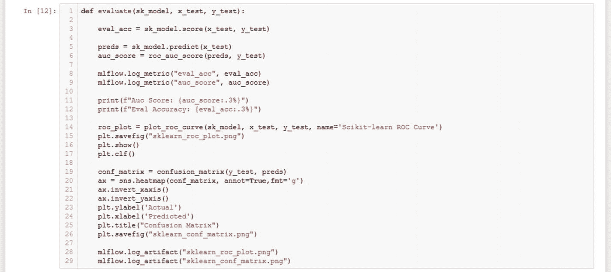

图 4-10

一个用于计算 AUC 分数和准确率评估指标的函数。生成混淆矩阵和 ROC 曲线的图表，并将指标和图表都记录到 MLFlow

再次，你告诉 MLFlow 记录另外两个指标：AUC 分数和测试集上的准确率。你通过以下代码行来实现：

```
mlflow.log_metric("eval_acc", eval_acc)
mlflow.log_metric("auc_score", auc_score)
```

此外，你还可以告诉 MLFlow 保存由 matplotlib 和 seaborn 生成的图表。这样，你就可以以高度组织的方式查看每次训练运行的每个图表。你必须首先保存这些图表，保存在同一目录下。然后，你必须告诉 MLFlow 获取这些工件并记录它们，如下所示：

```
mlflow.log_artifact("sklearn_roc_plot.png")
mlflow.log_artifact("sklearn_conf_matrix.png")
```

确保它们的名称与你保存的图表名称一致。

### 记录和查看 MLFlow 运行

最后，让我们运行实际设置实验名称、启动 MLFlow 运行并执行所有这些代码的代码：

```
sk_model = LogisticRegression(random_state=None, max_iter=400, solver='newton-cg')
mlflow.set_experiment("scikit_learn_experiment")
with mlflow.start_run():
train(sk_model, x_train, y_train)
evaluate(sk_model, x_test, y_test)
mlflow.sklearn.log_model(sk_model, "log_reg_model")
print("Model run: ", mlflow.active_run().info.run_uuid)
mlflow.end_run()
```

注意 MLFlow 代码的新行。我们将逐一介绍它们。

首先，从设置实验名称的代码开始：

```
mlflow.set_experiment("scikit_learn_experiment")
```

它的作用是将运行归入你作为参数传入的任何实验名称下。如果该名称不存在，MLFlow 将创建一个该名称的新实验，并将运行放入其中。

```
with mlflow.start_run():
...
...
```

这行代码允许你将所有代码块组织在同一个 MLFlow 运行的上下文中。这确保了指标记录位置的一致性，并且当你打算将所有内容记录到同一次运行时，不会创建两个不同的运行。

```
mlflow.sklearn.log_model(sk_model, "log_reg_model")
```

这行代码是记录模型时的通用约定。参数依次是你要保存的模型，以及保存时你为模型设置的名称。在此例中，你正在将逻辑回归模型以名称 `log_reg_model` 保存到本次运行中。

正如你稍后将看到的，大多数其他框架在保存模型时都遵循相同的风格。有几个例外，但我们会在适当的时候介绍。在此例中，你调用的是 `mlflow.sklearn`，但如果你想记录一个 PySpark 模型，你会使用 `mlflow.spark`。

基本上，记录模型时，模型构建所用的框架必须与 MLFlow 的框架模块匹配。也可以在 MLFlow 中创建自定义“模型”并记录它，这在文档中有介绍。你可以使用这个自定义模型来指定你希望预测函数如何工作。例如，如果你希望在做出预测之前对数据进行更多处理，MLFlow 允许你通过使用 MLFlow PyFunc 模块来指定这个额外功能。请参考文档，你可以在这里找到：[`www.mlflow.org/docs/latest/models.html#model-customization`](http://www.mlflow.org/docs/latest/models.html%2523model-customization)。

```
print("Model run: ", mlflow.active_run().info.run_uuid)
```

这行代码本质上是获取当前正在记录模型和指标的运行，并将其打印出来。如果你想直接从笔记本本身检索运行，而不是通过 UI 来操作，这会非常方便。

```
mlflow.end_run()
```

最后，这告诉 MLFlow 结束当前运行。如果在 MLFlow 启动运行的代码块中出现错误，导致运行没有终止，可以这样做来强制结束当前运行。基本上，它用于确保在执行完与当前运行相关的所有代码后，MLFlow 停止该运行。

接下来，请参考图 4-11 查看代码的完整输出。

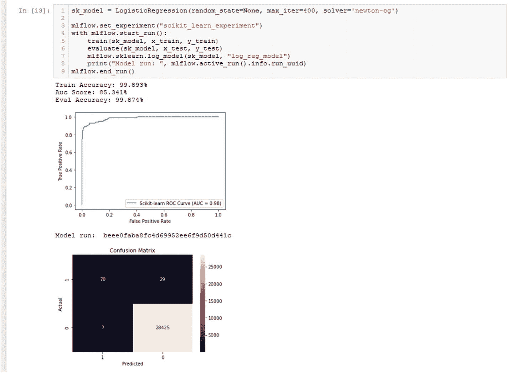

图 4-11

运行 MLFlow 实验的输出。在 MLFlow 运行上下文中，你正在训练模型，输出评估函数生成的图表，并将包括模型在内的所有指标记录到本次运行中


你可以看到，如果实验尚不存在，MLFlow 会自动生成一个新实验，因此你可以直接从代码中创建新实验。你还可以看到，代码的其余部分基本照常输出，只是它还会按照你的指定打印当前 MLFlow 运行的运行 ID。稍后当你选择要服务的特定模型时，将会用到这个 ID。接下来，你将打开 MLFlow 提供的 UI，在那里你可以查看所有实验和模型运行。最后，你还需要将模型本身作为工件记录到 MLFlow 中。MLFlow 会将这段代码模块化，以便它能与 MLFlow 提供的代码协同工作，支持实现各种 MLOps 原则。

以下操作是在 **Windows 10** 上完成的，但在 MacOS 或 Linux 上应该相同。首先，打开命令提示符/PowerShell/终端。然后，你必须进入包含此笔记本文件的目录。列出该目录的内容（或在文件资源管理器/Jupyter 内部查看），你会注意到一个名为 `mlruns` 的新目录。

如果你在 Conda 中安装了所有包，请确保在运行此操作之前已激活 Conda 环境。

现在你要做的是，确保你的命令提示符、PowerShell 或终端位于包含 `mlruns` 的同一目录中，然后输入以下内容：

```
mlflow ui -p 1234
```

命令 `mlflow ui` 会在本地默认端口 5000 上托管 MLFlow UI。然而，选项 `-p 1234` 告诉它你希望将其专门托管在端口 1234 上。

如果一切顺利（可能需要几秒钟），你应该会看到类似图 4-12 的内容。

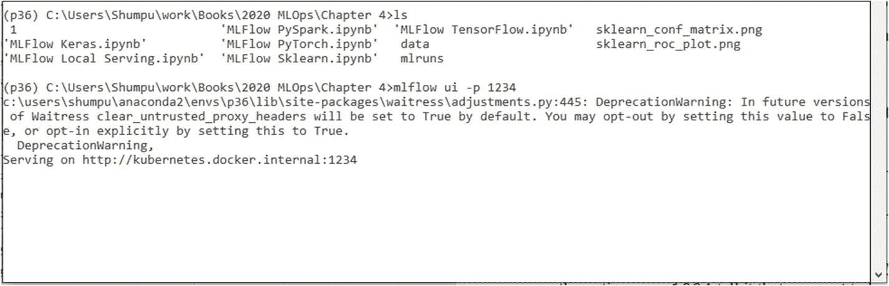

图 4-12

确保当前目录包含 `mlruns` 文件夹，并调用命令启动 UI。如果成功，它应该会显示“Serving on http:// … :1234”。我们的系统上有 Docker，因此你的系统上可能显示的是 `localhost` 而不是 `kubernetes.docker.internal`。

现在，打开浏览器并输入 `http://localhost:1234` 或 `http://127.0.0.1:1234`。两者都应该带你进入同一个 MLFlow UI。如果你使用了不同的端口，通常看起来像这样：

`http://localhost:PORT_NUMBER` 或 `http://127.0.0.1:PORT_NUMBER`，其中将 `PORT_NUMBER` 替换为你使用的端口号。如果你没有指定端口参数，那么 MLFlow 使用的默认端口是 5000。

无论如何，如果一切正常，访问该 URL 后你应该会看到类似图 4-13 的内容。

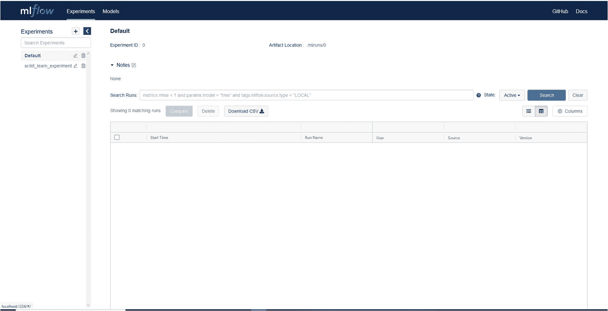

图 4-13

你的 MLFlow UI 应该看起来像这样。左侧是实验。请注意，有一个名为 Default 的实验和一个名为 `scikit_learn_experiment` 的实验，后者就是你刚刚创建的。

请注意，现在有一个名为 `scikit_learn_experiment` 的实验。点击它，你应该会看到类似图 4-14 的内容。

你可以看到刚刚完成的运行，以及你记录的指标。点击它以进行探索。如果一切顺利，刚刚完成的运行在其完成的时间戳旁边应该有一个绿色的勾号，你可以在图 4-14 中看到这种情况。

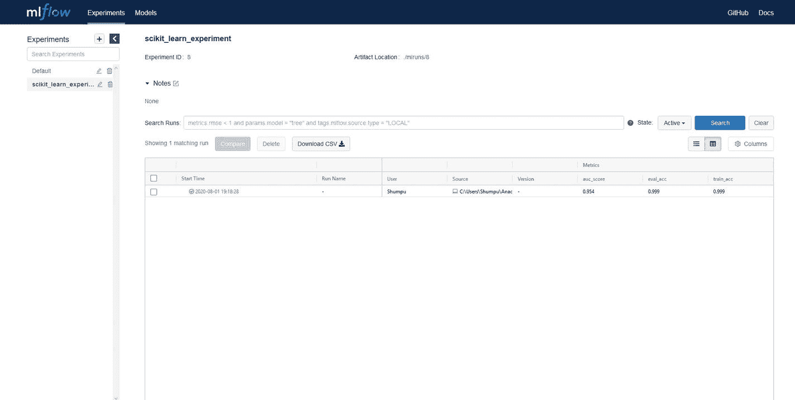

图 4-14

这就是你点击实验 `scikit_learn_experiment` 后应该看到的样子。请注意，这里有一个运行，正是刚刚创建的。

你应该会看到类似图 4-15 的内容。

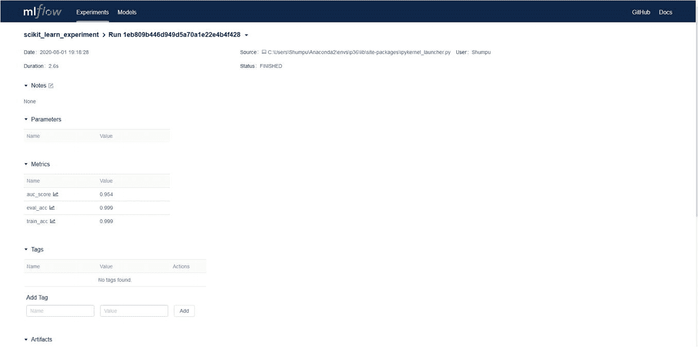

图 4-15

这是刚刚完成的运行。请注意，你记录的指标会显示在这里。

现在你应该能更清晰地看到此运行的详细信息。在这里，你可以看到所有记录的参数和指标。继续向下滚动，你应该能看到所有记录的工件。请参考图 4-16。

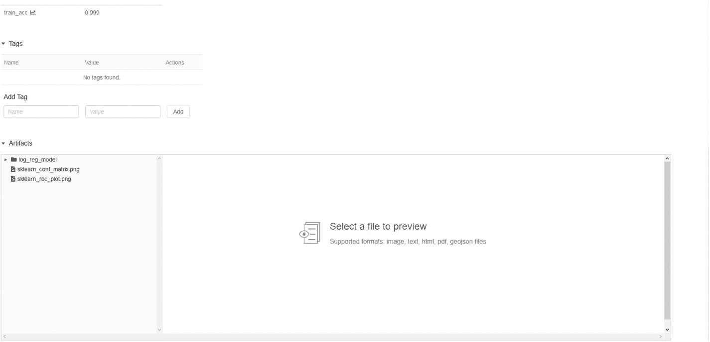

图 4-16

此运行记录的工件。请注意，图表以及模型本身似乎都被记录了，该模型在代码中记录时被命名为 `log_reg_model`。

在这里，你可以看到已记录的模型，以及你作为工件记录的两个图表。点击图表，你应该会看到类似图 4-17 的内容。

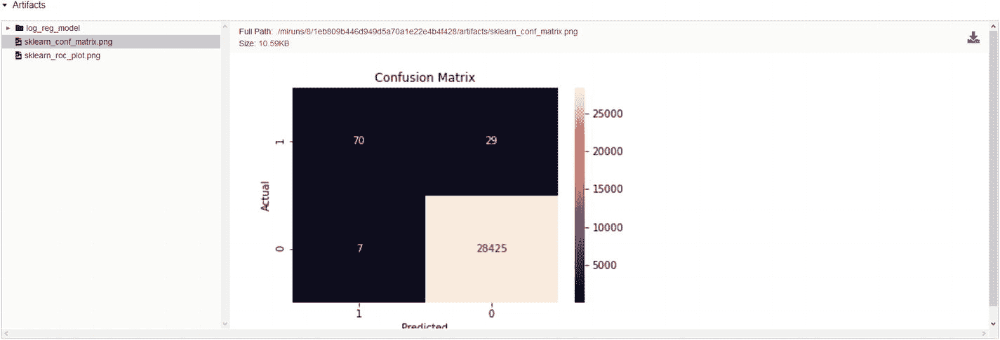

图 4-17

检查你保存的混淆矩阵图表。你也可以随意点击另一个图表，即 ROC 图。

很神奇，对吧？一切都井井有条，你无需担心为所有内容创建多个文件夹并保持条理。只需告诉 MLFlow 要做什么，它就会记录你需要的与此运行相关的所有信息。你可以记录深度学习模型的学习率、训练轮数、特定优化器参数（如 Adam 优化器的 beta1 和 beta2）等超参数。

你甚至可以记录图表，如图 4-17 所示，以及模型本身。使用 MLFlow，即使你未必需要部署到云服务的能力，也能让你的实验保持高度条理。

现在，让我们尝试再记录几次运行。重新运行图 4-11 中的单元格几次直至完成，然后返回 MLFlow UI。确保你已选择了名为 `scikit_learn_experiment` 的实验。你应该会看到类似图 4-18 的内容。

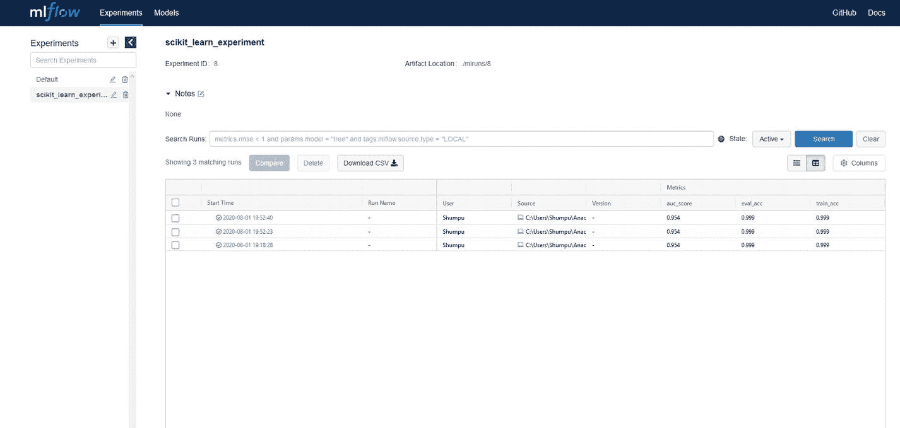

图 4-18

在记录了一些运行后重新查看你的实验。运行按时间戳升序排列，因此最新的运行位于顶部。

让我们比较一下你为这些运行记录的指标。至少选择两个运行，并确保你的 UI 看起来有点像图 4-19。我们选择了三个运行。

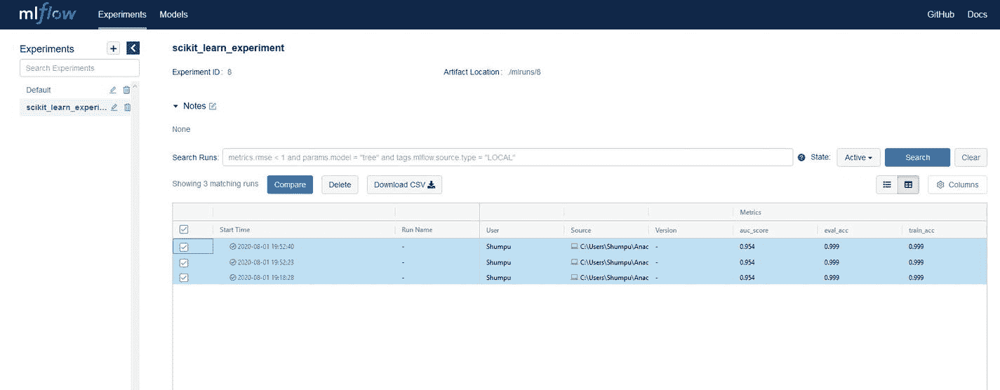

图 4-19

选择几个运行后，你的 UI 应该看起来像这样。确保至少选择两个，以便有内容可以比较。另请注意，名为 Compare 的按钮变为实心。

点击 Compare 后，你应该会看到类似图 4-20 的内容。

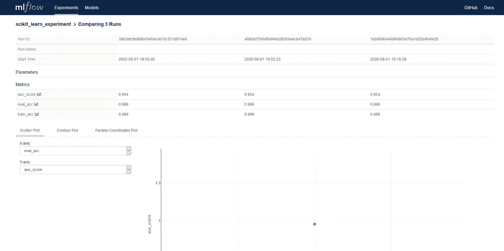

图 4-20

选择三个运行进行比较后的 UI。如你所见，你可以同时查看所有指标。还有一个绘图工具，可以让你以图形方式比较这些值，不过你不会看到合适的图表，因为所有运行中的每个值都相同。

在这里，你可以直接比较所选运行之间的相关参数和指标。你可以选择查看散点图、等高线图或平行坐标图。随意尝试不同的指标和图表。如果你愿意，甚至可以保存这些图表。

请注意，由于这些运行具有完全相同的指标，因此只会绘制出一个点。


#### 加载已记录的模型

接下来，我们简要了解一下如何加载由 MLFlow 记录的模型。返回实验页面并点击一次运行。记下顶部的运行 ID 并复制它。然后，返回笔记本并运行以下代码。请注意，运行 ID 处有一个占位符：

```
loaded_model = mlflow.sklearn.load_model("runs:/YOUR_RUNID_HERE/log_reg_model")
```

为了更好地理解这个路径的含义，我们将其分为三个部分：格式（`runs:/`）、运行 ID（`YOUR_RUNID_HERE`）以及记录模型时使用的模型名称（`log_reg_model`）。

在我们的案例中，运行 ID 是 3862eb3bd89b43e8ace610c521d974e6，因此我们的单元格如图 4-21 所示。请确保你的代码与图 4-21 大致相似，唯一的区别在于你选择的运行 ID，因为它会与我们的不同。

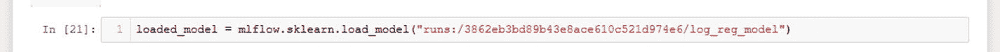

图 4-21

用于加载模型的代码，该模型使用我们记录时所用的特定运行 ID 以及记录时使用的模型名称

现在，这个模型与你最初使用 MLFlow 记录时的模型是同一个。有了它，你可以调用类似 `.score()` 的方法，并看到它与训练时的结果一致：

```
loaded_model.score(x_test, y_test)
```

这会在模型对测试集进行评估时输出准确率。如果这确实是同一个模型，那么准确率应该与之前模型运行评估阶段输出的结果相匹配。

请参考图 4-22 查看输出结果。

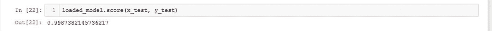

图 4-22

这是加载的模型在测试集上评估后的评估准确率。如果将此图与图 4-11 进行比较，你会发现数值大致匹配，忽略四舍五入的影响

如你所见，该值与图 4-11 中的评估准确率相匹配。

现在你知道了如何从特定的 MLFlow 运行中加载模型。

至此，你已经了解了 MLFlow 提供的一些功能，以及它如何帮助你更有条理地组织原型实验。稍后你将看到，刚才探索的整个流程几乎就是重现之前看到的训练、测试、验证流程所需的全部内容。在继续了解如何将 MLFlow 与其他框架结合使用之前，我们先来探讨如何利用 MLFlow 功能大幅改进模型验证过程。

### 使用 MLFlow 进行模型验证（参数调优）

#### 参数调优——广泛搜索

与第 2 章一样，你将使用一个脚本来辅助进行超参数调优方面的模型验证。调优脚本将基本保持不变，只是做了一些修改，添加了 MLFlow 代码。

运行以下代码来设置异常权重的范围以及折数：

```
anomaly_weights = [1, 5, 10, 15]
num_folds = 5
kfold = KFold(n_splits=num_folds, shuffle=True, random_state=2020)
```

代码应如图 4-23 所示。

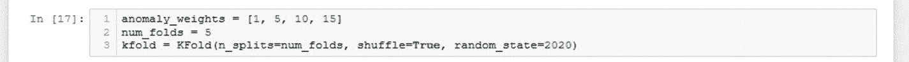

图 4-23

用于确定要执行验证的异常权重列表、确定折数以及基于折数初始化 KFolds 生成器的代码

现在，粘贴以下代码。这是整个函数的前半部分：

```
mlflow.set_experiment("sklearn_creditcard_broad_search")
logs = []
for f in range(len(anomaly_weights)):
fold = 1
accuracies = []
auc_scores= []
for train, test in kfold.split(x_validate, y_validate):
with mlflow.start_run():
weight = anomaly_weights[f]
mlflow.log_param("anomaly_weight", weight)
class_weights= {
0: 1,
1: weight
}
sk_model = LogisticRegression(random_state=None,
max_iter=400,
solver='newton-cg',
class_weight=class_weights).fit(x_validate[train], y_validate[train])
for h in range(40): print('-', end="")
print(f"\nfold {fold}\nAnomaly Weight: {weight}")
train_acc = sk_model.score(x_validate[train], y_validate[train])
mlflow.log_metric("train_acc", train_acc)
eval_acc = sk_model.score(x_validate[test], y_validate[test])
preds = sk_model.predict(x_validate[test])
mlflow.log_metric("eval_acc", eval_acc)
```

以下是更多代码。请确保这些代码与上面的代码对齐。

```
try:
auc_score = roc_auc_score(y_validate[test], preds)
except:
auc_score = -1
mlflow.log_metric("auc_score", auc_score)
print("AUC: {}\neval_acc: {}".format(auc_score, eval_acc))
accuracies.append(eval_acc)
auc_scores.append(auc_score)
log = [sk_model, x_validate[test], y_validate[test], preds]
logs.append(log)
mlflow.sklearn.log_model(sk_model, f"anom_weight_{weight}_fold_{fold}")
fold = fold + 1
mlflow.end_run()
print("\nAverages: ")
print("Accuracy: ", np.mean(accuracies))
print("AUC: ", np.mean(auc_scores))
print("Best: ")
print("Accuracy: ", np.max(accuracies))
print("AUC: ", np.max(auc_scores))
```

首先，我们来看看这一大块代码在单元格中的样子。请确保你的代码和对齐方式与图 4-24 匹配。

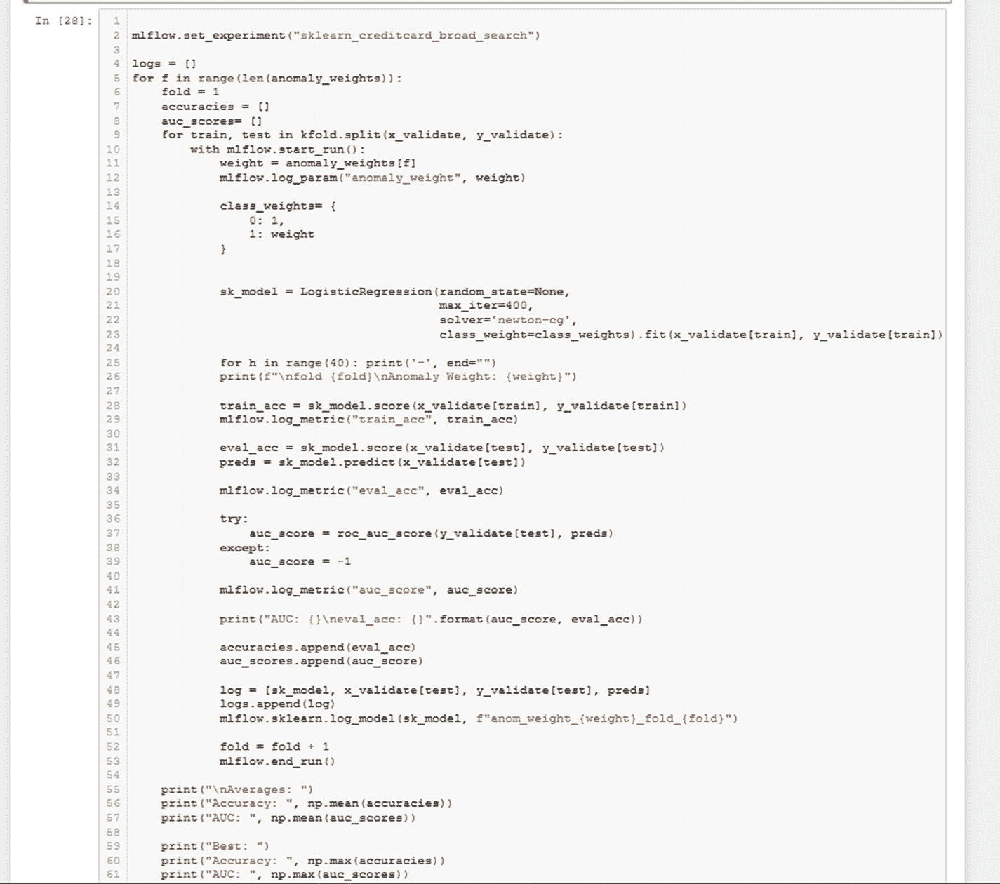

图 4-24

来自第 2 章的完整验证脚本，添加了一些 MLFlow 代码，用于在验证过程中记录所有内容

现在，让我们运行这个脚本。它应该会记录异常权重的参数以及你为生成的每个折指定的所有指标。脚本运行完成后，转到你的 MLFlow UI，并将实验切换到 `sklearn_creditcard_broad_search`，以查看你刚刚记录的所有运行。你应该会看到类似图 4-25 的内容。

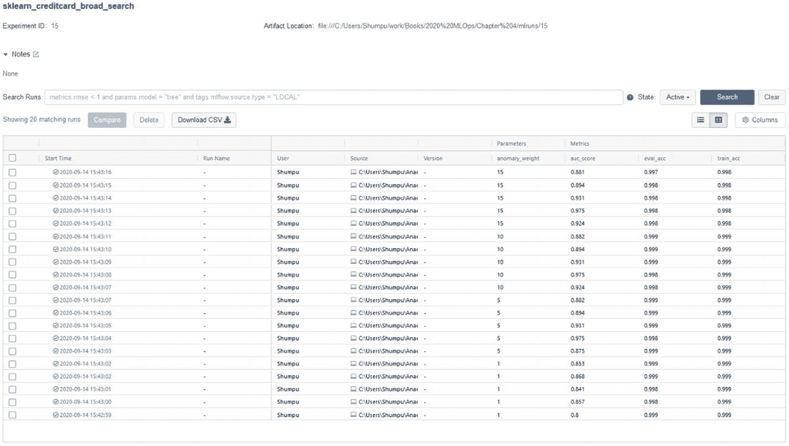

图 4-25

验证实验完成后你应该看到的输出。请确保你选择了标题为 sklearn_creditcard_broad_search 的实验

让我们尝试按 AUC 分数排序，以找到 AUC 的最佳参数。在 `metrics` 列中，点击 `auc_score`。

该操作应产生类似图 4-26 的结果。

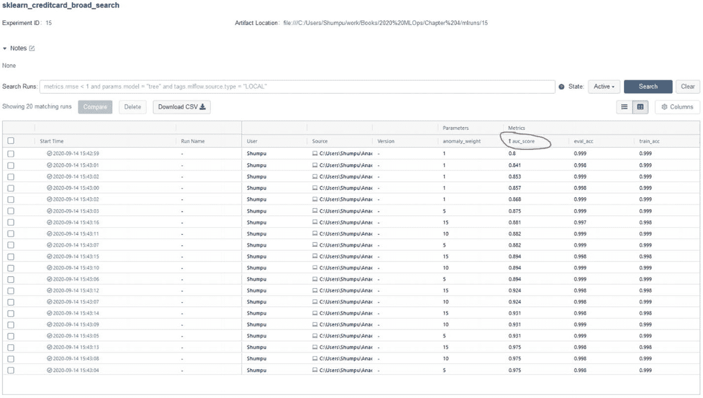

图 4-26


所有数值均按 auc_score 降序排列。我们已高亮显示此列，以便您更轻松地发现该图与图 4-25 之间的差异。如您所见，AUC 分数是升序排列的。您希望看到最佳的 AUC 分数，因此必须按降序排列。

您希望按降序排序列，因此请再次点击它，查看类似图 4-27 所示的内容。

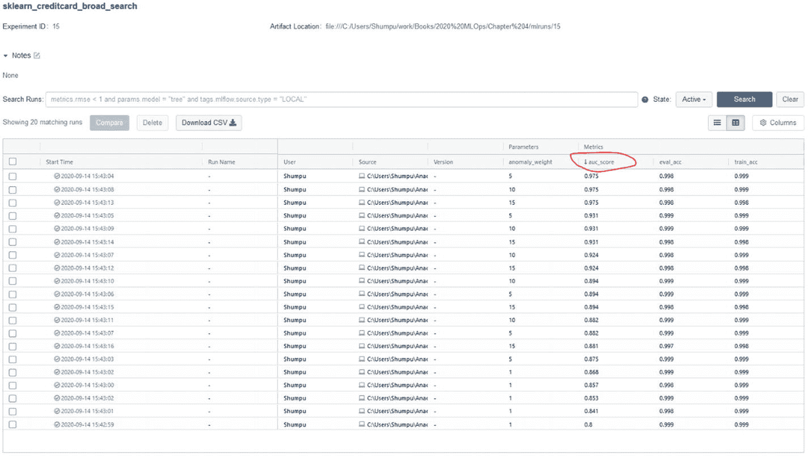

图 4-27

现在，数值已按 AUC 分数降序排列。现在，您可以查看产生最佳 AUC 分数的运行，以及该运行中使用的特定异常权重。

也许您只关心绝对最佳的分数。假设您的目标是 AUC 分数至少达到 0.90。您将如何进行过滤呢？嗯，UI 提供了一个搜索栏，该搜索栏基于 SQL WHERE 子句执行搜索。因此，要过滤输出，请键入以下内容并点击搜索：

```
metrics."auc_score" >= 0.90
```

您应该会看到类似图 4-28 的内容。如果您复制粘贴了这行代码，请务必删除它并重新输入引号，以防遇到任何与引号相关的错误。

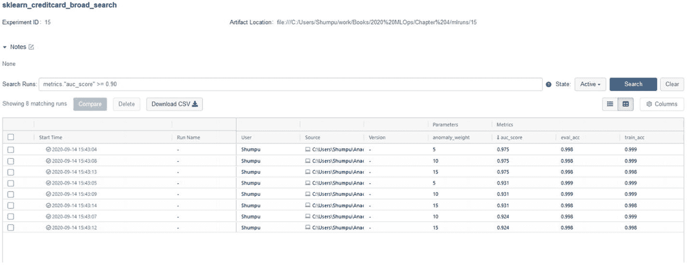

图 4-28

将所有 AUC 分数过滤为高于 0.90 的结果。如您所见，只有少数几次运行的 AUC 分数达到了 0.90 或以上。

请注意，我们将 `"auc_score"` 放在了引号中。这是为了应对您记录的指标名称包含连字符等字符的情况，如果您像这样输入，系统可能无法识别该名称：

```
metrics.auc-score
```

对于记录为 `"auc-score"` 的指标，正确的约定是像这样进行过滤：

```
metrics."auc-score" >= 0.90
```

现在，假设在这些分数中，您只想查看异常权重为 5 的分数。似乎没有异常权重为 1 的结果，因此我们从 5 开始。为此，让我们键入并搜索以下内容：

```
metrics."auc_score" >= 0.90 AND parameters.anomaly_weight = "5"
```

您应该会看到类似图 4-29 的内容。

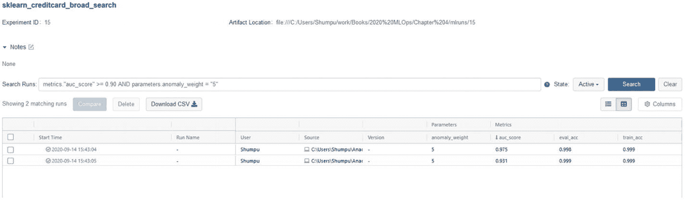

图 4-29

过滤运行，使其仅包含异常权重设置为 5 且 AUC 分数高于 0.90 的运行。

您将 5 放在引号中，是因为参数似乎被记录为字符串值，而指标则被记录为浮点数。

从该输出来看，在异常权重设置为 5 的五个折叠中，似乎只有两个折叠的 AUC 分数高于 0.90。让我们快速搜索其他参数，并检查有多少折叠的 AUC 分数也高于 0.90。

要按异常权重 10 进行过滤，请参考图 4-30。

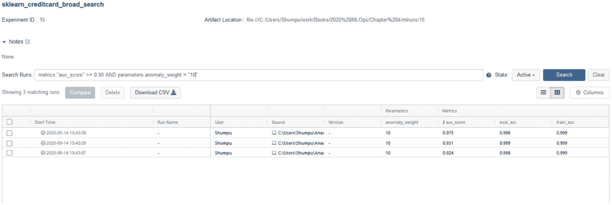

图 4-30

异常权重为 10 的三次运行也满足您的最低 AUC 分数标准。

因此，在异常权重设置为 10 的五个折叠中，有三个折叠的 AUC 分数高于 0.90。

现在让我们检查 15。请参考图 4-31。

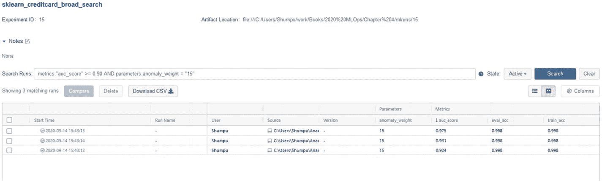

图 4-31

您可以看到，当异常权重为 15 时，似乎有两个折叠的 AUC 分数高于 0.95。

您在 15 时看到了类似的结果。

如果您将 AUC 分数要求收紧到最低 0.95 会怎样？让我们检查一下最低 AUC 为 0.95 且异常权重为 5 的运行。请参考图 4-32。

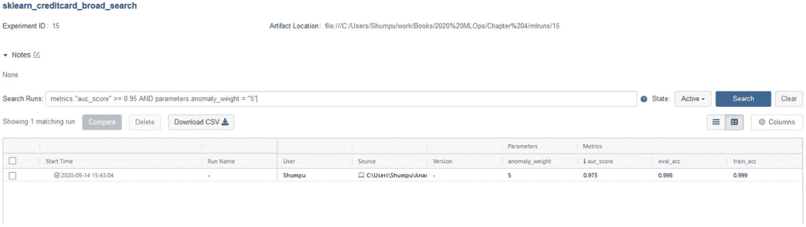

图 4-32

这次，您会看到在异常权重设置为 5 的运行中，只有一个折叠的 AUC 分数高于 0.95。

因此，当异常权重为 5 时，似乎只有一个折叠达到了高于 0.95 的 AUC 分数。

异常权重为 10 的结果如何？请参考图 4-33。

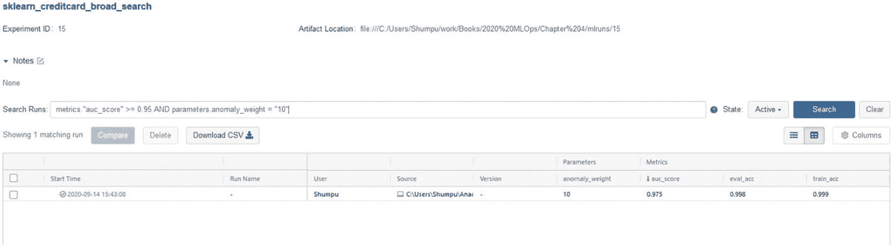

图 4-33

当异常权重为 10 时，只有一次运行的 AUC 分数高于 0.95。

让我们检查异常权重为 15 的运行。请参考图 4-34。

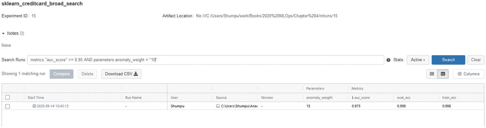

图 4-34

当异常权重为 15 时，只有一次运行的 AUC 分数达到了 0.95 以上。根据这些结果，您无法真正推断出哪个权重设置最佳，因此您必须缩小超参数搜索的范围。就您所知，您可能错过了最佳设置，它可能介于 5 和 10 之间，或者 10 和 15 之间。

似乎对于异常权重为 15，只有一次运行的 AUC 分数达到了 0.95 以上。似乎不查看其余的 AUC 分数，您就无法确定如何缩小范围。

看起来最佳 AUC 分数似乎介于 5 和 15 之间。

好吧，那么，如果较高的异常权重在 AUC 分数上更一致，而较小的异常权重运行达到的最高 AUC 分数只是侥幸呢？要查看每个异常权重设置的表现，首先移除查询语句，然后再次点击搜索。接下来，确保 AUC 分数按降序排列。完成后，请参考图 4-35 并验证您的输出是否相似。

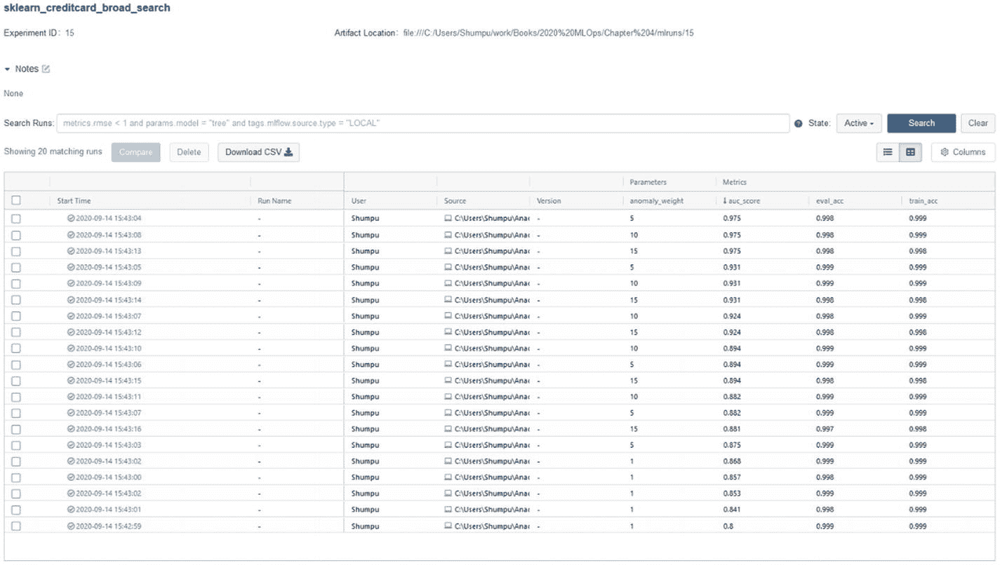

图 4-35

按 AUC 分数降序排列运行。

使用以下代码，让我们过滤异常权重的所有值，并检查 AUC 分数的情况，将 1 替换为 5、10 和 15。

```
parameters.anomaly_weight = "1"
```

请参考图 4-36 查看按异常权重 1 过滤的结果。

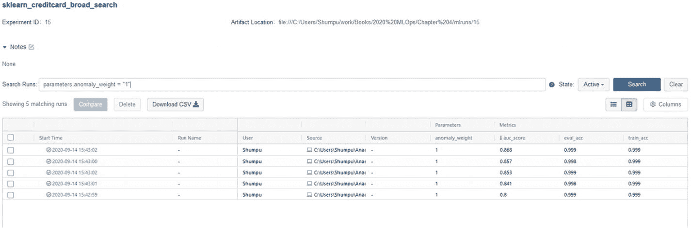

图 4-36

按降序查看异常权重为 1 的运行的 AUC 分数。

所有分数均未超过 0.9，因此您可以自动排除此异常权重设置。如果您回到脚本，可以看到平均 AUC 约为 0.8437。

让我们看看异常权重为 5 的运行。请参考图 4-37。

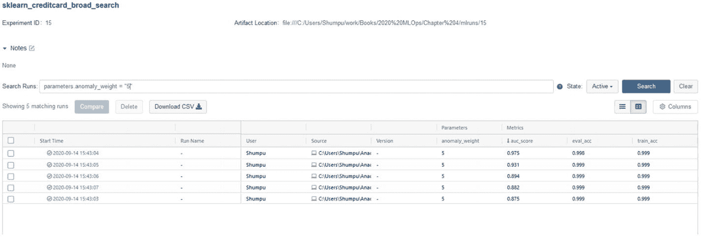

图 4-37

按降序查看异常权重为 5 的运行的 AUC 分数。与异常权重为 1 相比，您可以看到平均 AUC 分数显著提高。

分数有了显著提高。如果您回到原始脚本的输出，可以看到平均 AUC 分数现在是 0.9116。

其余的异常权重都达到了大约 0.975 的最高 AUC 分数，因此平均 AUC 是帮助您缩小范围的更好指标。

现在让我们看看异常权重为 10 的运行。请参考图 4-38。


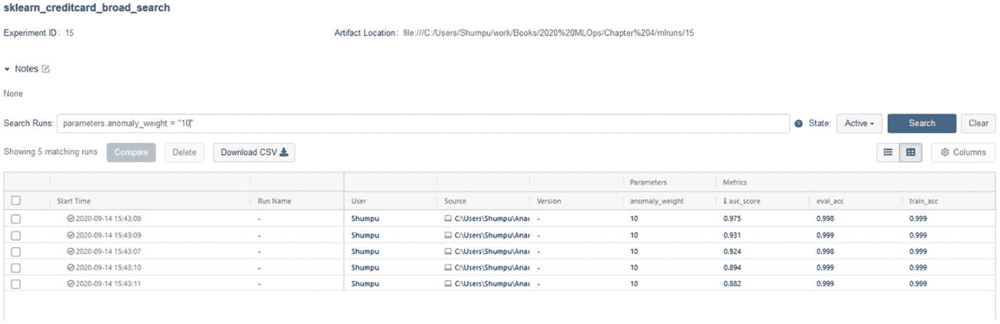

图 4-38

按降序排列异常权重为 10 的各次运行的 AUC 分数。这些分数看起来甚至更好

这些分数看起来甚至比异常权重为 5 时的分数还要好。这一次，平均 AUC 分数约为 0.9215。

最后，让我们看看异常权重为 15 时的分数。请参考图 4-39 查看按异常权重 15 筛选的结果。

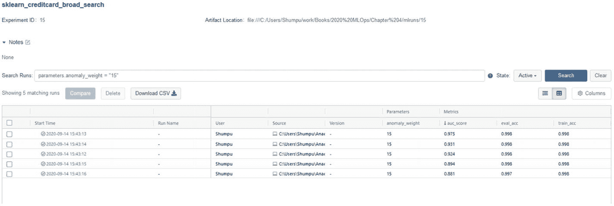

图 4-39

按降序排列异常权重为 15 的各次运行的 AUC 分数。这些分数非常相似，但平均值略差一些，因此真实范围似乎介于 10 到 15 之间

这些分数彼此非常接近，实际上，平均 AUC 分数现在是 0.9212。

基于这些结果，你可以看到从 5 到 10 似乎有所提升，但从 10 到 15 则略有下降。根据这些数据，理想范围似乎介于 10 到 15 之间，但同样，从 10 到 15 的平均 AUC 下降基本上可以忽略不计。那么，如果最佳值可能超过 15，而你一开始搜索的范围就不对呢？

从这个验证实验的结果来看，你似乎还没有找到一个可以确定聚焦的明确数值范围。因此，你必须进一步扩大范围，看看能否通过更高的异常权重获得更好的结果。

观察数据的分布情况以及正常点数量远超异常点的事实，你可以凭借直觉来指导超参数搜索，并将范围扩大得多一些。

既然你已经了解了这一点，那就让我们尝试将范围扩大得多一些吧。


#### 参数调优 – 引导式搜索

整体表现最佳的是异常权重 10 和 15，但似乎随着异常权重的增加，性能呈上升趋势。

既然你已经了解了这一点，让我们尝试用更广泛的异常权重范围再进行一次验证运行。

回到图 4-23 中的单元格（或将其复制粘贴到新单元格），并修改异常权重，使其如下所示：

```
anomaly_weights = [10, 50, 100, 150, 200]
```

你应该会看到类似图 4-40 的内容。

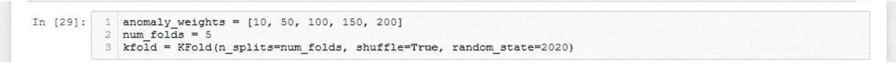

图 4-40

在第二次验证运行中设置一个较窄的搜索值范围

验证脚本本身应该保持不变，因此如果你只是替换了原始单元格中的异常权重，**请先不要运行验证脚本！** 让我们创建一个新的实验，以免这些新的运行结果与原始调优实验混杂在一起。

修改旧验证脚本中的以下行，将其从

```
mlflow.set_experiment("sklearn_creditcard_broad_search")
```

改为

```
mlflow.set_experiment("sklearn_creditcard_guided_search")
```

你应该会看到类似图 4-41 的内容。

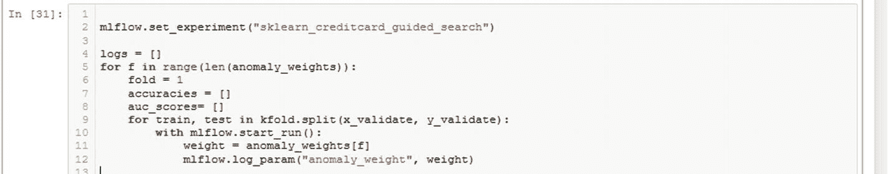

图 4-41

创建一个名为 `sklearn_creditcard_guided_search` 的新实验，以便将第二次验证实验的结果单独存储

现在你可以运行这段代码了。运行完成后，返回 UI，刷新页面，并选择名为 `sklearn_creditcard_guided_search` 的新实验。你应该会看到类似图 4-42 的内容。

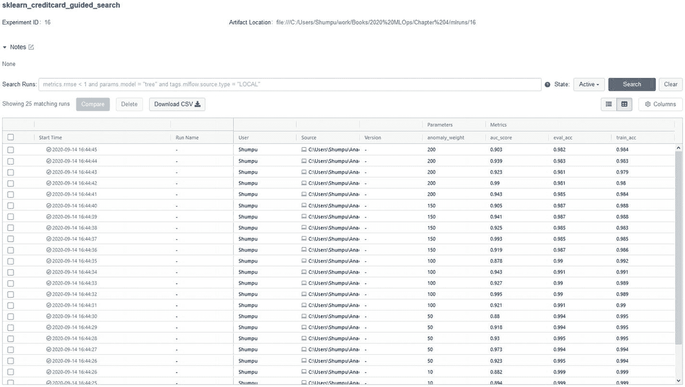

图 4-42

第二次验证实验的结果

扩大调优实验中异常权重范围的全部意义在于帮助你了解最佳超参数范围可能在哪里。你最初并不知道这一点，因此选择了一个过小的范围，无法帮助你发现最佳值。既然你现在知道了，你就大大扩展了搜索范围。

根据这次实验的结果，你很有希望进一步缩小范围，然后用一个大幅缩减的范围重复实验，从而找到正确的超参数设置。

现在，你将按每个唯一的异常权重（10、50、100、150 和 200）筛选出各个值，以了解该设置下的运行表现。

确保你按降序排列 AUC 分数，输入以下查询并搜索：

```
parameters.anomaly_weight = "10"
```

你应该会看到类似图 4-43 的内容。

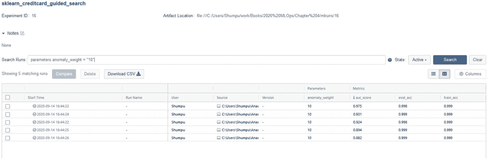

图 4-43

按异常权重 10 筛选运行结果，并将 AUC 分数设置为降序显示

验证脚本显示的平均 AUC 分数约为 0.9215。当然，这与之前的结果相同。

让我们看看异常权重为 50 时的分数情况。请参考图 4-44。

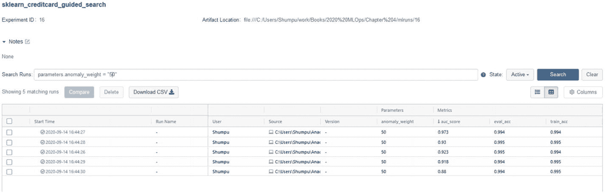

图 4-44

按异常权重 50 筛选运行结果，并将 AUC 分数设置为降序显示。数值似乎有细微差异

AUC 分数的范围已经出现了微小的差异。查看脚本，你可以看到平均 AUC 约为 0.9248，因此 AUC 分数似乎有小幅提升。

我们继续检查异常权重为 100 时的结果。请参考图 4-45。

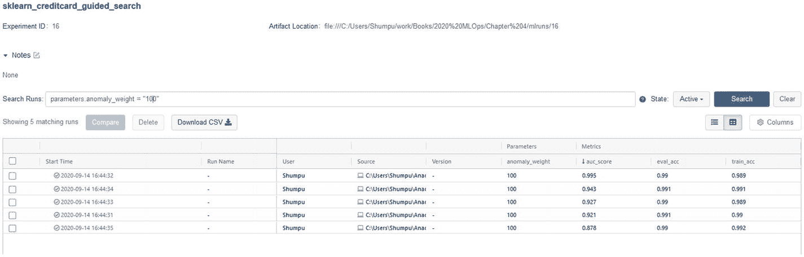

图 4-45

按异常权重 100 筛选运行结果，并将 AUC 分数设置为降序显示

这次的平均值似乎是 0.9327。尽管权重大幅增加，但平均 AUC 分数并没有上升太多。然而，请注意，第一个 AUC 分数为 0.995 的结果已经出现。在异常权重达到 50 之前，最佳 AUC 分数是 0.975，但这个异常权重设置已经突破了这一记录。

我们继续看看异常权重设置为 150 时是否会增加。请参考图 4-46A。

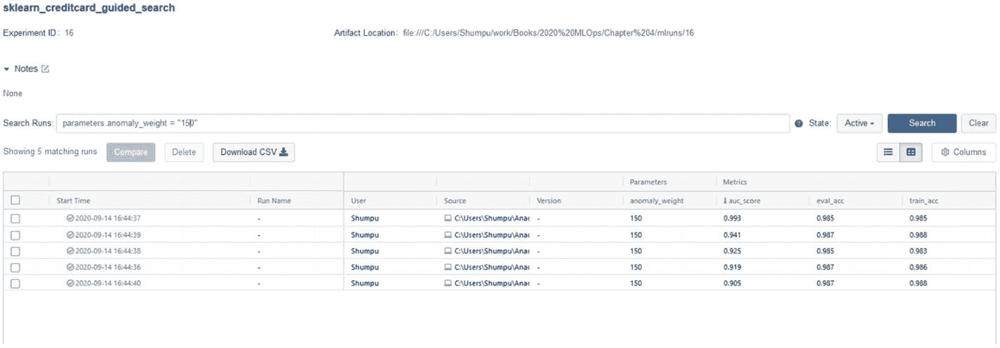

图 4-46A

按异常权重 150 筛选运行结果，并将 AUC 分数设置为降序显示

总体来看，AUC 分数似乎略高一些。确实，平均 AUC 分数现在是 0.9365，因此有所提升。最后，让我们检查异常权重设置为 200 时的 AUC 分数。请参考图 4-46B。

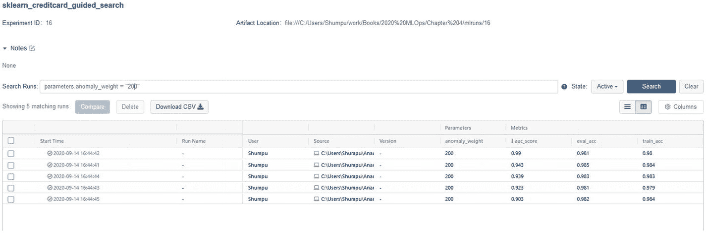

图 4-46B

按异常权重 200 筛选运行结果，并将 AUC 分数设置为降序显示

新的平均 AUC 现在是 0.9396，因此这个异常权重设置似乎更好。

事实上，你仍然无法得出关于最佳范围的结论，因为随着你设置更高的异常权重，AUC 分数持续上升。

因此，由此可知，最佳超参数设置位于 200 以上的某个位置。你只需将搜索范围的上限调整为从 200 开始，并在稍有不同的区域内进行搜索。一旦你找到了一个合适的搜索值范围（最终，随着异常权重的增加，AUC 分数将开始呈下降趋势），你就可以缩小焦点并重新开始搜索。

当参数值达到一定精度后，你会开始看到收益递减，即增加的努力只能带来微不足道的性能提升，但当你开始深入处理小数值时，你很可能会遇到这种情况。

希望你现在对如何使用 scikit-learn 将 MLFlow 集成到模型训练、测试和验证流程中有了更多了解。你还了解了如何使用 UI 进行基本比较，以及如何利用 MLFlow 更轻松地执行超参数调优。

需要快速说明的是，如果你想对多个指标或参数执行更复杂的搜索，MLFlow 通过 API 提供了相关功能，让你可以在代码内通过 SQL 搜索来实现，例如按多列排序。

MLFlow 在其文档中还提供了对其他框架的指标、参数、工件甚至模型进行日志记录的支持。接下来，我们将了解如何将 MLFlow 与 TensorFlow 2.0+/Keras、PyTorch 和 PySpark 集成。

## MLFlow 与其他框架


### 使用 TensorFlow 2.0 (Keras) 的 MLFlow

MLFlow 提供了与 TensorFlow 2.0+（任何 2.0 及以上版本）的简便集成。为了了解具体方法，让我们来看一个在 MNIST 数据集上构建手写数字分类器模型的非常基础的示例。为了演示方便，我们将使用内置的 Keras 模块来保持简单。MLFlow 最低支持 TensorFlow 1.12，因此只要你安装了至少 TensorFlow 1.12，这段代码就能运行。

我们假设你对 TensorFlow 2 有基本的了解，因此不会深入解释函数、模型层、优化器和损失函数的含义。

在开始之前，这里是我们使用的 TensorFlow、CUDA 和 CuDNN 的版本。请注意，我们使用的是 TensorFlow 的 GPU 版本（包名为 tensorflow-gpu），不过即使没有 GPU，你也可以运行此代码，只是运行时间会更长：

*   **TensorFlow**（GPU 版本）– 2.3.0
*   **CUDA** – 10.1
*   **CuDNN** – v7.6.5.32（适用于 CUDA 10.1）
*   **Sklearn** – 0.22.2.post1
*   **MLFlow** – 1.10.0

#### 数据处理

以下是导入必要模块并打印其版本的代码：

```
import tensorflow as tf
from tensorflow.keras.models import Sequential
from tensorflow.keras.layers import Dense, Conv2D, Flatten
from tensorflow.keras.datasets import mnist
import numpy as np
import matplotlib
import matplotlib.pyplot as plt
import sklearn
from sklearn.metrics import roc_auc_score
import mlflow
import mlflow.tensorflow
print("TensorFlow: {}".format(tf.__version__))
print("Scikit-Learn: {}".format(sklearn.__version__))
print("Numpy: {}".format(np.__version__))
print("MLFlow: {}".format(mlflow.__version__))
print("Matplotlib: {}".format(matplotlib.__version__))
```

你应该会看到类似图 4-47 的内容。

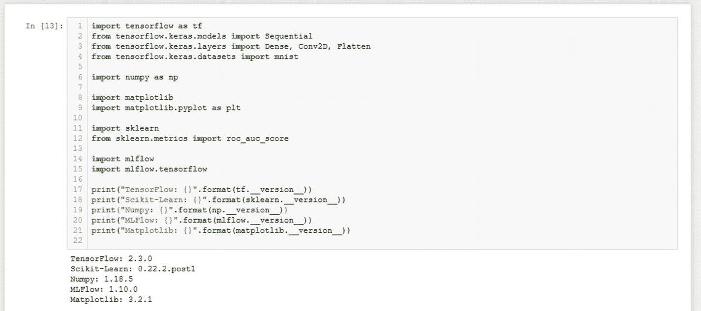

图 4-47：导入必要模块并打印其版本

现在让我们加载数据：

```
(x_train, y_train), (x_test, y_test) = mnist.load_data()
```

Keras（以及其扩展 TensorFlow）为你提供了 MNIST 手写数字数据集，因此加载数据只需调用该函数即可，如图 4-48 所示。

请参考图 4-48 查看单元格中的代码。

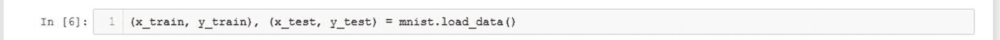

图 4-48：定义 x_train、y_train、x_test 和 y_test

你甚至可以查看其中一张图片的样子。运行以下代码：

```
plt.imshow(x_train[0], cmap="gray"), print("Class: ", y_train[0])
```

你应该会看到类似图 4-49 的内容。

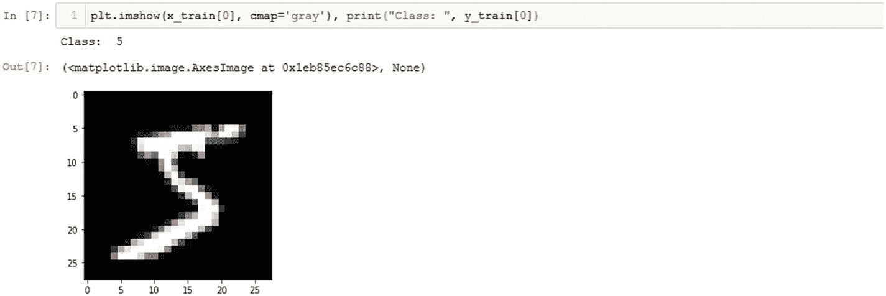

图 4-49：使用 matplotlib 查看其中一个数据样本的样子。你还打印出了与该样本关联的类别标签，其值为 5

另外请注意，你打印出了与该特定图像关联的类别标签。这些标签都是 0 到 9 之间的整数，每个整数对应一张显示 0 到 9 手写数字的图像。

由于 TensorFlow/Keras 中的二维卷积层期望输入为四维格式 (m, h, w, c)，其中 *m* 表示数据集中的样本数量，*h* 和 *w* 分别表示高度和宽度，*c* 表示通道数（例如，如果是 RGB 彩色图像则为 3），因此你需要重塑数据以符合这些规范。你的图像都是黑白的，所以技术上通道数为 1。因此，你必须像这样重塑它们：

```
x_train = x_train.reshape(x_train.shape[0], x_train.shape[1], x_train.shape[2], 1)
x_test = x_test.reshape(x_test.shape[0], x_test.shape[1], x_test.shape[2], 1)
y_train = tf.keras.utils.to_categorical(y_train)
y_test = tf.keras.utils.to_categorical(y_test)
```

请参考图 4-50 查看单元格中的代码。


图 4-50：重塑数据以包含一个通道，符合卷积层的规范。此外，y 集合被转换为独热编码格式

你通过调用名为 `to_categorical()` 的函数转换了 y 集合。该函数将每个样本从整数值（例如 2 或 4，对应于 x 样本所代表的数字）转换为一个独热编码向量。

这种格式的样本现在是长度为 `num_classes` 的零向量。换句话说，这些向量的长度都与总类别数一致。标签原本的值现在变成了值为 1 的索引。因此，如果标签是 1，那么该向量中索引为 1 的位置的值就是 1，其余位置都是 0。

这可能有点令人困惑，所以请参考图 4-51，看看代表数字 5 的独热编码标签是什么样子。


图 4-51：代表数值 5 的独热编码标签的新输出。注意索引 5 处的值现在是 1

如你所见，值为 1 的索引是 5，对应于你之前看到的第一个 `x_train` 示例，即数字 5。

现在，让我们打印出形状：

```
print("Shapes")
print("x_train: {}\ny_train: {}".format(x_train.shape, y_train.shape))
print("x_test: {}\ny_test: {}".format(x_test.shape, y_test.shape))
```

你现在应该会看到类似图 4-52 的内容。


图 4-52：打印处理后的数据输出形状


#### MLFlow 运行 – 训练与评估

接下来，我们开始创建你的模型。你将使用 `Sequential` 方法来创建模型。这个模型会相当简单，由几个 2D 卷积层组成，这些卷积层再连接到三个全连接层。运行以下代码：

```
model = Sequential()
model.add(Conv2D(filters=16, kernel_size=3, strides=2, padding="same", input_shape=(28, 28, 1), activation="relu"))
model.add(Conv2D(filters=8, kernel_size=3, strides=2, padding="same", input_shape=(28, 28, 1), activation="relu"))
model.add(Flatten())
model.add(Dense(30, activation="relu"))
model.add(Dense(20, activation="relu"))
model.add(Dense(10, activation="softmax"))
model.summary()
```

你应该会看到类似图 4-53 的内容。


图 4-53

创建模型并输出模型架构的摘要

现在，让我们使用 Adam 优化器和分类交叉熵作为损失函数来编译你的模型。对于评估指标，我们只使用准确率。运行以下代码：

```
model.compile(optimizer="Adam", loss="categorical_crossentropy", metrics=["accuracy"])
```

你应该会看到类似图 4-54 的内容。


图 4-54

编译你的模型，将优化器设置为 Adam 优化器，将损失函数设置为分类交叉熵，并将评估指标设置为准确率

现在，你进入了告诉 MLFlow 记录此次运行的部分。你希望所有指标都记录到同一次运行中，因此必须明确告诉 MLFlow 在同一次运行的上下文中执行一段代码。为此，你需要再次使用以下代码行来包裹你的代码块：

```
with mlflow.start_run():
```

接着，运行以下代码来设置实验名称、训练模型、获取所需的评估指标，并将它们全部记录到 MLFlow：

```
mlflow.set_experiment("TF_Keras_MNIST")
with mlflow.start_run():
mlflow.tensorflow.autolog()
model.fit(x=x_train, y=y_train, batch_size=256, epochs=10)
preds = model.predict(x_test)
preds = np.round(preds)
eval_acc = model.evaluate(x_test, y_test)[1]
auc_score = roc_auc_score(y_test, preds)
print("eval_acc: ", eval_acc)
print("auc_score: ", auc_score)
mlflow.tensorflow.mlflow.log_metric("eval_acc", eval_acc)
mlflow.tensorflow.mlflow.log_metric("auc_score", auc_score)
mlflow.end_run()
```

请参考图 4-55 查看输出结果。忽略警告信息，它们不会影响训练过程或模型性能。


图 4-55

MLFlow 运行和训练过程的输出。你也可以看到你计算的指标已经更新

另一行新代码是：

```
mlflow.keras.autolog()
```

这基本上是在告诉 MLFlow 记录与该特定 TensorFlow/Keras 模型相关的所有参数和指标。稍后你将看到，MLFlow 会记录超参数、在 `compile()` 函数中列出的模型指标，甚至在训练完成后还会记录模型本身。

#### MLFlow UI – 检查你的运行

接下来，让我们打开 MLFlow UI 并在 MLFlow 中检查你的运行。请确保你的终端或命令提示符位于存储 mlruns 的同一目录中。通常，MLFlow 会将所有运行保存在 Jupyter notebook 的同一目录下。

现在你已经打开了 UI，应该会看到类似图 4-56 的内容。


图 4-56

运行 TensorFlow 实验后的 MLFlow UI。请注意，出现了一个名为 TF_Keras_MNIST 的新实验

点击名为 TF_Keras_MNIST 的选项卡，查看你刚刚记录的实验结果。你应该会看到类似图 4-57 的内容。


图 4-57

打开名为 TF_Keras_MNIST 的实验。你可以看到它成功记录了一次运行

如你所见，你的运行刚刚被成功记录。接下来，点击它以探索 MLFlow 记录的所有参数、指标和工件。

你应该会看到类似图 4-58 的内容。


图 4-58

查看实验中记录的特定运行。如你所见，所有参数和指标都被记录了，包括你指定的那些。它还显示了运行的持续时间和状态，因此你现在可以知道训练模型花费了多长时间，以及它是否成功完成

MLFlow 保存了创建模型时使用的所有超参数。例如，这对于在验证集上进行超参数调优非常有用，尤其是在你试图同时调整许多超参数时。例如，你完全可以调整 `batch_size`、`epochs`，或者与 Adam 优化器相关的参数，如 `opt_learning_rate`、`opt_beta_1` 或 `opt_beta_2`。

如图 4-58 所示，MLFlow 保存了训练过程中计算的准确率和损失等模型指标。此外，MLFlow 还保存了你自定义的指标。

向下滚动到工件部分，点击 `model`，然后点击 `data`。你应该会看到类似图 4-59 的内容。


图 4-59

仔细检查工件后，发现 MLFlow 似乎也记录了模型本身

在这里，你可以看到 MLFlow 在训练过程结束后也保存了模型。实际上，让我们简要地看一下如何加载这个模型。在执行此操作之前，请确保你已转到顶部并复制了运行 ID。


#### 加载 MLFlow 模型

复制运行 ID 后，转到笔记本并创建一个新单元格。运行以下代码，但将运行 ID 替换为你自己的：

```
loaded_model = mlflow.keras.load_model("runs:/YOUR_RUN_ID/model")
```

你的代码应类似于图 4-60。我们的运行 ID 是 `ba423a8f28d24b67b8f703ca6be43fc2`，因此我们将 `YOUR_RUN_ID` 替换为了这个值。


图 4-60

使用特定运行加载已记录的模型。请注意，我们使用的是 `mlflow.keras`。这是因为该模型本质上是一个 Keras 模型。

你会注意到我们使用了 `mlflow.keras` 而不是 `mlflow.tensorflow`。这是因为该模型本质上是一个 Keras 模型，因此它遵循 `mlflow.keras` 模块中特定的 `load_model()` 代码。

运行以下代码，快速计算你之前记录的相同评估指标：

```
eval_loss, eval_acc = loaded_model.evaluate(x_test, y_test)
preds = loaded_model.predict(x_test)
preds = np.round(preds)
eval_auc = roc_auc_score(y_test, preds)
print("Eval Loss:", eval_loss)
print("Eval Acc:", eval_acc)
print("Eval AUC:", eval_auc)
```

这仅用于确保模型相同，并演示你可以使用该模型进行预测。请参考图 4-61 查看输出。


图 4-61

代码块输出的结果，显示了在测试集上评估模型时的损失、准确率和 AUC 分数。这三个值与之前运行输出的相应值匹配。

如你所见，此输出与之前运行输出的值匹配。此外，该模型也是可用的，并且可以进行预测。

至此，你现在知道了如何将 MLFlow 集成到你的 TensorFlow 2.0+ 实验中。再次说明，MLFlow 支持 TensorFlow 1.12+，其中也包含 Keras 子模块。这意味着只要你拥有 TensorFlow 1.12+，就应该能够遵循相同的约定来记录 `tf.keras` 模块代码。

在实践中，你很可能会有用于构建和编译模型的函数、用于训练模型的函数，以及用于评估甚至验证模型的函数。只需确保在 `with mlflow.start_run():` 块中调用所有这些函数，以便 MLFlow 知道所有这些操作都发生在同一个运行中。

接下来，让我们看看如何将 MLFlow 与 PyTorch 集成。

### MLFlow 与 PyTorch

MLFlow 也提供了与 PyTorch 的集成。虽然这个过程不像与 Keras 或 TensorFlow 那样简单，但将 MLFlow 集成到你现有的 PyTorch 代码中却相当简单。为了了解如何操作，我们将再次探索一个应用于 MNIST 数据集的简单卷积神经网络。

在开始之前，这里是我们使用的模块版本，包括 CUDA 和 CuDNN：

*   **Torch** - 1.6.0

*   **Torchvision** – 0.7.0

*   **CUDA** – 10.1

*   **CuDNN** – v7.6.5.32（适用于 CUDA 10.1）

*   **Sklearn** – 0.22.2.post1

*   **MLFlow –** 1.10.0

*   **numpy –** 1.18.5

#### 数据处理

让我们开始吧。以下是导入必要模块、打印其版本并设置 PyTorch 将使用的设备的代码：

```
import torch
import torch.nn as nn
from torch.utils import data
import torchvision
import torchvision.datasets
import sklearn
from sklearn.metrics import roc_auc_score, accuracy_score
import numpy as np
import mlflow
import mlflow.pytorch
device = torch.device("cuda:0" if torch.cuda.is_available() else "cpu")
print("PyTorch: {}".format(torch.__version__))
print("torchvision: {}".format(torchvision.__version__))
print("sklearn: {}".format(sklearn.__version__))
print("MLFlow: {}".format(mlflow.__version__))
print("Numpy: {}".format(np.__version__))
print("Device: ", device)
```

请参考图 4-62 查看输出。


图 4-62

导入必要的模块并打印模块的版本

代码行

```
device = torch.device("cuda:0" if torch.cuda.is_available() else "cpu")
```

告诉 PyTorch 在哪个设备上运行代码。如果存在 CUDA 可以连接的 GPU，它将使用 GPU。否则，它将在 CPU 上运行所有内容。在我们的例子中，我们已经为 GPU 设置了 CUDA，因此 Torch 显示 `“cuda:0”`，如图 4-62 所示。

接下来，你将定义一些基本的超参数：

```
batch_size = 256
num_classes = 10
learning_rate = 0.001
```

请参考图 4-63 在单元格中查看它们。


图 4-63

设置与模型训练相关的超参数

接下来，你将加载 MNIST 数据集。与 Keras 和 TensorFlow 一样，PyTorch 也提供了示例数据集。在这里，你正在加载 MNIST：

```
train_set = torchvision.datasets.MNIST(root='./data', train=True, download=True, transform=None)
test_set = torchvision.datasets.MNIST(root='./data', train=False, download=True, transform=None)
```

请参考图 4-64 在单元格中查看此代码。


图 4-64

通过从 PyTorch 加载数据来定义训练集和测试集

你现在将定义你的 `x_train`、`y_train`、`x_test` 和 `y_test` 数据集：

```
x_train, y_train = train_set.data, train_set.targets
x_test, y_test = test_set.data, test_set.targets
```

请参考图 4-65。


图 4-65

从训练集和测试集中创建你的 x_train、y_train、x_test 和 y_test 数据集

在 PyTorch 中，你希望数据是通道优先的。换句话说，数据的格式应为 `(m, c, h, w)`，其中 *m* 代表样本数量，*c* 代表通道数，*h* 代表样本的高度，*w* 代表样本的宽度。

请注意，这与 Keras 和 TensorFlow 默认的“通道最后”格式是“相反”的。在 Keras 和 TensorFlow 中，你也可以使用通道优先，但必须指定你正在以这种方式操作。

让我们重塑你的 x 数据集：

```
x_train, y_train = train_set.data, train_set.targets
x_test, y_test = test_set.data, test_set.targets
```

请参考图 4-66 在单元格中查看此代码。


图 4-66

重塑 x 数据集，使数据以通道优先的格式编码

在打印所有形状之前，请注意你的 y 数据集不是独热编码格式。运行以下代码：

```
y_train[0]
```


请参考图 4-67。


图 4-67

y_train 集中第一个样本的输出。请注意，这些数字并非采用独热编码格式。

请注意，这里输出的是一个数字，而非向量。你必须将你的 y 集转换为独热编码格式。然而，并没有像 `keras.utils.to_categorical()` 这样现成的函数可以直接调用，因此你需要自行定义一个：

```
def to_one_hot(num_classes, labels):
one_hot = torch.zeros(([labels.shape[0], num_classes]))
for f in range(len(labels)):
one_hot[f][labels[f]] = 1
return one_hot
```

话虽如此，你仍然可以调用 `keras.utils.to_categorical()`：并将结果输出类型转换为 PyTorch 张量。

请参考图 4-68 查看其在单元格中的实现。


图 4-68

一个自定义函数，它根据给定的类别数量，将名为“labels”的输入转换为独热编码格式并返回。

现在，让我们将你的 y 集转换为独热编码格式：

```
y_train = to_one_hot(num_classes, y_train)
y_test = to_one_hot(num_classes, y_test)
```

请参考图 4-69 查看此代码在单元格中的实现。


图 4-69

使用自定义函数将你的 y 集转换为独热编码格式。

让我们检查一下 `y_train` 现在的样子：

```
y_train[0]
```

请参考图 4-70。


图 4-70

检查 y_train 中第一个样本的输出，你现在可以看到该张量已被转换为独热编码格式。

如你所见，它现在已经是独热编码格式了。现在你可以继续检查数据集的形状了：

```
print("Shapes")
print("x_train: {}\ny_train: {}".format(x_train.shape, y_train.shape))
print("x_test: {}\ny_test: {}".format(x_test.shape, y_test.shape))
```

你应该会看到类似图 4-71 的输出。


图 4-71

打印训练集和测试集的形状。如你所见，x 集是通道优先格式，而 y 集是独热编码格式。

#### MLFlow 运行 – 训练与评估

现在，让我们定义你的模型。PyTorch 中一个流行的惯例是将模型定义为一个类，因为这可以让你在训练时更轻松地使用 GPU。无需将每一层都传递给 GPU，你可以直接传入模型对象。

运行以下代码来定义你的模型：

```
class model(nn.Module):
def __init__(self):
super(model, self).__init__()
# IN 1x28x28 OUT 16x14x14
self.conv1 = nn.Conv2d(in_channels=1, out_channels=16, kernel_size=3, stride=2, padding=1, dilation=1)
# IN 16x14x14 OUT 32x6x6
self.conv2 = nn.Conv2d(in_channels=16, out_channels=32, kernel_size=3, stride=2, padding=0, dilation=1)
# IN 32x6x6 OUT 64x2x2
self.conv3 = nn.Conv2d(in_channels=32, out_channels=64, kernel_size=3, stride=2, padding=0, dilation=1)
# IN 64x2x2 OUT 256
self.flat1 = nn.Flatten()
self.dense1 = nn.Linear(in_features=256, out_features=128)
self.dense2 = nn.Linear(in_features=128, out_features=64)
self.dense3 = nn.Linear(in_features=64, out_features=10)
def forward(self, x):
x = self.conv1(x)
x = nn.ReLU()(x)
x = self.conv2(x)
x = nn.ReLU()(x)
x = self.conv3(x)
x = nn.ReLU()(x)
x = self.flat1(x)
x = self.dense1(x)
x = nn.ReLU()(x)
x = self.dense2(x)
x = nn.ReLU()(x)
x = self.dense3(x)
x = nn.Softmax()(x)
return x
```

请参考图 4-72。


图 4-72

将模型架构定义为一个类。

接下来，让我们将模型发送到设备，定义并初始化一个 Adam 优化器实例（使用之前设置的学习率），并设置损失函数：

```
model = model().to(device)
optimizer = torch.optim.Adam(model.parameters(), lr=learning_rate)
criterion = nn.BCELoss()
```

请参考图 4-73。


图 4-73

将模型对象发送到设备，定义优化器，并初始化损失函数。

接下来，你将使用 PyTorch 提供的功能定义一个数据加载器，以处理数据集的批处理：

```
dataset = data.TensorDataset(x_train,y_train)
train_loader = data.DataLoader(dataset, batch_size=batch_size)
```

请参考图 4-74。


图 4-74

从你的数据集创建一个数据加载器对象。借助此功能，PyTorch 会自动为你批处理数据集，允许你在训练循环中一次传入一个小批量。这本质上就是 TensorFlow 2/Keras 的 `.fit()` 函数所做的，但在这里它为你抽象了所有细节。

如你所见，这比自己编写复杂的循环来批处理和传入数据要简单得多。

最后，让我们定义训练循环：

```
num_epochs = 5
for f in range(num_epochs):
for batch_num, minibatch in enumerate(train_loader):
minibatch_x, minibatch_y = minibatch[0], minibatch[1]
output = model.forward(torch.Tensor(minibatch_x.float()).cuda())
loss = criterion(output, torch.Tensor(minibatch_y.float()).cuda())
optimizer.zero_grad()
loss.backward()
optimizer.step()
print(f"Epoch {f} Batch_Num {batch_num} Loss {loss}")
```

根据你的 GPU，这可能需要至少几分钟，如果使用 CPU，时间会更长。如果你想减少总训练时间，可以随意减少周期数。

你应该会看到类似图 4-75 的输出。


图 4-75

训练循环的输出。你可以随意减少周期数以节省训练时间，但这可能会影响模型的性能。

现在，让我们启动一个 MLFlow 运行，计算你想要的指标，并记录所有内容：

```
mlflow.set_experiment("PyTorch_MNIST")
with mlflow.start_run():
preds = model.forward(torch.Tensor(x_test.float()).cuda())
preds = np.round(preds.detach().cpu().numpy())
eval_acc = accuracy_score(y_test, preds)
auc_score = roc_auc_score(y_test, preds)
mlflow.log_param("batch_size", batch_size)
mlflow.log_param("num_epochs", num_epochs)
mlflow.log_param("learning_rate", learning_rate)
mlflow.log_metric("eval_acc", eval_acc)
mlflow.log_metric("auc_score", auc_score)
print("eval_acc: ", eval_acc)
print("auc_score: ", auc_score)
mlflow.pytorch.log_model(model, "PyTorch_MNIST")
mlflow.end_run()
```

如你所见，MLFlow 与 PyTorch 的集成仍然非常容易。请参考图 4-76 查看输出。


图 4-76

设置实验，并将参数、指标和模型记录到 MLFlow 运行中。


#### MLFlow UI – 检查运行

让我们打开 UI。请参考图 4-77。


图 4-77

现在查看 MLFlow UI。请注意，您的实验 PyTorch_MNIST 已创建。

如您所见，出现了一个名为 PyTorch_MNIST 的新实验。点击它。您现在应该能看到刚刚完成的运行。请参考图 4-78。


图 4-78

MLFlow UI 显示您已完成的运行

现在您的运行已显示，点击它。您应该能看到该运行中记录的所有参数和指标。请参考图 4-79。


图 4-79

您指定的所有参数、指标和工件（模型）均已记录

另外请注意 MLFlow 在工件下保存的模型。请参考图 4-80。


图 4-80

MLFlow 也已成功记录模型

#### 加载 MLFlow 模型

现在我们来介绍如何使用 MLFlow 加载此模型。复制运行 ID，然后返回笔记本。运行以下代码，但将占位符替换为您的运行 ID：

```
loaded_model = mlflow.pytorch.load_model("runs:/YOUR_RUN_ID/PyTorch_MNIST")
```

在我们的例子中，运行 ID 是 `094a9f92cd714711926114b4c96f6d73`，因此我们的代码如图 4-81 所示。


图 4-81

加载已记录的 MLFlow 模型

现在已完成，让我们再次进行预测并计算指标：

```
preds = loaded_model.forward(torch.Tensor(x_test.float()).cuda())
preds = np.round(preds.detach().cpu().numpy())
eval_acc = accuracy_score(y_test, preds)
auc_score = roc_auc_score(y_test, preds)
print("eval_acc: ", eval_acc)
print("auc_score: ", auc_score)
```

请参考图 4-82 查看输出。


图 4-82

使用已记录模型计算评估指标的输出。如您所见，分数完全匹配

如您所见，这些指标与训练运行时的指标相同。现在您知道如何使用 MLFlow 加载 PyTorch 模型，以及如何使用它进行预测。

至此，您已经知道如何将 MLFlow 集成到 PyTorch 实验中。接下来，我们将介绍如何将 MLFlow 集成到 PySpark 中。

### MLFlow 与 PySpark

在最后一个示例中，我们将介绍 MLFlow 如何与 PySpark 集成。与 scikit-learn 示例类似，我们将研究逻辑回归模型在信用卡数据集上的应用。实际上，这段代码与第 2 章中的 PySpark 示例非常相似。

在开始之前，以下是所用模块的版本，包括 CUDA 和 CuDNN：

*   **PySpark** – 2.4.5
*   **Matplotlib** – 3.2.1
*   **Sklearn** – 0.22.2.post1
*   **MLFlow** – 1.10.0
*   **mumpy** – 1.18.5

#### 数据处理

那么，让我们开始吧。首先，您必须导入所有必要的模块并为 Spark 设置一些变量：

```
import pyspark #
from pyspark.sql import SparkSession
from pyspark import SparkConf, SparkContext
from pyspark.sql.types import *
from pyspark.ml.feature import VectorAssembler
from pyspark.ml import Pipeline
from pyspark.ml.classification import LogisticRegression
import pyspark.sql.functions as F
import os
import seaborn as sns
import sklearn #
from sklearn.metrics import confusion_matrix
from sklearn.metrics import roc_auc_score, accuracy_score
import matplotlib #
import matplotlib.pyplot as plt
import mlflow
import mlflow.spark
os.environ["SPARK_LOCAL_IP"]='127.0.0.1'
spark = SparkSession.builder.master("local[*]").getOrCreate()
spark.sparkContext._conf.getAll()
print("pyspark: {}".format(pyspark.__version__))
print("matplotlib: {}".format(matplotlib.__version__))
print("seaborn: {}".format(sns.__version__))
print("sklearn: {}".format(sklearn.__version__))
print("mlflow: {}".format(mlflow.__version__))
```

请参考图 4-83。


图 4-83

导入必要的模块并打印其版本

接下来，让我们加载数据集并指定要使用的列：

```
data_path = 'data/creditcard.csv'
df = spark.read.csv(data_path, header = True, inferSchema = True)
labelColumn = "Class"
columns = df.columns
numericCols = columns
numericCols.remove("Time")
numericCols.remove(labelColumn)
print(numericCols)
```

请参考图 4-84 查看输出。


图 4-84

加载数据并将所需列指定为列表

请注意，与 scikit-learn 示例一样，您在此处删除了 `Time` 列。该列添加了大量无关信息，这些信息实际上与标签列的相关性不大，甚至可能使学习任务变得比实际更困难。

让我们看看数据框的样子：

```
df.toPandas().head()
```

请参考图 4-85 查看输出。


图 4-85

将 Spark 数据框转换为 Pandas 并检查输出。如您所见，列和数据都已正确加载。`Time` 列尚未被删除，因为您尚未过滤数据框

您会注意到，您“删除”的列（如 `Time`）仍然显示。您尚未过滤所需的列，现在将进行此操作。运行以下代码，从数据框中选择所需特征，并创建正常样本和异常样本的分割：

```
stages = []
assemblerInputs =  numericCols
assembler = VectorAssembler(inputCols=assemblerInputs, outputCol="features")
stages += [assembler]
dfFeatures = df.select(F.col(labelColumn).alias('label'), *numericCols )
normal = dfFeatures.filter("Class == 0").sample(withReplacement=False, fraction=0.5, seed=2020)
anomaly = dfFeatures.filter("Class == 1")
normal_train, normal_test = normal.randomSplit([0.8, 0.2], seed = 2020)
anomaly_train, anomaly_test = anomaly.randomSplit([0.8, 0.2], seed = 2020)
```

请参考图 4-86 查看单元格中的代码。


图 4-86

选择所需列并定义正常样本和异常样本的训练集和测试集

现在让我们看看新的数据框：

```
dfFeatures.toPandas().head()
```

请参考图 4-87。


图 4-87

如你所见，Time 列已被删除。这就是你的训练集和测试集所源自的数据框。

请注意，你删除的列已经消失。现在你知道 normal 和 anomaly 数据集也不包含你删除的特征，一切都在按计划进行。让我们创建训练集和测试集：

```
train_set = normal_train.union(anomaly_train)
test_set = normal_test.union(anomaly_test)
```

请参考图 4-88。


图 4-88

拼接 normal 和 anomaly 数据集以创建训练集和测试集

现在，我们继续创建逻辑回归模型将要使用的特征向量。运行以下代码来定义流水线并创建最终的训练集和测试集：

```
pipeline = Pipeline(stages = stages)
pipelineModel = pipeline.fit(dfFeatures)
train_set = pipelineModel.transform(train_set)
test_set = pipelineModel.transform(test_set)
selectedCols = ['label', 'features'] + numericCols
train_set = train_set.select(selectedCols)
test_set = test_set.select(selectedCols)
print("Training Dataset Count: ", train_set.count())
print("Test Dataset Count: ", test_set.count())
```

请参考图 4-89。


图 4-89

定义用于创建特征向量的流水线，该特征向量将用于训练模型。根据特征向量和标签向量，定义最终的训练集和测试集

现在你已经完成了数据处理，让我们定义一个函数来训练模型并计算一些相关指标：

```
def train(spark_model, train_set):
trained_model = spark_model.fit(train_set)
trainingSummary = trained_model.summary
pyspark_auc_score = trainingSummary.areaUnderROC
mlflow.log_metric("train_acc", trainingSummary.accuracy)
mlflow.log_metric("train_AUC", pyspark_auc_score)
print("Training Accuracy: ", trainingSummary.accuracy)
print("Training AUC:", pyspark_auc_score)
return trained_model
```

请参考图 4-90 查看单元格中的函数。


图 4-90

用于训练 PySpark 逻辑回归模型并记录训练准确率和 AUC 分数指标的代码

现在，让我们定义一个函数来评估模型并计算这些指标：

```
def evaluate(spark_model, test_set):
evaluation_summary = spark_model.evaluate(test_set)
eval_acc = evaluation_summary.accuracy
eval_AUC = evaluation_summary.areaUnderROC
mlflow.log_metric("eval_acc", eval_acc)
mlflow.log_metric("eval_AUC", eval_AUC)
print("Evaluation Accuracy: ", eval_acc)
print("Evaluation AUC: ", eval_AUC)
```

请参考图 4-91。


图 4-91

用于评估训练好的 PySpark 逻辑回归模型并记录评估准确率和 AUC 分数指标的代码


#### MLFlow 运行 – 训练、UI 及加载 MLFlow 模型

现在你已经完成了训练和评估函数的定义，以及要记录的指标，接下来可以启动一个 MLFlow 运行并构建模型：

```
lr = LogisticRegression(featuresCol = 'features', labelCol = 'label', maxIter=10)
mlflow.set_experiment("PySpark_CreditCard")
with mlflow.start_run():
trainedLR = train(lr, train_set)
evaluate(trainedLR, test_set)
mlflow.spark.log_model(trainedLR, "creditcard_model_pyspark")
mlflow.end_run()
```

请参考图 4-92。


图 4-92

MLFlow 运行的输出。实验已创建，指标和模型已成功记录

好了，现在 MLFlow 已完成所有记录，运行也已结束，请打开 MLFlow UI。你应该会看到类似图 4-93 的内容。


图 4-93

MLFlow UI 显示你的实验 `PySpark_CreditCard` 已创建

请注意，一个名为 `PySpark_CreditCard` 的新实验已经创建。点击它，你应该会看到类似图 4-94 的内容。如果 MLFlow 没有在此记录运行，请尝试重新运行该单元格。它应该能正确记录。


图 4-94

MLFlow UI 显示你的运行已成功完成

如果一切顺利，你应该会看到该实验中记录了一次运行。点击它，你应该会看到类似图 4-95 的内容。


图 4-95

查看运行详情，可以看到所有指标均已成功记录

最后，在工件部分，点击名为 `creditcard_model_pyspark` 的文件夹将其展开。你应该会看到一个名为 `sparkml` 的文件夹，其中包含 PySpark 逻辑回归模型。请参考图 4-96。


图 4-96

MLFlow 还记录了 PySpark 模型。与 TensorFlow 或 PyTorch 示例不同，这里没有具体的模型文件，这是因为 PySpark 存储模型的方式不同

现在你已经验证了 MLFlow 已记录你指定的所有内容，请复制顶部的运行 ID。然后返回笔记本，运行以下代码，将占位符替换为你的运行 ID：

```
model = mlflow.spark.load_model("runs:/YOUR_RUN_ID/creditcard_model_pyspark")
```

在我们的例子中，运行 ID 是 `58e6aac5d43948c6948bee29c0c04cca`，因此我们的单元格如图 4-97 所示。


图 4-97

加载已记录的 MLFlow 模型

现在模型已加载，让我们用它进行一些预测。运行以下代码：

```
predictions = model.transform(test_set)
y_true = predictions.select(['label']).collect()
y_pred = predictions.select(['prediction']).collect()
```

请参考图 4-98 查看单元格中的代码。


图 4-98

使用加载的模型进行预测

让我们打印出评估准确率和 AUC 分数：

```
print(f"AUC Score: {roc_auc_score(y_true, y_pred):.3%}")
print(f"Accuracy Score: {accuracy_score(y_true, y_pred):.3%}")
```

请参考图 4-99。


图 4-99

打印评估指标。AUC 分数有明显差异，但准确率分数与 MLFlow 运行期间显示的一致

你会注意到 AUC 分数与评估函数中计算的结果不同。这可能是因为 PySpark 计算 ROC 曲线的方式略有不同，因为它可以直接访问模型本身。另一方面，使用 scikit-learn 时，你只能使用真实标签和预测结果，因此 ROC 曲线的计算方式略有不同。

最后，让我们构建混淆矩阵：

```
conf_matrix = confusion_matrix(y_true, y_pred)
ax = sns.heatmap(conf_matrix, annot=True,fmt='g')
ax.invert_xaxis()
ax.invert_yaxis()
plt.ylabel('Actual')
plt.xlabel('Predicted')
```

请参考图 4-100。


图 4-100

使用真实值和加载模型做出的预测显示混淆矩阵

从混淆矩阵可以看出，PySpark 计算的 AUC 分数一定反映了模型对正常数据的分类性能。观察异常数据，相当一部分欺诈数据被错误分类。粗略估计，模型在测试数据上只正确识别了三分之二的异常数据。这或许可以解释 scikit-Learn 计算的 AUC 分数与 PySpark 计算的 AUC 分数之间的差异。两者计算 ROC 曲线的方式必然略有不同，而 PySpark 的图形可能更偏向于正常数据分类的优异真正率。

至此，你已经了解了如何将 MLFlow 集成到 PySpark 实验中。

接下来，我们将探讨如何在本地部署模型，以及如何使用样本数据查询模型并接收预测结果。

## 本地模型服务


### 部署模型

在本地提供模型服务并进行查询非常简单，只需在命令行中操作即可。你只需要实验 ID 和运行 ID 就能提供模型服务。这正是之前提到的打印语句发挥作用的地方，因为它会打印出特定运行的运行 ID。如果你只想提供最新模型的服务，可以使用该 ID 进行操作。

否则，你可以在 MLFlow UI 中查看，选择一个符合需求的模型运行，然后通过这种方式粘贴运行 ID。

开始之前，请再次进入 MLFlow UI，点击实验 `scikit_learn_experiment`。选择一个运行并复制其运行 ID。同时，不要忘记你记录模型时使用的模型名称，应该是 `log_reg_model`。

此时，你可以创建一个新的笔记本以保持代码更有序，但务必导入以下内容：

```
import pandas as pd
import mlflow
import mlflow.sklearn
import seaborn as sns
import matplotlib.pyplot as plt
from sklearn.preprocessing import StandardScaler
from sklearn.model_selection import train_test_split
from sklearn.metrics import roc_auc_score, accuracy_score, confusion_matrix
import numpy as np
import subprocess
import json
```

你会注意到现在导入了 `subprocess`。如果你使用的是同一个笔记本，请确保也导入这个模块。

请参考图 4-101 查看单元格中的这段代码。


图 4-101

导入必要的模块

现在，打开你的命令提示符/终端，以便开始提供本地模型服务。首先，你需要将目录切换到包含所有实验的 `mlruns` 文件夹的目录。接下来，你需要两样东西：你的**模型运行**和你的**模型名称**。

再次强调，你的模型运行可以是你在 MLFlow UI 中任意选择的，也可以只是最新的运行。模型名称则是你记录模型时设置的名称。在本例中，它将是 `log_reg_model`。

准备好后，在命令提示符/终端中运行以下命令。我们对命令进行了泛化处理，请务必将字段分别替换为你的模型运行和模型名称：

```
mlflow models serve --model-uri runs:/你的模型运行/你的模型名称 -p 1235
```

在我们的例子中，模型运行是 `3862eb3bd89b43e8ace610c521d974e6`，模型名称同样是 `log_reg_model`。因此，我们运行的命令如图 4-102 所示。


图 4-102

我们在本地提供模型服务所运行的命令

以文本形式呈现，命令如下：

```
mlflow models serve --model-uri runs:/3862eb3bd89b43e8ace610c521d974e6/log_reg_model -p 1235
```

MLFlow 应立即开始构建一个新的 conda 环境，用于本地提供服务。在这个环境中，它会安装基础包以及模型运行所需的特定包。

一段时间后，你应该会看到类似图 4-103 所示的内容。


图 4-103

运行命令在本地部署模型的结果。你可能会看到不同的内容，例如 localhost:1235，但这是因为我们安装了 docker

MLFlow 会在本地服务器上托管模型之前创建一个新的 conda 环境。端口选项 `-p` 允许你设置一个特定的端口来托管模型。我们选择了一个特定端口，以便可以同时运行 MLFlow UI，因为两者默认都使用端口 5000。在我们的例子中，MLFlow UI 运行在端口 1234 上，因此我们在端口 1235 上提供模型服务。

### 查询模型

现在，你已经准备好用数据查询模型并接收预测结果了。这就是 `subprocess` 模块发挥作用的地方，稍后你会明白原因。首先，让我们再次加载数据框。运行以下代码：

```
df = pd.read_csv("data/creditcard.csv")
```

你应该会看到类似图 4-104 的内容。


图 4-104

加载信用卡数据集

接下来，从数据框中选择 80 个值来查询你的模型。运行以下代码：

```
input_json = df.iloc[:80].drop(["Time", "Class"], axis=1).to_json(orient="split")
```

你应该会看到类似图 4-105 的内容。


图 4-105

将选择的 80 行数据（由于在训练模型时使用的原始 x_train 中已删除，因此这里也删除 Time 和 Class 列）转换为 JSON 格式，并使用 split 方向

下一步非常重要，原因在于你最初训练模型之前对数据进行的预处理方式。为了说明其重要性，我们将快速演示传入未缩放数据和缩放数据时评估指标的差异。首先，这是向模型发送数据并接收预测结果的代码：

```
proc = subprocess.run(["curl",  "-X", "POST", "-H", "Content-Type:application/json; format=pandas-split", "--data", input_json, "http://127.0.0.1:1235/invocations"], stdout=subprocess.PIPE, encoding='utf-8')
output = proc.stdout
df2 = pd.DataFrame([json.loads(output)])
df2
```

本质上，这是在 Python 内部运行以下命令：

```
curl -X POST -H "Content-Type:application/json; format=pandas-split" –data "INPUT_JSON 的内容"  "http://127.0.0.1:1235/invocations"
```

问题的核心在于，如果你在命令行中运行此操作，粘贴数据框的 JSON 格式数据会变得非常混乱，因为列数太多。这就是我们选择使用 `subprocess` 的原因，因为通过变量名（本例中为 `input_json`）直接传入 JSON 内容更容易。

你应该会看到类似图 4-106 的内容。


图 4-106

向本地托管的模型发送数据并接收模型的预测结果

现在，你将使用未缩放的输入数据来查询模型。


#### 无需缩放进行查询

你将保留之前从数据中选取的 80 个值，并对模型进行查询。模型接受 JSON 格式的数据，因此在将数据发送给模型之前，你需要转换数据格式。运行图 4-106 中的单元格。

你应该会看到类似图 4-107 的内容。


图 4-107

使用`input_json`查询模型后得到的预测列表。请注意，它预测出了大量异常值。这是第一个警示信号，表明可能存在问题。

得到的数据框是通过将从模型返回的预测结果转换为数据框而得到的。由于你拥有真实预测值，让我们计算一下 AUC 分数和准确率分数，看看模型的表现如何。运行以下代码：

```
y_true = df.iloc[:80].Class
df2 = df2.T
eval_acc = accuracy_score(y_true, df2)
y_true.iloc[-1] = 1
eval_auc = roc_auc_score(y_true, df2)
print("Eval Acc", eval_acc)
print("Eval AUC", eval_auc)
```

首先，你必须使用`.T`对`df2`进行转置，以便将预测结果转换为 Pandas Series 格式。其次，如果数组`y_true`或`y_preds`中只有一个类别，则无法计算 AUC 分数。在这种情况下，`y_true`仅包含正常值，因此你不得不修改最后一个值，将其设为 1（尽管它实际上并非如此），仅仅是为了得到一个 AUC 分数。当然，这样得到的 AUC 分数是毫无意义的。

你应该会看到类似图 4-108 的内容。


图 4-108

根据预测结果评估准确率和 AUC 分数。AUC 分数毫无意义，但准确率分数表明模型表现非常差。

如你所见，准确率分数非常糟糕。这基本上意味着模型无法区分异常点和正常点，但似乎对正常点有一些概念。

模型在训练过程中表现良好，但在此处表现如此糟糕的原因在于输入数据未经缩放。当你接下来在传入数据之前对其进行缩放时，将会看到模型性能的差异。

#### 使用缩放进行查询

你将使用相同的数据划分，但这次在传入数据之前会对其进行缩放。运行以下代码，重新创建最初训练模型时用于拟合缩放器的数据：

```
normal = df[df.Class == 0].sample(frac=0.5, random_state=2020).reset_index(drop=True)
anomaly = df[df.Class == 1]
normal_train, normal_test = train_test_split(normal, test_size = 0.2, random_state = 2020)
anomaly_train, anomaly_test = train_test_split(anomaly, test_size = 0.2, random_state = 2020)
scaler = StandardScaler()
scaler.fit(pd.concat((normal, anomaly)).drop(["Time", "Class"], axis=1))
```

你应该会看到类似图 4-109 的内容。


图 4-109

重新创建最初处理数据时用于拟合标准缩放器的原始数据集。使用此缩放器，你将转换新的数据样本并将其传入模型。

现在你已经拟合了缩放器，让我们转换你选取的数据：

```
scaled_selection = scaler.transform(df.iloc[:80].drop(["Time", "Class"], axis=1))
input_json = pd.DataFrame(scaled_selection).to_json(orient="split")
```

请参考图 4-110。


图 4-110

对从原始数据框中选取的 80 个值进行缩放，并将其转换为 JSON 格式以便发送给模型。

现在运行以下代码：

```
proc = subprocess.run(["curl",  "-X", "POST", "-H", "Content-Type:application/json; format=pandas-split",
"--data", input_json, "http://127.0.0.1:1235/invocations"],
stdout=subprocess.PIPE, encoding='utf-8')
output = proc.stdout
preds = pd.DataFrame([json.loads(output)])
preds
```

你应该会看到类似图 4-111 的内容。


图 4-111

使用缩放后的值查询模型。乍一看，这次的预测结果似乎是正确的。

需要注意的一点是，你是在所有正常数据和所有异常数据的组合上进行缩放，这与你在创建训练集、测试集和验证集划分时所做的一致。由于模型是在基于训练过程中使用的数据划分（即训练集、测试集和验证集数据一起）进行缩放后的数据上训练的，因此传入以不同方式缩放的数据将无法得到正确的预测结果。当你缩放新数据时，必须是在基于训练集拟合缩放器之后再进行缩放。

最终可能出现的一个问题是，新数据的分布可能与原始训练数据的分布不同。这可能导致模型性能问题，但实际上，这正是一个信号，表明你需要重新训练模型，使其适应新数据。

现在让我们检查一下模型的表现：

```
y_true = df.iloc[:80].Class
preds = preds.T
eval_acc = accuracy_score(y_true, preds)
y_true.iloc[-1] = 1
eval_auc = roc_auc_score(y_true, preds)
print("Eval Acc", eval_acc)
print("Eval AUC", eval_auc)
```

请参考图 4-112。


图 4-112

检查预测结果的准确率和 AUC 分数。准确率分数要好得多，但你需要更多同时包含正常值和异常值的预测数据，才能获得 AUC 分数。

如你所见，准确率分数显著提高，模型的表现让人回想起它当初被训练和评估时的状态。不幸的是，AUC 分数并不能非常准确地反映模型的性能，因为你用来查询模型的样本只包含正常数据。

让我们看看当你用更大的数据样本查询模型时，它的表现如何。


#### 批量查询

遗憾的是，模型能一次性预测的数据样本数量存在限制。80 这个数字已经非常接近单次可发送的最大样本数。那么，如何突破这个限制，对超过 80 个样本进行预测呢？一种方法是分批处理样本，每次只预测一批数据。

运行以下代码：

```
test = df.iloc[:8000]
true = test.Class
test = scaler.transform(test.drop(["Time", "Class"], axis=1))
preds = []
batch_size = 80
for f in range(100):
sample = pd.DataFrame(test[f*batch_size:(f+1)*batch_size]).to_json(orient="split")
proc = subprocess.run(["curl",  "-X", "POST", "-H",
"Content-Type:application/json; format=pandas-split", "--data",
sample, "http://127.0.0.1:1235/invocations"],
stdout=subprocess.PIPE, encoding='utf-8')
output = proc.stdout
resp = pd.DataFrame([json.loads(output)])
preds = np.concatenate((preds, resp.values[0]))
eval_acc = accuracy_score(true, preds)
eval_auc = roc_auc_score(true, preds)
print("Eval Acc", eval_acc)
print("Eval AUC", eval_auc)
```

这里，我们从数据框中选取了前 8000 个样本。由于批次大小为 80，因此需要向模型传递 100 个批次。当然，在传入数据之前，也必须对其进行缩放。缩放方式与之前类似：使用模型训练流程中相同的正常数据和异常数据来拟合缩放器，然后对要发送给模型的值进行转换。完成后，你应该会看到类似图 4-113 的结果。这个过程可能需要几秒钟才能完成，请耐心等待！


图 4-113

使用数据框中的前 8000 个样本查询模型的结果。请注意，AUC 分数远高于样本

这次，你无需担心整个数据中只包含一个类别。因为在这 8000 个数据点的选取中包含了异常样本，所以真实标签和预测结果应该会包含两个类别的样本。

你可以看到，模型在这批数据（包含模型从未见过的数据）上表现相当出色。尽管在训练数据时确实用到了所有异常样本，但模型在正常数据上依然表现良好，这从相对较高的 AUC 分数中可见一斑。

实际上，让我们绘制一个混淆矩阵，看看模型的表现如何，以及是什么拉低了 AUC 分数。运行以下代码：

```
conf_matrix = confusion_matrix(true, preds)
ax = sns.heatmap(conf_matrix, annot=True,fmt='g')
ax.invert_xaxis()
ax.invert_yaxis()
plt.ylabel('Actual')
plt.xlabel('Predicted')
plt.title("Confusion Matrix")
```

请参考图 4-114 查看输出结果。


图 4-114

预测值与真实值的混淆矩阵。模型表现优异，能够正确分类所有正常点以及大部分异常点

如你所见，混淆矩阵显示模型在这批数据上表现非常出色。它不仅完美地分类了所有正常点，还正确分类了大部分异常点。

至此，希望你对部署和查询模型的流程有了更深入的了解。当你在云平台上部署时，查询过程遵循类似的路径：你需要在云平台上部署模型，然后通过发送 JSON 格式的数据来查询它。

## 总结

MLFlow 是一个 API，可以帮助你将 MLOps 原则集成到现有代码库中，支持多种流行的框架。在本章中，我们介绍了如何使用 MLFlow 记录指标、参数、图形以及模型本身。此外，你还学习了如何加载已记录的模型并利用其功能。在框架方面，我们介绍了如何将 MLFlow 应用于 scikit-learn、TensorFlow 2.0/Keras、PyTorch 和 PySpark 的实验，并探讨了如何将其中一个模型本地部署，并使用该模型进行预测。

在下一章中，我们将探讨如何将你的 MLFlow 模型与 MLFlow 功能结合，部署到 Amazon SageMaker 上。此外，我们还将介绍如何使用已部署的模型进行预测。

