# 5. 在 AWS 中部署

在本章中，我们将介绍如何使用 AWS SageMaker 将你的 MLFlow 模型投入生产。我们将涵盖如何将运行记录上传到 S3 存储，如何构建 MLFlow Docker 容器镜像并推送到 AWS，以及如何部署模型、查询模型、更新已部署的模型，并移除已部署的模型。


## 引言

在上一章中，你了解了什么是 MLFlow，以及如何利用其提供的功能将 MLOps 原则集成到你的代码中。你还学习了如何将模型部署到本地服务器并执行模型推理。然而，现在是时候进入下一阶段，探索如何将你的机器学习模型部署到云平台，以便多个实体可以使用其预测服务。

在开始之前，这里有一些**重要的前提条件**：

*   你必须已安装 AWS 命令行界面（CLI）并配置好凭证。
    *   凭证验证通过后，AWS CLI 可让你连接到 AWS 工作区。从这里开始，你可以通过命令行创建新的存储桶、检查 SageMaker 端点等。

*   你必须定义一个身份和访问管理（IAM）执行角色，该角色授予 SageMaker 访问你的 S3 存储桶的权限。有关更多信息，请参考图 5-8。

*   你必须已安装 Docker 并确保其正常工作。验证你能够构建 Docker 镜像。
    *   确保 Docker 在你的系统上正常工作至关重要，因为如果没有它，MLFlow 就无法构建要推送到 AWS ECR 的 Docker 容器镜像。

我们还建议你了解 AWS 的基本情况及其工作原理。具备 AWS 的背景知识有助于你理解本章内容，并能让你更轻松地解决任何问题。

具体来说，我们将在本章中讨论以下内容：

*   **配置 AWS：** 在此步骤中，你将设置一个存储桶，并将你的 `mlruns` 文件夹推送到此处以存储在云端。这些文件夹包含与实验相关的所有运行信息以及记录的模型本身。接下来，你将构建一个由 MLFlow 定义的专用 Docker 容器，并将其推送到 AWS ECR。SageMaker 使用此容器镜像来提供 MLFlow 模型服务。

*   **将模型部署到 AWS SageMaker：** 在此步骤中，你将使用内置的 MLFlow SageMaker 模块代码将模型推送到 SageMaker。SageMaker 创建端点后，模型将利用你之前推送到 ECR 的 Docker 镜像托管在此处。

*   **进行预测：** 模型完成部署并准备好提供服务后，你将使用 Boto3 查询模型并接收预测结果。

*   **切换模型：** MLFlow 提供了让你能够将已部署的模型切换为新模型的功能。SageMaker 本质上会用你尝试部署的新模型更新端点。

*   **移除已部署的模型：** 最后，MLFlow 允许你完全移除已部署的模型并删除端点。这样做很重要，可以避免因端点持续运行而产生费用。

另外，需要注意的是，AWS 正在持续开发中，功能和操作流程可能会发生变化！这意味着现在能用的功能，将来可能无法使用。

不过，MLFlow 专门为 SageMaker 提供了支持，因此如果 SageMaker 运行方式的基础部分在未来发生变化，MLFlow 很可能会在下一个版本中加以考虑。

在最坏的情况下，如果上述情况没有发生，你仍然可以运行一个 MLFlow 服务器并将其托管在 AWS 上。你仍然可以部署模型并使用它们进行推理，整体功能依然保留。与直接使用 MLFlow 容器镜像让 SageMaker 托管模型不同，你需要执行类似于我们在第 4 章中进行的本地模型部署实验的操作，只不过你需要连接到托管 MLFlow 服务器的服务器 IP 和端口。

我们将探讨如何使用 Google Cloud 实现这一点，因为 MLFlow 对 Google Cloud 的支持不如对 SageMaker 和 Azure 那样完善。

那么，让我们开始吧！

## 配置 AWS

在将任何模型实际推送到 SageMaker 之前，你需要设置你的 Amazon 工作区。你可以像进行本地模型部署一样，从本地的 `mlruns` 目录推送模型，但将所有运行推送到 AWS 并存储在存储桶中会更加方便和集中。这样，所有团队都可以访问存储在此处的模型。从某种意义上说，这可以充当你的“模型注册表”，尽管它不提供与 MLFlow 提供的模型注册表相同的功能。

MLFlow 允许你选取特定的运行，并决定将该模型暂存到开发分支还是生产分支。在这种情况下，你可以为每个团队设置存储桶，并划分为开发或生产分支。这比 MLFlow 的模型注册表多了一些步骤，但它仍然能让你享受到拥有模型注册表的好处。

在本例中，你将只创建一个存储桶来托管你所有的 MLFlow 运行。从这里开始，你将选择一个特定的运行并部署到 SageMaker。为简单起见，你将再次使用之前训练的 scikit-learn 逻辑回归模型作为要部署的模型。

那么，创建一个简单的存储桶，并将其命名为类似 `mlflow-sagemaker` 的名称。你可以通过 AWS CLI 创建，也可以通过浏览器中的 AWS 控制台创建。

我们将采用后一种方式，这样你可以直观地看到 Amazon 在创建存储桶时实际做了什么。

请记住，AWS 一直在更新其用户界面，因此你的屏幕可能不会与所展示的完全一样。话虽如此，你仍然很可能能够访问 S3 存储桶服务，因此核心功能应该保持不变，尽管用户界面有所变化。

当你登录门户时，应该会看到类似图 5-1 的内容。

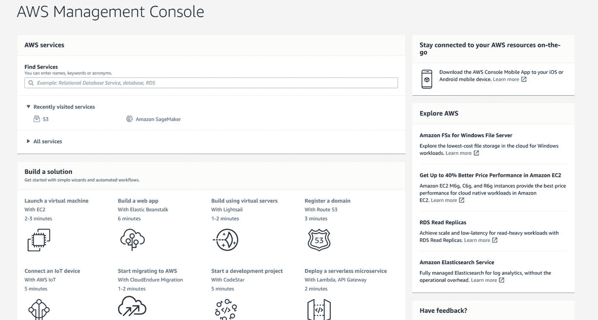

图 5-1

AWS 控制台的主屏幕。请注意，你的屏幕很可能与这里显示的有所不同

如你所见，你可以使用搜索栏查找服务。在这里，输入 `S3`，然后点击显示“S3”且描述为“云中的可扩展存储”的结果。

你应该会进入一个类似图 5-2 的页面。

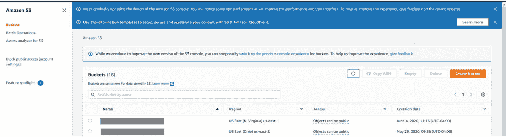

图 5-2

打开 S3 存储桶服务模块时屏幕可能的样子。我们已将存储桶的名称灰化处理，但你可以在此处看到字符串名称

你应该会看到一个标有“创建存储桶”的按钮。点击它，你将看到类似图 5-3 的内容。

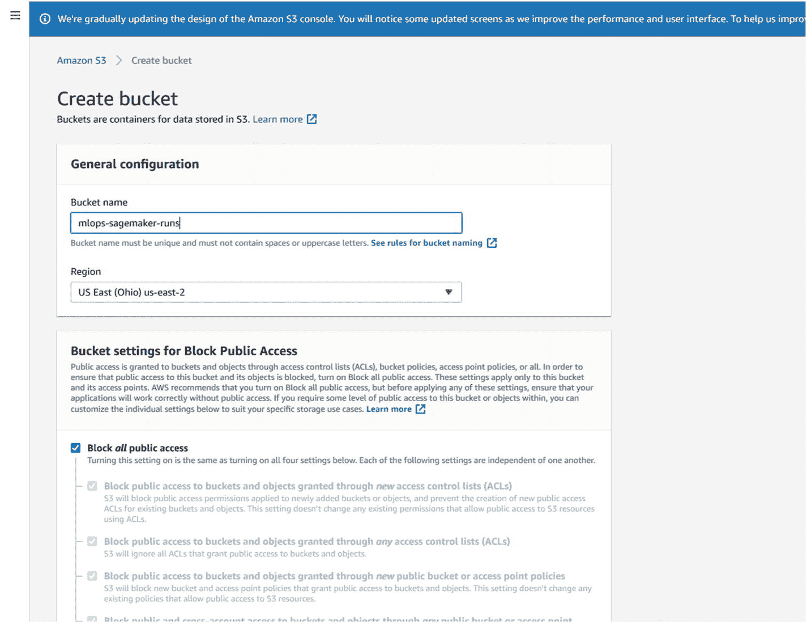

图 5-3

这是你的存储桶创建屏幕可能的样子。在本例中，你只需命名存储桶，无需关心其他选项

我们将存储桶命名为 `mlops-sagemaker-runs`。你无需担心其余选项，直接滚动到底部并点击“创建存储桶”。完成后，你应该能够在存储桶列表中看到你的存储桶。

接下来，让我们使用一个子进程将本地的 `mlruns` 目录同步到此存储桶。这样做会将整个 `mlruns` 目录上传到你的存储桶，从而将所有运行都存储在云端。

首先，收集以下属性：

*   `s3_bucket_name`：你尝试推送到的 S3 存储桶的名称是什么？

*   `mlruns_directory`：你推送到存储桶的 `mlruns` 目录的位置在哪里？

基于这些信息，运行以下命令。我们在示例中包含了存储桶名称和 `mlruns` 目录，因此只需将它们替换为你自己的值即可。


```
import subprocess
s3_bucket_name = "mlops-sagemaker-runs"
mlruns_direc = "./mlruns/"
output = subprocess.run(["aws",  "s3", "sync", "{}".format(mlruns_direc), "s3://{}".format(s3_bucket_name)], stdout=subprocess.PIPE, encoding='utf-8')
print(output.stdout)
print("\nSaved to bucket: ", s3_bucket_name)
```

运行上述代码后，您应该会看到类似图 5-4 的输出，表明它已将本地的 `mlruns` 目录与存储桶同步。如果没有任何输出，则表示没有新内容需要推送（如果您是重新运行）。请确保 `mlruns` 目录与此笔记本位于同一目录中；否则将无法找到它。

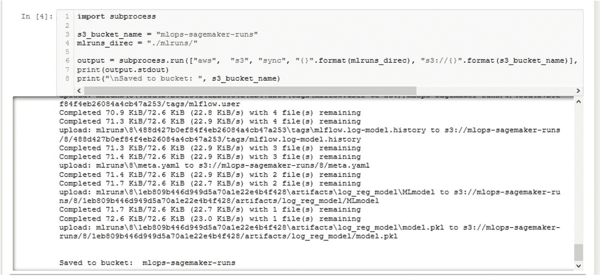

图 5-4

这是您首次将 mlruns 目录与存储桶同步时可能看到的输出。请确保您的 mlruns 目录与此笔记本文件位于同一目录中。

完成后，您可以继续构建 SageMaker 在部署时用于托管模型的容器。为此，请在终端中运行以下命令：

```
mlflow sagemaker build-and-push-container
```

同样，这要求您已配置好 Amazon 凭证。

您无需在每次使用新框架时都创建新的 Docker 镜像。得益于模块化，这一个镜像就能处理所有 MLFlow 模型。这类似于我们在第 3 章中讨论的部署管道，您只需在其中替换模型即可。

此步骤可能需要一些时间，所以请放松，让它自行完成。您应该会看到类似图 5-5 的内容。

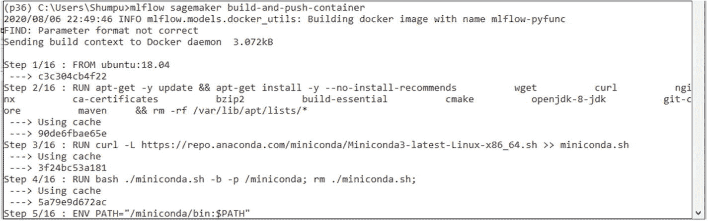

图 5-5

运行构建容器的命令时，您应该会看到类似的内容。

完成后，控制台应输出类似图 5-6 的内容。

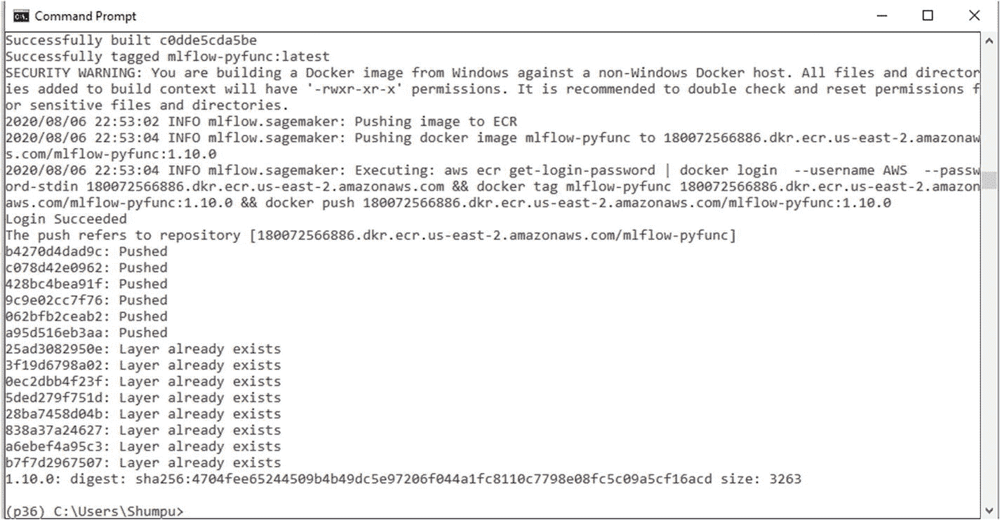

图 5-6

当 Docker 容器镜像成功构建并推送到 Amazon ECR 时，您应该会看到此内容。

现在，当您导航到 Amazon ECR 时，应该能在门户中看到一个新的容器。

从您的主控制台导航到 Amazon ECR，并确认您看到了名为 `mlflow-pyfunc` 的容器。您应该会看到类似图 5-7 的内容，确认 Docker 镜像已成功推送到 AWS ECR。

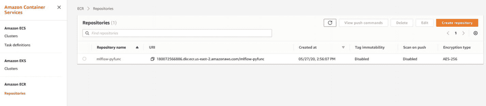

图 5-7

运行命令后，您应该能够在 ECR 存储库列表中看到您的容器。

至此，您已在 AWS 控制台中设置了将模型部署到 SageMaker 所需的所有与 MLFlow 功能相关的内容。

现在，让我们来看看如何部署其中一个模型。

## 将模型部署到 AWS SageMaker

要将模型部署到 SageMaker，您需要收集以下信息：

*   `app_name`

*   `model_uri`

*   `execution_role`

*   `region`

*   `image_ecr_url`

执行角色指的是身份和访问管理（IAM）角色，您可以通过在控制台中搜索“IAM”来找到它。创建或选择一个执行角色后（确保它可以访问 S3 并对其执行 get、put、delete 和 list 操作），复制其中存在的完整值。

至于该角色应遵循的具体策略，请参考图 5-8 了解我们的 IAM 执行角色是如何设置的。

至于执行角色 ARN 编号，您应该会看到类似图 5-8 的内容。

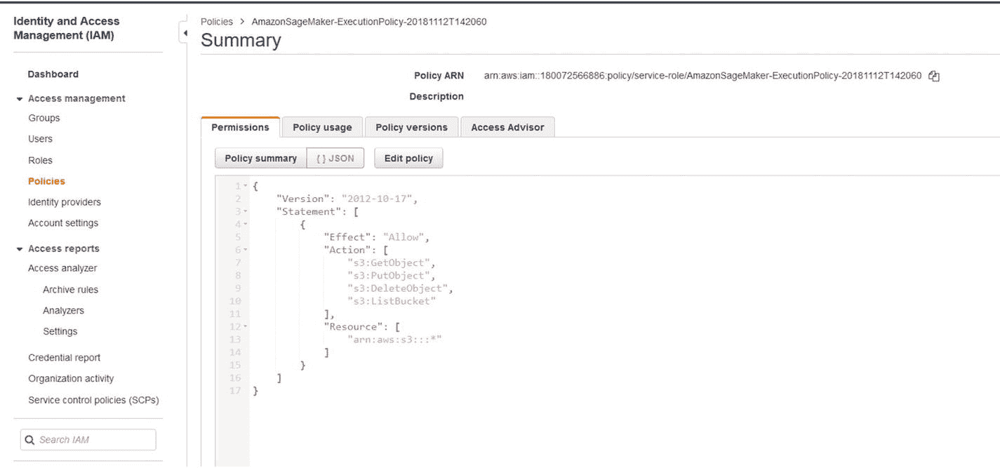

图 5-8

在 IAM 选项卡的策略下，选择（或创建）您将用于执行部署过程的角色。在那里，您应该能够看到特定的策略 ARN 值，您必须复制并记录该值。

请确保您已复制策略 ARN 值。AWS 允许您通过单击策略旁边的小剪贴板图标将其复制到剪贴板。

要查找 `image_ecr_url` 值，请返回 ECR 并查找类似图 5-7 的内容。现在单击它以查看类似图 5-9 的内容。

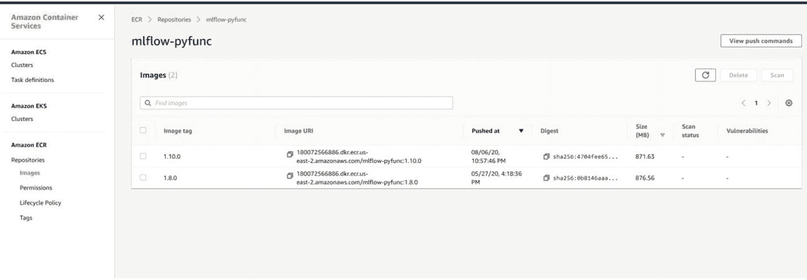

图 5-9

Image URI 是您要复制的值

复制 Image URI 处的值，但排除您想要的版本。我们运行的是 MLFlow 1.10.0 版本，因此复制该版本的值。

接下来，找到您要部署的特定运行。转到您的 S3 存储桶列表，单击您创建的存储桶，其标题应为 `mlops-sagemaker-runs`。

在此处导航，直到看到显示多个运行的文件夹。我们选择了最上面的运行。请参考图 5-10。

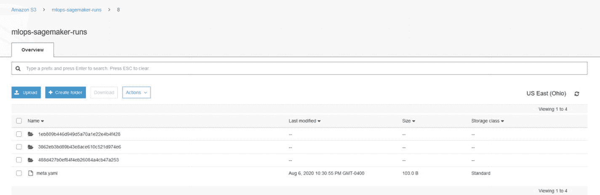

图 5-10

查看您的存储桶以找到要部署的运行。（这些运行具有相同的性能指标，因此我们选择哪一个并不重要。如果重要，我们可以通过 MLFlow UI（确保终端与我们推送的 mlruns 目录位于同一目录中）查看并选择最佳运行。）另外，请记住记录实验 ID 和您记录的模型名称。如果您单击运行 ID，然后单击 artifacts，应该可以找到它。在我们的例子中，它是 log_reg_model

收集完所有信息后，让我们继续部署。运行以下命令：

```
import boto3
import mlflow.sagemaker as mfs
import json
app_name = "mlops-sagemaker"
execution_role_arn = "arn:aws:iam::180072566886:role/service-role/AmazonSageMaker-ExecutionRole-20181112T142060"
image_ecr_url = "180072566886.dkr.ecr.us-east-2.amazonaws.com/mlflow-pyfunc:1.10.0"
region = "us-east-2"
s3_bucket_name = "mlops-sagemaker-runs"
experiment_id = "8"
run_id = "1eb809b446d949d5a70a1e22e4b4f428"
model_name = "log_reg_model"
model_uri = "s3://{}/{}/{}/artifacts/{}/".format(s3_bucket_name, experiment_id, run_id, model_name)
```

这将设置您将用于运行部署代码的所有参数。

最后，让我们进入实际的部署代码：

```
mfs.deploy(app_name=app_name,
model_uri=model_uri,
execution_role_arn=execution_role_arn,
region_name=region,
image_url=image_ecr_url,
mode=mfs.DEPLOYMENT_MODE_CREATE)
```

您应该会看到类似图 5-11 的内容。

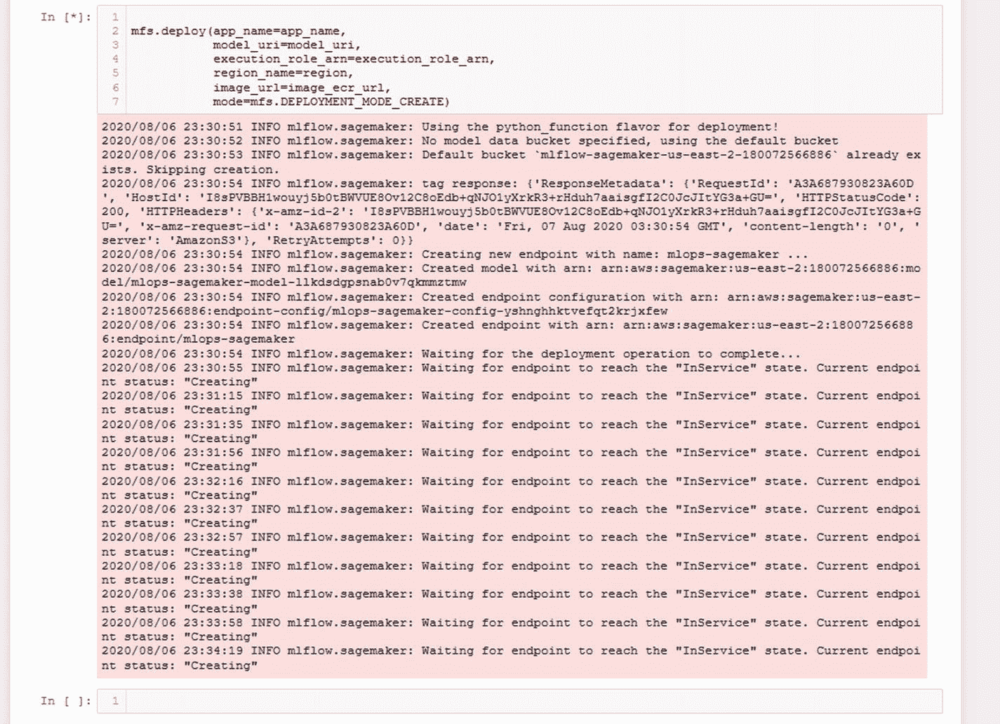

图 5-11


当你尝试部署模型时，应该会看到类似这样的界面。如果耗时较长，不必担心。

这一步可能需要一些时间。如果你想查看 SageMaker 端点的状态，可以打开门户并搜索导航到 SageMaker。其中应有一个“端点”部分，你可以看到所有现有的 SageMaker 端点。你应该能看到当前端点状态显示为“creating”（创建中），如图 5-12 所示。

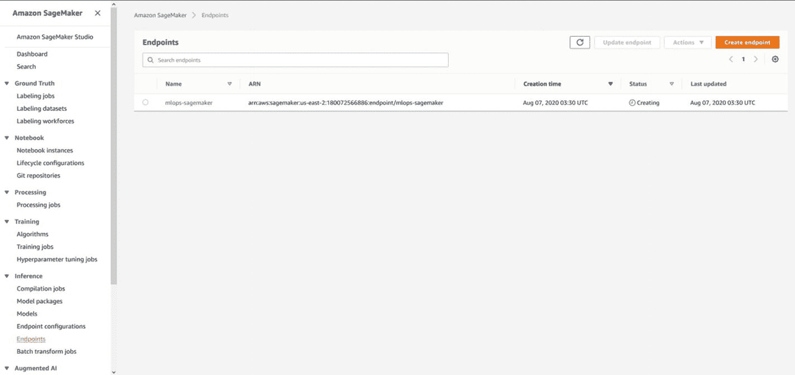

图 5-12

你在 Amazon SageMaker 的“端点”部分应该看到的内容。一旦端点创建完成，你会看到其状态更新为“InService”（服务中）。

当这个端点成功创建后（即你看到状态更新为“InService”时），你就可以继续进行预测了。

## 进行预测

进行预测很简单。你只需要端点的名称以及 boto3 提供的查询模型功能。让我们定义一个查询模型的函数：

```
def query(input_json):
client = boto3.session.Session().client("sagemaker-runtime", region)
response = client.invoke_endpoint(
EndpointName=app_name,
Body=input_json,
ContentType='application/json; format=pandas-split',
)
preds = response['Body'].read().decode("ascii")
preds = json.loads(preds)
return preds
```

现在，像本地模型部署示例那样，加载数据、处理数据并进行缩放。确保存在 `data` 文件夹，并且其中包含 `creditcard.csv` 文件。运行以下代码：

```
import pandas as pd
import mlflow
import mlflow.sklearn
import seaborn as sns
import matplotlib.pyplot as plt
from sklearn.preprocessing import StandardScaler
from sklearn.model_selection import train_test_split
from sklearn.metrics import roc_auc_score, accuracy_score, confusion_matrix
import numpy as np
df = pd.read_csv("data/creditcard.csv")
```

完成 `import` 语句和数据框加载后，运行以下代码：

```
normal = df[df.Class == 0].sample(frac=0.5, random_state=2020).reset_index(drop=True)
anomaly = df[df.Class == 1]
normal_train, normal_test = train_test_split(normal, test_size = 0.2, random_state = 2020)
anomaly_train, anomaly_test = train_test_split(anomaly, test_size = 0.2, random_state = 2020)
scaler = StandardScaler()
scaler.fit(pd.concat((normal, anomaly)).drop(["Time", "Class"], axis=1))
```

全部完成后，运行以下代码以确保模型确实在进行预测：

```
scaled_selection = scaler.transform(df.iloc[:80].drop(["Time", "Class"], axis=1))
input_json = pd.DataFrame(scaled_selection).to_json(orient="split")
pd.DataFrame(query(input_json)).T
```

你应该会看到类似图 5-13 的输出。

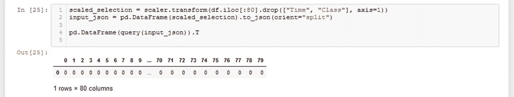

图 5-13

使用代表数据框前 80 行的缩放数据查询已部署的模型，并获取响应

图 5-13 展示了在 SageMaker 端点上托管模型时成功查询模型并收到预测响应的过程。

让我们运行经过一些修改的批量查询脚本：

```
test = pd.concat((normal.iloc[:1900], anomaly.iloc[:100]))
true = test.Class
test = scaler.transform(test.drop(["Time", "Class"], axis=1))
preds = []
batch_size = 80
for f in range(25):
print(f"Batch {f}", end=" - ")
sample = pd.DataFrame(test[f*batch_size:(f+1)*batch_size]).to_json(orient="split")
output = query(sample)
resp = pd.DataFrame([output])
preds = np.concatenate((preds, resp.values[0]))
print("Completed")
eval_acc = accuracy_score(true, preds)
eval_auc = roc_auc_score(true, preds)
print("Eval Acc", eval_acc)
print("Eval AUC", eval_auc)
```

完成后，你应该会看到类似图 5-14 的内容。

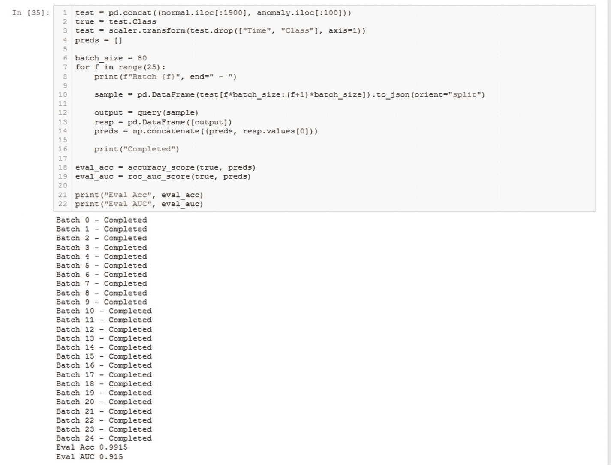

图 5-14

批量查询脚本的输出。你混合了 100 个异常点和 1900 个正常点，以便更好地了解模型对异常点的表现。否则，你只会得到少量异常点。

这一切都很好，但如果你想切换已部署的模型该怎么办？SageMaker 允许你更新端点并切换到新模型。让我们看看如何操作。

## 切换模型

也许你想更新模型，或者当前模型及其预测服务不再有用，你想在不删除和创建新端点的情况下替换它。在这种情况下，你可以直接更新端点并替换当前托管的模型。为此，你只需要收集新的 `model_uri`。

这次，`model_uri` 指的是你想要部署的新模型的 URI。在你的案例中，你选择的是上传到存储桶的三个运行中的第二个运行。其他所有内容保持不变，所以你只需要获取一个新的 `model_uri`。

现在，运行以下代码，将 `run_id` 值替换为你选择的 `run_id`：

```
new_run_id = "3862eb3bd89b43e8ace610c521d974e6"
new_model_uri = "s3://{}/{}/{}/artifacts/{}/".format(s3_bucket_name, experiment_id, new_run_id, model_name)
```

运行此代码后，再运行以下代码来更新模型：

```
mfs.deploy(app_name=app_name,
model_uri=new_model_uri,
execution_role_arn=execution_role_arn,
region_name=region,
image_url=image_ecr_url,
mode=mfs.DEPLOYMENT_MODE_REPLACE)
```

你会发现这个函数与你之前用于部署模型的函数非常相似。唯一不同的参数是模式，因为你现在使用的是 `mfs.DEPLOYMENT_MODE_REPLACE` 而不是 `mfs.DEPLOYMENT_MODE_CREATE`。

请参考图 5-15 查看输出应该是什么样子。请注意，这也可能需要一些时间才能完成。

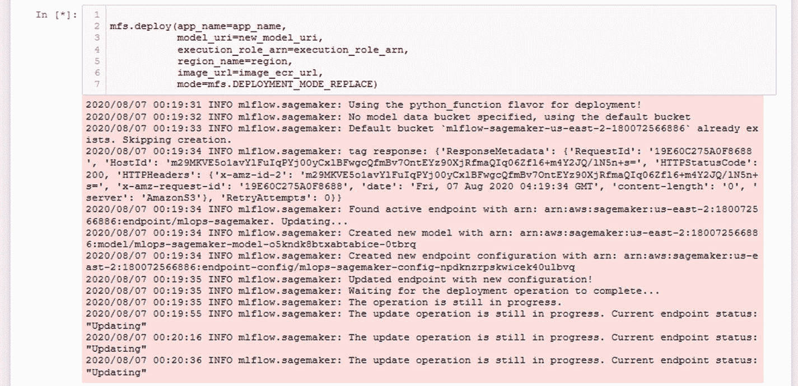

图 5-15

运行更新代码后，你的输出应该看起来像这样

在运行过程中，你可以在门户中检查端点，看到它正在更新。请参考图 5-16 查看此过程。

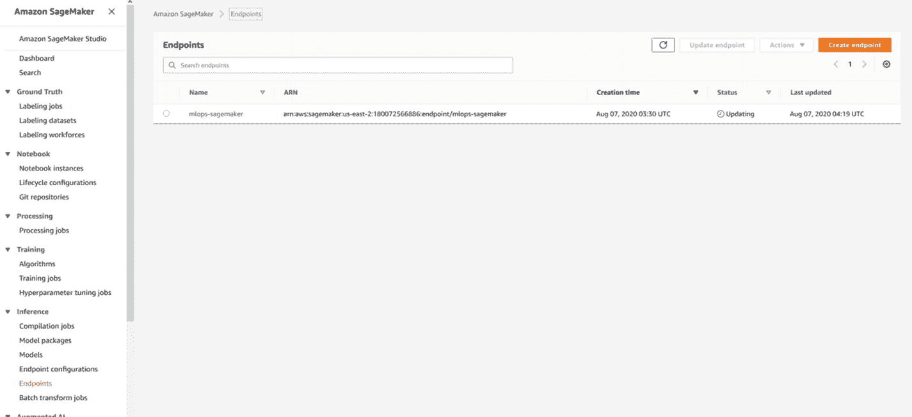

图 5-16

端点正在更新。完成后，它应该像创建端点时一样显示“InService”

一旦更新完成，你可以使用相同的函数再次查询这个模型。你也不需要修改批量脚本。

现在你已经知道如何用新模型更新端点，接下来我们将看看如何移除端点和已部署的模型。


## 删除已部署的模型

你可能拥有多个端点，每个端点托管着不同的模型，并且由于成本原因，你不再希望让某个端点继续运行。要删除一个端点，你只需要以下信息：

*   `app_name`

*   `region`

有了这些信息（通常应该已经定义好了），你可以直接运行以下命令：

```
mfs.delete(app_name=app_name,region_name=region)
```

你应该会看到类似图 5-17 的输出。这个过程完成得非常快。

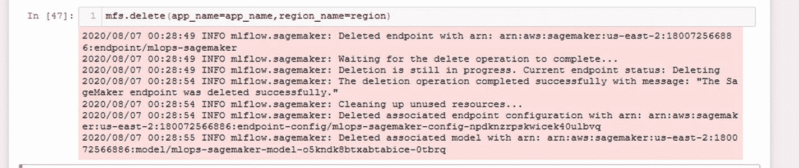

图 5-17

删除命令的输出

你也可以在门户网站中检查该端点，它应该会显示类似图 5-18 的内容。

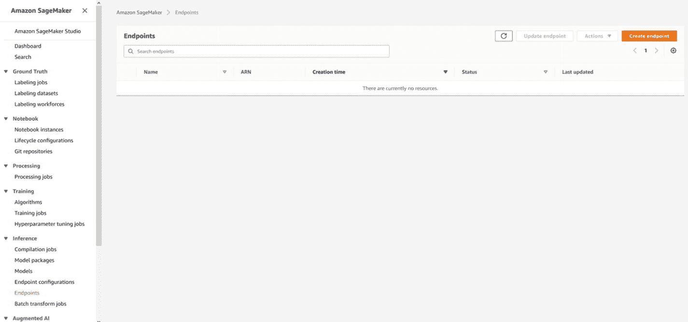

图 5-18

删除后的 SageMaker 端点资源。如果删除过程成功，这里应该没有任何内容

如你所见，端点现在已经完全消失了。

需要注意的一点是，你应该确保不会意外地让任何资源继续运行，因为成本会随着时间的推移而累积，让你的钱包受损。对于像 SageMaker 端点这样的服务，是按小时收费的，所以一旦使用完毕，请务必将其删除。

至于 S3 存储桶和 ECR 容器，它们是一次性收费，仅针对数据传输计费。

至此，你现在已经知道如何使用 AWS SageMaker 来运维你的 MLFlow 模型了。

## 总结

MLFlow 在其运维代码中提供了对 AWS SageMaker 的显式支持。因此，我们介绍了如何将你的运行记录上传到 S3 存储桶，以及如何创建并推送一个 MLFlow Docker 容器镜像供 AWS SageMaker 在运维模型时使用。我们还介绍了如何在端点上部署模型、查询模型、用新模型更新端点以及删除端点。希望你现在已经知道如何使用 MLFlow 和 AWS SageMaker 来运维你的机器学习模型了。

在下一章中，我们将探讨如何使用 Microsoft Azure 来运维你的 MLFlow 模型。

