# 6. 在 Azure 中部署

在本章中，我们将介绍如何使用 Microsoft Azure 来运维你的 MLFlow 模型。具体来说，我们将探讨如何利用 Azure 的内置功能将模型部署到开发分支和生产分支，以及部署后如何查询模型。

## 引言

在上一章中，我们介绍了如何将模型部署到 Amazon SageMaker，通过更新或删除事件进行管理，以及如何查询它们。现在，我们将把重点转向展示如何使用 Microsoft Azure 来运维你的 MLFlow 模型。

在开始之前，有一个**重要的先决条件**：

*   在你的 Python 环境中安装 `azureml-sdk`。

与 AWS 一样，Microsoft Azure 也在不断开发和更新中。由于 MLFlow 支持 Microsoft Azure，你应该能够利用 MLFlow 来运维你的模型。任何新功能肯定都会被 MLFlow 记录下来，在最坏的情况下，你仍然可以在 Azure 上托管一个服务器，并以这种方式维护你的 MLOps 功能。

同样，我们将在下一章探讨如何使用 Google Cloud API 运维你的 MLFlow 模型时，详细介绍如何做到这一点。

具体来说，本章将涵盖以下内容：

*   **配置 Azure：** 在这里，你基本上使用 MLFlow 的功能来构建一个容器镜像，用于托管模型。然后，将其推送到 Azure 的 Azure 容器实例（ACI），类似于你将镜像推送到 Amazon AWS Elastic Container Registry（ECR）的方式。

*   **将模型部署到 Azure（开发阶段）：** 在这里，你使用内置的 `azureml-sdk` 模块代码将模型推送到 Azure。然而，这是一个开发阶段的部署，因此该模型尚未准备好投入生产，因为其计算资源有限。

*   **进行预测：** 模型部署完成后，就可以被查询了。这是通过 HTTP 请求完成的。这是你可以验证模型在云端托管后是否正常工作的方法，因为它处于开发阶段。

*   **部署到生产环境：** 在这里，你利用 MLFlow Azure 模块代码，通过创建容器实例（或提供的任何其他部署配置，如 Azure Kubernetes 服务）将模型部署到生产环境。

*   **进行预测：** 与在开发阶段查询模型的方式类似，一旦模型部署到生产阶段，你就可以查询它，并运行上一章中的批量查询脚本。

*   **切换模型：** MLFlow 没有提供切换模型的显式功能，因此你必须删除该服务，并使用另一个模型运行重新创建它。

*   **删除已部署的模型：** 最后，你撤销所有已完成的部署并移除所有资源。也就是说，当你完成后，需要删除开发和生产分支的服务，以及容器注册表和任何其他已创建的服务。

那么，让我们开始吧！


## 配置 Azure

在开始使用 Azure 的功能将模型投入生产之前，您必须首先创建一个新的 Azure 工作区或连接到现有的工作区。您可以通过代码或浏览器中的 UI 来完成此操作。

在本例中，您将在浏览器中打开门户并学习如何创建工作区。请参考图 6-1。

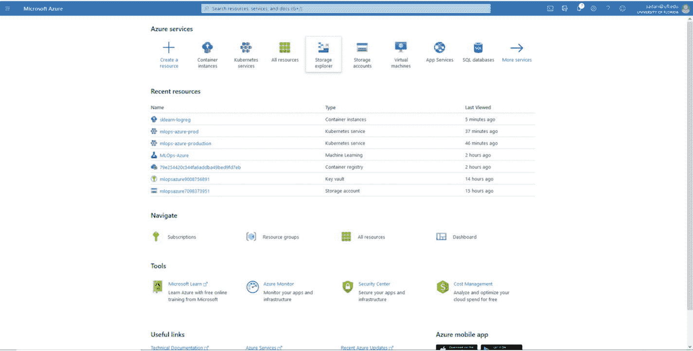

图 6-1

Microsoft Azure 门户主页示例

接下来，单击“创建资源”选项并搜索“Machine Learning”。您应该会看到类似图 6-2 的内容。

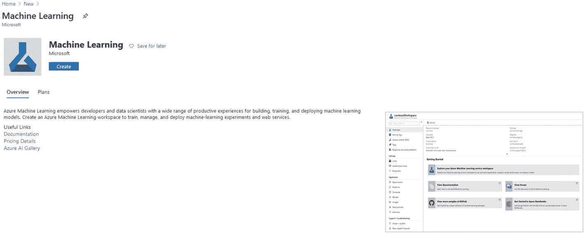

图 6-2

Azure 提供的“Machine Learning”服务示例。您需要在此服务中创建一个工作区，因此请单击“创建”按钮

单击“创建”按钮。您应该会看到类似图 6-3 的内容。（我们已使用自己的参数填写了字段。）

您的订阅可能与我们的不同。对于资源组，我们创建了一个名为 `azure-mlops` 的新资源组。

您在 6-3 中填写的字段足以创建您的工作区。接下来，单击“查看 + 创建”选项，并在 Azure 声明验证已通过并允许您单击“创建”后，单击“创建”。

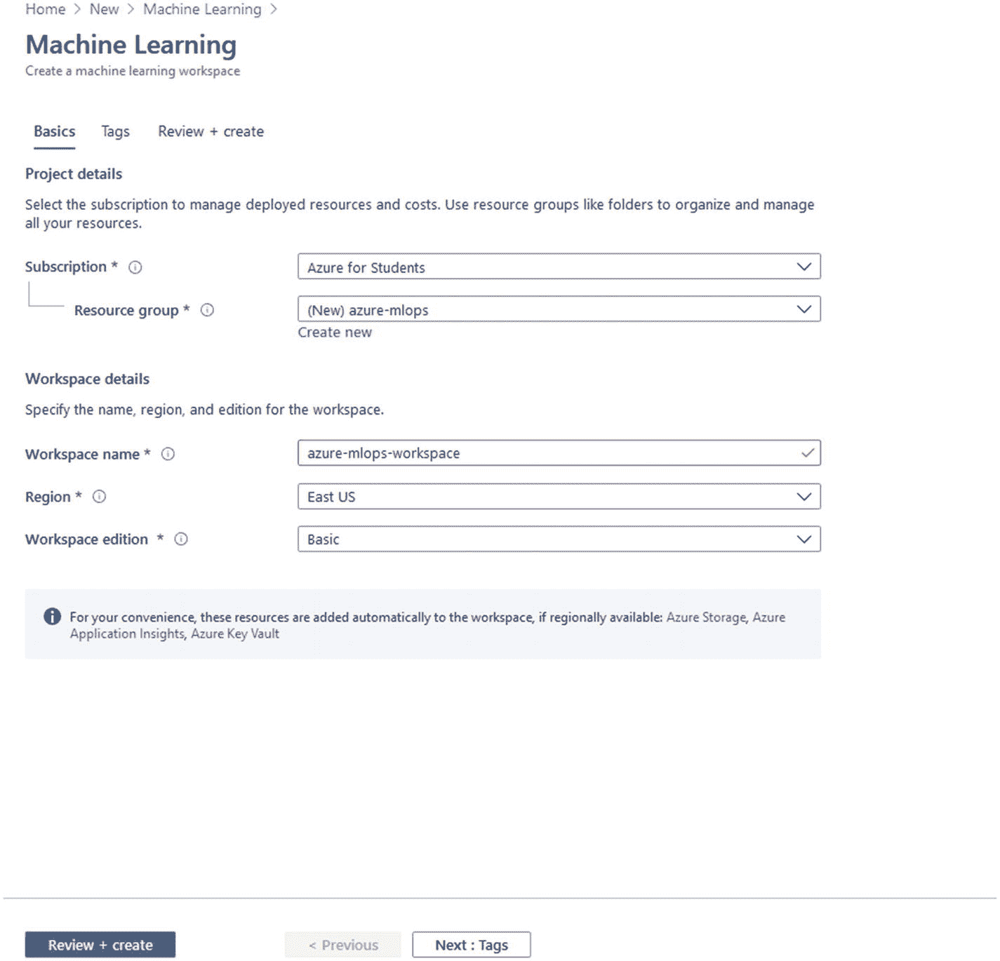

图 6-3

工作区创建 UI（我们已使用自己的参数填写了字段）

部署需要一些时间。工作区创建完成后，返回主页门户并单击“所有资源”选项。您应该会看到类似图 6-4 的内容。

单击您的工作区，其旁边应有一个化学烧杯图标。

在此概览中，您将看到与此工作区关联的几个参数。请务必记录工作区的以下属性，以便在代码中连接到它：

*   `workspace_name` (azure-mlops-workspace )

*   `subscription` (显示“订阅 ID”的值)

*   `resource_group` (azure-mlops)

*   `location` (East-US)

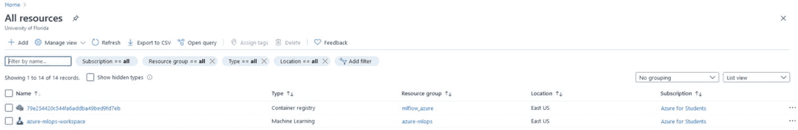

图 6-4

查看“所有资源”选项时，您可能会看到类似这样的内容

请参考图 6-5。

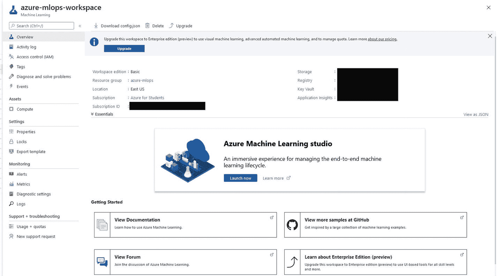

图 6-5

您应该会看到类似这样的您自己的工作区。这里我们隐藏了可能敏感的字段，但您应该能够在屏幕上看到自己唯一的订阅 ID。这就是您要使用的值

现在，运行以下命令来创建/连接到您自己的工作区：

```
import azureml
from azureml.core import Workspace
workspace_name = "MLOps-Azure"
workspace_location="East US"
resource_group = "mlflow_azure"
subscription_id = "xxxxxxxx-xxxx-xxxx-xxxx-xxxxxxxxxxxx"
workspace = Workspace.create(name = workspace_name,
location = workspace_location,
resource_group = resource_group,
subscription_id = subscription_id,
exist_ok=True)
```

如果您已成功连接到工作区，该单元格应能无错误地运行。

接下来，您必须构建 Azure 要使用的 MLFlow 容器镜像。在此，您还需要指定要部署的模型的运行。

对于 Amazon SageMaker，您可以引用本地机器上的运行或 S3 存储桶中的运行。对于 Azure，您可以执行相同的操作，只是使用 Azure 的存储实体（称为 blob）。

无论哪种方式，您都需要所部署模型的**运行 ID** 以及模型记录所在的**工件方案**。对于存储在 Amazon S3 存储桶中的模型，您使用了方案 `s3:/`，但这次您将仅使用本地运行。如果您愿意，仍然可以使用您的 Amazon S3 存储桶或 Google Cloud 存储桶。运行存储在哪里并不重要。

运行以下命令，将值替换为您特定的运行和存储方案：

```
run_id = "1eb809b446d949d5a70a1e22e4b4f428"
model_name = "log_reg_model"
model_uri = f"runs:/{run_id}/{model_name}"
```

除非您更改了模型名称，否则模型名称应与您的情况相同。由于我们使用的是本地运行，因此我们有一个以 `runs:/` 开头的 URI。同样，请根据您的情况将其更改为适当的值。

最后，设置好所有这些信息后，让我们创建容器镜像：

```
import mlflow.azureml
model_image, azure_model = mlflow.azureml.build_image(model_uri=model_uri,
workspace=workspace,
model_name="sklearn_logreg_dev",
image_name="model",
description="SkLearn LogReg Model for Anomaly Detection",
synchronous=False)
```

您应该会看到类似图 6-6 的内容。根据您的 MLFlow 版本，您可能会或可能不会看到警告消息。

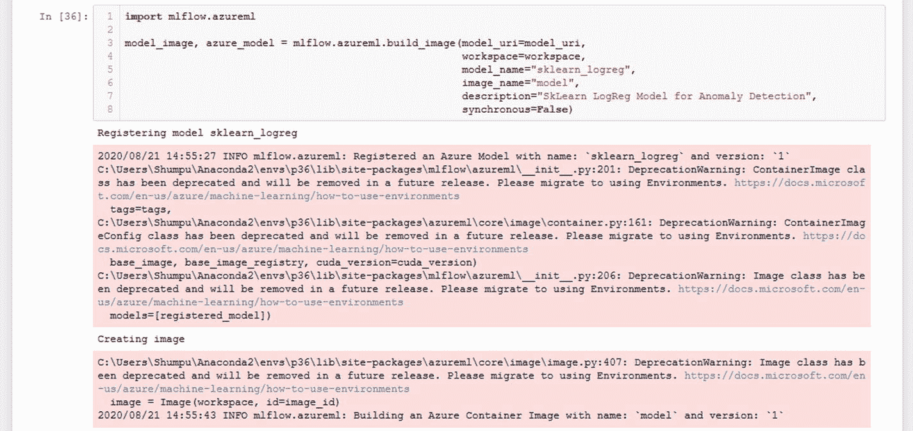

图 6-6

构建容器并将其推送到 Azure 的容器注册表。暂时忽略警告消息。您将来可能不会看到这些消息。由于这是由 MLFlow 创建和维护的代码，他们很可能会为 Azure 推出的任何新功能提供支持

接下来，运行以下命令检查容器的状态：

```
model_image.wait_for_creation(show_output=True)
```

您应该会看到类似图 6-7 的内容。

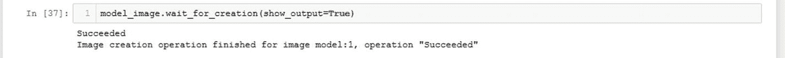

图 6-7

检查镜像创建操作中的进度输出

镜像创建完成后，您现在就可以部署模型了。


## 部署到 Azure（开发阶段）

Azure 提供的一项有趣功能是 ACI Web 服务。该 Web 服务专门用于调试或测试正在开发的模型，因此适用于开发阶段。

你将基于刚刚创建的模型镜像部署一个 ACI Web 服务实例。

运行以下代码：

```
from azureml.core.webservice import AciWebservice, Webservice
aci_service_name = "sklearn-model-dev"
aci_service_config = AciWebservice.deploy_configuration()
aci_service = Webservice.deploy_from_image(name=aci_service_name,
image=model_image,
deployment_config=aci_service_config,
workspace=workspace)
```

你应该会看到类似图 6-8 的内容。

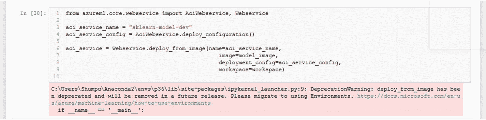

图 6-8

创建 ACI 服务的输出。这个函数未来可能会被移除，但目前这是访问 ACI 服务并部署模型的一种方式。

这种启动服务的精确方式可能在不久的将来会被弃用，转而使用环境。目前，你仍然可以通过这种方式启动 ACI 服务，但重要的是要知道存在一个专门为开发阶段测试量身定制的 Web 服务。

现在运行以下代码来检查进度：

```
aci_service.wait_for_deployment(show_output=True)
```

你应该会看到类似图 6-9 的内容。

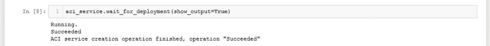

图 6-9

检查部署是否成功时你应该看到的输出

在进行预测之前，让我们先验证是否可以访问你的服务：

```
aci_service.scoring_uri
```

你应该会看到类似图 6-10 的内容。如果没有，请尝试在门户中进入你的资源，验证是否存在一个名为 `sklearn-model-dev` 的新容器。如果不存在，请尝试按相同顺序重新运行单元格。这次应该会显示某个 URI。

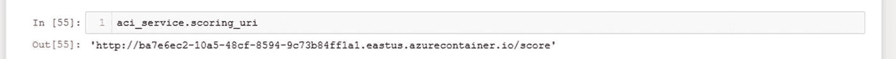

图 6-10

显示评分 URI，表明你可以连接到它并进行预测

你应该会看到类似图 6-10 的内容。

现在你可以使用此模型进行预测了。

## 进行预测

现在你需要获取一些数据进行预测。

和之前一样，你将加载信用卡数据集，进行预处理，并留出一小批数据用于查询模型。运行以下代码块，并确保此目录中有一个名为 `data` 的文件夹，其中包含 `creditcard.csv`：

```
import pandas as pd
import mlflow
import mlflow.sklearn
import seaborn as sns
import matplotlib.pyplot as plt
from sklearn.preprocessing import StandardScaler
from sklearn.model_selection import train_test_split
from sklearn.metrics import roc_auc_score, accuracy_score, confusion_matrix
import numpy as np
import subprocess
import json
df = pd.read_csv("data/creditcard.csv")
```

加载完所有模块和数据后，运行以下代码：

```
normal = df[df.Class == 0].sample(frac=0.5, random_state=2020).reset_index(drop=True)
anomaly = df[df.Class == 1]
normal_train, normal_test = train_test_split(normal, test_size = 0.2, random_state = 2020)
anomaly_train, anomaly_test = train_test_split(anomaly, test_size = 0.2, random_state = 2020)
scaler = StandardScaler()
scaler.fit(pd.concat((normal, anomaly)).drop(["Time", "Class"], axis=1))
```

在单元格中，上述两个代码块应该看起来像图 6-11。

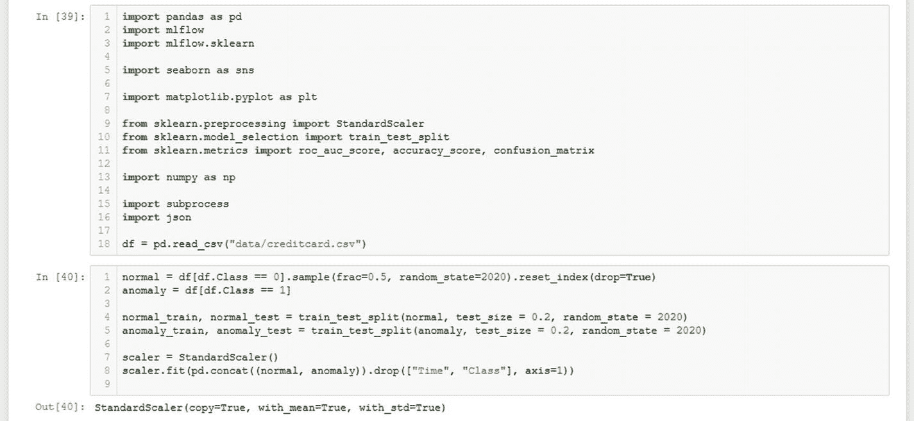

图 6-11

导入语句和数据处理代码。你还在此处定义了缩放器并将其拟合到数据，就像最初训练这些模型时一样。

完成数据准备后，让我们定义一个函数来帮助你查询已部署的模型：

```
import requests
import json
def query(scoring_uri, inputs):
headers = {
"Content-Type": "application/json",
}
response = requests.post(scoring_uri, data=inputs, headers=headers)
preds = json.loads(response.text)
return preds
```

现在你可以选择几个数据点并进行预测：

```
data_selection = df.iloc[:80].drop(["Time", "Class"], axis=1)
input_json = pd.DataFrame(scaler.transform(data_selection)).to_json(orient="split")
preds = query(scoring_uri=aci_service.scoring_uri, inputs=input_json)
pd.DataFrame(preds).T
```

综合起来，你应该会看到类似图 6-12 的内容。

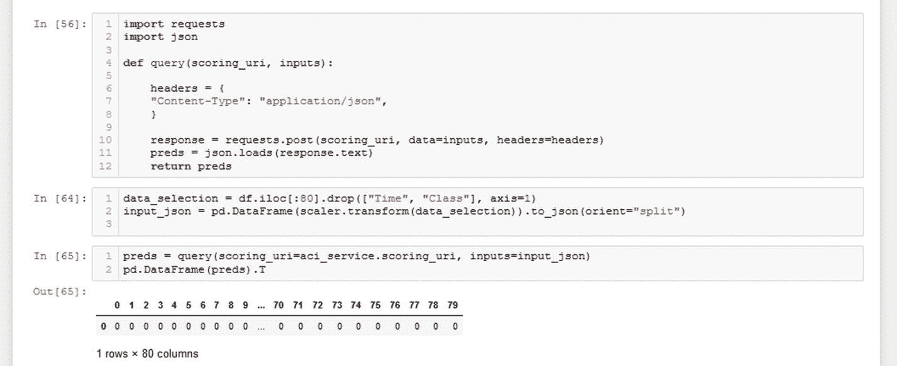

图 6-12

使用一些样本数据查询部署在 ACI Web 服务上的模型并接收响应

如你所见，模型返回了看起来正确的预测（得益于缩放）。

现在你已经知道如何部署到开发分支，接下来让我们看看如何使用内置的 MLFlow 功能将模型部署到生产环境。

## 部署到生产环境

MLFlow 提供 Azure 支持，并帮助我们直接部署模型，默认使用容器实例。

让我们直接开始。运行以下代码，将名称替换为你喜欢的任何名称：

```
azure_service, azure_model = mlflow.azureml.deploy(model_uri,
workspace,
service_name="sklearn-logreg",
model_name="log-reg-model",
synchronous=True)
```

值得一提的是，你可以部署到特定的 Web 服务。默认情况下，MLFlow 会将模型托管在容器实例上，但你可以指定一个计算集群。要了解更多信息，请参考此处的文档：[`www.mlflow.org/docs/latest/python_api/mlflow.azureml.html`](http://www.mlflow.org/docs/latest/python_api/mlflow.azureml.html)。

代码运行完成后（可能需要一些时间），你还可以检查 URI 是否可以打印出来：

```
azure_service.scoring_uri
```

综合起来，你应该会看到类似图 6-13 的内容。

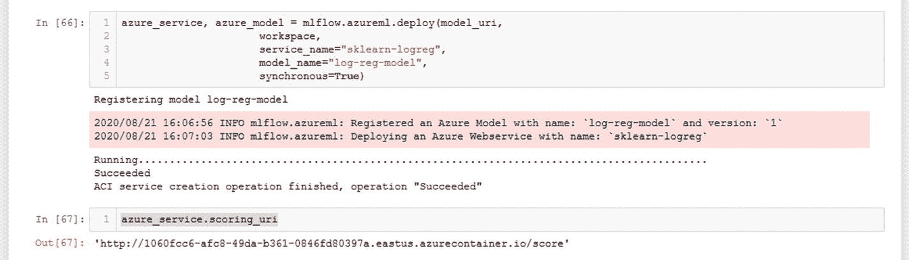

图 6-13

成功创建端点并验证服务具有 URI

现在你已经成功部署了模型，让我们继续下一步，进行预测。


## 进行预测

现在模型已部署，让我们运行代码进行预测。

首先，运行以下代码以确保能收到预测结果。您应该已经定义了 `input_json`：

```
preds = query(scoring_uri=azure_service.scoring_uri, inputs=input_json)
pd.DataFrame(preds).T
```

此时您应该会看到类似图 6-14 的内容。

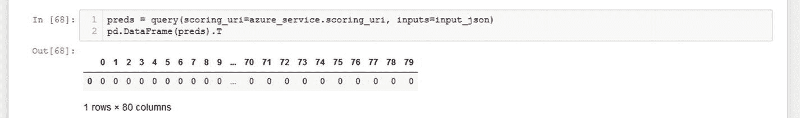

图 6-14

使用批量缩放数据查询已部署的模型，以确保其正常运行

现在，让我们运行批量查询脚本：

```
test = pd.concat((normal.iloc[:1900], anomaly.iloc[:100]))
true = test.Class
test = scaler.transform(test.drop(["Time", "Class"], axis=1))
preds = []
batch_size = 80
for f in range(25):
print(f"Batch {f}", end=" - ")
sample = pd.DataFrame(test[f*batch_size:(f+1)*batch_size]).to_json(orient="split")
output = query(scoring_uri=azure_service.scoring_uri, inputs=sample)
resp = pd.DataFrame([output])
preds = np.concatenate((preds, resp.values[0]))
print("Completed")
eval_acc = accuracy_score(true, preds)
eval_auc = roc_auc_score(true, preds)
print("Eval Acc", eval_acc)
print("Eval AUC", eval_auc)
```

完成后，您应该会看到类似图 6-15 的内容。

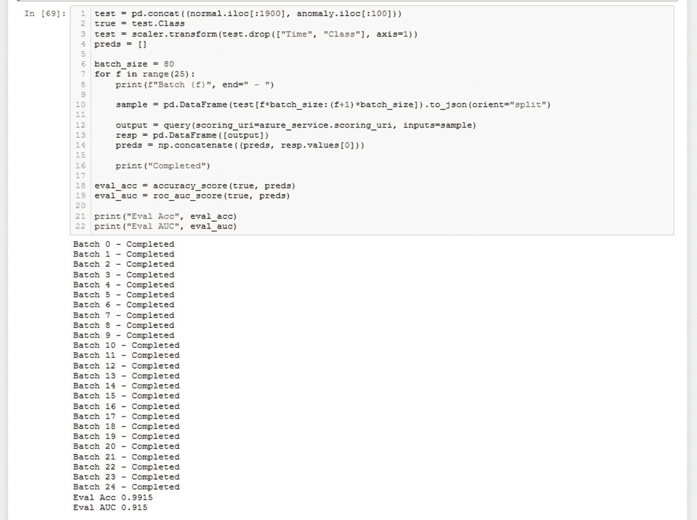

图 6-15

运行批量查询脚本的结果。该脚本对 2,000 个数据点进行了预测

至此，您已了解如何查询已部署的模型并利用其进行预测。如果您选择将模型部署到特定计算集群（例如 Azure Kubernetes 服务），操作流程与此相同。

## 清理工作

遗憾的是，似乎没有专门的功能可以用新模型**更新**服务。通常的做法是删除旧服务，然后使用新的模型 URI 创建新服务。

因此，接下来我们看看如何删除刚刚创建的所有服务。

运行以下代码：

```
aci_service.delete()
azure_service.delete()
```

请参考图 6-16。

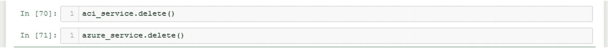

图 6-16

删除之前启动的 Web 服务

现在，从主页门户再次导航到“所有资源”部分。检查资源组类型为“容器实例”的每个项目。您应该会看到没有任何此类资源。图 6-17 展示了可能的情况。（这里有一个容器实例，但与此无关。）由于您刚刚删除了服务，因此不应看到 `sklearn-logreg` 或 `sklearn-model-dev`。

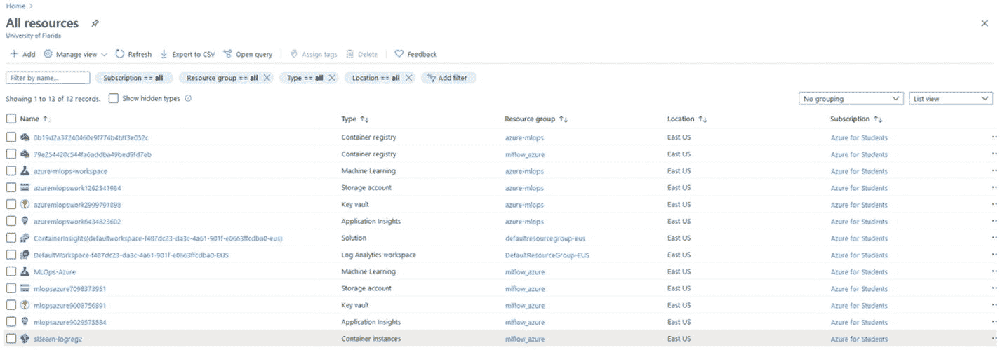

图 6-17

您不应看到任何标题为 `sklearn-logreg` 或 `sklearn-model-dev` 且类型为容器实例的资源。（这里有一个，但与上述实验无关，仅用于展示该资源类型的资源外观。）

如果您想从此处删除服务，只需删除容器实例或其他服务即可，如图 6-18 所示。

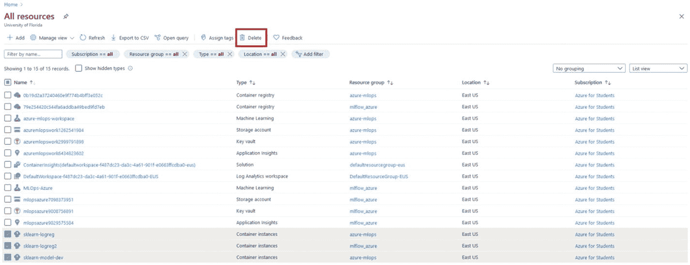

图 6-18

通过“所有资源”界面手动删除服务

现在，您可以按照相同流程，在界面中删除所有其他内容（或仅删除本章创建的新资源），以清理 Azure 工作区。

至此，您已了解如何使用 MLFlow 在 Microsoft Azure 上部署模型。

值得一提的是，Azure 还提供了许多与监控机器学习实验等相关的附加功能，但这些功能可能会根据您所需功能的深度而产生额外费用。如果您想进一步了解 Azure 及其功能，请务必查阅其优秀的官方文档。

## 总结

与 Amazon AWS 类似，Microsoft Azure 是一个为广泛用户提供众多高级服务的云平台。特别是，Azure 提供了大量内置功能（独立于 MLFlow）来支持机器学习模型的操作化。

在本章中，您学习了如何为特定的 MLFlow 模型运行构建容器镜像，在开发/生产环境中进行部署，并在 Microsoft Azure 上查询模型。

在下一章中，我们将探讨如何使用 Google Cloud 作为平台来操作化您的 MLFlow 模型。由于 Google Cloud 没有对 MLFlow 的显式支持，因此您将采用不同的方法：将模型托管在 Google Cloud 的服务器上，并通过该方式进行预测。

