# 7. 在 Google 中部署

在本章中，我们将介绍如何利用 MLFlow 和 Google Cloud 来操作化您的模型，即使 MLFlow 没有为 Google Cloud 提供显式的部署支持。

更具体地说，我们将介绍如何设置 Google Cloud 存储桶和虚拟机（用于运行服务器），以及如何操作化和查询您的模型。


## 引言

在上一章中，我们介绍了如何将模型部署到 Microsoft Azure、通过更新或删除事件进行管理以及查询模型。本章，我们将探讨如何使用 Google Cloud 实现模型的生产化运营。

MLFlow 并未像支持 AWS SageMaker 和 Microsoft Azure 那样，为在 Google Cloud 中部署提供显式支持，因此你的操作方式将与前面两章中模型生产化运营的方式略有不同。

这一次，你将使用与第 4 章相同的模型服务功能，只不过会将其托管在一台可通过互联网访问的 Google Cloud 机器上。然而，这种方式下的部署速度要快得多，因为你无需等待端点的创建。此外，一旦设置好机器，更换模型就变得非常简单，并且你可以通过使用不同的端口来服务多个模型。

值得注意的是，Google Cloud 拥有一系列专用于机器学习的先进工具和功能，例如 Kubeflow。Kubeflow 是一个工具，它允许你将机器学习生命周期集成到 Kubernetes 中。因此，你所有的机器学习管道都通过 Kubernetes 进行管理。鉴于 Kubernetes 是由 Google 开发的，Kubeflow 也集成到了 Google Cloud 平台中。在本章中，我们只介绍如何部署 MLFlow 记录的模型。我们不会深入探讨任何有助于管理机器学习生命周期的平台特定工具。

在开始之前，有一个**重要的前提条件**：

*   下载并安装 Google Cloud SDK，以便使用 CLI 连接到你的服务器。

具体来说，本章将涵盖以下内容：

*   **配置 Google：** 这可能是整个部署过程中最困难的一步。首先，你需要设置一个存储桶，并将 `mlruns` 文件夹的内容推送到云端存储。

    接下来，你需要设置一台虚拟机，用于在部署模型时托管你的服务器。这包括安装 Conda 和 MLFlow。

    最后，你需要设置防火墙，允许你的服务器通过 MLFlow 使用的默认端口 5000 进行入站访问，这样你才能通过 Jupyter notebook 实际连接到这台服务器。

*   **部署和查询模型：** 在此步骤中，你将检查 IP 地址、选择一个运行记录，并启动代码来服务模型。然后，你将查询模型，并同时运行批量查询脚本。

*   **更新和移除部署：** 在此步骤中，你将停止部署，然后简单地使用不同的模型运行记录重新运行模型服务脚本，以实现模型切换功能。更新模型后，移除部署就像停止模型服务一样简单。

*   **清理：** 在此步骤中，你将检查所有使用过的新服务，并将其全部删除，以免产生任何费用。

那么，让我们开始吧！

## 配置 Google

使用 Google Cloud 部署模型所涉及的大部分工作实际上都花在了配置过程中。一旦你设置好存储和托管模型的机器，模型服务就变成了一项极其简单的任务。要切换模型，你只需要更改模型运行记录，剩下的交给 MLFlow 处理即可。

至于模型的存储位置，你将使用 Google Cloud Storage。同样，这实现了类似于将运行记录存储在 Amazon S3 存储桶或 Azure Blob 中的功能。将所有运行记录推送到云端的目的，是为了有一个集中式的存储容器来保存模型。这样，世界各地的任何人都可以访问它们，并且不会出现你的运行记录副本与他人版本不一致的问题。从某种意义上说，这起到了模型注册表的作用，只是没有 MLFlow 模型注册表的附加功能。

### 存储桶

那么，让我们开始吧。首先，打开 Google Cloud 门户。你应该会看到类似图 7-1 的界面。不过请注意，Google Cloud 也在不断更新，因此你的门户屏幕可能看起来有所不同。

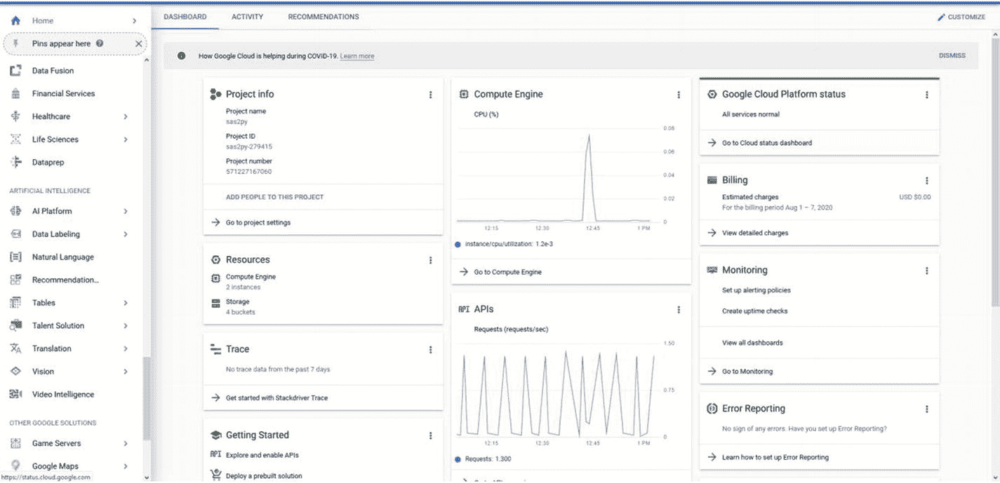

图 7-1

我们的 Google Cloud 门户屏幕外观

注意屏幕左侧的滚动条。你可以在这里查看 Google Cloud 提供的服务。滚动到标有“存储”的部分，然后点击名为“存储”的服务。你应该会看到类似图 7-2 的界面。

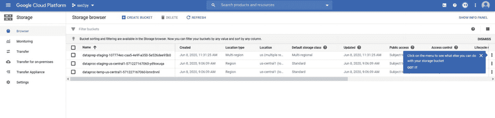

图 7-2

与你可能看到的界面类似。在你的情况下，这里可能没有任何存储桶

点击标有“创建存储桶”的按钮。输入 `mlops-storage`。

接下来，在要求选择位置类型的地方，选择“区域”选项以获得最低成本。请参考图 7-3。

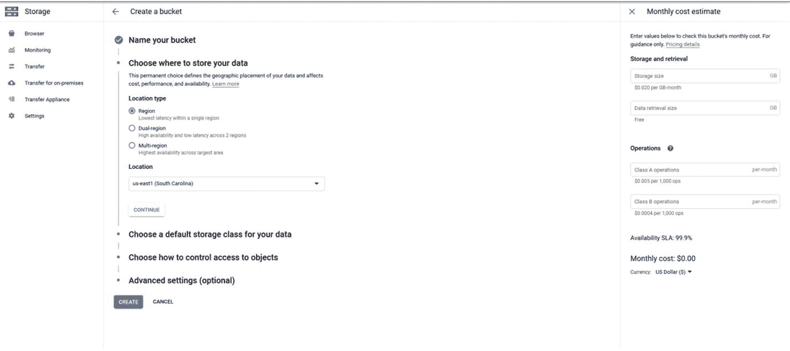

图 7-3

为你的存储桶指定存储选项。选择“区域”以保持最低成本，尽管考虑到你要推送的数据量，实际成本非常低

保持其余选项不变，然后点击“创建”按钮。你现在应该会看到类似图 7-4 的界面。

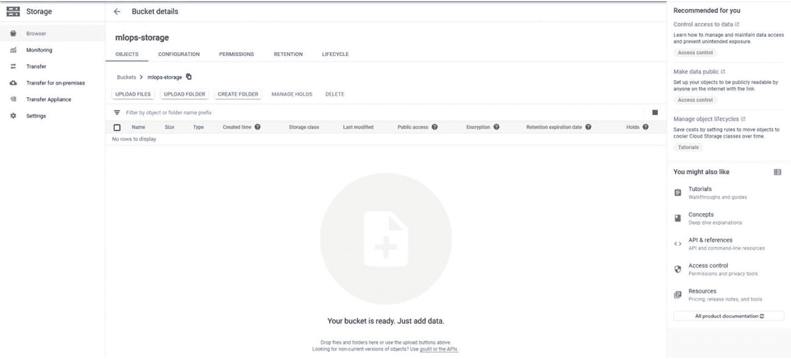

图 7-4

创建后你的存储桶可能的样子

接下来，你需要将 MLFlow 实验（`mlruns` 目录的内容）作为文件夹上传，因此点击“上传文件夹”，并上传 `mlruns` 目录内的所有文件夹。你可以省略名为 `.trash` 的文件夹。在我们的例子中，我们只**上传了使用 scikit-learn 的实验**，并省略了其余部分，因为我们不会用到其他实验。

完成后，你应该会看到类似图 7-5 的界面。

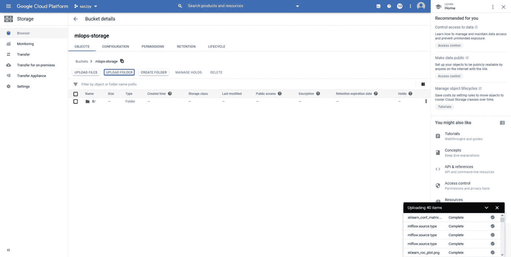

图 7-5

上传 mlruns 目录内容后的存储桶。为了节省成本，我们只上传了使用 scikit-learn 的实验

至此，你已经完成了存储的配置。接下来要配置的是托管模型的虚拟机。


### 配置虚拟机

返回门户后，滚动到“计算”部分，点击“Compute Engine”选项。您应该会看到类似图 7-6 的界面。请确保您已进入标题为“VM 实例”的服务门户。

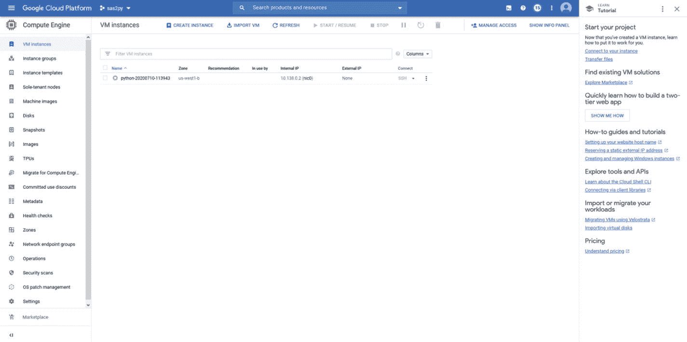

图 7-6

您的 VM 实例屏幕可能看起来像这样。在我们的例子中，我们已经有一台机器在运行，但这无关紧要，因为我们正在创建一台新机器。

现在，点击“创建实例”，您应该会看到类似图 7-7 的界面。

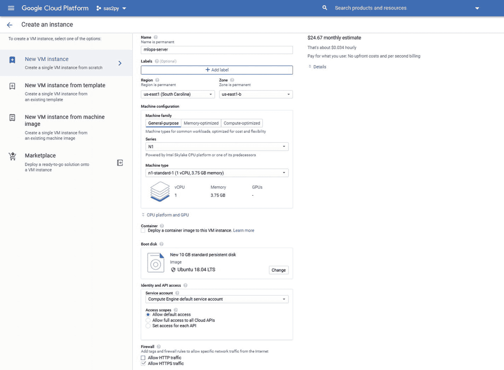

图 7-7

创建 VM 机器实例时可以填写的选项。您应匹配图中所示的选择，以确保与我们的结果一致。

在我们的例子中，我们填写或选择了希望 VM 机器使用的选项。我们将机器命名为 `mlops-server`，选择了区域（它会自动为您选择一个可用区），并指定使用 Ubuntu 18.04 LTS。最后，我们允许来自互联网的 HTTPS 流量。

完成后，您应该能够在机器列表中看到您的 VM 机器。现在要做的是点击名称 `mlops-server` 打开您的 VM 机器实例。这应该会将您带到一个类似图 7-8 的屏幕。

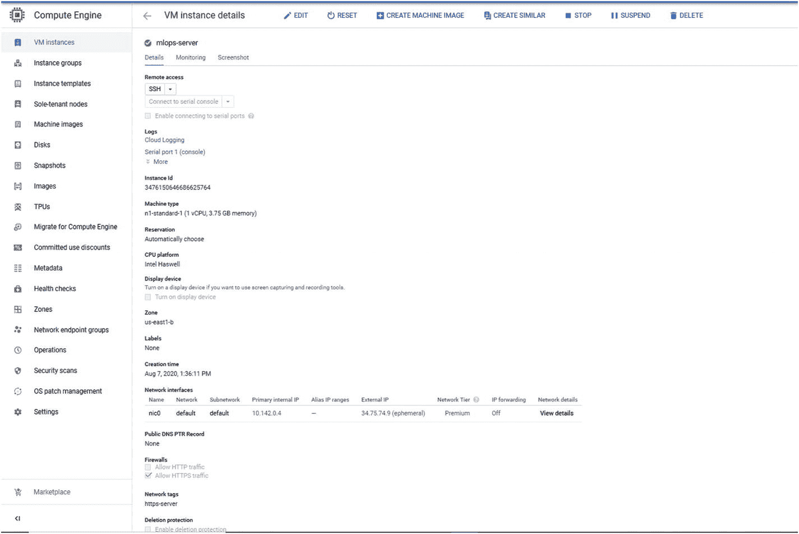

图 7-8

点击 `mlops-server` 后您应该看到的内容。请注意标有 SSH 的框，您稍后将用到它。

现在查看标有 SSH 的框。应该有一个小向下箭头，表示它是一个下拉列表。点击该箭头，选择“查看 gcloud 命令”选项。请参考图 7-9。

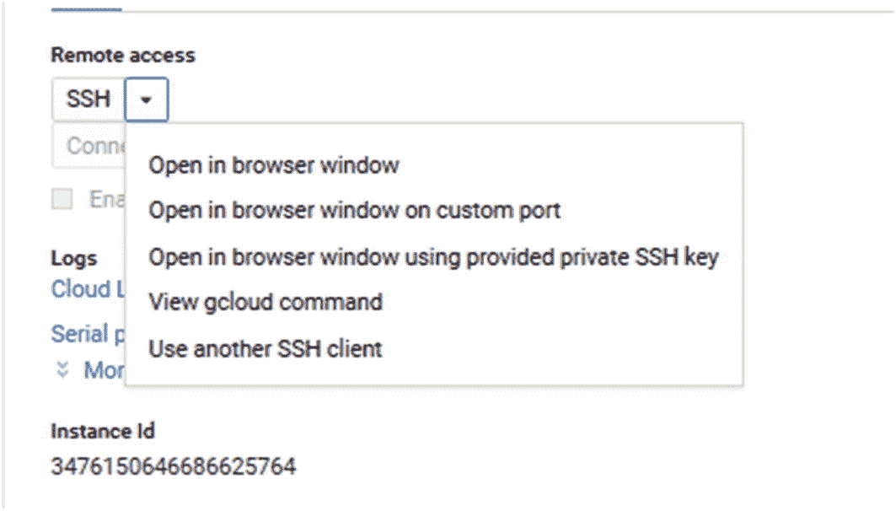

图 7-9

用于连接到此 VM 实例的下拉选项

这应该会打开一个类似图 7-10 的弹出窗口。您有两个选择：在 Google Cloud SDK CLI 的新实例中运行该命令（在我们的例子中，我们搜索了“Google Cloud SDK Shell”，它打开了一个已配置好的 Google Cloud 终端实例），或者直接在门户页面上通过 shell 运行它。您可以选择任一方式，因为两者都能连接到 VM。

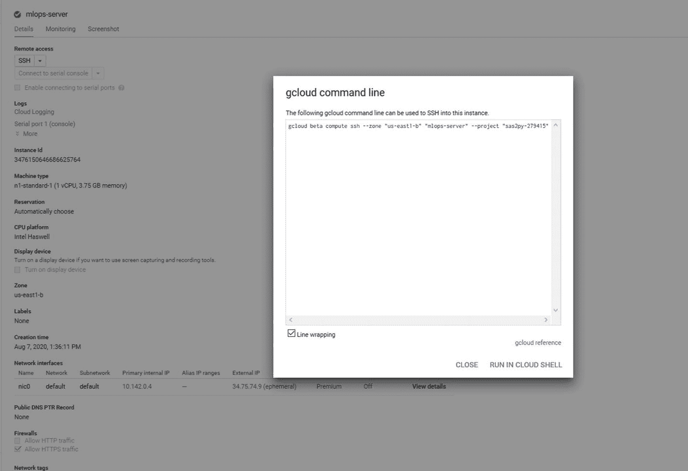

图 7-10

允许您通过 SSH 连接到 VM 的命令。如果您愿意，也可以在门户页面内直接运行它。

复制该命令并粘贴到您的终端中以连接到 VM。运行完成后，您应该会看到类似图 7-11 的内容，其中会打开一个 PuTTY 实例，显示 VM 内部的 shell。

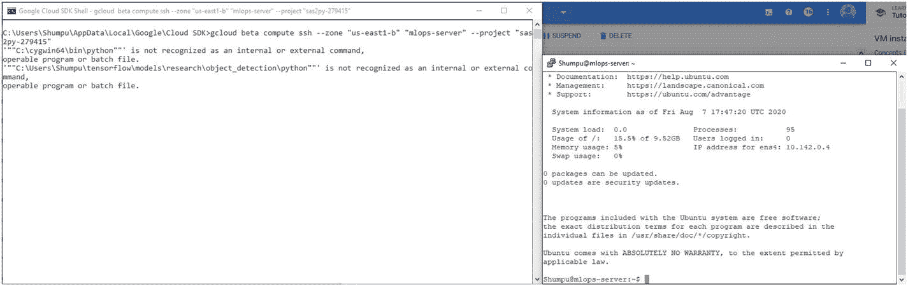

图 7-11

运行门户提供的 gcloud 命令的结果。在右侧，您可以看到一个 PuTTY 终端，其中打开了 VM 内部的 shell。

现在，您必须配置您的 VM，使其能够托管您的 MLFlow 模型。

首先，运行以下命令：

```
sudo apt update
sudo apt upgrade
```

对所有提示回答“y”。

完成后，您现在可以安装 Conda。没有 Conda，MLFlow 将无法重建记录 MLFlow 模型时所处的环境。这是 MLFlow 模块化的一部分。在 SageMaker 和 Azure 的情况下，您构建的容器（顾名思义）已经“包含”了这些 Conda 环境。这样，一旦容器进入云端，SageMaker 就无需重新安装任何 Conda 包。它只需运行容器的一个实例，而所有内容都已配置好。

首先，访问 Anaconda 的网页，了解如何在 Linux 上安装 Anaconda。应该会提供一个安装链接。复制该链接并粘贴到某处。您将使用命令来获取该链接。

逐一运行以下命令：

```
cd /tmp
curl -O https://repo.anaconda.com/archive/Anaconda3-2020.07-Linux-x86_64.sh
```

您应该会看到类似图 7-12 的内容。

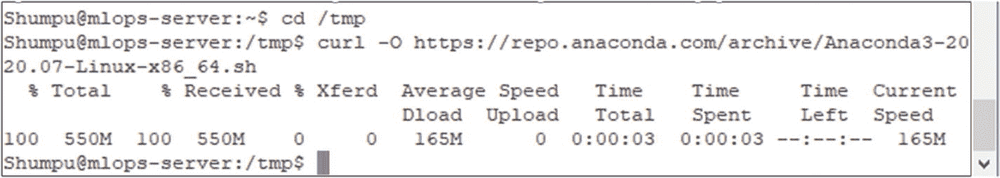

图 7-12

获取 Anaconda 安装脚本的输出

接下来，让我们通过运行以下命令来安装 Anaconda。您可以输入 `bash Anaconda` 然后按 Tab 键自动补全脚本名称的其余部分。

```
bash https://repo.anaconda.com/archive/Anaconda3-2020.07-Linux-x86_64.sh
```

它会要求您查看许可协议。最后，回答 yes，然后按 Enter 键确认默认安装位置。然后 Conda 应继续安装。对所有后续提示回答 yes。完成后，重新启动 shell（关闭 PuTTY 客户端并重新运行命令或云 shell），现在您应该已经完成了 Conda 的完整配置。

正如您现在将看到的，Conda 已经启动了基础环境。让我们通过运行以下代码来创建一个新环境：

```
conda create -n mlflow python=3.7
```

对所有后续提示回答“y”，您应该会看到类似图 7-13 的内容。

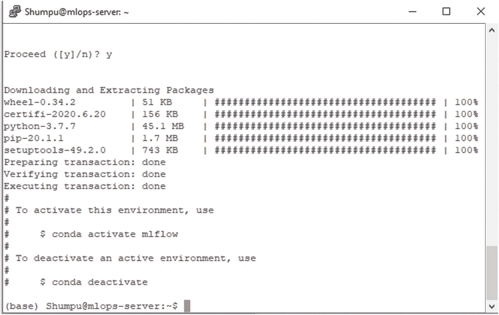

图 7-13

如果您看到此信息，则说明您的 Conda 环境已成功安装

接下来，您将安装以下包：**mlflow** 和 **google-cloud-storage**。前者不言自明：您需要 MLFlow 来执行任何与 MLFlow 相关的操作。您需要 google-cloud-storage，因为您将访问之前 Google 存储桶中的运行记录。

运行以下命令：

```
conda activate mlflow
pip install mlflow google-cloud-storage
```

运行此代码也应安装所有依赖项。将来，如果您需要安装更多依赖项，只需激活 mlflow 环境并使用 `pip install` 来获取更多包或更新现有包即可。

当所有内容安装完成后，您应该会看到类似图 7-14 的内容。

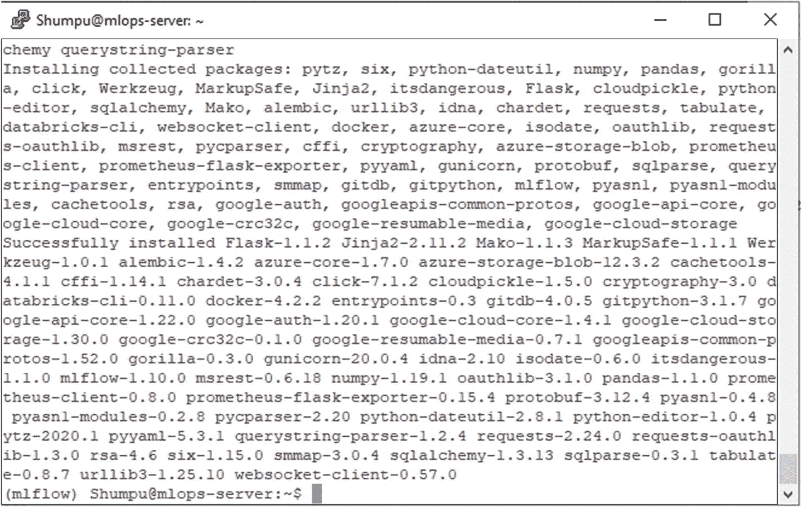

图 7-14

在 Conda 环境中完成安装必要包后的最终输出

至此，您已完全配置好您的 VM。剩下的就是配置防火墙了。


### 配置防火墙

首先，你需要查看虚拟机实例使用的内部 IP。为此，请运行以下命令：

```
ifconfig
```

你应该会看到类似图 7-15 的内容。

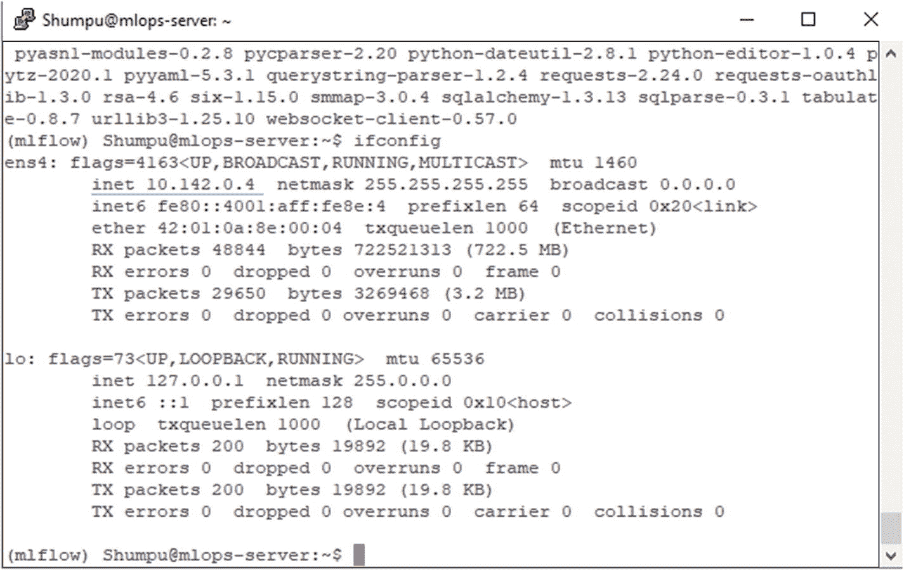

图 7-15

运行命令后你应该会看到类似的内容。我们用红色高亮标出了可以找到机器内部 IP 的位置。在我们的例子中，它是 10.142.0.4。你的会有所不同。

记下我们用红色高亮标出的内部 IP。在你的情况下，它会不同。

现在，你必须添加一条防火墙规则，以便在服务器启动后允许访问。返回门户网站，滚动到“网络”部分，然后点击“VPC 网络”选项。你应该会看到类似图 7-16 的内容。

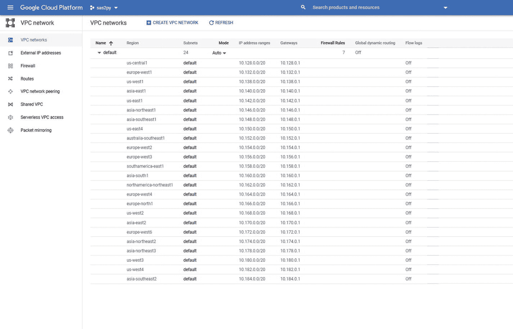

图 7-16

门户网站中的 VPC 网络模块。点击“防火墙”选项以查看防火墙选项

现在，点击“防火墙”，然后点击“创建防火墙规则”。具体来说，你需要输入以下值：

*   **名称**：mlflow-server

*   **目标标签**：mlops-server, http-server, https-server

*   **来源 IP 范围**：0.0.0.0/0

*   **协议和端口**：勾选 TCP 并输入 5000

如果犯了错误，你可以编辑防火墙规则。你应该会看到类似图 7-17 的内容。

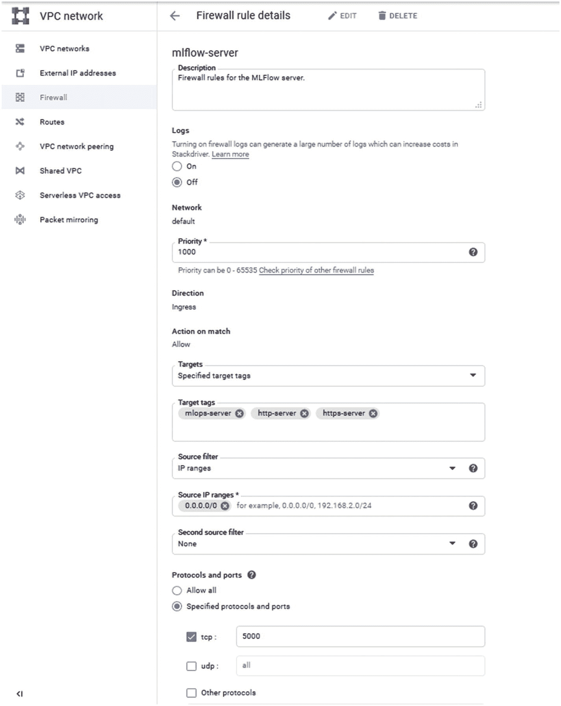

图 7-17

你的防火墙配置应该看起来像这样。我们已经自动填入了我们自己的值

现在点击“创建”。你已经完成了防火墙的配置以及 Google Cloud 中其他所有内容的配置。现在你可以继续部署模型了。

## 部署和查询模型

虚拟机配置完成后，就可以部署模型了。

确保你仍然记着那个内部 IP。返回 PuTTY 客户端，现在输入以下命令：

```
mlflow models serve -m gs://mlops-storage/EXPERIMENT_ID/RUN_ID/artifacts/MODEL_NAME -h 10.142.0.4
```

我们的命令如下所示。我们只是使用了 Google 存储桶中的第一次运行。

```
mlflow models serve -m gs://mlops-storage/8/1eb809b446d949d5a70a1e22e4b4f428/artifacts/log_reg_model -h 10.142.0.4
```

你应该会看到类似图 7-18 的内容。

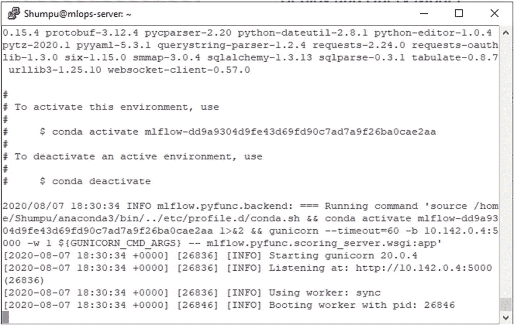

图 7-18

如果成功构建了 Conda 环境并且现在正在提供模型服务，你的输出应该看起来像这样

在成功使用此模型进行预测之前，只剩下一步了。你现在必须查看你的外部 IP。为此，请返回“虚拟机实例”页面找到你的虚拟机。你应该会看到类似图 7-19 的内容。

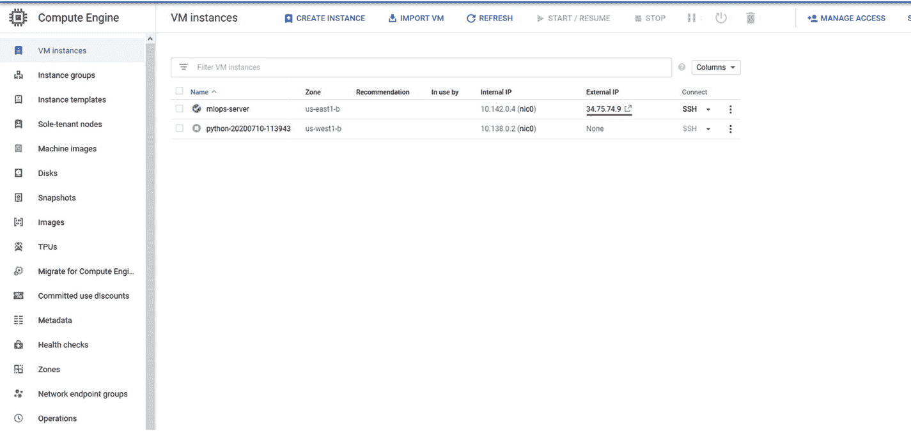

图 7-19

门户网站中的“虚拟机实例”部分应显示服务器的外部 IP。我们用红色高亮标出了我们的 IP，但你的很可能不同

一旦获得外部 IP 地址，请将其复制到某处。

现在你可以启动 Jupyter notebook 并查询此模型。

在 Jupyter notebook 单元格中，运行以下代码。确保 `data` 文件夹与此 notebook 位于同一目录，并且 `data` 文件夹包含 `creditcard.csv` 文件：

```
import pandas as pd
import seaborn as sns
import matplotlib.pyplot as plt
from sklearn.preprocessing import StandardScaler
from sklearn.model_selection import train_test_split
from sklearn.metrics import roc_auc_score, accuracy_score, confusion_matrix
import numpy as np
import subprocess
import json
df = pd.read_csv("data/creditcard.csv")
```

接下来，定义你将用于获取模型预测的 `query()` 函数：

```
def query(input_json):
proc = subprocess.run(["curl",  "-X", "POST", "-H", "Content-Type:application/json; format=pandas-split",
"--data", input_json, "http://34.75.74.9:5000/invocations"],
stdout=subprocess.PIPE, encoding='utf-8')
output = proc.stdout
preds = json.loads(output)
return preds
```

注意，IP 现在是 `http://34.75.74.9:5000/invocations`。基本上，你的 IP 应该采用 `http://YOUR_EXTERNAL_IP:5000/invocations` 的形式，将占位符替换为你的虚拟机的外部 IP 地址。

现在让我们查询你的模型：

```
input_json = df.iloc[:80].drop(["Time", "Class"], axis=1).to_json(orient="split")
pd.DataFrame(query(input_json)).T
```

总的来说，你应该会看到类似图 7-20 的内容。

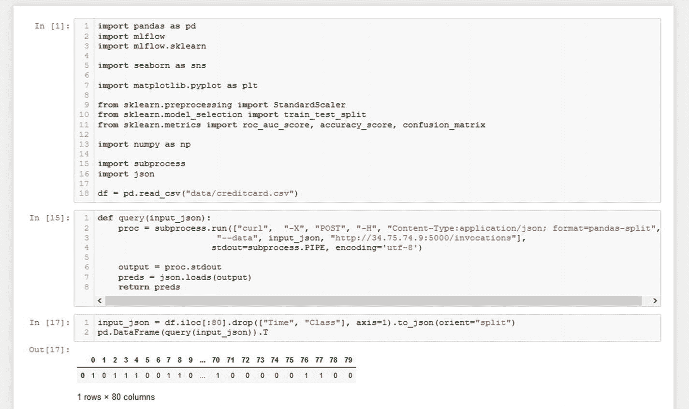

图 7-20

使用数据框的前 80 行查询模型的输出

正如预期的那样，预测结果不正确，因为你在查询模型之前没有对数据进行缩放。但是，你已经验证了查询的地址是正确的，并且模型能够返回预测结果。

现在运行以下单元格：

```
normal = df[df.Class == 0].sample(frac=0.5, random_state=2020).reset_index(drop=True)
anomaly = df[df.Class == 1]
normal_train, normal_test = train_test_split(normal, test_size = 0.2, random_state = 2020)
anomaly_train, anomaly_test = train_test_split(anomaly, test_size = 0.2, random_state = 2020)
scaler = StandardScaler()
scaler.fit(pd.concat((normal, anomaly)).drop(["Time", "Class"], axis=1))
test = pd.concat((normal.iloc[:1900], anomaly.iloc[:100]))
true = test.Class
test = scaler.transform(test.drop(["Time", "Class"], axis=1))
preds = []
batch_size = 80
for f in range(25):
print(f"Batch {f}", end=" - ")
sample = pd.DataFrame(test[f*batch_size:(f+1)*batch_size]).to_json(orient="split")
output = query(sample)
resp = pd.DataFrame([output])
preds = np.concatenate((preds, resp.values[0]))
print("Completed")
eval_acc = accuracy_score(true, preds)
eval_auc = roc_auc_score(true, preds)
print("Eval Acc", eval_acc)
print("Eval AUC", eval_auc)
```

完成后，你应该会看到类似图 7-21 的内容。

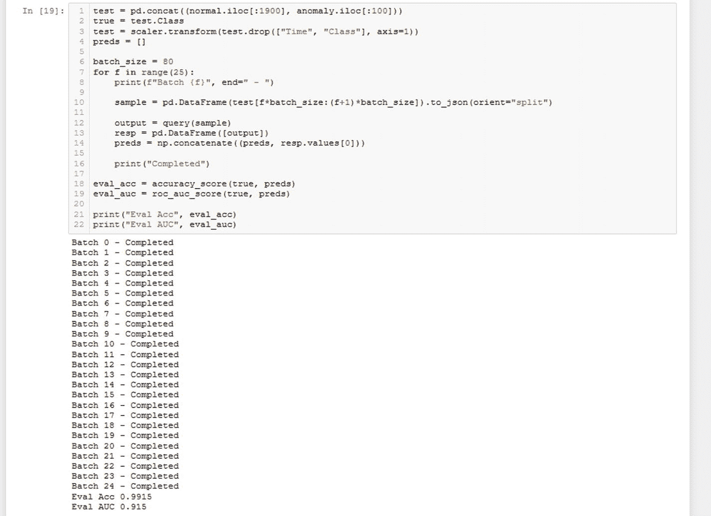

图 7-21

运行批量查询脚本的结果

## 更新和移除部署

更新模型部署非常简单。根据你的设置方式，只需退出模型服务命令（Ctrl-C），然后使用不同的运行 ID 重新运行该命令即可。

让我们尝试部署一个不同的运行。在你的情况下，检查你的 Google 存储桶并选择第二次运行。

在我们的例子中，我们运行了以下命令：

```
mlflow models serve -m gs://mlops-storage/8/3862eb3bd89b43e8ace610c521d974e6/artifacts/log_reg_model -h 10.142.0.4
```

如图 7-22 所示，它已成功部署，我们可以简单地使用相同的脚本进行查询。

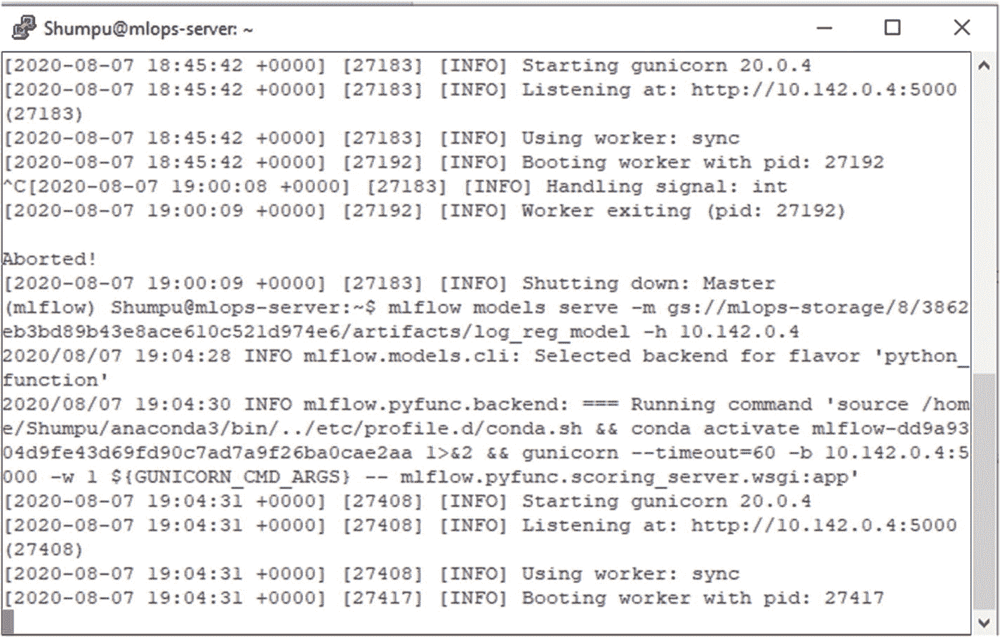

图 7-22

使用相同的命令约定部署不同的模型运行

至于移除部署，你只需使用 Ctrl-C 取消命令，你的部署就会被取消。

至此，你现在知道了如何提供模型服务、切换模型并部署不同的模型，以及通过简单地取消模型服务命令来移除部署。


## 清理资源

现在需要删除你创建的所有服务实例，以免产生任何费用。以下是所用服务的清单：

*   Google Cloud 存储桶

*   Compute Engine 虚拟机实例

*   ️ 网络防火墙规则

从虚拟机实例开始，首先点击 **停止** 来停止 VM 运行。根据你访问该 VM 的位置，你应该会看到类似图 7-23 的界面。

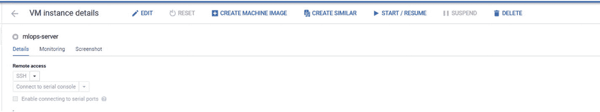

图 7-23

停止后的虚拟机实例

之后，你可以直接点击 **删除** 来移除该 VM。停止 VM 仅能确保你不会因 CPU/GPU 使用而被收费，但无法阻止与 VM 关联的服务所产生的任何费用。

接下来，我们进入存储桶。只需勾选你的存储桶，然后点击 **删除** 即可移除该存储。请参考图 7-24。

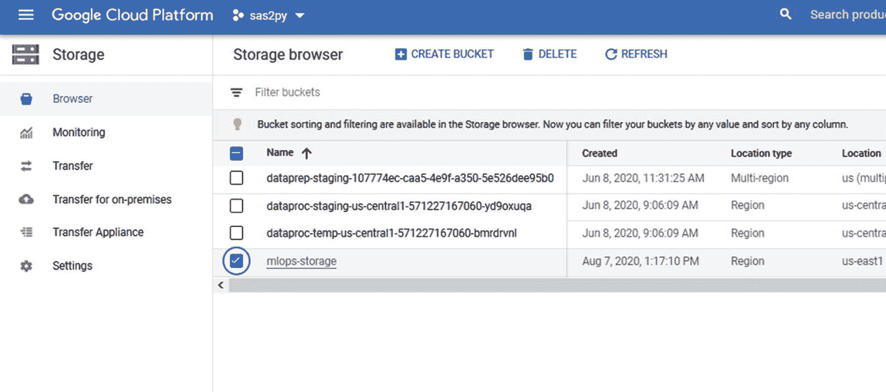

图 7-24

移除你的存储桶

最后，你也可以移除防火墙规则，但请确保不要误删其他可能存在的规则。

至此，你的工作区应该已清理完毕，不应再有任何可能产生费用的服务。

## 总结

Google Cloud 是一个云平台，为广泛的用户群体提供众多高级服务。虽然 MLFlow 并未明确提供对 Google Cloud 部署的支持，但你仍然可以利用 MLFlow 的模型服务功能和 Google Cloud 的计算引擎，在云端对模型进行运维。

在本章中，你学习了如何设置 Google Cloud，以便在虚拟机上部署模型。具体来说，你了解了如何将 MLFlow 运行记录推送到存储桶，如何在虚拟机上设置 Conda 环境，如何设置防火墙以允许模型被访问和查询，以及如何通过简单地切换运行 ID（以及适当情况下的实验 ID）来管理你的部署。

在附录中，你可以了解 Databricks 如何帮助你通过模型注册表来运维和管理模型。

索引 A, B 分析数据 AWS SageMaker Amazon ECR 属性 配置 容器 部署模型 ECR 仓库 列表 mlruns 目录 预测 移除已部署模型 切换模型 C 命令行界面 (CLI) 持续交付 持续集成/持续交付管道 自动化模型构建 自动化训练管道 数据分析 部署管道 特征存储 模型注册表 模型服务 模块化代码 包存储 设置反思 源代码仓库 测试 训练管道 触发器 用户数据收集 持续模型交付 自动化模型构建 自动化训练管道 数据分析 部署管道 特征存储 模型注册表 模型服务 模块化代码 性能 设置反思 训练管道 触发器 卷积神经网络 (CNN) 信用卡数据集 Kaggle 网站 页面加载 数据集 正常与欺诈 包 绘制异常 函数 图形 散点图 V12 一致性 值 可视化关系 D Databricks 集群 社区版 定义 部署 Azure 导入语句 指标 MLFlow 显示 MLFlow 注册表 笔记本 PySpark 运行实验 数据模式 部署阶段 数据收集 数据存储 模型部署 模型服务 开发运维 (DevOps) E 实验阶段 数据分析 数据存储 模型构建阶段 处理原始数据 F 假负例 假正例 G Google Cloud 清理 配置 创建 部署/查询 下拉选项 防火墙 安装 Anaconda MLOps 服务器 门户屏幕 PuTTY 终端 Scikit-learn SSH 存储 更新/移除 VM H 超参数设置 I, J 身份与访问管理 (IAM) K KFold() 函数 k 折交叉验证 L 本地模型服务 部署 查询 批量处理 无缩放 有缩放 M, N 机器学习解决方案 高方差 问题识别 问题识别 训练/评估/验证 模型架构 预测 调优超参数 手动实现 设置反思 手动触发 Microsoft Azure 清理 配置 容器镜像 部署 主页 输出 预测 生产工作区 MLFlow 参数调优 广泛搜索 引导搜索 PySpark 数据处理 训练/加载 PyTorch 检查运行 数据处理 加载 训练/评估 Scikit-Learn 数据处理 加载 记录模型 查看/记录 训练/评估 TensorFlow 2.0 (Keras) 检查运行 数据处理 加载 训练/评估 MLOps 设置 实现 手动实现 模块化 监控 O 过拟合 P, Q 性能问题 管道与自动化 数据预处理 模型评估 模型选择 模型总结 模型验证 测试 训练过程 plot_histogram() 函数 plot_scatter() 函数 主成分分析 (PCA) PySpark 数据处理 模型评估 模型训练 版本 R 原始数据 S 定时训练 Scikit-learn 数据处理 模型评估 模型训练 模型验证 版本 T, U 测试 训练集 真负例 真正例 V, W, X, Y, Z 验证
