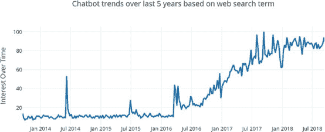
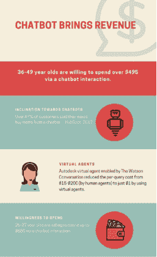
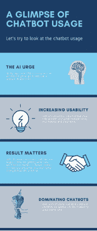
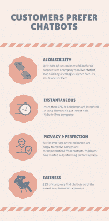
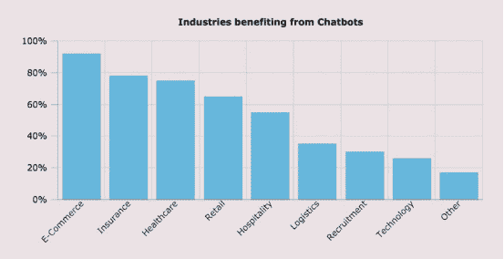
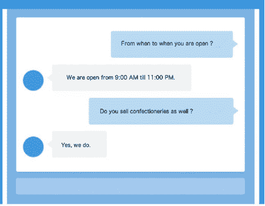
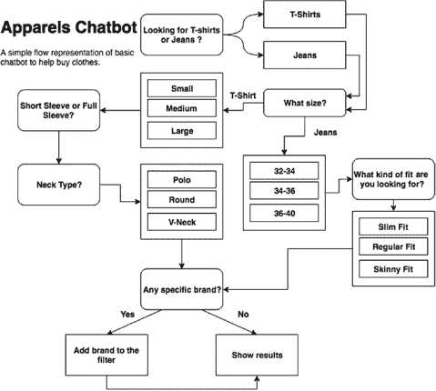
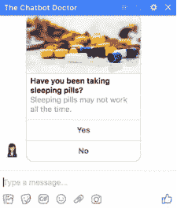

# 第 1 章 `备受喜爱的聊天机器人`

当你开始构建聊天机器人时，理解它们的功能和形态至关重要。

你一定听说过 `Siri`、`IBM Watson`、`Google Allo` 等。这些机器人试图解决的基本问题是：成为用户与信息之间的中介，帮助用户提高效率。它们通过让用户减少对信息检索方式和输入格式的担忧来实现这一点——用户无需担心获取特定数据需要何种输入格式。随着处理用户数据输入并从中获取更多洞察，机器人会变得越来越智能。聊天机器人之所以成功，是因为它们能精准提供你所需的内容。

你是否曾因每次在不同网站上重复输入姓名、邮箱、地址和邮编而感到烦躁？想象一下，一个机器人能替你完成所有任务——比如从不同供应商订餐、在多家电商平台购物、预订机票或火车票——而你无需每次都提供相同的邮箱、收货地址或支付信息。

机器人已经具备这些信息，并且足够智能，当你用`自然语言`（计算机科学中称为“`自然语言`”）提问时，它能自动检索所需内容。

聊天机器人的开发比几年前简单得多，但聊天机器人其实几十年前就已存在；不过，近几年来其受欢迎程度呈指数级增长。

如果你具备技术背景，或了解网页应用/移动应用的工作原理，那么你一定听说过`API`这个术语。如今你需要的任何数据，都可以通过不同服务提供商和机构提供的`API`来获取。无论是查询天气、预订门票、订餐、获取航班信息、语言翻译，还是在 `Facebook` 或 `Twitter` 上发帖，所有这些都可以通过`API`实现。网页或移动应用正是利用这些`API`来完成任务的。聊天机器人同样可以基于我们的请求，使用这些`API`实现相同的功能。

聊天机器人之所以比传统在线方式更具优势，是因为你可以借助它同时完成多项任务。它不仅仅是一个聊天机器人，更像是你的虚拟个人助理。你可以想象：在 `booking.com` 上预订酒店房间的同时，还能预订酒店附近餐厅的座位——而这一切都可以通过你的聊天机器人完成。聊天机器人满足了多功能需求，从而节省了大量时间和金钱。

在本书中，我们将学习如何利用机器人构建自然的对话体验，以及如何教会机器人理解我们的`自然语言`，并让它通过单一界面为我们执行任务。机器人本质上不过是一种足够智能的机器，能够理解你的请求，然后以其他软件系统可理解的方式重新组织你的请求，以便请求你所需的数据。

## 聊天机器人的普及程度

聊天机器人已经像近期任何事物一样流行起来。让我们看看图 1-1，它描绘了聊天机器人的兴起，并尝试理解为何构建聊天机器人的需求如此巨大。



图 1-1. `Y` 轴上的数字代表全球所有类别中相对于图表最高点的搜索兴趣

脑海中浮现的简单答案是：它并非复杂的软件，任何人都可以使用。当我们构建软件时，会针对使用它的受众进行设计，但当它被其他人使用时，就会变得困难且难以操作。在构建聊天机器人时，我们牢记它将供所有年龄段的人使用。这种情况只发生在聊天机器人身上，即软件试图表现得像个笨拙的人（但它很聪明），并让用户保持其本来的样子。在所有其他软件中，你会发现你需要了解某些术语，或者逐渐学会如何最优地使用它，但聊天机器人并非如此。如果你知道如何与人交谈，那么使用聊天机器人就不会有任何问题。

对聊天机器人的需求持续增长。然而，目前还没有太多研究通过实证来探究使用聊天机器人背后的动机。在最近的一项研究中，一份在线问卷询问了来自美国、年龄在 16 至 55 岁之间的聊天机器人用户，描述他们在日常生活中使用聊天机器人的需求。调查显示，“`生产力`”是使用聊天机器人的主要动机因素。

## Python 之禅及其为何适用于聊天机器人？

我记得 `Python` 之禅中说过：“简单优于复杂”，这一点在软件的许多地方都适用。

`Python` 之禅是影响 `Python` 编程语言设计的 20 条软件原则的集合。

——蒂姆·彼得斯

想知道 `Python` 之禅是什么吗？请尝试以下步骤。

如果你已经在电脑上安装了 `Python`。只需进入你的 `Python` 解释器并导入：

```
Python 2.7.15 (default, May 1 2018, 16:44:08)  
[GCC 4.2.1 Compatible Apple LLVM 9.1.0 (clang-902.0.39.1)] on darwin  
Type "help", "copyright", "credits" or "license" for more information.  
>>> import this  
```

`Python` 之禅，作者：蒂姆·彼得斯

优美优于丑陋。
明确优于隐晦。
简单优于复杂。
复杂优于繁琐。
扁平优于嵌套。
稀疏优于密集。
可读性很重要。
特殊情况不足以特殊到
打破规则。
尽管实用性胜过纯粹性。
错误永远不应悄无声息地通过。
除非明确地保持沉默。
面对歧义，拒绝猜测的诱惑。
应该有一种——最好只有一种——显而易见的方法来做这件事。
尽管这种方法起初可能并不明显，除非你是荷兰人。
现在做胜过永远不做。
尽管永远不做通常比 *立刻* 做要好。
如果实现难以解释，那是个坏主意。
如果实现易于解释，那可能是个好主意。
命名空间是一个绝妙的主意——让我们更多地使用它们吧！

你可能无法理解以上所有观点与聊天机器人的关联，但你肯定能理解其中的大部分。

好了，回到我们的主题。我记得从 `Orkut` 背景转向使用 `Facebook` 用户界面时遇到了困难。如果你从未使用过 `Orkut`，你可能无法理解，但请试着想想你生活中开始使用某个新软件或应用程序时，难以掌握其要领的情况。也许是从 `Windows` 切换到 `MacOS`/`Linux`，或者反之？当你使用一个新应用程序时，你需要学习一些东西，并且需要时间来适应它，了解它的功能和运作方式。有时，即使使用多年后，你才了解到应用程序的某些功能。如果你使用的是 `MacOS`，

试试 `Shift + Option + 音量上/下键`，看看会发生什么。如果你之前不知道这个功能，请告诉我它是否让你感到惊讶。

在聊天机器人的情况下，用户与服务器或后端系统之间的通信非常简单。就像使用消息应用程序与另一个人交谈一样。

你只需输入你想要的内容，机器人就应该能够要么给你想要的东西，要么指导你如何获得它。换句话说，它应该通过提供链接或文档来为你指明

正确的信息。如今，机器人甚至能够从文章和文档中挖掘信息并提供给用户。

`谷歌`、`Facebook` 和 `IBM` 等公司在`人工智能`方面取得的重大进展，以及 `Amazon Lex`、`wit.ai`、`api.ai`、`luis.ai`、`IBM Watson`、`Amazon Echo` 等`机器学习`服务，导致了此类机器人的非凡增长和需求。

## 聊天机器人的必要性

现在，我们将尝试从两个不同的角度来审视在这个快速发展的信息创建和检索时代对聊天机器人的需求和必要性：商业角度和开发者角度。因此，如果你是产品经理、销售经理，或者来自市场营销或任何直接驱动业务的相关领域，那么你不应跳过聊天机器人的商业视角。它将为你清晰地描绘出，当今企业需要采用这项技术来驱动更多收入。

### 商业视角

我们将尝试审视聊天机器人的商业视角。对于企业来说，拥有一个聊天机器人，或者将大量事务迁移由聊天机器人处理，是否有利？

企业将聊天机器人视为这一代营销工具之一的时代已经到来。

- **可访问性**：它们易于访问。消费者可以打开网站并开始提问或解决疑问，无需拨打电话号码，也无需遵循 `IVR` 中那种“按 1 选这个，按 2 选那个”的繁琐流程。只需提供基本信息，他们就能快速切入正题。
- **效率**：客户可以坐在办公室的办公桌前，或客厅的沙发上，一边看比赛，一边查询信用卡申请状态、查找食品订单状态，或就任何问题提出投诉。如果你让客户变得高效且富有成效，他们就会开始喜欢你。聊天机器人正是如此，并有助于提升业务。
- **可用性**：聊天机器人每周 7 天、每天 24 小时可用。它们永远不会像人类员工那样向你请假或感到疲倦。它们每次都会以同样的效率和性能执行相同或新的任务。当你仅仅为了获取一条信息，却听到某个客服电话说“请在上午 9:00 至下午 6:00 之间致电我们”时，你一定会感到沮丧。你的聊天机器人永远不会这么说。
- **可扩展性**：一个聊天机器人 => 100 万名员工。你明白吗？是的，如果你的聊天机器人能完成客户所需的任务，它可以毫不费力地同时处理数十万条客户查询。你无需让客户排队等待客服代表空闲。
- **成本**：毋庸置疑，它为企业节省了大量成本。谁不喜欢省钱呢？当聊天机器人能为你做到这一点时，你没有理由不喜欢它们。
- **洞察力**：你的销售代表可能无法记住用户的行为，也无法为你提供关于消费者行为模式的独家见解，但你的聊天机器人可以利用最新的`机器学习`和`数据科学`技术做到这一点。

**聊天机器人带来收入**

聊天机器人已被证明能够成功为企业带来更多收入。与竞争对手相比，那些开始提供聊天机器人支持或创建新聊天机器人来支持客户查询的企业，在市场上表现更佳。

根据 stanfy.com 上的一篇博文，1-800-Flowers.com 在推出其 Facebook 聊天机器人后的头两个月内报告称，其 Messenger 订单中超过 70% 来自新客户。这些新客户通常也比公司典型的购物者更年轻，因为他们已经熟悉 Facebook Messenger 应用。这显著增加了他们的年收入。

## 聊天机器人最大的附加价值之一在于将其用于挖掘潜在客户
你可以直接在客户注意力所在之处（即时通讯应用）接触到潜在客户，并向他们展示你最新的产品、服务或商品。

当客户想要购买产品/服务时，他们可以在聊天机器人内完成购买，包括支付流程。像 1-800flowers.com、eBay 和 Fynd 这样的聊天机器人已经证明了这一点。

——Julien Blancher，Recast.AI 联合创始人

在 ChatbotsLife 创始人 Stefan Kojouharov 的一篇文章中，他提到了不同公司如何通过聊天机器人赚取比没有它们时更多的钱。他说：

电子商务领域已经开始以多种方式使用聊天机器人，这些方式正在迅速增加其利润。让我们看看早期的成功案例：

- **1–800-Flowers**：报告称其超过 70% 的 Messenger 订单来自新客户！
- **Sephora**：通过其 Facebook Messenger 聊天机器人，将预约化妆服务增加了 11%。
- **Nitro Café**：通过其 Messenger 聊天机器人将销售额提高了 20%，该机器人专为轻松下单、直接支付和即时双向沟通而设计。
- **Sun's Soccer**：在特定的足球赛事报道期间，聊天机器人将近 50% 的用户引导回其网站；在其最佳时期，43% 的聊天机器人订阅者点击了链接。
- **Asos**：使用 Messenger 聊天机器人将订单量增加了 300%，并获得了 250% 的广告支出回报率，同时覆盖人数增加了 3.5 倍。

图 1-2 试图让你了解为什么聊天机器人与收入之间存在直接关联。让我们看看图 1-2 来了解一些相关信息。



图 1-2. 聊天机器人带来收入

## 聊天机器人使用概览

我们将尝试了解聊天机器人因其易用性和提供的效率而对消费者有多么有用。在这个炙手可热的 IT 时代，每个人都希望事事快速，而使用聊天机器人能让你的工作每天都更轻松、更快捷。它以一种不会重复显而易见的事情的方式实现个性化；这让我们重新思考软件的传统用法。图 1-3 提供了一个图示，应该能让你对聊天机器人的使用有一个清晰的概念。



图 1-3. 消费者使用聊天机器人概览

## 客户偏爱聊天机器人

聊天机器人不仅仅是现代时代的软件。聊天机器人就像我们的个人助理，他们理解我们，并且可以进行微调配置。他们记得我们的好恶，并且永远不会因为忘记我们已经教过的东西而让我们失望，这就是每个人都喜欢聊天机器人的原因。下次你见到一个人或你的客户时，别忘了问问他们更喜欢传统软件还是新的尖端聊天机器人。让我们看看图 1-4，了解客户在人机交互中偏爱聊天机器人而非其他软件系统的原因。



图 1-4. 客户偏爱聊天机器人

在本章的下一节中，我们将讨论为什么聊天机器人是新兴开发者的下一个重大机遇。

无论你是新手、中级开发者，还是经验丰富的领域专家，都必须了解在构建聊天机器人时，开发者可以利用哪些资源。

### 开发者的视角

你是否曾因必须更新电脑、手机或正在使用的其他应用的操作系统才能使用新功能而感到烦恼？如果每次使用新功能都不需要频繁更新应用呢？或者说，与其拥有多个应用，不如用一个应用来完成目前多个应用能做的绝大部分事情？

对开发者而言，构建机器人是一件有趣的事。这就像教你的孩子走路、说话、懂规矩和做事。你乐于让它变得更智能、更自主。从开发者的角度来看，聊天机器人是一个非常重要的知识领域。

### 功能发布与错误修复

你可以轻松地为聊天机器人添加大量功能，而无需让用户更新你的聊天机器人应用。如果你发布了一个带有某些错误的应用版本，就必须修复它并再次提交到 AppStore 等待审核，而最重要的是，用户最终还得更新应用。如果他们不更新，客户就会不断抱怨问题，这会导致所有人的生产力下降。在聊天机器人中，一切都是基于 API 的，所以你只需在后端修复问题，将更改部署到生产环境，然后——哇哦，问题就为用户解决了，无需任何担忧。你还能从用户报告的错误中节省大量时间。

想象一下，你构建了一个用于查找餐厅的机器人，后来又想添加搜索酒店、航班等功能。用户只需轻松请求此类信息，你的后端聊天机器人系统就会处理一切。

假设你正在构建一个 Facebook Messenger 聊天机器人，你可以直接从后端控制几乎所有内容，包括用户在应用中看到的界面。在 Facebook Messenger 机器人中，你可以选择用户是点击按钮来回答“是/否”，还是直接输入简单的文本。

### 市场需求

2016 年，全球 54% 的开发者首次涉足聊天机器人开发。为企业构建一个能正常运行的简单聊天机器人有着巨大的需求，而企业正在寻找能够为他们构建机器人的开发者。一旦你读完本书的第 3 章，我敢打赌你就能轻松开始向企业出售你的服务。你也可以通过为你擅长的领域引入一个聊天机器人，来创办自己的初创公司。能够端到端地构建聊天机器人是一项全新的技能，这也是聊天机器人开发者的平均市场薪酬非常可观的原因。

聊天机器人日益增长的需求可以从 Facebook 等开发者平台上正在开发的机器人数量中看出。Facebook 的 Messenger 平台上每月有 10 万个活跃的机器人，而且这个数字还在增长。

你会惊讶地发现，Messenger 在 2015 年 4 月拥有 6 亿用户，到 2016 年 6 月增长到 9 亿，2016 年 7 月达到 10 亿，2017 年 4 月达到 12 亿。

### 学习曲线

无论你是前端/后端背景，还是对编程知之甚少，在构建或学习构建聊天机器人的过程中，都有无限的机会学习新事物。在这个过程中，你会学到很多东西。例如，你会更深入地了解人机交互（HCI），它探讨的是计算机技术的设计与使用，重点关注人与计算机之间的界面。你将学习如何构建或使用 API 或 Web 服务，以及如何使用第三方 API，如 Google API、Twitter API、Uber API 等。你将拥有大量机会学习自然语言处理、机器学习、消费者行为，以及许多其他技术和非技术方面的知识。

### 受聊天机器人影响的行业

让我们快速浏览一下哪些行业将从聊天机器人中获益最多。Mindbowser 与 Chatbots Journal 联合进行的一项研究，收集了来自 300 多位参与者的数据，他们来自众多行业，包括在线零售、航空、物流、供应链、电子商务、酒店、教育、技术、制造以及市场营销与广告。如果我们看一下图 1-5 中的图表，很明显，电子商务、保险、医疗保健和零售是从聊天机器人中获益最多的行业。这些行业高度依赖客户服务团队以高效的方式做出响应，从而节省时间。鉴于聊天机器人在这方面表现出色，很明显它将在这些行业中迅速普及。



**图 1-5. 将从聊天机器人中获益最多的主要行业**

目前，聊天机器人仍在以不同形式在较新的领域中获得关注。未来 5 到 10 年对于聊天机器人向那些没有使用经验的行业推广至关重要。

### 聊天机器人简史

让我们简要回顾一下聊天机器人的发展历程。了解聊天机器人技术从何而来以及如何形成，这一点非常重要。

聊天机器人无疑在最近才流行起来，但为此付出的努力是基于数十年对该技术的研究。聊天机器人的历史一定会让你惊叹于我们自起步以来已经走了多远。

#### 1950 年

图灵测试由艾伦·图灵提出。这是一种测试机器能否表现出与人类相当或无法区分的智能行为的测试。

#### 1966 年

第一个聊天机器人 Eliza 由约瑟夫·魏泽鲍姆创建，被设计成一名治疗师。它通过使用“模式匹配”和替换方法来模拟对话，给用户一种机器人能够理解的错觉。

#### 1972 年

由精神病学家兼斯坦福科学家肯尼斯·科尔比开发的计算机程序帕里（Parry），模拟了偏执型精神分裂症患者的行为。

#### 1981 年

英国程序员罗洛·卡彭特创建了 Jabberwocky 聊天机器人。该项目始于 1981 年，并于 1997 年在互联网上推出。该聊天机器人的目标是“以有趣、娱乐且幽默的方式模拟自然的人类对话”。

#### 1985 年

无线机器人玩具 Tomy Chatbot 能够重复录制在其磁带上的任何信息。

#### 1992 年

Creative Labs 为 MS-DOS 系统开发的聊天机器人 Dr. Sbaitso，以数字化语音模拟心理学家与用户“交谈”。用户反复的咒骂和畸形输入会导致 Dr. Sbaitso 在重置前因“奇偶校验错误”而“崩溃”。

#### 1995 年

诺贝尔奖得主理查德·华莱士开发了 A.L.I.C.E（人工语言互联网计算机实体）。

# 聊天机器人发展历程与构建指南

## 发展历程

1996 年，杰森·哈钦斯开发的 Hex 基于 Eliza，并赢得了 1996 年的勒布纳奖。

2001 年，ActiveBuddy 开发的智能机器人 Smarterchild 广泛分布于全球即时通讯和短信网络。其原始实现迅速扩展，可即时提供新闻、天气、股票信息、电影时间、黄页列表、详细体育数据以及多种工具（个人助理、计算器、翻译器等）。

2006 年，沃森（Watson）的想法诞生于一次餐桌讨论；它被设计用于参加电视节目《危险边缘》。最初，它只能答对约 15%的问题，但后来沃森能够稳定击败人类选手。

2010 年，智能个人助理 Siri 作为 iPhone 应用推出，随后集成到 iOS 系统中。Siri 源自 SRI 国际人工智能中心，其语音识别引擎由 Nuance Communications 提供，并利用先进的机器学习技术运行。

2012 年，谷歌推出了 Google Now 聊天机器人。其最初代号为“Majel”，取自《星际迷航》系列中计算机系统的配音演员、吉恩·罗登贝瑞的妻子马杰尔·巴雷特；它也曾被代号为“assistant”。

2014 年，亚马逊发布了“Alexa”一词。该词包含硬辅音“X”，因此能被更高精度地识别，这也是亚马逊选择此名称的主要原因。

2015 年，微软创建了虚拟助手 Cortana。Cortana 可以设置提醒、识别自然语音，并利用必应搜索引擎的信息回答问题。其名称源自《光环》电子游戏系列中的虚构人工智能角色。

2016 年，Facebook 宣布为 Messenger 推出机器人平台，包括用于构建与用户交互的聊天机器人的 API。后续增强功能包括机器人能够参与群组、预览屏幕，以及通过 Messenger 的摄像头功能实现二维码扫描，将用户直接引导至机器人。

2016 年 5 月，谷歌在其开发者大会上发布了与亚马逊 Echo 竞争的语音控制机器人 Google Home。它允许用户通过语音命令与各种服务进行交互。

2017 年，Woebot 是一款自动化对话代理，可帮助您监测情绪、了解自我，并让您感觉更好。Woebot 结合了自然语言处理技术、心理学专业疗法（认知行为疗法）、出色的写作技巧和幽默感来治疗抑郁症。

## 我能用聊天机器人解决哪些问题？

当你不了解机器人的能力范围，或不想将其局限于回答查询时，这个问题就变得具有挑战性。

记住聊天机器人的能力有限非常重要。我们总感觉是在与一个非常智能的类人事物交谈，但特定的机器人是经过设计和训练，以特定方式行事并仅解决特定问题的。它无法做到所有事情，至少目前如此。未来无疑是光明的。

那么，我们回到这个问题：如何判断你的问题陈述是否真的适合构建一个机器人？

如果以下三个问题的答案都是“是”，那么你就可以着手进行了。

### 问题能否通过简单的问答或来回沟通解决？

在解决任何对你来说非常陌生的问题时，切勿试图充当英雄，这一点至关重要。你应始终力求限制问题的范围。先构建基本功能，然后在此基础上进行扩展。不要在初版就试图使其复杂化。这在软件开发中行不通。

想象一下，如果马克·扎克伯格一开始就花时间构建 Facebook 的所有功能，比如标记朋友、点赞按钮、评论点赞、更好的消息系统、直播、评论反应等——这些功能甚至在 Facebook 获得融资、平台拥有超过 100 万注册用户时都还不存在。如果他先构建所有这些功能再推出平台，他真的能成功吗？

因此，我们应始终只创建当前所需的功能，避免过度设计。

现在，回到第一个问题：“问题能否通过简单的问答或来回沟通解决？” 你只需限制范围，答案就会是“是”。我们并非限制自己不去解决复杂问题，而是限制自己不要一次性解决所有复杂问题。

“你必须让每一个细节都完美。同时你必须限制……的数量。”

——杰克·多西

### 问题是否包含需要分析或获取数据的高度重复性事务？

这个问题很重要，因为无论从商业角度还是开发者角度来看，聊天机器人的作用和设计目的都是让使用者更高效、更有生产力。如何做到这一点？通过消除用户自己执行重复性事务的需求。

聊天机器人显然不仅仅能自动化一些高度重复的工作，但你总会发现，大多数聊天机器人主要试图解决同一个问题——无论是通过监督学习（即：“有监督学习”）还是自我学习（即：“无监督学习”）。

### 你的机器人任务能否被自动化并固定下来？

除非你只是为了学习目的而构建聊天机器人，否则你应该确保你试图解决的问题是可以自动化的。机器已经开始学习和自行处理事务，但这仍处于非常初级的阶段。你现在认为无法自动化的事情，可能在几年后就能实现。

### 问答机器人

构建聊天机器人的一个很好的问题示例就是问答机器人。想象一个经过训练的机器人，它能理解用户提出的各种问题，而这些问题的答案已经存在于网站的常见问题解答（FAQ）页面上。

如果你回过头去尝试回答前面提到的三个问题，答案都是肯定的。

参见图 1-6，你会发现一个 FAQ 机器人在做什么。



图 1-6. FAQ 聊天机器人示例

这些无非是某个特定商店的客户可能会打电话询问，或者通过访问网站并浏览页面来寻找答案的重复性问题。

想象一下，当你拥有这样一个聊天机器人时，它能像人类一样在几秒钟内回答你的问题，甚至能做得比你想象的更多。这只是聊天机器人能力的一小部分。

现在，让我们尝试针对问答机器人来分析前面提到的三个问题及其答案。

**这个问题能否通过简单的问答或来回沟通来解决？**

是的，FAQ 无非就是一些常见问题及其相关答案。可能存在基于上下文的 FAQ，但除非你使用聊天机器人解决多领域问题，否则你不会遇到这个问题。可能会出现两个或多个问题看起来相似的情况，但你总是可以设计机器人在有疑问时向用户反问一个问题。

**它是否包含需要分析或获取数据的高度重复性问题？**

是的，FAQ 要求我们从数据库中获取数据，并在网站上一次性显示出来，或者可能动态显示。但用户必须逐一浏览所有问题，才能找到他/她正在寻找的问题，然后查看其答案。在用户真正得到答案之前，需要大量浏览用户界面……或者也许不需要。为什么不让我们机器人来做这件事呢？

**你的机器人任务能否被自动化并固定下来？**

是的，一个 FAQ 机器人需要获取问题、分析问题、从数据库中提取信息，并将其返回给用户。这里没有任何事情是无法通过编码完成的。而且，这个过程基本上是固定的，不会实时变化。

## 开始构建聊天机器人

在构建聊天机器人之前，应该遵循三个步骤。我们在此简要讨论每一个步骤。

### 1. 意图与示例语句

思考你希望聊天机器人能够处理的所有场景或任务，并收集所有可以用于执行这些任务的不同形式的相关问题。你希望聊天机器人执行的每一个任务都会定义一个意图。你列出的每个问题或意图都可以用多种方式表示。这取决于用户如何表达它。

例如：
- Alexa，关灯。
- Alexa，请你关一下灯好吗？
- 你能关一下灯吗？

用户可能会使用这些句子中的任何一个来指示机器人关灯。所有这些句子都有相同的意图/任务——关灯，但它们是以不同的方式被提出的。

### 2. 设计对话流程

在你识别出用户的意图后，编写所有逻辑，将用户引导到你已选择的流程中。

例如，假设你正在构建一个用于预约医生的机器人。那么你要求用户提供电话号码、姓名和专科医生，然后你显示可预约的时间段，最后进行预约。

在这种情况下，你可以期望用户知道这些细节，并且不要试图在机器人本身中容纳所有事情，比如耳朵问题的专科医生被称为耳鼻喉科医生。然而，做到这一点并非难事。所以，这又回到了决定机器人范围的问题上，这取决于你构建应用程序所拥有的时间和资源。

### 3. 使用决策树

如果你了解决策树，那非常好，因为在设计聊天机器人的流程时，你会经常用到这个知识。但如果你不了解决策树，只需谷歌一下就能帮助你学习这个在计算机科学中广泛使用的简单概念。

**在聊天机器人中使用决策树**

在聊天机器人的上下文中，决策树只是帮助我们找到用户问题的确切答案。

> 决策树是一种决策支持工具，它使用树状图或模型来表示决策及其可能的结果，包括偶然事件的结果、资源成本和效用。它是展示仅包含条件控制语句的算法的一种方式。
> ——维基百科

构建聊天机器人时最困难的部分是跟踪 `if...else` 代码块。需要做出的决策越多，代码中 `if...else` 出现的频率就越高。但同时，这些代码块是编码复杂对话流程所必需的。如果问题很复杂，并且在现实生活中需要大量的 `if...else`，那么代码也需要以同样的方式进行调整。

**决策树如何提供帮助？**

决策树易于编写和理解，但它们是对所讨论问题的解决方案的有力表示。它们具有独特的能力，可以帮助我们理解很多事情。
- 帮助构建当前问题的完整图景。查看决策树，我们可以轻松理解缺少什么或需要修改什么。
- 帮助更快地进行调试。

决策树就像一本简短的圣经，或者说，是软件需求规格说明文档的可视化呈现，可供开发人员、产品经理或领导层参考，用以解释预期行为或在需要时进行修改。

- 人工智能尚未达到能够通过大量数据训练并实现 100%准确率的阶段。它仍然需要大量通过编写业务逻辑和规则来进行的人工干预。在让机器学习和执行变得有些困难的地方，决策树就能派上用场。

让我们通过一个简单的例子来理解它如何帮助构建聊天机器人。请看这个聊天机器人的示例图：它首先询问用户是想找 T 恤还是牛仔裤，然后根据输入，流程图会进一步通过提出更多问题来提供与产品相关的选项。你不需要创建一个完整的决策树，但在开始构建聊天机器人之前，你绝对应该在每一步都定义好问题流程。

假设你正在构建一个类似的、帮助人们在线购买服装的聊天机器人。你要做的第一件事就是制作一个类似的决策树或流程图，以帮助你的聊天机器人在正确的时间提出恰当的问题。这对于设定每一步的范围以及该阶段需要完成的任务至关重要。当你后来真正编写第一个聊天机器人的代码时，你将需要状态图或一个简单的流程图。请记住，在创建像图 1-7 这样的图表时，不要过于死板；尽量保持简单，然后再添加扩展功能。这种流程的好处是开发时间会缩短，并且后续功能将实现松耦合，并开始作为组件变得有意义。例如，在创建了基本功能之后，你还可以添加颜色选择、价格范围、评分和折扣选项。



**图 1-7.** 用于在线购买服装的服装聊天机器人的简单表示

根据你的需求，你肯定还可以为之前的用例添加更多功能。但你必须确保不要让自己和用户都感到过于复杂。

决策树不仅有助于让用户遵循流程，而且是一种非常有效的方法，可以识别客户可能以问题形式提出的下一个意图。

因此，你的机器人将按照你构建的决策树提出一系列问题。每个节点通过聊天机器人的意图逐步缩小客户的目标范围。

假设你正在为一家金融机构（比如银行）创建一个聊天机器人，它可以在身份验证后根据你的请求进行转账。在这种情况下，你的机器人可能首先需要验证账户详情，并要求用户确认金额，然后机器人可能会要求验证目标账户名称、账号、账户类型等。

除非你已经验证了用户的账户余额大于请求金额，否则你不能也不应该调用 `OTP`（一次性密码）`API`。

我们所有人以及客户都会遇到这种情况。当他们的提问没有得到正确回答时，他们会感到沮丧。为你的聊天机器人使用决策树，肯定比不使用能让用户体验更好。

很多时候，你会发现通过编程方式解决某些意图会遇到问题。所以，底线是：如果你无法通过编程方式解决某些问题，那就通过设计来解决。”

请看图 1-8，其中机器人正在尝试进行健康问答，并想知道抗生素是否对一切都有用。



**图 1-8.** 通过设计解决用例的示例

由于预期答案是布尔值（真/假），你只需提供两个按钮供用户点击，而不是让他们输入并等待修正错误。

这是通过设计来解决问题，而不是编写大量代码来处理意外的用户输入。在构建聊天机器人时，你会遇到很多场景，只需提供按钮，就能快速了解用户的意图。理解这些场景并提供按钮非常重要，这既是为了你自己的方便，也是为了那些在明显可选答案的情况下无需输入的用户。

**最佳聊天机器人/机器人框架**

- `https://woebot.io/`
    - 可以追踪你的情绪
    - 帮助你感觉更好
    - 通过观察你的情绪模式为你提供见解
    - 教你如何保持积极和充满活力
- `https://qnamaker.ai/`
    - 在几分钟内基于常见问题解答、URL 和结构化文档构建、训练并发布一个简单的问答机器人。
    - 使用熟悉的聊天界面测试和完善回复。
- `https://dialogflow.com/`
    - 前身为 `api.ai`，在聊天机器人爱好者中广受欢迎。
    - 通过构建由人工智能驱动的、引人入胜的语音和文本对话界面，为用户提供与产品互动的新方式。
    - 在 Google Assistant、Amazon Alexa、Facebook Messenger 以及其他流行平台和设备上与用户连接。
    - 分析并理解用户的意图，帮助你以最有用的方式做出回应。
- `https://core.rasa.ai`
    - 一个用于构建对话式软件的框架
    - 你可以用 Python 代码实现机器人可以执行的操作。
    - 你的机器人逻辑不是基于一堆 `if...else` 语句，而是基于在示例对话上训练的概率模型。
- `https://wit.ai`
    - `Wit.ai` 让开发者能够轻松构建你可以与之对话或发送文本的应用程序和设备。
    - 在推出后 21 个月内被 Facebook 收购，`wit.ai` 团队为 Facebook 内部的自然语言处理引擎做出贡献。
    - 你可以使用 `wit.ai` 构建聊天机器人、家庭自动化等。
    - `Wit.ai` 的工作方式与 `Dialogflow` 类似，但功能不如 `Dialogflow` 丰富。

人们最初使用 `wit.ai`，因为它免费，而 `Dialogflow` 当时并非如此，但后来 `Dialogflow` 也免费了。

- `https://www.luis.ai/`
- 一种基于机器学习的服务，用于将自然语言构建到应用、机器人和物联网设备中。
- 快速创建可投入企业级应用、持续改进的自定义模型。
- `http://botkit.ai`
- 可视化对话构建器
- 内置统计和指标
- 可轻松集成到 Facebook、Microsoft、IBM Watson、Slack、Telegram 等平台。

## 聊天机器人的组成部分及常用术语

聊天机器人系统的组成部分很少。在本节中，我们将简要讨论在后续章节中会遇到的聊天机器人组件。

在深入探讨任何系统之前，对其有基本的理论理解总是有益的。通过本节，你应该能对使用 Python 构建聊天机器人时所用的技术术语有一个清晰的认识。这些术语将在后续章节中频繁使用，届时我们将真正开始构建聊天机器人。

### 意图

当用户与聊天机器人交互时，他使用聊天机器人的目的是什么/他在询问什么？

例如，当用户对聊天机器人说“预订一张电影票”时，作为人类，我们能理解用户想要预订一张电影票。这就是机器人的意图。它可以被命名为意图。

另一个例子是，当用户说“我想点餐”或“你能帮我点餐吗？”这些都可以被命名为意图。同样，你可以根据需要定义任意数量的意图。

### 实体

意图包含关于意图的元数据，称为实体。在“预订一张电影票”的例子中，预订票是意图，而实体是“电影”，它也可能是其他东西，比如航班、音乐会等。

你可以标记通用实体，以便在所有意图中使用。实体可以表示数量、计数或体积。意图也可以有多个实体。

例如：给我订一双 8 码的鞋。这里可能有两个实体：

类别：鞋

尺码：8

### 表述

表述不过是用户可能展示的同一问题/意图的不同形式。

- 还记得我们讨论过的关灯意图吗？那是用户如何为同一意图使用不同表述的一个例子。
- 建议每个意图有 10 个最佳表述，最少 5 个，但这并非硬性限制。

### 训练机器人

训练本质上意味着构建一个模型，该模型将从现有定义的意图/实体和表述中学习，以对新表述进行分类，并同时提供置信度分数。

当我们使用表述训练系统时，这被称为监督学习。我们很快将学习如何实际操作。

### 置信度分数

每当你尝试判断一个表述可能属于哪个意图时，你的模型都会给出一个置信度分数。

这个分数告诉你，你的机器学习模型对识别用户意图的自信程度。

以上就是我们在“聊天机器人简介”第一章中想要涵盖的全部内容。从商业角度和技术角度，你现在应该对聊天机器人有了清晰的认识。我们回顾了聊天机器人的历史发展脉络。聊天机器人的进化程度令人着迷。

我们了解了聊天机器人如何随着时间的推移而演变，以及为什么在如此激烈的竞争中，聊天机器人是企业发展的必备工具。我们学习了不同的聊天机器人框架，并通过示例了解了聊天机器人的术语。我们将在后续章节中使用这些知识。你现在应该已经清楚自己想构建哪种聊天机器人，以及它构建完成后的行为表现。

如果需要，请完成你的所有文档和决策树。在下一章学习了自然语言理解的基础知识后，我们就可以快速开始构建聊天机器人了。

即使你心中没有任何想法，也不必担心。我们将利用后续章节学到的所有概念，一步步构建一个很酷的聊天机器人。

下一章见。