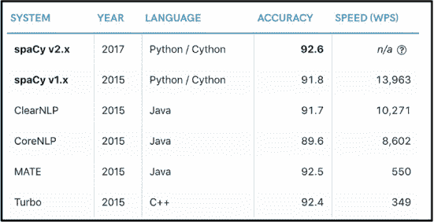
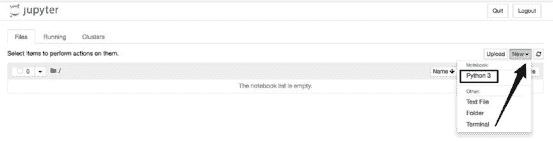
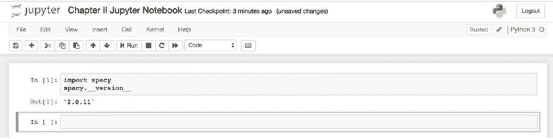
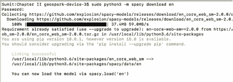
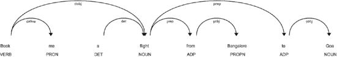
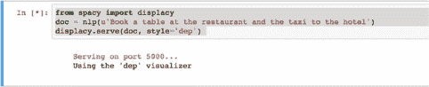
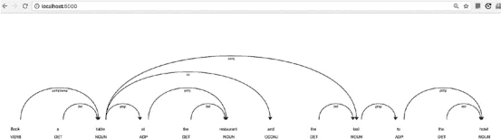

# 第 2 章 **用于聊天机器人的自然语言处理**  

本章旨在让你开始使用 Python 进行自然语言处理（NLP），这是构建聊天机器人所需的技能。你将学习使用一个名为 spaCy 的优秀开源库进行 NLP 的基本方法和技术。如果你是 Python 生态系统的初学者或中级用户，请不要担心，因为你会逐步完成学习聊天机器人 NLP 所需的每一步。本章不仅教你 NLP 的方法，还会结合现实生活中的例子，并通过代码示例进行演示。我们还将讨论为什么特定的 NLP 方法可能对聊天机器人是必需的。请注意，NLP 本身是一项技能。  
我们将仔细研究词性标注、词干提取、实体检测、停用词、依存句法分析、名词块以及词语间的相似度查找。所有这些方法在你构建特定用例的聊天机器人时都会非常有帮助。  
本章涵盖的 NLP 方法之外还有很多。根据你正在构建的聊天机器人的需求，你可以尝试学习它们。到本章结束时，我们将学习使用的 SpaCy 库将为你提供足够的思路，来扩展你的 NLP 知识库和理解。那么，让我们开始吧，首先在下一节中尝试理解用于聊天机器人的 NLP。  

**为什么我需要了解自然语言处理才能构建聊天机器人？**  
要理解这个问题的答案，我们首先来了解自然语言处理（NLP）。  
自然语言处理（NLP）是人工智能的一个领域，它使计算机能够分析和理解人类语言。  

29  
© Sumit Raj 2019  
S.


拉杰，《构建聊天机器人》——现在，要执行自然语言处理（NLP），或者说自然语言理解（NLU），我们有很多方法，接下来将逐一讨论。你刚才听到了一个新术语“自然语言理解”吗？  
简单来说，NLU 是 NLP 这个大概念的一个子集，就像机器学习、深度学习、NLP 和数据挖掘是人工智能（AI）这个大概念的子集一样。AI 是一个总称，泛指任何能执行智能任务的计算机程序。  
一个实用的经验法则是：用 NLU 这个术语来表达机器理解人类提供的自然语言形式的能力。  
现在，回到“构建聊天机器人是否真的需要了解 NLP”这个问题——答案是“既是也不是”。困惑吗？你没听错，并不是说如果你不懂 NLP 的方法和技术就完全无法构建聊天机器人，但你的能力范围会受到一定限制。你将无法在扩展应用的同时保持代码的整洁。当你的聊天机器人还只能行走和奔跑时，NLP 能赋予它飞翔的翅膀。  
对普通人来说，聊天机器人不过是一种与另一端智能机器交流的方式。这种机器可以是基于语音的，也可以是基于文本的，用户会用自己的语言提供输入，在计算机科学中，这种语言通常被称为自然语言。  
我们知道，并没有什么黑箱能凭空施展魔法，让一切完美运行。大家应该明白，AI 中并没有什么“人工”的智能；实际上，幕后运行的是由杰出人士编写的机器学习和深度学习算法。机器尚未达到能像人类一样思考并拥有自身智能的阶段。如今的 AI 系统——它们的行为和表现方式——都是我们如何训练它们的结果。  
因此，为了理解用户的自然语言（无论是什么语言，也无论输入形式是文本、语音还是图像等），我们必须编写算法并运用 NLP 技术。NLP 被视为聊天机器人的大脑，它处理原始数据，进行数据清洗和整理，然后准备采取适当的行动。  
NLP 本身是一个庞大的主题，需要时间和毅力才能完全掌握，但作为聊天机器人开发者，有一些方法是必须了解的，我们将在本章中学习这些方法。  

### 什么是 spaCy？

spaCy 是一个用于高级 NLP 的开源软件库，由 Matthew Honnibal 用 Python 和 Cython 编写。它提供了直观的 API，用于访问由深度学习模型训练出的方法。  
spaCy 提供了世界上最快的句法解析器。直接引用 spaCy 的文档，他们有一些令人惊叹的基准测试结果，如下所示。  

#### spaCy 的基准测试结果

2015 年的两篇同行评审论文证实，spaCy 提供了世界上最快的句法解析器，并且其准确率与最佳可用方案相差不到 1%。  
少数更准确的系统速度则慢了 20 倍甚至更多。让我们看看图 2-1，它展示了 spaCy 与其他库在速度和准确率方面的基准测试结果。  

  

**图 2-1. spaCy 基准测试结果**  

spaCy 还为多种语言提供了统计神经网络模型，例如英语、德语、西班牙语、葡萄牙语、法语、意大利语、荷兰语以及多语言命名实体识别（NER）。它还为其他多种语言提供了分词功能。此表显示了由 Choi 等人进行的速度基准测试，因此将 spaCy v2.x 在不同硬件上的基准测试结果进行对比并不公平。这就是为什么你看不到 spaCy v2.x 的速度列数值。  

### spaCy 提供了什么？

spaCy 声称主要提供三项功能，并且在这些方面极具帮助。让我们来看看这些功能，并理解为什么人们应该将 spaCy 作为进行 NLP 的首选模块。  

#### 世界上最快的库

spaCy 在提取大规模信息方面表现极为出色。它借助 Cython 库，从零开始编写，对内存管理极为谨慎。  

#### 完成任务

spaCy 的设计理念是“完成任务”。它帮助我们实现真实的 NLP 场景。清晰的文档为开发者和计算语言学爱好者节省了大量时间，并提高了他们的工作效率。它安装起来就像其他 Python 包一样简单。  

#### 深度学习

spaCy 是开源社区中可用于处理深度学习算法文本的最佳库之一。它与 TensorFlow、PyTorch、scikit-learn、Gensim 以及 Python 的其他相关技术无缝协作。深度学习开发者可以轻松地为一系列 NLP/NLU 问题构建语言上复杂的统计模型。  

### spaCy 的特性

没有其他 NLP 库能像 spaCy 一样提供极其广泛的 API 来完成几乎所有任务。这个库最棒的地方在于它持续进化，变得越来越好。让我们先睹为快，看看 spaCy 官方网站上列出的特性：  

- 非破坏性分词  
- 命名实体识别  
- 支持 28 种以上语言  
- 针对 8 种语言的 13 个统计模型  
- 预训练词向量  
- 易于集成的深度学习  
- 词性标注  
- 带标签的依存句法分析  
- 基于句法的句子分割  
- 用于句法和 NER 的内置可视化工具  
- 便捷的字符串到哈希映射  
- 导出为 numpy 数据数组  
- 高效的二进制序列化  
- 简便的模型打包与部署  
- 最先进的速度  
- 稳健、经过严格评估的准确率  

现在，让我们深入探索这个用于 Python NLP 的出色模块：spaCy。  

### 安装与先决条件

在我们真正深入 spaCy 和代码片段之前，请确保你的操作系统上已安装 Python。如果没有，请参考 [1]。


你可以使用任何你熟悉的 Python 版本。如今大多数系统都预装了默认的 Python 2.7.x 版本。本章我们将使用 Python 3。因此，如果你想使用 Python 3，请从 [Python 官网](https://www.python.org/downloads/) 下载并安装到你的操作系统上。如果你已经安装了 Python 2，也可以使用它；可能需要对代码进行少量修改，也可能不需要。我们将通过 pip [2] 安装 spaCy。我们将使用虚拟环境 [3]，并将 spaCy 安装到用户目录中。

如果你使用的是 macOS/OSX/Linux，请按照以下步骤操作：
步骤 1：python3 -m pip install -U virtualenv
步骤 2：virtualenv venv -p /usr/local/bin/python3 # 请确保使用你自己的操作系统路径来指定 Python 3 可执行文件。
步骤 3：source venv/bin/activate
步骤 4：pip3 install -U spacy # 我们将使用 spaCy 2.0.11 版本。
最后一步可能需要一些时间，请耐心等待。

如果你使用的是 Windows，只需将步骤 3 改为：
venv\Scripts\activate

现在，我们将在已激活的虚拟环境中安装 Jupyter Notebook。使用 Jupyter Notebook 比标准 Python 解释器更简单、更高效。在接下来的章节中，我们将在 Jupyter Notebook 中执行所有代码片段。

要安装 Jupyter Notebook，请运行以下 pip 命令：
pip3 install jupyter
此命令将在你的系统中安装 Jupyter Notebook。

此时，你的虚拟环境中应该已经安装了 spaCy 和 Jupyter Notebook。让我们验证一下是否全部安装成功。

进入你的命令行界面，输入以下内容，你应该会看到服务器启动，并在默认浏览器中打开一个 URL。
$ jupyter notebook
默认 URL 是 `http://localhost:8888`。它看起来应该像图 2-2 所示。

如图 2-2 所示，点击 **New**，然后选择 **Python 3**。

它将在当前浏览器中打开一个新标签页，并为你创建一个新的笔记本，你可以在其中运行 Python 代码。

你可以执行任何 Python 代码、导入库、绘制图表以及使用 Markdown 单元格。


图 2-2. Jupyter Notebook 初览

输入 `import spacy`，然后点击“Run”按钮或按 Shift + Enter 运行该单元格。它看起来应该像图 2-3 所示。


图 2-3. 验证 spaCy 安装

如果步骤 3 没有抛出任何错误信息，那么你已成功在系统上安装了 spaCy 模块。你应该会在笔记本中看到已安装的 spaCy 版本。如果你想安装相同版本的 spaCy，可以在通过 pip 安装时指定版本。
pip3 install –U spacy==2.0.11

什么是 spaCy 模型？

spaCy 模型就像其他任何机器学习或深度学习模型一样。模型是算法的产物，或者说，是使用机器学习算法训练数据后创建的对象。

spaCy 有很多这样的模型，我们可以像下载其他 Python 包一样，直接下载并放入程序中使用。

现在，我们将以 Python 包的形式安装 spaCy 模型。

为此，我们将在笔记本中利用其魔法命令运行以下命令。通过在 shell 命令前加上 `!`（感叹号操作符），我们也可以从 Jupyter Notebook 中运行 shell 命令。让我们看看效果如何。

!python3 -m spacy download en

在使用 Jupyter Notebook 为 Python 下载 spaCy 模型时，你可能会遇到权限问题。请前往你的终端并运行以下命令：
sudo python3 –m spacy download en

请参考图 2-4。


图 2-4. 下载 spaCy 模型

如图 2-4 所示，spaCy 会尝试下载一些核心文件，并将它们作为 Python 包安装。


**注意**！`!`（感叹号操作符）仅在 Jupyter Notebook 中有效。要直接从终端安装 spaCy 模型，你需要去掉 `!`（感叹号操作符）；否则会导致错误。


[1] https://www.python.org/downloads/
[2] https://packaging.python.org/tutorials/installing-packages/#installing-from-pypi
[3] http://docs.python-guide.org/en/latest/dev/virtualenvs/

构建聊天机器人的 NLP 基础方法

要想精通某件事并高效地完成它，打好基础非常重要。要构建聊天机器人，我们需要了解 NLP 的基础方法。这些方法帮助我们分解输入并理解其含义。在下一节中，我们将学习一些最常用的 NLP 方法，这些方法不仅能帮助你精通 NLP，还能帮助你构建出色的聊天机器人。我们处理输入文本的能力越强、效率越高，就越能更好地回应用户。

词性标注

词性标注是一个过程，你读取一些文本，并为每个单词或标记分配词性，例如名词、动词、形容词等。

当你想要识别给定句子中的某个实体时，词性标注变得极其重要。第一步是进行词性标注，看看我们的文本包含什么。

让我们通过一些真实的词性标注示例来动手实践。

示例 1：
nlp = spacy.load('en') # 将 spaCy en 模型加载到 Python 对象中
doc = nlp(u'I am learning how to build chatbots') # 创建一个 doc 对象
for token in doc:
    print(token.text, token.pos_) # 打印文本和词性

输出：
('I', 'PRON')
('am', 'VERB')
('learning', 'VERB')
('how', 'ADV')
('to', 'PART')
('build', 'VERB')
('chatbots', 'NOUN')

示例 2：
doc = nlp(u'I am going to London next week for a meeting.')
for token in doc:
    print(token.text, token.pos_)

('I', 'PRON')
('am', 'VERB')
('going', 'VERB')
('to', 'ADP')
('London', 'PROPN')
('next', 'ADJ')
('week', 'NOUN')
('for', 'ADP')
('a', 'DET')
('meeting', 'NOUN')
('.', 'PUNCT')


', 'PUNCT') 如我们所见，当打印从 `nlp` 方法返回的 `Doc` 对象（一个用于访问注释的容器）中的词元时，我们会得到句子中每个单词的词性标注。这些标签是单词的属性，决定了该单词在语法正确的句子中的用法。我们可以将这些标签用作信息过滤等任务中的单词特征。

让我们再举一个例子，尝试探索来自 `Doc` 对象的词元的不同属性。

**示例 3：**

```python
doc = nlp(u'Google release "Move Mirror" AI experiment that matches your pose from 80,000 images')
for token in doc:
    print(token.text, token.lemma_, token.pos_, token.tag_, token.dep_, token.shape_, token.is_alpha, token.is_stop)
```

**示例 4：**

```python
doc = nlp(u'I am learning how to build chatbots')
for token in doc:
    print(token.text, token.lemma_, token.pos_, token.tag_, token.dep_, token.shape_, token.is_alpha, token.is_stop)
```

请参考下表，了解我们在代码中打印的每个属性的含义。

| 属性 | 含义 |
| :--- | :--- |
| `TEXT` | 正在处理的实际文本或单词 |
| `lemma` | 正在处理的单词的词根形式 |
| `pos` | 单词的词性 |
| `tag` | 表达词性（例如，动词）和一些形态信息（例如，动词是过去时态） |
| `dep` | 句法依存关系（即词元之间的关系） |
| `shape` | 单词的形状（例如，大小写、标点、数字格式） |
| `alpha` | 该词元是否为字母字符？ |
| `stop` | 该单词是否为停用词或停用词列表的一部分？ |

你可以参考下表来理解词元对象的每个词性属性值的含义。此列表详细说明了 spaCy 模型分配的词性标签。

那么，为什么聊天机器人需要词性标注呢？

**答案：** 为了降低理解文本的复杂性，这些文本可能无法被训练，或者训练置信度较低。通过使用词性标注，我们可以识别文本输入中的部分，并仅对这些部分进行字符串匹配。例如，如果你想判断一个句子中是否存在某个地点，词性标注会将地点词标记为 `NOUN`，这样你就可以从标注列表中提取所有名词，并检查它是否在你预设的地点列表中。

### 词干提取与词形还原

**词干提取** 是将屈折词简化为其词干、基本形式的过程。词干提取算法会将单词 “saying” 简化为词根 “say”，而 “presumably” 则变为 “presum”。如你所见，这不一定总是 100% 正确。

**词形还原** 与词干提取密切相关，但词形还原是根据单词的预期含义来确定其词元的算法过程。例如，在英语中，动词 “to walk” 可能以 “walk”、“walked”、“walks” 或 “walking” 的形式出现。可以在字典中查到的基本形式 “walk” 被称为该单词的词元。spaCy 没有内置的词干提取器，因为词形还原被认为更准确、更高效。

### 词干提取与词形还原的区别

-   **词干提取** 以一种粗糙、启发式的方式工作，通过切掉单词的结尾，假设剩下的单词就是我们实际要找的，但它通常包括去除派生词缀。
-   **词形还原** 试图通过使用词汇表和单词的形态分析来更优雅地完成这项工作。它尽力只去除屈折词尾，并返回单词的词典形式，即词元。

尽管少数库同时提供了词干提取和词形还原的方法，但最佳实践始终是使用词形还原来正确获取词根。

让我们通过一些例子来探索词形还原：

**示例 1：**

```python
from spacy.lemmatizer import Lemmatizer
from spacy.lang.en import LEMMA_INDEX, LEMMA_EXC, LEMMA_RULES
lemmatizer = Lemmatizer(LEMMA_INDEX, LEMMA_EXC, LEMMA_RULES)
lemmatizer('chuckles', 'NOUN') # 第二个参数是词元的词性标签
```

**输出：**

```python
[u'chuckle']
```

**示例 2：**

```python
lemmatizer('blazing', 'VERB')
```

**输出：**

```python
[u'blaze']
```

**示例 3：**

```python
lemmatizer('fastest', 'ADJ')
```

**输出：**

```python
[u'fast']
```

如果你想比较词干提取器和词形还原器，那么你需要安装 Python 最流行的库之一：自然语言工具包（NLTK）。spaCy 最近才流行起来，但正是 NLTK 让每一位 NLP 爱好者投身于 NLP 及其技术的海洋。

请查看以下示例，我们尝试使用 NLTK 提供的两种词干提取技术。首先，我们尝试使用 `PorterStemmer` 获取单词 “fastest” 的词干，然后使用 `SnowBallStemmer`。


两者得出的结果相同，都是“fastest”，但当我们使用 spaCy 的方法进行词形还原时，它给出的“fastest”的词干是“fast”，这更有意义且更正确。  
from nltk.stem.porter import *  
from nltk.stem.snowball import SnowballStemmer  
porter_stemmer = PorterStemmer()  
snowball_stemmer = SnowballStemmer("english")  

fastest fastest  
  
在尝试运行此代码之前，请务必使用 pip3 安装 nltk 包。  
  
既然你已经很清楚词干提取或词形还原在自然语言处理中的作用，那么你应该能够理解，每当遇到需要单词词根形式的情况时，就需要进行词形还原。例如，它常用于构建搜索引擎。你一定好奇过，即使搜索文本表述不规范，谷歌是如何在搜索结果中给出你想要的文章的。  

这正是词形还原发挥作用的地方。想象一下，你用文本“will the next season of Game of Thrones be”进行搜索。  
现在，假设搜索引擎只是通过简单的文档词频匹配来提供搜索结果。在这种情况下，上述查询很可能无法匹配到标题为“Thrones next season release date”的文章。  

如果在将输入与文档匹配之前，先对原始问题进行词形还原，那么我们可能会得到更好的结果。  
我们将在后续章节中尝试验证这一理论。  

命名实体识别  

命名实体识别，也称为实体识别或实体抽取，是一个在给定文本中查找命名实体并将其分类到预定义类别的过程。  

NER 任务在很大程度上依赖于用于训练命名实体提取算法的知识库，因此其效果可能因训练所用的数据集而异。  

spaCy 自带一个非常快速的实体识别模型，能够从给定文档中识别出实体短语。实体可以是不同类型，例如人物、地点、组织、日期、数字等。这些实体可以通过  
doc 对象的 `.ents` 属性进行访问。  

让我们借助 spaCy 强大的 NER 标注功能，通过一些示例来尝试查找命名实体。  

示例 1：  

my_string = u"Google has its headquarters in Mountain View, California having  
revenue amounted to 109.65 billion US dollars"  
doc = nlp(my_string)  
for ent in doc.ents: print(ent.text, ent.label_)  
输出：  

('Google', 'ORG')  
('Mountain View', 'GPE')  
('California', 'GPE')  
('109.65 billion US dollars', 'MONEY')  

我们可以看到，spaCy 模型能够多么出色且自动地识别出单词“Google”是一个组织，“Mountain View”和“California”是地缘政治实体，并且在给定的句子中，我们谈论的是 1096.5 亿美元，这实际上与金钱有关。  

让我们尝试探索更多示例。  

示例 2：  

my_string = u"Mark Zuckerberg born May 14, 1984 in New York is an American technology entrepreneur and philanthropist best known for co-founding and leading Facebook as its chairman and CEO."  
doc = nlp(my_string)  
for ent in doc.ents: print(ent.text, ent.label_)  
输出：  

('Mark Zuckerberg', 'PERSON')  
('May 14, 1984', 'DATE')  
('New York', 'GPE')  
('American', 'NORP')  
('Facebook', 'ORG')  

示例 3：  

my_string = u"I usually wake up at 9:00 AM. 90% of my daytime goes in learning new things."  
doc = nlp(my_string) for ent in doc.ents:  
print(ent.text, ent.label_)  
输出：  

('9:00 AM', 'TIME')  
('90%', 'PERCENT')  

如你所见，实体提取器可以轻松地从给定字符串中提取时间信息。同时，你还可以看到实体提取器不仅试图识别数字，还能识别出确切的百分比值。  

根据 spaCy 的文档，在 OntoNotes 语料库上训练的模型支持以下实体类型。  
  
类型  描述  
  
包括虚构的  
或宗教或政治团体  
机场、高速公路、桥梁等。  
机构、组织等。  
城市、州  
地点、山脉、水域  
车辆、食物等（不包括服务）  
飓风、战役、战争、体育赛事等。  
书籍、歌曲等。  
已制定为法律的文件  
已命名的语言  
或相对日期或时间段  
小于一天的时间  
包括“%”  
数值，包括重量或距离的单位  
“第一”、“第二”等。  
  
不属于其他类型的实体  
  

每当我们打算构建一个对话代理或聊天机器人（简单来说）时，我们心中总会有一个领域。例如，我们希望聊天机器人能够预约医生、订餐、支付账单、填写银行申请表、处理电子商务等。聊天机器人也可能解决这些问题的组合。通过找出问题中的实体，我们可以大致了解提出问题的上下文。  

让我们通过两个包含相似词语但含义不同的句子示例来理解这一点。  

my_string1 = u"Imagine Dragons are the best band."  
my_string2 = u"Imagine dragons come and take over the city."  

doc1 = nlp(my_string1)  
doc2 = nlp(my_string2)  

for ent in doc1.ents: print(ent.text, ent.label_)  

上述对 doc1 对象的 for 循环输出：  

('Imagine Dragons', 'ORG')  

很厉害，不是吗？当你意识到实体识别器在字符串中未识别出任何实体时，这会变得更加有趣。运行以下代码，doc2 不会产生任何输出。  

for ent in doc2.ents: print(ent.text, ent.label_)  

现在，想象一下你需要在实时环境中提取上述两个字符串的上下文。你会怎么做？借助实体，可以轻松判断语句的上下文，并智能地推动对话继续进行。  


停用词   停用词是指像 a、to 和 also 这类我们有时希望在进一步处理前从文档中过滤掉的词语。停用词通常词汇内容很少，没有太多实际意义。以下是 Reuters-RCV1 语料库中常见的 25 个语义上非选择性的停用词列表。  a  an  and  are  as   at  be  by   for from  has  he   in    is    it    its      of    on that  the  to    was      were    will    with   让我们进入一些代码，尝试理解其工作原理。   要查看 spaCy 中定义为停用词的所有单词，可以运行以下代码行：   from spacy.lang.en.stop_words import STOP_WORDS print(STOP_WORDS)   你应该会看到类似这样的输出：   set(['all', 'six', 'just', 'less', 'being', 'indeed', 'over', 'move',   'anyway', 'fifty', 'four', 'not', 'own', 'through', 'using', 'go', 'only', 'its', 'before', 'one', 'whose', 'how',   ..........................................................................   .........................................................................   ...........................................................................   ........................................................................   'whereby', 'third', 'i', 'whole', 'noone', 'sometimes', 'well', 'together',   'yours', 'their', 'rather', 'without', 'so', 'five', 'the', 'otherwise', 'make', 'once'])   spaCy 的停用词列表中定义了大约 305 个停用词。如果需要，你始终可以定义自己的停用词并覆盖现有列表。   要判断一个词是否为停用词，可以使用 spaCy 的 `nlp` 对象。我们可以使用 `nlp` 对象的 `is_stop` 属性。   示例 1：   nlp.vocab[u'is'].is_stop   输出：   True  nlp.vocab[u'hello'].is_stop   输出：   False   示例 3：   nlp.vocab[u'with'].is_stop   输出：   True   停用词是文本清理中非常重要的一部分。它有助于在我们尝试进行实际处理以理解文本含义之前，移除无意义的数据。   假设你正在构建一个机器人，通过评估用户情绪来让人们开心。此时，需要分析用户输入文本中的情感，以便制定正确的回应。在这里，在开始进行基本的情感分析之前，我们应该移除数据中以停用词形式存在的噪声。   依存句法分析   依存句法分析是 spaCy 中更优美且强大的功能之一，它快速且准确。该解析器还可用于句子边界检测，并允许你遍历基本名词短语或“语块”。   spaCy 的这一功能为你提供了一个解析树，它解释了单词或短语之间的父子关系，并且与单词出现的顺序无关。   让我们看一个例子，你需要解析以下句子：   帮我订一张从班加罗尔到果阿的机票   示例 1：   doc = nlp(u'Book me a flight from Bangalore to Goa') blr, goa = doc[5], doc[7]   list(blr.ancestors)   输出：   [from, flight, Book]   上述输出可以告诉我们，用户希望预订从班加罗尔出发的航班。让我们尝试列出 `goa.ancestors` 对象的祖先：   list(goa.ancestors)   输出：   [to, flight, Book]   这个输出可以告诉我们，用户希望预订前往果阿的航班。   依存句法分析中的祖先是什么？   祖先是指该词元的句法后代中最右边的词元。就像上面例子中，对于对象 `blr`，其祖先是 `from`、`flight` 和 `Book`。   请记住，你始终可以使用 `ancestors` 属性列出文档对象项的祖先。   list(doc[4].ancestors) #doc[4]==flight   上述代码将输出：   [flight, Book]   要以编程方式检查一个文档对象项是否是另一个文档对象项的祖先，我们可以这样做：   doc[3].is_ancestor(doc[5])   上述代码返回 `True`，因为 `doc[3]`（即 `flight`）是 `doc[5]`（即 `Bangalore`）的祖先。你可以尝试更多类似的例子，以更好地理解依存句法分析和祖先的概念。   如果我们尝试思考在构建聊天机器人时可能遇到的实际场景，可能会遇到像这样的句子：   我想订一辆出租车去酒店，并在餐厅订一张桌子。   在这个句子中，了解请求了哪些任务以及它们的目标地点在哪里（即用户是想订出租车去酒店，还是……）非常重要。   让我们尝试使用以下代码来实现这一点：  示例 1：   doc = nlp(u'Book a table at the restaurant and the taxi to the hotel') tasks = doc[2], doc[8] #(table, taxi)   tasks_target = doc[5], doc[11] #(restaurant, hotel)   for task in tasks_target:   for tok in task.ancestors: if tok in tasks:   print("Booking of {} belongs to {}".format(tok, task))   break   输出：   Booking of table belongs to restaurant Booking of taxi belongs to hotel   依存句法分析中的子节点是什么？   子节点是指该词元的直接句法依存项。我们可以像之前使用 `children` 属性一样，查看一个词的子节点。   list(doc[3].children)   将输出   [a, from, to]   依存句法分析的交互式可视化   第一次完全理解依存句法分析的概念非常困难。spaCy 提供了一种极其简单且交互式的方式来理解其依存句法分析。spaCy v2.0+ 有一个可视化模块，我们可以将 `Doc` 对象或 `Doc` 对象列表传递给 `displaCy`，并调用 `displaCy` 的 `serve` 方法来运行 Web 服务器。   图 2-5 展示了依存句法分析的交互式可视化效果。     Figure 2-5. 依存句法分析的交互式可视化   你也可以生成图 2-5 中的依存句法分析可视化。要创建这样的可视化，请运行以下代码，然后在浏览器中访问 http://localhost:5000。   让我们尝试对我们关于任务及其目标地点的示例进行可视化。


from spacy import displacy  
doc = nlp(u'Book a table at the restaurant and the taxi to the hotel')  
displacy.serve(doc, style='dep')  

运行这段代码将产生如图 2-6 所示的输出。如果你得到类似的结果，请转到浏览器的另一个标签页并输入  

我们会得到代码中该字符串的依存句法分析可视化结果（如图 2-7 所示）。  

  
图 2-6. 在 localhost 上启动依存句法分析服务器  

  
图 2-7. 依存句法分析示例  

我们再举一个依存句法分析的例子，假设用户正在询问以下句子：  

What are some places to visit in Berlin and stay in Lubeck?  

我们首先创建如下所示的对象：  

doc = nlp(u"What are some places to visit in Berlin and stay in Lubeck")  

现在，我们获取正在讨论的地点以及用户想要执行的操作：  

places = [doc[7], doc[11]] #[Berlin, Lubeck]  
actions = [doc[5], doc[9]] #[visit, stay]  

由于你已经了解词性标注和实体提取，你可以轻松自动地获取地点和操作。  

现在我们有了地点，让我们遍历每个地点的所有祖先节点，并检查是否有任何祖先节点出现在操作列表中。在操作列表中找到的地点的第一个父节点，应该是该地点对应的操作。  

for place in places:  
    for tok in place.ancestors:  
        if tok in actions:  
            print("User is referring {} to {}").format(place, tok)  
            break  

输出：  

User is referring: Berlin to visit  
User is referring: Lubeck to stay  

正如我们在这些示例中所看到的，依存句法分析使得理解用户所指的内容变得相当容易。我们发现在两个不同任务的情况下，我们也能很好地推断出用户的期望，并据此制定下一步的回应。  

**依存句法分析在聊天机器人中的用途是什么？**  

从头构建聊天机器人时，依存句法分析是最重要的部分之一。当你想要弄清楚用户输入给聊天机器人的文本含义时，它变得更为重要。有时你可能尚未训练你的聊天机器人，但你仍然不想失去客户，或者像一台愚蠢的机器一样回复。  

在这些情况下，依存句法分析确实有助于发现关系，并更详细地解释用户可能正在询问的内容。  

如果要列出依存句法分析有助于解决的问题，可能包括：  

• 它有助于找出语法正确句子中单词之间的关系。  
• 它可用于句子边界检测。  
• 它在判断用户是否同时谈论多个上下文时非常有用。  

你可能会想，如果你的机器人用户在输入信息时说了任何语法不正确的句子，或者使用了短信简写，该怎么办？正如第 1 章所讨论的，你必须对这些情况保持警惕，并使用 NLP 技术相应地处理它们。  

你需要编写自己的自定义 NLP 来理解用户或聊天机器人的上下文，并据此识别用户可能犯的语法错误。  

总而言之，你必须为诸如用户输入垃圾值或语法错误句子等场景做好准备。你无法一次性处理所有此类场景，但你可以通过添加自定义 NLP 代码或通过设计限制用户输入来不断改进你的聊天机器人。  

**名词组块**  

名词组块或 NP 组块基本上是“基础名词短语”。我们可以说它们是扁平短语，以名词为核心。你可以将名词组块视为名词及其修饰词。  

让我们尝试一个例子来更好地理解它。  

示例 1：  

doc = nlp(u"Boston Dynamics is gearing up to produce thousands of robot dogs")  
list(doc.noun_chunks)  

输出：  

[Boston Dynamics, thousands, robot dogs]  

虽然从给定句子中提取名词组块很有帮助，但 spaCy 还提供了其他可能有用的属性。让我们尝试探索其中一些。  

示例 2：  

doc = nlp(u"Deep learning cracks the code of messenger RNAs and protein- coding potential")  
for chunk in doc.noun_chunks:  
    print(chunk.text, chunk.root.text, chunk.root.dep_, chunk.root.head.text)  

输出：  

Output: Output: Output: Output: Output: Output:  

正如我们从这张表中看到的，我们得到了名词组块及其属性。下表将帮助你理解每一列的含义。  

  
列名 含义  

  
原始名词组块的文本  

将名词组块与其余解析连接起来的原始单词的词根  

将词根连接到其头节点的词根关系  

  
词根头节点的词根头  

**查找相似度**  

查找两个词之间的相似度是你在处理 NLP 时经常会遇到的一个用例。有时，判断两个词是否相似变得相当重要。在构建聊天机器人时，你经常会遇到不仅需要找到外观相似的词，还需要找到两个词在逻辑上关联程度的情况。  

spaCy 使用高质量的词向量，通过 GloVe 算法（全局词向量表示）来查找两个词之间的相似度。  

GloVe 是一种用于获取词向量表示的无监督学习算法。GloVe 算法使用语料库中聚合的全局词-词共现统计信息来训练模型。  

让我们尝试使用 token 的 `vector` 属性来查看 spaCy 向量中的实际值。  

doc = nlp(u'How are you doing today?')  
for token in doc:  
    print(token.text, token.vector[:5])  

输出：  

(u'How', array([-0.29742685, 0.73939574, -0.04001453, 0.44034013, 2.8967502 ], dtype=float32))  
(u'are', array([-0.23435134, -1.6145049 , 1.0197453 , 0.9928169 , 0.28227055], dtype=float32))  
(u'you', array([ 0.10252178, -3.564711 , 2.4822793 , 4.2824993 , 3.590245 ], dtype=float32))  
(u'doing', array([-0.6240922 , -2.0210216 , -0.


91014993, 2.7051923 , 4.189252 ], dtype=float32))(u'today', array([ 3.5409122 , -0.62185854, 2.6274266 , 2.0504875 , 0.20191991], dtype=float32)) (u'?', array([ 2.8914998 , -0.25079122, 3.3764176 , 1.6942682 , 1.9849057 ], dtype=float32)) 看到这个输出，它并没有太多意义和含义。从应用的角度来看，最重要的是不同单词的向量有多相似——也就是单词本身的含义。

为了在 spaCy 中查找两个单词之间的相似度，我们可以执行以下操作。

示例 1：

hello_doc = nlp(u"hello") hi_doc = nlp(u"hi") hella_doc = nlp(u"hella")

print(hello_doc.similarity(hi_doc)) print(hello_doc.similarity(hella_doc)) 输出：

0.7879069442766685

0.4193425861242359

如果你看到单词 hello，它与单词 hi 更相关、更相似，尽管单词 hello 和 hella 之间只有一个字符的差异。

我们再举一个句子的例子，了解 spaCy 如何进行相似度比较。还记得我们在前面章节中提到的《权力的游戏》例子吗？我们将尝试用它来查看相似度。

代码：

GoT_str1 = nlp(u"When will next season of Game of Thrones be releasing?") GoT_str2 = nlp(u"Game of Thrones next season release date?") GoT_str1.similarity(GoT_str2)

输出：

0.785019122782813

正如我们在本例中看到的，两个句子之间的相似度约为 79%，这足以说明这两个句子非常相似，事实也确实如此。这可以帮助我们在构建应用时节省大量编写自定义代码的时间。因此，我们得出一个事实：spaCy 使用词向量为我们提供两个单词之间有意义的相似度，而不仅仅是查看它们的拼写或字母。

我们将举一个非常简单的例子，尝试找出单词之间的相似度。

example_doc = nlp(u"car truck google")

for t1 in example_doc: for t2 in example_doc: similarity_perc = int(t1.similarity(t2) * 100) print "Word {} is {}% similar to word {}".format(t1.text, similarity_perc, t2.text)

输出：

Word car is 100% similar to word car Word car is 71% similar to word truck Word car is 24% similar to word google Word truck is 71% similar to word car Word truck is 100% similar to word truck Word truck is 36% similar to word google Word google is 24% similar to word car Word google is 36% similar to word truck

Word google is 100% similar to word google

当我们打算构建任何高度依赖 NLP 实现的应用时，查找单词或句子之间的相似度变得非常重要。如果你曾经使用过 StackOverFlow，每当我们尝试提出新问题时，它都会尝试列出平台上已经提出的类似问题。这是查找两组句子之间相似度可能有所帮助的最佳示例之一。spaCy 基于已训练模型查找两个单词之间相似度的置信度，完全取决于所采用的一般假设类型。

在构建聊天机器人时，查找相似度在以下情况下会非常有用：

• 构建推荐型聊天机器人时
• 去除重复内容
• 构建拼写检查器

我们学到的这些内容在构建聊天机器人时非常重要，这样我们就知道如何解析用户输入，以便在代码内部编写业务逻辑时使其有意义。聊天机器人 NLP 中值得了解的内容

在本节中，我们将学习几个有趣的主题，当你计划编写自己的自定义 NLP 方法来处理某些场景时，这些主题经常会派上用场。请务必仔细阅读它们，因为在你最不期待的时候，它们往往是最需要的。我们将简要讨论聊天机器人场景中的分词和正则表达式的使用。

分词

分词是 NLP 中简单但基础的概念之一，我们将文本分割成有意义的片段。spaCy 首先对文本进行分词（即将其分割成单词，然后是标点符号和其他内容）。你可能会想到一个问题：为什么我不能直接使用 Python 语言内置的 split 方法来进行分词？Python 的 split 方法只是一个原始方法，用于根据分隔符将句子分割成标记。它不考虑任何含义，而分词则试图同时保留含义。

让我们尝试一些代码，看看分词是如何工作的。

示例 1：

doc = nlp(u'Brexit is the impending withdrawal of the U.K. from the European Union.')

for token in doc: print(token.text)

输出：

Brexit is the impending withdrawal of the U.K. from the EuropeanUnion

如果你看到上面的输出，U.K. 在分词过程后作为一个单独的单词出现，这是有道理的，因为 U.K. 是一个国家名称，将其拆分是错误的。即使如此，如果你对 spaCy 的分词不满意，你可以在完全依赖 spaCy 的分词方法之前，使用其 add_special_case 方法添加自己的规则。

正则表达式

你一定已经了解正则表达式及其用法。本书假设你已熟悉一般的正则表达式。在本节中，我们只是要浏览一些示例，看看正则表达式在构建聊天机器人时如何发挥优势并变得有用。

文本分析和处理本身就是一个庞大的主题。有时单词以某种方式组合在一起，使得机器极难理解和训练。正则表达式可以作为机器学习模型的一种回退方案。它具有模式匹配的能力，可以确保我们正在处理的数据是正确的还是错误的。第 1 章“聊天机器人历史”部分讨论的大多数早期聊天机器人都高度依赖模式匹配。

让我们看下面两个非常容易理解的示例。我们将尝试使用正则表达式从这两个句子中提取信息。


帮我预订一张从机场站到香港站的地铁票。再帮我叫一辆从香港机场到亚洲国际博览馆的出租车。以下是代码：  
sentence1 = "Book me a metro from Airport Station to Hong Kong Station."  
sentence2 = "Book me a cab to Hong Kong Airport from AsiaWorld-Expo."  

import re  

from_to = re.compile('.* from (.*) to (.*)')  

to_from = re.compile('.* to (.*) from (.*)')  

from_to_match = from_to.match(sentence2)  
to_from_match = to_from.match(sentence2)  

if from_to_match and from_to_match.groups():  
  _from = from_to_match.groups()[0]  
  _to = from_to_match.groups()[1]  
  print("from_to pattern matched correctly. Printing values\n")  
  print("From: {}, To: {}".format(_from, _to))  

elif to_from_match and to_from_match.groups():  
  _to = to_from_match.groups()[0]  
  _from = to_from_match.groups()[1]  
  print("to_from pattern matched correctly. Printing values\n")  
  print("From: {}, To: {}".format(_from, _to))  

输出：  

to_from pattern matched correctly. Printing values  
From: AsiaWorld-Expo., To: Hong Kong Airport  

尝试将 sentence2 改为 sentence1，看看代码是否能正确识别模式。  
尽管如今机器学习功能强大，正则表达式和模式匹配已退居次位，但请务必温习一下相关知识，因为随时可能需要用它从单词、句子或文本文档中解析特定细节。  

总结  

至此，你应该已经清楚为什么在开始构建聊天机器人之前需要了解 NLP。在本章中，我们学习了 Python 中的 spaCy 模块、它的特性以及如何安装它。我们深入探讨了 NLP 的各种方法，这些方法在构建聊天机器人时被广泛使用。我们学习了词性标注、词干提取与词形还原的区别、实体识别、名词组块化以及查找词组之间的相似性。  

我们为所有这些概念编写了代码，并通过实践而非仅仅阅读来学习它们——这正是本书所强调的。我们还复习了分词和正则表达式的基础知识。我们已经准备好进入下一章，使用一个名为 Dialogflow 的免费工具来构建我们的聊天机器人。在下一章中，我们将学习如何训练我们的聊天机器人来理解和提取用户提供的信息。  

