# 第 3 章 轻松构建聊天机器人

“轻松构建聊天机器人”这一章的编写考虑到有时你不想从头开始构建一切，只想快速完成任务。本章不需要你编写大量代码，但仍能让你清楚地了解如何以简单的方式构建聊天机器人并将其发布。

本章之所以对学习构建聊天机器人更为重要，是因为软件世界变化太快，需要快速适应。有时我们需要快速构建应用程序，并尝试寻找开源库中可用的工具，以便无需重新发明轮子就能快速构建应用。

有时我们的编码能力不足以从头构建一切。即使我们想从头构建应用，也可能因为学习曲线对新入门者来说过于陡峭而无法实现。

本章将帮助你快速构建聊天机器人，并将其发布供全世界使用。

我们将尝试使用一个以前称为 `Api.ai` 的工具，现在它被称为 `Dialogflow`。

## Dialogflow 简介

`Dialogflow` 通过构建引人入胜的语音和文本对话界面（如语音应用和聊天机器人），为用户提供了与其产品互动的新方法。

`Dialogflow` 由人工智能驱动。它帮助你与网站、移动应用、`Google Assistant`、`Amazon Alexa`、`Facebook Messenger` 以及其他流行平台和设备上的用户建立连接。

以下来自 `Dialogflow` 的图表展示了它们如何处理用户请求。

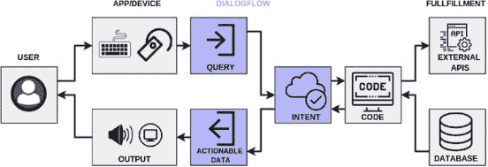

图 3-1. `Dialogflow` 架构工作示意图

流程如下：

用户与输入设备对话。用户查询进入 `Dialogflow` 引擎。`Dialogflow` 尝试识别意图。根据意图执行 `fulfillment`，并从数据库返回数据。响应返回给意图。响应被转换为可操作的数据。用户的信息请求被返回给输出设备。

`Dialogflow` 中有一个“代理”的概念，最好将其描述为自然语言理解（`NLU`）模块。这些模块可以集成到你的应用、产品或服务中，将用户的自然语言请求转换为可操作的数据。当用户输入与代理中的某个意图匹配时，就会发生这种转换。

代理还可以被设计为以特定方式管理对话流程。这可以通过上下文、意图优先级、槽位填充、职责以及通过 `webhook` 进行 `fulfillment` 来实现。

## 入门指南

了解我们目前所学的内容过去和现在都很重要，因为开源中提供的免费工具和包并不总能帮助你构建一个完整的聊天机器人应用。

很多时候，你可能会遇到想要自己构建一切的情况，以便对应用拥有更多控制权。我们将在下一章学习这些内容，并同时使用之前学到的 NLP 技术。

本章的全部内容是关于创建一个概念验证型的聊天机器人，并使其在几乎不需要编程经验或无需编程的情况下准备好供全世界使用。

## 构建一个订餐聊天机器人

我们将借助 `Dialogflow` 为一家特定餐厅创建一个聊天机器人。我们将其命名为 `OnlineEats` 产品。你也可以选择其他任何你想构建聊天机器人的用例。在本章中，我们将构建一个订餐聊天机器人。

### 确定范围

让我们确定这个聊天机器人的范围——即它能做什么以及做到什么程度。

• 它应该能够动态地向用户打招呼。
• 它应能理解菜单项及其请求的数量。
• 聊天机器人应能代表用户下单。
• 当用户询问时，能提供订单状态。

### 列出意图

在此，我们列出希望聊天机器人训练的意图，以便它在用户询问时能够理解这些意图。

意图

• 默认欢迎意图：当用户向聊天机器人发送消息时触发
• 下单意图：当用户要求机器人点餐时触发
• 商品描述意图：当用户告知所需商品和数量时触发
• 订单状态：当用户想了解订单状态时触发
• 订单 ID：机器人需要理解用户的订单 ID 以进行追踪。
• 用户感谢：当用户感谢机器人时触发

### 列出实体

我们将在此尝试列出所有意图可能涉及的实体。在后续章节中，我们将看到这些实体如何根据适用的意图进行定义。

实体

• `food_items`：用户想点哪些食物？
• `quantities`：用户想点的食物数量是多少？
• `order_id`：为用户下单的订单 ID

### 构建食品订购聊天机器人

让我们也设定聊天机器人的期望值，明确它至少应能完成哪些基本任务。为此，我们编写一个聊天机器人与用户之间的对话脚本。这有助于我们坚持计划，在假设用户以友好且正确的方式进行对话的前提下，准备好一个能基本运行的聊天机器人。

聊天机器人与用户对话脚本：

用户：你好
`OnlineEatsBot`：你好，欢迎光临！有什么可以帮您的吗？
用户：我想点中餐。
`OnlineEatsBot`：好的，您今天想点什么？
用户：一份鸡肉饺子，两份春卷。
`OnlineEatsBot`：完成。您的总金额为 XYZ，已为您下单：1 份鸡肉饺子，2 份春卷。
用户：我还没收到我的订单。我的食物在哪？
`OnlineEatsBot`：请提供您的订单 ID 好吗？
用户：123456
`OnlineEatsBot`：订单 ID：123456 的订单状态。配送员已在您所在区域，您的食物大约 5 分钟内送达。
用户：谢谢。
`OnlineEatsBot`：非常感谢您的配合。

现在我们已经编写了一个基本脚本来指导构建聊天机器人，接下来我们将深入探讨 `Dialogflow`。

## `Dialogflow` 入门

让我们按照以下步骤在 `Dialogflow` 中创建账户，然后创建一个代理。（代理其实就是聊天机器人的另一种说法。）

1. 在 `Dialogflow` 创建账户并登录。
2. 创建一个代理。

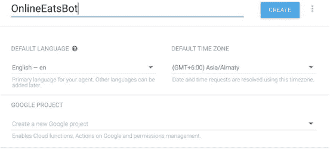

图 3-2. 在 `Dialogflow` 中创建新代理

3. 输入详细信息，如代理名称、时区、默认语言以及您想选择或新建的 `Google` 项目。
4. 创建意图。

查看图 3-3，您会发现系统已经提供了两个意图。

• 默认回退意图：如果用户的输入与任何常规意图或启用的内置闲聊都不匹配，则会触发回退意图。创建新代理时，会自动创建一个默认回退意图。您可以根据需要修改或删除它。
• 默认欢迎意图：我们可以扩展此欢迎意图用于自己的聊天机器人。您应该添加一些自己的用户表述和默认响应。

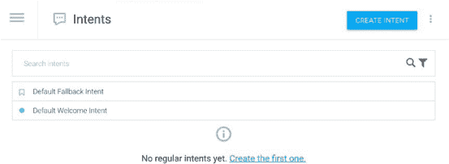

图 3-3. 在 `Dialogflow` 中创建意图

在创建我们自己的意图之前，让我们先在默认欢迎意图中添加一些表述，并按照以下步骤使其就绪：
1. 点击默认欢迎意图。
2. 在“训练短语”中添加您自己的用户表述。
3. 点击“保存”。

当我们点击保存时，后台的机器学习模型会运行并训练我们提供的数据（即用户表述）。训练数据意味着让机器根据我们提供的数据理解这是什么类型的意图，并能够在接收到新数据时进行预测。例如，查看图 3-4，我们定义了五个用户表述，机器已知这些表述属于“欢迎意图”。如果用户说“Hello there”（该表述未在任何地方定义），会发生什么？机器仍会将“Hello there”归类为默认欢迎意图，因为训练中使用的特征以及机器对欢迎意图的理解与新用户表述中的特征相似。

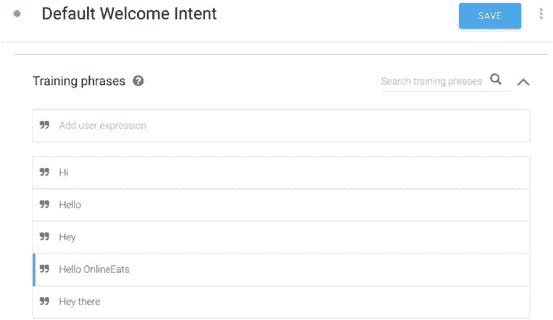

图 3-4. 在 `Dialogflow` 中定义默认欢迎或问候意图

让我们测试一下欢迎意图是否有效。使用 `Dialogflow`，我们可以在仪表板中直接进行测试。见图 3-5。

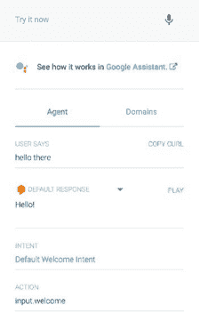

图 3-5. 在 `Dialogflow` 中测试欢迎意图

### 创建意图时的注意事项

让我们了解一些在 `Dialogflow` 中创建意图时的重要知识点。

• `Dialogflow` 的意图还具备为每个意图设置默认响应的功能。默认响应是每次识别到该意图时返回给用户的响应。在我们的示例中，当用户说“Hello there”时，我们会从机器人那里得到“Hello!”作为响应。
• 如果您愿意，可以添加更多响应或删除现有响应。拥有多个响应能让机器人看起来更真实，这样它就不会每次都回复相同的内容，让与机器人对话的用户感觉更人性化。
• `Dialogflow` 中的意图还可以标记为对话结束。换句话说，您可以让机器人假设用户将不再参与对话，机器人可以根据此信息执行必要操作来结束对话。

### 创建意图并添加表述

现在我们已经创建了欢迎意图，接下来创建下单意图，我将其命名为“下单意图”。

以下是我输入的用户表述：

我想要食物
我想尽快点餐
你能帮我点餐吗？
请帮我点餐
我想点中餐
我想点餐
你能帮我点餐吗？
请帮我点餐好吗？
我想点餐
我想点泰餐
我想点中餐

现在，我们已经构建了意图来识别上述用户表达或相关用户表达。接下来，是时候使用意图的默认回复向用户添加回复了。

### 为意图添加默认回复

我们将添加三种可能的回复，一旦检测到 `place_order_intent`，就会返回给用户。

当然，您今天想点什么？
没问题，您今天想吃点什么？
好的，我会尽力帮您。您今天想吃点什么？

现在，下一步是等待用户输入他想要的食物并解析这些食物。现在我们将创建一个新的意图，告诉我们用户实际想要点什么（即食物项目）。

我们创建一个名为 `items_description` 的新意图。

首先，我们添加标准的用户表达。

一个鸡肉饺子和两个春卷。

# 添加用户表达和实体

当我们添加用户表达后，我们可以选择特定的词语，将其指定为意图的实体。这可以是数量、日期或时间、地点等预定义的实体，但我们也可以通过点击弹出框右下角的“创建新实体”按钮来创建自己的实体。

## 高亮显示话语

高亮显示话语中你想要设为实体的词语。之后，会弹出创建我们自己的实体的对话框。

在这个例子中，我们应该能够以一种易于阅读的格式解析数据，以便我们可以使用任何编程语言来使用它。`JSON` 格式是当今跨平台应用中我们能拥有的最佳格式。`Dialogflow` 默认以 `JSON` 格式返回数据，可以解析成类似下面代码的样子。始终建议尽可能保持数据最小化；不要因为提供过多数据而使 `API` 响应过载。请记住，所有这些在规模化时都是要花钱的。

```json
{
  "food_items": {
    "chicken dumpling": 1,
    "Spring rolls": 2
  }
}
```

## 实体示例

项目描述意图及其所属实体

我们可以选择“一”和“二”，并将它们定义为 `@sys.number`，这其实就是数据类型。我们将创建一个名为 `food_items_entity` 的新实体来识别食物项目。

如果你查看图 3-6，你会发现我们有一个名为 `food_items_` 的实体，但当我们选择词语时，我们将参数命名为 `food_items_entity1`，对于食物数量也是如此，它是一个数字，我们将第一个和第二个参数分别命名为 `quantity1` 和 `quantity2`。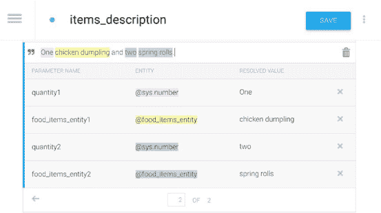 图 3-6. 项目描述意图

我们在这里定义的内容将帮助我们理解在意图被触发后我们将收到的 `JSON` 响应。我们应该拥有所有这些值，以便继续推进聊天机器人的流程。

## 创建实体

所以，选择整个词语或词语组合，然后点击“创建”。会出现一个新屏幕来创建实体；只需输入这个新实体的名称并保存。

现在，回到我们的 `items_description` 意图，你应该会看到类似图 3-6 的内容。

继续在训练短语中添加更多的用户表达，并在其中定义实体。

到目前为止，我们已经添加了四个话语，它们看起来是这样的。我们将尽可能多地添加，以便我们的智能体在意图分类方面的准确性更高。

`Dialogflow` 还有一个共享智能体训练数据的功能。本书中使用的训练数据可以通过 `Apress` 网站 https://github.com/Apress/building- 访问。正如你在图 3-7 中看到的，我们尝试在我们的 `Dialogflow` 智能体的项目描述意图中添加更多示例。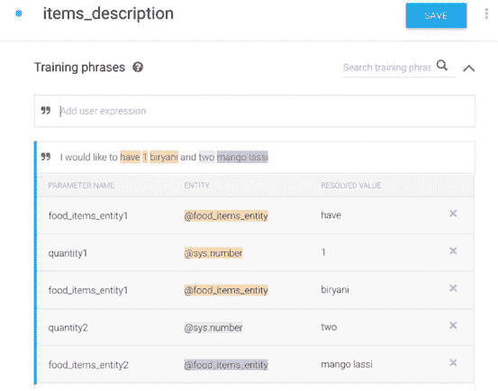 图 3-7. 在项目描述意图中添加更多话语

## 添加训练短语

现在，此时一旦我们保存了意图，并且我们的智能体完成了模型训练。如果我们在右侧输入以下句子，我们应该能够看到如下的 `JSON` 响应：

一个鸡肉饺子和两个春卷

来自意图的响应：

```json
{
  "id": "e8cf4a44-6ec9-49ae-9da8-a5542a80d742",
  "timestamp": "2018-04-01T21:22:42.846Z",
  "lang": "en",
  "result": {
    "source": "agent",
    "resolvedQuery": "One chicken dumpling and two spring rolls",
    "action": "",
    "actionIncomplete": false,
    "parameters": {
      "quantity1": 1,
      "food_items_entity1": "chicken dumpling",
      "quantity2": 2,
      "food_items_entity2": "spring rolls"
    },
    "contexts": [],
    "metadata": {
      "intentId": "0b478407-1b37-4f9a-8779-1866714dd44f",
      "webhookUsed": "false",
      "webhookForSlotFillingUsed": "false",
      "intentName": "items_description"
    },
    "fulfillment": {
      "speech": "",
      "messages": [
        {
          "type": 0,
          "speech": ""
        }
      ]
    },
    "score": 1
  },
  "status": {
    "code": 200,
    "errorType": "success",
    "webhookTimedOut": false
  },
  "sessionId": "e1ee1860-06a7-4ca1-acae-f92c6e4a023e"
}
```

如果你查看 `JSON` 响应的参数部分，我们会看到

```json
{
  "quantity1": 1,
  "food_items_entity1": "chicken dumpling",
  "quantity2": 2,
  "food_items_entity2": "spring rolls"
}
```

我们可以轻松地编写一些 `Python` 代码，将 `JSON` 转换为我们之前讨论的目标格式。 ––––––––  只需测试你的 `Python` 技能，尝试编写一段代码，读取像上面这样的 `JSON`，并返回数量及其所属的食物项目，格式为我们之前讨论的另一种 `JSON` 格式。

# 理解并回复用户

现在，对话的下一步是让机器人回复用户，告知订单已理解，并附带任何新信息。新信息可以是生成的订单 `ID`、订单金额或预计送达时间。这些信息将在你的服务器端填充，你可以将其与机器人的回复整合在一起，返回给用户。

现在，让我们尝试在我们的案例中添加订单金额；为此，我们可以使用 `Dialogflow` 的**默认回复**功能，并将其添加到意图中。我们先对金额进行硬编码，因为该金额会根据食品种类、数量或餐厅而有所不同。在本章后面，我们将讨论如何通过调用 `API` 使其动态化。有趣的是，我们可以访问从意图中获取的参数（即食品种类及其数量）。回复中可以包含对参数的引用，我们稍后会理解这一点。如果参数表中存在某个参数，我们可以使用以下格式在“文本回复”字段中引用其值：`$parameter_name`。我们可以在默认回复中使用这些参数，以便机器人向用户确认订单。添加“您的最终金额为 `XYZ`，您的订单已下达，包含 `$quantity1` 份 `$food_items_entity1` 和 `$quantity2` 份 `$food_items_entity2`”作为回复。 注意，如果我们的意图无法解析食品种类或其数量，我们需要给出一个不同的默认回复，要求用户解释机器人无法理解的内容，或者至少进行确认。我们已经在“向意图添加默认回复”一节中学习了如何向意图添加默认回复。

## 订单状态意图

现在，让我们创建 `order_status` 意图，用户可能在订单下达后尝试询问订单状态。图 3-8 展示了一些我们为订单状态意图添加的训练短语，我们将该意图命名为 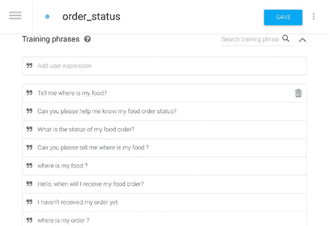 图 3-8. 创建订单状态意图 现在，让我们尝试一些随机的询问订单状态的语句，看看我们的智能体是否足够智能，能够识别出该意图。我尝试了一下，收到了我的食物，瞧——我的智能体完美地识别出这是一个 `order_status` 意图。请参见图 3-9 中 `JSON` 的 `resolvedQuery` 和 `intentName`。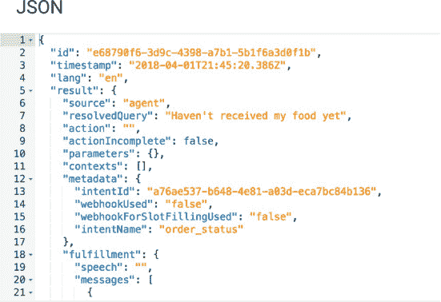

# 用户订单 ID 意图

––––––––

图 查询解析后来自 `Dialogflow` 的 `JSON` 回复

# 向用户询问与识别订单 ID

接下来，需要向用户询问订单 ID，因此我们将此意图的默认回复设置为提出以下问题：您能提供您的订单 ID 吗？现在，用户将提供他们的订单 ID，我们的任务是识别它并再次给出回复。为此，我们需要创建另一个意图，用于识别用户何时在谈论订单 ID。

请注意，我们正在创建的这些意图彼此之间相当独立。在这种情况下，我们知道用户将提供订单 ID，而且这很可能是正确的。如果错误，你总是可以返回给用户并再次询问。我们还应注意，在某些情况下，订单 ID 和电话号码可能都是整数。在这种情况下，我们需要进行一些验证，例如订单 ID 或电话号码的位数。此外，根据前一个问题的上下文，你可以判断用户是在提供订单 ID 还是电话号码。如第 1 章所述，我们始终可以使用决策树来更好地管理聊天机器人的流程。我们还可以通过编程方式跟踪：在 `order_status` 意图之后，我们询问订单 ID，用户将发送一些订单 ID（某个数字），这在代码中解析比创建一个全新的意图更容易。

在本例中，我们将创建 `user_order_id` 意图，因为不存在此类冲突。现在，我们创建一个名为 `user_order_id` 的新意图。图 3-10 展示了我们的 `user_order_id` 意图的样子。
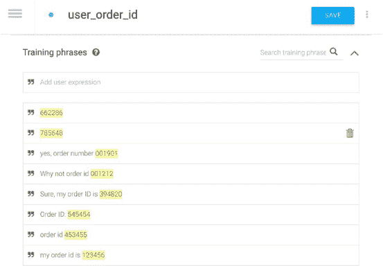
图 3-10. 在我们的智能体中定义用户订单 ID 意图

我测试了几个表达式，它能够很好地将它们正确分类为 `user_order_id` 意图。始终使用 Dialogflow 控制台进行测试，以查看你的意图是否按预期运行。现在，将 `user_order_id` 意图的默认回复设置为机器人的以下回复：订单 ID 为 `$order_id` 的订单状态。配送员正在您所在区域，您的食物大约 5 分钟后到达。我们再次使用从 `user_order_id` 意图解析出的参数来准备对用户的回复。

## 用户感谢意图

接下来，用户可能会表示感谢，如果没有其他情况的话，因此我们创建一个名为 `user_thanks` 的新意图，用于识别用户表达感谢的不同方式。这很重要，因为一旦用户以某种方式表示感谢，我们的机器人应该做出相应的回复。我们不应该仅仅期望用户在收到配送状态默认回复后说谢谢并盲目回复，而应该尝试使用自定义意图来识别它。

图 3-11 展示了我们的 `user_thanks` 意图的样子。
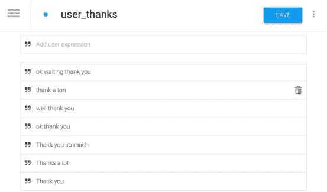
图 3-11. 定义用户说谢谢时的意图

现在，是时候使用默认回复功能向用户表示感谢，并将此意图标记为对话的结束。让我们添加一些文本，例如“非常感谢您的配合”，作为我们的默认回复。我们可以添加更多这样的回复，以使机器人看起来更真实（见图 3-12）。
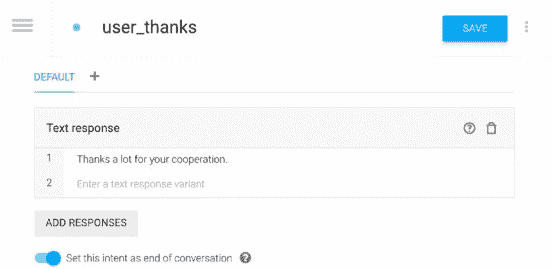
图 3-12. 在智能体中添加针对用户意图的回复

查看图 3-12，可以看到我们已将此意图启用为对话结束。如果我们尝试将机器人集成到 Google Assistant 中，启用此功能意味着当意图结束时，关闭 Google Assistant 中的麦克风。至此，我们已经创建了机器人，按照最初的设计和脚本构建了它，并对其进行了训练。现在，是时候将其部署到 Web 上，看看效果如何了。

## 在 Web 上部署 Dialogflow 聊天机器人

在这一部分，我们将把机器人集成到各种平台，如 Facebook Messenger、Twitter、Slack 等，并查看它们是否工作。还有许多其他平台可以轻松集成此机器人。我们现在将使用 Web Demo 和 Facebook Messenger 测试我们的机器人。

### 使用 Web 演示进行测试

让我们进入 Dialogflow 账户中的“集成”页面，并启用 Web 演示。您将看到一个类似图 3-13 的弹出窗口。点击弹出窗口中的链接。
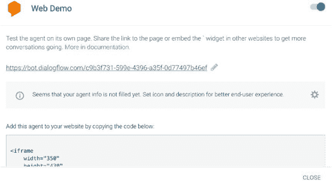
图 3-13. Dialogflow 的 Web 演示链接

您将看到类似图 3-14.1 至 3-14.4 的内容。我用我们编写的对话测试了我的机器人，它运行得非常好。
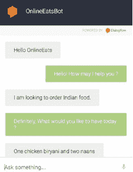
图 3-14.1. OnlineEatsBot 演示对话界面 I
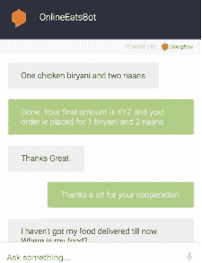
––––––––
图 3-14.2. OnlineEatsBot 演示对话界面 II
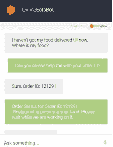
图 3-14.3. OnlineEatsBot 演示对话界面 III
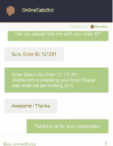
图 3-14.4. OnlineEatsBot 演示对话界面 IV

除此之外，我们还可以使用弹出窗口中的 iframe 代码，将这个机器人嵌入到我们自己的网站上。

在此处与我的 OnlineEatsBot 对话：
https://bot.dialogflow.com/c9b3f731-599e-4396-a35f-0d77497b46ef

也请将您自己的机器人分享给您的朋友和家人，看看他们如何以合理的方式与机器人互动。如果您的聊天机器人没有按预期工作，请尝试修复它。

### 将 Dialogflow 聊天机器人集成到 Facebook Messenger

在本节中，我们将尝试将同一个聊天机器人集成到 Facebook Messenger，这样我们 Facebook 平台上的用户也可以使用它，而无需访问我们的网站。

让我们回到 Dialogflow 控制面板中的“集成”页面，启用 Facebook Messenger 图标，然后点击它，这将弹出一个与之前类似的弹出窗口。在这里，我们需要前往 Facebook，注册一个应用，并获取所需的令牌。

* 验证令牌（任意字符串，仅供您自己使用）
* 页面访问令牌（输入在 Facebook 开发者控制台中生成的令牌）

Dialogflow 的 Facebook 集成非常有用，可以基于 Dialogflow 技术，轻松创建一个带有 NLU（自然语言理解）功能的 Facebook Messenger 机器人。

### 设置 Facebook

为了让我们的机器人在 Facebook 上以同样的方式工作，我们需要执行以下操作：

如果您还没有 Facebook 账户，请创建一个。创建一个 Facebook 页面，您可以将机器人添加到该页面。当用户访问您的 Facebook 页面并向您发送消息时，他们将直接与您的机器人对话。

### 创建 Facebook 应用

以下是创建应用的步骤：

1. 登录 Facebook 开发者平台。
2. 点击右上角的“我的应用”。
3. 点击“添加新应用”，输入名称和联系电子邮件地址。
4. 点击“创建应用 ID”，如下方图 3-15 所示。
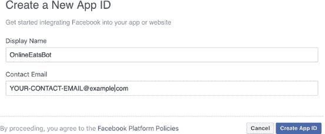
图 3-15. 在 Facebook 开发者平台创建新应用

在下一页，点击 Messenger 选项的“设置”按钮。在“令牌生成”部分，选择我们希望机器人连接的 Facebook 页面（见图 3-16）。
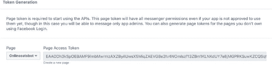
图 3-16. 通过为您的机器人选择 Facebook 页面来生成令牌

这将生成一个页面访问令牌。请妥善保管此令牌，因为我们稍后需要在 Dialogflow 中输入它。

# 设置 Dialogflow 控制台

以下是步骤：

点击 Dialogflow 控制台左侧菜单中的“集成”选项，如果尚未启用，请打开 Facebook Messenger。在打开的弹出窗口中，输入以下信息，如图 3-17“设置 Dialogflow 并与 Facebook Messenger 集成”所示：

* 验证令牌：这可以是您想要的任何字符串，仅供您自己使用。
* 页面访问令牌：输入在 Facebook 开发者控制台中生成的令牌。

点击“开始”按钮。

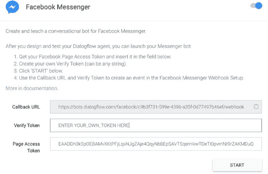

图 3-17. 设置 Dialogflow 并与 Facebook Messenger 集成

您应该会看到一条消息，显示“机器人已启动”。这意味着我们已经准备就绪。

您可能想知道什么是回调 URL、验证令牌和页面访问令牌。让我们来理解一下这些概念。

## 回调 URL

回调 URL 就是一个可公开访问的 URL，Facebook 会将来自您 Facebook 页面的任何实时请求 POST 到这个 URL。

假设您正尝试在 OnlineEats 上为您的食物付款，然后您被重定向到银行的支付页面。现在，OnlineEats 必须向银行提供一个回调 URL，以便银行在支付完成后可以将用户重定向回去。

在这里，Facebook 不会进行任何重定向，而是会获取用户在该页面聊天框中发送的所有内容，并将其 POST 到 webhook 或回调 URL。

现在，一旦我们在服务器上收到消息，我们就进行意图分类和实体解析，然后制定您想要回复给用户的内容。

## 验证令牌

验证令牌是在验证订阅时发送到您端点的一个任意字符串。需要它的原因是为了确保我们的服务器知道该请求是由 Facebook 发出的，并且与我们刚刚配置的订阅相关。

假设其他人知道了您的 webhook，并冒充 Facebook 发布消息，那么 `verify_token` 就会发挥作用，您将验证来源是否正确。基于此令牌，您还可以处理来自多个来源的 POST 请求，因为可以为不同的来源定义不同的令牌，但使用相同的回调 URL。

## 访问令牌

Facebook API 需要页面访问令牌来管理 Facebook 页面。每个页面、管理员和应用都有唯一的令牌，并且这些令牌有到期时间。


注意

请准备好回调 URL 和验证令牌，以便现在配置 webhook。


# 配置 Webhooks

要配置我们机器人的 webhook，让我们回到 Facebook 开发者控制台：

当您点击控制面板时，在“添加产品”部分的 webhooks 下点击“设置”按钮。如果您尚未订阅 webhooks，您将看到一个“订阅此对象”的选项。点击此选项会弹出一个新窗口，然后输入以下信息：

* 回调 URL：这是 Facebook Messenger 集成页面上提供的 URL。
* 验证令牌：这是您创建的令牌。

前往 Messenger ➤ 设置 ➤ 设置 Webhooks。您将看到一个类似图 3-18 的弹窗。添加您的回调 URL 并验证令牌。

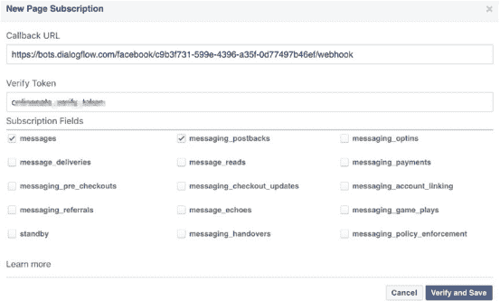

图 3-18. 在 Facebook 中为 Dialogflow 机器人设置 Webhooks

勾选“订阅字段”下的 `messages` 和 `messaging_postbacks` 选项。您当然可以根据自己的用例选择所需的选项。点击“验证并保存”按钮。请参考图 3-18。

您将返回设置页面，此时 Webhooks 应显示“完成”状态。请确保选择一个页面，以便您订阅该页面的 Webhook 事件。

# 测试 Messenger 机器人

为了让我们的机器人可供测试，我们需要将应用设为公开：

在 Facebook 开发者控制台的左侧菜单中，点击“应用审核”。点击“将 <您的应用名称> 设为公开？”下方的开关。如果出现“无效的隐私政策 URL”提示，请点击对话框中的“基础设置”链接，如果尚未填写，请先为“隐私政策 URL”输入任意 URL，然后点击“保存更改”。现在，返回“应用审核”页面，再次尝试将应用切换为公开。

系统会提示您为应用选择一个类别。从列表中选择“教育”。您也可以自由选择最适合您机器人的类别。点击“确认”按钮，如图 3-19 所示。

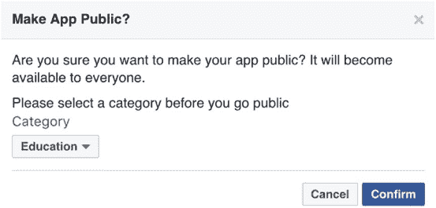

图 3-19. 将您的 Facebook 应用设为公开

我们还需要为我们的页面创建一个用户名。这是用户在使用我们的机器人时进行聊天的用户名。要设置用户名，请点击页面“关于”部分下的“创建页面 @用户名”链接，如图 3-20 所示。这有助于您仅使用一个简短名称来分享您的页面或机器人。

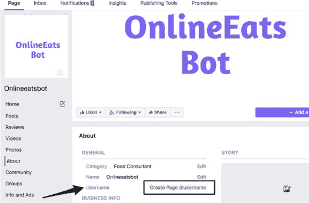

图 3-20. 创建您的 Facebook 机器人页面用户名

让我们在 Facebook Messenger 上测试我们之前在 Dialogflow 网站上测试过的相同机器人流程。您应该能够通过参考图 3-21.1 至图 3-21.4 看到我的 Facebook Messenger 机器人是如何响应的。

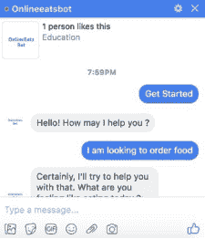

图 3-21.1. Facebook Messenger OnlineEatsBot 演示界面 I

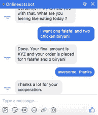

图 3-21.2. Facebook Messenger OnlineEatsBot 演示界面 II

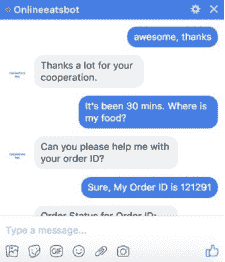

图 3-21.3. Facebook Messenger OnlineEatsBot 演示界面 III

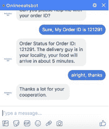

图 3-21.4. Facebook Messenger OnlineEatsBot 演示界面 IV

各位，这就是我们构建机器人的方法。

第 4 章会更加有趣。在第 4 章中，我们将尝试在不依赖 Dialogflow API 或仪表板的情况下实现相同的功能。

能够完全掌控自己所拥有的一切总是好的，不是吗？

注意：您可以前往您的账户设置，直接导出或导入智能体。您可以下载 zip 文件。您可以使用此 zip 文件将其导入 Dialogflow，并体验我们在本章中构建的聊天机器人。

您一定在想，如果我想实时处理订单，并使用供应商/餐厅的 API 查找订单状态并相应地回复用户，该怎么办？这可以是您想要进行的任何 API 调用——实时检索数据并制定机器人的响应。在结束本章并为下一章做准备之前，是时候了解如何做到这一点了。

让我们来了解 Dialogflow 中一个叫做 `Fulfillment` 的功能。

为了获取用户请求的实时信息，我们需要开发一些 API 或使用现有的 API。要使用 Dialogflow 实现这一点，我们需要进行设置，这包括部署一个服务并调用 API。

我们不会深入探讨构建 API 和如何部署的细节，但如果您曾经尝试使用过任何 Google 或 Facebook 的 API，您至少应该熟悉如何调用它们。

我构建了一个基于 Flask 的小型 API，并将其部署到了 Heroku。我将用它来实现 fulfillment，该 API 只需在 URL 中接收任何 `order_id`，并返回一个随机的 `order_status`。如果您不熟悉 Heroku，请不要担心，您可以在本地系统上运行提供的代码并进行测试。在接下来的章节中，我们将使用 Heroku 部署大量应用程序，届时您可以学习与之相关的知识。

在代码中，您可以了解如何解析 `order_identity`、`intentName` 等。在此处查找代码：`flask_onlineeats_demo.zip`

请求 URL：`https://radiant-bayou-76095.herokuapp.com/onlineeatsbot/api/v1.0/order_status/`

因此，在 Dialogflow Fulfillment 中，会将来自意图的 JSON 响应 POST 到此 URL，您需要解析该响应以获取相关的实体及其值，并执行特定的操作。

您也可以尝试将示例 Flask 应用代码部署到 Heroku，并在您的机器人中拥有自己的 fulfillment 端点。

现在，Dialogflow 会将启用了 webhook 调用的意图的 JSON 响应 POST 到我们的端点。该端点包含解析 `order_id` 实体并根据其采取行动的代码。目前，该代码仅从列表中返回一个随机选择的状态。

要测试 API 是否正常工作，请前往 POSTMAN 并使用图 3-22 中的示例数据进行测试。如果您在本地运行 Flask 应用，请使用本地 URL。

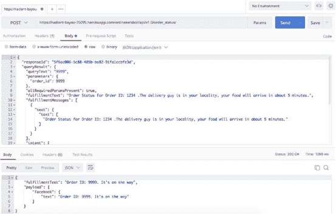

图 3-22. 在 POSTMAN 中测试部署在 Heroku 上的 fulfillment API

# 启用 Webhook

那么，让我们前往 Dialogflow 中的 fulfillment 页面，尝试启用 webhook（见图 3-23）。

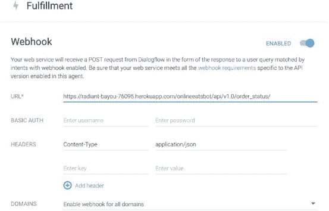

请确保您已为 `user_order_id` 意图启用了 webhook 调用（见图 3-24）。

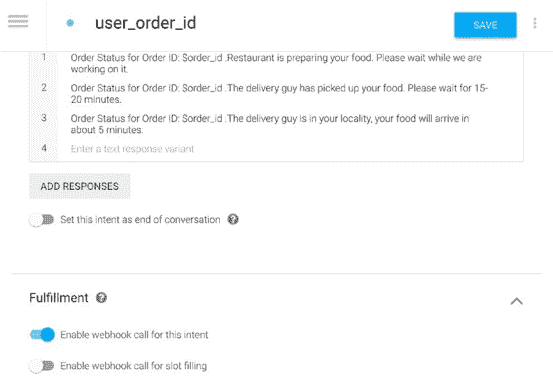

Dialogflow 会将一个 JSON 主体 POST 到您的 webhook URL，该主体将类似于图 3-25。

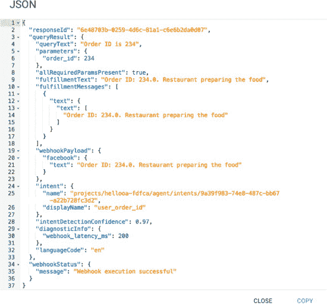

## 检查响应

每当 Dialogflow 将意图的 JSON 响应（如图 3-25 所示）POST 到你的 Web 服务时，它期望你的 Web 服务返回如图 3-26 所示格式的响应。

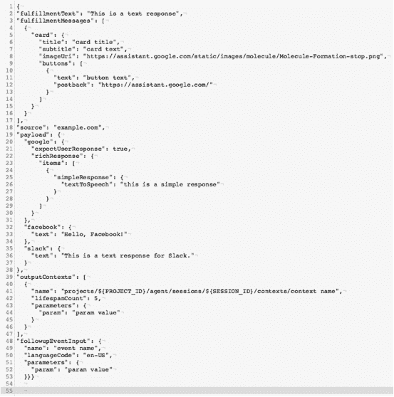

如果你认为你的 API 响应必须与图 3-26 的格式完全一致，那么请放心——事实并非如此。你的意图不会抛出错误，因为 JSON 主体中的所有键都是可选的。

以下是我的 API 响应及其完美运行的样子：

```json
{
    "fulfillmentText": "订单 ID：9999。正在途中",
    "payload": {
        "facebook": {
            "text": "订单 ID：9999。正在途中"
        }
    }
}
```

当我再次调用同一个 API 时，会得到不同的订单状态文本，但格式与 Dialogflow 引擎期望的相同。

```json
{
    "fulfillmentText": "订单 ID：9999。骑手已取到您的食物，请再等 10-15 分钟",
    "payload": {
        "facebook": {
            "text": "订单 ID：9999。骑手已取到您的食物，请再等 10-15 分钟"
        }
    }
}
```

`fulfillmentText` 是智能体向用户回复内容的关键。

现在，使用公共 URL 或在 Dialogflow 智能体本身中测试机器人，查看来自 API 的响应，而不是我们之前添加的默认静态响应。

这就是我们如何利用 Dialogflow 的 fulfillment 功能，将外部 API 或我们自己的 API 集成到聊天机器人中，从而实现动态和实时交互。

### 总结

在本章中，我们学习了 Dialogflow 以及如何使用 Dialogflow 构建聊天机器人。我们学习了如何定义意图及其对应的实体。我们构建了一个简单的食品订购聊天机器人，它能理解用户的订餐意图，还能识别用户点了哪些食品以及数量。我们还增强了聊天机器人的功能，让用户可以查询订单状态，获取订单 ID，并根据不同的订单状态生成回复。

我们还学习了 Dialogflow 中的 fulfillment，通过它从我们自己的 API 获取订单状态，并据此向用户提供回复。我们学会了为聊天机器人创建 Web 演示，并将其与 Messenger 集成。至此，你应该对聊天机器人的端到端工作原理有了清晰的认识。

在下一章中，我们将尝试更困难的方式来构建聊天机器人。是的，你没听错。我们将摆脱对 Dialogflow 等工具的依赖，以编程方式自行构建一切。让我们为下一章做好准备，因为当你从头开始构建一切时，那将会更加有趣。这就像训练和驯服你自己的聊天机器人。

我们下一章见。