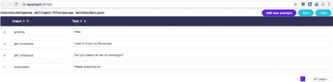
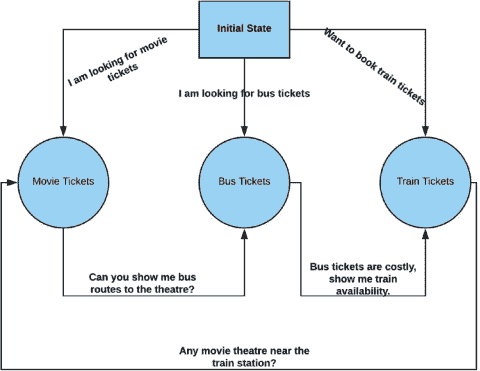
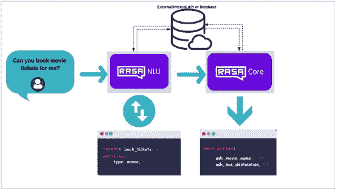

# 第 4 章 以更困难的方式构建聊天机器人  

“以更困难的方式构建聊天机器人”并不难学。  

这是为了完全掌控你自己的聊天机器人而采取的困难方式。如果你想自己构建一切，那么你就选择了这条艰难的道路。这条更艰难的路，当你走过时觉得困难，但当你回首时，却会发现它美丽而清晰。  

这是一条通往伟大高度的崎岖之路。  

——塞内卡  

如果你熟悉 Python，并且对如何安装包等有一定了解，那么学习本章内容不会有任何问题。如果你是开发者，这应该很容易。如果你是管理者或非技术人员，你仍然可以按照每个章节中提到的步骤逐一操作，并完成任务。我强烈建议每个人都完成本章，这样你就能学到构建聊天机器人的核心知识。  

本章不仅教你从头构建聊天机器人，还展示了在 `Rasa NLU` 的帮助下，核心机器学习（ML）如何与自然语言处理（NLP）协同工作。正如本书第一章所述，在构建聊天机器人时，拥有决策树总是好的。在本章中，我们几乎不会使用任何规则，但机器学习尚未达到 100% 可靠的阶段。因此，这个决定完全取决于你的用例，以及你是否希望在机器学习模型之外应用一些业务逻辑。有时，你的机器学习模型可能运行得非常好，以至于你根本不需要任何启发式规则。但根据我的经验，当你去销售或商业化你的聊天机器人时，你必须多加小心。没有功能总比拥有一个毫无意义的功能要好。  

我们将使用一个名为 `Rasa NLU` 的开源库，学习如何在不使用 Dialogflow、Watson、wit.ai 等云服务的情况下，从头构建聊天机器人。请记住，`Rasa NLU` 是一个非常复杂的库，包含许多功能。我们只会涉及对我们构建聊天机器人重要的概念和功能。  

## 什么是 Rasa NLU？  

`Rasa NLU` 是一个用于聊天机器人意图分类和实体提取的 NLP 库。它帮助你为聊天机器人构建和编写自定义的 NLP。  

本章将涵盖 `Rasa` 的两个部分。  

- `Rasa NLU`：使用 `Rasa NLU`，我们将学习为聊天机器人准备训练数据、编写配置文件、选择管道以及训练模型。最后，我们将使用模型预测文本的意图。我们还将学习如何使用 `Rasa NLU` 解析实体。  
- `Rasa Core`：在第二部分中，我们将学习训练 `Rasa Core` 对话管理模型，以准备向用户回复。当你的聊天机器人包含多种意图及其后续问题或回复时，这一部分变得非常重要。与其在决策树中编写大量条件，并在大型企业级应用出现问题时花费数小时调试，不如教会模型如何生成回复。  

观察我们训练好的模型在这方面的表现将会很有趣。我们不能仅仅以文本形式向用户随意输出内容；它必须是有意义的。  

## 为什么应该使用 Rasa NLU？  

`Rasa NLU` 并非只是另一个包含一堆方法来完成某些任务的库。它具备构建你能想象到的几乎任何类型聊天机器人的能力。`Rasa` 为你带来了神奇的能力：训练机器理解文本的含义，而不是让你编写规则来理解它。  

让我们看看以下几点，了解为什么应该使用 `Rasa NLU`：  

- `Rasa NLU` 是一个积极维护的项目，并且拥有一个良好的社区来支持它。  
- 如果我们不想将用户的敏感数据分享给第三方，就必须使用像 `Rasa NLU` 这样的开源工具从头构建聊天机器人。这样，所有数据都保留并在我们自己的服务器上进行处理。  
- 依赖第三方服务来训练数据并查找用户话语的意图，需要你调用可能并不总是可靠的 API。如果他们的服务器宕机，你的聊天机器人应用会怎样？  
- 使用 `Rasa NLU` 构建聊天机器人将使你完全掌控你的聊天机器人。你可以根据自己的意愿，使用你想要的数据来训练、调整和优化它。借助 `Rasa NLU`，我们可以试验哪种机器学习算法最适合我们的数据集，而不是依赖固定的算法。  

## 直接深入 Rasa NLU  

在本节中，我们将直接进入实践部分，尝试安装 `Rasa` 栈，并通过训练数据开始构建我们的机器学习模型。我们将使用一些更酷的开源库来让我们的工作更轻松。  

### 安装 Rasa  

要安装 `Rasa`，请运行以下 `pip` 命令，我们在之前的章节中曾用该命令安装 `spaCy`。请注意，我们将使用 `Rasa` 版本 0.13.2。  

```
pip install rasa-nlu==0.13.2
```

`Rasa NLU` 有多个组件用于分类意图和识别实体。  

`Rasa` 的不同组件有各自独立的依赖项。  

当我们训练模型时，`Rasa NLU` 会检查所有必需的依赖项是否已安装。如果你想安装完整使用 `Rasa` 库所需的所有依赖项，可以执行以下步骤：  

```
git clone https://github.com/RasaHQ/rasa_nlu.git #克隆仓库
cd rasa_nlu #进入 rasa 目录
pip install -r alt_requirements/requirements_full.txt #安装完整依赖项
```

第一步可能需要一些时间。请像大地一样耐心等待，直到它完成。  

### 在 Rasa 中决定管道  

管道不过是一组用于训练模型的算法。`Rasa NLU` 有两个广泛使用的管道，分别称为 `spacy_sklearn` 和 `tensorflow_embedding`。让我们对两者都稍作了解。  

#### spacy_sklearn  

- `spacy_sklearn` 管道利用了来自 GloVe 算法或 Facebook AI 团队开发的名为 fastText 的算法的预训练词向量。  
- `spacy_sklearn` 在以下场景中表现非常出色：假设你有一个话语，比如“What is the weather in Boston?”，当我们用相同的话语示例训练模型，然后要求它预测“What is the weather in London?”的意图时，我们的模型现在足够智能，能够知道“Boston”和“London”这两个词是相似的，并且它们属于同一个意图。  
- 这个管道对于小数据集非常有用。  

#### tensorflow_embedding  

- `tensorflow_embedding` 管道不像 `spacy_sklearn` 那样使用任何预训练的词向量，而是根据我们自己提供的数据集自行调整。  
- `tensorflow_embedding` 管道的好处在于，我们的词向量将根据我们的领域而定。  
- 为了用一个例子解释 `tensorflow_embedding` 的工作原理，在英语中，“play”这个词可能与“a sport”或“an activity of enjoyment or recreation”密切相关，并且它可能看起来与“an act”这个词非常不同。在戏剧领域，“play”和“an act”密切相关，其中“play”的意思是“a form of literature written by a playwright”，因此非常有必要告诉我们的模型学习特定于我们的领域，而不要因为某些预训练模型而混淆。  

## 从头训练和构建聊天机器人  

如果你已经阅读过本书的第 3 章，你一定熟悉我们使用 Dialogflow 构建的“食品订购聊天机器人”。你一定了解意图、实体以及聊天机器人对最终用户的响应。  

类似地，在本章中，我们将以一个聊天机器人的用例为例，从头开始构建它。你不一定需要使用相同的示例。请随意找到你自己的用例，按照本章的步骤操作，并在本章结束时构建你自己的聊天机器人。  

我们将构建一个星座运势机器人，它能够理解用户查询并告诉他们当天的星座运势。那么，让我们开始吧。  

### 构建星座运势机器人  

在这个使用开源库 `Rasa NLU` 完全自行构建聊天机器人的示例中，我们将构建一个星座运势机器人。让我们确定这个聊天机器人的范围，看看它能做什么以及可以做什么。  

- 星座运势机器人应该能够理解问候语并用问候语回复。  
- 机器人应该能够理解用户是否在询问星座运势。  
- 如果用户没有提供星座，机器人应该能够询问用户的星座。  
- 如果用户不知道自己的星座，机器人应该询问用户的出生日期并为他们找到星座。  
- 机器人应该能够订阅/取消订阅用户以获取每日星座运势。  
- 机器人应该能够从现有的响应中学习，以制定新的响应。  
- 机器人应该能够处理用户的拼写错误。  

我们的机器人在这里要做的任务相当简单。

# 构建聊天机器人：意图识别与数据准备

## 可能的意图
- **问候意图**：用户以问候开始对话
- **获取星座意图**：用户询问星座运势
- **用户星座意图**：用户告知其星座
- **用户出生日期意图**：用户告知其出生日期
- **订阅意图**：用户请求订阅

根据你设计机器人和编写代码的方式，你可能需要或不需要上述所有意图，或者你可能还需要定义一些额外的意图，以涵盖我们希望机器人完成的所有用例。随着本章内容的深入，我们将尝试构建一个能够完成提供星座运势基本任务的机器人；稍后作为练习的一部分，我们可以为其添加更多用例。

嗯，这基本上就是我们到目前为止，基于机器人和用户之间一个简单的可能对话，来识别可能意图所做的事情。

## 星座运势机器人与用户之间的对话脚本
让我们为聊天机器人和用户之间创建一个可能的对话脚本。正如第一章所述，编写对话脚本就像在构建软件之前准备一份软件需求文档。它之后可能会改变，但能让你对最终聊天机器人应用程序中将要发生的事情有一个整体的了解。

以下是我们用户与机器人之间对话的样子：

**用户：** 你好
**星座运势机器人：** 你好！希望你一切顺利。
**用户：** 我想知道我的星座运势。
**星座运势机器人：** 当然，可以告诉我你的星座吗？
**用户：** 摩羯座（拼写错误）
**星座运势机器人：** 抱歉，你是指摩羯座吗？
**用户：** 是的。
**星座运势机器人：** 好的，这是你今天的星座运势。今天你可能会感到乐观和积极。将这种能量分享给那些感到不太满足的人。你的态度可能会对朋友、伴侣、配偶和孩子产生深远的影响。邻居和亲戚可能会在你没有意识到的情况下感受到你的精神。如果有人受伤或生气，请给予鼓励。一切最终都会好起来的。
**星座运势机器人：** 你想订阅每日更新吗？如果愿意，只需说“订阅”。
**用户：** 是的，请帮我订阅。
**星座运势机器人：** 太好了，你现在已经订阅了。祝你有美好的一天。

这个对话只是为了让我们大致了解聊天机器人对话的样子。我们可能会也可能不会根据需求更改对话流程。

我们可以让我们的聊天机器人模型自行训练以准备有效的响应，而不是编写一堆`if...else`语句。

## 为聊天机器人准备数据
Rasa NLU 有多种方式在我们的自定义数据上定义意图及其实体。它支持 Markdown 格式、JSON 格式（作为单个文件）或包含多个文件的目录格式的数据。

我们将首先讨论最困难但高度可扩展的方法。手动创建 JSON 文件很困难，但通过编程方式创建则非常容易且可扩展。

### 以 JSON 格式为模型创建数据
Rasa NLU 期望的 JSON 格式数据有一个顶层对象，包含键和。
我们将要使用的最重要的键是 `common_`。以下是我们 JSON 数据的基本结构：
```
{
  "rasa_nlu_data": {
    "common_examples": [],
    "regex_features" : [],
    "entity_synonyms": []
  }
}
```
我们 JSON 数据中的 `common_examples` 键是用于训练我们模型的核心位置。我们将把所有训练示例添加到 `common_examples` 数组中。

`regex_features` 是一个帮助意图分类器识别实体或意图，并提高意图分类准确性的工具。

让我们开始编写我们的 JSON 文件。我们将其命名为 `data.json`。
1.  创建一个名为的文件夹。将当前工作目录更改为 `horoscope_bot`。
2.  启动 Jupyter Notebook #`jupyter notebook`。
3.  创建一个名为的新文件夹。
4.  点击 `data` 文件夹，然后在 Jupyter Notebook 的“新建”菜单下进入“文本文件”。
5.  点击创建的文件名称，将其更改为 `data.json`，并为你的聊天机器人编写意图。

对于步骤 5 和 6，你可以随意使用你喜欢的编辑器，如 Sublime、Notepad++、PyCharm 等来处理 JSON 文件。

以下是我的 `data` 文件夹下 `data.json` 文件的内容：
```
{
  "rasa_nlu_data": {
    "common_examples": [
      {
        "text": "Hello",
        "intent": "greeting",
        "entities": []
      },
      {
        "text": "I want to know my Horoscope",
        "intent": "get_horoscope",
        "entities": []
      },
      {
        "text": "Can you please tell me my horoscope?",
        "intent": "get_horoscope",
        "entities": []
      },
      {
        "text": "Please subscribe me",
        "intent": "subscription"
      }
    ],
    "regex_features": [],
    "entity_synonyms": []
  }
}
```
嗯，如你所见，手动准备这个看起来很笨拙。你一定还记得我们在 Dialogflow 中使用的那个又好又简单的方法。那么，让我们看看一个很酷且有趣的工具，用于创建 Rasa 期望格式的训练数据。它由 Polgár András 创建，对于检查和修改我们之前准备的现有数据也非常有用。如果你正在处理一个需要手动创建数据的小项目，这个工具可以节省大量时间。在你构建的任何完全由数据驱动的应用程序中，可视化数据总是一个好主意。

所以，先保存我们之前创建的 `data.json` 文件，直到我们使用更好的方法来扩展数据收集。

### 可视化和修改 Rasa 的 JSON 数据格式
在本节中，我们将使用一个名为 Rasa NLU trainer 的工具来可视化我们的数据（即我们到目前为止创建的数据）。这个工具也帮助我们标注数据。如果你还记得第三章中解释的 Dialogflow 界面，定义实体、实体名称和类型非常容易。我们将使用一个开源工具来做同样的事情。

Rasa NLU 训练器是一个非常便捷的工具，可以直接在浏览器中编辑训练数据。处理 JSON 数据既棘手又容易出错。借助这个便捷工具，我们可以轻松地向训练数据中添加更多示例或编辑现有示例，从而节省大量手动标注数据的时间。`rasa-nlu-trainer` 是一个基于 JavaScript 的工具，因此我们需要安装 `node.js` 才能在系统上运行它。安装过程不超过 5 分钟。让我们按照以下步骤进行设置：

1.  前往 `https://www.npmjs.com/get-npm` 下载 `node.js`。
2.  按照网站指引在系统上安装该软件包。
3.  安装完成后，打开一个新的终端/命令行界面，输入“`npm`”来检查是否安装成功。

我安装了 LTS 版本 8.11.4。安装完成后，运行以下命令来安装 `rasa-nlu-trainer`：
```
sudo npm i -g rasa-nlu-trainer
```

成功安装此命令后，您将看到类似以下的日志：
```
[fsevents] Success: "/usr/local/lib/node_modules/rasa-nlu-trainer/ node_modules/fsevents/lib/binding/Release/node-v57-darwin-x64/fse.node" already installed

Pass—update-binary to reinstall or—build-from-source to recompile

npm WARN slick-carousel@1.8.1 requires a peer of jquery@>=1.8.0 but none is installed. You must install peer dependencies yourself.

+ rasa-nlu-trainer@0.2.7 added 492 packages in 10.14s
```
即使您的消息与此不同，只要没有抛出任何错误，就无需担心。我们稍后就会知道 `rasa-nlu-trainer` 是否成功安装并能正常工作。

让我们在终端中进入之前创建的 `data` 文件夹，并运行以下命令：
```
rasa-nlu-trainer
```

输入此命令将在端口 55703 上启动一个本地服务器，并在默认浏览器中打开它。界面将类似于图 4-1。



如您所见，`data.json` 中的所有现有数据都被这个出色的工具加载，供我们删除或编辑，我们也可以从这里添加新的示例，它会不断扩展 `data.json` 文件。

我建议您为意图添加更多数据，以便更好地训练模型。如果您正在尝试构建本章中介绍的同一聊天机器人，可以从出版商提供的源代码压缩包或仓库中获取这个 `data.json` 文件。

就像我们在第 3 章中使用 Dialogflow 在话语中选择实体进行定义一样，我们可以使用此工具进行相同的操作，并为实体命名以便后续解析。因此，点击示例的切换按钮，选择文本，并通过命名来添加一个实体。

我在定义的每个意图中都添加了五到六个话语示例。我们添加的示例越多，模型训练效果就越好，准确率也越高。

现在查看 `data.json` 文件，您会发现它自动添加了更多示例。

# 验证数据与准备训练

因此，请继续验证您的 `data.json` 文件，确认其中包含了您从 `rasa-nlu-trainer` UI 添加的所有示例。您还会注意到，在 `data.json` 文件中，您可能使用 `rasa-nlu-trainer` UI 定义的实体被捕获在 `common_examples` 列表中，并带有 `start` 和 `end` 键，这告诉模型特定实体值在示例中的起始和结束位置。

同一个字典对象还描述了实体的值和我们定义的实体名称。对于我们的示例，它看起来如下：

```json
{
  "text": "19-01",
  "intent": "dob_intent",
  "entities": [
    {
      0,
      2,
      "value": "19",
      "entity": "DD"
    },
    {
      3,
      5,
      "value": "01",
      "entity": "MM"
    }
  ]
}
```

## 训练聊天机器人模型

在本节中，我们将基于准备好的数据训练一个模型。由于我们使用 Jupyter Notebook 进行文件创建和管理，我们将创建一个新的 `.ipynb` 文件，并开始编写 Python 代码，通过选择本章前面讨论的其中一个管道来训练我们的模型。

### 创建配置文件

让我们再次以之前使用 Jupyter 创建文件的方式创建一个 JSON 文件，并将其命名为 `config.json`。将其放在数据文件夹之外（即项目目录 `horoscope_bot` 中）。

向其中添加以下配置：

```json
{
  "pipeline": "tensorflow_embedding",
  "path": "./models/nlu",
  "data": "./data/data.json"
}
```

如您所见，`config.json` 文件中配置了一些重要的参数。让我们尝试理解它们。

*   `pipeline` 指定将使用哪些特征化器或特征提取器来处理文本消息并提取必要信息。在我们的例子中，我们使用的是 `tensorflow_embedding`。
*   `path` 本质上是训练后保存模型的目录。我们将模型保存在 `/models/nlu` 文件夹中。
*   `data` 是需要指定的路径，即训练数据所在的位置。

完成 `config.json` 文件后，让我们继续编写一些 Python 代码来训练我们的机器学习模型。


---

您也可以使用 `.yml` 文件作为配置文件，如下所示。您可以在 GitHub 仓库中找到示例 `config.yml` 文件。

*   **示例 1**：
    ```yaml
    language: "en"
    pipeline: "tensorflow_embedding"
    ```

*   **示例 2**：
    ```yaml
    language: "en"
    pipeline:
      - name: "nlp_spacy"
      - name: "tokenizer_spacy"
      - name: "intent_entity_featurizer_regex"
      - name: "intent_featurizer_spacy"
      - name: "ner_crf"
      - name: "ner_synonyms"
      - name: "intent_classifier_sklearn"
    ```


所有传入的消息都按照定义的组件顺序进行处理。定义的组件按顺序逐一运行，因此被称为处理管道。不同的组件用于不同的目的，例如实体提取、意图分类、预处理等。

这种格式的好处是，我们可以以清晰的方式指定 Rasa 预定义的管道。

## 编写 Python 代码训练模型并进行预测

让我们打开一个新的 `.ipynb` 文件，开始编写代码。将 `ipynb` 文件命名为 `rasa-nlu.ipynb`。请确保已针对您使用的 Python 版本成功安装了 `rasa-nlu==0.13.2`。

以下是我们使用 `data.json` 和 `config.json` 在 Python 中加载数据，并通过 `tensorflow_embedding` 管道训练模型的代码。

```python
from rasa_nlu.training_data import load_data
from rasa_nlu.model import Trainer
from rasa_nlu import config
from rasa_nlu.model import Interpreter

def train_horoscopebot(data_json, config_file, model_dir):
    training_data = load_data(data_json)
    trainer = Trainer(config.load(config_file))
    trainer.train(training_data)
    model_directory = trainer.persist(model_dir, fixed_model_name='horoscopebot')

def predict_intent(text):
    interpreter = Interpreter.load('./models/nlu/default/horoscopebot')
    result = interpreter.parse(text)
    print(result)
```

在代码的第一部分，我们从 `rasa_nlu` 包中导入了所有必要的库。然后定义了两个方法：`train_horoscopebot` 和 `predict_intent`。第一个方法根据给定的数据、配置文件（`config_file`）和模型存储目录（`model_directory`）来训练模型；第二个方法使用 `rasa_nlu` 中的 `Interpreter` 模型加载预训练好的模型文件，使用户能够预测任何新的文本示例。

### 训练模型

我们运行以下代码片段，调用 `train_horoscopebot` 方法并传入相应参数：

```python
train_horoscopebot('./data/data.json', 'config.json', './models/nlu')
```

在 `rasa-nlu.ipynb` 中运行此代码后，我们将得到类似如下的输出：

```
Epochs: 300/300 [00:01<00:00, 175.69it/s, loss=0.075, acc=1.000]
```

训练聊天机器人模型的代码会创建一个 `models` 文件夹，您可以通过 Jupyter 或文件资源管理器/访达应用查看。它会在我们指定的模型目录路径下生成一系列索引、元数据和 pickle 文件。

### 从模型进行预测

让我们调用该方法，传入一段文本，看看训练好的模型表现如何：

```python
predict_intent("I am looking for my horoscope for today. I am wondering if you can tell me that.")
```

该方法会直接打印输出结果。对于上述文本，我的输出如下所示：

```
INFO:tensorflow:Restoring parameters from ./models/nlu/default/horoscopebot/intent_classifier_tensorflow_embedding.ckpt

{
  "intent": {
    "name": "get_horoscope",
    "confidence": 0.9636583924293518
  },
  "entities": [],
  "intent_ranking": [
    {
      "name": "get_horoscope",
      "confidence": 0.9636583924293518
    },
    {
      "name": "dob_intent",
      "confidence": 0.03462183475494385
    },
    {
      "name": "greeting",
      "confidence": 0
    },
    {
      "name": "subscription",
      "confidence": 0
    }
  ],
  "text": "I am looking for my horoscope for today. I am wondering if you can tell me that."
}
```

哇！是不是很神奇？我们的模型以 96% 的置信度预测出了这段文本的意图。您可以在提供的 `ipynb` 文件中看到，我们的模型在预测其他意图方面也表现良好。

# TensorFlow与Rasa实践

这就是 tensorflow 和机器学习整体的力量。毋庸置疑，`rasa_nlu`库让这一切变得如此简单可信。所以，是时候回顾一下了——如果您还记得本书的第 3 章，那么您一定记得，每当我们添加一个新示例时，Dialogflow 都会重新训练模型。它实际上在幕后做着和我们刚才一样的事情。我们当时无法更改模型或调整任何参数，但现在我们完全可以掌控这一切。

既然我们已经成功使用 tensorflow 构建并训练了一个模型，并且也对其进行了测试，接下来我们将进入对话管理的下一个主题。我建议您测试一下您的机器人可能面临的所有场景，这样您就能了解模型在哪些方面表现不佳，并据此添加更多数据或在必要时调整参数。

另外请记住，只有当训练数据发生变化时，才需要重新训练模型。如果训练数据没有变化，我们可以加载现有的训练模型，持续对新示例进行预测。

## 使用 Rasa Core 进行对话管理

在本节中，我们将通过训练另一个用于 Rasa Core 对话管理的模型来亲自动手实践。请记住，此时我们已经有了一个可以预测文本意图的模型，我们可以编写一些 Python 代码来生成回复，并回复给客户。但是，如果我们想为机器人添加更多意图呢？在功能众多的大型应用中，这种方式是否可扩展？答案是否定的。这时，Rasa Core 的对话管理功能就派上用场了。

如果您曾在任何平台上使用过任何机器人，您一定见过它在某些情况下失败。是的，我们都经历过这种情况，而且这种情况至今仍然存在——如今的机器人往往无法妥善管理对话的上下文，也无法跟上对话的节奏。借助 Rasa Core 基于机器学习的对话框架，我们可以轻松解决这个问题。

Rasa Core 在企业级应用中久经考验，被成千上万的开发者使用，因为它生产就绪、易于使用和扩展，而且最重要的是，它是开源的。

## 进一步了解 Rasa Core 和对话系统

在我们真正进入 Rasa Core 对话管理模型的编码部分之前，理解其来源和适用场景非常重要。

我们将尝试理解迄今为止我们构建聊天机器人的方式，以及这种方式将如何被彻底改变。

举个例子：

如果我们想构建一个简单的聊天机器人，帮助用户预订机票/巴士票/电影票/火车票，最简单的方法是创建一个状态机或决策树，编写一堆`if...else`语句，然后就可以完成了。这种方法虽然可行，但无法扩展。如果客户最初对某件事有良好的体验，他们就会想更多地使用它。通过一些启发式方法，我们可以让聊天机器人显得智能，但这种智能无法持久。

当代码的控制流从 `try` 块跳转到 `except` 块时，我们开始挠头。图 4-2 简单展示了用于构建此聊天机器人的状态机可能的样子。



–––––––

图 4-2. 订票聊天机器人的状态图表示

观察我们的状态图，它可能适用于正常对话场景，比如用户正在查找电影票、汽车票或火车票，或者在询问电影票后想要预订汽车票。但如果用户同时询问汽车票和电影票呢？你可能会说，我们可以在已经嵌套的代码中再添加几个 `if...else` 语句来处理这种情况。如果你是一名优秀的开发者，编写一个状态机的输入输出或扩展决策树并不会花费太多时间。但请思考一下这种情况：当这些条件开始呈指数级增长，你必须不断添加用例来处理它们，并且它们开始相互干扰时，该怎么办？

我们的大脑运作方式是通过学习和再学习。如果一个孩子不知道火会对自己造成什么伤害，他会去触摸它；但当火灼伤他时，他就不会再碰了。他会强化一个事实：火是有害的。奖励机制也是如此——当你做某事并得到回报时，你会将“做某事会带来奖励或更好的奖励”这一事实关联起来，然后你倾向于再次这样做。这在机器学习中被称为**强化学习**，即机器通过执行动作并理解结果来学习如何在特定情境中表现。强化学习有时并非最佳方法，例如在数据不足以学习、数据质量不足以学习奖励场景等情况下。

图 4-3 是一张示意图，帮助你理解 Rasa Core 如何在 Rasa 技术栈中完美契合，以及它与我们一直在学习的 Rasa NLU 各自扮演的角色。



图 4-3. 展示 Rasa NLU 和 Rasa Core 工作原理的示意图

借助 Rasa Core，我们可以指定机器人应该说或做的所有事情。这些被称为**动作**。一个动作可能是向用户打招呼、查询数据库，或者通过某个网络服务或 API 检索信息。

Rasa Core 提供了训练概率模型的功能，以根据用户的历史对话预测需要执行什么动作。想象一下，如果没有 ML 模型，你需要编写数百个用例来确定应该发送或执行什么响应或动作。简单来说，Rasa Core 为你解决了这个问题。

让我们看看在第 3 章构建 OnlineEatsBot 时，我们创建的用户与机器人的并排对话。


用户 | OnlineEatsBot
---|---
 | 你好，onlineeats
你好！有什么可以帮你的吗？ | 我想点餐
好的，今天想点什么？一个鸡肉汉堡 | 好的。您的最终金额是 3.99 美元
 | 谢谢
非常感谢

这段对话非常简单，即使没有 ML 模型也能完成，尽管我们确实使用了训练好的模型来识别其中的意图和实体。

现在，你脑海中可能会浮现一个有趣的问题：“如果我希望我的机器人能够更改订单呢？如果我希望我的机器人能够删除或增加食品数量呢？”因此，正如讨论过的，添加更多用例、更多复杂性、更多意图及其表述、更多代码中的 `if...else` 来处理边界情况——但当你为企业构建聊天机器人时，你必须通过它来扩展业务以产生更多收入。所有软件系统都这样做，而那些不这样做的系统则无法生存。关键在于，我们不能一直修改和部署代码。

因此，与其在每次出现情况时处理所有用例并重复操作，我们可以借助 Rasa Stack 采取 ML 路线来解决这个问题。Rasa Stack 会根据用户的上下文和对话状态告诉我们机器人下一步应该做什么。由于模型会根据先前对话数据的上下文自行学习，机器人更容易保持对话的自然和用户友好性，而不是从四五个固定句子中随机选择。

Rasa 建议数据较少或没有数据的用户使用交互式学习。我们将在本章后面进一步了解交互式学习。

在真正开始使用 Rasa Stack 编写机器人的核心部分之前，我们首先需要理解几个概念。

### 理解 Rasa 概念

在完全将这些概念应用于代码之前，理解几个与 Rasa 相关的特定概念非常重要。在本节中，我们将学习 Rasa NLU 中一些重要且非常实用的概念。请确保你完全理解这些概念，因为我们将在使用 Rasa 的领域文件格式构建第一个内部聊天机器人时用到它们。如果我们不理解这些概念的含义，那么下一步将难以进行。

#### 动作

顾名思义，这是一个可以执行的特定动作。根据 Rasa 文档，它指的是“响应对话而采取的动作”。

例如，如果用户询问今天的星座运势，我们的机器人可以执行“GetTodaysHoroscope”动作。让我们看看“GetTodaysHoroscope”动作在代码中是什么样子。

```python
from rasa_core.actions import Action
from rasa_core.events import SlotSet

class GetTodaysHoroscope(Action):
    def name(self):
        return "get_todays_horoscope"

    def run(self, dispatcher, tracker, domain):
        # type: (Dispatcher, DialogueStateTracker, Domain) -> List[Event]
        user_horoscope_sign = tracker.get_slot('horoscope_sign')
        """编写你的逻辑，根据某些 API 调用或数据库检索，获取给定星座的今日运势详情"""
        return [SlotSet("horoscope_sign", user_horoscope_sign)]
```

`name` 方法返回动作的名称，我们将在领域文件中将其作为自定义方法名引用。

`run` 方法负责执行动作的主要工作——即核心业务逻辑位于此处。如你所见，它接受三个参数：`dispatcher`、`tracker` 和 `domain`。让我们逐一理解这些参数：

- `dispatcher`：调度器用于向用户发送消息。我们可以使用 `dispatcher.utter_message()` 来实现这一点。
- `tracker`：当前用户的状态追踪器。我们可以使用 `tracker.get_slot(slot_name)` 访问槽值，要获取最近的用户消息，可以使用 `tracker.latest_message.text`。
- `domain`：机器人的领域。我们将在本章后面更详细地讨论领域。

# Rasa 核心概念与实践


**注意**：`run` 方法返回一个事件实例列表。


---

### 槽位

槽位是让机器人能够像人类一样工作的关键。槽位就像一个存储空间，可以存储用户提供的信息，也可以使用从数据库或 API 预取的信息。

针对不同的用例，有不同类型的槽位。

例如，在我们构建 HoroscopeBot 的用例中，我们可能希望将用户提供的 `horoscope_sign` 的槽位类型设置为文本。

根据你想要保留的槽位类型，Rasa 提供了一些预定义的槽位类型。除了文本类型，Rasa 还有以下槽位类型：

• **布尔型** ⇒ 用于真/假值
• **类别型** ⇒ 用于需要从几个值中选择一个的情况
• **浮点型** ⇒ 用于连续值
• **列表型** ⇒ 用于值列表
• **特征化型** ⇒ 用于不影响对话的内部值存储

### 模板

“模板”这个词你在生活中一定至少听过一次，比如在寻找发送电子邮件的模板、准备文档的模板、构建个人作品集网站的模板，或者遵循某个流程时。

Rasa 中的模板用于话语。一个话语模板包含一组预设文本，当某个动作被触发时，这些文本会被发送给用户。通过使动作的名称与话语相同，或者通过一个包含自定义代码的动作，我们可以将模板中格式化后的消息发送给用户。

领域文件中模板的简单表示可能如下所示：

```
templates:
  utter_greet:
    - "你好，{name}。{name} 可以通过同名槽位或自定义代码填充"
  utter_goodbye:
    - "再见"
    - "保重。多个模板允许机器人从中随机选择"
  utter_default:
    - "抱歉，我没有理解您的意思。"
```

现在，我们已经了解了动作、槽位和模板这三个概念，并且通过第 3 章的学习已经知道了意图和实体是什么，我们准备深入 Rasa，开始为我们的第一个聊天机器人编写代码。

### 为聊天机器人创建领域文件

使用 Rasa 技术栈构建聊天机器人时，首要任务就是创建一个领域文件。

根据 Rasa 的文档：“领域定义了你的机器人运行所在的宇宙。它指定了你的机器人应该知道的意图、实体、槽位和动作。可选地，它还可以包含机器人可以说的话的模板。”

现在，你明白为什么我们之前要提前理解 Rasa 核心概念来为这种情况做准备了吧。让我们创建一个使用 YAML 定义的 `DefaultDomain` 文件。Rasa 使用 `.yml` 文件来定义领域格式。

最初，YAML 被认为是“Yet Another Markup Language”（另一种标记语言）的缩写，表明其作为标记语言的用途，但后来被改为理解为“YAML Ain't Markup Language”（YAML 不是标记语言），这是一个递归缩写，目的是将其用途区分为面向数据，而不是文档标记语言。

现在，让我们回到我们的 `rasa-nlu` Jupyter Notebook 目录，开始创建文件。请注意，我们可以使用命令行将所有代码写在单独的文件中，并使用编辑器进行编辑。我发现 Jupyter Notebook 更具交互性，并且浏览文件更方便。选择你习惯的方式即可，但了解 Jupyter Notebook 提供的大部分功能是件好事。

进入主 `horoscope_bot` 目录，创建一个文件，我们将其命名为 `horoscope_domain.yml`。

以下是我们机器人的 `horoscope_domain.yml` 文件内容：

```
slots:
  horoscope_sign:
    type: text
  DD:
    type: text
  MM:
    type: text
  subscribe:
    type: bool

intents:
  - greeting
  - get_horoscope
  - subscription
  - dob_intent

entities:
  - horoscope_sign
  - DD
  - MM
  - subscribe
  - dob_intent

templates:
  utter_greet:
    - '你好！今天过得怎么样？'
  utter_ask_horoscope_sign:
    - '你的星座是什么？'
  utter_ask_dob:
    - '你的出生日期是什么（DD-MM 格式）？'
  utter_subscribe:
    - '你想订阅每日更新吗？'

actions:
  - utter_greet
  - utter_ask_horoscope_sign
  - utter_ask_dob
  - utter_subscribe
  - get_todays_horoscope
  - subscribe_user
```

如你所见，领域文件由五个重要部分组成：意图、实体、槽位、模板和动作，这些我们之前都讨论过。

请注意，每个模板都对应一个 `utterAction` 定义，例如 `utter_greet`，并且我们必须在模板部分定义一个同名的模板。

正如在我们的示例中所见，主要定义了五个动作，其中前三个动作仅用于向用户说出模板文本，但最后两个动作需要我们要么从数据库检索数据，要么进行 API 调用来获取当天的星座运势并将其返回给用户。

对于 `subscribe_user` 动作也是如此，我们需要执行一个操作，将当前用户添加到数据库的订阅列表中。这些用户定义的动作被称为自定义动作。要实现这样的自定义动作，我们需要编写当这些动作被触发时机器人应该执行的操作。

在下一节中，我们将学习如何编写自定义动作。

### 编写聊天机器人的自定义动作

众所周知，每当触发一个 UtterAction 时，我们的机器人会根据该动作模板中定义的文本来回复。但当某个自定义动作被触发时会发生什么呢？在本节中，我们将编写 Python 代码来创建自定义动作，这些动作可用于调用 API 或执行任何 Python 能实现的操作。

让我们在项目目录（即本例中的 `horoscope_bot` 文件夹）中创建一个名为 `actions.py` 的新文件。

```python
from __future__ import absolute_import
from __future__ import division
from __future__ import print_function
from __future__ import unicode_literals

import requests

from rasa_core_sdk import Action
from rasa_core_sdk.events import SlotSet

class GetTodaysHoroscope(Action):
    def name(self):
        return "get_todays_horoscope"

    def run(self, dispatcher, tracker, domain):
        # type: (Dispatcher, DialogueStateTracker, Domain) -> List[Event]
        user_horoscope_sign = tracker.get_slot('horoscope_sign')
        base_url = "http://horoscope-api.herokuapp.com/horoscope/{day}/{sign}"
        url = base_url.format(**{'day': "today", 'sign': user_horoscope_sign})
        # http://horoscope-api.herokuapp.com/horoscope/today/capricorn
        res = requests.get(url)
        todays_horoscope = res.json()['horoscope']
        response = "Your today's horoscope:\n{}".format(todays_horoscope)
        dispatcher.utter_message(response)
        return [SlotSet("horoscope_sign", user_horoscope_sign)]
```

如我们所见，`GetTodaysHoroscope` 动作中包含两个方法。第一个方法 `name` 仅返回动作的名称。另一个方法是 `run`，如前所述，它通过执行我们编写的业务逻辑来实际完成任务。

在我们的方法中，我们使用了一个代码托管在 GitHub 上的开源 API。该 API 的 URL 格式如下：

`http://horoscope-api.herokuapp.com/horoscope/today/capricorn`

它以 JSON 格式返回数据：

# 对话流程、动作与训练数据

```json
{
    "date": "2018-08-29",
    "horoscope": "You will be overpowered with nostalgia and may long to get in touch with old pals. And as Ganesha says, chances are that you may take a liking to your ex-lover, while simultaneously strengthening your social standing. All in all, the day will be a productive one.",
    "sunsign": "capricorn"
}
```

正如你在`run`方法中所见，我们将 API 的响应转换为 Python JSON 对象，然后从 JSON 中访问`'horoscope'`键以获取实际运势。获取到 JSON 中的运势后，我们构建响应，并使用`dispatcher`对象及其`utter_message`方法将其发送回用户。最后，我们使用`SlotSet`方法设置槽位。`SlotSet`类似于保存从用户响应中提取的变量，以便在对话流程中随时在代码中使用它们。


## 注意

使用上述 API，只需提供星座标识即可获取今日运势。你可以自由使用自己的 API 或数据库，只需将 API 调用替换为你想要使用的其他数据源即可。


就像我们在`actions.py`文件中添加了`GetTodaysHoroscope`动作一样，我们也将添加`SubscribeUser`动作。我们不打算使用数据库来存储用户的订阅偏好，但在为真实用户构建聊天机器人时，你可能需要用户 ID，以便在数据库中将其与订阅信息关联起来。

以下是`SubscribeUser`动作的代码：

```python
class SubscribeUser(Action):
    def name(self):
        return "subscribe_user"

    def run(self, dispatcher, tracker, domain):
        # type: (Dispatcher, DialogueStateTracker, Domain) -> List[Event]
        subscribe = tracker.get_slot('subscribe')
        if subscribe == "True":
            response = "You're successfully subscribed"
        if subscribe == "False":
            response = "You're successfully unsubscribed"
        dispatcher.utter_message(response)
        return [SlotSet("subscribe", subscribe)]
```

像这样，我们可以根据需要编写任意数量的自定义动作。

## 对话训练数据

下一步是数据。Rasa 的对话管理模型是基于用户与聊天机器人之间的实际对话进行训练的。这里的关键点是，这些对话必须转换为故事格式。

故事本质上就是用户与聊天机器人之间的实际对话，其中用户输入被转换为意图和实体，而聊天机器人返回的响应则被视为机器人在需要时应触发的动作。

下表给出了一个示例，展示了用户与聊天机器人之间的真实对话如何以故事形式呈现。

### 场景一


| 用户 | HoroscopeBot |
|------|--------------|
| hello there! | utter_greet |
| i want to know my horoscope for today | utter_ask_horoscope_sign |
| My sign is Capricorn | actions.gettodayshoroscope |
| Can you subscribe me for updates? | actions.subscribeuser |

### 场景二


| 用户 | HoroscopeBot |
|------|--------------|
| hello there! | utter_greet |
| i want to know my horoscope for today | utter_ask_horoscope_sign |
| i don’t know my sign | utter_ask_dob |
| 12-12 | actions.gettodayshoroscope |

我们尚未在代码中处理用户不知道星座但知道出生日期的场景。在这种情况下，我们的代码需要修改，以便在未找到`horoscope_sign`值时获取`DATE`和`MONTH`实体。

我们可以使用 DD-MM 值来检查星座，然后显式调用`GetTodaysHoroscope`方法，或者以这种方式训练模型。

## 训练机器人的数据准备

在进行任何机器学习之前，拥有高质量的数据始终很重要。训练聊天机器人也需要数据；用户与聊天机器人之间的对话就是我们训练模型所需的数据。有时，在网络上免费找到适合自己需求的数据集并不容易。

我们应该花必要的时间来收集数据。我们可以请朋友和家人提供样本对话文本，展示他们如何与你正在构建的这类机器人互动。有些人会为此创建示例应用程序并众包数据。因此，数据越好，模型越好，聊天机器人的响应也越好。

在数据准备方面，Rasa 不遗余力，并提供了一个名为**交互式学习**的酷炫功能。它可以帮助你轻松生成故事数据，并在我们不断添加故事数据的同时训练对话管理模型。你可以称之为实时机器学习训练。因此，随着我们不断添加故事数据，我们可以了解模型是否产生了正确的输出。最重要的是，当我们添加新故事时，我们可以看到模型是在改进还是退化。在大多数情况下，它会变得更好，因为我们实际上是在进行强化学习，告诉机器学习模型忘记并重新学习——这与人类的行为非常相似。

## 创建故事数据

正如我们所知，故事数据只是用户与聊天机器人之间对话的一种表示方式，展示了对话如何导向逻辑终点。通常，所有聊天机器人都旨在帮助用户完成一组预定义的任务；故事只是展示了这些任务是如何完成的。

我们将尝试以 Rasa 期望的格式准备一些简单的对话。这些对话将是**无状态的**——也就是说，它们不依赖于之前的对话。我们将使用手工制作的无状态故事进行交互式学习。

我们将花几分钟时间手工整理一些我们知道的故事，以便熟悉故事数据的创建方式。

首先，在我们的`data`文件夹中创建一个名为`stories.md`的文件。

## story_001
*   `greeting`
    -   `utter_greet`
*   `get_horoscope`
    -   `utter_ask_horoscope_sign`
*   `get_horoscope{"horoscope_sign": "Capricorn"}`
    -   `slot{"horoscope_sign": "Aries"}`
    -   `get_todays_horoscope`
    -   `utter_subscribe`

## story_002
*   `greeting`
    -   `utter_greet`
*   `get_horoscope{"horoscope_sign": "Capricorn"}`
    -   `slot{"horoscope_sign": "Cancer"}`
    -   `get_todays_horoscope`
    -   `utter_subscribe`
*   `subscription`
    -   `slot{"subscribe": "True"}`
    -   `subscribe_user`

## 带星座查询的星座运势
*   `greeting`
    -   `utter_greet`
*   `get_horoscope`
    -   `utter_ask_horoscope_sign`
*   `get_horoscope{"horoscope_sign": "capricorn"}`
    -   `slot{"horoscope_sign": "capricorn"}`
    -   `get_todays_horoscope`
    -   `slot{"horoscope_sign": "capricorn"}`
    -   `utter_subscribe`
*   `subscription{"subscribe": "True"}`
    -   `slot{"subscribe": "True"}`
    -   `subscribe_user`
    -   `slot{"subscribe": true}`

## 用户提供星座的情况
*   `greeting`
    -   `utter_greet`
*   `get_horoscope{"horoscope_sign": "leo"}`
    -   `slot{"horoscope_sign": "leo"}`
    -   `get_todays_horoscope`
    -   `slot{"horoscope_sign": "leo"}`
    -   `utter_subscribe`
*   `subscription{"subscribe": "True"}`
    -   `slot{"subscribe": "True"}`
    -   `subscribe_user`
    -   `slot{"subscribe": true}`

## 用户直接请求订阅
*   `greeting`
    -   `utter_greet`
*   `subscription{"subscribe": "True"}`
    -   `slot{"subscribe": "True"}`
    -   `subscribe_user`
    -   `slot{"subscribe": true}`

如果你盯着这些故事看几分钟，它们就会向你坦白它们的含义；理解发生了什么应该不难。前两个故事的主要区别在于，第一个故事中用户没有提及自己的星座，机器人需要询问星座，然后继续故事。在第二个故事中，用户自己说出了星座，然后以订阅对话结束故事。我们添加了更多故事来覆盖更多用例。欢迎你在同一个文件中添加自己的故事。

所以，基本上故事就是 `markdown` 文件，我们可以按照前面展示的 `markdown` 格式在其中编写任意数量的故事。手动完成这项工作似乎有点困难。因此，我们将尝试学习如何使用 `Rasa` 自己的交互式学习工具来生成更多类似的故事。

让我们开始吧。

# 交互式学习

到目前为止，我们一直在零散地讨论交互式学习，但现在是时候实际编写一些代码并付诸实践了。交互式学习是 `Rasa` 最酷的功能之一，它让机器学习部分变得既有趣又简单。它分为两部分：第一部分，我们通过使用各种策略提供初始数据集来训练模型；第二部分，我们以交互方式测试模型、纠正模型并重新训练模型。

## 训练聊天机器人代理模型

让我们在主项目目录中创建一个名为 `train_initialize.py` 的新文件。`train_initialize.py` 的内容如下：

```python
from __future__ import absolute_import
from __future__ import division
from __future__ import print_function
from __future__ import unicode_literals

from rasa_core import utils
from rasa_core.agent import Agent
from rasa_core.policies.keras_policy import KerasPolicy
from rasa_core.policies.memoization import MemoizationPolicy
from rasa_core.policies.sklearn_policy import SklearnPolicy

if __name__ == '__main__':
    utils.configure_colored_logging(loglevel="DEBUG")
    training_data_file = './data/stories.md'
    model_path = './models/dialogue'
    agent = Agent("horoscope_domain.yml",
                  policies=[MemoizationPolicy(), KerasPolicy()])
    training_data = agent.load_data(training_data_file)
    agent.train(
        training_data,
        augmentation_factor=50,
        epochs=500,
        batch_size=10,
        validation_split=0.2
    )
    agent.persist(model_path)
```

这就是我们在 `train_initialize.py` 文件中编写的代码。现在，在我们进入下一个代码文件之前，让我们先尝试理解其中的要点。

首先，我们从 `__future__` 模块中导入了一些方法。Python 中的 `__future__` 语句有特殊用途，它们会改变 Python 模块的解析方式，并改变现有方法的行为。

好奇吗？在 Python 解释器中尝试以下代码：

```python
from __future__ import braces
```

从 `rasa_core` 模块导入 `utils` 方法以配置日志记录。从 `agent` 模块导入 `Agent` 类以创建代理对象。`KerasPolicy`、`MemoizationPolicy` 将作为策略参数传递给 `Agent` 类。

-   `configure_colored_logging`：`utils.py` 中定义的实用方法，用于使用 Python 的 `coloredlogs` 包进行彩色日志记录。

-   `Agent`：`Rasa` 定义的一个类，它提供了一个接口来使用最重要的 `Rasa Core` 功能，例如训练、处理消息、加载对话模型、获取下一个动作以及处理渠道。

-   `load_data`：从给定路径加载训练数据。

-   `train`：使用提供的文件中的数据训练给定的策略/策略组合。

-   `training_data`：由 `load_data` 方法返回的对象。这其实就是我们的训练数据文件。

-   `augmentation_factor`：告诉 `Rasa` 在给定初始故事集的情况下应创建多少个虚拟故事。10 倍因子是训练数据生成器增强轮次的启发式方法。

-   `epochs`：1 个 epoch 是在整个训练数据集上完成的一个完整训练周期。即训练数据的前向和后向传递的总次数。

-   `batch_size`：告诉你在每次传递中使用的训练样本数量。100 个样本，`batch_size` 为 10，需要 10 个 epoch 才能遍历整个数据集。

-   `validation_split`：用于验证模型无偏准确率的数据百分比。

-   `persist`：此方法用于将代理对象持久化到给定目录中以便重用。

此时，你应该非常清楚每个方法的作用以及代码内部发生了什么。

在运行脚本之前，请确保在执行此脚本之前已安装 `rasa_core` 库。

你可以使用以下命令安装 `rasa_core`：`pip install rasa_core==0.11.1`。如果你正在学习本书中的聊天机器人示例，请确保只安装上述版本，因为 Rasa 可能不向后兼容。他们正在快速推出更新、更优化的方法。 你也可以从 GitHub 仓库安装 `rasa_core` 的最新开发版。只需执行以下命令集，这些命令会在安装前直接从 GitHub 获取最新代码。

```
git clone https://github.com/RasaHQ/rasa_core.git
cd rasa_core
```


```
pip install -r requirements.txt
pip install -e .
```

让我们尝试运行这个代码文件，根据给定的参数训练我们的模型。

```
$python train_initialize.py
```

你也可以在 Jupyter Notebook 中直接使用 Jupyter 的魔法命令来运行此脚本，如下所示：

```
!python train_initialize.py #如果你为 python3 安装了 rasa，请使用 python3
```

在像我们这样的小数据集上训练模型大约需要 25 到 30 秒。我在策略列表中除了 `MemorizationPolicy` 和 `KerasPolicy` 之外，还添加了 `SklearnPolicy` 来训练我的模型。不同的策略各有其优势。请阅读更多相关内容，了解哪种策略更适合你的用例；对于我的数据集，`SklearnPolicy` 有时似乎比 `KerasPolicy` 表现更好。

脚本执行完毕后，你应该会看到一些类似这样的成功消息：

```
2018-08-30 04:24:31 Done fitting keras policy model
2018-08-30 04:24:31 Creating states and action examples from collected trackers (by MaxHistoryTrackerFeaturizer)... Processed trackers: 96/96 [00:00<00:00, 898.31it/s, # actions=75]
2018-08-30 04:24:31 Created 75 action examples.
2018-08-30 04:24:31 Done fitting sklearn policy model
2018-08-30 04:24:31 Model directory models/nlu exists and contains old model files. All files will be overwritten.
2018-08-30 04:24:31 Persisted model to '/Users/sumit/apress_all/Chapter IV/horoscope_bot/models/nlu'
```

你还会发现根据模型名称创建了几个文件夹。请确保它们位于你在脚本中指定的 `model_path` 中。以下是我在 `model_path` 文件夹中看到的文件夹/文件：

```
policy_0_MemoizationPolicy
policy_1_KerasPolicy
policy_2_SklearnPolicy
domain.json
domain.yml
Policy_metadata.json
```

如果你已验证模型已成功完成执行并持久化到本地系统中，那么我们就可以进入下一步的交互式训练了。

### 通过强化学习进行实时训练

在本节中，我们将编写更多代码来训练我们的对话模型，并在模型输出不正确时重新训练它。

因此，当我们的机器人做错事时，我们会立即介入，通过告诉它正确的答案来让模型知道它的预测是错误的。

无需停止，模型会自行重新训练，一旦我们完成，用户与机器人之间的交互会被捕获到一个文件中，并添加到我们现有的训练数据中。它更像是在每一步都进行反馈，而不是在最后等待单一的奖励。

下一步是创建一个名为 `endpoints.yml` 的新文件，内容如下。

我们将在 Python 代码文件 `train_online.py` 中使用这个文件。通过此配置，我们可以将 Rasa 方法暴露为 HTTP API。

```yaml
action_endpoint:
  url: http://localhost:5055/webhook
  #nlg:
  #  url: http://localhost:5056/nlg
core_endpoint:
  url: http://localhost:5005
```

现在，让我们为在线/交互式训练创建 `train_online.py`。

```python
from __future__ import absolute_import
from __future__ import division
from __future__ import print_function
from __future__ import unicode_literals
import logging

from rasa_core import utils, train
from rasa_core.training import online
from rasa_core.interpreter import NaturalLanguageInterpreter

logger = logging.getLogger(__name__)

def train_agent(interpreter):
    return train.train_dialog_model(domain_file="horoscope_domain.yml",
                                    stories_file="data/stories.md",
                                    output_path="models/dialog",
                                    nlu_model_path=interpreter,
                                    endpoints="endpoints.yml",
                                    max_history=2,
                                    kwargs={"batch_size": 50,
                                            "epochs": 200,
                                            "max_training_samples": 300
                                            })

if __name__ == '__main__':
    utils.configure_colored_logging(loglevel="DEBUG")
    nlu_model_path = "./models/nlu/default/horoscopebot"
    interpreter = NaturalLanguageInterpreter.create(nlu_model_path)
    agent = train_agent(interpreter)
    online.serve_agent(agent)
```

`max_history` 是模型要跟踪的状态数量。

在我们继续运行最终脚本之前，我们应该了解并准备好一个叫做 `rasa-nlu-sdk` 的东西。

### rasa-nlu-sdk

Rasa NLU 栈附带 `rasa-nlu-sdk`，这是一个用于开发 Rasa Core 自定义动作的 Python SDK。对于我们的聊天机器人示例，我们需要定义一些自定义动作，比如调用 API 获取今日星座运势，或者执行数据库写入操作以将用户添加到订阅列表。

好消息是他们有一个单独的库，我们可以使用 `pip` 安装它。让我们使用以下命令安装它：

```
pip install rasa-core-sdk==0.11.0
```

现在，我们需要打开终端的另一个标签页或一个新的命令行，并在我们的项目目录（即 `actions.py` 文件所在的位置）中执行以下命令：

```
python -m rasa_core_sdk.endpoint --actions actions
```

```
INFO:__main__ :Starting action endpoint server...
INFO:rasa_core_sdk.executor:Registered function for 'get_todays_horoscope'.
INFO:rasa_core_sdk.executor:Registered function for 'subscribe_user'.
INFO:__main__  :Action endpoint is up and running. on ('0.0.0.0', 5055)
```

此命令将启动一个动作服务器，该服务器将监听模型预测的任何自定义动作。一旦触发任何动作，它就会执行该动作并根据方法给出响应。动作服务器端点的默认端口是 localhost 上的 5055。如果你想更改它，可以在命令行中添加 `--port` 参数。

一个快速的问题浮现在脑海中：为什么？为什么我需要一个单独的服务器来处理这个？为什么我们不能直接使用纯 Python？是的，我们可以使用纯 Python，但假设你要用其他语言开发所需的动作，或者你已经有一些以 API 形式暴露的动作。现在，你只需要进入我们已经创建好的 `endpoints.yml` 文件，用它来指定你的动作服务器应该从哪里使用，以及你的 `core_endpoint` 服务器应该在哪里。在生产系统中，这两个服务器可以是拥有完全不同 URL 的不同服务器。

现在，当我们运行下一个脚本（其中引用了我们的 `endpoints.yml` 文件）时，Rasa 将读取该文件并获取我们 `action_server` 的配置，该服务器已经根据我们之前的配置启动并运行。

```
action_endpoint:
  url: http://localhost:5055/webhook
```

让我们在一个新的命令行终端中运行 `train_online.py`。

```
$python3 train_online.py
```

在对话模型成功训练后，我们会收到类似这样的消息：

```
2018-08-30 07:09:37 Done fitting keras policy model
2018-08-30 07:09:37 Model directory models/nlu exists and contains old model files. All files will be overwritten.
2018-08-30 07:09:37 Persisted model to '/Users/ sumit/apress_all/Chapter IV/horoscope_bot/models/nlu'
2018-08-30 07:09:37 Rasa Core server is up and running on http://localhost:5005
Bot loaded. Type a message and press enter (use '/stop' to exit).
127.0.0.1 - - [2018-08-30 07:09:37] "GET /domain HTTP/1.1" 200 996 0.001847
```

现在，你可以开始与刚刚诞生的机器人对话了。从此刻起，如何训练它完全掌握在你手中。每当它回应错误或意外内容时，你都可以纠正它。让我们试试看，看看它是否有改进。我输入“Hi”作为第一条消息，机器人返回了以下内容：


聊天历史：

```
bot did: action_listen
user said: hi
whose intent is: {'confidence': 0.8472929307505297, 'name': 'greeting'}
 we currently have slots: DD: None, MM: None, horoscope_sign: None, subscribe: None
```


机器人想要根据意图执行 `utter_greet`。这是正确的吗？

- 是
- 否，意图正确但动作错误
- 意图错误
- 导出当前对话作为故事并退出


现在，机器人告诉我它根据用户所说以及它如何理解用户意图所采取的行动。同时，它还给了我们四个选项。我们稍后会讨论这个。这里 `bot_did` 是 `action_listen`，意思是它只是在等待用户输入一些内容，这没问题。


机器人说意图是 `{'confidence': 0.8472929307505297`，这是正确的，所以我们将按 1，表示机器人理解的内容和尝试执行的操作是正确的。

```
1
```

聊天历史：

```
bot did: action_listen
user said: hi
whose intent is: {'confidence': 0.8472929307505297, 'name': 'greeting'}
bot did: utter_greet
 we currently have slots: DD: None, MM: None, horoscope_sign: None, subscribe: None
```


机器人想要执行 `action_listen`。这是正确的吗？

- 是。
- 否，动作错误。
- 导出当前对话作为故事并退出


就这样，我们的机器人至少正确地问候了用户。如果你看到上述响应，你实际上可以检查我们的机器人做了什么；在我们训练它时，它会一直记录所有这些信息。

```
bot did: utter_greet
```

现在，机器人说下一步是等待并监听用户将要说什么（即等待用户输入）。这是正确的吗？是的，这是正确的，所以我们再次按 1，机器人会向用户发出提示。我输入：“What's my horoscope for today?”


聊天历史：

```
bot did: action_listen
user said: hi
whose intent is: {'confidence': 0.8472929307505297, 'name': 'greeting'}
 bot did: utter_greet
bot did: action_listen
 user said: what's my horoscope for today?
 whose intent is: {'confidence': 0.8902154738608781, 'name': 'get_horoscope'}
 we currently have slots: DD: None, MM: None, horoscope_sign: None, subscribe: None
```


机器人想要根据意图执行 `utter_ask_horoscope_sign`。这是正确的吗？

- 是
- 否，意图正确但动作错误
- 意图错误
- 导出当前对话作为故事并退出


现在，机器人非常准确地识别出意图是“get_horoscope”，准确率达到 89%，这相当不错。机器人还说它想要执行 `utter_ask_horoscope_sign`，这又是正确的，因为用户还没有提到任何星座，并且插槽仍然是 None，如图所示。我们再次按 1。


聊天历史：

```
bot did: action_listen
user said: hi
whose intent is: {'confidence': 0.8472929307505297, 'name': 'greeting'}
bot did: utter_greet
 bot did: action_listen
 user said: what's my horoscope for today?
 whose intent is: {'confidence': 0.8902154738608781, 'name': 'get_horoscope'}
 bot did: utter_ask_horoscope_sign
 we currently have slots: DD: None, MM: None, horoscope_sign: None, subscribe: None
```


机器人想要执行 `action_listen`。这是正确的吗？

- 是。
- 否，动作错误。
- 导出当前对话作为故事并退出


现在，机器人询问是否该等待用户输入了。是的，用户需要提供星座。我们再次按 `1`，当提示时，我们输入“Capricorn”作为输入。


聊天历史：

```
bot did: action_listen
user said: hi
whose intent is: {'confidence': 0.8472929307505297, 'name': 'greeting'}
机器人执行了：utter_greet
机器人执行了：action_listen
用户说：what's my horoscope for today?
其意图为：{'confidence': 0.8902154738608781, 'name': 'get_horoscope'}
机器人执行了：utter_ask_horoscope_sign
机器人执行了：action_listen
用户说：Capricorn
其意图为：{'confidence': 0.8456705103362621, 'name': 'get_horoscope'}
带有 horoscope_sign: capricorn
我们当前拥有的槽位：DD: None, MM: None, horoscope_sign: capricorn, subscribe: None
机器人想要根据意图执行 `get_todays_horoscope`。这是正确的吗？
是
否，意图正确但动作错误
意图错误
0. 导出当前对话为故事并退出
```


现在，正如我们所见，上面的 `horoscope_sign` 槽位被自动设置了。

下一步是教机器人调用 `get_todays_horoscope` 并执行 `get_todays_horoscope` 动作。此时，我们已经在 `horoscope_domain.yml` 中定义的 `horoscope_sign` 变量的槽位已经设置好了，所以如果再次调用此动作，聊天机器人应该返回当天的实际星座运势。让我们试试。

我输入了“Capricorn”。

机器人访问动作服务器的端点，并将结果按照我们在自定义动作中定义的方式返回给用户。

您今天的星座运势：

从失败到成功的旅程是由乐观驱动的。今天你会非常乐观——关于你的工作、未来以及一切能引领你走向成功的事物，Ganesha 说。你在处理日常工作时也会非常小心，并会利用每一个能让你离目标更近一步的机会。决心和好运是你实现梦想所需的一切；今天你两者兼备。

这似乎很合理，因为我正赶着完成这一章的截止日期，而现在已经是早上 6:00 了，我还没睡。尽一切努力让你的钱花在这本书上物有所值。

好了，让我们回到正题，看看我们的机器人接下来想做什么。


机器人想要执行 `action_listen`。这是正确的吗？

是。

否，动作错误。

导出当前对话为故事并退出

也许我们不希望机器人在说完今天的星座运势后立即进入监听状态。我们希望机器人按照我们的对话脚本以及我们创建的故事，询问用户是否要订阅更新。

所以，我按下 `2`，它显示


机器人的下一个动作是什么？

```
机器人？
机器人？
机器人？
3  utter_greet 0.00
4  utter_ask_horoscope_sign 0.00
5  utter_ask_dob 0.00
6  utter_subscribe 0.00
7  get_todays_horoscope 0.00
8  subscribe_user 0.00
```

由于我们希望用户订阅，我们应该按下 `6`，这样机器人就会询问用户是否想要订阅每日更新。

机器人回复：“您想订阅每日更新吗？”现在机器人说：


机器人想要执行 `get_todays_horoscope`。这是正确的吗？

是。

否，动作错误。

导出当前对话为故事并退出

这里的动作不正确，所以我们按下 `2`，并训练机器人在这里监听用户的操作。


机器人的下一个动作是什么？

```
0  action_listen 0.21
1  action_restart 0.01
2  action_default_fallback 0.01
3  utter_greet 0.21
4  utter_ask_horoscope_sign 0.51
5  utter_ask_dob 0.01
6  utter_subscribe 0.02
7  get_todays_horoscope 0.78
8
```


当机器人等待知道正确的下一步时，我们按下 `0`。在我们的交互式学习过程中，机器人现在将等待用户输入。

用户在这里说：“请订阅我”，我们的机器人以 80% 的置信度成功识别出这是一个订阅意图，并且基于我们在 `data.json` 中的训练数据，也很容易理解用户是在请求订阅而不是取消订阅。换句话说，它将 `subscribe` 槽位设置为 `True`，正如你在这里看到的：


```
用户说：Please subscribe me
其意图为：{'confidence': 0.795172441763619, 'name': 'subscription'}
带有 subscribe: True
我们当前拥有的槽位：DD: None, MM: None, horoscope_sign: capricorn, subscribe: True
```


现在，我们的机器人已经理解了意图并解析了其中的实体，是时候回复用户说“您已成功订阅”了，太棒了——我们收到了机器人的消息：

您已成功订阅

就是这样！你可以成功地自己构建一个内部聊天机器人。作为练习的一部分，我建议你添加我们为 `HoroscopeBot` 讨论过的所有用例，看看它是否有效。当我们到目前为止所做的一切都运行良好时，尝试添加更多的用例和功能。

你可以在这里添加更多的回复消息，让机器人在对话结束后说“再见，祝您愉快”。我坚信你应该有能力做到这一点。请务必尝试一下，并告诉我们你的进展如何。

现在，最后一步是将所有这些学习内容反馈给用户，这样我们就不必再次教授相同的故事，并且机器人会尝试从现有故事以及未来的故事中学习。

### 将对话导出为故事

现在，交互式学习部分的下一步是按下 `0`，将我们当前的对话导出为故事并退出。

我们为此按下 `0`，机器人会提示类似这样的内容：

导出到的文件（如果文件存在，这将追加故事）[stories.md]：

只需输入我们的 `stories.md` 文件名，如果你使用了其他名称，请确保输入正确的文件名。

然后 Rasa 为我们完成了繁重的工作并生成了一个故事。

生成的 `.md` 文件会自动为我们生成，如下所示：

## 生成的故事 3797421409943253925

```md
*   greeting
-   utter_greet
*   I want to know my horoscope
-   utter_ask_horoscope_sign
*   get_horoscope
```

## 生成的故事 7304374603374920907

```md
*   greeting
-   utter_greet
*   what is my todays horoscope?
-   utter_ask_horoscope_sign
*   Cancer
```

## 生成的故事 -6877464862083507836

```md
*   greeting
-   utter_greet
*   get_horoscope
-   utter_ask_horoscope_sign
*   get_horoscope{"horoscope_sign": "capricorn"}
-   slot{"horoscope_sign": "capricorn"}
-   get_todays_horoscope
-   slot{"horoscope_sign": "capricorn"}
-   utter_subscribe
*   subscription{"subscribe": "True"}
-   slot{"subscribe": "True"}
-   subscribe_user
-   slot{"subscribe": true}
```

在训练模型时，你可以更改故事文件的来源（使用上述文件），也可以将新生成的故事复制粘贴到原始的`stories.md`文件中。现在，我将把这些故事复制粘贴到原始的`stories.md`文件中。在测试或再次进行交互式学习之前，请务必重新运行模型。

## 测试机器人

测试机器人是我们交互式学习过程的一部分。我们会不断检查最初为机器人设想的所有可能场景，并据此进行训练。我测试了`星座运势机器人`的其他一些场景，并进行了相应训练。以下是其中一个场景，与我们本章前面所做的略有不同。

### 测试用例 1

让我们运行第一个测试：

**用户**：你好！  

**HoroscopeBot**：你好！有什么可以帮你的吗？  

**用户**：今天摩羯座的运势如何？  

**HoroscopeBot**：你今天的星座运势：  

> 从失败到成功的旅程是由乐观驱动的。今天你会非常乐观——关于你的工作、未来以及一切能引领你走向成功的事情，Ganesha 说。在处理日常工作时，你也会非常细心，并会抓住每一个能让你离目标更近一步的机会。实现梦想所需的只是决心和好运；今天你两者都将拥有。

**HoroscopeBot**：你想订阅每日更新吗？  

**用户**：请帮我订阅。  

**HoroscopeBot**：您已成功订阅。

正如你在用户和聊天机器人之间的这段对话中所看到的，我们测试了机器人是否能够处理用户自己在询问当日运势时提供星座名称的场景。在这种情况下，机器人处理得很好，最终会询问是否订阅，并根据用户的回复采取相应行动。

你应该对机器人的对话进行健全性测试，以确定正常流程是否正常工作。

我还测试了`stories.md`文件中提到的故事——当用户直接要求订阅时——它也运行良好。

### 测试用例 2

现在进行第二个测试：

**用户**：嗨  

**HoroscopeBot**：你好！有什么可以帮你的吗？  

**用户**：请帮我订阅每日更新。  

**HoroscopeBot**：您已成功订阅。

我还会添加一些新的故事，以便机器人能够完美运行。

但到目前为止，我们已经有了一个功能完整的机器人。在`GitHub`上的第二个版本代码中，你还会发现机器人能够纠正星座名称的拼写错误、根据用户的出生日期获取星座、发送告别消息等功能。我强烈建议你查看代码的实现方式并提供反馈。但在那之前，先思考一下如何实现以及改动会放在哪里。我们有意没有在本章中提及其他用例的代码，以免在你专注于学习行业技巧时感到混乱。

你可以从我们的`GitHub`仓库下载最新的`Python`代码和`Jupyter Notebook`，并尝试安装正确的包来运行它。你会发现代码中处理了更多本章讨论的用例。

## 总结

在本章中，我们学习了`rasa-nlu`，以及为什么`Rasa-NLU`比市场上任何其他开源工具更好。我们学习了如何通过在我们的管道配置中使用`tensorflow`、`sklearn`和`keras`来配置管道。

我们学习了如何在本地系统上从头开始创建一切，而不依赖于任何需要使用其`API`的服务（如`Dialogflow`、`wit.ai`等）。我们还学习了如何创建故事，如何训练`NLU`模型和对话模型，并使用`Rasa Core`将它们结合起来，通过最酷的功能——交互式学习——来训练构建机器人。我们还大致了解了如何借助`rasa-nlu-trainer`等开源工具轻松创建和标注训练数据。我希望这一章对你来说比其他任何章节都更具互动性。如果你还没有成就感，那么请准备好迎接下一章，我们将真正把它带给我们的观众，并向世界展示机器人的能力。我们将学习如何将本章的聊天机器人集成到`Facebook`和`Slack`等不同平台，使用我们自己的`Web`服务器。

继续训练你的机器人，直到下一章我们将其上线。下一章见。