# 第五章 部署你的聊天机器人  

在本章中，我们将学习如何将我们的聊天机器人部署到网络上。有多种方式和渠道可以将聊天机器人 Web 应用部署或暴露给外部世界。例如，我们可以将带有 NLU 和对话模型的 HoroscopeBot 部署到 Facebook 和 Slack 上，因为它们已经提供了用户界面。你可能也希望拥有一个完全运行在自己服务器上的 Web 应用。在本章结束时，我们还将探讨如何使用自己的用户界面将聊天机器人部署到我们自己的服务器上。

### 第一步

第一步是复制你在第 4 章中构建的现有聊天机器人，并创建一个新副本，以便你有一个备份。


由于我们将通过添加一些新代码来进行一些更改，因此最好将两个项目分开存放。于是，我创建了一个新文件夹，并将我的 horoscope_bot 文件夹粘贴到了其中。现在，我所有的模型文件、数据集和代码文件都已复制过来，可以直接用于部署。

Rasa 的凭证管理  
Rasa 提供了一种在单一位置管理所有凭证的方法。你可能只有一个模型，但希望它能部署在 Facebook、Slack、Telegram 等多个不同平台上。所有这些第三方平台在连接时都需要使用一些凭证。这些凭证存储在一个名为 `credentials.yml` 的 YAML 文件中。让我们在项目目录 `horoscope_bot` 文件夹中创建一个名为 `credentials.yml` 的文件，并将我们的 Facebook 凭证添加进去。如果你不知道如何获取这些凭证，可以先创建这个文件，在本章下一节中，你将找到获取 Facebook 凭证的步骤。

––––––––  
© Sumit Raj 2019  
S. Raj, 《构建聊天机器人》 https://doi.org/10.1007/978-1-4842-4096-0_5  
155  

`credentials.yml` 的内容如下所示：

```yaml
facebook:
  verify: "horoscope-bot"
  secret: "bfe5a34a8903e745e32asd18"
  page-access-token: "HPaCAbJJ1JmQ7qDedQKdjEAAbO4iJKr7H9nx4rEBAAuFk4Q3g PQcNT0wtD"
```

这些凭证是虚拟凭证；你的 Facebook 应用的令牌或密钥的长度以及字符类型可能有所不同。

如果你正在处理一个大型项目，需要将聊天机器人集成到多个平台，并且希望项目更具可维护性，那么最好使用 `credentials.yml`。我强烈建议你维护一个 `credentials.yml` 文件，特别是当你是一家企业，并试图构建一个能在 Facebook、Slack、Twitter、Telegram 或你自己的网站等多个平台上以相同方式运行的机器人时。在这种情况下，管理密钥和机密信息会变得更加容易。

管理应用级密钥的一个好方法是将密钥存储为环境变量，并编写代码从操作系统环境中读取密钥值或任何其他敏感信息。请记住，将任何类型的密钥放在代码中从来都不是一个好主意。

你也可以在服务器上创建一个点（.）env 文件，并从该文件中读取密钥，该文件不会在你的代码仓库中被追踪。

为了简单起见，我们将在部署的独立脚本中使用访问密钥和密钥。我们将使其易于理解，以便你首先能够构建机器人，然后可以尝试扩展它，最重要的是，你可以考虑安全层面的问题。

如果你需要将机器人部署到多个平台，并希望使用 `credentials.yml` 来维护不同的凭证，那么你可以通过传递一个额外的参数来使用它。例如，要在运行 rasa core 时使用上述名为 `credentials.yml` 的凭证文件，你可以使用以下命令：

```bash
python -m rasa_core.run -d models/dialogue -u models/nlu/current —port 5002—credentials credentials.yml
```

了解这一点对于大型企业级聊天机器人的开发很有帮助，但如前所述，在接下来的示例中，我们将直接在脚本中使用凭证。

在 Facebook 上部署聊天机器人  
在本节中，我们首先将使用 Heroku 在云端部署我们的聊天机器人。Heroku 是一种平台即服务（PaaS），使开发人员能够完全在云端构建、运行和操作应用程序。Heroku 的好处在于，我们可以轻松地让我们的应用程序在 https 上运行，而无需太多麻烦。在我们学习和测试聊天机器人时，无需去购买 SSL 证书。需要 https 的原因是一些平台（如 Facebook）不允许开发者使用非 https 的 URL 作为回调 URL。

我们将逐步执行一系列步骤，成功地将我们的聊天机器人作为 Web 服务部署到云端。一旦成功完成，将其与 Slack、Telegram 等不同平台集成将变得容易得多。那么，让我们开始吧。

在 Heroku 上创建应用  
让我们开始吧：

1.  在 Heroku 上注册，创建一个应用，并将其命名为 something-actions，因为这将是我们动作服务器应用。请查看图 5-1 中的截图，你可以为你的动作服务器指定一个唯一的名称，该名称应在 Heroku 上可用。一旦该名称可用，你可以点击“创建应用”按钮来创建动作服务器应用。
2.  如果你的名称不可用，可以随意将其命名为你想要的任何名称，但尽量使用有意义的名称。

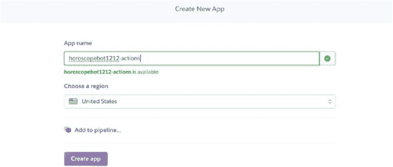  
图 5-1. 在 Heroku 上创建名为 horoscopebot1212-actions 的动作服务器应用

在本地系统上设置 Heroku  
在你的本地操作系统上安装 Heroku CLI。请参考此链接：https://  
如果你使用的是 macOS，请使用以下命令：

```bash
brew install heroku/brew/heroku
```

在 Facebook 上创建并设置应用  
为了能够将我们的聊天机器人部署到 Facebook，首先我们需要拥有 Facebook 应用的凭证。为了获取 Facebook 凭证，我们需要像在第三章中那样设置一个 Facebook 应用和一个页面。

前往 https://developers.facebook.com/，如果你还没有应用，请创建一个。我们为 OnlineEatsBot 创建了一个；现在我们将为 HoroscopeBot 创建一个。输入详细信息并点击“创建应用 ID”。查看图 5-2，了解如何输入你的机器人的显示名称和你的联系邮箱。

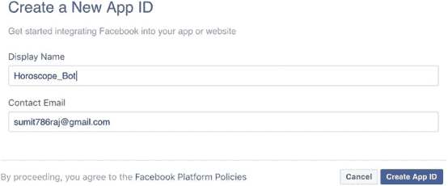  
图 5-2. 为开发者创建 Facebook 应用

应用创建完成后，进入“设置”下的“基本”选项，点击“应用密钥”旁边的“显示”按钮。这就是你的 `fb_secret` 密钥。请参考图 5-3，了解具体在哪里获取你的 `fb_secret` 密钥。

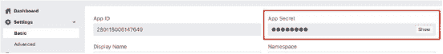  
图 5-3. 从 Facebook 应用获取应用密钥

进入应用的仪表板，向下滚动到“添加产品”。点击“添加产品”，然后添加 Messenger（点击“设置”）。查看图 5-4。


[](image-o6zbzdpu.png) **图 5-4.** 将 Messenger 作为产品添加到 Facebook 应用

在 Messenger 的设置中，向下滚动到“令牌生成”（Token Generation）部分，你会看到一个为你的应用创建新页面的链接。如果你还没有页面，请创建一个，或者从“选择页面”（Select a page）下拉菜单中选择一个页面。“页面访问令牌”（Page Access Token）就是你的 `fb_access_token`。请参考图 5-5。

你可以通过以下链接为你的机器人项目创建一个全新的页面：https://www.facebook.com/pages/creation/

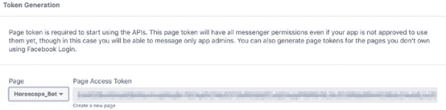 **图 5-5.** 为 Facebook Messenger 应用生成令牌

在“令牌生成”部分之后，紧接着在“Webhooks”下，点击“设置 Webhooks”（Setup Webhooks）。请参考图 5-6。

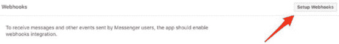 **图 5-6.** 设置 Facebook Webhooks

接下来，选择一个验证令牌（verify token），我们稍后会用到它。验证令牌可以是任意随机字符串。这将是你的 `fb_verify`。请查看图 5-7，了解在 Facebook 应用中添加验证令牌的位置。现在，暂时将回调 URL（callback URL）部分留空。不要关闭浏览器；先放在一边——我们稍后会回到这里。

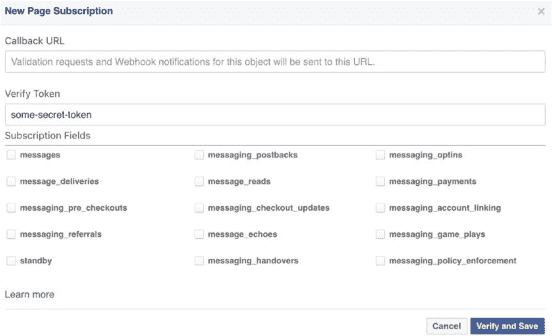 **图 5-7.** 将验证令牌添加到 Facebook webhook 设置

请将 `fb_verify`、`fb_secret` 和 `fb_access_token` 放在手边，以便将你的机器人连接到 Facebook。

**在 Heroku 上创建并部署 Rasa Actions 服务器应用**

在这一步中，我们将使用我们的 actions Heroku 应用作为 Rasa action 的服务器。我们需要两个不同的应用，因为我们无法在单个 Heroku 应用中运行两个 Web 应用。打开命令行，按照指示从你的项目目录执行以下一组命令。

创建一个名为 `actions_app` 的新文件夹并进入该目录：

```
mkdir actions_app
cd actions_app
```

将 `actions.py` 从主项目目录复制到 `actions_app` 目录。

创建一个包含以下内容的 `requirements.txt` 文件。`requirements.txt` 将告诉 Heroku 应用安装指定版本的包。

```
rasa-core-sdk==0.11.0
requests==2.18.4
```

创建一个名为 `Procfile` 的文件，内容如下。`Procfile` 是 Heroku 用来理解如何启动应用的文件。

```
web: python -m rasa_core_sdk.endpoint—actions actions
—port $PORT
```

a) 运行以下命令集：

```
$ heroku login
$ git init
$ heroku git:remote -a <your-heroku-app-name>
$ heroku buildpacks:set heroku/python
$ heroku config:set PORT=5055
$ git add .
$ git commit -am "deploy my bot"
$ git push heroku master
```

执行完最后一条命令后，Heroku 将根据 `requirements.txt` 文件安装我们所需的所有包。如果你的应用成功部署，你应该会看到类似于以下的日志：

```
remote:
remote:——-> Discovering process types
remote: Procfile declares types -> web
remote:
remote:——-> Compressing...
remote: Done: 48.3M
remote:——-> Launching...
remote: Released v4
remote: https://horoscopebot1212-actions.herokuapp.com/ deployed to Heroku
remote:
remote: Verifying deploy... done.
To https://git.heroku.com/horoscopebot1212-actions.git
 * [new branch] master -> master
```

此时，我们将验证我们的应用是否响应公共请求。为此，让我们访问附加了“webhook”的应用 URL。

我的应用 URL 是 https://horoscopebot1212-actions.herokuapp.com/，所以我会去检查我的 action 服务器是否在响应。

我访问这个 URL，正如预期的那样，它返回“方法不允许”（method not allowed），如图 5-8 所示，这完全没问题，意味着应用正在根据用户请求正确响应。

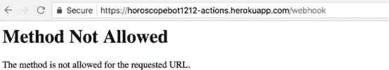 **图 5-8.** 验证 action 服务器端点

**创建 Rasa 聊天机器人 API 应用**

在这一步中，我们将遵循一些与我们刚才所做的类似的步骤和命令，但这是一个我们将创建的新应用，它将是我们用于对话管理的主应用。那么，让我们开始吧。首先回到主项目目录（即 `horoscope_bot` 目录），创建一个文件并添加以下内容：

```
web: python -m spacy download en && python facebook.py
```

**为 Facebook Messenger 聊天机器人创建独立脚本**

在同一项目目录中创建一个名为 `facebook.py` 的文件。Python 文件的内容应如下所示：

```python
from rasa_core.channels.facebook import FacebookInput
from rasa_core.agent import Agent
from rasa_core.interpreter import RasaNLUInterpreter
import os
from rasa_core.utils import EndpointConfig

# 加载你训练好的 agent
interpreter = RasaNLUInterpreter("models/nlu/default/horoscopebot/")
MODEL_PATH = "models/dialog"

action_endpoint = EndpointConfig(url="https://horoscopebot1212-actions.herokuapp.com/webhook")

agent = Agent.load(MODEL_PATH, interpreter=interpreter)
input_channel = FacebookInput(
    fb_verify="YOUR_FB_VERIFY_TOKEN",
    # 你需要告诉 Facebook 这个令牌，以确认你的 URL
    fb_secret="YOUR_FB_SECRET",
    # 你的应用密钥
    fb_access_token="YOUR_FB_ACCESS_TOKEN"
    # 你所订阅页面的令牌
)

# 如果你希望保持服务器运行，请设置 serve_forever=False
s = agent.handle_channels([input_channel], int(os.environ.get('PORT', 5004)), serve_forever=True)
```

请确保将此代码中的 `fb_secret` 和 `fb_access_token` 变量值替换为我们在步骤 3 中保存的值。

创建一个新的 `requirements.txt` 文件，并添加此项目所需的所有包及其版本。我的 `requirements.txt` 文件如下所示；对于你的项目，依赖项可能有所不同，但如果你遵循本章中相同的机器人示例，这些依赖项应该没问题。

```
rasa-core==0.11.1
rasa-core-sdk==0.11.0
rasa-nlu==0.13.2
gunicorn==19.9.0
requests==2.18.4
spacy==2.0.11
sklearn-crfsuite==0.3.6
```

以便在服务器中安装我们的包。

现在，让我们像之前一样在 Heroku 中再次创建一个新应用。转到你的 Heroku 仪表板，创建一个新应用，如图 5-9 所示。

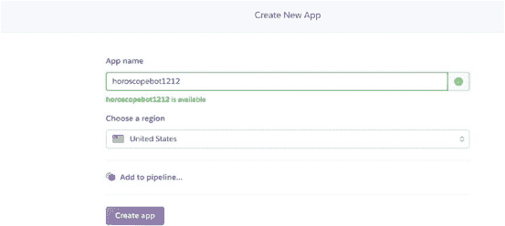 **图 5-9.**


在 Heroku 上创建对话管理应用  
创建应用后，你可以进入项目根目录，在项目文件夹中通过命令行运行以下一组命令：  

$ git init  
$ heroku git:remote -a <你的-heroku-应用名称>  
$ heroku buildpacks:set heroku/python  
$ heroku config:set PORT=5004  
$ git add .  
$ git commit -am "部署我的机器人"  
$ git push heroku master  

如果部署后遇到运行时错误，可能类似于以下内容：  

ValueError: You may be trying to read with Python 3 a joblib pickle generated with Python 2. This feature is not supported by joblib.  

这通常发生在你使用 Python 2.x 版本时。Heroku 默认使用 Python 3.x 版本。因此，如果你想使用 Python 2.x，需要执行以下步骤来解决上述错误：将 Python 3.6 改为 Python-2.7.15。具体操作如下：  

在项目的根应用目录下创建一个 `runtime.txt` 文件。打开 `runtime.txt`，添加以下内容 `python-2.7.15`，然后保存。Heroku 将仅使用上述 Python 版本来构建你的项目。  

成功部署后，你会看到 Heroku 提供一个 URL，显示应用已部署到 <url>。</url>  

remote: Compressing source files... done.  
remote: Building source:  
remote:  
remote:——-> Python app detected  
remote:——-> Installing requirements with pip  
remote:  
remote:——-> Discovering process types  
remote: Procfile declares types -> web  
remote:  
remote:——-> Compressing...  
remote: Done: 254M  
remote:——-> Launching...  
remote: Released v17  
remote: https://horoscopebot1212.herokuapp.com/ deployed to Heroku  
remote:  
remote: Verifying deploy... done.  

To https://git.heroku.com/horoscopebot1212.git cd3eb1b..c0e081d master -> master  

这次部署需要一些时间，请尽量保持耐心——你即将见证奇迹。如果没有收到任何错误信息，那么你已经成功将聊天机器人部署到 Heroku 云端，使其能与 Facebook Messenger 配合工作。  

让我们验证一下它是否正常工作。  
验证我们的对话管理应用在 Heroku 上的部署  

为了验证我们的对话管理应用是否成功部署在 Heroku 上，我们将执行以下步骤：  

获取 Heroku 提供的 URL，并在其后添加以下端点：  

/webhooks/facebook/webhook?hub.verify_token=你的 _FB_  
请确保使用你在 Facebook 的 webhooks 设置中使用的正确验证令牌。对我来说，完整的 URL 如下所示：  
https://horoscopebot1212.herokuapp.com/webhooks/facebook/webhook?hub.verify_token=my-secret-verify-  

转到浏览器并粘贴整个 URL，如果你的 `hub.verify_token` 正确，它应该返回你的 `hub.challenge` 值。你的完整 URL 将如下所示：  
https://horoscopebot1212.herokuapp.com/webhooks/facebook/webhook?hub.verify_token=你的 _FB_ 验证令牌&hub.  

如果你在浏览器中看到 `successfully_verified` 消息，则说明你的应用已成功部署并正常运行。  

将 Webhook 与 Facebook 集成  

现在让我们回到 Facebook 应用配置。我们将从步骤 3 中断的地方继续，添加我们的回调 URL。请确保在“订阅字段”中勾选“消息”。参考图 5-10。  
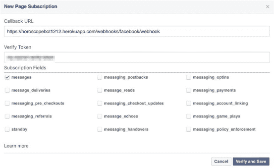  
图 5-10. Facebook Messenger webhooks 配置  

点击“验证并保存”。Facebook 将使用上述 URL 匹配验证令牌，这意味着服务器（或者说我们的应用）只会响应具有正确验证令牌的请求。一旦验证令牌匹配，webhook 订阅将为我们的应用激活。  

接下来，选择一个页面，你可以在该页面的 Webhooks 部分下将 webhook 订阅到页面事件。点击“订阅”（见图 5-11）。  
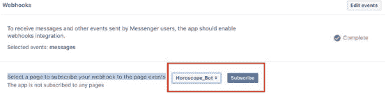  
图 5-11. 将 webhook 订阅到 Facebook 页面事件  

全部完成！是时候在 Facebook 上测试我们的星座机器人了。  
部署后验证：Facebook 聊天机器人  

在正常的软件开发场景中，人们构建软件、测试它，然后部署并进行 PDV（部署后验证）。我们也将做类似的事情，在成功部署到 Facebook Messenger 后，对我们的聊天机器人进行 PDV。这很重要，因为正如你所了解的，聊天机器人有一部分需要连接到动作服务器，以响应用户的某些意图请求。  

PDV 类似于冒烟测试，用于检查应用的整体健康状况。如果你正在构建一个使用 10 到 15 个不同供应商 API 的机器人，那么必须检查所有场景，即机器人访问动作服务器并使用 API 向用户返回数据的情况。  

因此，请前往你的 Messenger 应用或电脑浏览器中的 Facebook，搜索你的机器人并开始对话。  

图 5-12.1 到 5-12.3 展示了我的星座机器人的功能及反馈。  

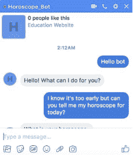  
图 5-12.1. Horoscope_Bot Facebook  
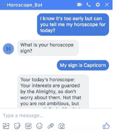  
图 5-12.2. Horoscope_Bot Facebook  
  
图 5-12.3. Horoscope_Bot Facebook  

瞧！我们第一个内部构建的聊天机器人应用已部署到网络上，并可通过 Facebook Messenger 平台访问。所以，快去与你的家人、朋友、同事以及全世界分享吧。  

在 Slack 上部署聊天机器人  

在本节中，我们将把聊天机器人部署到 Slack。Slack 是一款团队协作工具，在开发者和企业中广受欢迎。如果你不热衷于社交媒体，那么你可能需要借助 Slack 通过界面与你的聊天机器人对话。那么，让我们开始构建第一个内部 Slack 聊天机器人吧。  

为了将我们的星座聊天机器人部署到 Slack，我们将像处理 Facebook 时那样编写一个独立脚本。  

为 Slack 聊天机器人创建独立脚本  

在你的项目目录中创建一个名为 `slack.py` 的新文件。文件内容为 `slack.`


py 的代码将如下所示：  
```python
from rasa_core.channels.slack import SlackInput
from rasa_core.agent import Agent
from rasa_core.interpreter import RasaNLUInterpreter
import os
from rasa_core.utils import EndpointConfig

# 加载你训练好的智能体
interpreter = RasaNLUInterpreter("models/nlu/default/horoscopebot/")
MODEL_PATH = "models/dialogue"

action_endpoint = EndpointConfig(url="https://horoscopebot1212-actions.herokuapp.com/webhook")

agent = Agent.load(MODEL_PATH, interpreter=interpreter, action_endpoint=action_endpoint)

input_channel = SlackInput(
    slack_token="YOUR_SLACK_TOKEN",
    # 这是 `bot_user_o_auth_access_token`
    slack_channel="YOUR_SLACK_CHANNEL"
    # 机器人发布消息的频道名称（可选）
)

# 如果希望保持服务器运行，请设置 serve_forever=False
s = agent.handle_channels([input_channel], int(os.environ.get('PORT', 5004)), serve_forever=True)
```
`facebook.py` 和 `slack.py` 的主要区别在于我们创建的 `input_channel` 对象。Rasa 提供了多种内置渠道，如 Facebook、Slack、Mattermost、Telegram、Twilio、RocketChat 和 Microsoft Bot Framework，我们可以直接使用它们轻松地将同一个机器人部署到不同渠道。

如你所见，我们需要在脚本中添加 `slack_token` 和 `slack_channel`。就像我们之前在 Facebook 开发者平台上创建 Facebook 应用一样，我们同样需要在 Slack 上创建一个应用。

让我们逐步操作：

访问此网址 https://api.slack.com/slack-apps，然后点击“Create App”按钮。请参考图 5-13。

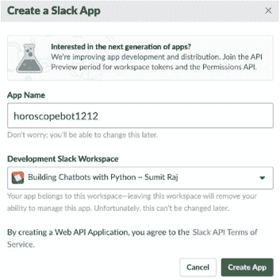  
––––––––  
图 5-13. 在 Slack 中创建应用

下一步是创建一个机器人用户。要创建机器人用户，请在“Add features and functionality”下点击“Bots”。在新页面中，你将看到“Add a Bot User”选项。查看图 5-14，了解如何添加详细信息并创建机器人用户。

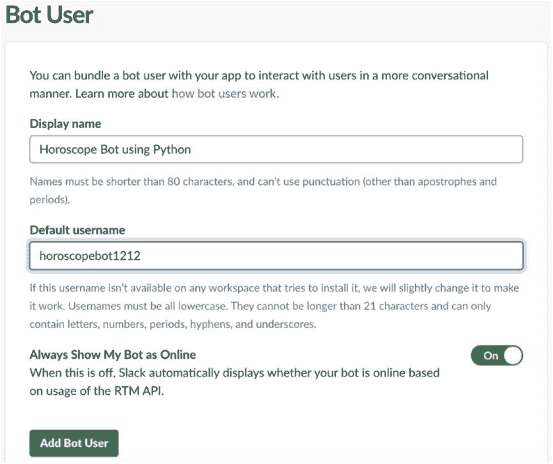  
图 5-14. 在 Slack 中为你的机器人命名

根据你正在构建的聊天机器人填写详细信息。显示名称可以是你喜欢的任何名称；默认用户名必须唯一，你可以保持原样。将最后一个选项切换为“始终将我的机器人显示为在线”，是为了让机器人始终以用户身份显示为可用状态。这正是聊天机器人的意义所在——人类无法 24/7 在线，但聊天机器人可以，因此我们开启此功能。确保点击“保存更改”。返回“Basic Information”选项卡。点击“Install your app to your workspace”。应用将要求确认身份。请像授权其他应用一样进行授权。查看图 5-15，了解授权界面的样式。

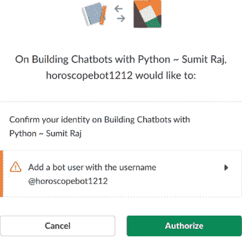  
图 5-15. 授权你的 Slack 应用

你会在“Add features and functionality”下看到“Bots”和“Permissions”选项卡旁边带有绿色对勾，这意味着我们的机器人和应用已良好集成。这表明我们到目前为止进展顺利。

转到你的“OAuth & Permissions”部分，复制“Bot User OAuth Access Token”。将复制的令牌粘贴到我们的 Python 脚本中。按你喜欢的方式指定频道名称。如果你希望机器人向某个频道发布消息，则可以指定频道名称。我指定了 `@slackbot`。如果你不设置 `slack_channel` 关键字参数，消息将直接回复给发送者。

**编辑你的 Procfile**

在这一步中，我们不会创建新的 Procfile，因为我们使用的是相同的代码库。我们将修改现有的 Procfile 为以下内容，使其适用于我们的 Slack 机器人。因此，我们只需将脚本文件名从 `facebook.py` 改为 `slack.py`，以便 Heroku 使用该文件启动应用。

```
web: python -m spacy download en && python slack.py
```

**最终将 Slack 机器人部署到 Heroku**

为了最终将我们的新 Slack 机器人部署到 Heroku，我们将从命令行运行一组类似的 Heroku 命令来部署我们的应用。

```
$ git init
$ heroku git:remote -a <your-heroku-app-name>
$ git add .
$ git commit -am "deploy my bot"
$ git push heroku master
```

**订阅 Slack 事件**

现在，点击选项卡，通过切换屏幕上的按钮来激活事件订阅功能。输入用于 Slack 的 Heroku 应用 webhook URL。

如果你的应用已使用修改后的 Procfile 正确部署到 Heroku，那么你的 Slack webhook URL 将是 `app_url + /webhooks/slack/webhook`，如下所示：

```
https://horoscopebot1212.herokuapp.com/webhooks/slack/webhook
```

在 Slack 向上述 URL 发送一个包含 `challenge` 参数的 HTTP POST 请求后，你将看到一个已验证的对勾标记，并且我们的端点必须使用该 `challenge` 值进行响应。这类似于我们在构建 Facebook 聊天机器人的密钥时讨论的内容。查看图 5-16 以了解更多信息。

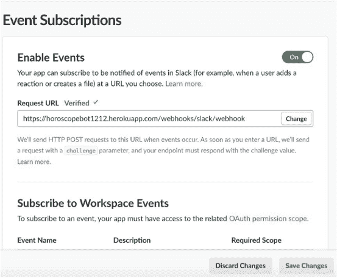  
图 5-16. 为你的机器人激活事件订阅

**订阅机器人事件**

在这一步中，我们只需向下滚动事件订阅页面，进入“Subscribe to Bot Events”部分，然后点击“Add Bot User Event”。参考图 5-17 了解导航位置。

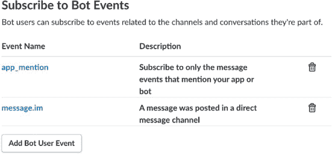  
图 5-17. 订阅机器人事件

订阅机器人事件实际上就是声明机器人需要响应的事件。我们这里只演示两种场景：第一，当有人提及机器人的名字时（即 `@bot_name`）；第二，当有人直接向机器人发送消息时（即 `message.im`）。

现在，点击“保存更改”，你就完成了。是时候像上一节测试 Facebook 聊天机器人那样，测试我们的 Slack 聊天机器人了。

**部署后验证：Slack 机器人**

让我们回到用于创建应用的工作区，在左侧的“Apps”下找到你的机器人。尝试与它对话，看看它是否正常工作。我的机器人表现相当不错，能为我提供今天的星座运势，读起来很有趣。如果你还没能走到这一步，请查看图 5-18，了解我的 Slack 机器人是如何响应的。

  
图 5-18. Slack 机器人的响应示例


[](image-6l69pxto.png) 图 5-18. 测试 Slack 聊天机器人

好了，各位，我们的 Slack 机器人就完成了。在下一节中，我们将把机器人部署到我们自己的用户界面上。构建自己的用户界面可能需要一些前端技能，但别担心——我们对此已有计划。

## 将聊天机器人部署到自有平台

这个标题听起来很酷，对吧？到目前为止，我们一直在使用 Facebook 或 Slack 将聊天机器人部署到网络上，或者我们也可以使用 Telegram 等平台，但现在，是时候将一切部署到我们自己的平台上了——我们自己的服务器、我们自己的数据，以及使用我们自己的用户界面配置的模型。

如果你是一个组织或初出茅庐的企业家，你可能在 Facebook、Twitter 或 Slack 上有了机器人的想法，但你总是希望它也能在你自己的网站上运行，这样随着用户群的增加，你的品牌价值也会越来越高。

在本节中，我们将利用到目前为止的所有努力，最终构建一个功能完备且独立于任何第三方 API 调用或工具（如 Dialogflow、wit.ai、Watson 等）的聊天机器人。你将拥有完全的控制权，可以随心所欲地调整你的聊天机器人，最重要的是，可以轻松地将其扩展到数百万用户。

那么，让我们开始吧。

第一步是确保我们在前面章节中部署的两个应用程序正在运行。你已经知道如何进行基本的健康检查。你始终需要运行你的对话管理器应用和动作应用，以便在任何平台上使用你的聊天机器人模型。

现在，在我们之前创建 `facebook.py` 和 `slack.py` 的同一个项目目录中，我们将创建一个名为 `myown_chatbot.py` 的新文件。之前创建的脚本，如 `facebook.py` 和 `slack.py`，是我们创建的独立脚本，这样我们就可以在命令中告诉 Heroku 运行哪个脚本来启动应用程序。现在，我们正在创建自己的脚本，该脚本将通过 REST API 暴露用户与聊天机器人之间的请求/响应。

部署你自己的聊天机器人分为两部分。第一部分，我们将编写一个脚本来创建自定义频道，并将其部署为 REST API。第二部分，我们需要自己的用户界面，因为到目前为止，我们一直在使用 Facebook 和 Slack 的聊天界面进行对话。

## 为你的自有聊天机器人频道编写脚本

这个脚本与我们迄今为止学习和编写的脚本类似，但它需要我们覆盖 `rasa_core` 的一些现有方法，以便我们可以定义自己的 API 认证规则。在下面的代码中，我对令牌验证进行了基本的字符串检查。这不建议用于生产级系统，因此，如果你正在为大型系统构建聊天机器人，请务必谨慎编写该部分。

创建一个名为 `myown_chatbot.py` 的新文件，并向其中添加以下内容：

```python
import os

from rasa_core.channels.rasa_chat import RasaChatInput
from rasa_core.agent import Agent

from rasa_core.interpreter import RasaNLUInterpreter
from rasa_core.utils import EndpointConfig

# 加载你训练好的智能体

interpreter = RasaNLUInterpreter("models/nlu/default/horoscopebot/")
MODEL_PATH = "models/dialogue"

action_endpoint = EndpointConfig(url="https://horoscopebot1212-actions.herokuapp.com/webhook")
agent = Agent.load(MODEL_PATH, interpreter=interpreter, action_endpoint=action_endpoint)

class MyNewInput(RasaChatInput):
    def _check_token(self, token):
        if token == 'mysecret':
            return {'username': 'admin'}
        logger.info("Failed to check token: {}.".format(token))
        return None

input_channel = MyNewInput(url='https://horoscopebot1212.herokuapp.com')
# 如果希望保持服务器运行，请设置 serve_forever=False
s = agent.handle_channels([input_channel], int(os.environ.get('PORT', 5004)), serve_forever=True)
```

这里需要注意几点：

*   `rasa_core` 中的 `_check_token` 方法基本上如下所示，它会发起一个 API 调用来获取用户对象。这主要完成用户级认证/鉴权的工作。在我们重写的方法中，我们保持简单，以便使其工作并理解其用法。

    ```python
    def _check_token(self, token):
        url = "{}/users/me".format(self.base_url)
        headers = {"Authorization": token}
        logger.debug("Requesting user information from auth server {}.".format(url))
        result = requests.get(url, headers=headers, timeout=DEFAULT_REQUEST_TIMEOUT)
        if result.status_code == 200:
            return result.json()
        logger.info("Failed to check token: {}. Content: {}".format(token, request.data))
        return None
    ```

*   使用 Rasa 自己的 `_check_token` 方法可能需要你编写一个 API 或 Web 服务，该服务接受请求并以指定方式返回响应。
*   确保将动作的服务器端点更改为你自己的 URL。
*   记住，代码中的 `mysecret` 字符串稍后将用于发起 API 调用。

## 编写 Procfile 并部署到 Web

到现在为止，你一定已经非常熟悉为 Heroku 部署创建 Procfile 了。我们将再次使用现有的 Procfile 并进行修改，以将基于 API 的聊天机器人部署到 Web。在备份现有文件后，可以随意创建一个新的 Procfile。

以下是我的 Procfile 内容：

```
web: python -m spacy download en && python myown_chatbot.py
```

完成后，只需执行我们在部署 Facebook Messenger 和 Slack 机器人时已经学会的下一组命令。

```bash
$ git init
$ heroku git:remote -a <your-heroku-app-name>
$ git add .
$ git commit -am "deploy my bot"
$ git push heroku master
```

执行完最后一条命令后，你将收到来自 Heroku 的一些日志，内容涉及部署版本、对应用所做的更改等。

## 验证你的聊天机器人 API

在收到部署成功的消息后，让我们测试一下我们的聊天机器人 API 是否正常工作。为了快速进行健康检查，请访问以下 URL：

`<your-basic-app-url>/webhooks/rasa/`

例如：`https://horoscopebot1212.herokuapp.com/webhooks/rasa/`


在浏览器中打开 `com/webhooks/rasa/` 这个网址，应该会得到类似如下的响应。如果返回的状态是“ok”，那么一切就绪——放松、坐好，开始调试吧。  
`{"status":"ok"}`  

有时仅凭这种验证可能还不够，所以让我们通过实际测试来检查聊天机器人是否能正确识别意图并据此给出响应。  

我将使用 POSTMAN 工具（POSTMAN 是一款非常优秀的基于 GUI 的 API 测试工具）。你也可以使用任何自己熟悉的工具。我们只需测试聊天机器人应该理解和响应的其中一个意图。我测试了问候意图，效果非常好。机器人返回了预期的响应，如图 5-19 所示。  

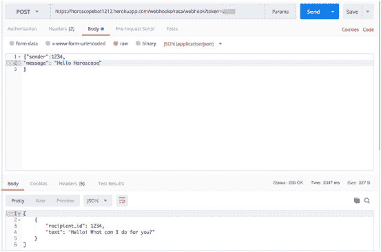  

图 5-19. 在 POSTMAN 中测试聊天机器人 API  

### 创建聊天机器人 UI  

正如我们在第二步中讨论的，我们需要拥有自己的 UI，为聊天机器人和用户之间的对话提供一个友好的界面。如果你是前端开发人员，或者团队中有前端开发人员，你可以轻松地将我们目前构建的聊天机器人 API 交给他们，前端团队应该能够轻松地将其集成到他们的聊天机器人 UI 中。他们可以使用常规的 HTTP 调用来消费这些 API。WebSocket 是实现聊天机器人的更好方式，但这不在本书的讨论范围内。  

如果你不熟悉 HTML/CSS/JavaScript 等前端技术，那么我推荐阅读《Pro HTML5 with CSS, JavaScript, and Multimedia》（Apress, 2017）。  

为了方便我们的读者——或者更准确地说，学习者——我们创建了一个聊天机器人和用户对话所需的基本 UI。你可以在 GitHub 或 Apress 网站上找到完整的可运行代码。我只会告诉你需要如何配置才能让它为你的机器人工作。  

下载本章的代码后，你会在主文件夹内找到一个名为 `Go to this folder` 的文件夹，然后进入 `assets -> js -> script.js` 文件。  

将下面这行 JavaScript 代码中的 URL 替换为你自己的端点 URL。如果你的应用名称不同，那么下面的 URL 也会有所不同。请使用你自己的 URL，并在 JavaScript 代码中包含令牌，如下面的 URL 所示：  

```javascript
var baseUrl = "https://horoscopebot1212.herokuapp.com/webhooks/rasa/webhook?token=YOUR-SECRET";
```

保存文件，然后在浏览器中打开 `index.html` 文件，你应该能立即看到一个可用的聊天机器人 UI。但是，从本地提供的简单 HTML 页面发起 API 调用会引发 CORS 问题。因此，为了避免这种情况，我们将对现有的 `myown_chatbot.py` 进行一些修改，使其能够直接从我们的 Heroku 应用提供 HTML 服务。  

将你的 `myown_chatbot.py` 修改为以下内容，然后我们将讨论所做的更改：  

```python
import os

from rasa_core.channels.rasa_chat import RasaChatInput

from rasa_core.channels.channel import CollectingOutputChannel, UserMessage
from rasa_core.agent import Agent

from rasa_core.interpreter import RasaNLUInterpreter
from rasa_core.utils import EndpointConfig

from rasa_core import utils
from flask import render_template, Blueprint, jsonify, request

# 加载你训练好的智能体
interpreter = RasaNLUInterpreter("models/nlu/default/horoscopebot/")
MODEL_PATH = "models/dialogue"

action_endpoint = EndpointConfig(url="https://horoscopebot1212-actions.herokuapp.com/webhook")

agent = Agent.load(MODEL_PATH, interpreter=interpreter, action_endpoint=action_endpoint)

class MyNewInput(RasaChatInput):
    @classmethod
    def name(cls):
        return "rasa"

    def _check_token(self, token):
        if token == 'secret':
            return {'username': 1234}
        else:
            print("Failed to check token: {}.".format(token))
            return None

    def blueprint(self, on_new_message):
        templates_folder = os.path.join(os.path.dirname(os.path.abspath(__file__)), 'myown_chatbot')
        custom_webhook = Blueprint('custom_webhook', __name__, template_folder=templates_folder)

        @custom_webhook.route("/", methods=['GET'])
        def health():
            return jsonify({"status": "ok"})

        @custom_webhook.route("/chat", methods=['GET'])
        def chat():
            return render_template('index.html')

        @custom_webhook.route("/webhook", methods=['POST'])
        def receive():
            sender_id = self._extract_sender(request)
            text = self._extract_message(request)
            should_use_stream = utils.bool_arg("stream", default=False)
            if should_use_stream:
                return Response(
                    self.stream_response(on_new_message, text, sender_id),
                    content_type='text/event-stream')
            else:
                collector = CollectingOutputChannel()
                on_new_message(UserMessage(text, collector, sender_id))
                return jsonify(collector.messages)

        return custom_webhook

input_channel = MyNewInput(url='https://horoscopebot1212.herokuapp.com')
# 如果你希望保持服务器运行，请设置 serve_forever=False
s = agent.handle_channels([input_channel], int(os.environ.get('PORT', 5004)), serve_forever=True)
```

以下是我们所做的更改：  

-   在我们的类中重写了现有的 `name` 和 `blueprint` 方法，这让我们能够创建自己的端点，并自由定义其行为。  
-   我们创建了一个新的端点 `/chat`，并提供了 `index.html` 文件，该文件正是聊天机器人的 UI。因此，这将成为我们聊天机器人的主页链接。  
-   我们导入了一些必要的类和方法，例如 `utils` 和 `UserMessage`，以确保一切正常运行。  

保存文件，然后使用以下命令将更改再次部署到我们的 Heroku 应用：  

```bash
$ git add .
$ git commit -am "deploy my bot"
$ git push heroku master
```

部署成功后——瞧！我们的机器人已经准备好与全世界分享了。它通过两个 Heroku 应用协同工作：一个用于对话管理，另一个用于执行动作。  

在浏览器中打开以下 URL，我们应该能看到自定义的聊天机器人 UI：  

`https://horoscopebot1212.herokuapp.com/webhooks/rasa/chat`  

图 5-20.1 和 5-20.2 展示了我的聊天机器人在对话过程中的样子。  

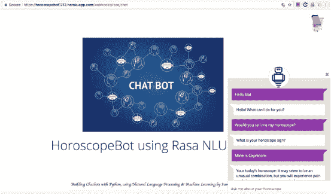  

图 5-20.1.  


在你的网站上拥有你自己的定制聊天机器人 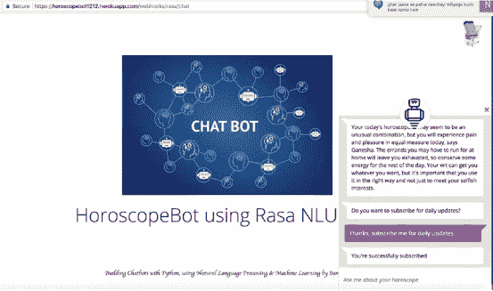 图 5-20.2. 在你的网站上拥有你自己的定制聊天机器人   利用 Heroku 的自定义域名功能，你可以轻松地将同一个应用指向你自己的网站名称，比如当你觉得你的聊天机器人已经足够好，可以面向全世界用于盈利或非盈利目的时，就可以这样做。   那么，各位朋友，这就是全部内容了！这就是如何使用 Python 结合自然语言处理和机器学习来构建聊天机器人的方法。我希望本章以及前面的章节对你有所帮助，并且你能够学到构建聊天机器人的实用方法。总结   在本章中，我们学习了如何使用 Heroku 将我们自己的应用部署到我们自己的服务器上。我们学习了如何使用 Facebook 的开发者平台将我们的聊天机器人与 Facebook 集成。我们还学习了为 Slack 应用创建一个自定义聊天机器人，并对其进行了测试。最后，正如在第三章末尾所承诺的，我们摆脱了对任何社交媒体平台的依赖，创建了我们自己的用户界面，并将其部署在 Heroku 上并进行了测试。我们看到它运行得非常好——在训练它的时候它就能正常工作。既然我们已经有了一个基本模型并使其运行起来，现在你可以处理聊天机器人工作不佳的情况了。确定问题是与数据或训练有关，还是与动作服务器或自定义代码处理有关。一旦找到根本原因，修复它，重新部署，然后检查聊天机器人是否有所改进。我们通过从小处着手来构建大型软件。   我期待收到你的来信，并且很好奇你在读完这本书后构建了什么样的聊天机器人。如果你在任何概念、代码执行或部署上遇到困难，我将随时乐意帮助你。   感谢与致敬。索引   A   自动化和固定机器人，18   B   商业视角，聊天机器人的可访问性，5   可用性，6   成本，6 客户偏好   聊天机器人，9–10   效率，5   聊天机器人使用概览，8–9 洞察，6   收入，6–8   可扩展性，6   C   聊天机器人，1   API，1, 181–182   自动化和固定，18   来回通信，17   构建，20   商业视角（商业视角，聊天机器人）   置信度分数，28   自定义，网站，186–187   决策树，20–24   开发者视角（功能发布和错误修复，11   学习曲线，12   市场需求，11）   开发，1   实体，27, 66   常见问题解答，18–19   点餐（点餐聊天机器人）   框架，25–26   历史，13–16   行业，12–13   意图，27, 66   myown_chatbot.py 文件，179–180, 183–185   NLP（自然语言处理（NLP））   流行度，2–3   问题陈述，16   Procfile，181   重复性问题，17   范围，65   第三方 API，178   传统方法，2   训练，28   用户界面，183   话语，27   Python 之禅，3–5   ––––––––   © Sumit Raj 2019   S. Raj, 使用 Python 构建聊天机器人，https://doi.org/10.

1007/978-1-4842-4096-0   ––––––––   189  自定义动作对话，132   GetTodaysHoroscope 动作，131   name 方法，131   run 方法，131   SlotSet 方法，131   UtterAction，130   客户偏好聊天机器人，9–10   D, E   数据准备，将机器人对话作为故事，导出，150, 152   交互式学习，133, 136 聊天机器人代理模型，136–140 rasa-nlu-sdk，142–150   通过强化学习进行实时训练，140–142   故事数据，134, 136 决策树   服装聊天机器人，表示，22–23 描述，21   金融机构，23   成熟的，22   健康测验，24   意图，24   OTP API，24   表示，21 依存句法分析   祖先，50–51   子节点，51   交互式可视化，51–53   父子关系，49   用法，53–54   Dialogflow 聊天机器人，63   架构，64 部署到网页，82–85   Facebook Messenger，集成（访问令牌，89   回调 URL，89   创建应用，87–88   设置，86   测试机器人，91, 93–95   验证令牌，89   Webhooks 配置，90–91）点餐聊天机器人（点餐聊天机器人）履行   检查响应，101–102 POST 和 JSON 响应，96 测试，97   Webhook，启用，98–100   NLU 模块，64   F   Facebook 应用   动作服务器应用，Heroku，157   添加产品，159   应用密钥，158–159   创建，158   部署，166   对话管理，165 Heroku，对话管理部署，167   Horoscope_Bot，169–170 安装 Heroku CLI，158 Messenger，令牌生成，159–160   Python 文件，164   requirements.

txt 文件，164   根目录，165–166   Webhooks 配置，167–168   Webhook 设置，160–161  索引   常见问题解答机器人，18–19   点餐聊天机器人，65   对话脚本，67   对意图的默认响应，72–73 Dialogflow，67–68   默认欢迎意图，69–70 意图，68–69, 71   测试，71   意图和话语，72 商品描述意图和实体，73, 75–76 回复用户（order_status 意图，78–79   user_order_ID 意图，79–81   user_thanks 意图，81–82）   G   聊天机器人使用概览，8–9 GloVe 算法，56   H   星座运势机器人，109–110   用户与机器人的对话脚本，110–111 测试，152–153   Horoscope_Bot Facebook，169–170   I, J, K, L, M   行业，12–13   N, O   命名实体识别（NER），44–47 自然语言处理（NLP），29   黑盒，30   定义，29   依存句法分析（依存句法分析）   查找相似性，55–58   智能机器，30   NER，44–47   NLU，30   名词短语，54–55   词性标注，37–41   正则表达式，60–61   SpaCy，29, 31–36   词干提取和词形还原，42–44 停用词，47–49   分词，59   自然语言理解（NLU）模块，30, 64   名词短语，54–55   P   词性标注，37–41 流行度，2–3   部署后验证（PDV），169–170   Q   QnA 机器人，18–19   R   Rasa 动作服务器，Heroku 应用命令，161–162   验证，163   Webhook，163   Rasa 聊天机器人 API 163 Rasa Core，106   对话管理动作，125–126   191    Rasa Core   领域文件，创建，127–129 与 Rasa NLU 结合，123–124   Rasa 栈，125   槽位，126   状态机，122–123   模板，127   rasa_core，版本，139   Rasa NLU，106   安装，107   流水线，108–109   使用，107   Rasa 的凭证管理，155–156 正则表达式，60–61   S   从零开始构建聊天机器人，配置文件，117–118   对话脚本，110–111 数据（JSON 格式，112–113 Rasa NLU 训练器，114–116）   星座运势机器人，109–110   predict_intent 方法，119, 121   Python 代码，118–119   train_horoscopebot 方法，119 Slack   授权，173–174   机器人用户，172–173   创建应用，172   默认用户名，173   部署，Heroku，175   事件订阅，175–176 OAuth 与权限，174 Procfile，175   slack.py 文件，171   slack_token 和 slack_channel，172 订阅机器人事件，176–177 测试，177–178   SpaCy，29   基准测试结果，31   深度学习，32   定义，31   文档，32   下载，36   最快的库，32   特性，32–33 安装（Jupyter Notebook，34–35   Python 3，33   验证，35）   Python 包，35–36   停用词，47–49   T, U, V, W, X, Y   分词，59   Z   Python 之禅，3–5
