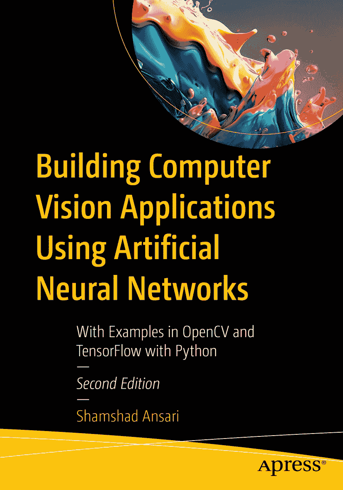

# 引言

ISBN 978-1-4842-9865-7 e-ISBN 978-1-4842-9866-4 [`doi.org/10.1007/978-1-4842-9866-4`](https://doi.org/10.1007/978-1-4842-9866-4) © Shamshad Ansari 2020, 2023 本作品受版权保护。所有权利均由出版商独家许可，无论涉及材料的全部或部分，特别是翻译、重印、重用插图、朗诵、广播、以缩微胶卷或任何其他物理方式复制，以及传输或信息存储与检索、电子改编、计算机软件，或采用目前已知或未来开发的类似或不同方法。本出版物中使用的一般描述性名称、注册商标名称、商标、服务标志等，即使未作明确声明，也不意味着这些名称不受相关保护性法律和法规的约束，因此可供一般使用。出版商、作者和编辑可以安全地假设，本书中的建议和信息在出版之日被认为是真实和准确的。出版商、作者或编辑均不对本文所含材料或可能存在的任何错误或遗漏提供明示或暗示的保证。出版商对已出版地图中的管辖权主张和机构归属保持中立。

本 `Apress` 印记由注册公司 `APress Media, LLC`（`Springer Nature` 的一部分）出版。

注册公司地址为：1 New York Plaza, New York, NY 10004, U.S.A.

*我们信仰上帝。*

*献给我杰出的父母，Abdul Samad 和 Nazhat Parween，他们总是纠正我的错误，并将我培养成一个好人。*

*献给我亲爱的妻子 Shazia，以及我们两个美丽的女儿 Dua 和 Erum。没有她们的爱与支持，这本书不可能完成。*

在超过 20 年的时间里，我有幸与杰出的数据科学家和计算机视觉专家共事，他们是各自领域中最优秀的人才。在这段旅程中，我获得了宝贵的见解，特别是在遵循最佳实践构建可扩展计算机视觉系统方面。本书凝聚了从我的工作经验中获得的智慧，以及从我有幸共事或合作的杰出人士那里积累的集体知识。本书还呈现了我从一些最伟大的计算机视觉贡献者和思想领袖的作品中学到的知识。我在本书的适当位置提供了对他们作品的引用。

当我招聘新的工程师和科学家时，我面临的主要挑战之一是如何对他们进行有效的培训，使他们能够快速开始为计算机视觉系统的开发做出贡献。尽管有大量的在线资源和书籍涵盖了各种计算机视觉主题，但面对海量信息，人们很容易感到不知所措。尤其因为计算机视觉领域既广泛又复杂。

在本书中，我的目标是提供一种结构化和系统化的方法来学习计算机视觉系统。您将首先学习基本概念，然后通过处理与现实世界计算机视觉系统相关的实用代码示例来构建这些概念。这种方法将帮助您在阅读各章节时融会贯通。我将本书设计得尽可能动手和实用，以便有效地帮助您。

本书首先解释了计算机视觉的核心概念，并提供了代码示例来帮助您更好地理解这些想法。在开始部分，示例主要使用 `OpenCV` 和 `Python` 语言。

本书还涵盖了机器学习的基本概念，然后逐步深入到更复杂的概念，如人工神经网络和深度学习。每个概念都通过一个或多个实用的代码示例来强化，展示该概念在实际中的应用。与机器学习相关的概念通过 `TensorFlow` 和 `Python` 的代码示例进行说明。

本书提供了 11 个示例，包括可运行的代码，展示了计算机视觉在现实生活中的应用。这些示例来自不同的领域，如医疗保健、监控、安全和制造业。为了帮助您理解代码，我逐步解释了每一行代码。

第 7、8 和 9 章专门用于构建实用的基于计算机视觉的系统。这些章节向您展示了创建视觉系统的所有阶段，从获取图片或视频，到构建数据管道，再到训练模型，最后将模型部署到实际场景中。

训练最先进的计算机视觉模型需要大量的硬件资源。在云基础设施上训练计算机视觉模型是可取的，并且在经济上是有益的，这样可以利用最新的硬件资源（如 GPU）和按需付费的成本模式。最后一章，第 10 章，提供了在三种流行的云基础设施上构建基于机器学习的计算机视觉应用的分步说明：`Google Cloud Platform`、`Amazon AWS` 和 `Microsoft Azure`。

尽管本书从解释图像的一个像素开始，一直讲到如何使用云计算机进行神经网络训练，但要更好地理解本书中呈现的概念，仍需要某些先决条件。您应该已经知道如何使用 `Python` 编程语言。

本书旨在帮助在职专业人士、程序员、数据科学家，甚至学生（本科生和研究生）获得使用人工神经网络构建计算机视觉应用的实践技能。

# 致谢

我写这本书有两个主要目标。首先，我旨在全面构建计算机视觉概念的基础，从基础开始，逐步深入到高级水平。其次，我渴望通过包含实际用例和代码示例，为这些概念在现实世界计算机视觉系统中的应用提供实用指南。

实现这些目标需要对主题进行细致的组织，将内容与有意义且实用的用例相结合，并对代码进行彻底的测试，所有这些都需要我在写作过程中全神贯注。没有家人坚定不移的支持，这一成就将不可能实现。我对我的妻子 Shazia 感激不尽，她负责照顾我们的两个女儿（Erum 和 Dua），确保在我专心撰写本书时她们能保持专注。她巧妙地将这段经历变成了对她们和我自己都积极正面的体验。值得注意的是，我的孩子们开始跟踪我的进度，庆祝每一个章节、小节或章节的完成。他们的热情成为了能量和动力的源泉，极大地丰富了我的写作体验。我至今仍不知道我的妻子用了什么魔法做到这一点。

我的一生都感激 Anumati Bhagi 和 Ashok Bhagi，他们对我来说如同父母；他们的爱和支持始终激励着我。

这本书是我一生经验的集合，这些经验来自于我与一些最伟大的工程师、数据科学家和商业专业人士的合作。我要感谢我在 `Accure` 以及所有过去工作过的公司的所有同事。我衷心感谢所有启迪我、用知识和智慧照亮我的老师、教授和导师们。

与 `Apress` 编辑团队合作，其中包括像 Mark Powers 和 Laura Berendson 这样杰出的人士，是一次令人难以置信的经历。我要特别感谢项目协调员 Shonmirin PA，他在与编辑团队和技术审阅人员的协调中发挥了关键作用，并在此过程中对我提出的问题给予了及时且有益的答复。

我要向 `Apress` 的执行编辑 John Celestin 表达我的感激之情。他的周到和快速决策给我留下了深刻的印象。谢谢你，John，对我工作的信任。我也感谢 `Apress` 使这本书的出版成为可能。

我要感谢 Bharat Bolla 对本书进行了专业的技术审阅。此外，我要特别感谢 Brett Berlin 教授，他细致的审阅、宝贵的见解和建设性的建议极大地提升了本书的质量。谢谢你们，Bharat 和 Berlin 教授。

最后，我要感谢本书的读者。我热切期待收到你们的反馈。请将你们的评论、建议和问题通过`ansarisam@gmail.com`与我分享。同时，鉴于技术的不断演进，我可能需要通过本书的 GitHub 仓库更新书中的一些代码示例。我致力于维护代码更新，因此请查看本书的 GitHub 仓库以获取最新信息。我期待你们的宝贵意见，并期待与你们互动。

## 关于作者
## 关于技术审阅者