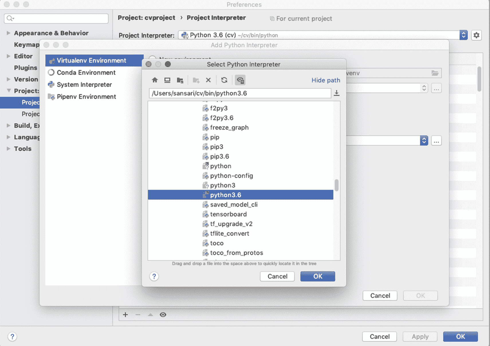

# 1.  **前提条件与软件安装**

本书是一本实用指南，探讨了使用 Python 编程语言构建计算机视觉应用的过程。通过本书，你将全面了解如何利用 OpenCV 进行图像处理，以及如何利用 TensorFlow 构建机器学习模型。

OpenCV 最初由英特尔开发，使用 C++编写，是一个开源的计算机视觉和机器学习库，包含超过 2500 个用于处理图像和视频的优化算法。TensorFlow 是一个用于高性能数值计算和大规模机器学习的开源框架。它使用 C++编写，并原生支持 CPU 和 GPU。Python 是开发机器学习应用最广泛使用的编程语言。TensorFlow 和 OpenCV 都提供了 Python 接口来访问其底层功能。虽然 TensorFlow 和 OpenCV 也为 Java、C++和 MATLAB 等其他编程语言提供了接口，但本书将重点介绍 Python 的使用。Python 庞大的社区支持和直观的语法使其成为学习者和从业者都能轻松掌握的语言。

本书的前提条件是具备 Python 的实践知识，并熟悉 NumPy 和 pandas。本书假设你熟悉 Python 中的内置数据容器，例如字典、列表、集合和元组。如果你需要复习这些前提知识，以下资源可能会有所帮助：

*   Python: [`https://www.w3schools.com/python/`](https://www.w3schools.com/python/)

*   pandas: [`https://pandas.pydata.org/docs/getting_started/index.html`](https://pandas.pydata.org/docs/getting_started/index.html)

*   NumPy: [`https://numpy.org/devdocs/user/quickstart.html`](https://numpy.org/devdocs/user/quickstart.html)

首要任务是为你准备本书中所有练习所需的工作环境。你将首先下载并安装必要的软件库和包。

## Python 和 PIP

如前所述，Python 是本书中使用的主要编程语言。对于 Python 包的安装和管理，我们将依赖 PIP，它是 Python 生态系统中广泛接受的包安装器和标准工具。

要设置你的工作环境，你首先需要在你的计算机上安装 Python 和 PIP。安装步骤取决于你使用的操作系统（OS）。以下各节按顺序提供了 Ubuntu、macOS、Red Hat Enterprise Linux 和 Windows 的安装步骤。请确保按照你的操作系统说明进行操作。如果你已经安装了 Python 和 PIP，请确保你使用的是 Python 3.8 或更高版本以及 PIP 19 或更高版本。要检查 Python 的版本号，请在终端上执行以下命令：

```
$ python3 --version
```

此命令的输出应类似于：Python 3.8.10。

要检查 PIP 的版本号，请在终端上执行以下命令：

```
$ pip3 --version
```

此命令应显示 PIP 3 的版本号，例如，PIP 20.0.2。

### 在 Ubuntu 上安装 Python 和 PIP

在你的 Ubuntu 终端中运行以下命令：

```
sudo apt update
sudo apt install python3 python3-dev python3-pip
```

### 在 macOS 上安装 Python 和 PIP

在 macOS 上运行以下命令：

```
brew update
brew install python
```

这将同时安装 Python 和 PIP。

### 在 Red Hat Linux 上安装 Python 和 PIP

在 Red Hat Linux 上运行以下命令：

```
sudo yum update
sudo yum install python3
sudo yum groupinstall 'Development Tools'
```

### 在 Windows 上安装 Python 和 PIP

安装 Microsoft Visual C++ 2017 Redistributable Update 3。这随 Visual Studio 2017 一起提供，但也可以通过以下步骤单独安装：

1.  访问 Visual Studio 下载页面：[`https://visualstudio.microsoft.com/vs/older-downloads/`](https://visualstudio.microsoft.com/vs/older-downloads/)。

2.  选择“其他工具、框架和可再发行组件”。

3.  下载并安装 Microsoft Visual C++ 2017 Redistributable Update 3。

确保在 Windows 上启用了长路径。以下是操作说明：[`https://www.thewindowsclub.com/how-toenable-or-disable-win32-long-paths-in-windows-11-10`](https://www.thewindowsclub.com/how-toenable-or-disable-win32-long-paths-in-windows-11-10)。

从[`https://www.python.org/downloads/windows/`](https://www.python.org/downloads/windows/)安装适用于 Windows 的 64 位 Python 3 版本（选择 PIP 作为可选功能）。

如果这些安装说明在你的情况下不起作用，请参考[`https://www.python.org/`](https://www.python.org/)上的官方 Python 文档。

## virtualenv

virtualenv 是一个旨在创建隔离 Python 环境的工具。当你使用 virtualenv 时，它会生成一个目录，其中包含使用 Python 项目所需包的所有必要可执行文件。virtualenv 具有以下优点：

*   它允许同一库的两个版本共存，从而使运行不同版本库的两个程序都能正常工作。例如，如果你有一个程序依赖于 Python 库的版本 1，而另一个程序依赖于同一库的版本 2，virtualenv 允许你同时运行这两个程序。

*   它为你的开发工作建立了一个自包含且独立的环境，可以在生产环境中使用，而无需单独安装依赖项。

接下来，我们将安装 virtualenv 并设置包含所有必要软件的虚拟环境。本书的其余部分假设我们参考程序的依赖项将包含在此 virtualenv 中。


### 安装并激活 virtualenv

要在系统范围内安装 virtualenv，请执行以下 PIP 命令，该命令在所有操作系统上均适用：

```
$ sudo pip3 install -U virtualenv
```

安装完成后，在你打算设置 virtualenv 的位置创建一个你选择的目录。为了遵循本书中的示例，请将此目录命名为 `cv`（“computer vision”的缩写）：

```
$ mkdir cv
```

然后在此 `cv` 目录中创建 virtualenv：

```
$ virtualenv --system-site-packages -p python3 ./cv
```

以下是运行此命令（在我的 MacBook 上）的示例输出：

```
Running virtualenv with interpreter /anaconda3/bin/python3
Already using interpreter /anaconda3/bin/python3
Using base prefix '/anaconda3'
New python executable in /Users/sansari/cv/bin/python3
Also creating executable in /Users/sansari/cv/bin/python
Installing setuptools, pip, wheel...
done.
```

使用特定于 shell 的命令激活虚拟环境：

```
$ source ./cv/bin/activate  # 适用于 sh, bash, ksh, 或 zsh
```

当 virtualenv 激活时，你的 shell 提示符会以 `(cv)` 为前缀。示例如下：

```
(cv) Shamshads-MacBook-Air:~ sansari$
```

在虚拟环境中安装包不会影响主机系统设置。首先按如下方式升级 PIP。请注意，在虚拟环境内，你不应以 root 或 sudo 身份执行任何命令。

```
$ pip install --upgrade pip
$ pip list  # 显示虚拟环境中安装的包
```

当你完成编程活动并想要退出 virtualenv 时，运行以下命令：

```
$ deactivate
```

## TensorFlow

TensorFlow 是一个广泛使用的开源库，用于数值计算和大规模机器学习。在接下来的章节中，你将更深入地了解 TensorFlow 并探索其功能。然而，在继续之前，让我们先安装 TensorFlow 并为我们的深度学习练习做好准备。如果你的计算机有 GPU 并且你想将其用于深度学习任务，通常不需要同时安装 TensorFlow 的 CPU 和 GPU 版本。你可以安装 GPU 版本，它同时支持 GPU 和 CPU 计算。当 GPU 资源不可用或操作不适合 GPU 加速时，支持 GPU 的 TensorFlow 会自动回退到 CPU 执行。因此，安装支持 GPU 的 TensorFlow（tensorflow-gpu）就足够了。它可以在 GPU 和 CPU 上工作，使其成为大多数深度学习任务的多功能选择。

### 在配备 M1 芯片的 Mac 上安装 TensorFlow

在 M1 芯片上安装 TensorFlow 的步骤如下：

1.  从以下链接下载 Conda 环境：[`https://repo.anaconda.com/miniconda/Miniconda3-latest-MacOSX-arm64.sh`](https://repo.anaconda.com/miniconda/Miniconda3-latest-MacOSX-arm64.sh)。

2.  假设下载的文件 `Miniconda3-latest-MacOSX-arm64.sh` 位于 Downloads 文件夹中，执行以下命令安装 Miniconda3：

    **$ sh Downloads/Miniconda3-latest-MacOSX-arm64.sh**

3.  按照屏幕上的说明在你的计算机上完成 Miniconda3 的安装。如果你选择默认选项，Miniconda3 将安装在你的主目录中。例如，如果你的主目录是 `/Users/username`，安装后 Miniconda3 的路径将是 `/Users/username/miniconda3`。

4.  安装完成后，重启终端。

5.  通过运行以下命令，使用 Miniconda3 创建一个虚拟环境：

    **$ conda create --name cv python=3.8**

6.  要激活或停用此虚拟环境，请使用以下命令：

    **$ conda activate cv**

    **$ conda deactivate**

7.  通过运行命令 `conda activate cv` 激活虚拟环境，然后通过执行以下命令安装 TensorFlow：

    **$ conda install -c apple tensorflow-deps**

    **$ pip install tensorflow-macos**

    **$ pip install tensorflow-metal**

    **$ conda install tensorflow**

8.  通过运行以下命令测试 TensorFlow 安装：

    **$ python -c "import tensorflow as tf"**

9.  如果此命令执行无误，则表示 TensorFlow 已成功安装到你的 M1 芯片上。

10. 如果遇到任何错误，请通过例如升级 Mac OS 等方式解决不兼容问题。

### 为 CPU 安装 TensorFlow

要从 PyPI ([`https://pypi.org/project/tensorflow/`](https://pypi.org/project/tensorflow/)) 安装最新版本的 TensorFlow，特别是针对 CPU，请确保你在虚拟环境中并执行以下命令：

```
(cv) $ pip install --upgrade tensorflow
```

通过运行此命令测试你的 TensorFlow 安装：

```
(cv) $ python -c "import tensorflow as tf"
```

如果 TensorFlow 安装成功，输出不应显示任何错误。

### 为 GPU 安装 TensorFlow

要为 GPU 安装 TensorFlow，你需要遵循略有不同的安装过程。步骤如下：

1.  确保你的系统上安装了合适的 NVIDIA GPU 和驱动程序。你可以查看 TensorFlow 文档以了解具体的 GPU 要求和兼容的驱动程序版本。

2.  激活我们之前创建的虚拟环境。

3.  安装必要的 GPU 驱动程序和依赖项。请根据你的操作系统参考 TensorFlow 文档中的具体说明。

4.  使用以下命令安装 TensorFlow 的 GPU 版本：

    **(cv) $ pip install --upgrade tensorflow-gpu**

    此命令安装支持 GPU 加速的最新版 TensorFlow。

5.  安装完成后，你可以通过运行以下命令测试你的 TensorFlow-GPU 设置：

    **(cv) $ python -c "import tensorflow as tf; tf.config.list_physical_devices('GPU')"**

如果 TensorFlow-GPU 安装正确且启用了 GPU 支持，它将显示有关你系统上可用 GPU 的信息。

请注意，为 GPU 安装 TensorFlow 需要额外的设置，并且可能比 CPU 版本更复杂。建议参考官方 TensorFlow 文档，以获取针对你系统配置的详细说明和故障排除指南。

## PyCharm IDE

为了一致性，本书中用于编写和管理 Python 代码的集成开发环境（IDE）是 PyCharm 社区版，这是一个流行的 Python IDE。你可以选择使用你偏好的 IDE，但如果这样做，你需要将相关的示例和练习适配到你的 IDE。


### 安装 PyCharm

要从官方网站获取 PyCharm，请按照以下步骤操作：

1.  访问 PyCharm 网站：[`https://www.jetbrains.com/pycharm/download/`](https://www.jetbrains.com/pycharm/download/)。

2.  选择与你的机器相对应的操作系统。

3.  向下滚动到 PyCharm 社区版部分，然后点击“下载”按钮。

4.  下载完成后，找到下载的安装包并执行它。

5.  按照屏幕上的提示完成安装。

以下是不同操作系统的直接下载链接：

*   Linux：[`https://www.jetbrains.com/pycharm/download/download-thanks.html?platform=linux&code=PCC`](https://www.jetbrains.com/pycharm/download/download-thanks.html?platform=linux&code=PCC)

*   Mac：[`https://www.jetbrains.com/pycharm/download/download-thanks.html?platform=mac&code=PCC`](https://www.jetbrains.com/pycharm/download/download-thanks.html?platform=mac&code=PCC)

*   Windows：[`https://www.jetbrains.com/pycharm/download/download-thanks.html?platform=windows&code=PCC`](https://www.jetbrains.com/pycharm/download/download-thanks.html?platform=windows&code=PCC)

请注意，这些链接可能会随时间变化，因此建议访问 PyCharm 官方网站以确保获取最新的下载链接。

### 配置 PyCharm 使用 virtualenv

要在 PyCharm IDE 中使用之前创建的名为 `cv` 的虚拟环境，请按照以下步骤操作：

1.  启动 PyCharm 并打开你的项目。然后在 Windows 和 Linux 上选择“文件” ➤ “设置”，或在 macOS 上选择“PyCharm” ➤ “偏好设置”。

2.  在“设置/偏好设置”对话框中，导航到“项目 <项目名称>” ➤ “项目解释器”。

3.  点击图标（通常是一个齿轮或加号），然后从下拉菜单中选择“添加”。

4.  在“添加 Python 解释器”对话框的左窗格中，选择“现有环境”。

5.  展开“解释器”列表并选择其中一个显示的现有解释器，或者点击  图标（一个带有三个水平排列点的方形图标）来指定文件系统中 Python 可执行文件的路径，例如 `/Users/ansarisam/cv/bin/python3.8`（参见图 1-1）。此路径应对应于你之前创建的虚拟环境 `cv`。

可选地，如果你希望此解释器可用于 PyCharm 中的所有项目，可以选中“对所有项目可用”复选框。

通过执行这些步骤，你将配置 PyCharm 使用虚拟环境 `cv` 作为项目的 Python 解释器。



三个级联窗口的截图。项目 c v 项目，项目解释器。添加 Python 解释器。顶部标题为“选择 Python 解释器”的对话框，带有一个选项列表。选中了 Python 3.6 选项，并点击了对话框底部的“确定”按钮。

图 1-1

选择解释器

## OpenCV

OpenCV 是最流行且广泛使用的图像处理库之一。本书中的所有代码示例均基于 OpenCV 4。因此，本节介绍的安装步骤适用于 OpenCV 的第 4 版。

### 使用 OpenCV

OpenCV 主要用 C/C++ 编写，其安装说明因你使用的操作系统而异。由于 OpenCV 依赖于平台，因此需要针对你的操作系统进行专门构建以确保平稳运行。在本书中，我们将利用 Python 绑定来与 OpenCV 交互，以满足任何图像处理需求。

OpenCV 在不断发展，因此如果以下安装说明不适用于你的特定情况，请参考 OpenCV 官方网站以获取最新、最准确的安装流程。

为了简化安装过程，我们将使用 PIP 来安装 OpenCV 4 及其 Python 3 绑定。如果你需要额外的 OpenCV 模块和功能，可以安装 `opencv-contrib-python` 包。

现在，让我们开始安装过程！

### 安装带有 Python 绑定的 OpenCV 4

确保你处于虚拟环境中。只需将目录切换到你的 virtualenv 目录（`cv` 目录）并输入以下命令：

```
$ source cv/bin/activate
```

使用以下命令快速安装 OpenCV：

```
$ pip install opencv-python
```

要安装包含不属于主 OpenCV 包的额外模块和功能的 `opencv-contrib-python` 包，请使用以下命令：

```
$ pip install opencv-contrib-python
```

安装完成后，你可以通过在 Python 命令中导入 OpenCV 来验证：

```
$ python -c "import cv2"
```

如果没有错误，则表示 OpenCV 已成功安装。

注意

OpenCV 的包名可能会根据你的特定操作系统或 Python 版本略有不同。如果在安装过程中遇到任何问题，请参考 OpenCV 官方文档或 PyPI 页面以获取最准确和最新的安装说明。

## 附加库

SciPy 和 Matplotlib 是我们在处理某些示例时需要的两个附加库。让我们将它们安装并保留在虚拟环境中。

### 安装 SciPy

使用以下命令安装 SciPy：

```
$ pip install scipy
```

### 安装 Matplotlib

使用以下命令安装 Matplotlib：

```
$ pip install matplotlib
```

注意

本章安装的库会频繁更新。强烈建议查看官方网站以获取这些库的更新、新版本以及最新的安装说明。

### 总结

下表总结了在虚拟环境中安装所需库的命令。你可以将这些命令复制并粘贴到终端中以安装这些库。

表 1-1

虚拟环境中所需库的安装命令

| 库 | 命令 |
| --- | --- |
| TensorFlow | `pip install tensorflow` |
| TensorFlow GPU | `pip install tensorflow-gpu` |
| OpenCV | `pip install opencv-python` |
| OpenCV Contrib | `pip install opencv-contrib-python` |
| SciPy | `pip install scipy` |
| NumPy | `pip install numpy` |
| Matplotlib | `pip install matplotlib` |

在运行这些命令之前，请确保你的虚拟环境已激活。安装完这些库后，你的虚拟环境中将拥有处理本书示例所需的所有依赖项。

