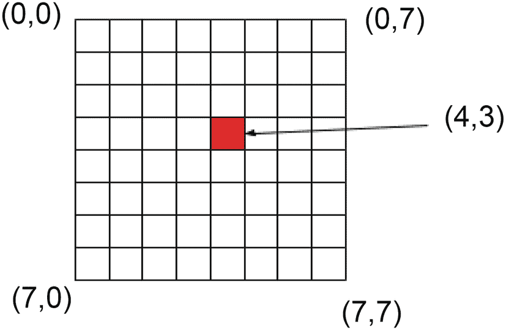
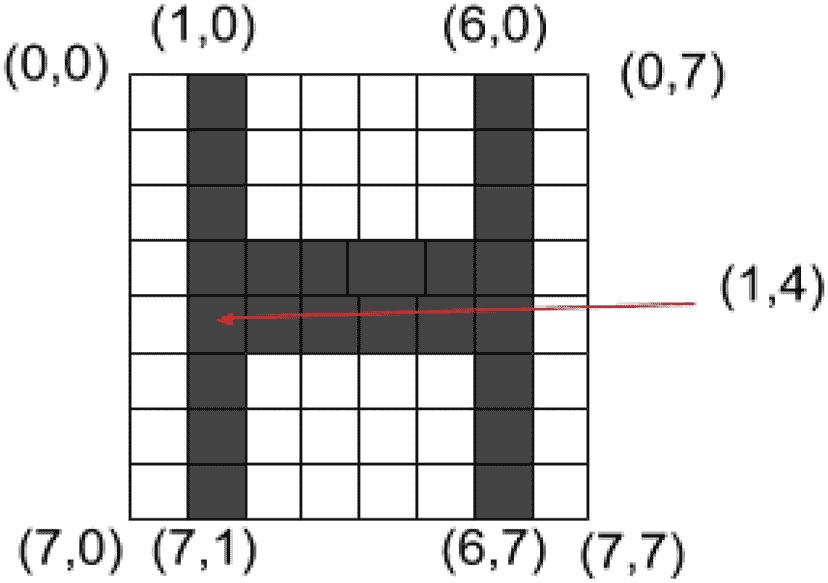
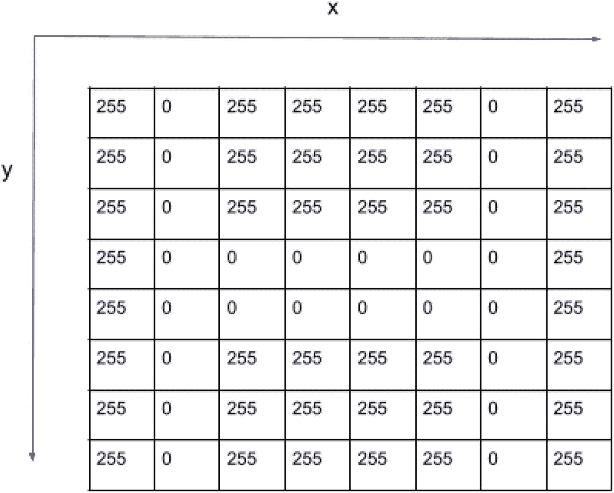
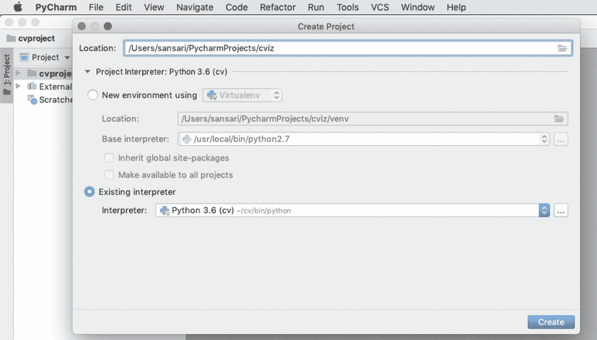
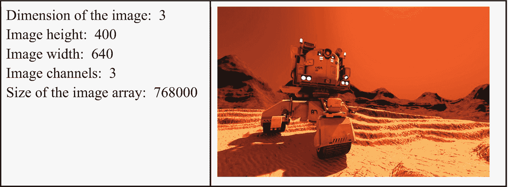
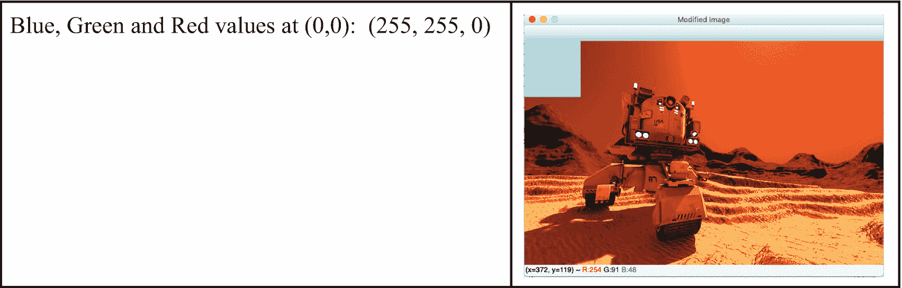
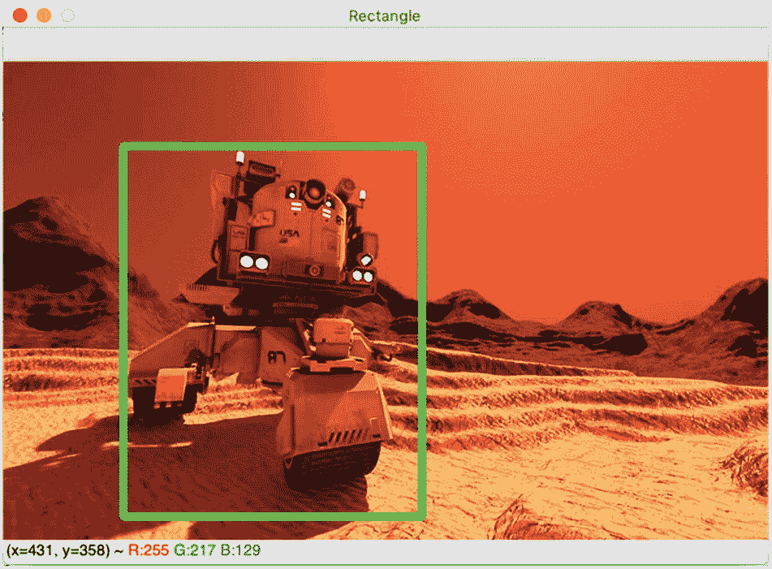
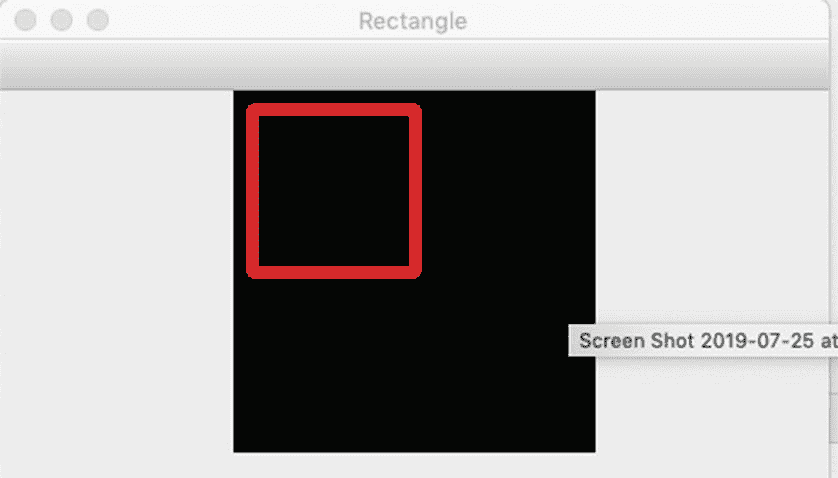
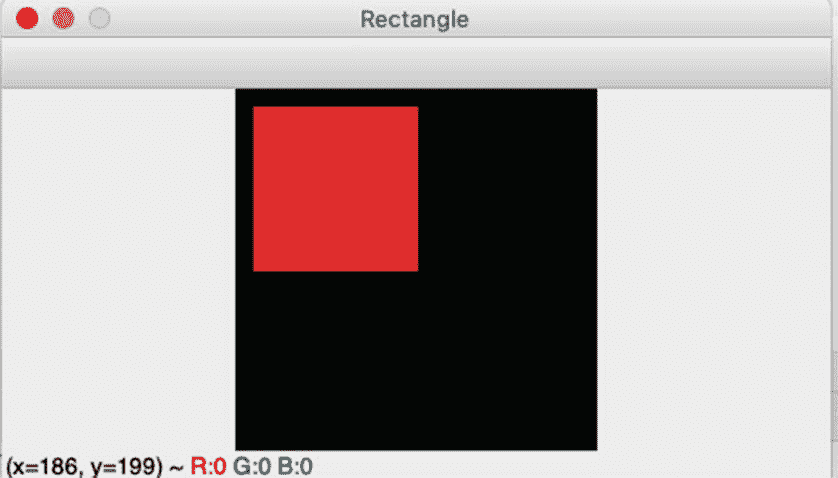
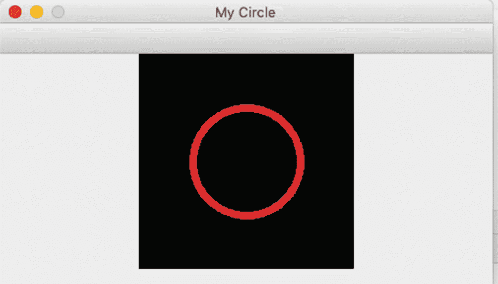

# 2. 图像与视频处理的核心概念

本章介绍图像的基本构成单元，并描述操作它们的各种方法。本章的学习目标如下：

*   理解图像的最小单元（像素）以及颜色是如何表示的
*   学习像素在图像中是如何组织的，以及如何访问和操作它们
*   使用 Python 编写代码，并利用 OpenCV 通过示例来访问和操作图像
*   在图像上绘制不同的形状，例如线条、矩形和圆形

## 图像处理

`图像处理`是一种用于操作数字图像以获得改进图像或从中提取有价值信息的方法。它涉及将图像作为输入，并输出另一幅图像或与该图像相关的特定特征和属性。视频由一系列图像或帧组成，因此也可以使用图像处理技术进行处理。在本章中，我们将深入探讨数字图像处理的基本概念。此外，你将获得处理图像和编写代码来操作图像的基本技能。

## 图像基础

`数字图像`是物体/场景或扫描文档的电子表示。图像的数字化意味着将其转换为一系列数字，并将这些数字存储在计算机存储系统中。理解这些数字如何排列以及如何操作它们，是本章的主要目标。本章将解释构成图像的基本组件，并指导你使用 OpenCV 和 Python 操作图像的过程。

### 像素

图像可以可视化为按行和列排列的点的集合，其中每个点代表一个具有特定颜色的像素。这些像素被赋予数值，这些数值决定了它们各自的颜色。你可以将图像想象成一个由方形单元格组成的网格，其中每个单元格对应一个具有特定颜色的像素。例如，如果我们有一张 300×400 像素的图像，这意味着该图像被构造成一个具有 300 行和 400 列的网格，总共产生 120,000 个像素。

#### 像素颜色

像素可以用两种不同的方式表示：灰度图和彩色图。

##### 灰度图

在灰度图像中，每个像素取 0 到 255 之间的值。值 0 代表黑色，255 代表白色。介于两者之间的值是不同深浅的灰色。接近 0 的值是较暗的灰色，而接近 255 的值是较亮的灰色。

##### 彩色图

`RGB`（代表红、蓝、绿）颜色模型是像素最流行的颜色表示之一。还有其他颜色模型可用，但本书主要关注 `RGB` 颜色模型。

在 `RGB` 模型中，每个像素表示为一个由三个值组成的元组，通常表示如下：（红色分量值，绿色分量值，蓝色分量值）。这三种颜色中的每一种都由 0 到 255 之间的整数表示。以下是一些示例：

*   (0,0,0) 是黑色。
*   (255,0,0) 是纯红色。
*   (0,255,0) 是纯绿色。

W3Schools 网站是尝试 `RGB` 元组不同组合以探索更多模式的好地方（[`https://www.w3schools.com/colors/colors_rgb.asp`](https://www.w3schools.com/colors/colors_rgb.asp)）。使用 `RGB` 计算器探索以下每个元组代表什么颜色：

*   (0,0,255)
*   (255,255,255)
*   (0,0,128)
*   (128,0,128)
*   (128,128,0)

现在尝试制作黄色。这里有一个提示：红色和绿色混合成黄色。这意味着纯红色 (255)、纯绿色 (255) 和没有蓝色 (0) 将产生黄色。因此，黄色的 `RGB` 元组是 (255,255,0)。

现在你已经对像素及其颜色有了很好的理解，让我们探索像素在图像中是如何排列的，以及如何访问它们。下一节将讨论图像处理中的坐标系概念。

## 坐标系

如前所述，图像中的像素以网格形式排列，该网格由行和列组成。想象一个八行八列的方形网格。这形成了一张 8×8 或 64 像素的图像。将其视为一个二维坐标系，其中原点 (0,0) 位于左上角。图 2-1 展示了我们示例中的 8×8 像素图像。



*一个 8×8 方形网格图案的示意图，四个角的坐标分别为 (0, 0)、(0, 7)、(7, 7) 和 (0, 7)。网格中的一个像素被高亮显示，其坐标标记为 (4, 3)。*

图 2-1 像素坐标系

以左上角作为图像坐标系的原点，右上角的像素表示为 (0,7)，左下角的像素为 (7,0)，右下角的像素为 (7,7)。这可以概括为 `(x,y)`，其中 `x` 是单元格距图像左边缘的位置，`y` 是距图像顶部边缘向下的垂直位置。在图 2-1 中，红色像素位于从左数第五个位置，从上数第四个位置。由于坐标系从 0 开始，图 2-1 中所示红色像素的坐标为 (4,3)。

为了更清楚地说明这个概念，请考虑图 2-2，这是一张 8×8 像素的图像，上面写着字母 *H*。另外，为简单起见，假设这是一张灰度图像，字母 *H* 用黑色书写，图像的其余区域为白色。



*一个示意图展示了 8×8 方形网格图案，四个角的坐标已标记。字母 H 在网格上从 (1, 0) 到 (7, 1)、(6, 0) 到 (6, 7) 以及穿过中心第 4 行和第 5 行的位置被着色。*

图 2-2 像素坐标系示例

请记住，在灰度模型中，黑色像素用 0 表示，白色像素用 255 表示。图 2-3 显示了 8×8 网格内每个像素的值。



*一个介于 y 轴和 x 轴之间的 8×8 矩阵。像素的值为 255 或 0。零值位于第 2 列和第 7 列，以及第 4 行和第 5 行。*

图 2-3 像素矩阵及其值

那么，位置 (1,4) 处的像素值是多少？位置 (2,2) 处的像素值呢？

现在，你应该清楚地理解图像是如何表示为排列在网格中的数字的。这些数值被序列化并存储在计算机的存储系统中。当图像显示在屏幕上时，这些数字被解释并渲染为实际图像。

至此，你已经学会了如何使用坐标系访问单个像素，这使你能够精确定位图像网格中的特定位置。此外，你还学会了如何通过操作像素的数值来为这些像素分配颜色。通过掌握这些概念，你现在理解了图像是如何构建的，以及如何以编程方式与它们交互。

有了坚实的图像表示基础和理解，你现在已经准备好通过 Python 和 OpenCV 编码获得实践经验。在下一节中，我将逐步指导你编写代码，这些代码将从计算机磁盘加载图像、访问单个像素、执行操作，并将修改后的图像保存回磁盘。

让我们深入图像处理的精彩世界，开始我们的动手实践之旅吧！

## 使用 Python 和 OpenCV 代码操作图像

在 `OpenCV` 中，图像的像素值使用 `NumPy` 数组表示。（不熟悉 `NumPy`？你可以在 [`https://numpy.org/devdocs/user/quickstart.html`](https://numpy.org/devdocs/user/quickstart.html) 找到一份“入门”教程。）这个 `NumPy` 数组作为图像网格及其颜色通道的多维表示。它使我们能够高效地存储、访问和操作图像的像素值。通过利用 `NumPy` 数组的能力，`OpenCV` 为图像处理和分析任务提供了一个强大的框架。换句话说，当你读取图像时，`OpenCV` 会创建一个 `NumPy` 数组。只需提供 `(x,y)` 坐标，就可以从 `NumPy` 中获取像素值。

当你提供 `(x,y)` 坐标时，`NumPy` 会返回该坐标处像素的颜色值，如下所示：

*   *对于灰度图像*，`NumPy` 返回的值将是介于 0 和 255 之间的单个值。
*   *对于彩色图像*，`NumPy` 返回的值将是一个包含红色、绿色和蓝色的元组。请注意，`OpenCV` 以相反的顺序维护 `RGB` 序列。换句话说，`OpenCV` 以 `BGR` 序列存储颜色，*而不是* `RGB` 序列。请记住 `OpenCV` 的这个重要特性，以避免在使用 `OpenCV` 时产生任何混淆。

在我们编写任何代码之前，让我们确保始终使用我们的虚拟环境，该环境位于 `~/cv` 目录中，我们已经在第 1 章中使用 `PyCharm` 设置好了。

启动你的 `PyCharm` IDE 并创建一个新项目（我将我的项目命名为 `cviz`，是“computer vision”的缩写）。参考图 2-4，确保你已选择“Existing Interpreter”并选中了我们的 `virtualenv` Python 3.8 (cv)。



*一张屏幕截图显示了 PyCharm 页面，其中呈现了一个标题为“Create Project”的对话框。该对话框显示了项目解释器名称、正在使用的新环境以及选为现有解释器的 python 3.6 cv 等详细信息。底部的“Create”按钮被选中。*

图 2-4 `PyCharm` IDE，展示了使用 `virtualenv` 设置项目的过程

### 程序：加载、探索和显示图像

在本节中，我们将编写代码从文件读取图像并探索其属性。我们将利用 `OpenCV` 库，它提供了用于图像处理和分析的强大工具。通过将图像加载到程序中，我们将能够访问其尺寸、大小和通道信息等信息。此外，我们将在屏幕上显示图像，并等待按键以继续执行。这次探索将使我们更好地理解图像，并为后续的图像处理任务奠定基础。让我们深入研究代码并开始探索图像！

清单 2-1 展示了用于加载、探索和显示图像的 Python 代码。

### 清单 2-1 中的代码解释如下：

*   第 1 行：我们导入 OpenCV 库，使我们能够使用其函数和功能。
*   第 4 行：我们将要从磁盘加载的图像的路径赋值给一个变量。如果你的输入路径在不同的目录中，你应该提供图像路径的完整路径或相对路径。
*   第 7 行：使用 OpenCV 的 `imread()` 函数，我们将图像读入一个 NumPy 数组，并将其赋值给一个名为 `image` 的变量（你可以随意命名这个变量）。
*   第 10 到 14 行：使用 NumPy 特性，我们打印图像数组的维度、高度、宽度、通道数以及数组的大小（即像素数）。
*   第 17 行：这一行使用 OpenCV 的 `imshow()` 函数按原样显示图像，该函数接受两个参数：图像窗口的名称和表示图像的 NumPy 数组。
*   第 18 行：`waitKey()` 函数使程序不会立即终止，而是等待用户按下任意键。当你看到将在第 17 行显示的图像窗口时，按任意键终止程序，否则程序将阻塞。

**注意**

`waitKey()` 函数无限期地等待一个按键事件，或者等待特定的延迟时间（以毫秒为单位）。由于操作系统在线程切换之间存在最小时间间隔，因此在按下按键后，`waitKey()` 函数不会精确等待作为参数传递给 `waitKey()` 函数的延迟时间。实际等待时间取决于在按下按键并调用 `waitKey()` 函数时，你的计算机可能正在运行的其他程序。

图 2-5 展示了清单 2-1 的输出。



一张屏幕截图显示了输出细节。图像维度 3，图像高度 400，图像宽度 640，图像通道 3，图像数组大小 768000。右侧是一张显示荒芜地形上火星车的照片。

表示图像的 NumPy 数组具有三个维度：高度 × 宽度 × 通道。数组的第一个元素对应高度，表示图像像素网格中的行数。类似地，第二个元素表示宽度，表示网格中的列数。这三个通道按蓝色、绿色和红色（BGR）的顺序表示颜色分量，而不是传统的 RGB。数组的总大小为 `400×640×3 = 768,000`。这意味着图像总共包含 `400×640 = 256,000` 个像素，每个像素由三个颜色值组成。

### 程序：使用 OpenCV 代码访问和操作像素

在下面的程序中，我们将探索如何使用前面介绍的坐标系来访问和修改像素值。清单 2-2 演示了这一过程，随后是逐行解释，以帮助你理解实现的每一步。

```
Filename: Listing_2_2.py
1    import cv2

3    # 图像路径
4    image_path = "images/marsrover.png"
5    # 从路径读取或加载图像
6    image = cv2.imread(image_path)

8    # 访问 (0,0) 位置的像素
9    (b, g, r) = image[0, 0]
10   print("(0,0) 位置的蓝、绿、红值: ", format((b, g, r)))

12   # 操作像素并显示修改后的图像
13   image[0:100, 0:100] = (255, 255, 0)
14   cv2.imshow("修改后的图像", image)
15   cv2.waitKey(0)
清单 2-2
访问和操作图像像素的代码示例
```

清单 2-2 的解释如下：

*   第 1 至 6 行：我们导入 OpenCV 的`cv2`包，并从目录路径读取图像（如讨论清单 2-1 时所述）。
*   第 9 行：我们获取坐标`(0,0)`处像素的 BGR（而非 RGB）值，并使用 NumPy 语法将它们赋值给`(b,g,r)`元组。
*   第 10 行：此行打印 BGR 值。
*   第 13 行：我们选取 `y` 轴方向从 0 到 100、`x` 轴方向从 0 到 100 的像素范围，形成一个 100×100 的正方形，并将值`(255,255,0)`——纯蓝、纯绿、无红——赋给该正方形内的所有像素。
*   第 14 行：此行显示修改后的图像。
*   第 15 行：程序等待用户按下任意键后退出。

图 2-6 显示了清单 2-2 的示例输出。



屏幕截图显示了输出细节，例如零坐标处的蓝、绿、红值为`(40, 55, 134)`。右侧照片显示了修改后的火星车图像，图像左上角有一个青色的正方形。

如图 2-6 所示，修改后的图像在左上角有一个 100×100 像素的青色正方形，由 BGR 色彩模式中的`(255,255,0)`表示。

## 绘图

OpenCV 提供了便捷的方法来在图像上绘制各种形状。在接下来的章节中，我们将探索如何使用 OpenCV 提供的相应方法来绘制线条、矩形和圆形：

*   线条：`line()`
*   矩形：`rectangle()`
*   圆形：`circle()`

这些方法使我们能够轻松地将这些形状添加到图像中，增强了我们注释和可视化数据的能力。

### 在图像上绘制线条

要使用 OpenCV 在图像上绘制线条，请遵循以下步骤：
1.  将图像加载到 NumPy 数组中。
2.  确定线条起始位置的坐标。
3.  确定线条结束位置的坐标。
4.  指定线条的颜色。
5.  可选地，指定线条的粗细。

让我们继续实现，并探索每一步在代码中是如何执行的。清单 2-3 演示了如何在图像上绘制线条。

```
Filename: Listing_2_3.py
1    import cv2

3     # 图像路径
4    image_path = "images/marsrover.png"
5    # 从路径读取或加载图像
6    image = cv2.imread(image_path)

8    # 设置起始和结束坐标
9    start = (0, 0)
10   end = (image.shape[1], image.shape[0])
11   # 以 BGR 格式设置颜色
12   color = (255,0,0)
13    # 以像素为单位设置粗细
14   thickness = 4
15   cv2.line(image, start, end, color, thickness)

17   # 显示修改后的图像
18   cv2.imshow("修改后的图像", image)
19   cv2.waitKey(0)
清单 2-3
在图像上绘制线条
```

以下是代码的逐行解释：

*   第 1 至 6 行：与之前的清单一样，这些行导入 OpenCV 包并将图像从输入目录加载到 NumPy 数组中。
*   第 9 行：我们设置线条起始点的坐标。回想一下，位置`(0,0)`是图像的左上角。
*   第 10 行：我们设置线条终点的坐标。注意，表达式`(image.shape[1], image.shape[0])`表示图像右下角的坐标。
你现在可能已经猜到了，我们正在绘制一条从图像左上角到右下角的对角线。
*   第 12 行：我们以 BGR 顺序设置线条的颜色。
*   第 14 行：我们指定线条的粗细。
*   第 15 行：实际线条通过使用 OpenCV 的`line()`函数绘制，该函数接受以下参数：
    *   图像 NumPy 数组。这是我们绘制线条的图像。
    *   线条的起始坐标。
    *   线条的结束坐标。
    *   颜色元组。
    *   线条的粗细。（此为可选参数。如果不传递此参数，线条默认粗细为 1。）

# OpenCV 图像处理基础：在图像上绘制形状

## 在图像上绘制矩形

使用 OpenCV 绘制矩形非常简单。我们直接来看代码，如清单 2-4 所示。我们首先加载一张图像，并在其上绘制一个矩形。然后，将修改后的图像保存到磁盘并显示出来。

```
Filename: Listing_2_4.py
1    import cv2

3    # 图像路径
4    image_path = "images/marsrover.png"
5    # 从路径读取或加载图像
6    image = cv2.imread(image_path)
7    # 设置矩形左上角和右下角的起始与结束坐标
8    # 设置矩形左上角和右下角的起始与结束坐标
9    start = (100,70)
10   end = (350,380)
11   # 设置轮廓的颜色和粗细
12   color = (0,255,0)
13   thickness = 5
14   # 绘制矩形
15   cv2.rectangle(image, start, end, color, thickness)
16   # 保存绘制了矩形的修改后图像
17   cv2.imwrite("rectangle.jpg", image)
18   # 显示修改后的图像
19   cv2.imshow("Rectangle", image)
20   cv2.waitKey(0)
清单 2-4
加载图像、在其上绘制矩形、保存并显示修改后的图像
```

以下是对清单 2-4 的逐行解释：

- 第 1 行是我们通常导入 OpenCV 包的语句。
- 第 4 行指定了图像路径。
- 第 5 行从路径读取图像。
- 第 9 行设置了我们想要在图像上绘制的矩形的起点。起点由矩形左上角的坐标组成。
- 第 10 行设置了矩形的终点。这表示矩形右下角的坐标。
- 第 12 行设置了颜色。
- 第 13 行设置了矩形轮廓的粗细。
- 第 15 行绘制矩形。我们使用了 OpenCV 的`rectangle()`函数，该函数接受以下参数：
    - 保存图像像素值的 NumPy 数组
    - 起始坐标（矩形的左上角）
    - 结束坐标（矩形的右下角）
    - 轮廓的颜色
    - 轮廓的粗细

请注意，第 15 行没有任何赋值运算符。换句话说，我们没有将`cv2.rectangle()`函数的返回值赋给任何变量。作为参数传递给`cv2.rectangle()`函数的 NumPy 数组`image`被直接修改了。

- 第 17 行将绘制了矩形的修改后图像保存到磁盘上的一个文件中。
- 第 19 行显示修改后的图像。
- 第 20 行调用`waitKey()`函数，使图像保持显示在屏幕上，直到按下任意键。

图 2-8 显示了绘制了矩形的图像输出。



在前面的示例中，我们首先从磁盘读取了一张图像，并在其上绘制了一个矩形。现在，我们将对这个示例稍作修改，在一个空白画布上绘制矩形。我们将首先创建一个画布（而不是加载现有图像），并在其上绘制一个矩形。然后，我们将保存并显示生成的图像。参见清单 2-5。

```
Filename: Listing 2_5.py
1    import cv2
2    import numpy as np

4    # 创建一个新画布
5    canvas = np.zeros((200, 200, 3), dtype = "uint8")
6    start = (10,10)
7    end = (100,100)
8    color = (0,0,255)
9    thickness = 5
10   cv2.rectangle(canvas, start, end, color, thickness)
11   cv2.imwrite("rectangle.jpg", canvas)
12   cv2.imshow("Rectangle", canvas)
13   cv2.waitKey(0)
清单 2-5
在新画布上绘制矩形并保存图像
```

由于你已经熟悉清单 2-5 中大多数行的用途，我将只解释新增的行。

第 2 行导入了我们将用于创建画布的 NumPy 库。

第 5 行是我们创建图像（称为*画布*）的地方。我们的画布是 200×200 像素，每个像素包含三个通道（用于保存 BGR 值）。变量名`canvas`是一个 NumPy 数组，在本例中，每个像素的值为零。请注意，画布每个像素值的数据类型是 8 位无符号整数（如第 1 章所述）。

如何绘制一个实心矩形（即，用特定颜色填充的矩形）？
提示：将粗细设置为 -1。

图 2-9 显示了清单 2-5 的输出。图 2-10 显示了一个绘制了实心矩形的画布。





## 在图像上绘制圆形

在图像上绘制圆形同样简单。你可以创建自己的画布或加载现有图像，然后设置圆心的坐标、半径、颜色和轮廓粗细。

清单 2-6 展示了一段在空白画布上绘制圆形的可运行代码。图 2-11 显示了这段代码的输出。

```
Filename: Listing_2_6.py
1    import cv2
2    import numpy as np

4    # 创建一个新画布
5    canvas = np.zeros((200, 200, 3), dtype = "uint8")
6    center = (100,100)
7    radius = 50
8    color = (0,0,255)
9    thickness = 5
10   cv2.circle(canvas, center, radius, color, thickness)
11   cv2.imwrite("circle.jpg", canvas)
12   cv2.imshow("My Circle", canvas)
13   cv2.waitKey(0)
清单 2-6
在画布上绘制圆形
```

清单 2-6 中的代码与清单 2-5 的代码没有太大区别，只是第 6 行定义了圆心，第 7 行设置了半径，第 8 行定义了颜色，第 9 行设置了圆形的粗细。最后，第 10 行使用 OpenCV 的`circle()`函数绘制圆形，该函数接受以下参数：

- 要在其上绘制圆形的图像。这是包含图像像素的 NumPy 数组。
- 圆心的坐标。
- 圆形的半径。
- 圆形轮廓的颜色。
- 轮廓的粗细。



这里有一个练习供你尝试：

1.  在画布中心绘制一个实心圆形。
2.  绘制两个同心圆，并使最外层圆的半径是内层圆半径的 1.5 倍。

## 总结

在本章中，我们深入探讨了图像处理的基础知识。首先介绍了像素及其在不同色彩方案（包括灰度与彩色）中的表示方式。我们研究了坐标系如何帮助我们定位特定像素并修改其数值。此外，还探索了在图像上绘制基本形状（如线条、矩形和圆形）的过程。尽管这些概念看似简单，但它们构成了各种图像处理任务的基石。

在下一章中，我们将深入探讨图像处理技术与算法，涵盖图像滤波、边缘检测、图像增强等主题。通过在本章所学概念的基础上进一步拓展，你将提升在图像处理领域的理解深度与实践能力。