# 3. 图像处理技术

在计算机视觉应用中，图像通常从其来源（如摄像头、存储在计算机磁盘上的文件或其他应用程序的流）中获取。在大多数情况下，这些输入图像需要从一种形式转换为另一种形式。例如，可能需要调整大小或旋转，或者改变其颜色。在某些情况下，可能需要移除背景像素，或者将两幅图像合并。此外，在图像中查找特定对象的边界也是一项必要任务。

本章深入探讨了不同的图像变换技术，并提供了使用 Python 和 OpenCV 实现的示例。本章的学习目标如下：

*   探索图像处理中常用的变换技术
*   学习图像处理中使用的算术运算
*   学习合并两幅或多幅图像以及拆分通道的技术
*   理解图像清理技术，例如降噪
*   掌握在图像中检测并绘制对象轮廓（边界）的技能
*   探索形态学变换和模板匹配的概念

## 变换

在处理任何计算机视觉问题时，你通常需要将图像变换为不同的形式。以下各节将通过一组 Python 示例，演示可用于变换图像的不同技术。

### 调整大小

让我们从第一个变换——调整大小开始。调整图像大小时，我们需要增加或减少图像的高度和宽度。调整图像大小时需要记住的一个重要概念是*宽高比*，即宽度与高度的比例，通过宽度除以高度计算得出。计算宽高比的公式如下：

*   *宽高比 = 宽度 / 高度*

正方形图像的宽高比为 1:1，而宽高比为 3:1 意味着宽度是高度的三倍。如果图像的高度为 300 像素，宽度为 600 像素，则其宽高比为 2:1。

调整图像大小时，保持原始宽高比可以确保调整后的图像不会显得拉伸或压缩。

清单 3-1 展示了两种不同的图像调整大小技术：

*   将图像调整为所需的像素尺寸，同时保持宽高比。换句话说，如果你知道图像的期望高度，就可以利用原始图像的宽高比计算出相应的宽度。
*   按比例调整图像大小。例如，将图像宽度放大 1.5 倍，或高度放大 2.5 倍。

OpenCV 提供了一个单一函数 `resize()` 来执行这两种调整大小技术。

```
文件名: Listing_3_1.py
1    # 使用 resize() 函数进行图像变换
2    import cv2
3    import numpy as np

5    # 加载图像
6    imagePath = "images/zebra.png"
7    image = cv2.imread(imagePath)

9    # 获取图像形状，返回高度、宽度和通道数（元组）。计算宽高比
10   (h, w) = image.shape[:2]
11   aspect = w / h

13   # 将图像高度缩小为原始高度的一半。
14   # 记住，像素值必须是整数。
15   height = int(0.5 * h)
16   width =  int(height * aspect)

18   # 新的图像尺寸（元组）
19   dimension = (height, width)
20   resizedImage = cv2.resize(image, dimension, interpolation=cv2.INTER_AREA)
21   cv2.imshow("调整大小后的图像", resizedImage)

23   # 使用 x 和 y 因子调整大小
24   resizedWithFactors = cv2.resize(image, None, fx=1.2, fy=1.2, interpolation=cv2.INTER_LANCZOS4)
25   cv2.imshow("按因子调整大小", resizedWithFactors)
26   cv2.waitKey(0)
清单 3-1
计算宽高比并调整图像大小的代码
```

清单 3-1 展示了如何使用 OpenCV 的 `resize()` 函数调整图像大小，该函数接受以下参数：

*   第一个参数是原始图像，以 NumPy 数组表示。
*   第二个参数是目标调整尺寸。这是一个整数元组，表示调整后图像的高度和宽度。如果希望使用水平或垂直因子调整大小（稍后说明），则将此参数传递为 `None`。
*   第三和第四个参数 `fx` 和 `fy` 分别是水平方向（宽度方向）和垂直方向（高度方向）的缩放因子。这两个参数是可选的。
*   最后一个参数是插值方法。这是 OpenCV 内部用于调整图像大小的算法名称。*插值*是在调整图像大小时计算像素值的过程。OpenCV 支持以下五种插值算法：
    *   `INTER_LINEAR`：这是一种双线性插值，确定四个最近邻像素（2×2 = 4），并计算它们的加权平均值以确定下一个像素的值。
    *   `INTER_NEAREST`：使用最近邻插值方法，在给定某个空间内某函数在邻近点值的情况下，近似该函数在非给定点的值。换句话说，为了计算一个像素的值，会考虑其最近邻像素来近似插值函数。


*   `INTER_CUBIC:` 该算法使用双三次插值算法计算像素值。与双线性插值类似，它利用 4×4 = 16 个最近邻像素来确定下一个像素的值。在不考虑速度的情况下，双三次插值生成的缩放图像质量优于双线性插值。

*   `INTER_LANCZOS4:` 该算法使用 8×8 最近邻插值。

*   `INTER_AREA:` 该算法通过像素区域关系（如 OpenCV 官方文档所述）计算像素值。使用此算法可生成无摩尔纹的缩放图像。当图像尺寸放大时，`INTER_AREA` 的效果类似于 `INTER_NEAREST` 方法。

让我们检查清单 3-1 中的代码。

第 2 行和第 3 行是库的导入。

第 6 行指定图像路径，第 7 行将图像读取为 NumPy 数组并赋值给名为 `image` 的变量。

NumPy 的 `shape` 函数返回数组内对象的维度。对图像调用 `shape` 函数会返回一个包含高度、宽度和通道数的元组。第 10 行通过指定索引长度为 2（`image.shape[,:2]`）仅获取高度和宽度。高度和宽度分别存储在变量 `h` 和 `w` 中。

如果我们不指定索引长度，它将返回包含高度、宽度和通道数的元组，如下所示：

```
(h, w, c) = image.shape[:]
```

在此示例中，我们希望将图像尺寸缩小 50%，同时保持原始宽高比。我们可以简单地将原始高度和宽度乘以 0.5 来获得所需的高度和宽度。如果我们只知道所需的高度，则可以通过将原始新高度乘以宽高比来计算所需的宽度。这在第 16 行和第 17 行中进行了演示。

第 20 行将所需的高度和宽度设置为一个元组。

第 21 行调用 OpenCV 的 `resize()` 函数，并将原始图像 NumPy 数组、所需尺寸以及插值算法（本例中为 `INTER_AREA`）作为参数传递给 `resize()` 函数。

第 24 行演示了当我们知道图像高度或宽度（或两者）需要增加或减少的倍数时，使用第二种方法进行缩放操作。在此示例中，高度和宽度均放大了 1.2 倍。

图 3-1 和图 3-2 展示了我们缩放程序的示例输出。

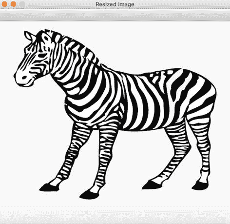

一张从侧面视角绘制的斑马截图。标题显示为“缩放后的图像”。

图 3-2

缩放后的图像

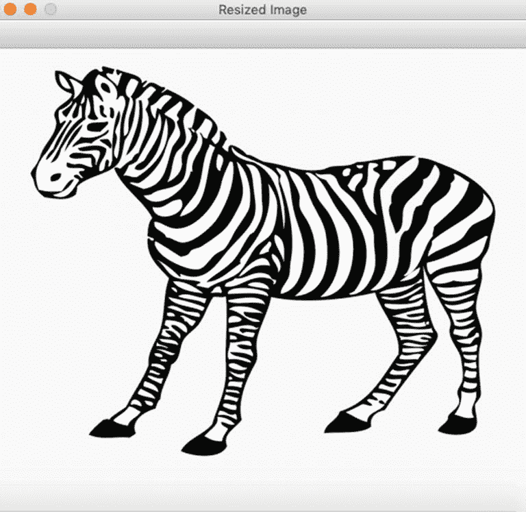

一张从侧面视角绘制的斑马截图。顶部文字显示为“缩放后的图像”。

图 3-1

原始图像

### 图像平移

*图像* *平移*是指将图像沿 x 轴和 y 轴向左、向右、向上或向下移动。移动图像的过程包括两个主要步骤：定义平移矩阵和调用 OpenCV 的 `warpAffine()` 函数。平移矩阵决定了移动的方向和幅度。

`warpAffine()` 函数是 OpenCV 中执行实际移动操作的函数。`warpAffine()` 函数接受三个参数：

*   图像 NumPy 数组
*   平移矩阵
*   图像的尺寸

为了帮助您理解平移操作，清单 3-2 提供了一个代码示例。

```
文件名: Listing_3_2.py
1    # 使用 OpenCV 的 warpAffine() 沿 x 轴和 y 轴移动图像
2    import cv2
3    import numpy as np

5    # 加载图像
6    imagePath = "images/soccer-in-green.jpg"
7    image = cv2.imread(imagePath)

9    # 定义平移矩阵
10   translationMatrix = np.float32([[1,0,50],[0,1,20]])

12   # 移动图像
13   movedImage = cv2.warpAffine(image, translationMatrix, (image.shape[1], image.shape[0]))

15   cv2.imshow("移动后的图像", movedImage)
16   cv2.waitKey(0)
清单 3-2
沿 x 轴和 y 轴的图像平移
```

第 10 行定义了平移矩阵，指定了移动方向以及图像应移动的像素数。在此示例中，平移矩阵是一个 2×3 矩阵或二维数组。第一行由 `[1,0,50]` 定义，表示沿 x 轴向右移动 50 个像素。如果该数组的第三个元素为负数，则图像将向左移动。第二行由 `[0,1,20]` 定义，表示沿 y 轴向下移动 20 个像素。如果该数组的第三个元素为负数，则图像将沿 y 轴向上移动。

在第 13 行，我们调用了 OpenCV 的 `warpAffine()` 函数。该函数接受以下参数：

*   我们打算移动的图像的 NumPy 表示。
*   定义移动方向和移动量的平移矩阵。
*   最后一个参数是一个元组，包含我们想要移动图像的画布的宽度和高度。在此示例中，我们保持画布尺寸与图像的原始高度和宽度相同。

图 3-3 和图 3-4 显示了结果。


一张放置在草地上的足球照片截图。照片后面有深色背景。标题显示为“移动后的图像”。

图 3-4

移动后的图像

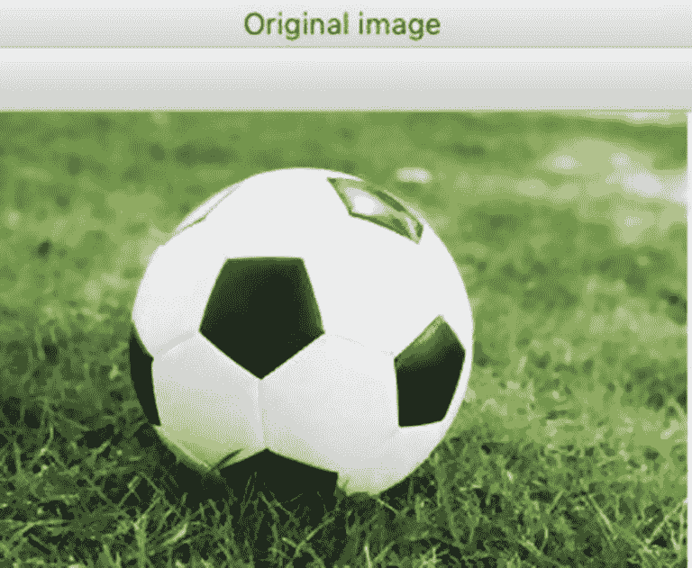

一张放置在草地上的足球照片截图。标题显示为“原始图像”。

图 3-3

原始图像

这里有一个练习供您尝试：将图像向左移动 50 像素，向上移动 60 像素。


### 旋转

要按特定角度旋转图像，我们首先使用 OpenCV 提供的 `getRotationMatrix2D()` 函数定义一个旋转矩阵。清单 3-3 中的示例演示了创建此旋转矩阵的过程。要实际执行旋转，我们可以使用 `warpAffine()` 函数，这与我们在上一个示例（清单 3-2）中应用平移的方式类似。

```
Filename: Listing_3_3.py
1    # 使用 OpenCV 的 warpAffine 函数演示图像旋转的示例代码
2    import cv2
3    import numpy as np

5    # 加载图像
6    imagePath = "images/zebrasmall.png"
7    image = cv2.imread(imagePath)
8    (h,w) = image.shape[:2]

10   # 定义平移矩阵
11   center = (h//2, w//2)
12   angle = -45
13   scale = 1.0

15   rotationMatrix = cv2.getRotationMatrix2D(center, angle, scale)

17   # 旋转图像
18   rotatedImage = cv2.warpAffine(image, rotationMatrix, (image.shape[1], image.shape[0]))

20   cv2.imshow("旋转后的图像", rotatedImage)
21   cv2.waitKey(0)
清单 3-3
围绕图像中心旋转图像
```

清单 3-3 展示了如何围绕图像中心将其顺时针旋转 45 度。

第 11 行计算图像的中心。请注意，我们使用 `//` 对高度和宽度进行除法运算，以仅获取其整数部分。

第 12 行简单地为我们想要旋转图像的角度赋值。负值将顺时针旋转图像，而正值将逆时针旋转图像。

第 13 行设置旋转比例，用于在旋转时调整图像大小。值为 1.0 表示旋转后保持原始大小。如果将其设置为 0.5，则旋转后的图像尺寸将缩小一半。

在第 15 行，我们使用 OpenCV 的函数 `getRotationMatrix2D()` 定义旋转矩阵，该函数接受以下参数：

*   一个元组，表示图像需要围绕其旋转的点
*   以度为单位旋转的角度
*   缩放比例

第 18 行根据旋转矩阵的定义执行图像旋转。我们使用了与平移图像时相同的 `warpAffine()` 函数。唯一的区别在于，在旋转的情况下，我们传递的是第 15 行创建的旋转矩阵。

第 20 行显示旋转后的图像，第 21 行等待按键按下，然后关闭显示的图像。

图 3-5 和图 3-6 展示了我们代码的示例输出。

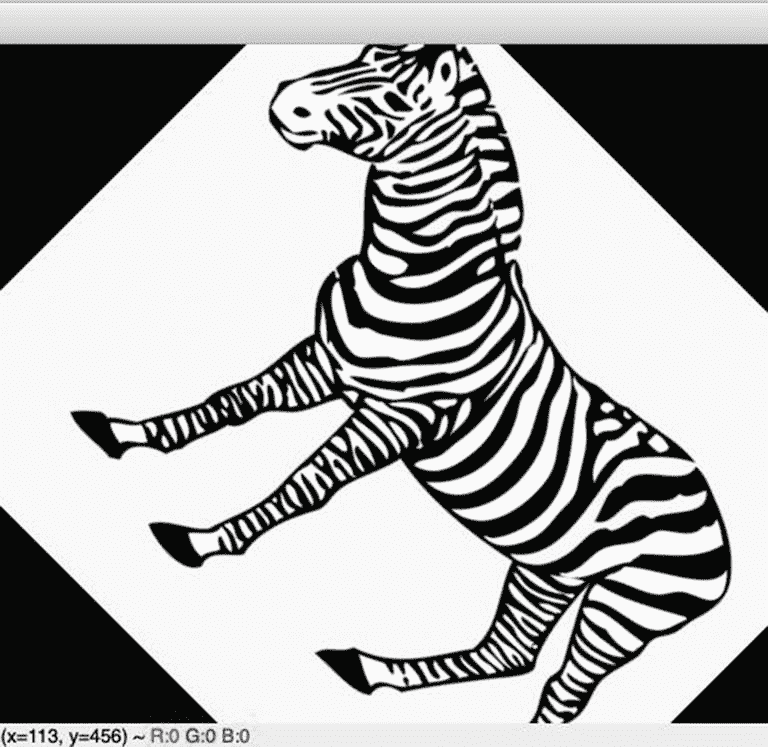

一张屏幕截图显示了旋转后的斑马图案。底部提供了以下数值：X = 113。Y = 456。R、G、B 值均设置为 0。

图 3-6

旋转后的图像

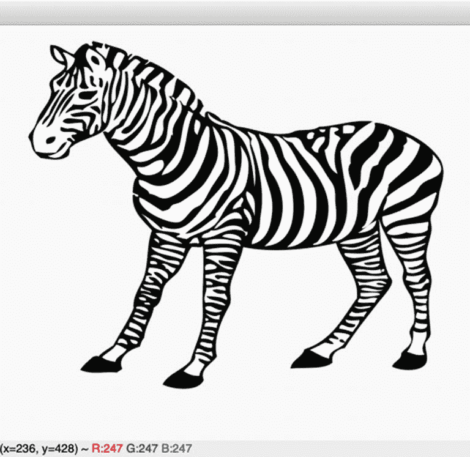

一张屏幕截图显示了从侧面视角观察的斑马图案。底部提供了以下数值：X = 236。Y = 428。红色：247。绿色：247。蓝色：247。

图 3-5

原始图像

### 翻转

利用 OpenCV 便捷的 `flip()` 函数，可以轻松地沿 x 轴水平翻转图像或沿 y 轴垂直翻转图像。`flip()` 函数接受两个参数。

*   原始图像
*   翻转方向
    *   0 表示垂直翻转。
    *   1 表示水平翻转。
    *   -1 表示先水平翻转，再垂直翻转。

让我们通过清单 3-4 来探索不同方向上的图像翻转过程。

```
Filename: Listing_3_4.py
1    # 演示不同方向图像翻转的示例
2    import cv2
3    import numpy as np

5    # 加载图像
6    imagePath = "images/zebrasmall.png"
7    image = cv2.imread(imagePath)

9    # 水平翻转
10   flippedHorizontally = cv2.flip(image, 1)
11   cv2.imshow("水平翻转", flippedHorizontally)
12   cv2.waitKey(-1)

14   # 垂直翻转
15   flippedVertically = cv2.flip(image, 0)
16   cv2.imshow("垂直翻转", flippedVertically)
17   cv2.waitKey(-1)
18   # 先水平翻转，再垂直翻转
19   flippedHV = cv2.flip(image, -1)
20   cv2.imshow("水平垂直翻转", flippedHV)
21   cv2.waitKey(0)
清单 3-4
水平、垂直以及先水平后垂直翻转图像
```

清单 3-4 相当不言自明，演示了不同方向上的图像翻转过程，但让我们检查一下清单 3-4 中执行图像翻转的行。

第 10 行调用 `flip()` 函数，并传入原始图像和值 0 以进行水平翻转。第 15 行垂直翻转图像。第 19 行的参数为 -1，表示先水平翻转，再垂直翻转。

图 3-7 至 3-10 展示了这些翻转的效果。

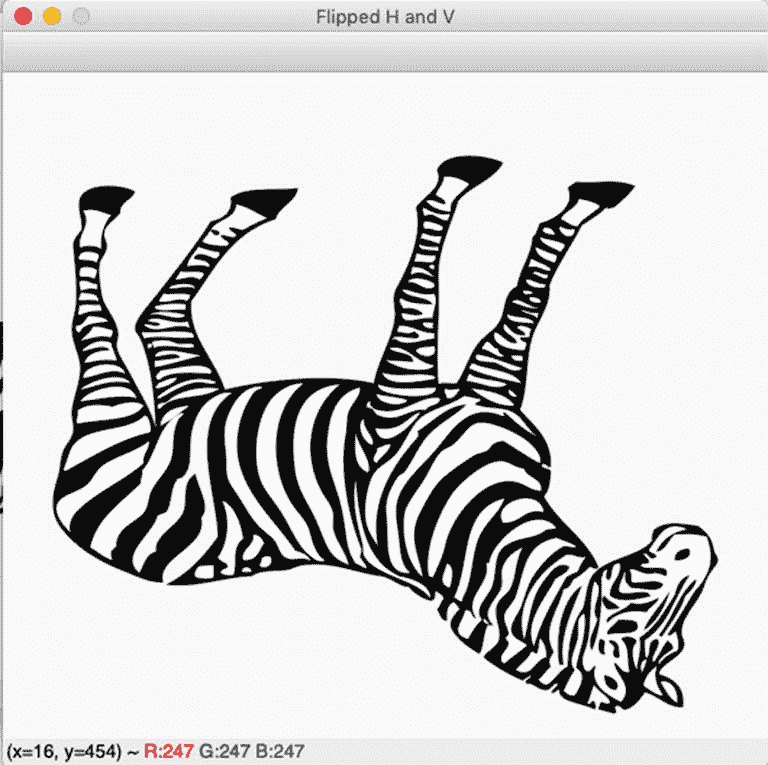

一张屏幕截图显示了头朝下、面朝右的斑马图案。标题为“水平垂直翻转”。底部提供了以下数值：x = 16。Y = 454。R、G、B 值均设置为 247。

图 3-10

先水平翻转，再垂直翻转

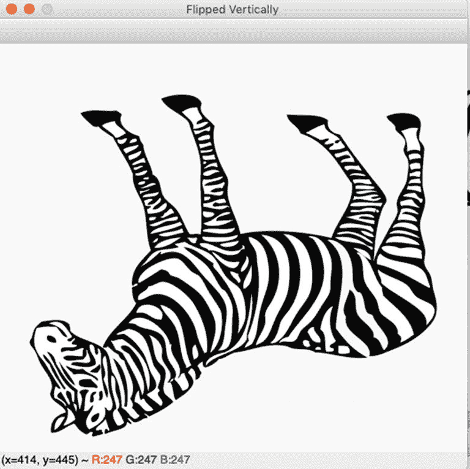

一张屏幕截图显示了头朝下的斑马图案。标题为“垂直翻转”。底部提供了以下数值：X = 414。Y =445。R、G、B 值均设置为 247。

图 3-9

垂直翻转

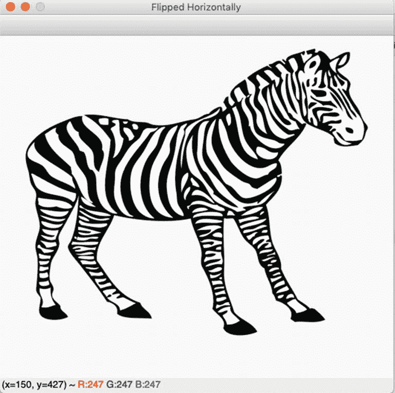

一张屏幕截图显示了面朝右的斑马图案。顶部文字为“水平翻转”。底部提供了以下数值：X = 150。Y = 427。R、G、B 值均设置为 247。

图 3-8

水平翻转

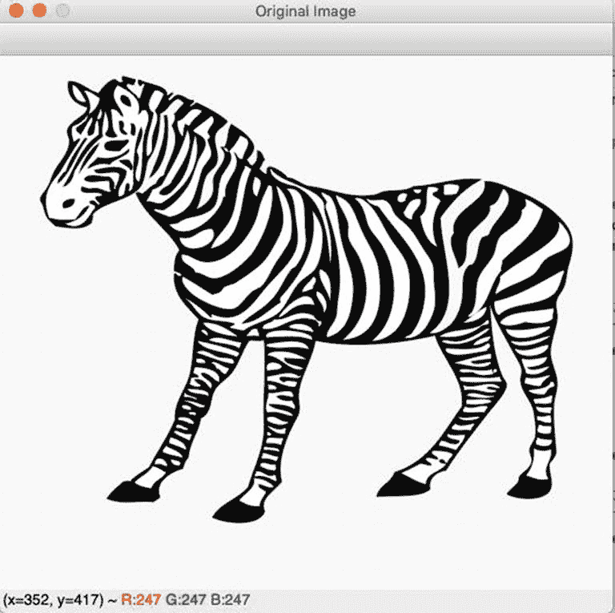

一张屏幕截图显示了斑马图案。标题为“原始图像”。底部提供了以下数值：X = 352。Y = 417。R、G、B 值均设置为 247。

图 3-7

原始图像


### 裁剪

*图像* *裁剪*涉及移除图像中不需要的外部区域。如前所述，在 OpenCV 中，图像被表示为 NumPy 数组。可以通过对图像 NumPy 数组进行切片来裁剪图像。OpenCV 没有提供专门的图像裁剪函数；相反，我们利用 NumPy 数组的切片功能。

让我们借助清单 3-5 来了解如何裁剪图像。

```
Filename: Listing_3_5.py
1    # 演示图像裁剪的示例
2    import cv2
3    import numpy as np

5    # 加载图像
6    imagePath = "images/zebrasmall.png"
7    image = cv2.imread(imagePath)
8    cv2.imshow("原始图像", image)
9    cv2.waitKey(0)

11   # 裁剪图像以仅获取斑马的面部
12   croppedImage = image[0:150, 0:250]
13   cv2.imshow("裁剪后的图像", croppedImage)
14   cv2.waitKey(0)
清单 3-5
图像裁剪
```

第 12 行展示了如何对 NumPy 数组进行切片。在此示例中，我们使用 150 像素的高度和 250 像素的宽度来裁剪图像，以仅提取斑马的面部部分。

图 3-11 显示了原始图像，图 3-12 显示了裁剪后的图像。

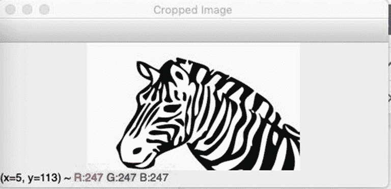

一张截图描绘了从头部到颈部区域的斑马轮廓。标题显示为“裁剪后的图像”。底部提供了以下数值：X = 5。Y = 113。R、G、B 值设置为 247。

图 3-12

裁剪后的图像

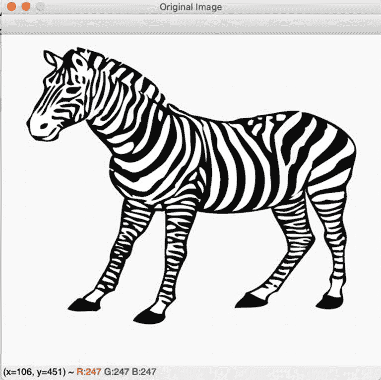

一张截图描绘了一匹面向左侧的斑马。标题显示为“原始图像”。底部提供了以下数值：X = 106。Y = 451。R、G、B 值设置为 247。

图 3-11

原始图像

## 图像算术与位运算

在开发计算机视觉应用时，通常需要增强输入图像的属性。这涉及执行各种算术运算，例如加法、减法，以及位运算，例如 OR、AND、NOT 和 XOR。

在图像处理的上下文中，图像中的每个像素可以具有从 0 到 255 的整数值（如第 2 章所述）。然而，当我们向一个像素添加一个常数，导致其值大于 255，或者从中减去一个常数，导致其值小于 0 时，会发生什么？

例如，考虑一个场景，图像中某个像素的值为 230，我们向其添加 30。显然，结果像素值不能是 260。那么，在这种情况下我们应该怎么做？我们应该截断该值以保持像素的最大值为 255，还是应该将其回绕使其变为 4（这意味着在达到 255 后，该值回绕到 0，然后加上任何余数）？

有两种方法可以处理像素值超出 `[0,255]` 范围的情况：

*   *饱和运算（或修剪）*：在此运算中，230 + 30 ⇒ 255。

*   *模运算*：这里执行模运算，如下所示：(230+30) % 256 ⇒ 4。

你可以通过使用 OpenCV 和 NumPy 的内置函数来执行算术运算。但是，它们处理运算的方式不同。

OpenCV 的加法是饱和运算。另一方面，NumPy 执行模运算。

请注意 NumPy 和 OpenCV 之间的区别，因为这两种技术会产生不同的结果，因此你在何处使用哪一种取决于你的具体情况和需求。

### 加法

OpenCV 提供了两种便捷的方法来相加两幅图像：

*   `add()`：将两幅尺寸相同的图像作为参数，并相加它们的像素值以产生结果。

*   `addWeighted()`：通常用于混合两幅图像。稍后将提供有关此函数的更多详细信息。

请注意，要相加两幅图像，它们必须具有相同的深度和类型。

为了更好地理解这两种图像相加方法之间的差异，清单 3-6 展示了这两种方法。

```
Filename: Listing_3_6.py
1    # 演示两种图像相加方法的示例程序
2    import cv2
3    import numpy as np

5    image1Path = "images/zebra.png"
6    image2Path = "images/nature.jpg"

8    image1 = cv2.imread(image1Path)
9    image2 = cv2.imread(image2Path)

11   # 调整两幅图像的大小，使它们具有相同的尺寸。这是相加两幅图像的必要条件
12   resizedImage1 = cv2.resize(image1,(300,300),interpolation=cv2.INTER_AREA)
13   resizedImage2 = cv2.resize(image2,(300,300),interpolation=cv2.INTER_AREA)

15   # 这是两幅图像的简单加法
16   resultant = cv2.add(resizedImage1, resizedImage2)

18   # 显示这些图像以查看差异
19   cv2.imshow("调整大小后的图像 1", resizedImage1)
20   cv2.waitKey(0)

22   cv2.imshow("调整大小后的图像 2", resizedImage2)
23   cv2.waitKey(0)

25   cv2.imshow("结果图像", resultant)
26   cv2.waitKey(0)

28   # 这是两幅图像的加权加法
29   weightedImage = cv2.addWeighted(resizedImage1,0.7, resizedImage2, 0.3, 0)
30   cv2.imshow("加权图像", weightedImage)
31   cv2.waitKey(0)

33   imageEnhanced = 255*resizedImage1
34   cv2.imshow("增强图像", imageEnhanced)
35   cv2.waitKey(0)

37   arrayImage = resizedImage1+resizedImage2
38   cv2.imshow("数组图像", arrayImage)
39   cv2.waitKey(0)
清单 3-6
两幅图像的加法
```

第 8 行和第 9 行从磁盘加载两幅不同的图像。如前所述，要将两幅图像相加，它们必须具有相同的大小和深度。你可能已经猜到了第 12 行和第 13 行的目的。在代码中，图像被调整为 300×300 像素的尺寸。

第 16 行是这两幅图像相加的地方，使用了 OpenCV 的简单加法函数 `add()`，该函数将这两幅图像作为参数。请参考图 3-15 中的输出图像，查看简单相加图 3-13 和图 3-14 所示的两幅图像的结果。

在第 29 行，我们通过使用 OpenCV 的 `addWeighted()` 函数进行加权加法，其工作原理如下：

*   结果图像 = ***α*** x 图像 1 + **β** x 图像 2 + **γ**(1)

其中 𝝰 是图像 1 的权重，𝛃 是图像 2 的权重，𝛄 是一个常数。通过改变这些权重的值，我们可以创建所需的加法效果。

通过查看前面的等式，你可以轻松猜出需要传递给函数 `addWeighted()` 的参数。以下是参数列表：

*   图像 1 的 NumPy 数组

*   图像 1 的权重 𝝰（我们在清单 3-6 中传递了值 0.7）

*   图像 2 的 NumPy 数组

*   图像 2 的权重 𝛃（我们在清单 3-6 中传递了值 0.3）

*   最后一个参数 𝛄（我们在清单 3-6 中传递了值 0）

让我们检查清单 3-6 的输入和输出。图 3-13 和图 3-14 是原始图像，已调整为 300×300 以使它们具有相等的尺寸。

图 3-15 是使用函数 `add()` 将这两幅图像相加时的输出。图 3-16 是使用函数 `addWeighted()` 相加输入时得到的结果图像。

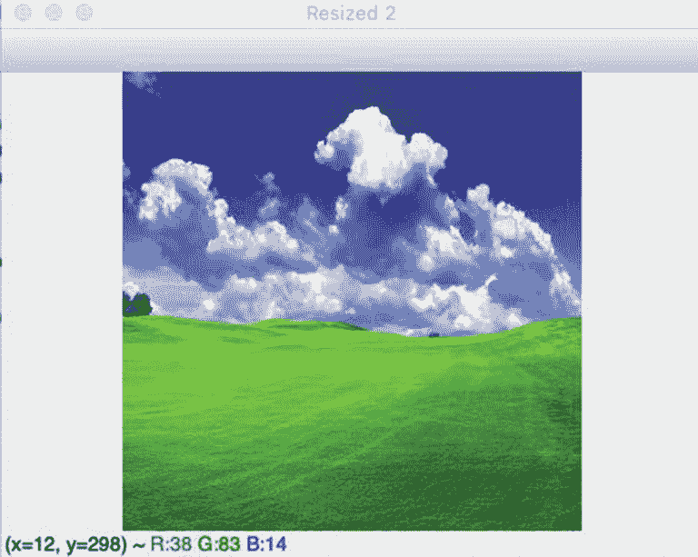


一张截图展示了上方大片草地和多云天空的照片。标题显示为“已调整大小 2”。底部提供了以下数值：X = 12，Y = 298，R = 38，G = 83，B = 14。

图 3-14

添加的原始图像

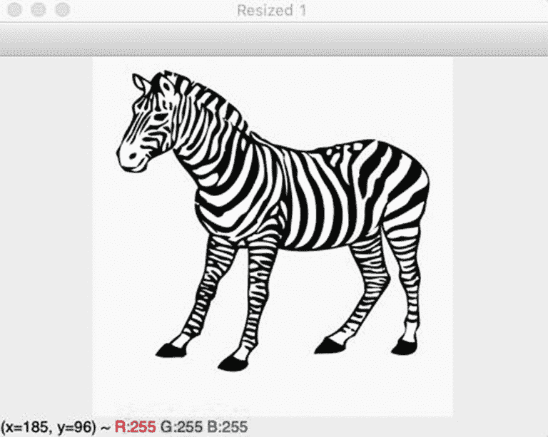

一张截图描绘了侧视角的斑马素描。顶部文字显示为“已调整大小 1”。底部提供了以下数值：X = 185，Y = 96，R、G、B 值均设为 255。

图 3-13

原始图像

请参考图 3-15 和图 3-16 所示的输出结果，注意简单的 `add()` 函数与 `addWeighted()` 函数之间的区别。

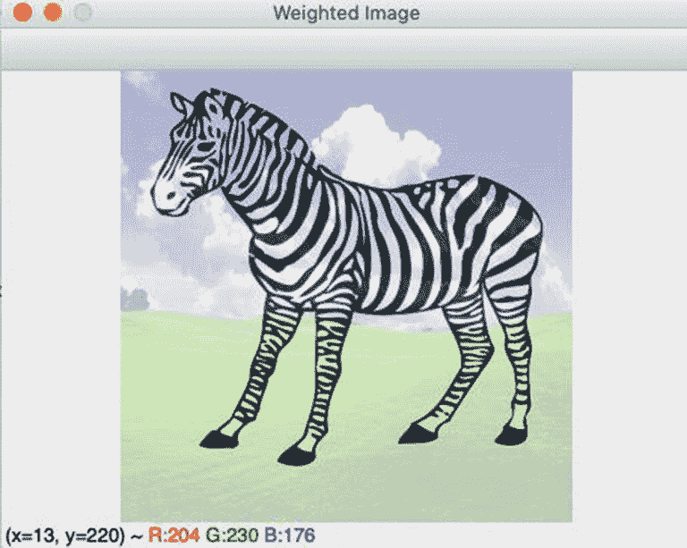

一张截图描绘了斑马绘制在草地背景照片上的效果。标题显示为“加权图像”。底部提供了以下数值：X = 13，Y = 220，R = 204，G = 230，B = 176。

图 3-16

OpenCV 的 `addWeighted()` 函数结果

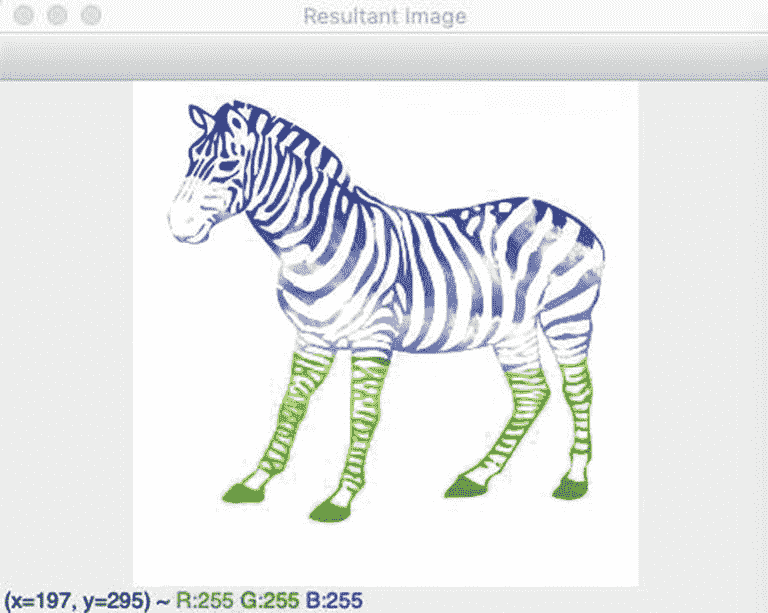

一张截图描绘了斑马身体和腿部呈现不同色调的素描。标题显示为“结果图像”。底部提供了以下数值：X = 197，Y = 295，R、G、B 值均设为 255。

图 3-15

OpenCV 的 `add()` 函数结果

### 减法

*图像* *减法*是指将一幅图像的像素值减去另一幅图像对应位置的像素值。我们也可以从图像像素中减去一个常数。当对两幅图像进行减法时，务必注意这两幅图像必须具有相同的尺寸和深度。

当我们对一幅图像自身进行减法时会发生什么？结果图像的所有像素值都将为零，从而生成一幅全黑的图像。这一特性在检测图像中的任何变化/改动时非常有用。如果没有变化，两幅图像相减的结果将是一幅全黑的图像。

图像减法的另一个原因是平衡图像中任何不均匀的区域或阴影。

我们将通过清单 3-7 中的代码示例，看到图像减法的一些有趣结果。

```
文件名: Listing_3_7.py
1    import cv2
2    import numpy as np

5    image1Path = "images/cat1.png"
6    image2Path = "images/cat2.png"

8    image1 = cv2.imread(image1Path)
9    image2 = cv2.imread(image2Path)

11   # 调整两幅图像的尺寸，使其具有相同的维度。这是进行图像减法的必要条件
12   resizedImage1 = cv2.resize(image1,(int(500*image1.shape[1]/image1.shape[0]), 500),interpolation=cv2.INTER_AREA)
13   resizedImage2 = cv2.resize(image2,(int(500*image2.shape[1]/image2.shape[0]), 500),interpolation=cv2.INTER_AREA)

15   cv2.imshow("猫 1", resizedImage1)
16   cv2.imshow("猫 2", resizedImage2)

18   # 从图像 2 中减去图像 1
19   cv2.imshow("猫 1 与猫 2 的差异",cv2.subtract(resizedImage2, resizedImage1))
20   cv2.waitKey(0)

23   # 从图像 1 中减去图像 2
24   subtractedImage = cv2.subtract(resizedImage1, resizedImage2)
25   cv2.imshow("从猫 1 中减去猫 2", subtractedImage)
26   cv2.waitKey(0)

28   # 使用 NumPy 从猫 1 中减去猫 2
29   subtractedImage2 = resizedImage2 - resizedImage1
30   cv2.imshow("NumPy 减法图像", subtractedImage2)
31   cv2.waitKey(0)

33   # 常数减法
34   subtractedImage3 = resizedImage1 - 50
35   cv2.imshow("从图像中减去常数", subtractedImage3)
36   cv2.waitKey(0)
清单 3-7
图像减法
```

清单 3-7 展示了与图像减法相关的几种有趣行为。以下是该清单内容的概述。

第 5 至 9 行从磁盘（目录路径）加载图像。我们加载了两张猫的图像，并试图判断这两只看起来相似的猫是否存在差异。图 3-17 和图 3-18 所示的图像是本示例中使用的输入图像。

第 12 和 13 行用于调整图像尺寸，以确保它们的维度相同。请记住，这是对两个图像数组进行减法的必要条件。

在第 19 行，我们显示了从 `cat2` 中减去 `cat1` 的结果。为了确定差异，我们使用了 OpenCV 的 `subtract()` 函数，并传入两幅图像的 NumPy 表示（调整尺寸后的图像）。在此例中，我们想要从 `cat2` 中减去 `cat1`；因此，我们在函数中首先传入 `resizedImage2` 变量，然后将 `resizedImage1` 作为第二个参数。从图 3-19 和图 3-20 所示的输出结果可以明显看出，顺序确实很重要。

为了演示顺序的影响，第 24 行在 `subtract()` 函数中将 `resizedImage1` 作为第一个参数，`resizedImage2` 作为第二个参数。

第 29 行没有使用 OpenCV 的减法函数。这是一个简单的 NumPy 数组减法。请注意图 3-21 所示输出结果的差异。

第 34 行从图像中减去一个常数。输出结果如图 3-22 所示。

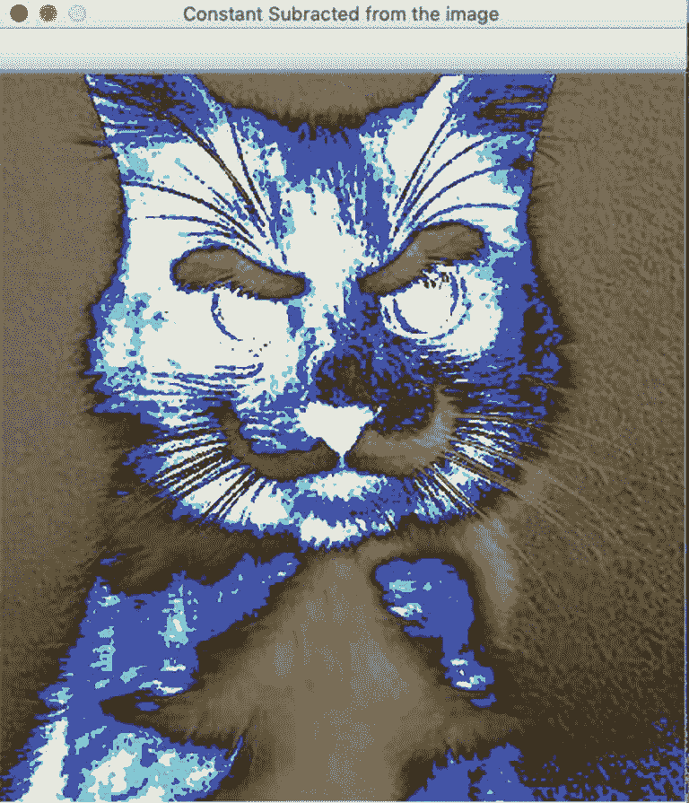

一张截图展示了一只由不同色块构成的猫的插图。它类似于一个掩膜结构，眉毛和嘴巴周围有空白区域。标题显示为“从图像中减去常数”。

图 3-22

从图像中减去一个常数

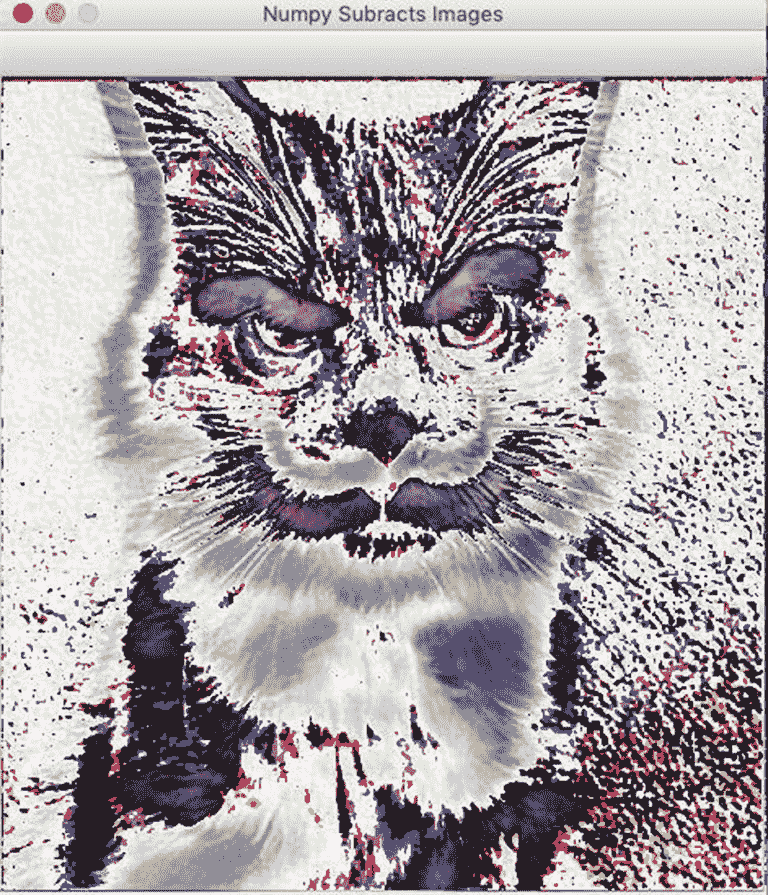

一张截图展示了一只由不同颜色点簇构成的猫的图片。标题显示为“NumPy 减法图像”。

图 3-21

NumPy 减法

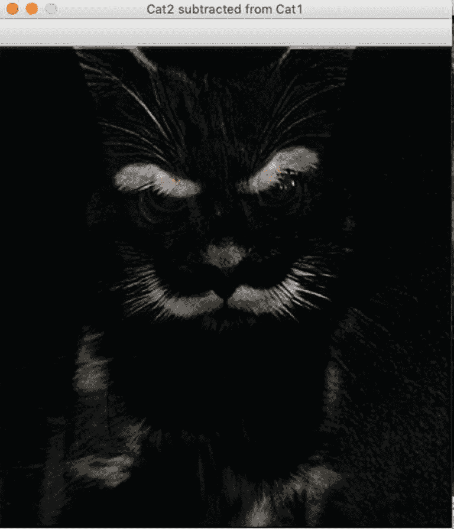

一张截图展示了一只明暗色调的猫的图片。大部分区域与深色背景融合在一起。标题显示为“从猫 1 中减去猫 2”。

图 3-20

从图像 1 中减去图像 2

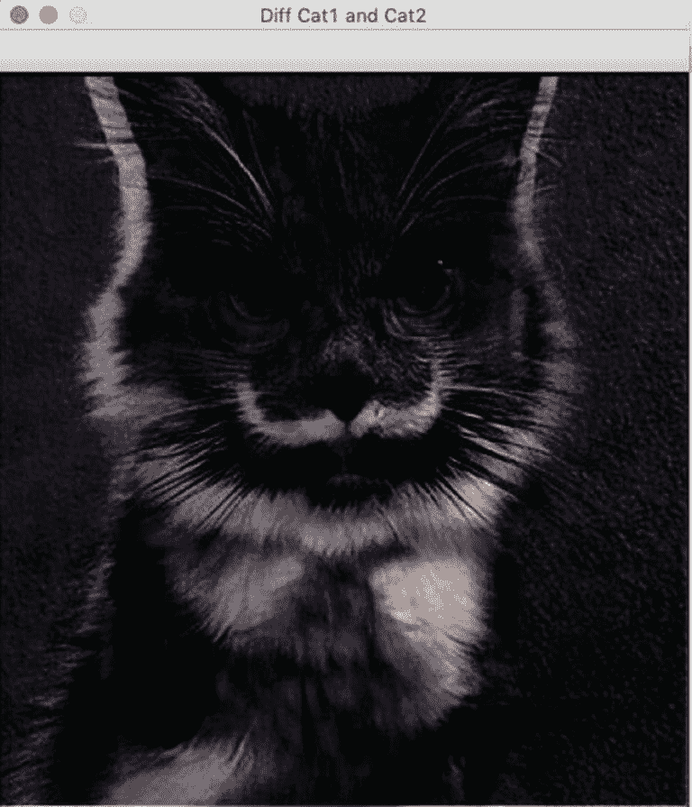

一张截图展示了一只明暗色调的猫的图片。面部区域颜色更深。标题指示了猫 1 与猫 2 之间的差异。

图 3-19

从图像 2 中减去图像 1

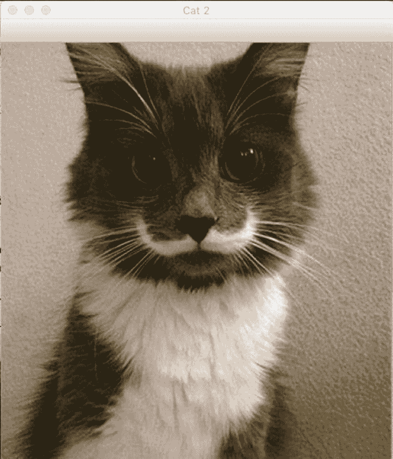

一张截图展示了一只猫的照片。标题显示为“猫 2”。

图 3-18

猫 2 图像

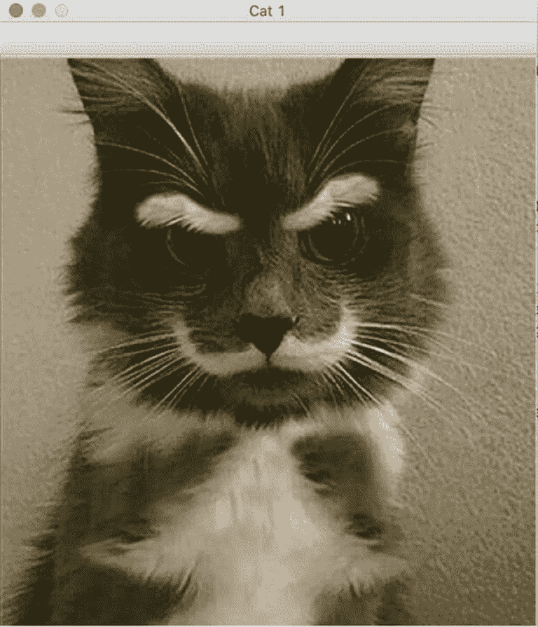

一张截图展示了一只猫的照片。标题显示为“猫 1”。

图 3-17

猫 1 图像

到目前为止，我们已经介绍了两种强大的图像算术技术：加法和减法。现在，让我们深入探讨对图像像素执行按位逻辑运算的领域，这将进一步扩展我们的图像处理能力。

### 按位运算

计算机视觉中一些最有用的运算包括按位运算 AND、OR、NOT 和 XOR。正如你可能从布尔代数中回忆起的，这些运算是二进制运算，作用于像素的两种状态：开和关。在灰度图像中，像素的值范围可以从 0 到 255。那么，在这种情况下，我们如何定义“开”和“关”呢？在图像处理中，对于灰度二值图像，像素值为 0 表示关，像素值大于 0 表示开。利用像素要么开要么关这一概念，我们将探讨以下按位运算。


#### 与运算（AND）

对两个操作数“a”和“b”执行按位与运算，只有当“a”和“b”都为 1 时，结果才为 1；否则结果为 0。

在图像处理领域，对两个图像数组执行按位与运算，会计算逐元素的逻辑与。要成功执行按位与运算，必须确保两个数组具有相同的维度。此外，也可以对数组和标量值执行按位与运算。

为了方便执行按位与运算，OpenCV 提供了一个便捷的函数 `bitwise_and(imageArray1, imageArray2)`。该函数将两个图像数组作为参数，并执行按位与运算。

要探究按位与运算的实现，请参考清单 3-8，该清单位于对或运算、非运算和异或运算的讨论之后。

```
Filename: Listing_3_8.py
1    import cv2
2    import numpy as np

4    # 创建一个圆形
5    circle = cv2.circle(np.zeros((200, 200, 3), dtype = "uint8"), (100,100), 90, (255,255,255), -1)
6    cv2.imshow("白色圆形", circle)
7    cv2.waitKey(0)

9    # 创建一个正方形
10   square = cv2.rectangle(np.zeros((200,200,3), dtype= "uint8"), (30,30), (170,170),(255,255,255), -1)
11   cv2.imshow("白色正方形", square)
12   cv2.waitKey(0)

14   # 按位与运算
15   bitwiseAnd = cv2.bitwise_and(square, circle)
16   cv2.imshow("与运算", bitwiseAnd)
17   cv2.waitKey(0)

19   # 按位或运算
20   bitwiseOr = cv2.bitwise_or(square, circle)
21   cv2.imshow("或运算", bitwiseOr)
22   cv2.waitKey(0)

24   # 按位异或运算
25   bitwiseXor = cv2.bitwise_xor(square, circle)
26   cv2.imshow("异或运算", bitwiseXor)
27   cv2.waitKey(0)

29   # 按位非运算
30   bitwiseNot = cv2.bitwise_not(square)
31   cv2.imshow("非运算", bitwiseNot)
32   cv2.waitKey(0)
清单 3-8
按位运算
```

#### 或运算（OR）

对两个操作数“a”和“b”执行按位或运算，如果“a”或“b”中有一个或两个为 1，则结果为 1；否则结果为 0。按位或运算计算两个数组或一个数组与一个标量值的逐元素逻辑或。在 OpenCV 中，函数 `bitwise_or(imageArray1, imageArray2)` 计算两个输入数组的按位或。清单 3-8 展示了一个或运算的工作示例。

#### 非运算（NOT）

按位非运算将其操作数的位值取反。OpenCV 的 `bitwise_not(imageArray)` 函数仅接受一个图像数组作为参数，对该图像执行按位非运算。示例请参见清单 3-8。

#### 异或运算（XOR）

对两个操作数“a”和“b”执行按位异或运算，如果“a”或“b”中恰好有一个（但*不是*两个）为 1，则结果为 1；否则结果为 0。OpenCV 提供了一个便捷的函数 `bitwise_xor(imageArray1, imageArray2)` 来执行按位异或运算。同样，两个图像数组必须具有相同的维度。清单 3-8 展示了一个按位异或运算的工作示例。

下表总结了图像处理中常用的按位运算，包括掩码操作及其他相关任务：

| 运算符 | 用法 | 描述 |
| --- | --- | --- |
| 按位与 | a AND b | 在每个位的位置上，如果两个操作数的对应位都为 1，则返回 1 |
| 按位或 | a OR b | 在每个位的位置上，如果两个操作数中任意一个或两个的对应位为 1，则返回 1 |
| 按位异或 | a XOR b | 在每个位的位置上，如果两个操作数中恰好有一个的对应位为 1，则返回 1 |
| 按位非 | NOT a | 将其操作数的位取反 |

为了更好地理解这些按位运算，让我们分析一下清单 3-8 中的程序。该程序首先创建了两个图像，一个圆形和一个正方形，然后对图像应用了各种按位运算。接下来，我们将在后续的图中观察这些运算的效果。

清单 3-8 中发生了以下事件。

第 5 行在 200×200 画布的中心创建了一个白色圆形。（关于如何在画布上绘制圆形的示例，请参见清单 2-5。）

类似地，第 10 行在 200×200 画布上绘制了一个白色正方形。（关于如何在画布上绘制矩形的示例，请参见清单 2-4。）

第 15 行展示了 OpenCV 的 `bitwise_and()` 函数的实现。该函数的参数是圆形和正方形图像（由 NumPy 数组表示）。

类似地，第 20 行和第 25 行分别展示了 `bitwise_or()` 和 `bitwise_xor()` 运算。

这三个用于与、或、异或运算的函数都需要两个数组作为操作对象。

第 30 行展示了 `bitwise_not()` 函数，该函数仅接受一个参数来计算按位非。

图 3-23 至 3-28 展示了清单 3-8 的输出结果。

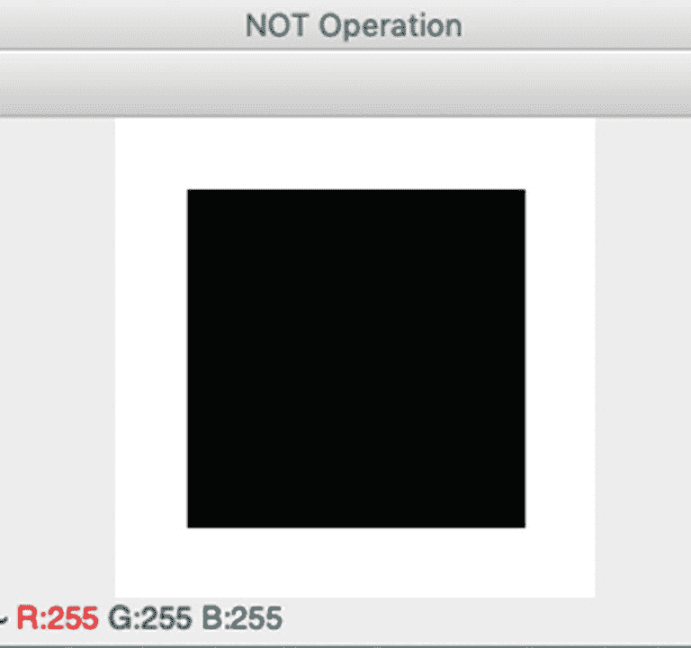

一张截图，显示一个深色阴影的正方形。标题为“非运算”。R、G、B 的值均设为 255。

图 3-28
按位非

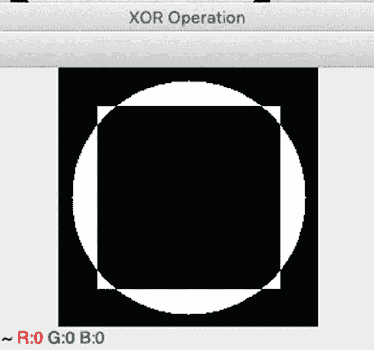

一张截图，显示一个亮色圆形内部有一个深色正方形。从圆形中露出的正方形角部颜色较浅。标题为“异或运算”。R、G、B 的值均设为 0。

图 3-27
按位异或

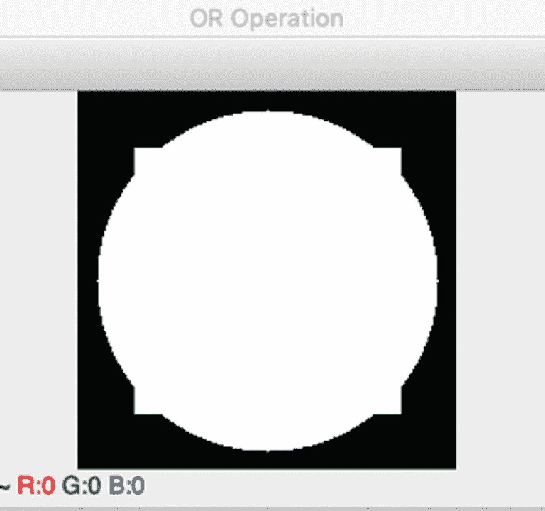

一张截图，显示一个带有四个尖刺的圆形。标题为“或运算”。R、G、B 的值均设为 0。

图 3-26
按位或

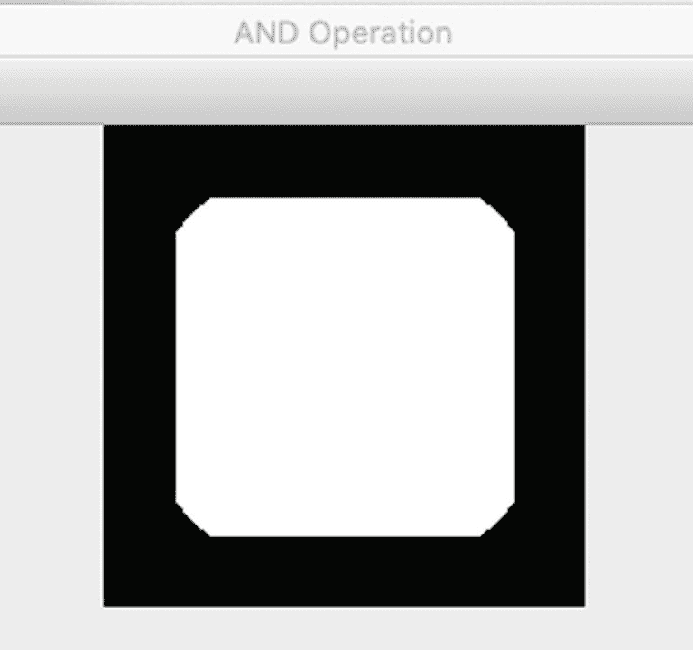

一张截图，显示一个带有倒角的正方形形状。标题为“与运算”。

图 3-25
按位与

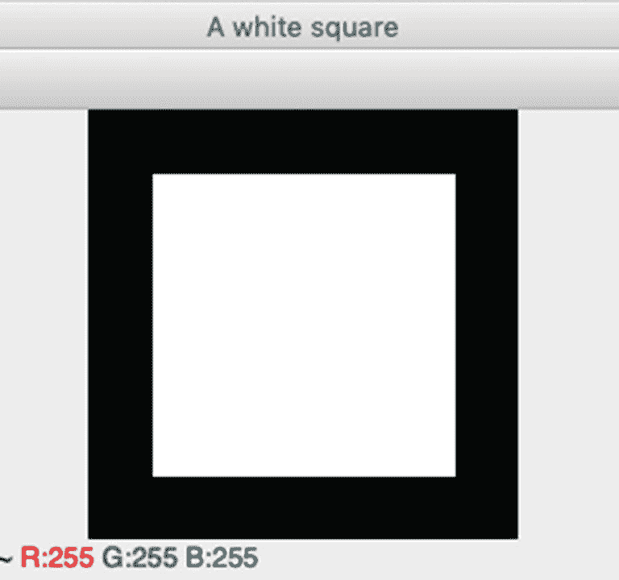

一张截图，显示深色背景上的一个正方形形状。标题为“白色正方形”。R、G、B 的值均设为 255。

图 3-24
白色正方形

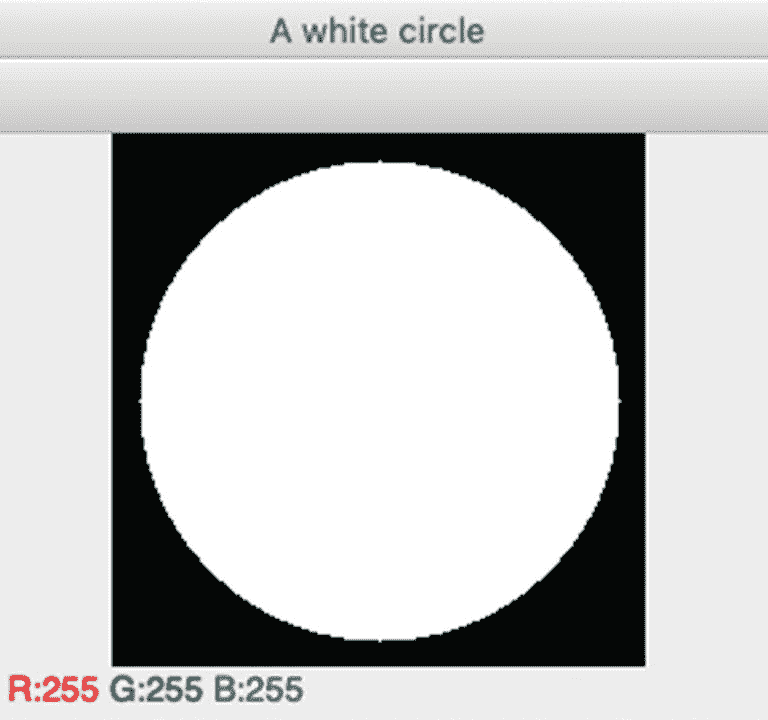

一张截图，显示深色背景上的一个圆形。标题为“白色圆形”。R、G、B 的值均设为 255。

图 3-23
白色圆形


## 掩膜

*掩膜*是计算机视觉中最强大的技术之一。掩膜指的是对图像的“隐藏”或“过滤”。

当我们对图像进行掩膜处理时，我们会用其他图像隐藏图像的一部分。换句话说，我们通过对图像的其余部分应用掩膜，将注意力集中在图像的某一部分上。例如，图 3-29 中包含数字 1、2 和 3，而图 3-30 是一张带有白色镂空部分的黑色图像。当我们混合这两张图像时，数字 1 和 3 将被隐藏，唯一可见的数字是数字 2。掩膜的结果如图 3-31 所示。

掩膜技术应用于图像的平滑或模糊处理，以及检测图像中的边缘和轮廓。掩膜技术也用于目标检测，我们将在第 6 章中探讨。

清单 3-9 展示了如何使用 OpenCV 执行掩膜操作。

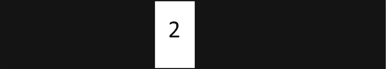

一个矩形框内标有数字 2。

图 3-31

掩膜效果

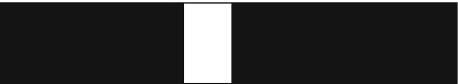

一个矩形块表示中间部分为空白，而两侧为较暗的色调。

图 3-30

掩膜图像

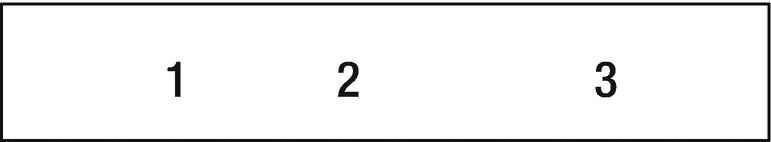

一个矩形块内标有数字 1、2 和 3。

图 3-29

原始图像

```
Filename: Listing_3_9.py
1    import cv2
2    import numpy as np

4    # 加载图像
5    natureImage = cv2.imread("images/nature.jpg")
6    cv2.imshow("原始自然图像", natureImage)

8    # 创建一个矩形掩膜
9    maskImage = cv2.rectangle(np.zeros(natureImage.shape[:2], dtype="uint8"),
10                        (50, 50), (int(natureImage.shape[1])-50, int(natureImage.shape[0] / 2)-50), (255, 255, 255), -1)
11   cv2.imshow("掩膜图像", maskImage)
12   cv2.waitKey(0)

14   # 使用 bitwise_and 操作执行掩膜。注意 mask=maskImage 参数
15   masked = cv2.bitwise_and(natureImage, natureImage, mask=maskImage)
16   cv2.imshow("掩膜后的图像", masked)
17   cv2.waitKey(0)
清单 3-9
使用按位与操作进行掩膜
```

在 OpenCV 中，图像掩膜是通过按位与操作来执行的。清单 3-9 展示了一个如何对图像区域进行掩膜的简单示例。在此示例中，我们的目标是提取图 3-32 中所示的云朵的矩形部分。

现在，清单 3-9 的第 5 行对你来说应该很熟悉了。我们在这里所做的只是加载图像（图 3-32）。

在第 9 行，我们创建了一个黑色画布，其顶部有一个白色矩形部分（带有一些边距）。画布的大小与原始图像的大小相同。请注意，在图 3-33 中，较大的矩形顶部有另一个矩形白色部分，而该矩形的其余区域是黑色的。

第 15 行是执行掩膜操作的地方。请注意，我们使用了 `bitwise_and()` 函数，它接受两个必需参数，在本例中为原始图像本身和一个可选的掩膜参数（`mask=maskImage`）。此函数对图像自身执行 AND 操作，并根据参数 `mask=maskImage` 的指示应用掩膜。当 OpenCV 看到这个 `mask` 参数时，它将只检查掩膜（`maskImage`）数组中处于开启状态的像素。此掩膜操作的输出如图 3-34 所示。

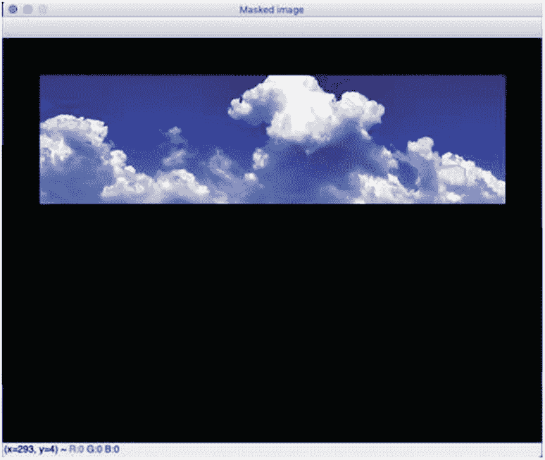

一张截图显示了一个矩形框内的多云天空的部分照片。标题为“掩膜后的图像”。底部提供了以下值：x = 293。y = 4。R、G 和 B 值均设置为 0。

图 3-34

掩膜后的图像

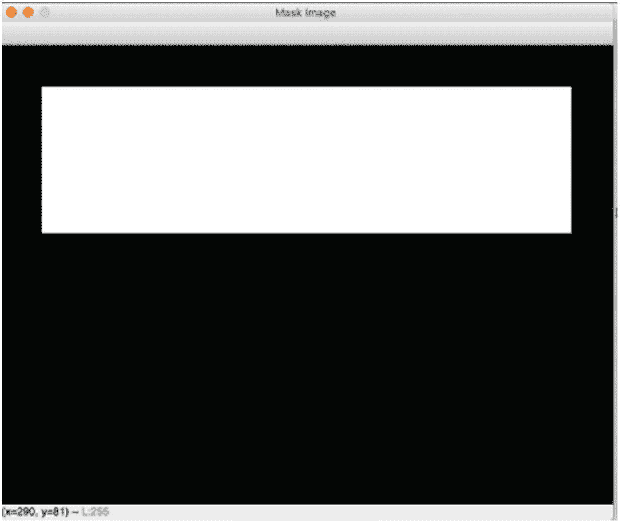

一张截图显示了一个深色背景上的矩形块。标题为“掩膜图像”。底部提供了以下值：x = 290。y = 81。L, 255。

图 3-33

将用于从图 3-32 中提取云朵的掩膜

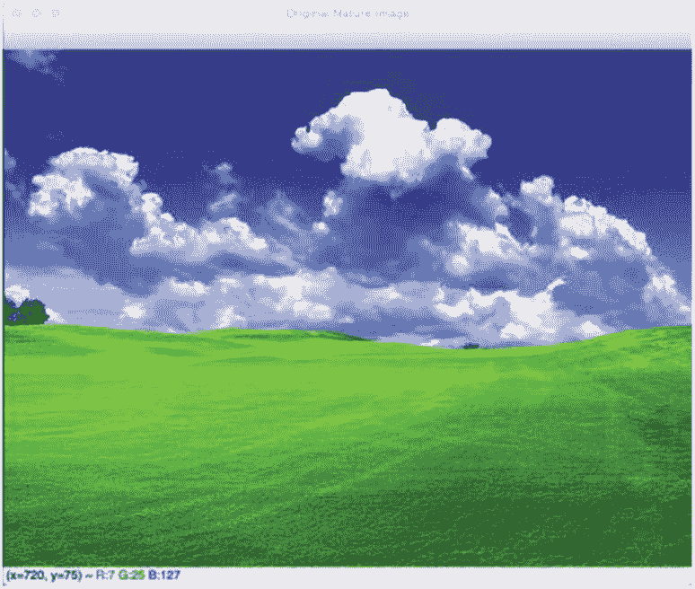

一张截图显示了一张顶部有多云天空的大片草地的照片。标题为“原始自然图像”。底部提供了以下值：x = 720。y = 75。R, 7。G, 25。B, 127。

图 3-32

待掩膜的原始图像

掩膜是计算机视觉中最常用的图像处理技术之一。你将在后续关于机器学习和神经网络的章节中了解更多关于其实际应用的知识。


## 分割与合并通道

回顾第 2 章，彩色图像由多个通道（R,G,B）组成。你已经学会了如何访问这些通道并将其表示为 NumPy 数组。在本节中，你将学习如何分割这些通道并将它们存储为单独的图像。OpenCV 提供了一个便捷的函数 `split()` 来实现这一功能。使用这个 `split()` 函数，我们可以将图像分割成各自的颜色分量。代码清单 3-10 是一个演示此功能的工作示例。在这个示例中，我们将再次使用“自然”图像（如前文图 3-32 所示），并将其分割成各个颜色分量。

```
文件名: Listing_3_10.py
1    import cv2
2    import numpy as np

4    # 加载图像
5    natureImage = cv2.imread("images/nature.jpg")

7    # 将图像分割成颜色分量
8    (b,g,r) = cv2.split(natureImage)

10   # 显示蓝色图像
11   cv2.imshow("蓝色图像", b)

13   # 显示绿色图像
14   cv2.imshow("绿色图像", g)

16   # 显示红色图像
17   cv2.imshow("红色图像", r)
18   cv2.waitKey(0)
代码清单 3-10
将通道分割为颜色分量
```

在代码清单 3-10 中，第 5 行加载图像。第 8 行将图像分割成三个分量，并将它们存储在独立的 NumPy 变量（`b`、`g`、`r`）中。回顾一下，NumPy 按蓝、绿、红（BGR）顺序存储颜色，而非 RGB 顺序。第 11、14 和 17 行显示了这些分割后的图像。输出结果如图 3-35、3-36 和 3-37 所示。

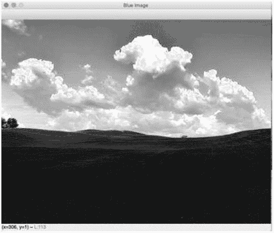

一张屏幕截图，显示的是顶部有多云天空的草地的灰度照片。标题为“蓝色图像”。底部提供了以下数值：x = 306。y = 1。L, 113。草地颜色较深。

图 3-37
蓝色通道

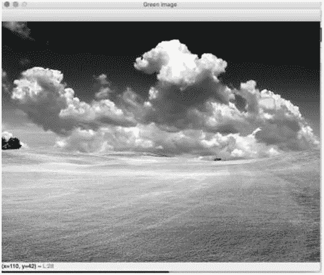

一张屏幕截图，显示的是顶部有多云天空的草地的灰度照片。标题为“绿色图像”。底部提供了以下数值：x = 110。y = 42。L, 28。

图 3-36
绿色通道

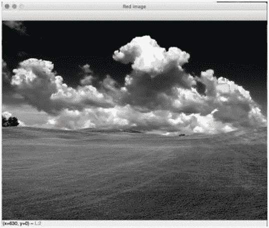

一张屏幕截图，显示的是顶部有多云天空的草地的灰度照片。标题为“红色图像”。底部提供了以下数值：x = 630。y = 0。L, 2。

图 3-35
红色通道

我们可以使用 OpenCV 的 `merge()` 函数来合并通道，该函数接收按 BGR 顺序排列的数组。代码清单 3-11 展示了 `merge()` 函数的用法。

```
文件名: Listing_3_11.py
1    import cv2
2    import numpy as np

4    # 加载图像
5    natureImage = cv2.imread("images/nature.jpg")

7    # 将图像分割成颜色分量
8    (b,g,r) = cv2.split(natureImage)

10   # 显示蓝色图像
11   cv2.imshow("蓝色图像", b)

13   # 显示绿色图像
14   cv2.imshow("绿色图像", g)

16   # 显示红色图像
17   cv2.imshow("红色图像", r)

19   merged = cv2.merge([b,g,r])
20   cv2.imshow("合并后的图像", merged)
21   cv2.waitKey(0)
代码清单 3-11
分割与合并函数
```

第 5 行加载图像。第 8 行到第 17 行与我们之前的分割函数相关。我们进行分割是为了得到三个分量，以便演示 `merge()` 函数。

第 19 行是我们合并通道的地方。我们只需将各个通道作为参数传递给 `merge()` 函数。注意，通道是按 BGR 顺序排列的。执行程序并观察输出。你得到原始图像了吗？

分割与合并是图像处理中非常有用的技术，可用于为机器学习进行特征工程。我们将在后续章节中应用其中的一些概念。

## 使用平滑与模糊进行降噪

*平滑*和*模糊*是重要的图像处理技术，用于减少图像中存在的噪声。平滑和模糊都涉及减少图像中的高频分量或尖锐细节，从而使图像外观更加均匀。平滑是一个通用术语，用于描述减少图像中噪声或尖锐过渡的过程。模糊是平滑技术的一种特定类型。在图像处理中，我们通常会遇到以下几种类型的噪声：

*   *椒盐噪声*：随机出现的黑白像素
*   *脉冲噪声*：随机出现的白色像素
*   *高斯噪声*：遵循高斯正态分布的强度变化

在本节中，我们将深入探讨各种能够有效减少图像噪声的模糊与平滑技术。


### 均值滤波或平均滤波

在*平均*技术中，我们取图像的一小部分，例如 *k*×*k* 像素。图像的这一小部分被称为*滑动窗口*。我们将这个滑动窗口从左到右、从上到下移动。这个 *k*×*k* 矩阵中心像素的值会被其周围所有像素的平均值所取代。这个 *k*×*k* 矩阵也被称为*卷积核*，或简称为*核*。通常，这个核的尺寸取奇数，以便能够计算出明确的中心点。核的尺寸越大，图像就会变得越模糊。例如，与 3×3 的核相比，5×5 的核会产生更模糊的图像。

OpenCV 提供了一个便捷的函数来模糊图像。`blur()` 函数用于通过均值滤波或平均技术来模糊图像。该函数接受两个参数。

*   需要被模糊的原始图像的 NumPy 表示
*   *k*×*k* 的核矩阵

清单 3-12 展示了使用不同核大小对图像进行模糊处理的效果。

```
Filename: Listing_3_12.py
1    import cv2
2    import numpy as np

4    # 加载图像
5    park = cv2.imread("images/nature.jpg")
6    cv2.imshow("原始公园图像", park)

8    # 定义核
9    kernel = (3,3)
10   blurred3x3 = cv2.blur(park,kernel)
11   cv2.imshow("3x3 模糊图像", blurred3x3)

13   blurred5x5 = cv2.blur(park,(5,5))
14   cv2.imshow("5x5 模糊图像", blurred5x5)

16   blurred7x7 = cv2.blur(park, (7,7))
17   cv2.imshow("7x7 模糊图像", blurred7x7)
18   cv2.waitKey(0)
清单 3-12
通过均值滤波或平均滤波进行平滑/模糊处理
```

像往常一样，我们首先加载图像并将其赋值给一个数组变量（清单 3-12 中第 5 行的 `park` 变量）。

第 9 行定义了一个 3×3 的核。

在第 10 行，我们使用了 `blur()` 函数，并将 `park` 图像和 `kernel` 作为参数传递。这将使用 3×3 的核生成一幅模糊图像。

为了比较核大小的影响，第 13 行和第 16 行分别使用了 5×5 和 7×7 的核。请注意，在图 3-38 到图 3-41 中，随着核大小的增加，模糊程度也在增加。

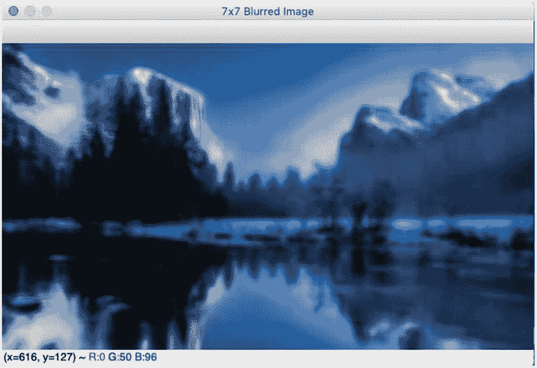

一张截图，展示了一幅模糊的风景照片，其中有雪覆盖的山丘、一片水域、植被和顶部晴朗的天空。标题显示为“7 乘 7 模糊图像”。底部提供了以下数值：x = 616。y = 127。R, 0。G, 50。B, 96。

图 3-41
使用 7×7 核进行模糊处理

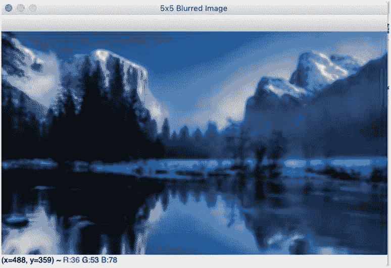

一张截图，展示了一幅模糊的风景照片，其中有雪覆盖的山丘、一片水域、植被和顶部晴朗的天空。标题显示为“5 乘 5 模糊图像”。底部提供了以下数值：x = 488。y = 359。R, 36。G, 53。B, 78。

图 3-40
使用 5×5 核进行模糊处理

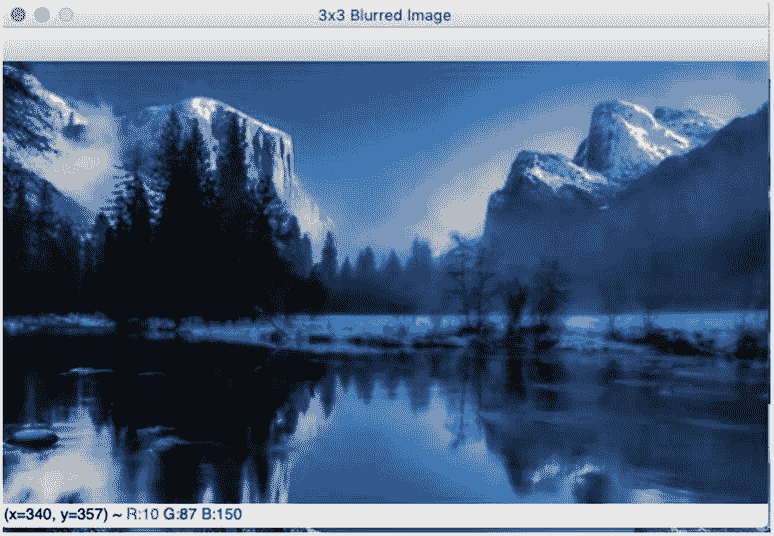

一张截图，展示了一幅模糊的风景照片，其中有雪覆盖的山丘、一片水域、植被和顶部晴朗的天空。标题显示为“3 乘 3 模糊图像”。底部提供了以下数值：x = 340。y = 357。R, 10。G, 87。B, 150。

图 3-39
使用 3×3 核进行模糊处理

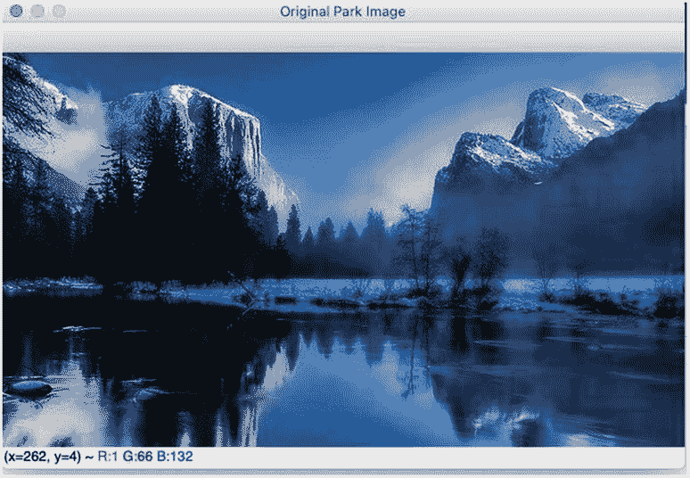

一张截图，展示了一幅风景照片，其中有雪覆盖的山丘、一片水域、植被和顶部晴朗的天空。标题显示为“原始公园图像”。底部提供了以下数值：x = 262。y = 4。R, 1。G, 66。B, 132。

图 3-38
原始图像

### 高斯滤波

*高斯滤波*是图像处理中最有效的模糊技术之一。它用于减少高斯噪声。与平均技术相比，这种模糊技术能产生更自然的平滑效果。在这种滤波中，我们提供的是高斯核，而不是固定的盒状核。

高斯核由高度、宽度以及 X 和 Y 方向的标准差组成。

OpenCV 提供了一个便捷的函数 `GaussianBlur()` 来执行高斯滤波。`GaussianBlur()` 接受以下参数：

*   由 NumPy 数组表示的图像
*   作为核高度和宽度的 *k*×*k* 矩阵
*   `sigmaX` 和 `sigmaY` 是 X 和 Y 方向的标准差

关于标准差的一些说明：

*   如果只指定了 `sigmaX`，则 `sigmaY` 取与 `sigmaX` 相同的值。
*   如果两者都取零，则标准差会根据核大小自动计算。
*   OpenCV 提供了一个函数 `getGaussianKernel()` 来自动计算标准差。

对于那些对高斯滤波中使用的公式感兴趣的人，以下是高斯方程：

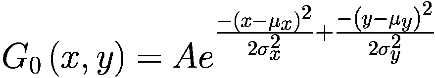

其中 *μ* 是均值（峰值），*σ*² 是方差（分别针对变量 `x` 和 `y`）。

清单 3-13 是一个演示高斯模糊的工作示例。

```
Filename: Listing_3_13.py
1    import cv2
2    import numpy as np

4    # 加载公园图像
5    parkImage = cv2.imread("images/park.jpg")
6    cv2.imshow("原始图像", parkImage)

8    # 使用 3x3 核高度和 0 标准差（让 OpenCV 根据核大小计算）进行高斯模糊
9    GaussianFiltered = cv2.GaussianBlur(parkImage, (5,5), 0)
10   cv2.imshow("高斯模糊图像", GaussianFiltered)

12   cv2.waitKey(0)
清单 3-13
使用高斯技术进行平滑处理
```

这里我们再次从加载我们的 `park` 图像开始（清单 3-13 的第 5 行）。第 9 行展示了 OpenCV 的 `GaussianBlur()` 函数的使用。我们提供了一个 5×5 的核和一个 0，以告知 OpenCV 根据核大小计算标准差。

图 3-42 显示了原始图像，图 3-43 显示了高斯模糊的效果。

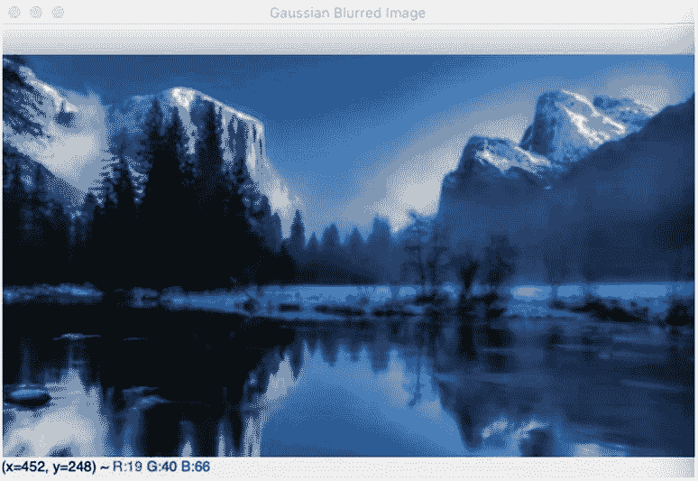

一张截图，展示了一幅模糊的风景照片，其中有雪覆盖的山丘、一片水域、植被和顶部晴朗的天空。标题显示为“高斯模糊图像”。底部提供了以下数值：x = 452。y = 248。R, 19。G, 40。B, 66。

图 3-43
使用 5×5 核的高斯模糊图像

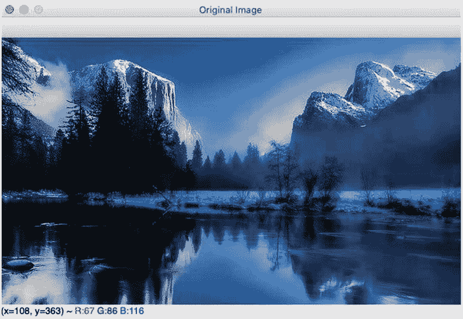

一张截图，展示了一幅风景照片，其中有雪覆盖的山丘、一片水域、植被和顶部晴朗的天空。标题显示为“原始图像”。底部提供了以下数值：x = 108。y = 363。R, 67。G, 86。B, 116。

图 3-42
原始图像


### 中值模糊

*中值模糊*是一种有效降低椒盐噪声的技术。中值模糊与均值模糊类似，区别在于核的中心值被周围像素的中值所取代。我们使用 OpenCV 的 `medianBlur()` 函数来降低椒盐噪声（参见代码清单 3-14）。该函数接受以下两个参数：

*   需要进行模糊处理的原始图像
*   核大小 *k*（类似于均值模糊中的 *k*×*k* 矩阵）

```
Filename: Listing_3_14.py
1    import cv2

3    # 加载一张带噪声的图像
4    saltpepperImage = cv2.imread("images/salt-pepper.jpg")
5    cv2.imshow("原始带噪声图像", saltpepperImage)

7    # 中值滤波降噪
8    blurredImage3 = cv2.medianBlur(saltpepperImage, 3)
9    cv2.imshow("模糊图像 3", blurredImage3)

11   # 中值滤波降噪
12   blurredImage5 = cv2.medianBlur(saltpepperImage, 5)
13   cv2.imshow("模糊图像 5", blurredImage5)
14   cv2.waitKey(0)
代码清单 3-14
使用中值模糊降低椒盐噪声
```

代码清单 3-14 展示了 `medianBlur()` 函数的用法。第 8 行和第 12 行基于第 4 行加载的原始图像创建了模糊图像。请注意，该函数的 `kernel` 参数是一个标量，而不是元组或矩阵。

图 3-44 展示了带有椒盐噪声的图像。请注意，当我们应用不同核大小时，降噪效果的不同程度。图 3-45 展示了应用核大小为 3 时的输出图像。请注意，图 3-45 中仍有一些噪声。图 3-46 展示了应用核大小为 5 的中值模糊后，几乎无噪声的更干净输出。

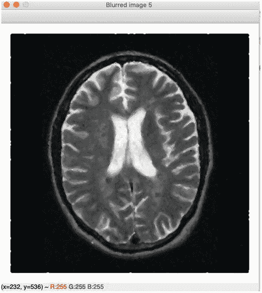

一张屏幕截图，显示的是无噪声的脑部 MRI 扫描图。标题为“模糊图像 5”。底部标注了以下数值：X = 232。Y = 536。R, 255。G, 255。B, 255。

图 3-46
核大小为 5 的中值模糊（噪声几乎被去除）

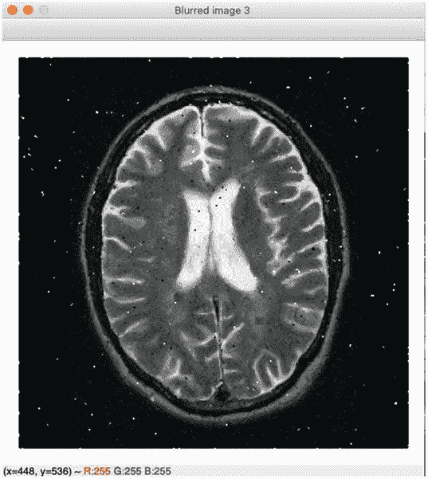

一张屏幕截图，显示的是散布着较少随机点的脑部 MRI 扫描图。标题为“模糊图像 3”。底部标注了以下数值：X = 448。Y = 536。R、G、B 值均设为 255。

图 3-45
核大小为 3 的中值模糊（仍有一些噪声）

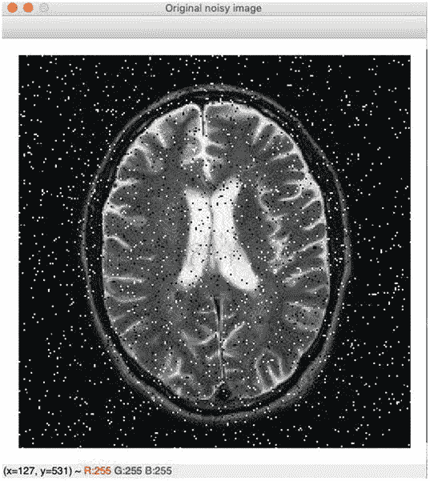

一张屏幕截图，显示的是散布着大量随机点的脑部 MRI 扫描图。标题为“原始带噪声图像”。底部标注了以下数值：X = 127。Y = 531。R, 255。G, 255。B, 255。

图 3-44
一张椒盐噪声图像

图 3-44 展示了一张带有椒盐噪声的图像。你会注意到中值模糊在降噪方面表现相当不错。图 3-45 展示了使用核大小为 3 的模糊图像。如图 3-46 所示，核大小为 5 时取得了良好的效果。

### 双边模糊

前面三种模糊技术会产生模糊图像，其副作用是丢失了图像中的边缘。为了在模糊图像的同时保留边缘，我们使用*双边模糊*，它是对高斯模糊的改进。双边模糊使用两个高斯分布来进行计算。

第一个高斯函数考虑空间邻域（在 x 和 y 空间上接近的像素）。第二个高斯函数考虑相邻像素的像素强度。这确保了只有那些与中心像素强度相似的像素才会被用于模糊处理，从而保持边缘完整，因为边缘的强度往往高于其他像素。

尽管这是一种更高级的模糊技术，但与其他技术相比，它的速度较慢。

我们使用 `bilateralFilter()` 来执行这种模糊。该函数的参数如下：

*   需要进行模糊处理的图像。
*   像素邻域的直径。
*   颜色值。颜色值越大，意味着在计算模糊时会考虑更多邻域像素的颜色。
*   空间或距离。空间值越大，意味着会考虑距离中心像素更远的像素。

让我们研究一下代码清单 3-15 来理解双边滤波。

```
Filename: Listing_3_15.py
1    import cv2

3    # 加载一张带噪声的图像
4    noisyImage = cv2.imread("images/nature.jpg")
5    cv2.imshow("原始图像", noisyImage)

7    # 核大小为 5 的双边滤波
8    fileteredImag5 = cv2.bilateralFilter(noisyImage, 5, 150,50)
9    cv2.imshow("模糊图像 5", fileteredImag5)

11   # 核大小为 7 的双边模糊
12   fileteredImag7 = cv2.bilateralFilter(noisyImage, 7, 160,60)
13   cv2.imshow("模糊图像 7", fileteredImag7)

15   cv2.waitKey(0)
代码清单 3-15
双边模糊示例
```

如代码清单 3-15 所示，第 8 行和第 12 行用于使用 `bilateralFilter()` 对输入图像进行模糊处理。第一组参数（第 8 行）包括 NumPy 表示的图像像素、核或直径、颜色阈值以及距中心的距离。

图 3-47 至 3-49 展示了代码清单 3-15 的输出结果。

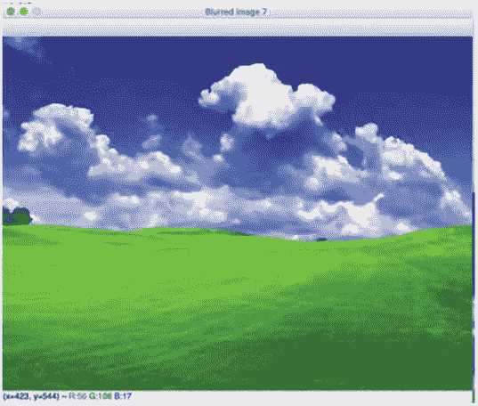

一张屏幕截图，显示的是模糊后的草地照片，顶部是多云的天空。标题为“模糊图像 7”。底部提供了以下数值：X = 423。Y = 544。R, 56。G, 106。B, 17。

图 3-49
直径为 7 的双边模糊

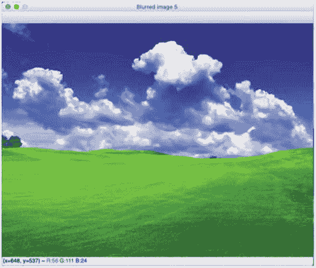

一张屏幕截图，显示的是模糊后的草地照片，顶部是多云的天空。标题为“模糊图像 5”。底部提供了以下数值：X = 648。Y = 537。R, 56。G, 111。B, 24。

图 3-48
直径为 5 的双边模糊

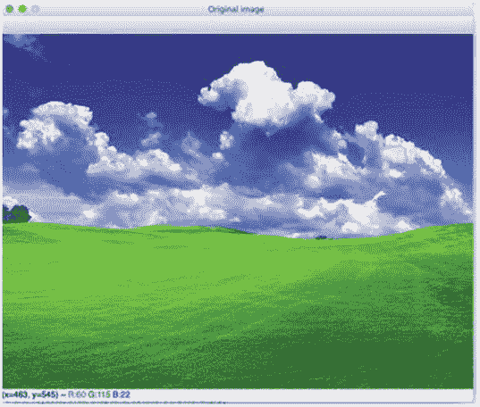

一张屏幕截图，显示的是草地照片，顶部是多云的天空。标题为“原始图像”。底部提供了以下数值：X = 463。Y = 545。R, 60。G, 115。B, 22。

图 3-47
原始图像

你所学到的关于图像模糊或平滑的各种技术知识将在后续章节中得到广泛应用。

接下来，我们的重点将转向使用一种称为阈值处理的技术将灰度图像转换为二值图像的过程。

## 基于阈值处理的二值化

*图像二值化*是将灰度或彩色图像转换为二值图像的过程，其中每个像素仅由两个可能值之一表示：黑色或白色。二值化通常通过对图像中的像素应用阈值来实现。强度低于阈值的像素被赋值为黑色（0），而强度高于阈值的像素被赋值为白色（255）。结果是一个二值图像，它通过强调物体边缘并消除强度上的细节和变化来简化图像。二值化广泛应用于各种图像处理应用，如物体检测、分割和字符识别。

OpenCV 支持三种类型的阈值处理技术：简单阈值处理、自适应阈值处理和 Otsu 二值化。


### 简单阈值处理

在简单阈值处理中，我们手动选择一个阈值 *T*。所有大于该 *T* 值的像素被设置为 255，所有小于或等于 *T* 的像素被设置为 0。

有时，进行二值化反转会很有用，在这种情况下，大于阈值的像素被设置为 0，而小于阈值的像素被设置为 255。

让我们看一个使用 OpenCV 的 `threshold()` 函数对图像进行二值化的示例。该函数接受以下参数：

*   需要二值化的原始灰度图像
*   阈值 *T*
*   当像素值大于阈值时将被设置的最大值
*   一种阈值处理方法，例如 `THRESH_BINARY` 或 `THRESH_BINARY_INV`

`threshold()` 函数返回一个包含阈值和二值化图像的元组。

清单 3-16 将灰度图像转换为二值图像。

```
Filename: Listing_3_16.py
1    import cv2
2    import numpy as np

4    # 加载图像
5    image = cv2.imread("images/scanned_doc.png")
6    # 将图像转换为灰度图
7    image = cv2.cvtColor(image, cv2.COLOR_BGR2GRAY)
8    cv2.imshow("原始灰度收据", image)

10   # 使用阈值处理对图像进行二值化
11   (T, binarizedImage) = cv2.threshold(image, 60, 255, cv2.THRESH_BINARY)
12   cv2.imshow("二值化收据", binarizedImage)

14   # 使用反转阈值处理进行二值化
15   (Ti, inverseBinarizedImage) = cv2.threshold(image, 60, 255, cv2.THRESH_BINARY_INV)
16   cv2.imshow("反转二值化收据", inverseBinarizedImage)
17   cv2.waitKey(0)
清单 3-16
使用简单阈值处理进行二值化
```

清单 3-16 展示了两种二值化方法：简单二值化和反转二值化。第 5 行加载图像，第 8 行将图像转换为灰度图像，因为阈值函数的输入应为灰度图像。

第 11 行调用 OpenCV 的 `threshold()` 函数，并传入灰度图像、阈值、最大像素值和阈值处理方法 `THRESH_BINARY` 作为参数。`threshold()` 函数返回一个元组，其中包含我们在参数中提供的相同阈值以及二值化图像。由于我们使用 `THRESH_BINARY` 作为阈值处理方法，所有值大于 60 的像素将被设置为最大值 255，而值小于或等于 60 的像素将被设置为 0。

第 15 行与第 11 行类似，不同之处在于 `threshold()` 函数的最后一个参数是 `THRESH_BINARY_INV` 作为阈值处理函数。通过传入 `THRESH_BINARY_INV`，我们指示 `threshold()` 方法执行与 `THRESH_BINARY` 方法相反的操作：如果像素强度小于 60，则将像素值设置为 255；否则，将其设置为 0。

两种阈值处理方法的示例输出以及原始图像如图 3-50 至 3-52 所示。

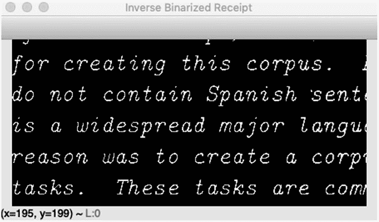

一张截图显示了一组写在深色背景上的文本。标题为“反转二值化收据”。底部提供了以下值：X = 195。Y = 199。L, 0。

图 3-52
使用简单反转阈值处理得到的二值化图像


一张截图显示了一组写在明亮纯色背景上的文本。标题为“二值化收据”。底部提供了以下值：X = 290。Y = 198。L, 255。

图 3-51
使用简单阈值处理得到的二值化图像


一张截图显示了一组写在深色背景上的文本。标题为“原始灰度收据”。底部提供了以下值：X = 175。Y = 152。L, 157。

图 3-50
带有深色背景污渍/斑点的原始灰度图像

为了演示这个示例，我拍摄了一张严重污损文档的扫描图像（图 3-50），并使用简单阈值处理对其进行了二值化。`THRESH_BINARY` 方法生成了输出，其中包含白色背景上的黑色文本。`THRESH_BINARY_INV` 方法创建了黑色背景上的白色文本图像。

在简单阈值处理中，一个全局阈值应用于图像中的所有像素，并且我们需要预先知道阈值。如果我们正在处理大量图像，并希望根据图像类型和强度变化来调整阈值，那么简单阈值处理可能不是理想的方法。在这种情况下，可以应用其他阈值处理方法，例如自适应阈值处理或 Otsu 二值化，来解决这一挑战。


### 自适应阈值处理

*自适应阈值处理*是一种根据每个像素的局部邻域动态调整其阈值的技术。这能更好地处理图像中光照条件变化和强度变化的情况。

在自适应阈值处理中，算法会根据像素周围的一个小区域来确定该像素的阈值。因此，同一图像中的不同区域可以拥有不同的阈值。

清单 3-17 展示了使用自适应阈值处理对灰度图像进行二值化的方法。

```
Filename: Listing_3_17.py
1    import cv2
2    import numpy as np

4    # 加载图像
5    image = cv2.imread("images/boat.jpg")
6    # 将图像转换为灰度图
7    image = cv2.cvtColor(image, cv2.COLOR_BGR2GRAY)

9    cv2.imshow("原始灰度图像", image)

11   # 使用自适应阈值处理和简单均值进行二值化
12   binarized = cv2.adaptiveThreshold(image, 255, cv2.ADAPTIVE_THRESH_MEAN_C, cv2.THRESH_BINARY, 7, 3)
13   cv2.imshow("使用简单均值二值化的图像", binarized)

15   # 使用自适应阈值处理和高斯均值进行二值化
16   binarized = cv2.adaptiveThreshold(image, 255, cv2.ADAPTIVE_THRESH_GAUSSIAN_C, cv2.THRESH_BINARY_INV, 11, 3)
17   cv2.imshow("使用高斯均值二值化的图像", binarized)

19   cv2.waitKey(0)
清单 3-17
使用自适应阈值处理进行二值化
```

在清单 3-17 中，我们对一张包含不同程度阴影和颜色强度的示例图像应用了自适应阈值处理。目标是使用此技术将图像转换为二值图像。让我们探讨一下这个清单中发生了什么。

第 5 行，像往常一样，加载图像。第 7 行将图像转换为灰度图像，因为阈值函数的输入是灰度图像。

第 12 行使用 OpenCV 的 `adaptiveThreshold()` 函数执行实际的二值化。该函数接受以下参数：

*   需要二值化的灰度图像
*   最大值
*   计算阈值的方法（稍后详细介绍）
*   二值化方法，例如 `cv2.THRESH_BINARY` 或 `cv2.THRESH_BINARY_INV`
*   用于计算阈值的邻域大小
*   一个常数 *C*，将从计算出的阈值中减去

在此示例中，第 12 行我们使用了 `cv2.ADAPTIVE_THRESH_MEAN_C` 来表示我们希望通过计算像素周围邻域像素的均值来确定该像素的阈值。本例中的邻域大小为 7×7。第 12 行的最后一个参数 3 是从计算出的阈值中减去的常数。

第 16 行与第 12 行类似，不同之处在于我们使用了 `cv2.ADAPTIVE_GAUSSIAN_C` 来表示我们希望通过计算像素周围所有像素的加权均值来确定该像素的阈值。

图 3-53 至 3-55 展示了清单 3-17 的示例输出。


一张截图显示了一个人借助船桨驾驶小船的画面。主体在深色背景上以较浅的色调勾勒出来。标题为“使用高斯均值二值化的图像”。底部标注了以下数值：X = 162。Y = 246。L, 0。

图 3-55
使用高斯均值的自适应阈值处理得到的二值化图像


一张截图显示了一个人借助船桨驾驶小船的画面。标题为“使用简单均值二值化的图像”。底部标注了以下数值：X = 379。Y = 51。L, 255。

图 3-54
使用简单均值的自适应阈值处理得到的二值化图像


一张截图显示了一个人借助船桨驾驶小船的黑白照片。标题为“原始灰度图像”。底部标注了以下数值：X = 302。Y = 214。L, 44。

图 3-53
原始图像


### 大津二值化

简单阈值处理涉及选择一个单一的全局阈值，并将其应用于整个图像。然而，确定合适的阈值可能具有挑战性，因为无法预先确切知道理想值。找到正确的阈值通常需要反复试验。此外，即使为某张图像找到了最佳阈值，该值也可能无法为其他具有不同像素强度特征的图像带来令人满意的结果。因此，简单阈值处理中阈值的选择是主观的，可能需要针对不同的图像或场景进行调整。

*大津法*是一种通过分析图像直方图来计算最佳全局阈值的方法。我们将在下一章详细探讨直方图，目前只需将直方图理解为图像像素值频率分布的视觉表示。大津法利用这种直方图信息来自动确定阈值，该阈值能最大化前景与背景像素之间的分离度。通过有效利用像素值分布，大津法有助于实现更准确、更可靠的阈值处理结果。

要执行大津二值化，我们在 `threshold()` 函数中传入 `cv2.THRESH_OTSU` 作为额外标志。例如，我们在 `threshold()` 函数中传入 `cv2.THRESH_BINARY+cv2.THRESH_OTSU` 以指示使用大津法。`threshold()` 方法需要一个阈值。使用大津法时，我们传入一个任意值（可以是 0），算法会自动计算阈值，并将该阈值作为输出之一返回。

清单 3-18 展示了一个演示大津二值化方法使用的代码示例。

```
Filename: Listing_3_18.py
1    import cv2
2    import numpy as np

4    # 加载图像
5    image = cv2.imread("images/scanned_doc.png")
6    # 将图像转换为灰度图
7    image = cv2.cvtColor(image, cv2.COLOR_BGR2GRAY)
8    cv2.imshow("原始灰度收据", image)

10   # 使用阈值处理对图像进行二值化
11   (T, binarizedImage) = cv2.threshold(image, 0, 255, cv2.THRESH_BINARY+cv2.THRESH_OTSU)
12   print("大津二值化的阈值", T)
13   cv2.imshow("二值化收据", binarizedImage)

15   # 使用逆阈值处理进行二值化
16   (Ti, inverseBinarizedImage) = cv2.threshold(image, 0, 255, cv2.THRESH_BINARY_INV+cv2.THRESH_OTSU)
17   cv2.imshow("逆二值化收据", inverseBinarizedImage)
18   print("大津逆二值化的阈值", Ti)
19   cv2.waitKey(0)
清单 3-18
大津二值化
```

清单 3-18 中的代码示例与清单 3-16 中的代码示例非常相似，区别如下：

*   第 11 行在 `cv2.THRESH_BINARY` 之外还使用了一个额外的标志 `cv2.THRESH_OTSU`，并且阈值被传入为 0。
*   第 16 行在 `cv2.THRESH_BINARY_INV` 之外使用了标志 `cv2.THRESH_OTSU`，同样阈值被设置为 0。
*   我们在第 12 行和第 18 行有 `print` 语句，用于打印计算出的阈值。图 3-56 展示了这些 `print` 语句的示例输出。

图 3-57 至 3-59 展示了大津法的输出样本。


一张截图，显示深色背景上的一组文字。标题为“逆二值化收据”。底部标注了以下值：X = 2。Y = 106。L, 0。

图 3-59
使用大津法的逆二值化


一张截图，显示一组文字，背景带有少量噪点。标题为“二值化收据”。底部标注了以下值：X = 423。Y = 133。L, 255。

图 3-58
使用大津法的二值化


一张截图，显示深色背景上的一组文字。标题为“原始灰度收据”。底部标注了以下值：X = 227。Y = 199。L, 178。

图 3-57
具有不同背景色调（污渍和暗斑）的原始图像


一张截图，显示两句话，内容如下：大津二值化的阈值 116.0。大津逆二值化的阈值 116.0。

图 3-56
大津法计算出的阈值样本输出

二值化是一种宝贵的图像处理技术，它允许我们从图像中提取显著特征。在本节中，我们探讨了各种二值化技术及其应用，考虑了像素强度和强度变化等因素。

在下一节中，我们将深入探讨另一种强大的图像处理技术——边缘检测，它使我们能够识别并突出显示图像中物体的边界和边缘，有助于执行物体识别和图像分割等任务。

## 梯度与边缘检测

*边缘检测*包含一系列技术，用于识别图像中像素亮度发生显著变化的点。在本节中，我们将探讨两种检测图像边缘的方法：基于梯度的边缘检测和 Canny 边缘检测。

### 基于梯度的边缘检测

基于梯度的边缘检测涉及计算像素强度的梯度，以定位快速变化的区域。它提供了一种识别图像边缘的直接方法。

OpenCV 提供了两种寻找梯度的方法：Sobel 导数和 Laplacian 导数。


#### Sobel 导数（Sobel( ) 函数）

Sobel 方法是高斯平滑与 Sobel 微分的结合，用于计算图像强度函数梯度的近似值。由于采用了高斯平滑，该方法对噪声具有鲁棒性。

我们可以通过分别传递参数 `xorder` 和 `yorder`，在水平方向或垂直方向上进行导数计算。`Sobel()` 函数还接受一个参数 `ksize`，用于定义核大小。如果将 `ksize` 设置为 -1，OpenCV 将在内部应用一个 3×3 的 Scharr 滤波器，其结果通常优于 3×3 的 Sobel 滤波器。

清单 3-19 展示了 Sobel 函数的实际应用。

```
Filename: Listing_3_19.py
1    import cv2
2    import numpy as np
3    # 加载图像
4    image = cv2.imread("images/sudoku.jpg")
5    cv2.imshow("原始图像", image)
6    image = cv2.cvtColor(image, cv2.COLOR_BGR2GRAY)
7    image = cv2.bilateralFilter(image, 5, 50, 50)
8    cv2.imshow("模糊图像", image)

10   # Sobel 梯度检测
11   sobelx = cv2.Sobel(image,cv2.CV_64F,1,0,ksize=3)
12   sobelx = np.uint8(np.absolute(sobelx))
13   sobely = cv2.Sobel(image,cv2.CV_64F,0,1,ksize=3)
14   sobely = np.uint8(np.absolute(sobely))

16   cv2.imshow("Sobel X", sobelx)
17   cv2.imshow("Sobel Y", sobely)

19   # 通过向 Sobel 函数传递 ksize = -1 进行 Scharr 梯度检测
20   scharx = cv2.Sobel(image,cv2.CV_64F,1,0,ksize=-1)
21   scharx = np.uint8(np.absolute(scharx))
22   schary = cv2.Sobel(image,cv2.CV_64F,0,1,ksize=-1)
23   schary = np.uint8(np.absolute(schary))
24   cv2.imshow("Scharr X", scharx)
25   cv2.imshow("Scharr Y", schary)

27   cv2.waitKey(0)
清单 3-19
Sobel 和 Scharr 梯度检测
```

这里涉及很多内容，让我们逐一分析此清单中的相关行，以帮助阐明梯度的概念。

第 4 行只是从磁盘加载图像。我们在第 7 行应用了双边滤波器来减少噪声。图 3-60 显示了原始输入图像，图 3-61 显示了用作 Sobel 和 Scharr 梯度检测函数输入的模糊图像。


一张截图，显示了一个包含一组个位数字的表格，其中一些单元格是空白的。标题为“模糊图像”。底部标注了以下数值：X = 317。Y = 221。L, 206。

图 3-61
模糊图像


一张截图，显示了一个包含一组个位数字的表格，其中一些单元格是空白的。标题为“原始图像”。底部标注了以下数值：X = 212。Y = 308。R、G、B 值均设为 94。

图 3-60
原始图像

梯度检测从第 11 行开始。我们使用 OpenCV 的 `Sobel()` 函数，它接受以下参数：

*   我们要在其中检测梯度的模糊图像。
*   数据类型 `cv2.CV_64F`，这是一个 64 位浮点数。为什么？从黑到白的过渡被视为正斜率，而从白到黑的过渡则是负斜率。8 位无符号整数无法表示负数。因此，我们需要使用 64 位浮点数；否则，当发生从白到黑的过渡时，我们会丢失梯度信息。
*   第三个参数指示我们是否要计算 X 方向的梯度。值为 1 表示我们要计算 X 方向的梯度。
*   类似地，第四个参数指示是否要计算 Y 方向的梯度。1 表示是，0 表示否。
*   第五个参数 `ksize` 定义了核大小。`ksize=5` 表示核大小为 5×5。

由于我们想要在第 11 行确定 X 方向的梯度，我们将 `Sobel()` 函数中的第三个参数设置为 1，第四个参数设置为 0。

第 12 行简单地取梯度的绝对值，并将其转换回 8 位无符号整数。请记住，图像被表示为 8 位无符号整数的 NumPy 数组。

第 13 行与第 11 行类似，只是第三个参数设置为 0，第四个参数设置为 1，以指示在 Y 方向进行梯度计算。

第 14 行将 64 位浮点数转换为 8 位无符号整数，如前所述。

图 3-62 和图 3-63 展示了第 16 行和第 17 行的示例输出。你会注意到，X 和 Y 方向的边缘检测都不太锐利。让我们尝试一个简单的改进，看看对边缘锐利度的影响。


一张截图，显示了一组排列在深色背景上的个位数字。数字以较浅的色调勾勒出轮廓。标题为“Sobel Y”。底部标注了以下数值：X = 255。Y = 287。L, 10。

图 3-63
Y 方向的 Sobel 边缘检测


一张截图，显示了一组排列在深色背景上的个位数字。数字以较浅的色调勾勒出轮廓。标题为“Sobel X”。底部标注了以下数值：X = 9。Y = 249。L, 23。

图 3-62
X 方向的 Sobel 边缘检测

第 20 行到第 23 行与清单 3-19 的第 11 行到第 14 行类似。不同之处在于 `ksize` 的值为 `-1`，这指示 OpenCV 在内部调用核大小为 3×3 的 Scharr 函数。你会注意到，与 Sobel 函数相比，边缘的锐利度要好得多。图 3-64 和图 3-65 是对图 3-61 所示图像应用 Scharr 滤波器的结果。


一张截图，显示了一组排列在深色背景上的个位数字。数字以较浅的色调勾勒出轮廓。标题为“Sobel Y”。底部标注了以下数值：X = 169。Y = 238。L, 228。

图 3-65
Y 方向的 Scharr 边缘检测


一张截图，显示了一组排列在深色背景上的个位数字。数字以较浅的色调勾勒出轮廓。标题为“Scharr X”。底部标注了以下数值：X = 313。Y = 185。L, 32。

图 3-64
X 方向的 Scharr 边缘检测

Sobel 和 Scharr 计算沿 X 和 Y 方向的梯度幅值，使我们能够确定水平和垂直方向上的边缘。


#### 拉普拉斯导数（cv2.Laplacian( ) 函数）

拉普拉斯算子计算像素强度函数的二阶导数，以确定图像中的边缘。拉普拉斯算子基于以下方程计算梯度：


OpenCV 提供了一个函数 `Laplacian()`，用于计算边缘检测的梯度。该函数接受以下参数：

*   需要检测边缘的图像
*   数据类型，通常为 `cv2.CV_64F`，用于保存浮点数值

清单 3-20 展示了使用 OpenCV 的拉普拉斯函数进行边缘检测的完整示例。

```
Filename: Listing_3_20.py
1    import cv2
2    import numpy as np

4    # 加载图像
5    image = cv2.imread("images/sudoku.jpg")
6    image = cv2.cvtColor(image, cv2.COLOR_BGR2GRAY)

8    image = cv2.bilateralFilter(image, 5, 50, 50)
9    cv2.imshow("模糊图像", image)

11   # 用于边缘检测的拉普拉斯函数
12   laplace = cv2.Laplacian(image,cv2.CV_64F)
13   laplace = np.uint8(np.absolute(laplace))

15   cv2.imshow("拉普拉斯边缘", laplace)

17   cv2.waitKey(0)
清单 3-20
使用拉普拉斯导数进行边缘检测
```

与往常一样，第 5 行加载图像，第 6 行将图像转换为灰度图，第 8 行使用双边滤波对图像进行模糊处理。

第 12 行调用了 `Laplacian()` 函数，用于计算梯度以检测图像中的边缘。同样，我们传递了 `CV_64F` 数据类型，以保存当像素从白到黑过渡时可能出现的负梯度值。

第 13 行将 64 位浮点数转换为 8 位无符号整数。

图 3-66 展示了 `Laplacian()` 函数的示例输出。


截图显示了一个表格，其中包含一组排列在深色背景上的个位数数字。数字以较浅的色调勾勒出轮廓。标题为“拉普拉斯边缘”。底部标注了以下数值：X = 305。Y = 265。L, 3。

图 3-66

使用拉普拉斯导数进行边缘检测

### Canny 边缘检测

*Canny 边缘检测*是图像处理中最流行的边缘检测方法之一。它涉及一个多步骤过程，包含几个关键操作：

1.  对图像进行模糊处理以减少噪声。
2.  在 X 和 Y 两个方向上计算 Sobel 梯度，以捕捉边缘强度变化。
3.  应用非极大值抑制来抑制非必要边缘。非极大值抑制通过仅保留边缘图中局部最大梯度值，帮助细化检测到的边缘。
4.  采用滞后阈值技术来确定一个像素是否符合“边缘像素”的条件。

OpenCV 通过将所有步骤封装到一个名为 `Canny()` 的单一函数中，简化了 Canny 边缘检测的实现。该函数简化了流程，使其便捷高效。清单 3-21 提供了使用 `Canny()` 函数进行边缘检测的示例。

```
Filename: Listing_3_21.py
1    import cv2
2    import numpy as np

4    # 加载图像
5    image = cv2.imread("images/sudoku.jpg")
6    image = cv2.cvtColor(image, cv2.COLOR_BGR2GRAY)
7    cv2.imshow("模糊图像", image)

9    # 用于边缘检测的 Canny 函数
10   canny = cv2.Canny(image, 50, 170)
11   cv2.imshow("Canny 边缘", canny)

13   cv2.waitKey(0)
清单 3-21
Canny 边缘检测
```

清单 3-21 中关键的一行是第 10 行，我们在此调用了 `Canny()` 函数，并向需要检测边缘的图像传递了最小和最大阈值参数。任何大于最大阈值的梯度值都被视为边缘。任何低于最小阈值的值都不被视为边缘。介于两者之间的梯度值则根据其强度变化被考虑为边缘。

图 3-67 展示了 Canny 边缘检测器的示例输出。请注意，此例中的边缘非常清晰。


截图显示了一个表格，其中包含一组排列在深色背景上的个位数数字。数字以较浅的色调勾勒出轮廓。标题为“Canny 边缘”。

图 3-67

Canny 边缘检测


## 轮廓

*轮廓*是连接相同强度连续点的曲线。识别和分析轮廓的能力对于物体识别、人脸检测和识别等任务至关重要。

要在图像中检测轮廓，我们遵循以下步骤：

1.  将图像转换为灰度图以简化处理。

2.  使用任意可用的阈值方法对图像进行二值化。

3.  应用 Canny 边缘检测方法来突出图像中的边缘。

4.  使用 `findContours()` 方法定位并提取图像中存在的所有轮廓。

5.  可选地，使用 `drawContours()` 函数在图像上可视化并绘制轮廓。

为了让您实际理解如何有效实现此技术，清单 3-22 中的示例及随后的讨论将探索轮廓检测和绘制的实际过程。

```
Filename: Listing_3_22.py
1    import cv2
2    import numpy as np

4    # 加载图像
5    image = cv2.imread("images/sudoku.jpg")
6    image = cv2.cvtColor(image, cv2.COLOR_BGR2GRAY)
7    cv2.imshow("模糊图像", image)

9    # 对图像进行二值化
10   (T,binarized) = cv2.threshold(image, 0, 255, cv2.THRESH_BINARY_INV+cv2.THRESH_OTSU)
11   cv2.imshow("二值化图像", binarized)

13   # 用于边缘检测的 Canny 函数
14   canny = cv2.Canny(binarized, 0, 255)
15   cv2.imshow("Canny 边缘", canny)

17   (contours, hierarchy) = cv2.findContours(canny,cv2.RETR_EXTERNAL, cv2.CHAIN_APPROX_SIMPLE)
18   print("确定的轮廓数量为 ", format(len(contours)))

20   copiedImage = image.copy()
21   cv2.drawContours(copiedImage, contours, -1, (0,255,0), 2)
22   cv2.imshow("轮廓", copiedImage)
23   cv2.waitKey(0)
清单 3-22
轮廓检测与绘制
```

以下是清单 3-22 的逐行解释。

第 5 行加载图像。第 6 行将图像转换为灰度图，第 10 行使用 Otsu 方法对图像进行二值化。第 14 行使用 Canny 函数计算梯度以进行边缘检测。

第 17 行调用 OpenCV 的 `findContours()` 函数来确定轮廓。该函数的参数如下：

*   第一个参数是我们想要使用 Canny 函数检测边缘的图像。

*   第二个参数 `cv2.RET_EXTERNAL` 决定了我们感兴趣的轮廓类型。`cv2.RET_EXTERNAL` 仅检索最外层的轮廓。我们也可以使用 `cv2.RET_LIST` 来检索所有轮廓，使用 `cv2.RET_COMP` 和 `cv2.RET_TREE` 来包含层次轮廓。

*   第三个参数 `cv2.CHAIN_APPROAX_SIMPLE` 移除冗余点并压缩轮廓，从而节省内存。`cv2.CHAIN_APPROAX_NONE` 存储轮廓的所有点（这需要更多内存来存储它们）。

`findContours()` 函数的输出是一个元组，其中包含以下项目：

*   第一项是图像中所有轮廓的 Python 列表。每个单独的轮廓是一个 NumPy 数组，包含物体边界点的 (x,y) 坐标。

*   第二项是轮廓层次结构。

第 18 行是我们打印识别出的轮廓数量的地方。

我们在清单 3-22 的第 21 行使用 `drawContours()` 函数绘制轮廓。以下是该函数的参数：

*   第一个参数是要在其上绘制轮廓的图像。

*   第二个参数是所有轮廓点的列表。

*   第三个参数是要绘制的轮廓的索引。要绘制第一个轮廓，传递 0。类似地，传递 1 绘制第二个轮廓，依此类推。如果要绘制所有轮廓，则向此参数传递 -1。

*   第四个参数是轮廓的颜色。

*   最后一个参数是轮廓的粗细。

图 3-68 到 3-70 展示了清单 3-22 的一些示例输出。


一张屏幕截图，显示了一个包含一组个位数字的表格。数字在亮色背景上呈深色。标题为“轮廓”。底部标注了以下值：X = 318。Y = 264。L, 199。

图 3-70

绘制在原始图像上的轮廓


一张屏幕截图，显示了一个表格，其中一组个位数字排列在深色背景上。数字以较浅的色调勾勒出轮廓。标题为“Canny 边缘”。底部标注了以下值：X = 39。Y = 293。L, 0。

图 3-69

使用 Canny 函数得到的轮廓


一张屏幕截图，显示了一个表格，其中一组个位数字排列在深色背景上。数字呈较浅的色调。标题为“二值化图像”。底部标注了以下值：X = 211。Y = 311。L, 255。

图 3-68

模糊图像

## 形态学变换

*形态学变换*是图像处理中的一项基本技术，涉及对图像中物体的几何结构进行操作和修改。它主要用于噪声去除、物体提取和形状分析等任务。

形态学变换基于一组预定义的操作，称为*形态学算子*。最常用的两个形态学算子是膨胀和腐蚀。形态学变换有几种变体形式，可以补充基本的膨胀和腐蚀操作。这些包括开运算、闭运算、梯度等。在接下来的章节中，我们将以图 3-71 所示的图像为例，详细探讨每种变换，以说明其效果。


一张屏幕截图，显示了一个包含一组个位数字的表格。数字在亮色背景上呈深色。标题为“原始图像”。

图 3-71

原始图像

OpenCV 提供了专门用于执行形态学操作的函数，这些操作主要针对二值图像。这些操作依赖于两个输入：原始图像和一个结构元素（也称为核），它决定了要执行操作的具体特性。

### 膨胀

*膨胀*是一个扩展图像中物体边界的过程。它通过将图像与一个结构元素（一个小型二值矩阵）进行卷积来实现。膨胀导致物体增长并合并在一起，使它们更加突出和清晰。在膨胀过程中，如果核下方至少有一个像素的值为 1，则该像素元素被赋值为 1。结果，图像中的白色区域扩大，导致前景物体尺寸增加。

OpenCV 提供了一个函数 `dilate()`，它接受原始图像（作为 NumPy 数组）、结构元素或核以及迭代次数作为参数。有关此函数的使用示例，请参考清单 3-23 的第 14 行，其输出示例见图 3-72。


一张屏幕截图，显示了一个包含一组个位数字的表格。数字以粗体和深色格式书写。标题为“腐蚀”。

图 3-73

腐蚀


### 腐蚀

*腐蚀*是一种侵蚀或缩小图像中物体边界的过程。它涉及使用结构元素对图像进行卷积。腐蚀可以消除微小细节并断开连通区域，从而去除噪声和精细结构。在腐蚀过程中，内核以类似于二维卷积的方式在图像上移动。如果原始图像中内核下方的所有像素都为 1，则输出中对应的像素保持为 1。然而，如果内核下方的任何像素为 0，则该像素被腐蚀并设置为 0。

因此，物体边界附近的像素会根据内核的大小逐渐被消除。这会导致前景物体的厚度或尺寸减小，从而使图像中的白色区域减少。

OpenCV 提供了一个函数 `erode()`，它接受原始图像（作为 NumPy 数组）、结构元素或内核以及迭代次数作为参数。有关此函数的使用示例，请参阅清单 3-23 的第 11 行，其输出示例见图 3-73。


一张屏幕截图显示了一个包含一组个位数字的表格。这些数字在明亮背景上带有细的深色轮廓。标题显示为“膨胀”。

图 3-72

膨胀

### 开运算

*开运算*先进行腐蚀，再进行膨胀，对于去除噪声和小物体非常有用。通过先腐蚀图像，可以去除小的噪声区域和精细细节。然后膨胀有助于恢复剩余的物体，同时保留其整体形状和结构。

为了执行开运算，OpenCV 提供了一个函数 `morphologyEx()`，它接受以下参数：

*   一个作为 NumPy 数组的图像
*   `cv2.MORPH_OPEN`，表示正在执行的操作是开运算
*   一个定义结构元素或卷积矩阵的内核

有关此函数的使用示例，请参阅清单 3-23 的第 17 行，其输出示例见图 3-74。


一张屏幕截图显示了一个包含一组个位数字的表格。这些数字带有粗的深色轮廓。标题显示为“开运算”。

图 3-74

开运算

### 闭运算

*闭运算*先进行膨胀，再进行腐蚀，对于闭合小间隙和填充物体中的孔洞非常有效。通过先执行膨胀，该操作有助于扩展物体的边界并闭合它们之间的小间隙。然后腐蚀有助于细化物体边界，并消除由膨胀引起的任何过度扩展。

为了执行闭运算，我们可以使用与开运算相同的 OpenCV 函数 `morphologyEx()`，并传递以下参数：

*   一个作为 NumPy 数组的图像
*   `cv2.MORPH_CLOSE`，表示正在执行的操作是闭运算
*   一个定义结构元素或卷积矩阵的内核

有关此函数的使用示例，请参阅清单 3-23 的第 20 行，其输出示例见图 3-75。


一张屏幕截图显示了一个包含一组个位数字的表格。这些数字带有粗的深色轮廓，并且在某些地方模糊。背景是明亮的。标题显示为“闭运算”。

图 3-75

闭运算

### 形态学梯度

*形态学梯度*是一个过程，它使用特定的结构元素或内核计算图像膨胀与腐蚀之间的差异。它突出显示了图像中物体的边界或边缘。

形态学梯度对于边缘检测非常有用，因为它强调了不同强度或结构区域之间的过渡。它提供了图像内强度或形状局部变化的表示，允许进行进一步的分析或处理，例如物体分割或轮廓提取。

清单 3-23 的第 23 行展示了形态学梯度的使用示例，图 3-76 展示了此操作的输出示例。


一张屏幕截图显示了一个包含一组个位数字的表格。这些数字带有明亮的轮廓。背景是深色的。标题显示为“形态学梯度”。

图 3-76

形态学梯度

### 顶帽

*顶帽*是一种形态学操作，它计算输入图像与其开运算之间的差异。它有助于增强和提取图像中的小尺度细节，例如小物体或精细结构。

顶帽操作有效地从原始图像中移除较大尺度的结构或背景，留下较小尺度的细节。它在图像增强、物体检测以及提取可能被整体图像结构或背景掩盖的细微特征等应用中特别有用。

顶帽操作在清单 3-23 的第 26 行中进行了说明，其输出示例见图 3-77。


一张屏幕截图显示了一个包含一组个位数字的表格，背景为深色。数字和边框无法追踪，并完全与深色背景融为一体。标题显示为“顶帽”。

图 3-77

顶帽


### 黑帽运算

*黑帽运算*是一种形态学操作，用于计算图像闭运算结果与原始图像本身的差异。它被用来提取和突出图像中较大尺度的结构或区域。

黑帽运算揭示了图像中存在但可能被周围背景掩盖或隐藏的较大尺度结构或区域。它常用于图像分析、目标检测和文本提取等应用中，这些应用的重点是识别和提取那些比背景或噪声水平更显著的结构或特征。

黑帽运算在代码清单 3-23 的第 29 行进行了说明，其输出示例如图 3-78 所示。

```
Filename: Listing_3_23.py
1    import cv2
2    import numpy as np

4    # 加载图像
5    image = cv2.imread("images/sudoku.jpg", 0)

7    # 定义结构元素
8    kernel = np.ones((5, 5), np.uint8)

10   # 执行腐蚀
11   erosion = cv2.erode(image, kernel, iterations=1)

13   # 执行膨胀
14   dilation = cv2.dilate(image, kernel, iterations=1)

16   # 执行开运算
17   opening = cv2.morphologyEx(image, cv2.MORPH_OPEN, kernel)

19   # 执行闭运算
20   closing = cv2.morphologyEx(image, cv2.MORPH_CLOSE, kernel)

22   # 执行形态学梯度
23   gradient = cv2.morphologyEx(image, cv2.MORPH_GRADIENT, kernel)

25   # 执行顶帽运算
26   tophat = cv2.morphologyEx(image, cv2.MORPH_TOPHAT, kernel)

28   # 执行黑帽运算
29   blackhat = cv2.morphologyEx(image, cv2.MORPH_BLACKHAT, kernel)

31   # 显示结果
32   cv2.imshow("原始图像", image)
33   cv2.imshow("腐蚀", erosion)
34   cv2.imshow("膨胀", dilation)
35   cv2.imshow("开运算", opening)
36   cv2.imshow("闭运算", closing)
37   cv2.imshow("形态学梯度", gradient)
38   cv2.imshow("顶帽运算", tophat)
39   cv2.imshow("黑帽运算", blackhat)

41   # 等待按键并退出
42   cv2.waitKey(0)
43   cv2.destroyAllWindows()
代码清单 3-23
形态学操作：膨胀、腐蚀、闭运算、开运算、顶帽运算和黑帽运算
```


一张截图显示了一个带有深色背景的表格，其中包含一组个位数数字。数字和边框为亮色。部分数字无法追踪。标题显示为“黑帽运算”。

图 3-78

黑帽运算

## 模板匹配

*模板匹配*是一种用于在较大图像中定位和识别模板图像位置的技术。模板匹配算法将模板图像与目标图像在不同位置和尺度下进行比较，以确定最佳匹配。其工作原理是将模板图像在目标图像上滑动，并计算每个位置上模板与目标之间的相似度。

OpenCV 实现了多种模板比较算法。它返回一张灰度图像，其中每个像素代表该像素邻域与模板图像之间的相似度。

如果输入图像的尺寸为 (WxH)，模板图像的尺寸为 (wxh)，则输出图像的尺寸将为 (W-w+1, H-h+1)。获得结果后，我们可以利用 `cv2.minMaxLoc()` 函数来定位最大值/最小值的位置。该位置可被视为矩形的左上角，矩形的宽度和高度为 (w, h)。因此，识别出的矩形就代表了模板在较大图像中的区域。

代码清单 3-24 演示了使用所有六种支持方法的模板匹配过程。

```
Filename: Listing_3_24.py
1    import cv2

3    target = cv2.imread('images/obama_with_people.jpg', cv2.IMREAD_GRAYSCALE)

5    template = cv2.imread('images/obama_face.jpg', cv2.IMREAD_GRAYSCALE)
6    # 调整模板大小，使其尺寸小于目标图像
7    template = cv2.resize(template, None, fx=0.2, fy=0.2)

9    w, h = template.shape[::-1]
10   # 所有 6 种支持的比较方法
11   methods = ['cv2.TM_CCOEFF', 'cv2.TM_CCOEFF_NORMED', 'cv2.TM_CCORR',
12               'cv2.TM_CCORR_NORMED', 'cv2.TM_SQDIFF', 'cv2.TM_SQDIFF_NORMED']
13   for m in methods:
14       img = target.copy()
15       method = eval(m)
16       # 应用模板匹配
17       result = cv2.matchTemplate(img, template, method)
18       min_val, max_val, min_loc, max_loc = cv2.minMaxLoc(result)
19       # 如果方法是 TM_SQDIFF 或 TM_SQDIFF_NORMED，取最小值，否则取最大值
20       if method in [cv2.TM_SQDIFF, cv2.TM_SQDIFF_NORMED]:
21           top_left = min_loc
22       else:
23           top_left = max_loc
24       bottom_right = (top_left[0] + w, top_left[1] + h)
25       cv2.rectangle(img,top_left, bottom_right, 255, 2)
26       cv2.imshow(m, img)
27       cv2.waitKey(0)

29   cv2.destroyAllWindows()
代码清单 3-24
使用不同方法的模板匹配
```

代码清单 3-24 中的代码使用 OpenCV 执行模板匹配。以下是代码的详细说明。

第 3 行和第 5 行以灰度格式加载目标图像和模板图像。

第 7 行调整模板图像的大小，以确保其尺寸小于目标图像的尺寸。这种调整大小对于准确的模板匹配是必要的。

第 11 行和第 12 行定义了 OpenCV 提供的一系列支持的模板匹配方法。

第 13-28 行：启动一个 `for` 循环来遍历匹配方法列表。在循环内部：

第 14 行创建原始目标图像的副本，因为在图像上绘制矩形时会修改图像（第 25 行）。

在第 17 行，使用 OpenCV 的 `matchTemplate()` 函数执行模板匹配。它接受三个参数：目标图像、模板图像和匹配方法。

第 18 行到第 24 行计算目标图像匹配部分的边界框坐标。

第 25 行在目标图像上的匹配部分周围绘制一个矩形。

第 26 行显示带有绘制矩形的结果图像。

图 3-79 到 3-86 展示了代码清单 3-24 的输出结果。


一张截图显示了一张包含三个面带微笑人物的灰度照片。中间人物的脸部被一个边界框高亮标出。标题显示为 `c v 2 dot T M underscore S Q D I F F underscore NORMED`。

图 3-86

使用 `TM_SQDIFF_NORMED` 进行匹配


一张截图显示了一张包含三个面带微笑人物的灰度照片。中间人物的脸部被一个边界框高亮标出。标题显示为 `c v 2 dot T M underscore S Q D I F F`。

图 3-85

使用 `TM_SQDIFF` 进行匹配


一张截图显示了一张包含三个面带微笑人物的灰度照片。中间人物的脸部被一个边界框高亮标出。标题显示为 `c v 2 dot T M underscore C C O R R underscore NORMED`。

图 3-84

使用 `TM_CCORR_NORMED` 进行匹配


一张截图显示了一张包含三个面带微笑人物的灰度照片。背景墙的一部分被一个边界框高亮标出。标题显示为 `c v 2 dot T M underscore C C O R R`。

图 3-83

使用 `TM_CCORR` 进行匹配


一张截图显示了一张包含三个面带微笑人物的灰度照片。中间人物的脸部被一个边界框高亮标出。标题显示为 `c v 2 dot T M underscore C C O E F F underscore NORMED`。

图 3-82

使用 `TM_CCOEFF_NORMED` 进行匹配


一张截图显示了一张包含三个面带微笑人物的灰度照片。中间人物的脸部被一个边界框高亮标出。标题显示为 `c v 2 dot T M underscore C C O E F F`。

图 3-81

使用 *TM_CCOEFF* 进行匹配


一张截图显示了一张包含三个面带微笑摆姿势人物的灰度照片。顶部的标题显示为 Original。

图 3-80

原始图像


一张截图显示了一张人物头像形式的灰度照片。顶部的标题显示为 Template。

图 3-79

模板图像

### 多目标模板匹配

在上一节中，我们利用 `matchTemplate()` 和 `minMaxLoc()` 函数在图像中搜索巴拉克·奥巴马的脸部，并假设该脸部只出现一次。然而，如果我们要搜索的目标在图像中出现多次，`minMaxLoc()` 将无法提供所有位置。在这种情况下，我们需要采用阈值技术来过滤掉那些得分低于阈值的边界框。

清单 3-25 演示了多目标模板匹配的概念。它使用单个汽水瓶的模板图像，并在目标图像中对多个汽水瓶进行匹配。请注意，清单 3-25 中的代码调用了清单 3-26 中的 `non_maximum_suppression()` 函数。

```
Filename: Listing_3_25.py
1    import cv2
2    import numpy as np
3    # 从磁盘加载输入图像和模板图像
4    image = cv2.imread("images/pepsico.png")
5    template = cv2.imread("images/pepsi.png")
6    # 调整模板大小，使其尺寸小于图像尺寸
7    template = cv2.resize(template, None, fx=0.5, fy=0.5)
8    # 获取模板的高度和宽度
9    (tH, tW) = template.shape[:2]
10   # 将图像和模板都转换为灰度图
11   imageGray = cv2.cvtColor(image, cv2.COLOR_BGR2GRAY)
12   templateGray = cv2.cvtColor(template, cv2.COLOR_BGR2GRAY)
13   # 执行模板匹配
14   result = cv2.matchTemplate(imageGray, templateGray, cv2.TM_CCOEFF_NORMED)
15   # 在结果中查找所有匹配值大于阈值的位置
16   # 大于阈值
17   (yCoords, xCoords) = np.where(result >= 0.5)
18   # 克隆原始图像，以便在其上绘制矩形区域。
19   clone = image.copy()
20   # 遍历我们的起始 (x, y) 坐标
21   for (x, y) in zip(xCoords, yCoords):
22       # 在图像上绘制边界框
23       cv2.rectangle(clone, (x, y), (x + tW, y + tH),
24           (0, 255, 255), 2)
25   # 显示未应用非极大值抑制（NMS）去除重叠边界框的输出图像
26   cv2.imshow("Without NMS", clone)
27   # 现在让我们应用 NMS
28   # 初始化我们的矩形列表
29   rects = []
30   # 再次遍历起始 (x, y) 坐标
31   for (x, y) in zip(xCoords, yCoords):
32       # 更新矩形列表
33       rects.append((x, y, x + tW, y + tH))
34   # 我们给所有边界框赋予了相同的分数
35   pick = non_max_suppression(np.array(rects),  np.ones(len(rects)), 0.7)
36   # 遍历最终的边界框
37   for (startX, startY, endX, endY) in pick:
38       # 在图像上绘制边界框
39       cv2.rectangle(image, (startX, startY), (endX, endY),
40           (255, 0, 255), 2)
41   # 显示输出图像
42   cv2.imshow("After NMS", image)
43   cv2.waitKey(0)
清单 3-25
多目标模板匹配
```

至此，第 1 到 14 行应该不言自明。

在第 14 行，我们执行了模板匹配操作。

第 17 行应用了一个阈值，以过滤掉低于阈值的坐标 (x, y)，只保留那些超过阈值的坐标。

在第 19 行，我们复制了原始图像并将其存储在一个名为 `clone` 的变量中。这个克隆图像将作为绘制矩形的图像，确保原始图像保持不变。

第 21 到 25 行包含一个 `for` 循环，该循环遍历所有坐标，在图像中匹配到的目标周围绘制矩形区域。


第 26 行显示了图像，展示了识别出的对象周围的边界框（参见图 3-89）。可以观察到同一对象周围存在多个重叠的边界框。为了解决这个问题，我们需要实现一种称为*非极大值抑制（NMS）*的技术，以便每个匹配的对象只绘制一个边界框。NMS 常用于计算机视觉和目标检测算法中，以消除重叠或冗余的边界框。

在第 35 行，对检测到的边界框应用了非极大值抑制，以移除同一对象的重复或重叠检测。这确保了每个对象仅由一个边界框表示，从而消除冗余并提高检测结果的准确性。

非极大值抑制函数的实现见代码清单 3-26。

```
Filename: Listing_3_26.py
1    # NMS 函数
2    def non_max_suppression(boxes, scores, overlap_threshold):
3        # 如果没有边界框，则返回空列表
4        if len(boxes) == 0:
5            return []
6        # 初始化已选索引列表
7        pick = []
8        # 获取边界框的坐标
9        x1 = boxes[:, 0]
10       y1 = boxes[:, 1]
11       x2 = boxes[:, 2]
12       y2 = boxes[:, 3]
13       # 计算边界框的面积
14       area = (x2 - x1 + 1) * (y2 - y1 + 1)
15       # 按分数降序排列边界框
16       idxs = np.argsort(scores)
17       # 当存在待处理索引时持续循环
18       while len(idxs) > 0:
19           # 获取排序列表中的最后一个索引，并将其添加到已选索引列表
20           last = len(idxs) - 1
21           i = idxs[last]
22           pick.append(i)
23           # 找到边界框起点的最大 (x, y) 坐标
24           # 和边界框终点的最小 (x, y) 坐标
25           xx1 = np.maximum(x1[i], x1[idxs[:last]])
26           yy1 = np.maximum(y1[i], y1[idxs[:last]])
27           xx2 = np.minimum(x2[i], x2[idxs[:last]])
28           yy2 = np.minimum(y2[i], y2[idxs[:last]])
29           # 计算边界框的宽度和高度
30           w = np.maximum(0, xx2 - xx1 + 1)
31           h = np.maximum(0, yy2 - yy1 + 1)
32           # 计算重叠比例
33           overlap = (w * h) / area[idxs[:last]]
34           # 从索引列表中删除所有重叠比例大于指定阈值的索引
35           idxs = np.delete(idxs, np.concatenate(([last], np.where(overlap > overlap_threshold)[0])))
36       # 仅返回被选中的边界框
37       return boxes[pick]
代码清单 3-26
非极大值抑制函数
```

此代码清单 3-25 和 3-26 的输出如图 3-87 至 3-90 所示。


一张照片显示了一组放置在货架上的软饮料瓶和盒子。每个瓶子都被一个细边界框高亮显示。顶部的标题写着“应用 NMS 后”。

图 3-90

使用 NMS 进行多对象匹配


一张照片显示了一组放置在货架上的软饮料瓶和盒子。每个瓶子都被一个粗边界框高亮显示。顶部的标题写着“未应用 NMS”。

图 3-89

未使用 NMS 进行多对象匹配


一张照片显示了一组放置在货架上的软饮料瓶和盒子。顶部的标题写着“原始图像”。

图 3-88

原始图像


一张标有“百事可乐”的软饮料瓶截图。顶部的标题写着“模板图像”。

图 3-87

模板图像

应用 NMS 后的输出如图 3-90 所示。请注意应用 NMS 前后输出的差异。在应用 NMS 之前（图 3-89），输出包含同一对象的多个边界框或检测结果，这些框相互重叠。然而，应用 NMS 后，冗余或重叠的检测结果被抑制，从而得到更精简的输出，边界框数量减少。NMS 通过考虑检测结果的置信度分数和空间重叠程度，帮助选择最可靠、最准确的检测结果。这带来了更清晰、更准确的检测对象表示。

## 总结

在本章中，我们涵盖了广泛的图像处理技术，这些技术对于构建计算机视觉应用至关重要。我们首先探索了图像变换的方法，包括调整大小、旋转、翻转和裁剪，使我们能够根据需要操作图像。接着，我们研究了如何对图像执行算术运算和位运算，扩展了图像处理的能力。

此外，我们深入探讨了强大的图像处理功能，如掩码、降噪、二值化、边缘检测、轮廓检测和形态学变换。这些技术为提升图像质量、分割对象以及提取重要的视觉特征提供了宝贵的工具。

值得注意的是，你在本章学到的技术将在后续章节中被广泛使用，尤其是在我们深入探讨机器学习任务的特征提取和特征工程时。理解和应用这些图像处理技术，对于在各种应用和领域中充分发挥计算机视觉的潜力至关重要。

