# 4. 构建基于机器学习的计算机视觉系统

第 3 章介绍并探讨了多种图像处理方法。在第 5 章中，我们将深入探讨如何使用机器学习构建计算机视觉系统。在本章中，我们将探索从图像中提取特征的基本技术以及特征选择的艺术。我们将揭开机器如何从这些特征中学习的神秘面纱。本章作为第 5 章的引介，届时你将深入了解不同的深度学习算法，并学习如何使用 TensorFlow 在 Python 中实现它们。


## 图像处理流水线

*计算机视觉（CV）* 指的是计算机捕捉、分析图像并从中得出解释和结论的能力。例如，CV 可应用于图像检测与识别任务，以及识别图像中的模式或物体。当人工智能（AI）系统遇到图像时，会经历一系列处理过程：图像摄取、处理、特征提取和解释。这涉及图像在不同系统组件之间的转换，使机器能够识别其中的模式并检测物体。

*图像处理流水线*，也称为*计算机视觉流水线*，包含一系列组件，这些组件通过各种变换处理图像，最终产生输出结果。图 4-1 提供了该处理流水线的高级概览。

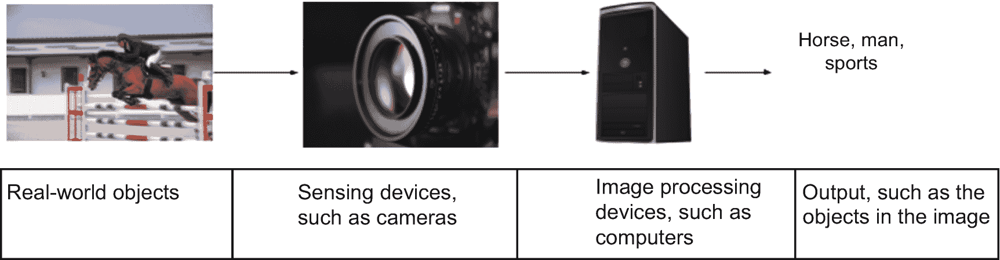

一个带有示例照片的图像处理流水线。它描绘了代表真实世界物体的骑马者、代表传感设备的相机以及代表图像处理设备的计算机。

图 4-1

图像流水线

如图 4-1 所示，真实世界物体由传感设备（如相机）捕捉，并转换为数字图像。这些数字图像随后由计算机系统处理，产生最终输出。输出结果可能与图像本身相关，例如图像分类，或识别图像中的模式和物体。例如，在医疗保健领域，从 MRI 或 X 光仪器获取的图像可被输入图像处理流水线，以检测是否存在肿瘤。

本书深入探讨了计算机处理单元的内部工作原理，并探索了生成输出的过程。计算机系统内用于图像处理的数据流流水线如图 4-2 所示。


一个包含 5 个步骤的图像处理流水线流程图。它从输入图像开始，接着是变换和特征提取，最后以输出图像结束。

图 4-2

计算机视觉中的图像处理流水线

以下是计算机视觉流水线的简要描述：

1.  **图像摄取**：图像被捕捉、转换为数字格式，并存储在计算机磁盘上。对于视频，数字帧被摄取并存储，可以从磁盘或直接从相机获取。

2.  **图像变换**：摄取后，图像会经历各种预处理变换以使其标准化。这些变换包括调整大小、颜色处理、平移、旋转和裁剪，以及二值化、阈值处理、梯度检测和边缘检测等高级技术。这些变换确保了图像在大小、形状和颜色模式上的一致性。有关这些技术的回顾，请参见第 3 章。

3.  **特征提取**：特征提取是视觉流水线中的关键步骤，涉及从图像中识别和提取相关特征。一个好的特征集对于准确的机器学习结果至关重要。关于特征提取的更多细节将在下一节“特征提取”中介绍。

4.  **机器学习算法**：该流水线分两个阶段使用机器学习算法。在第一阶段，使用大型数据集训练算法，生成训练好的模型。在第二阶段，将新数据集输入训练好的模型以预测结果或类别。此阶段称为*预测阶段*。第 5 章将探讨用于计算机视觉的流行且有效的机器学习模型。它将介绍 Keras 和 TensorFlow，并提供用于模型训练和预测的代码示例。

5.  **输出生成**：视觉流水线的最后一个组件是期望的输出，它代表了视觉系统的最终目标。

## 特征提取

在机器学习中，*特征*是被观察对象或事件的可测量属性。在计算机视觉中，特征提供了关于图像的独特信息。特征提取在机器学习中具有重要意义，因为整个过程都围绕这些特征展开。识别和提取相关且独立的特征以实现可靠的机器学习结果，是成功的关键。

例如，让我们考察仅凭车轮来区分汽车和摩托车的场景。仅凭车轮本身并不是一个区分性特征。还需要其他特征，例如是否有车门、车顶以及其他特性。此外，仅依赖从单个摩托车或汽车中提取的特征，对于实际的机器学习应用可能是不够的。通过观察事件或特征的重复出现来建立模式至关重要，因为现实世界中的物体并不总是以与特征完全相同的方式呈现。因此，可重复性是良好特征的关键特性。

在车轮的例子中，我们只有一个特征，但在实际场景中，需要考虑的特征可能非常多。这些特征可能包括颜色、轮廓、边缘、角点、角度、光强度等等。提取更多数量的独特特征可以提升模型的质量和有效性。

机器学习模型的性能在很大程度上依赖于用于训练的特征的质量。挑战在于提取一组稳健的特征。虽然没有适用于所有场景的通用解决方案，但以下列表提供了一些实用的方法（以及其他方法），可帮助您进行特征提取工作：

*   *区分性*：特征应具备区分性特征，使其能够区分不同的类别或分类。

*   *非重叠性*：特征不应具有可能导致分类或识别混淆或模糊的重叠属性。

*   *出现频率*：特征应基于以足够频率出现的属性或事件，避免因罕见出现而阻碍可靠的模式识别。

*   *鲁棒性*：特征应在各种条件下（例如不同的光照条件、视角或环境因素）表现出一致性。

*   *可识别性*：特征应易于直接识别，或借助适当的处理技术提取相关信息。

*   *充足样本*：收集大量样本对于建立可靠模式并确保特征提取过程的泛化能力至关重要。

通过遵循这些原则，我们可以提高所提取特征的质量和有效性，从而获得更好的机器学习结果以及更准确的分类或识别结果。


### 如何表示特征

从图像中提取的特征通常以*特征向量*的形式表示。举个简单的例子，考虑一张灰度图像，其特征对应于图像的像素值。像素被组织成一个二维矩阵，其中每个像素的值范围从 0 到 255。

为了将这些像素值表示为特征，我们将其转换为一维（1D）行矩阵，这可以看作是一个向量或一维数组。图 4-3 直观地展示了这种表示方式。

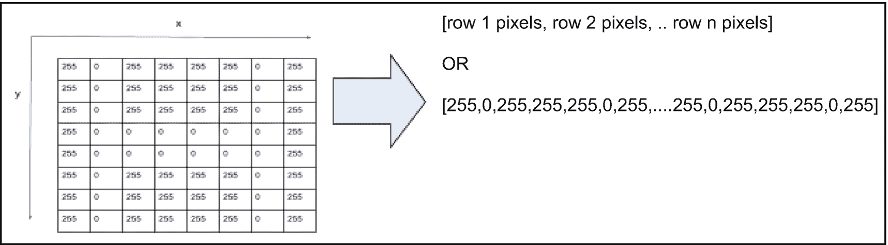

一个包含 8 行 8 列向量 x 和 y 的矩阵。这些向量表示特征，其单元格中的像素值范围为 0 到 255。

图 4-3

特征的向量表示

对于大多数机器学习算法来说，需要从图像中提取特征并将其输入算法进行模型训练。然而，某些深度学习算法，例如卷积神经网络（CNN），能够在模型训练过程中自动提取特征。（第 5 章提供了关于深度学习算法以及训练计算机视觉模型所需技术的全面信息。）

以下各节将探讨从图像中提取特征的不同方法，并提供特征提取的实际示例。使用 OpenCV 库的 Python 代码将演示这些概念及其实现。

### 颜色直方图

*直方图*表示图像中像素强度的频率分布。直方图通常以图形或图表的形式显示，其中 x 轴表示像素值或值范围，y 轴表示与每个值或范围相关联的像素频率或计数。图形上的最高点表示图像中出现频率最高的颜色。

由于像素值的范围可以从 0 到 255，直方图的 x 轴由 256 个值组成，代表了所有可能的像素强度范围。然而，如此大量的值在实际应用中可能会显得过于庞大。为了解决这个问题，我们通常将像素值划分为更小的组，称为*区间*。例如，我们可以将 x 轴划分为 8 个区间，每个区间覆盖 32 个像素颜色的范围。通过这样做，我们可以通过累加落在每个区间内的像素数量来计算 y 轴的值。

直方图提供了关于图像中颜色、对比度和亮度分布的信息。由于 RGB 色彩空间中的彩色图像由三个通道组成（灰度图像只有一个通道），因此在为彩色图像生成直方图时，常见的做法是绘制三个独立的直方图，每个通道一个，以便全面了解每个颜色通道的强度分布。这些直方图可以作为机器学习算法中的特征使用。

直方图的另一个有趣用途是图像增强。为此目的采用的一种技术是直方图均衡化，它利用直方图来提高图像质量。你将在本章后面了解有关直方图均衡化的更多细节。

#### 如何计算直方图

为了演示如何计算直方图，我们将使用 Python 和 OpenCV。为了可视化直方图图形，我们将使用 Matplotlib 包中的 `pyplot` 模块。如果你在第 1 章中没有安装和配置 Matplotlib，请现在进行安装。

OpenCV 通过提供一个名为 `calcHist()` 的用户友好函数，简化了计算直方图的过程：

```
calcHist(images, channels, mask, histSize, ranges, accumulate)
```

该函数接受以下参数：

*   `images`：这是一个图像像素的 NumPy 数组。如果你只有一张图像，只需将 NumPy 变量放在一对方括号内，例如 `[image]`。

*   `channels`：这是一个索引数组，表示我们要为其计算直方图的通道。对于灰度图像，这将是 `[0]`；对于 RGB 彩色图像，这将是 `[0,1,2]`。

*   `mask`：这是一个可选参数。如果你不提供掩码，直方图将针对图像中所有像素进行计算。如果你提供了掩码，则仅针对被掩码覆盖的像素计算直方图。还记得第 3 章中的掩码吗？

*   `histSize`：这是区间的数量。如果我们将此值传递为 `[64,64,64]`，这意味着每个通道将有 64 个区间。不同通道的区间大小可以不同。

*   `ranges`：这是像素值的范围，对于灰度图像和 RGB 彩色图像，通常为 `[0,255]`。在其他色彩空间中，此值可能不同，但现在我们只关注 RGB。

*   `accumulate`：这是累加标志。如果设置了此标志，则在分配直方图时不会在开始时清除它。此功能允许你从多组数组中计算单个直方图，或随时间更新直方图。默认值为 `None`。

通过使用带有适当参数的 `calcHist()` 函数，我们可以高效地计算图像的直方图。


#### 灰度直方图

为了实际理解如何计算和可视化灰度图像的直方图，请参阅代码清单 4-1 及其后的讨论。这段代码从 Matplotlib 包中导入了 `pyplot`。我们将使用这个库来绘制代表直方图的图形。

```
Filename: Listing_4_1.py
1    import cv2
2    import numpy as np
3    from matplotlib import pyplot as plot

5    # 读取图像并转换为灰度图
6    image = cv2.imread("images/nature.jpg")
7    image = cv2.cvtColor(image, cv2.COLOR_BGR2GRAY)
8    cv2.imshow("Original Image", image)

10   # 计算直方图
11   hist = cv2.calcHist([image], [0], None, [256], [0,255])

13   # 绘制直方图
14   plot.figure()
15   plot.title("Grayscale Histogram")
16   plot.xlabel("Bins")
17   plot.ylabel("Number of Pixels")
18   plot.plot(hist)
19   plot.show()
20   cv2.waitKey(0)
Listing 4-1
Histogram of a Grayscale Image
```

代码清单 4-1 的第 11 行计算了灰度图像的直方图。请注意，`image` 变量被包裹在一对方括号中，因为 `cv2.calcHist()` 函数接受一个 NumPy 数组的数组作为参数。即使我们只有一张图像，我们仍然需要将其包裹在数组中。

第二个参数 `[0]` 表示我们要计算第零个颜色通道的直方图。由于我们只有一个通道，我们只在数组中传递一个索引值：`[0]`。

第三个参数 `None` 表示我们不想提供任何掩码。换句话说，我们计算所有像素的直方图。

第四个参数 `[256]` 是区间信息。它指定我们需要 256 个区间，意味着每个像素值对应一个区间。除非我们想对图像像素分布进行精细分析，否则这可能没什么用。在大多数实际应用中，我们希望传递更小的区间大小，例如 `[32]` 或 `[64]`。

最后一个参数 `[0,255]` 告诉函数像素值的范围在 0 到 255 之间。

`hist` 变量保存了计算结果。如果你打印这个变量，你会看到一堆可能不易解读的数字。为了便于解读，我们以图形形式绘制直方图。

第 14 行配置了一个空白绘图。第 15 行为我们的绘图指定了标题。第 16 行和第 17 行分别设置了 x 轴和 y 轴的标签。第 18 行实际绘制了图形。最后，第 19 行在屏幕上显示绘图。图 4-4 显示了原始图像，图 4-5 显示了直方图输出。

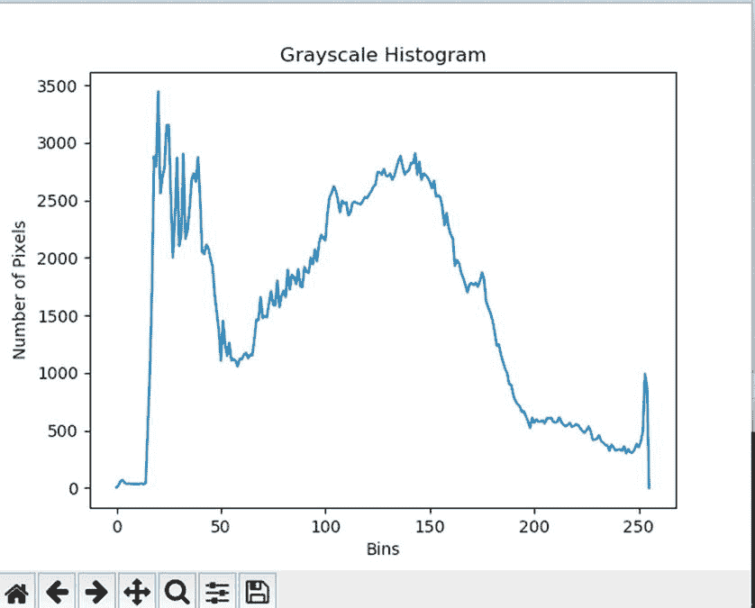

一幅标题为“灰度直方图”的图形。它描绘了像素数量（从 0 到 3500）与区间数量（从 0 到 250）的关系。该图形在约 25 个区间处出现一个峰值。

图 4-5
图 4-4 中灰度图像的直方图


一幅标题为“原始图像”的照片截图。它描绘了天空中云朵和下方地面的灰度图像。

图 4-4
原始灰度图像

在这个直方图中，频率最高的颜色值是 20，接近黑色，对应最多 3450 个像素。此外，大多数像素落在 100 到 150 的颜色范围内。

这里还有一个练习供你尝试：为一张图像绘制具有 32 个区间的直方图，并解读生成的图形。

#### RGB 颜色直方图

如前所述，彩色图像在 RGB 方案中有三个通道。代码清单 4-2 中的程序演示了如何绘制基于 RGB 的彩色图像所有三个通道的直方图。有必要重申，OpenCV 以 BGR 顺序而非 RGB 顺序存储颜色信息。

```
Filename: Listing_4_2.py
1    import cv2
2    import numpy as np
3    from matplotlib import pyplot as plot

5    # 读取彩色图像
6    image = cv2.imread("images/nature.jpg")

8    cv2.imshow("Original Color Image", image)
9    # 记住 OpenCV 以 BGR 顺序而非 RGB 顺序存储颜色
10   colors = ("blue", "green", "red")
11   # 计算直方图
12   for i, color in enumerate(colors):
13       hist = cv2.calcHist([image], [i], None, [32], [0,256])
14       # 绘制直方图
15       plot.plot(hist, color=color)

17   plot.title("RGB Color Histogram")
18   plot.xlabel("Bins")
19   plot.ylabel("Number of Pixels")
20   plot.show()
21   cv2.waitKey(0)
Listing 4-2
Histogram of Three Channels of RGB Color Image
```

在代码清单 4-2 中，第 6 行从磁盘读取一张彩色图像并将其赋值给一个变量。第 10 行创建了一个按 BGR 顺序排列的颜色元组，用于保存所有通道的颜色。

为什么第 12 行有一个 `for` 循环？`calcHist()` 函数的第二个参数接受一个值为 0、1 或 2 的数组。如果我们传递值 `[0]`，就是指示 `calcHist()` 函数计算第零个索引的颜色通道（即蓝色通道）的直方图。类似地，值 `[1]` 指示 `calcHist()` 函数计算红色通道的直方图，值 `[2]` 表示计算绿色通道的直方图。`for` 循环的第一次迭代用于计算和绘制蓝色的直方图，第二次迭代用于绿色，最后一次迭代用于红色通道。

再次注意，我们向 `calcHist()` 函数传递了 `[32]` 作为第四个参数。这是为了让函数知道我们想要为每个通道计算具有 32 个区间的直方图。最后一个参数 `[0,256]` 给出了颜色范围。

在第 15 行的 `for` 循环内，`plot()` 函数将直方图作为第一个参数，将可选的颜色作为第二个参数。

图 4-6 和图 4-7 显示了代码清单 4-2 的输出。

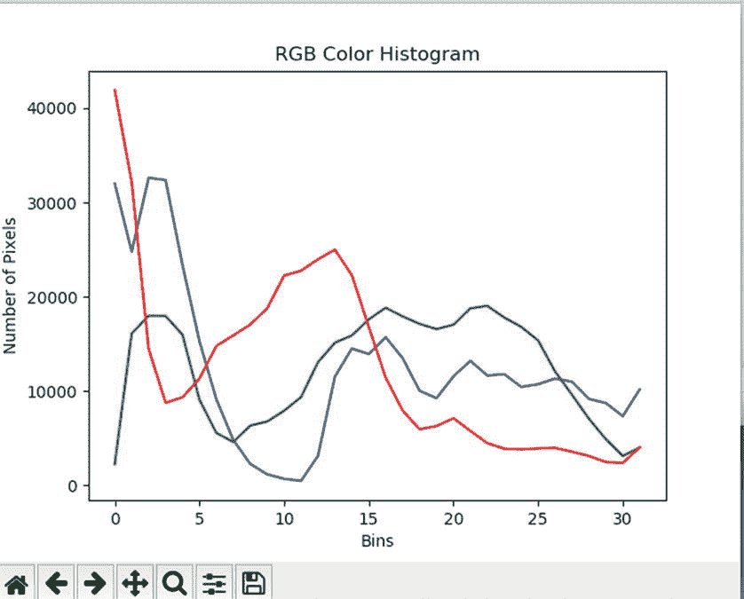

一幅标题为“RGB 颜色直方图”的图形。它描绘了像素数量（从 0 到 40000）与区间数量（从 0 到 30）的关系。图形显示了三条 RGB 线条，呈现下降趋势。

图 4-7
图 4-6 中图像三个颜色通道的直方图

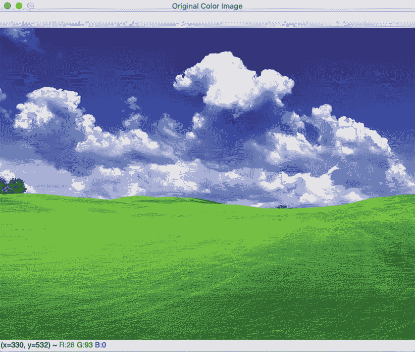

一幅标题为“原始彩色图像”的照片截图。它描绘了天空中云朵和下方地面的 RGB 照片。

图 4-6
原始彩色图像

在图 4-7 中，x 轴最多只有 32 个值，因为我们每个通道只用了 32 个区间。

这里有一个练习供你尝试：创建一个掩码图像的直方图。

提示

创建一个掩码 NumPy 数组，并将此数组作为第三个参数传递给 `cv2.calcHist()` 函数。阅读第 3 章以复习如何创建掩码。


### 直方图均衡化

现在你已经更清楚地理解了直方图所代表的内容，我们可以利用这一概念来提升图像质量。*直方图均衡化*是一种用于调整图像对比度的图像处理技术。它通过重新分布像素强度，使得像素数量较少的强度与像素数量较多的强度达到均衡，如图 4-8 所示。

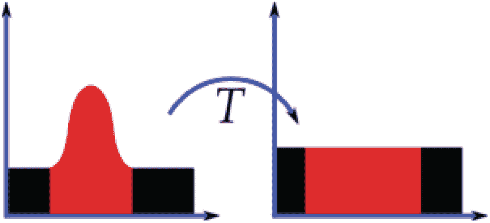

直方图均衡化的示意图。X 轴和 Y 轴上绘制了两个直方图，它们之间有一个标记为 T 的弯曲箭头。

图 4-8

直方图均衡化（来源：维基百科，[*https://wikipedia.org/wiki/Histogram_equalization*](https://wikipedia.org/wiki/Histogram_equalization)）

清单 4-3 提供了一个观察直方图均衡化实际效果的示例。尽管清单 4-3 包含大量代码，但你可以通过首先关注第 1 到 19 行来快速简化它，并注意到这些代码与清单 4-1 中用于计算和绘制灰度图像直方图的代码完全相同。

在第 21 行，我们使用了 OpenCV 的`equalizeHist()`函数，该函数将原始图像作为输入，并调整其像素强度以增强对比度。第 22 到 33 行计算并显示了增强后（均衡化后）图像的直方图。

图 4-9 到 4-12 展示了清单 4-3 的输出结果，以及原始图像和均衡化后图像的直方图对比。

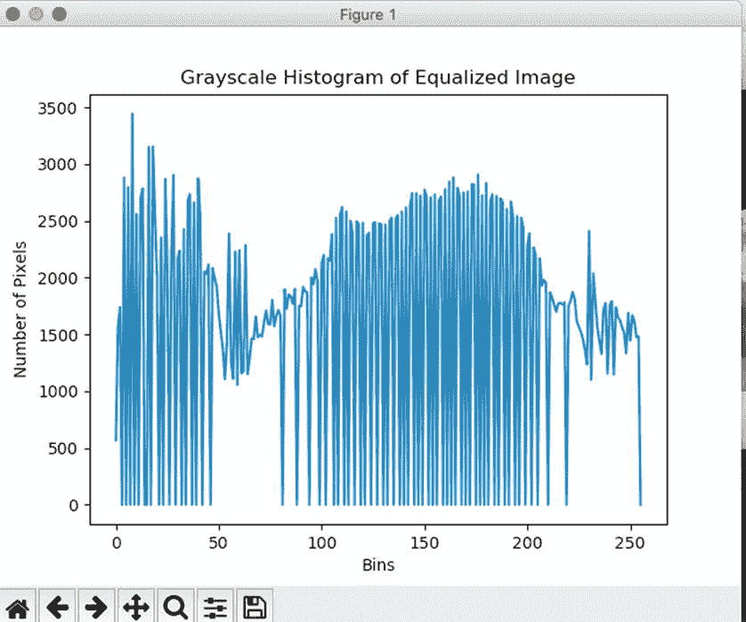

一张标题为“均衡化图像的灰度直方图”的图表。它绘制了从 0 到 3500 的像素数量与从 0 到 250 的区间数量之间的关系。图表显示在约 10 个区间处有一个峰值。

图 4-12

图 4-11 中均衡化图像的直方图

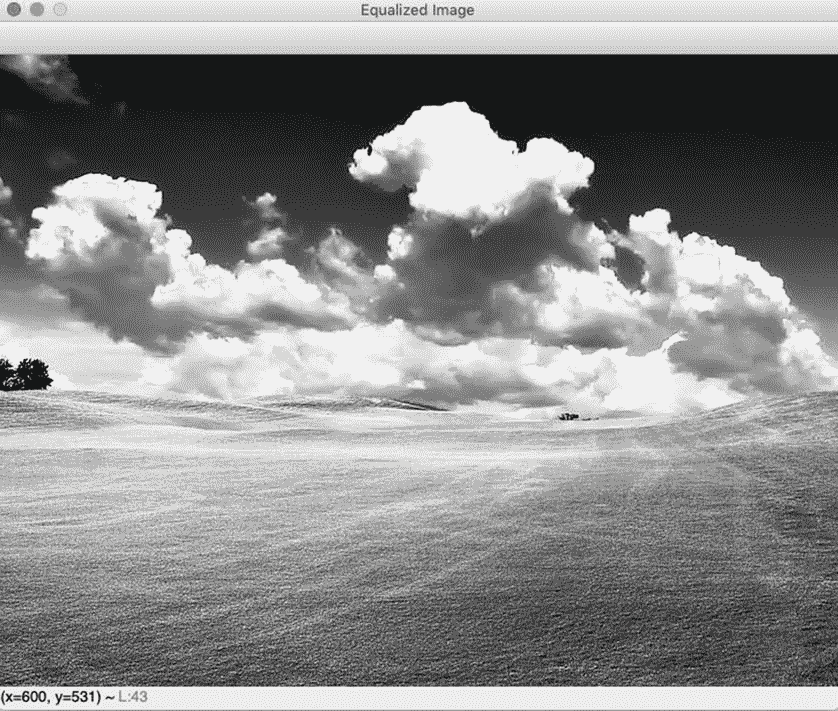

一张标题为“均衡化图像”的照片截图。它描绘了天空中云朵和下方地面的灰度图像。

图 4-11

对比度增强后的均衡化图像

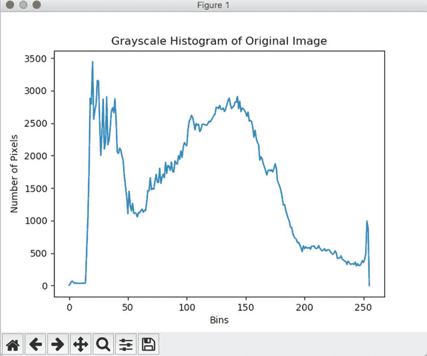

一张标题为“原始图像的灰度直方图”的图表。它绘制了从 0 到 3500 的像素数量与从 0 到 250 的区间数量之间的关系。图表显示在约 25 个区间处有一个峰值。

图 4-10

图 4-9 中图像的直方图

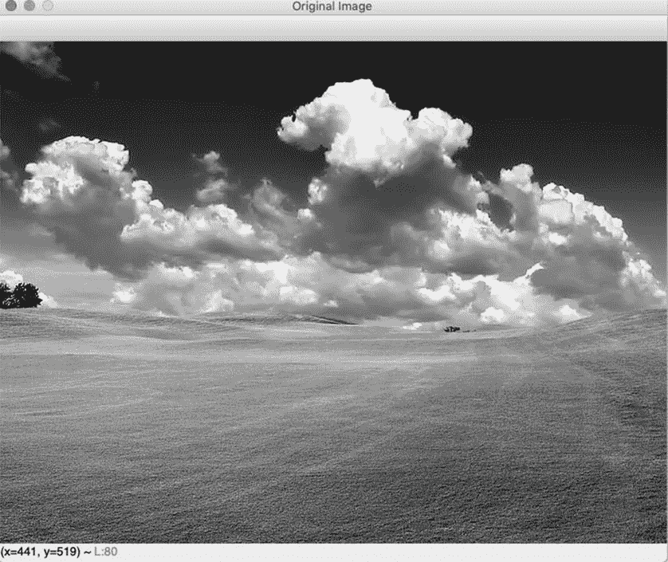

一张标题为“原始图像”的照片截图。它描绘了天空中云朵和下方地面的灰度图像。

图 4-9

原始灰度图像

```
Filename: Listing_4_3.py
1    import cv2
2    import numpy as np
3    from matplotlib import pyplot as plot

5    # 读取图像并将其转换为灰度图
6    image = cv2.imread("images/nature.jpg")
7    image = cv2.cvtColor(image, cv2.COLOR_BGR2GRAY)
8    cv2.imshow("原始图像", image)

10   # 计算原始图像的直方图
11   hist = cv2.calcHist([image], [0], None, [256], [0,255])

13   # 绘制直方图
14   #plot.figure()
15   plot.title("原始图像的灰度直方图")
16   plot.xlabel("区间")
17   plot.ylabel("像素数量")
18   plot.plot(hist)
19   plot.show()

21   equalizedImage = cv2.equalizeHist(image)
22   cv2.imshow("均衡化图像", equalizedImage)

24   # 计算均衡化图像的直方图
25   histEqualized = cv2.calcHist([equalizedImage], [0], None, [256], [0,255])

27   # 绘制直方图
28   #plot.figure()
29   plot.title("均衡化图像的灰度直方图")
30   plot.xlabel("区间")
31   plot.ylabel("像素数量")
32   plot.plot(histEqualized)
33   plot.show()
34   cv2.waitKey(0)
清单 4-3
直方图均衡化
```


好的，作为一名高级文档工程师和翻译员，我将严格遵循您提供的注意事项和示例，将给定的英文文本翻译成中文。


### 灰度共生矩阵（GLCM）

*灰度共生矩阵（GLCM）* 捕捉了在指定像素偏移内同时出现的像素值的统计分布。*偏移* 表示相邻像素的相对位置和方向。顾名思义，GLCM 是专门为灰度图像设计的。

GLCM 计算像素值 *i* 与像素值 *j* 在水平、垂直或对角线方向上共现的次数。

对于 GLCM 计算，我们指定一个偏移距离 *d* 和一个角度 ϴ（theta）。角度 ϴ（theta）可以是 0°（水平）、90°（垂直）、45°（右上方对角线）或 135°（左上方对角线），如图 4-13 所示。

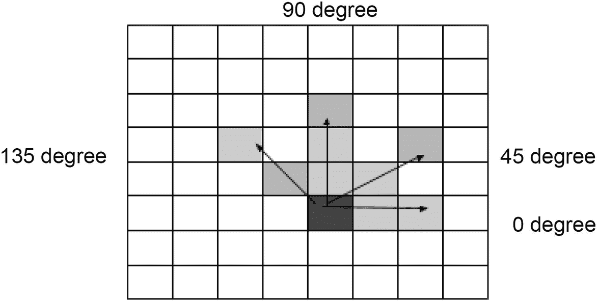

一个 8x8 网格上的像素位置矩阵。像素位于底部一个变暗像素的 135、90、45 和 0 度方向。

图 4-13

相邻像素位置（距离和角度）示意图

GLCM 的重要性在于它提供了图像上空间关系的信息。这与直方图不同，因为直方图不提供任何关于图像大小、像素位置或其关系的信息。

尽管 GLCM 是一个如此重要的矩阵，但我们并不直接将其用作机器学习的特征向量。我们使用 GLCM 计算关于图像的某些关键统计数据，这些统计数据被用作任何机器学习训练的特征。您将在本节中了解这些统计数据以及如何计算它们。

虽然 OpenCV 在内部使用 GLCM，但它没有直接提供任何函数来计算它。为了计算 GLCM，我们将使用另一个 Python 库：skimage 的 `feature` 包。

以下是我们将用于计算 GLCM 的函数的描述：

```
graycomatrix(image, distances, angles, levels, symmetric,normed)
```

`graycomatrix()` 函数接受以下参数：

*   `image`：这是灰度图像的 NumPy 表示。请记住，图像必须是灰度图像。
*   `distances`：这是一个像素对距离偏移的列表。
*   `angles`：这是一个像素对之间角度的列表。确保角度是弧度而不是度数。
*   `levels`：这是一个可选参数，适用于具有 16 位像素值的图像。在大多数情况下，我们使用 8 位图像像素，其值范围可以从 0 到 255。对于 8 位图像，此参数的最大值为 256。
*   `symmetric`：这是一个可选参数，接受一个布尔值。值 `True` 表示输出矩阵将是对称的。默认值为 `False`。
*   `normed`：这也是一个可选参数，接受一个布尔值。布尔值 `True` 表示每个输出矩阵都通过除以给定偏移的累积共现总数来进行归一化。默认值为 `False`。

`graycomatrix()` 函数返回一个 4D ndarray。这是灰度共生直方图。输出值 `P[i,j,d,theta]` 表示灰度级 *j* 在距离 *d* 和角度 *theta* 处从灰度级 *i* 出现的次数。如果参数 normed 为 `False`（这是默认值），则输出类型为 `uint32`（32 位无符号整数）；否则，为 `float64`（64 位浮点数）。

清单 4-4 展示了如何使用 `skimage` 库计算 GLCM 以计算特征统计信息。

```
Filename: Listing_4_4.py
1    import cv2
2    import skimage.feature as sk
3    import numpy as np

5    #从磁盘读取图像并将其转换为灰度图
6    image = cv2.imread("images/nature.jpg")
7    image = cv2.cvtColor(image, cv2.COLOR_BGR2GRAY)

9    #计算灰度图像的 GLCM
10   glcm = sk.graycomatrix(image,[2],[0, np.pi/2])
11   print(glcm)
清单 4-4
使用 graycomatrix() 函数计算 GLCM
```

第 10 行通过传递图像 NumPy 变量和距离 `[2]` 来使用 `graycomatrix()` 计算 GLCM。第三个参数是弧度。`np.pi/2` 是 90 度角的弧度。最后一行，第 11 行，简单地打印了 4D ndarray。

如前所述，GLCM 不直接用作特征，但我们使用它来计算一些有用的统计数据，这让我们了解图像的纹理。下表列出了我们可以推导出的统计数据：

| 统计量 | 描述 |
| --- | --- |
| 对比度（Contrast） | 测量 GLCM 中的局部变化。 |
| 相关性（Correlation） | 测量指定像素对的联合概率出现。 |
| 能量（Energy） | 提供 GLCM 中平方元素的总和。也称为均匀性或角二阶矩。 |
| 同质性（Homogeneity） | 测量 GLCM 中元素分布与 GLCM 对角线的接近程度。 |

以下一组高级公式用于计算上述统计数据。对这些公式进行详细的数学分析超出了本书的范围，但鼓励您深入研究这些统计计算背后的数学基础。

*   对比度 = 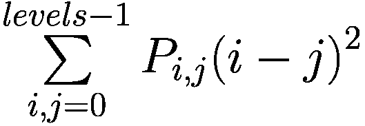

*   不相似性（Dissimilarity）= 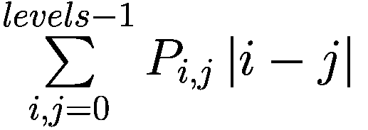

*   同质性 = 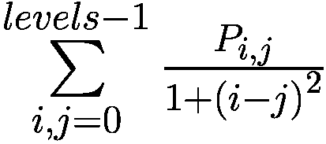

*   ASM = 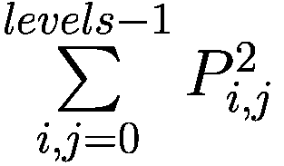

*   能量 = 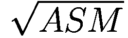

*   相关性 = ![$$ \sum \limits_{i,j=0}^{levels-1}{P}_{i,j}\left[\frac{\left(i-{\mu}_i\right)\kern0.5em \left(j-{\mu}_j\right)}{\sqrt{\left({\sigma}_i²\right)\kern0.5em \left({\sigma}_j²\right)}}\right] $$](images/493065_2_En_4_Chapter/493065_2_En_4_Chapter_TeX_IEq6.png)

在这些公式中，*P* 是要为其计算指定属性的 GLCM 直方图。值 *P*[*i*,*j*,*d*,*theta*] 是灰度级 *j* 在距离 *d* 和角度 *theta* 处从灰度级 *i* 出现的次数。

我们将使用 `skimage` 包中的 `graycoprops()` 从 GLCM 计算这些统计数据。以下是此函数的定义：

```
graycoprops(P, prop='contrast')
```

第一个参数是 GLCM 直方图（参见清单 4-4，第 10 行）。

第二个参数是我们要计算的属性。我们可以为此参数传递以下任何属性：`contrast`、`dissimilarity`、`homogeneity`、`energy`、`correlation` 和 `ASM`。如果您不传递第二个参数，它将默认为 `contrast`。

清单 4-5 展示了如何计算这些统计数据。

```
Filename: Listing_4_5.py
1    import cv2
2    import skimage.feature as sk
3    import numpy as np

5    #从磁盘读取图像并将其转换为灰度图
6    image = cv2.imread("images/nature.jpg")
7    image = cv2.cvtColor(image, cv2.COLOR_BGR2GRAY)

9    #计算灰度图像的 GLCM
10   glcm = sk.graycomatrix(image,[2],[0, np.pi/2])

12   #计算对比度
13   contrast = sk.graycoprops(glcm)
14   print("对比度:",contrast)

16   #计算 '不相似性'
17   dissimilarity = sk.graycoprops(glcm, prop='dissimilarity')
18   print("不相似性: ", dissimilarity)

20   #计算 '同质性'
21   homogeneity = sk.graycoprops(glcm, prop='homogeneity')
22   print("同质性: ", homogeneity)

24   #计算 'ASM'
25   ASM = sk.graycoprops(glcm, prop='ASM')
26   print("ASM: ", ASM)

28   #计算 '能量'
29   energy = sk.graycoprops(glcm, prop='energy')
30   print("能量: ", energy)


32   #计算'相关性'
33   correlation = sk.graycoprops(glcm, prop='correlation')
34   print("相关性: ", correlation)
列表 4-5
从 GLCM 计算图像统计量
```

列表 4-5 展示了如何使用 `graycoprops()` 函数，并通过向 `prop` 传递不同参数来计算相应的统计量。图 4-14 展示了列表 4-5 的输出结果。

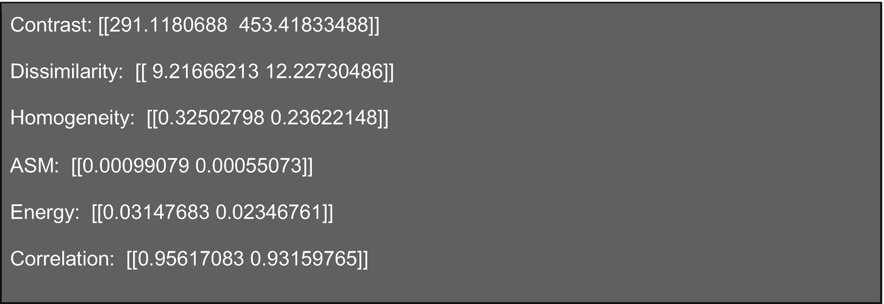

一段包含 6 行文字的文本，表示不同统计量的输出结果。它列出了对比度、相异性、同质性、ASM、能量和相关性的值。

图 4-14

基于 GLCM 的各种统计量输出

### HOG

*方向梯度直方图（HOG）* 是计算机视觉和机器学习中用于目标检测的重要特征描述子。HOG 描述了图像中物体的结构形状和外观。HOG 算法计算图像局部区域中梯度方向的出现频率。

HOG 算法按以下五个阶段工作：

*   *阶段 1：全局图像归一化*：这是一个可选阶段，仅用于减少光照效应的影响。在此阶段，图像通过以下方法之一进行全局归一化：
    *   *伽马（幂律）压缩*：每个像素值 *p* 通过应用 log(p) 进行变换。这种方法对像素的压缩过于强烈，不推荐使用。

*   *平方根归一化*：每个像素值 *p* 被变换为 [?][?][?]*p*（像素值的平方根）。与伽马压缩相比，这种方法对像素的压缩程度较小，被认为是一种首选的归一化技术。

*   *方差归一化*：对于大多数机器学习工作，与其他两种方法相比，该技术能提供更好的结果。在此方法中，我们首先计算像素值的均值（𝜇）和标准差（***σ***）。然后，根据以下公式对每个像素值 *p* 进行归一化：

*Tp* = (*p* − *μ*)/***σ***

*   *阶段 2：计算 x 和 y 方向的梯度图像*：第二阶段计算一阶图像梯度，以捕获轮廓、外形和部分纹理信息。如果需要捕获类似条形的特征（例如人体的四肢），还需要包含二阶图像导数。列表 3-19 和 3-20（在第 3 章中）展示了如何计算 X 和 Y 方向的梯度。如需复习，请参考第 3 章的“梯度与边缘检测”部分。假设 X 方向的梯度为 G[x]，Y 方向的梯度为 G[y]，则梯度幅值使用以下公式计算：

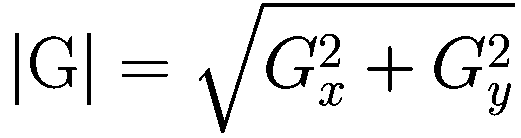

最后，使用以下公式计算梯度方向：

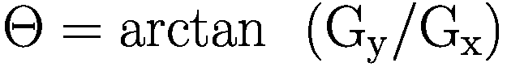

一旦计算出梯度和方向的值，就会计算直方图。

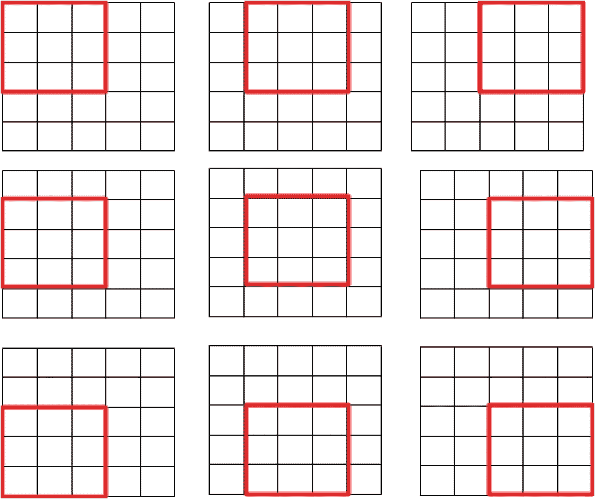

9 个像素矩阵和像素块。每个块由矩阵中不同位置的 9 个单元组成，从左上角到右下角。

图 4-15

通过分组单元形成块（3×3 单元的块）

*   *阶段 3：计算梯度直方图*：图像被划分为称为*单元*的小空间区域。利用之前的 |G| 和 Θ 公式 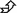 一个指向右上方箭头的图标。，我们在每个单元的所有像素上累积一个关于梯度或边缘方向的局部一维直方图。每个方向直方图将梯度角度范围划分为固定数量的预定区间。单元中像素的梯度幅值用于向方向直方图投票。投票的权重就是给定像素处的梯度幅值 |G|。


*   *第 4 阶段：跨块归一化*：少量单元格被组合成一个方形块。现在整个图像被划分为多个块（每个块由一组单元格组成）。块的形成通常通过在多个块之间共享单元格来实现。因此，同一个单元格会以不同的归一化方式多次出现在最终的输出向量中。然后对这些局部块进行归一化处理。这是通过在局部块内累积局部直方图“能量”的度量来完成的。这些归一化后的块描述符就是 HOG。图 4-15 展示了块的形成过程。

*   *第 5 阶段：展平为特征向量*：在所有块归一化之后，我们获取生成的直方图并将它们连接起来，以构建最终的特征向量。

如果对 HOG 算法的这个解释让你感到不知所措，请不要担心。你不需要从头开始编写代码来实现 HOG。有许多现成的库提供了预构建的函数，可以轻松计算 HOG。

我们将使用`scikit-image`库来计算图像的 HOG。`scikit-image`库中`skimage`包内的子包`feature`提供了一种便捷的方法来计算 HOG。以下是函数签名：

```
out, hog_image = hog(image, orientations=9, pixels_per_cell=(8, 8), cells_per_block=(3, 3), block_norm='L2-Hys', visualize=False,
transform_sqrt=False, feature_vector=True, multichannel=None)
```

参数说明如下：

*   `image`：这是输入图像的 NumPy 表示。

*   `orientation`：方向区间的数量，默认为 9。

*   `pixels_per_cell`：每个单元格中的像素数，以元组形式表示；对于 8×8 的单元格大小，默认为(8,8)。

*   `cells_per_block`：每个块中的单元格数，以元组形式表示；默认为(3,3)，表示 3×3 个单元格，而非像素。

*   `block_norm`：块归一化方法，是一个字符串，其值可以是以下之一：L1、L1-sqrt、L2、L2-Hys。这些归一化字符串的解释如下：
    *   L1：使用 L1 范数进行归一化，公式如下：

L1 范数 = 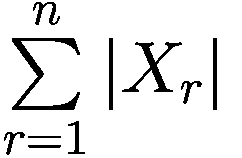

*   L1-sqrt：L1 归一化值的平方根。它使用以下公式：

L1-sqrt = 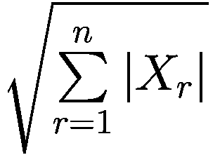

*   L2：使用 L2 范数进行归一化，公式如下：

L2 范数 = 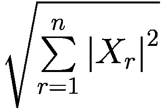

*   L2-Hys：这是参数`block_norm`的默认归一化方法。L2-Hys 的计算方法是：首先进行 L2 归一化，将结果限制在最大 0.2，然后重新计算 L2 归一化。

*   `visualize`：如果设置为`True`，该函数还会返回 HOG 的图像。其默认值设置为`False`。

*   `Transform_sqrt`：如果设置为`True`，该函数将在处理前应用幂律压缩来归一化图像。

*   `feature_vector`：此参数的默认值设置为`True`，指示函数将输出数据作为特征向量返回。

*   `multichannel`：将此参数的值设置为`True`，表示输入图像包含多通道。图像的维度通常表示为高度 × 宽度 × 通道。如果此参数的值为`True`，则最后一个维度（通道）被解释为颜色通道，否则被解释为空间维度。

这个`hog()`函数返回什么？

*   `out`：该函数返回一个包含`(n_blocks_row, n_blocks_col, n_cells_row, n_cells_col, n_orient)`的 ndarray。这是图像的 HOG 描述符。如果参数`feature_vector`为`True`，则返回一个一维（展平）数组。

*   `hog_image`：如果参数`visualize`设置为`True`，该函数还会返回 HOG 图像的可视化结果。

清单 4-6 展示了如何使用`skimage`包计算 HOG。

```
Filename: Listing_4_6.py
1    import cv2
2    import numpy as np
3    from skimage import feature as sk

5    #从磁盘加载图像
6    image = cv2.imread("images/obama.jpg")
7    #调整图像大小。
8    image = cv2.resize(image,(int(image.shape[0]/5),int(image.shape[1]/5)))

10   # HOG 计算
11   (HOG, hogImage) = sk.hog(image, orientations=9, pixels_per_cell=(8, 8),
12       cells_per_block=(2, 2), visualize=True, transform_sqrt=True, block_norm="L2-Hys", feature_vector=True)

14   print("图像维度",image.shape)
15   print("特征向量维度:", HOG.shape)

17   #显示原始图像和 HOG 图像
18   cv2.imshow("原始图像", image)
19   cv2.imshow("HOG 图像", hogImage)
20   cv2.waitKey(0)
清单 4-6
HOG 计算
```

理解 HOG 的概念很重要，因为我们将在第 6、7 和 8 章中利用它来进行实际实现。虽然我们花了数页篇幅来理解这个概念，但计算 HOG 却非常简洁，只需要一行代码（清单 4-6 的第 11 行）。

我们使用`skimage`包中`feature`子包的`hog()`函数。传递给`hog()`函数的参数已在前面解释过。

我们如何知道在`hog()`函数中传递了正确的参数值呢？实际上，并没有既定的规则。根据经验法则，我们应该从所有默认参数开始，然后在分析结果时进行调整。

值得一提的是，`hog()`函数会生成一个维度非常高的直方图。一个 32×32 的图像，如果`pixel_per_cell=(4,4)`且`cells_per_block=(2,2)`，将生成 1764 维的结果。同样，一个 128×128 像素的图像将生成 34596 维的输出。因此，密切关注参数，并适当调整图像大小以减少输出维度，这一点极其重要。这将对内存、存储需求和网络传输时间产生巨大影响。

图 4-16 到 4-18 展示了清单 4-6 的输出。

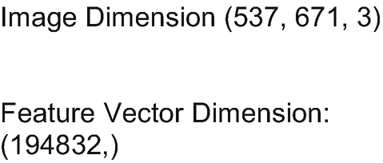

一个维度输出文本显示，图像维度 (537, 671, 3)。下一行显示，特征向量维度 194832。

图 4-18

来自`print()`语句的维度输出

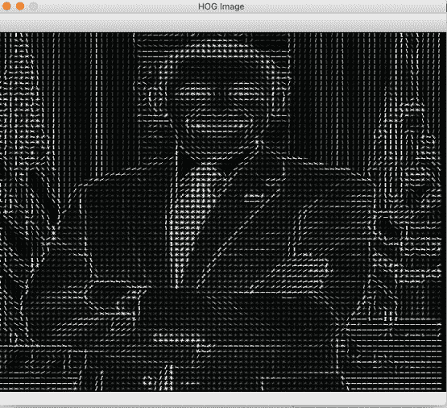

一张巴拉克·奥巴马的照片，标注为 HOG 图像。

图 4-17

HOG 图像

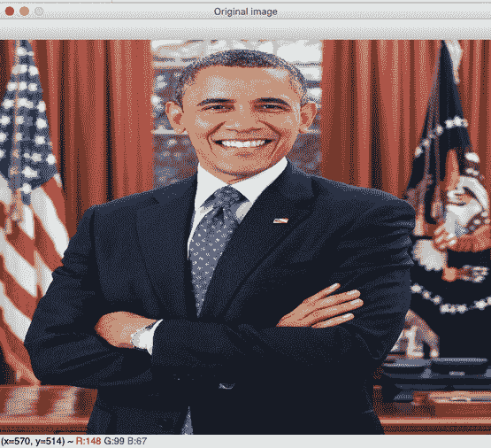

一张巴拉克·奥巴马的照片，标注为原始图像。R 值等于 148，G 值等于 99，B 值等于 67。

图 4-16

调整大小后的图像


### LBP

局部二值模式（LBP）是一种用于图像纹理分类的特征描述符。

LBP 特征提取的工作原理如下：

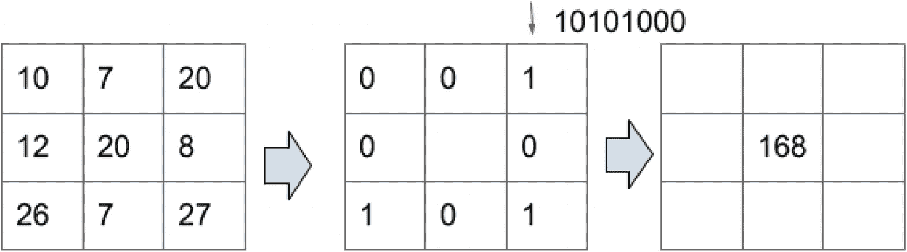

局部二值模式像素值计算的三个矩阵。矩阵之间用前向箭头分隔。一个由 1 0 1 0 1 0 0 0 组成的比特位指向第二个矩阵的第三列。

图 4-19

LBP 像素值计算

1.  对于图像中的每个像素，比较其周围像素的像素值。如果某个周围像素的值小于中心像素，则将其标记为 0；否则标记为 1。在图 4-19 中，中心像素值为 20，周围有八个邻域像素。图 4-19 的中间部分展示了根据像素值是否小于或大于中心像素（本例中为 20）而转换为 0 或 1 的过程。

2.  从任意一个邻域像素开始，沿任意方向，我们将 0 和 1 的序列组合成一个 8 位二进制数。在图 4-19 所示的以下示例中，我们从右上角开始，按顺时针方向组合数字，形成二进制数 10101000。该二进制数被转换为十进制数，从而得到中心像素的像素值，如图 4-19 所示。

3.  对于图像中的每个像素，我们重复前面的步骤，根据邻域像素获得像素值。确保所有像素的起始位置和方向保持一致。

4.  当所有像素处理完毕后，我们将像素值排列成一个 LBP 数组。

5.  最后，我们计算 LBP 数组的直方图。该直方图即作为 LBP 特征向量。

这种计算 LBP 特征向量的方法使我们能够捕捉图像纹理的更精细细节。但对于大多数机器学习分类问题，细粒度的特征可能无法产生理想的结果，尤其是在输入图像具有不同纹理尺度的情况下。

为了解决这个问题，我们有一个增强版的 LBP，它允许可变邻域大小。它为我们提供了两个额外的参数：

*   我们可以定义一个圆形对称邻域中的点数 *p*，而不是固定的方形邻域。
*   圆的半径 *r* 允许我们定义不同的邻域大小。

图 4-20 显示了作为点数的绿点以及半径变化的虚线圆。半径越小，捕捉到的纹理越精细。增大半径使我们能够对不同尺度的纹理进行分类。

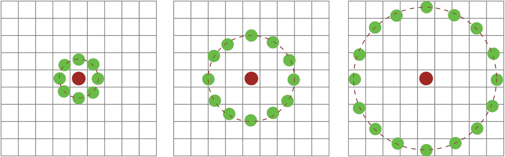

局部二值模式像素值计算的三个矩阵。这些矩阵由圆形图案中的点组成，每个矩阵之后圆的尺寸逐渐增大。

图 4-20

基于邻域大小和点数的 LBP 计算

有了这些背景知识，我们现在可以深入探讨 LBP 的实现。我们将再次依赖 `scikit-image`，具体来说是 `skimage` 包中的 `feature` 子包。以下是我们将用于计算 LBP 的指定函数签名：

```
local_binary_pattern(image, P, R, method='default')
```

参数说明如下：

*   `image`：灰度图像的 NumPy 表示。
*   `P`：围绕计算 LBP 的点的圆周上的邻域点数。这是图 4-20 中绿点的数量。
*   `R`：这是一个浮点数，定义了圆的半径。
*   `method`：此参数接受以下任一字符串值：
    *   `default`：指示函数基于灰度计算原始 LBP，不考虑旋转不变性。旋转不变二进制描述符的描述超出了本书的范围。要了解更多信息，请查阅论文“OSRI: A Rotationally Invariant Binary Descriptor”，网址为 [`http://ivg.au.tsinghua.edu.cn/~jfeng/pubs/Xuetal_TIP14_Descriptor.pdf`](http://ivg.au.tsinghua.edu.cn/~jfeng/pubs/Xuetal_TIP14_Descriptor.pdf)。
    *   `ror`：此方法指示函数使用旋转不变二进制描述符。
    *   `uniform`：这使用具有均匀模式和更精细角度空间量化的改进旋转不变性，该方法是灰度不变且旋转不变的。如果二进制数字序列中最多有两次 0-1 到 1-0 的转换，则认为该二进制模式是均匀的。例如，00100101 是一个均匀模式，因为它有两次转换（分别用红色和蓝色显示）。同样，00010001 也是一个均匀模式，因为它有一次 0-1 到 1-0 的转换。另一方面，01010100 不是均匀模式。在计算 LBP 直方图时，直方图为每个均匀模式设置一个单独的 bin，所有非均匀模式被分配到一个单独的 bin 中。使用均匀模式，单个单元的特征向量长度从 256 减少到 59。
    *   `nri_uniform`：非旋转不变均匀模式变体，仅具有灰度不变性。
    *   `var`：局部图像纹理对比度的旋转不变方差度量，具有旋转不变性但不具有灰度不变性。

函数 `local_binary_pattern()` 的输出是一个表示 LBP 图像的 ndarray。

我们已经介绍了足够的背景知识，可以开始实现 LBP 并观察其效果。清单 4-7 演示了 `local_binary_pattern()` 函数的使用。

它从磁盘加载图像、调整大小并将其转换为灰度开始。

第 12 行计算原始图像的直方图。第 14 到 16 行绘制原始图像的直方图。

```
文件名: Listing_4_7.py
1    import cv2
2    import numpy as np
3    from skimage import feature as sk
4    from matplotlib import pyplot as plt

6    # 从磁盘加载图像，调整大小并转换为灰度
7    image = cv2.imread("images/obama.jpg")
8    image = cv2.resize(image, (int(image.shape[0]/5), int(image.shape[1]/5)))
9    image = cv2.cvtColor(image, cv2.COLOR_BGR2GRAY)

11   # 计算原始图像的直方图并绘制
12   originalHist = cv2.calcHist(image, [0], None, [256], [0,256])

14   plt.figure()
15   plt.title("原始图像直方图")
16   plt.plot(originalHist, color='r')

18   # 计算 LBP 图像和 LBP 上的直方图，然后绘制直方图
19   radius = 3
20   points = 3*8
21   # LBP 计算
22   lbp = sk.local_binary_pattern(image, points, radius, method='default')
23   lbpHist, _ = np.histogram(lbp, density=True, bins=256, range=(0, 256))

25   plt.figure()
26   plt.title("LBP 图像直方图")
27   plt.plot(lbpHist, color='g')
28   plt.show()

30   # 显示原始图像和 LBP 图像
31   cv2.imshow("原始图像", image)
32   cv2.imshow("LBP 图像", lbp)
33   cv2.waitKey(0)
清单 4-7
LBP 图像与直方图计算及与原始图像的比较
```

LBP 图像的计算在第 22 行执行。请注意，我们使用了默认方法进行 LBP 计算，该方法采用半径为 3，点数为 24。第 22 行使用了来自 `skimage` 包的 `feature` 子包中的 `local_binary_pattern()` 函数。


第 23 行计算了 LBP 图像的直方图。请注意，我们使用了 NumPy 的`histogram()`函数。如果尝试对 LBP 图像使用`cv2.calcHist()`函数，将会收到一条错误信息：“-210 不支持的格式或格式组合”。这是因为`local_binary_pattern()`的输出格式不同，且不被 OpenCV 的`calcHist()`函数支持。因此，我们使用了 NumPy 的`histogram()`函数。

图 4-21 展示了原始图像。让我们查看代码清单 4-7 的输出结果。图 4-22 是根据输入图像（图 4-21）计算得到的 LBP 图像。请注意它多么清晰地捕捉到了原始图像的纹理。将图 4-23 与图 4-24 进行比较，它们分别是从原始图像和 LBP 图像绘制的直方图。

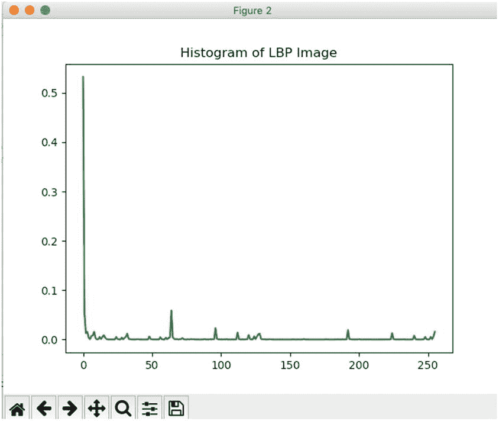

一张标题为“图 2”的截图。它绘制了一个 LBP 图像的直方图。该图显示初始阶段急剧下降，随后趋于稳定。

图 4-24
LBP 图像的直方图

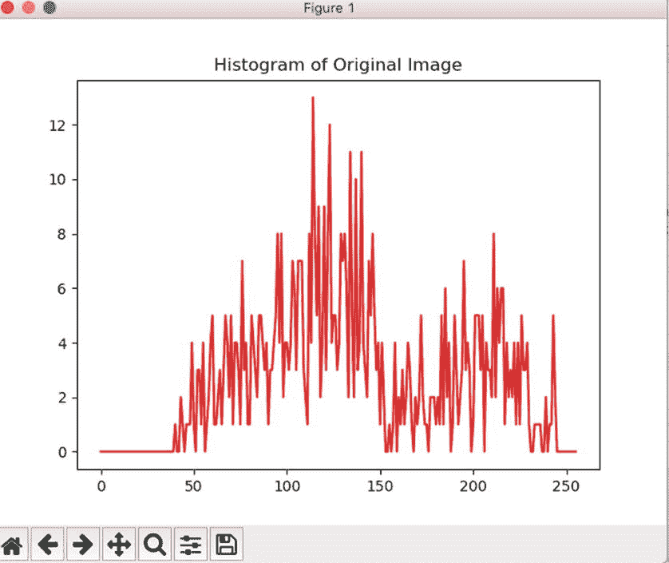

一张标题为“图 1”的截图。它绘制了原始图像的直方图。该图显示初始呈上升趋势，在中心附近达到峰值，然后逐渐下降。

图 4-23
原始图像的直方图

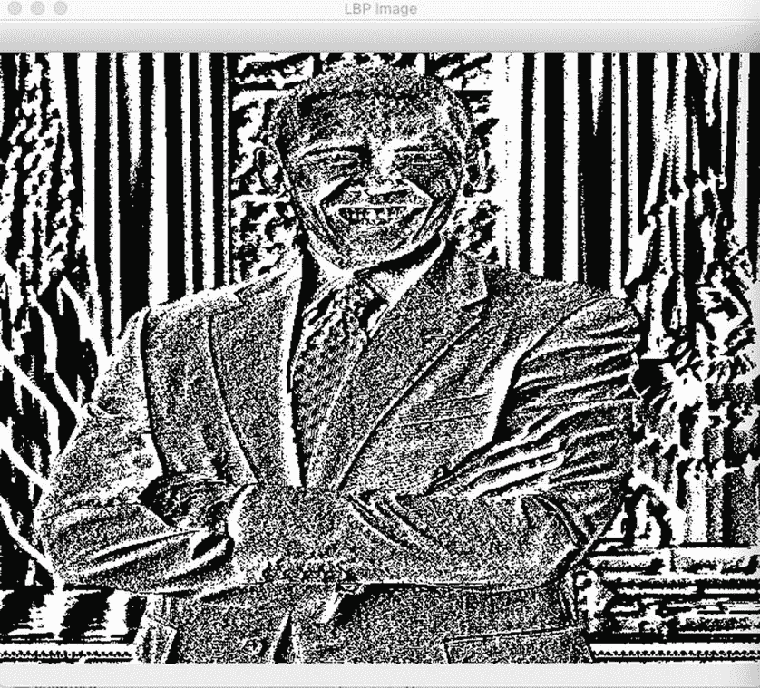

一张巴拉克·奥巴马的局部二值模式照片。

图 4-22
LBP 图像

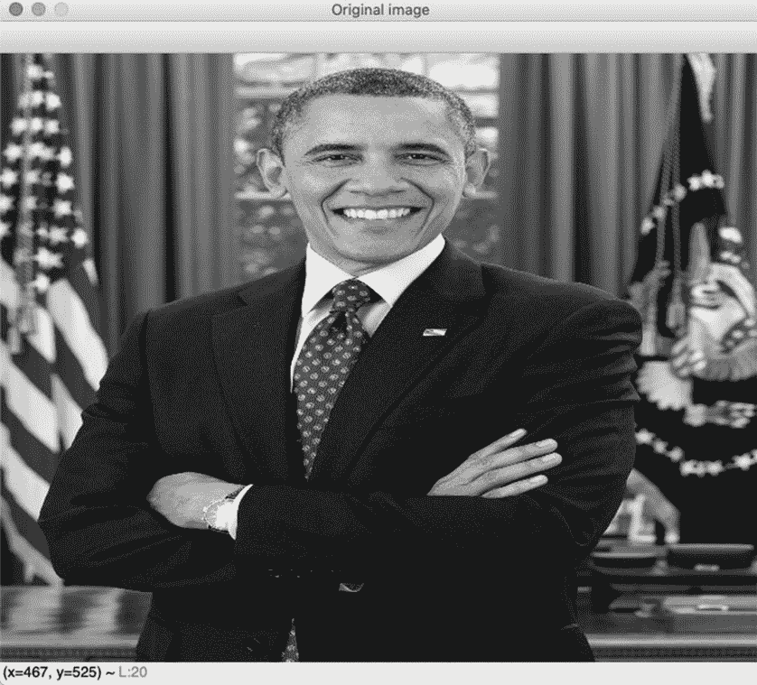

一张标记为原始图像的巴拉克·奥巴马灰度照片。L 值设为 20。

图 4-21
原始灰度图像

**注意**

在某些情况下，LBP 会与 HOG 结合使用，以提高目标检测的准确性。

在本节中，主要目标是让你了解执行特征提取的各种技术。我们专注于这些技术的基本概念，因为它们在后续章节中将被证明很有价值，届时我们将深入探讨机器学习和神经网络的领域。你在此处学到的概念将在第 6 章至第 9 章的实际场景中得到应用。

下一节将探讨特征选择中涉及的策略。

## 特征选择

机器学习中的*特征选择*是指选择与模型训练相关且有用的变量或属性，并消除不相关或冗余特征的过程，从而选出对模型学习过程有重大贡献的关键特征子集。理解特征选择至关重要，原因如下：

*   降低模型复杂度并增强可解释性
*   减少机器学习算法的训练时间
*   通过使用精心挑选的变量集来提高模型准确性
*   降低过拟合风险，从而提升模型的泛化能力

特征选择和特征提取是特征工程中两个不同的过程。*特征提取*涉及从现有数据中生成新特征，而*特征选择*则侧重于选择相关特征子集或消除冗余特征。这两种技术在提升机器学习模型性能方面都发挥着重要作用。当结合使用时，特征提取和特征选择共同构成了特征工程的实践。

统计证明，存在一个最佳特征数量，超过该数量后模型性能开始下降。问题在于，我们如何知道最佳数量是多少，以及如何决定使用哪些特征、不使用哪些特征？本节将尝试回答这个问题。

机器学习中使用的特征选择技术有很多，因此我们将重点介绍三种最常用的技术。

### 过滤法

假设你有一个特征集，并且想要选择一个子集输入到机器学习算法中。换句话说，你希望在触发机器学习之前选择特征子集。*过滤*是一个允许你进行预处理以选择特征子集的过程。在此过程中，你确定特征与目标变量之间的相关性，并基于统计分数确定它们的关系。请注意，过滤过程独立于任何机器学习算法。特征的选择（或剔除）仅基于特征变量与目标变量之间的关系。

存在多种统计方法可以帮助我们根据目标变量对特征进行评分。下表提供了选择方法以确定特征-目标关系的实用指南：

| 特征变量类型 | 目标变量类型 | 统计方法名称 |
| --- | --- | --- |
| 连续型 | 连续型 | 皮尔逊相关系数 |
| 连续型 | 分类型 | 线性判别分析（LDA） |
| 分类型 | 分类型 | 卡方检验 |
| 分类型 | 连续型 | 方差分析（ANOVA） |

对这些统计方法的描述超出了本书的范围。关于这些经典方法，有大量的书籍和在线资源可供参考。

### 包装法

在*包装法*中，你使用一个特征子集来训练模型。你评估模型，并根据结果添加或移除特征，然后重新训练模型。重复此过程，直到获得一个具有可接受准确率的模型。这更像是一种试错法，用于找到正确的特征子集。此过程计算成本很高，因为你实际上需要训练多个模型（并且很可能丢弃所有你不满意的模型）。

以下是包装法下用于执行特征选择的实用方法：

*   *前向选择*：从一个特征开始，构建并评估模型。迭代地添加最能改善模型的特征。
*   *后向消除*：从所有特征开始，构建并评估模型。通过消除特征进行迭代，直到获得最佳模型。重复此过程，直到移除特征后模型性能不再提升。
*   *递归特征消除*：重复创建模型，并在每次迭代中剔除表现最好或最差的特征。根据特征的系数或重要性对其进行排序，并消除最不重要的特征。使用剩余特征递归地创建新模型，直到所有特征都被耗尽。


### 嵌入式方法

在*嵌入式方法*中，特征选择由机器学习算法在模型训练过程中执行。回归算法中的 LASSO（最小绝对收缩与选择算子）和岭正则化方法就是此类算法的例子，它们会评估哪些最合适的特征有助于提升模型精度。

*套索回归*使用 L1 正则化，并添加一个与系数绝对值大小相等的惩罚项。岭回归使用 L2 正则化，并添加一个与系数平方值大小相等的惩罚项。

由于模型本身会评估特征重要性，因此嵌入式方法是最经济的特征选择方法之一。

注意

本书的主要重点是构建基于机器学习和深度学习技术的计算机视觉应用。虽然特征提取和选择是任何机器学习算法的关键组成部分，但本书仅针对这一广泛主题提供入门级别的信息。如果你想深入探索特征提取和选择，可以找到专门论述该主题的整本书籍。

## 模型训练

请花点时间回顾本章前面图 4-2 中描绘的图像处理流程。到目前为止，你已经学习了如何获取图像以及执行预处理技术来提升其质量。这个预处理步骤确保输入图像被适当地格式化，以用于流程的后续阶段，即特征提取和选择。在上一节中，你了解了不同的特征工程技术。我希望你已经透彻掌握了迄今为止所涵盖的概念，并准备好深入探讨与计算机视觉相关的机器学习领域。

### 如何进行机器学习

想象一下，你已经成功地从大量图像中提取并选择了特征。多少数量才算“大量”图像？并没有一个普遍适用的绝对神奇数字。理想的数量应该能够准确代表或非常接近你试图建模的真实世界场景。重要的是要记住，一个强大特征集的关键属性之一是其可重复性。虽然没有精确的方法来确定“大量”的数量，但一般的经验法则是，你拥有的图像越多，模型的潜在结果就越好。

数学算法利用这些特征集来识别特定的模式，这些模式以称为模型的数学方程形式存在，我们将在下一章中更详细地讨论。算法生成的结果被称为*模型*，而开发这个模型的过程被称为*模型训练*。本质上，如图 4-25 所示，计算机利用算法从提供的输入特征集（也称为*训练集*）中识别模式。

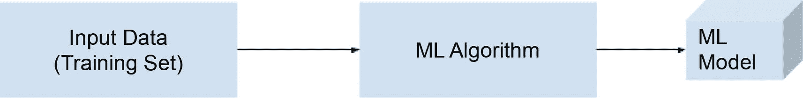

机器学习模型训练的流程图包含 3 个步骤。它从输入图像开始，接着是机器学习算法，最后以机器学习模型结束。

图 4-25
机器学习模型训练示意图

通常，训练集分为两类，对应两种机器学习类型：监督学习和无监督学习。以下各节将依次介绍它们。

### 监督学习

假设你有一张 8×8 的图像，所有 64 个像素的值就是你的特征。同时，假设你有几张这样的图像，并且你已经从中提取了像素值来构成一个特征集。一张图像的所有 64 个特征被排列成一个数组（或向量）。特征集的行数与训练集中的图像数量相同，每一行代表一张不同的图像。现在，有了这个数据集，你想训练一个能够将输入图像分类到特定类别的模型。例如，你想根据图像中包含的是狗还是猫来对其进行分类（为了简单起见，我们先这样设定）。

进一步假设这些训练图像已经被标记，这意味着它们已经被识别并标记出哪些图像包含狗，哪些图像包含猫。这意味着我们为每张图像都确定了正确的类别。

图 4-26 展示了一个带标签的训练集样本。图 4-26 的第 1 列是唯一标识每张图像的图像 ID。第 2 列到第 65 列（已截断）显示了所有 64 列的像素值（因为本例中我们的图像尺寸是 8×8）。这些像素值共同构成了我们的特征向量（X）。最后一列是标签列（y），对于狗，其值为 0，对于猫，其值为 1（标签必须是数值才能输入机器学习模型）。标签也被称为*目标变量*或*因变量*。

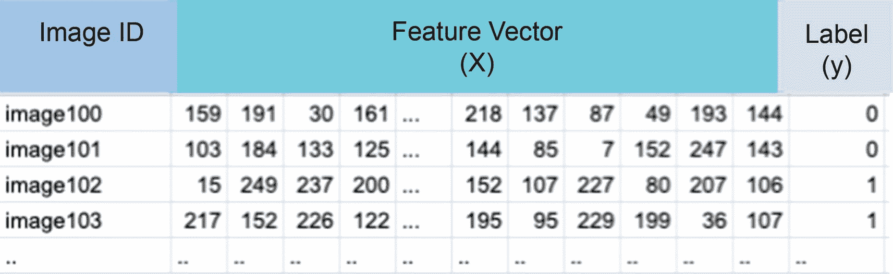

一个包含特征向量的数据集表格。它描绘了三列：图像 ID、特征向量和标签。展示了从 100 到 103 的 4 行图像。

图 4-26
带有标签特征向量的示例数据集

当我们通过向学习算法输入包含特征向量和相关标签的数据集来训练机器学习模型时，这被称为*监督学习*。

监督学习算法（见图 4-27）通过优化一个函数来学习，该函数以特征向量作为输入，并生成标签作为输出。我们将在第 5 章中探讨各种优化函数。

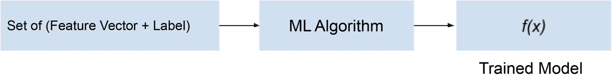

一个监督学习模型的流程图包含 3 个步骤。它从一组特征向量和标签开始，接着是机器学习算法，最后以训练好的模型结束。

图 4-27
监督学习示意图

有几种监督学习算法，例如支持向量机（SVM）、线性回归、逻辑回归、决策树、随机森林、人工神经网络（ANN）和卷积神经网络（CNN）。

本书的重点是深度学习技术的应用，特别是神经网络，如人工神经网络（ANN）和卷积神经网络（CNN），在训练用于计算机视觉任务的模型中的应用。在第 5 章中，你将了解这些深度学习算法的复杂性，并发现如何有效地训练用于计算机视觉目的的模型。


### 无监督学习

在图 4-26 所示的示例中，每个特征向量都有一个对应的标签。使用此类带标签数据集的主要目的是建立每个特征向量与其标签之间的关系。然而，如果我们没有特征向量的标签该怎么办？换句话说，我们模型的输入仅由特征向量组成，没有任何相关的输出或标签。在这种情况下，我们希望机器学习算法仅从该输入数据集中进行学习。在此条件下训练的模型被称为*无监督学习*。

图 4-28 描绘了无监督学习算法，这些算法旨在处理仅由特征向量组成的数据集。这些算法旨在识别数据中的结构或模式，例如数据分组或聚类。换句话说，它们从缺乏标签数据的训练集中学习，并发现数据集中的相似性或共性。

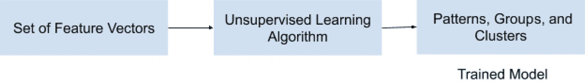

无监督学习模型的流程图包含 3 个步骤。它从一组特征向量开始，接着应用无监督学习算法，最后得到由模式、分组和聚类组成的训练模型。

图 4-28
无监督学习

无监督学习有多种用途，包括数据集聚类和分组。此外，它还可用于为监督学习算法生成标签。几种广泛使用的无监督学习算法包括 K-means 聚类、自编码器、深度信念网络和赫布学习。

本书仅涵盖计算机视觉领域中使用的监督学习技术。

## 模型部署

创建训练好的机器学习模型后，下一步是将其部署。但在深入探讨之前，让我们快速回顾一下我们究竟用训练好的模型做什么：

*   在监督学习的情况下，训练好的模型为我们提供一个函数，该函数以特征集作为输入并给出输出。输出通常被称为*预测*。换句话说，模型根据输入数据预测结果。此类预测可以是连续值或类别。

*   在无监督学习的情况下，训练好的模型接收一个特征集，并输出输入特征所属的组或聚类。这些分组或聚类可进一步用于为监督学习创建标签。

部署一个完全训练好的模型意味着使该模型可用于预测或分类图像，或任何其他由外部业务应用提供的输入数据集。从模型得出的这些预测或类别随后被用于各种分析和决策过程，以满足业务用例的特定需求。

外部应用可以生成需要处理的输入图像。这些图像经历与模型训练期间特征工程阶段相同的摄取和处理步骤。从摄取图像中提取特征，并通过模型函数传递以获得预测或类别。

虽然模型开发是一个迭代过程，但一旦模型达到可接受的准确率，我们通常会对该模型进行版本控制并将其部署到生产环境中。在实践中，模型不会随着新数据而更改或重新训练，直到准确率开始下降，或者预期使用新数据集重新训练会提高准确率。

模型的使用频率通常高于模型本身的重新训练。在某些场景中，可能需要每秒预测或分类成百上千张输入图像。在其他场景中，可能需要每天或按特定时间间隔批量分类数百万张图像。因此，以能够根据输入数据量和处理需求进行扩展的方式部署我们的模型至关重要。

要在生产环境中实现有效的模型利用，必须拥有合适的部署架构。有多种方法可以在生产环境中提供我们的模型服务：

*   *嵌入式模型*：模型工件作为消费应用程序代码中的依赖项使用。它与调用模型函数作为内部库函数的应用程序一起构建和部署。这对于边缘计算设备（例如物联网场景）的嵌入式应用来说是一个好方法，但不适用于数据量大且处理需要扩展的企业应用。此外，在这种情况下部署新版本的模型更加困难；你可能需要重建整个应用程序代码并重新部署。

*   *模型作为独立服务部署*：在这种方法中，模型被封装在一个服务中。该服务独立部署，并与消费应用程序分离。这使我们能够更新模型并重新部署，而不会影响其他应用程序。消费应用程序通过远程调用进行服务调用，这可能会引入一些延迟。

*   *模型作为 RESTful Web 服务部署*：这与前面描述的方法类似。在这种情况下，通过使用 TCP/IP 协议的 RESTful API 调用来调用模型。这种方法提供了可扩展性和负载均衡，但网络延迟可能是一个问题。

*   *模型为分布式处理部署*：这是一种高度可扩展的模型部署方式。在这种方法中，输入图像（数据集）存储在分布式存储位置，该位置可由集群的所有节点访问。模型部署在所有集群节点上。所有参与节点从分布式存储中获取输入数据，处理数据，并将预测结果存储到分布式存储中，供应用程序消费。分布式存储的一些示例包括 Hadoop 分布式文件系统（HDFS）、Amazon Simple Storage Service（Amazon S3）、Google Cloud Storage 和 Azure Blob Storage。

在第 10 章中，我们将探讨在云上扩展模型开发和部署的主题。我们将研究各种策略和技术，以有效利用云基础设施来满足大规模模型开发和部署的需求。

## 总结

本章与前面的章节共同为利用人工神经网络开发计算机视觉应用奠定了坚实的基础。在本章中，我们探讨了图像处理流水线、其组成部分以及它们在构建基于机器学习的计算机视觉系统中的作用。你学习了特征提取和选择的各种技术，并对不同的机器学习算法、模型训练类型和模型部署方法有了高层次的理解。

下一章，即第 5 章，是本书的核心主题。我们将研究各种机器学习模型，并实现专门为计算机视觉任务定制的人工神经网络（ANN）、卷积神经网络（CNN）、单次多框检测（SSD）和 YOLO（You Only Look Once）模型。我们的实现将涉及使用 Keras 深度学习库编写 Python 代码，并在 TensorFlow 上执行。

现在是回顾前几章所涵盖概念的好时机。如果你已经跟着提供的代码示例操作，你的开发环境很可能已经为下一章做好了准备。但是，如果你还没有这样做，我建议你回到第 1 章，安装所有必要的软件并设置好你的开发计算机。我们即将踏上一段充满严肃工作和迷人发现的激动人心之旅。如果你准备好了，让我们开始吧！


