# 5. 深度学习与人工神经网络

在本章中，我们将深入探讨应用深度学习与人工神经网络的领域。我们的主要关注点将放在它们在计算机视觉中的应用。为便于理解，本章提供了可运行的代码示例。

本章的学习目标如下：

*   全面理解神经网络，包括其架构、底层数学函数和算法。

*   熟练掌握编写 TensorFlow 代码来处理和分析图像、提取关键特征，并训练各类神经网络。

*   培养使用预训练模型以及为图像分类任务创建自定义训练模型所需的技能。此外，我们还将探讨对现有模型进行再训练的过程。

*   学习如何评估模型性能并微调其参数，以优化准确率和整体效果。

注意

本章包含对底层数学概念、符号和方程的技术性描述，但你无需具备正式理解这些内容的能力即可应用神经网络方法。不过，如果你希望进一步探索这些方程的数学处理方式，本章提供了相关参考文献作为指引。

## 人工神经网络简介

*人工神经网络（ANN）* 是一种受大脑中生物神经网络结构和功能启发的计算模型。ANN 是一种从数据中学习并能解决复杂问题的机器学习算法。

为了帮助说明这一概念，让我们考虑一个简单但具有启发性的场景。想象你看到一个从未见过的物体。有人告诉你这是一辆汽车。起初，你识别该物体的信心水平很低，因为你对汽车了解有限。

随着你不断遇到各种物体并学会识别它们，你对不同物体的理解和熟悉程度逐渐提高。现在，假设你遇到了另一个物体，并根据以往的经验猜测它是什么。在这种情况下，你可能会说：“我想我以前见过这个”或“我猜这是一辆车。”这些表述反映了你在准确识别物体时的不确定性，因为你仍然缺乏足够的信息或训练来做出明确结论。

然而，如果你在学习过程中观察了大量不同形状、大小、朝向和颜色的汽车，你识别“汽车”物体的能力就会得到更好的训练。因此，当你遇到一个明显像汽车的新物体时，你的信心水平会显著提高，并且你可以毫不犹豫、毫不含糊地断言：“这是一辆车！”

这种更高的信心源于你通过观察大量汽车实例所接受的广泛训练，这使你能够识别与“汽车”这类物体相关的共同设计特征和模式。

总之，你在识别特定物体或概念方面接触和训练得越多，你准确识别它的信心就越高。用更大、更多样化的示例集训练自己，能增强你做出自信且可靠判断的能力。

在此背景下，让我们从概念上探讨心理分类和学习过程中发生了什么。当你第一次或最初几次遇到一辆汽车时，你开始培养识别类似物体的能力，尤其是当某个物体出现在与你之前见过的已知汽车相似的场景中时。当然，你的识别可能并不完美，并且可能存在一定程度的不确定性。

另一方面，当你接触到大量以各种方式呈现的汽车样本时，你的学习会变得更加全面，你对物体的识别准确率会达到很高水平，通常接近 100%。

要理解其底层机制，请参考图 5-1 中的简化示意图，该图描绘了信息在我们大脑中的处理方式。尽管该图代表的是人类大脑功能的简化版本，但它提供了对大脑在不同阶段处理信息整体过程的洞察。初始阶段涉及接收感官输入，例如关于物体的视觉维度和特征信息。然后，这些信息被传递到大脑中后续的神经处理区域。

随着信息通过神经通路传播，各个处理层会自然而持续地分析和提取有意义的特征及观察到的模式。这些层根据上下文中的输入数据，逐步构建出物体的复杂表征。较深的层捕捉更高层次的抽象概念，并观察物体不同方面和相似方面之间的复杂关系。


通过接触大量多样化的汽车样本，大脑的处理通路会变得精细调谐，从而能够识别出汽车的典型特征。这种全面的训练使大脑在识别汽车时能达到近乎完美的准确率，因为它能在不同的背景、方向和变化中稳健地识别出汽车。


一张包含两张照片的示意图，展示了人脑的感知功能。眼睛看到一辆汽车，大脑将其处理并输出为“汽车”。

图 5-1

作为感知设备的人眼，将输入信息馈送给存储模式的大脑

人眼的功能类似于一个感官设备，它捕捉物体的图像，然后通过被称为*树突*的神经元树状结构边缘，将这些图像作为输入信号传输到大脑。这些信号随后由我们大脑中的神经元进一步处理，这些神经元执行模式识别计算，并生成供大脑系统使用的输入信号。

在神经网络的背景下，图 5-2 展示了树突在接收输入信号 (X) 中的作用。这些输入信号随后在神经元内部被整合和处理，并使用神经元特有的函数或算法进行计算。产生的输出随后通过轴突末梢进行传输。

对于我们大脑持续不断的识别处理过程而言，一个由数十亿个神经元组成的庞大网络以及它们之间数万亿计的相互连接至关重要。如图 5-2 所示，这种相互连接的神经元构成的复杂网络通常被称为*神经网络*，这也是当今人工神经网络及相关计算和复杂计算系统的灵感来源。

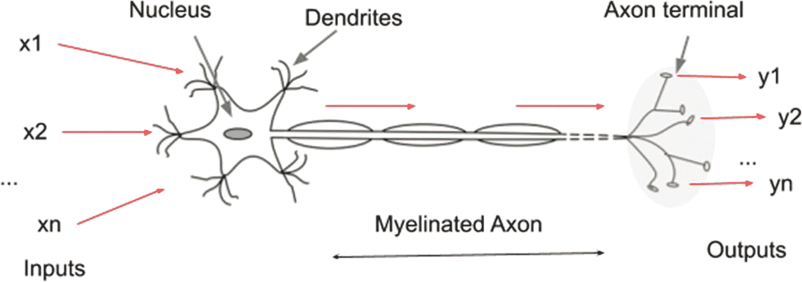

一个人体神经元的示意图。神经元一端包围着细胞核的树突接收输入 x1 到 xn。信息沿着中央的髓鞘轴突传递到另一端的轴突末梢，轴突末梢输出 y1 到 yn。

图 5-2

人体神经元中的信息处理

计算机科学家从（1956 年）第一个电磁人工“神经元”设计概念开始；十年后，他们首次受到人类视觉系统概念的启发，并试图通过创建一个像我们大脑一样学习和运行的计算机系统来模仿神经网络。这个学习系统如今被称为*人工神经网络* (ANN)。

图 5-3 展示了与图 5-1 类似的人工神经网络版本。相机作为一种传感设备，其工作原理类似于我们的眼睛捕捉物体图像。图像被传输到一个解释系统（例如计算机），在那里它们以类似于神经元处理输入信号的方式进行加工。其他传感设备的例子包括 X 光机、CT 扫描仪和 MRI 机器；卫星成像系统；以及文档扫描仪。解释设备（例如计算机）负责处理相机获取的数据。大多数与计算机视觉相关的计算，例如特征提取和模式确定，都在计算机内部执行。


一张包含三张照片的示意图，展示了人工感知。相机感知到一辆汽车，并将输入发送给计算机，计算机输出为“汽车”。

图 5-3

人工传感设备（相机）将图像输入馈送给计算机

图 5-4 与图 5-2 中显示的人体神经元类似。变量 x1, x2, .. xn 是输入信号（例如，图像特征），每个输入信号都关联着特定的权重 w1, w2, .. wn。这些输入信号通过一些数学函数进行处理以生成输出。整合这些输入信号的处理单元被称为*神经元*，其命名源于人体神经元。根据神经元计算输出的数学函数被称为*激活函数*。在图 5-4 中，标有函数符号 *f(x)* 的圆圈就是神经元。输出 y 由该神经元生成。

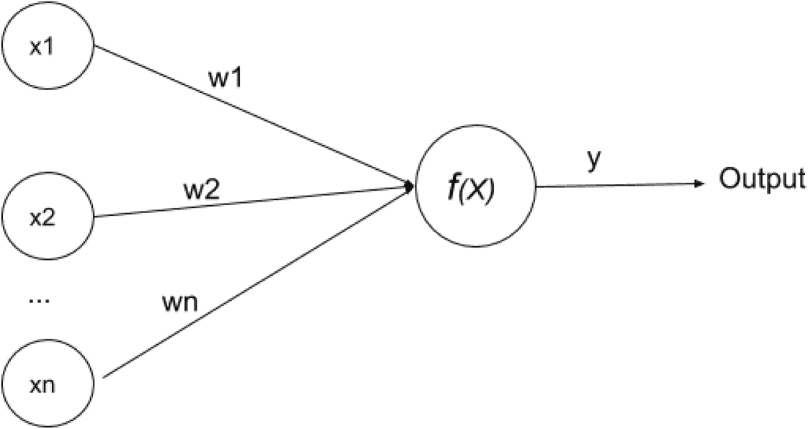

一个人工神经元的节点网络图。节点 x1 到 xn 将 w1 到 wn 发送给 f(x)，f(x) 进而给出 y 作为输出。

图 5-4

人工神经元

### 感知器

神经网络中的单个神经元被称为*感知器*。感知器实现一个数学函数，该函数对输入信号进行操作并生成输出。图 5-4 就是一个感知器的例子。感知器是最简单的神经网络。稍后我们将看到，一个典型的用于机器学习的神经网络由多个神经元组成。神经元的输入要么来自源（相机或传感设备），要么来自其他神经元的输出。

#### 感知器如何学习

感知器的学习目标是确定每个输入信号的最佳权重。学习算法会任意地为每个输入信号分配权重。信号值乘以其对应的权重。每个信号的乘积（权重乘以信号值）相加后计算出一个输出。该计算由以下方程表示：


(方程 5-1)

有时，一个偏置项 x[0] 也会被添加到方程中，如下所示：


(方程 5-2)

方程 5-2 也可以写成如下形式：

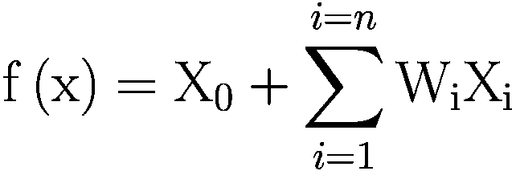

(方程 5-3)

神经元使用方程 5-2 对大量输入进行计算。一个优化函数通过使用特定的数学算法（称为*优化器*）来优化权重，然后使用新的权重重复计算。这种权重优化、计算和再优化的过程会进行多次迭代，直到权重针对给定的输入集达到完全优化。我们将在本章后面进一步探讨这个优化函数。完全优化的权重就是神经元实际学习到的内容。


### 多层感知机

正如人脑包含数十亿个神经元，人工神经网络也可能拥有数十亿甚至更多神经元的容量，但在大多数实际场景中，它们通常由数量少得多的神经元组成。输入由一组神经元处理。该组中的每个神经元独立处理输入。该组神经元的输出被馈送到另一个神经元或神经元组进行进一步处理。你可以将这些神经元想象成按层排列，其中一层的输出作为输入馈送到下一层。你可以根据需要设置任意数量的层来训练你的神经网络。这种在神经网络中排列神经元的多层方法通常被称为*多层感知机（**MLP**）*。图 5-5 展示了一个 MLP 示例。

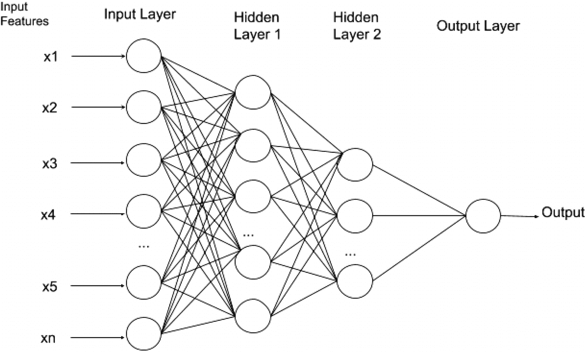

一个 MLP 的神经网络示意图。输入特征 x1 到 xn 被发送到输入层，该层与隐藏层 1 有互连节点，接着是节点数更少的隐藏层 2、具有单个节点的输出层，以及输出。

图 5-5
多层感知机

使用 MLP 相比单个感知机有什么优势？让我们考虑一个具有单个输入的单个神经元。公式 5-1 将如下所示：

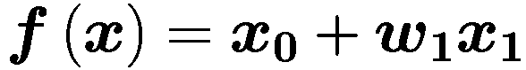

这表示一条直线的方程，截距为 x[0]，斜率为 w[1]。

如果你不理解这个数学公式，不必担心。这只是为了向你展示单个神经元模拟了输入与输出之间的线性关系。机器学习算法，如线性回归和逻辑回归，都是模拟线性关系。而大多数现实世界的问题并不呈现线性关系。多层感知机能够模拟非线性关系，并且比基于单个神经元的模型更准确地模拟现实世界的问题。

### 什么是深度学习？

*深度学习*是多层人工神经网络或多层感知机的另一个名称。根据神经网络架构及其工作原理，我们有不同类型的深度学习系统。例如，前馈神经网络、卷积网络、循环神经网络、自编码器和深度信念网络都是不同类型的深度学习系统。

接下来的部分将从解释多层感知机的高级架构开始。在本书中，我们将互换使用术语 MLP 和深度学习（DL）。

### 深度学习或多层感知机架构

如图 5-5 所示，多层感知机由三种基本层类型组成：输入层、一个或多个隐藏层以及输出层。每一层由一个或多个神经元组成，这些神经元处理接收到的输入并产生输出。除了输出层之外，神经元的输出随后作为输入被转发到后续层。输出层生成最终输出，可供各种应用程序使用。

MLP 架构包含以下部分：

*   **输入层**：这是神经网络的第一层。该层从外部来源接收输入，例如来自传感设备的图像。该层的输入是*特征*（有关特征的详细信息，请参见第 4 章）。

输入层中的节点不进行任何计算。这些节点只是将其输入传递到下一层。

输入层中的神经元数量与特征数量相同。有时，会在每一层中添加一个额外的节点。这个额外的节点被称为*偏置节点*。添加偏置节点是为了能够控制该层的输出。在深度学习中，偏置并非必需，但添加偏置是一种常见做法。

图 5-6 展示了一个带有偏置节点的神经网络架构。橙色显示的节点是每一层中添加的偏置节点。

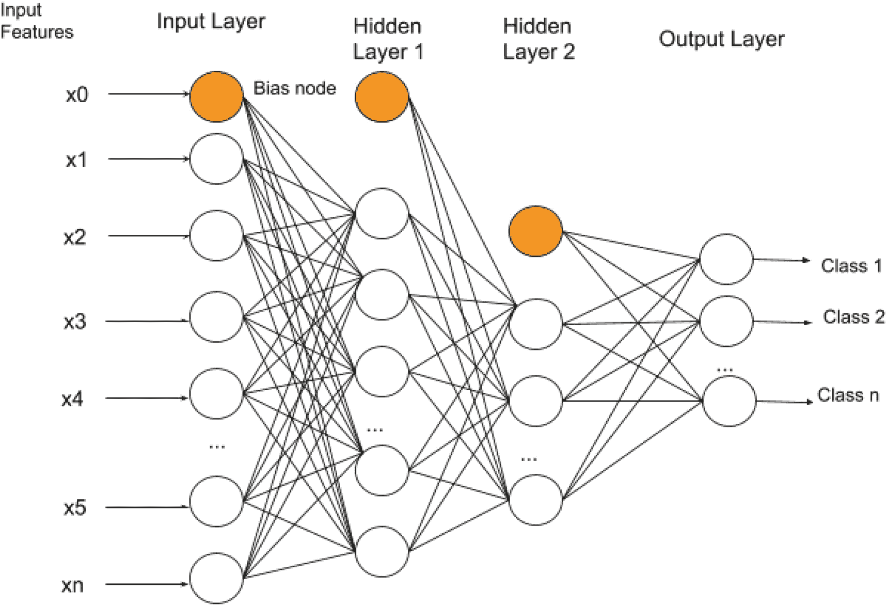

一个 MLP 的神经网络示意图。输入特征 x1 到 xn 被发送到输入层，接着是节点数更少的隐藏层 1 和 2、输出层，以及类别 1 到 n 的输出。输入层和两个隐藏层各有一个带阴影的偏置节点，该节点不连接到前一层。

图 5-6
带偏置节点的多层感知机

问题：神经网络输入层的神经元总数是多少？

答案：输入层神经元数量 = 无偏置时的输入特征数量 = （如果使用偏置，则为输入特征数量 + 1）。

*   **隐藏层**：隐藏层是神经网络中输入层和输出层之间的中间层。神经网络至少需要一个隐藏层来促进学习过程。这些层内的神经元执行学习所需的计算。虽然一个隐藏层通常足以满足学习目的，但可以增加隐藏层的数量以更好地模拟现实世界场景。随着隐藏层数量的增加，计算复杂度也随之增加，导致计算时间更长。

确定每个隐藏层的最佳神经元数量并非一门精确的科学，有多种实用的策略可用。一种常用的方法是将隐藏层中的神经元数量设置为前一层神经元数量的三分之二（约 66%）。例如，如果输入层有 100 个神经元，则第一个隐藏层将有大约 66 个神经元，后续隐藏层将遵循此模式（例如，下一个隐藏层有 43 个神经元）。然而，需要重申的是，没有普遍最优的神经元数量，应根据模型所需的准确性和性能来调整数量。

*   **输出层**：这是神经网络的最后一层。输出层从最后一个隐藏层获取其输入。输出层中的神经元数量取决于你想要神经网络解决的问题类型：
    *   **回归问题**：当网络需要预测一个连续值时，例如图像的像素强度，输出节点只有一个神经元。

*   **分类问题**：当网络需要预测多个类别中的一个时，输出层具有与所有可能类别数量相同的神经元。例如，如果网络被训练来预测四类动物——猫、狗、狮子、牛——中的一类，那么输出层将有四个神经元，每个类别一个。

*   **边或权重连接**：权重也被称为*系数*或*输入乘数*。输入到神经元的每个特征都乘以一个权重。在图形上，从输入到神经元的每个连接都与一条带权重的线相关联。带权重的线表示该特征在预测我们试图建模的结果中的贡献。将权重视为输入特征的贡献或重要性。权重越高，特征的贡献越大。如果权重为负，则该特征具有负面影响。如果权重为零，则输入特征不重要，可以从训练集中移除。

神经网络的训练目标是确定所有层中输入特征与神经元之间每个连接的最佳权重。在本章中，我们将深入探讨神经网络如何通过迭代调整这些权重来进行学习。需要注意的是，如果网络中加入偏置，学习过程还涉及同时确定最佳权重和最佳偏置值。


### 激活函数

决定神经元输出的数学函数被称为*激活函数*。

神经元通过以下线性方程对输入进行操作：

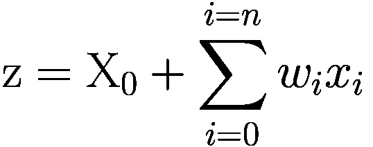

（公式 5-4）

但神经元的输出并非公式 5-4 的结果。激活函数作用于 z 的值（由公式 5-4 计算得出），并决定神经元的输出。

激活函数根据神经元的输入是否与模型预测相关，来决定其所连接的神经元是否应被激活（开启）。激活函数将每个神经元的输出归一化到 0 到 1 或 -1 到 1 的范围内。

根据具体用途，有多种数学函数可用作激活函数。在接下来的章节中，我们将探讨 TensorFlow 支持的一些激活函数，我们将在本章后面深入介绍这个框架。

#### 线性激活函数

*线性激活函数*根据公式 f(x) = x[0] + w[1]x[1] + w[2]x[2] + w[3]x[3] + ... + w[n]x[n]，通过将权重乘以输入来计算神经元输出。线性激活函数的输出范围从 -∞ 到 +∞，如图 5-7 所示。这意味着线性激活函数相当于没有激活函数。

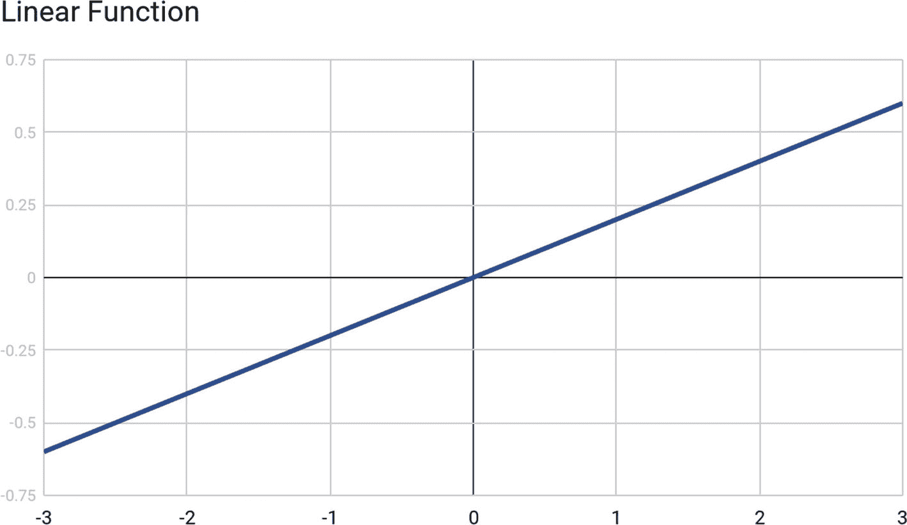

线性激活函数的折线图绘制了一条大致在 (-3, -0.6) 和 (3, 0.6) 之间线性递增的直线。该直线穿过原点。

图 5-7

线性激活函数图

线性激活函数存在以下两个主要问题，因此不用于深度学习：

*   深度学习使用一种称为*反向传播*的方法（稍后会详细介绍），该方法使用一种称为*梯度下降*的技术。梯度下降需要计算输入的一阶导数，而对于线性激活函数，这个导数是常数。常数的导数为零。这意味着它与输入没有关系。因此，无法返回并更新输入的权重。

*   如果使用线性激活函数，无论神经网络有多少层，最后一层都将是第一层的线性函数。换句话说，线性激活函数会将你的网络变成单层网络。这意味着你的网络只能学习输入到输出的线性依赖关系，这不适用于解决计算机视觉等复杂问题。

#### Sigmoid 或 Logistic 激活函数

*Sigmoid 激活函数*，也称为 logistic 激活函数，使用 sigmoid 函数计算神经元输出，如下所示，其中 z 使用公式 5-4 计算：

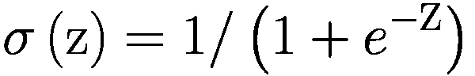

（公式 5-5）

Sigmoid 激活函数总是产生一个介于 0 和 1 之间的值。这使得输出平滑，不会随着输入值的波动而产生许多跳跃。另一个优点是这是一个非线性函数，并且不会从一阶导数中产生常数值。这使得它适用于使用基于梯度下降更新权重的反向传播的深度学习。参见图 5-8。

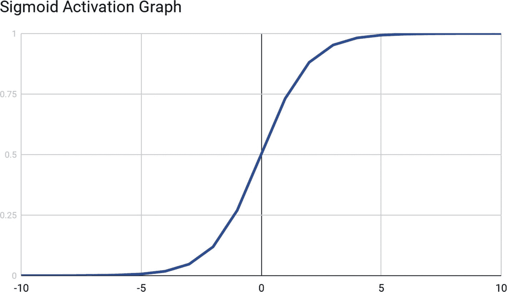

Sigmoid 激活函数的折线图绘制了一条大致在 (-10, 0) 和 (10, 1) 之间递增的 S 形曲线。该曲线在图表中心穿过点 (0, 0.5)。

图 5-8

Sigmoid 激活函数图

Sigmoid 激活函数最大的缺点是，对于很大或很小的输入值，其输出变化不大，这使得它不适用于特征向量包含大值或小值的情况。克服这个缺点的一种方法是将特征向量归一化到 -1 到 1 或 0 到 1 之间。

从图 5-8 中你会注意到的另一个特征是，S 形曲线不以零为中心。

#### 双曲正切函数 (TanH)

TanH 与 Sigmoid 激活函数类似，不同之处在于 TanH 是零中心的。参见图 5-9，注意 S 形曲线穿过原点。

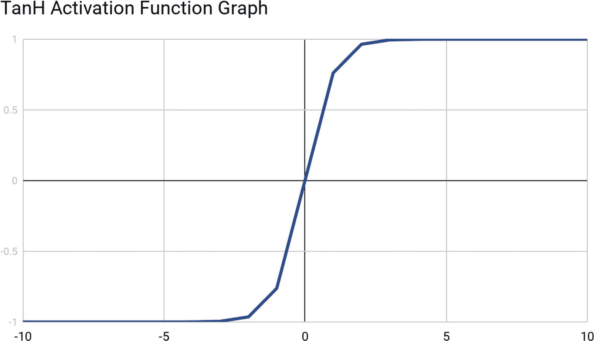

TanH 激活函数的折线图绘制了一条带有平坦曲线的 S 形曲线，大致在 (-10, 0) 和 (10, 1) 之间递增。该曲线在图表中心穿过原点。

图 5-9

TanH 激活函数图（零中心）

TanH 激活函数使用以下公式计算神经元输出：

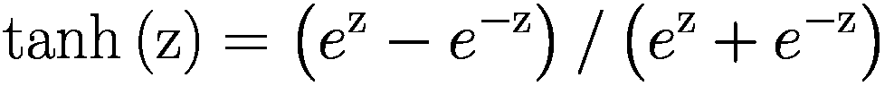

（公式 5-6）

由于 TanH 函数是零中心的，它可以对具有小值、大值和中性值的输入进行建模。

#### 修正线性单元

*修正线性单元 (ReLU)* 根据公式 5-4 计算出的 z 值来决定神经元输出。如果 z 的值为正，ReLU 将该值作为输出；否则，输出为零。ReLU 的输出范围在 0 到 +∞ 之间。ReLU 函数表示如下（另见图 5-10）：

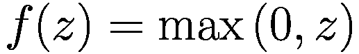

（公式 5-7）

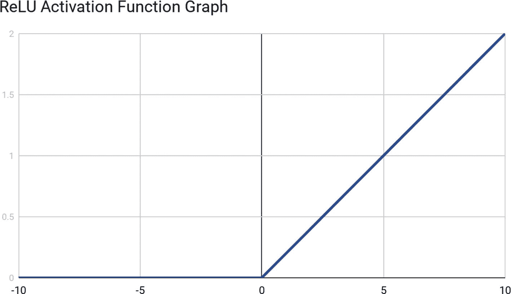

ReLU 激活函数的折线图绘制了一条在 x 轴上从 (-10, 0) 到 (0, 0) 保持恒定的直线，然后线性递增，大致在 (10, 1) 处结束。

图 5-10

ReLU 激活图（值范围在 0 到无穷大之间）

ReLU 激活函数的优点是计算效率高，并且允许网络快速收敛。此外，ReLU 是非线性的，并且具有导数函数，这使得它适用于神经网络学习过程中进行权重调整的反向传播。

ReLU 函数最大的缺点是，对于零或负输入，函数的梯度变为零。这使得当输入包含负值时，它不适用于反向传播。

ReLU 广泛用于大多数计算机视觉模型训练，因为图像像素没有负值。

#### 带泄露的 ReLU

*带泄露的 ReLU* 是 ReLU 的一个微小变体。它不是将 z 的负值（由公式 5-3 计算得出）设为零，而是将 z 的负值乘以一个很小的数，例如 0.01。图 5-11 描绘了带泄露的 ReLU 的输出。

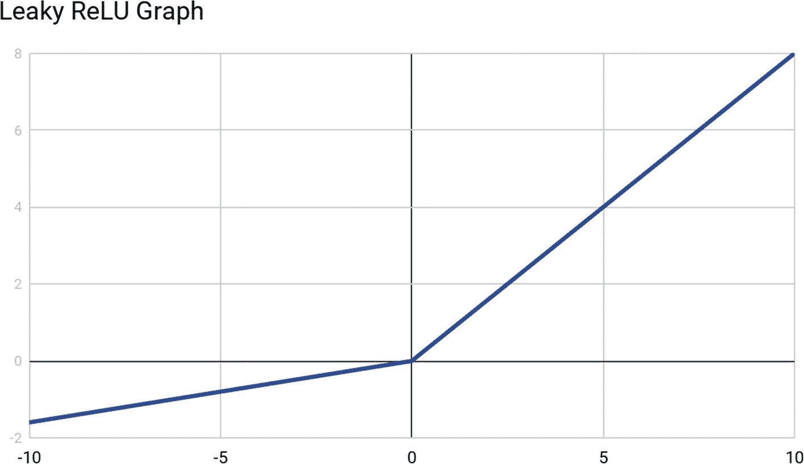

带泄露的 ReLU 的折线图绘制了一条大致在 (-10, -1.5) 和 (0, 0) 之间线性递增的直线，然后以线性趋势急剧上升，大致在 (10, 8) 处结束。

图 5-11

带泄露的 ReLU 图（通过将负值乘以一个小数来修正 ReLU）

带泄露的 ReLU 在负值区域有一个小斜率，允许对负输入进行反向传播。

其缺点是带泄露的 ReLU 对于负值的结果不一致。


#### 缩放指数线性单元

*缩放指数线性单元（SELU）* 通过以下方程计算神经元输出：

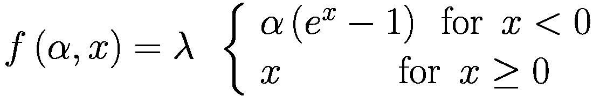

（公式 5-8）

其中 Lambda 的值为 1.05070098，𝞪 的值为 1.67326324。这些值是固定的，在反向传播过程中不会改变。

图 5-12 中的图表展示了 SELU 的特性。

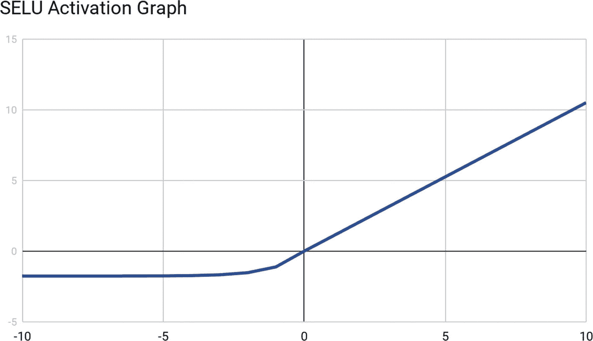

SELU 激活函数的折线图：线条在 (-10, -2) 和 (-5, -2) 之间保持恒定，然后向上弯曲，经过原点，并线性增加，最终大约在 (10, 11) 处结束。

图 5-12

SELU 激活函数图

SELU 具有“自归一化”特性（请参考 SELU 的原始论文 [`https://arxiv.org/pdf/1706.02515.pdf`](https://arxiv.org/pdf/1706.02515.pdf)）。SELU 的发明者通过数学证明，SELU 生成的输出是归一化的，均值为 0，标准差为 1。

在 TensorFlow 或 Keras 中，如果你使用以零为中心的截断正态分布作为权重初始化方法，即使用 `tf.keras.initializers.lecun_normal`*，你将获得网络各层所有组件（如权重、偏置和激活）的归一化输出。

那么，为什么我们要关心网络生成归一化输出呢？初始化函数 `lecun_normal` 将网络参数初始化为正态分布或高斯分布。SELU 也会生成归一化输出。这意味着整个网络表现出归一化的行为。因此，最后一层的输出也是归一化的。

使用 SELU，学习过程高度稳健，并且能够训练具有许多层的网络。

由于使用 SELU 时整个网络是自归一化的，因此在计算方面效率很高，并且往往收敛更快。另一个优点是，当输入特征过高或过低时，它能够克服梯度爆炸或梯度消失的问题。

#### Softplus 激活函数

*softplus 激活函数* 对激活函数值 z（按公式 5-4 计算）进行平滑处理。它使用指数对数，如下所示：

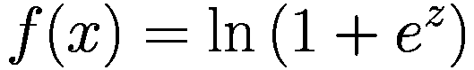

（公式 5-9）

Softplus 也被称为 *SmoothReLU 函数*。softplus 函数的一阶导数是 1/(1+e^(-z))，这与 sigmoid 激活函数相同。参见图 5-13。

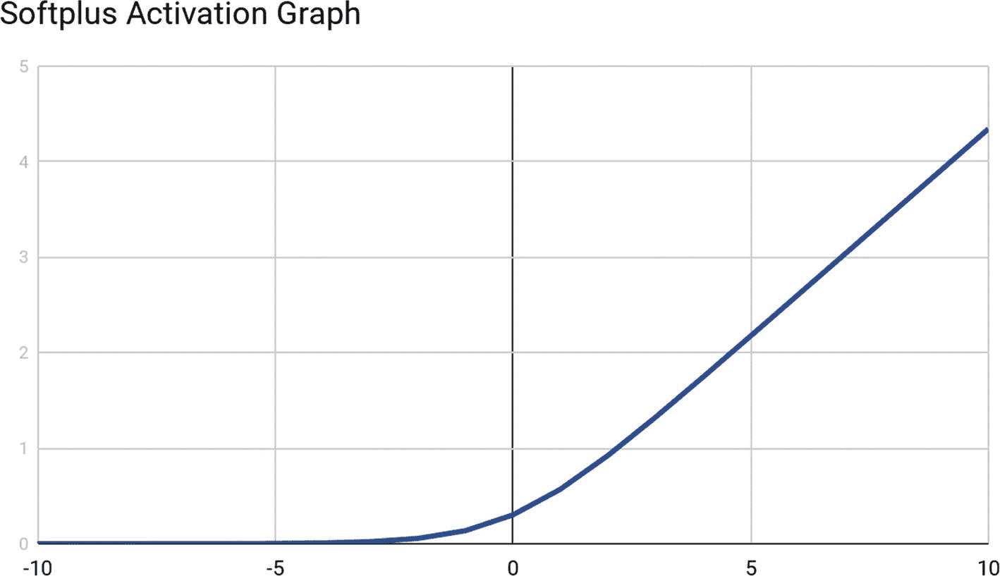

Softplus 激活函数的折线图：线条在 (-10, 0) 和 (-7, 0) 之间沿 x 轴保持恒定，然后向上弯曲，经过 (0, 0.25)，并线性增加，最终大约在 (10, 4.4) 处结束。

图 5-13

Softplus 激活函数图

#### Softmax

*Softmax* 是一个函数，它接收一个实数输入向量，将其归一化为概率分布，并生成范围在 (0,1) 内的输出，且输出值之和等于 1。

Softmax 最常用作分类神经网络最后一层（输出层）的激活函数。其结果被解释为每个类别的预测概率。

Softmax 变换通过以下公式计算：

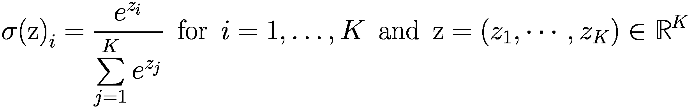

（公式 5-10）

上述公式的归一化输出始终介于 0 和 1 之间。当你将这些输出相加时，结果将为 1。

### 前馈

*前馈神经网络* 是一种人工神经网络，其中信息仅沿一个方向流动：从输入层向前，经过隐藏层，到达输出层。它是用于各种机器学习任务的最简单、最常见的神经网络类型之一。在这种网络中，没有回路或反馈机制。换句话说，神经元之间的连接不会形成任何循环连接。

前面图 5-2 和 5-3 中展示的示例网络就是前馈人工神经网络。

在本书中，我们的主要重点将是利用前馈网络。

### 误差函数

什么是误差？在机器学习语境中，*误差* 是预期结果与预测结果之间的差异。误差方程可以简写为如下形式：

*   误差 = 预期结果 – 预测结果

如前所述，神经网络的学习目标是计算权重的优化值。当误差最小时（理想情况下为零），对于给定的数据集，权重被认为是优化的。我们已经看到，当网络开始学习过程时，它会初始化权重，并使用其中一个激活函数计算每个神经元的输出。然后，它计算误差，调整权重，计算输出，并重新计算误差，将其与先前计算的误差进行比较，直到找到最小误差。产生最小误差的权重被作为最终权重。此时，网络被认为是“已学习”的。

根据微积分，如果函数的一阶导数为零，则该点处的函数要么是最小值，要么是最大值。找到这个一阶导数为零的最小值点是神经网络训练过程的目标。因此，神经网络必须有一个误差函数，该函数将计算一阶导数并找到误差函数最小的点（权重和偏置）。这个误差函数应该是什么，取决于我们想要训练的模型类型。误差函数也称为 *损失函数*，或简称为 *损失*。

计算导数并找到权重最优值的数学方法超出了本书的范围。我们将探讨一些常用的误差函数及其适用场景。为了保持本书专注于我们的学习目标——构建计算机视觉应用，我们不会深入探讨这些误差函数背后的数学原理。如果你没有任何微积分基础，也不必担心。只需确保你理解在解决计算机视觉问题时应该使用哪些误差函数即可。

误差函数大致分为以下三类：

*   *回归损失函数*：用于训练模型预测连续值结果，例如股票价格和房价。

*   *二分类损失函数*：用于训练模型预测最多两个类别，例如猫与狗，或癌症与非癌症。

*   *多分类损失函数*：当我们的模型需要预测两个以上类别时使用，例如目标检测。

以下各节概述了这三类误差函数、它们的用法以及它们兼容的激活函数类型。请将此信息作为指南，为你的特定建模工作确定合适的误差函数。


#### 回归损失函数

*误差函数名称*：均方误差（MSE）损失

*   *简要描述*：这是回归问题的默认误差函数。如果目标变量的分布是正态分布或高斯分布，这是首选的损失函数。

*   *适用场景*：当目标变量呈正态分布时。

*   *适用的激活函数*：`model.add(Dense(1, activation="linear"))`

*   *TensorFlow 示例*：`model.compile(loss='mean_squared_error')` 或 `model.compile(loss='mse')`

*误差函数名称*：均方对数误差（MSLE）损失

*   *简要描述*：该函数首先计算预测值的对数，然后计算均方误差。

*   *适用场景*：当目标变量具有分散的值或需要预测较大值时。在这两种情况下，你可能不希望像均方误差那样严厉地惩罚模型。这通常用于模型预测未缩放值的情况。

*   *适用的激活函数*：`model.add(Dense(1, activation="linear"))`

*   *TensorFlow 示例*：`model.compile(loss='mean_squared_logarithmic_error')`

*误差函数名称*：平均绝对误差损失

*   *简要描述*：计算为期望值与预测值之间绝对差值的平均值。

*   *适用场景*：当目标变量呈正态分布但存在一些异常值时。

*   *适用的激活函数*：`model.add(Dense(1, activation="linear"))`

*   *TensorFlow 示例*：`model.compile(loss='mean_absolute_error')`

#### 二分类损失函数

*误差函数名称*：二元交叉熵

*   *简要描述*：这是二分类问题的默认损失函数，优于其他函数。交叉熵计算一个分数，该分数总结了预测类别 1 时实际概率分布与预测概率分布之间的平均差异。该分数被最小化，完美的交叉熵值设为 0。

*   *适用场景*：当目标值在 (0, 1) 范围内时。

*   *适用的激活函数*：`model.add(Dense(1, activation="sigmoid"))`

*   *TensorFlow 示例*：`model.compile(loss='binary_crossentropy', metrics=['accuracy'])`

*误差函数名称*：合页损失

*   *简要描述*：该函数主要用于支持基于向量机的二分类。

*   *适用场景*：当目标变量在 (-1, 1) 范围内时。

*   *适用的激活函数*：`model.add(Dense(1, activation="tanh"))`

*   *TensorFlow 示例*：`model.compile(loss='hinge', metrics=['accuracy'])`

*误差函数名称*：平方合页损失

*   *简要描述*：该函数计算合页损失分数的平方。它平滑了误差函数的表面，使其在数值上更易于处理。

*   *适用场景*：当目标变量在 (-1, 1) 范围内时。

*   *适用的激活函数*：`model.add(Dense(1, activation="tanh"))`

*   *TensorFlow 示例*：`model.compile(loss='squared_hinge', metrics=['accuracy'])`

#### 多分类损失函数

*误差函数名称*：多分类交叉熵损失

*   *简要描述*：这是多分类问题的默认损失函数，优于其他函数。交叉熵计算一个分数，该分数总结了预测类别 1 时实际概率分布与预测概率分布之间的平均差异。该分数被最小化，完美的交叉熵值设为 0。

*   *适用场景*：当目标值在集合 {0, 1, 3, 4,..., n} 中时，其中每个类别被分配一个唯一的整数值。

*   *适用的激活函数*：`model.add(Dense(4, activation="softmax"))`

*   *TensorFlow 示例*：`model.compile(loss='categorical_crossentropy', metrics=['accuracy'])`

*误差函数名称*：稀疏多分类交叉熵损失

*   *简要描述*：该函数执行相同的交叉熵误差计算，但不需要在训练前对目标变量进行独热编码。

*   *适用场景*：当目标变量包含大量类别时；例如，预测字典中的单词。

*   *适用的激活函数*：`model.add(Dense(100, activation="softmax"))`

*   *TensorFlow 示例*：`model.compile(loss='sparse_categorical_crossentropy', metrics=['accuracy'])`

*误差函数名称*：KL 散度（KLD）损失

*   *简要描述*：该函数衡量一个概率分布与基线分布的差异程度。KLD 损失为 0 表示分布相同。它确定了如果使用预测概率分布来近似期望的目标概率分布时所损失的信息量（以比特为单位）。

*   *适用场景*：当需要解决复杂问题，例如用于学习密集特征的自编码器时。如果将其用于多分类，其作用等同于多分类交叉熵。

*   *适用的激活函数*：`model.add(Dense(100, activation="softmax"))`

*   *TensorFlow 示例*：`model.compile(loss='kullback_leibler_divergence', metrics=['accuracy'])`

### 优化算法

神经网络的学习目标是确定损失最小时的优化权重（和偏置）。当网络开始学习时，它会为每个输入连接分配权重。最初，这些权重很少是最优的。权重偏离最优的程度通过测量损失（或误差）来确定。为了确定理想权重，学习算法会优化损失函数，以找到使损失函数值最小的权重。权重（和偏置）被更新，这个过程会重复进行，直到没有进一步优化的空间。优化损失函数的数学函数被称为*优化算法*或*优化器*。

有几种优化算法提供不同程度的精度、速度和并行性。在本节中，我们将探讨一些最流行的优化器。我将提供入门级别的信息，而不深入探讨这些算法中使用的数学原理，以便让你对在何处使用哪种优化算法有一个基本的了解。


#### 梯度下降

*梯度下降*是一种优化算法，用于寻找使损失函数（也称为*代价函数*）为零或最小值的权重。梯度下降是一种寻找最小代价函数的技术。本节将介绍其工作原理。

代价函数或误差函数由以下方程表示：

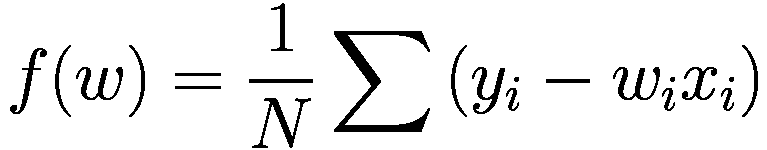

（方程 5-11）

其中，*y*[*i*] 是实际/已知值，*w*[*i*] 是对应于第 *i* 个样本特征向量 *x*[*i*] 的权重。*w*[*i*] *x*[*i*] 是预测值，从实际值 *y*[*i*] 中减去该值以计算误差或损失。

根据微积分知识，函数在某一点的一阶导数给出了该函数在该点的斜率或梯度。如果绘制代价函数 f(w) 的图形，您会看到一条多维曲线（如图 5-14 所示）。计算导数是为了获得梯度，从而确定沿曲线移动的方向，以得到新的权重集。由于目标是使代价最小化，算法会向负梯度的方向移动。

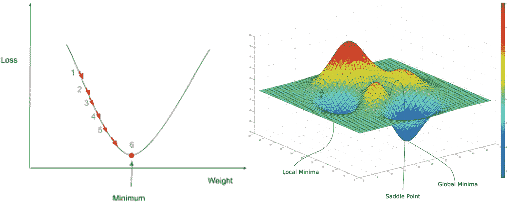

两张图。左图：损失与权重的折线图。一条开口向上的抛物线，在下降臂上有 1 到 5 个点，最小值处为点 6。右图：三维曲面图。梯度平面有一个向下开口的抛物面，以及一个用于全局最小值的向上开口的抛物面，其间有一个鞍点和局部最大值。

图 5-14

 代价函数及其向最小值移动的梯度

例如，假设只有一个特征，因此我们只需要计算一个权重 (w)。代价函数将如图 5-14 中的左图所示。

1.  算法首先计算初始权重的代价或损失，假设此损失为 f(w)，并且假设损失是在图 5-14（左图）中的点 1 处计算的。
    1.  然后，算法计算梯度（delta）并沿曲线向下移动；移动方向由负梯度决定。

    2.  在下移过程中，算法使用以下公式计算新的权重：


（方程 5-12）

这里，alpha 被称为*学习率*。学习率决定了梯度沿曲线下降以到达最小点的步长大小。

1.  使用新的权重值再次计算误差，并重复此过程，直到算法找到最终的全局最小代价。

##### 局部最小值与全局最小值

为简化起见，在前面的例子中，我们只考虑了一个特征，因此只有一个权重。但在实践中，可能有数十甚至数百个特征需要学习其权重。图 5-14 右侧的图像显示了当需要优化多个权重时的误差曲线。在这种情况下，曲线可能有多个看似最小值的点，称为*局部最小值*。梯度下降算法的目标是找到全局最小值以优化权重。

##### 学习率

在方程 5-12 中，参数 alpha 被称为*学习率*，它在梯度下降算法中起着至关重要的作用。学习率决定了算法沿曲线搜索全局最小值时所采取的步长大小。

为学习率选择合适的值非常重要。如果学习率设置得过大，可能导致算法越过最小值点，从而产生振荡并无法收敛。相反，选择较小的学习率则需要大量步数才能到达最小值点，导致收敛速度缓慢。

值得注意的是，较小的学习率会显著减慢学习过程。图 5-15 直观地展示了较大和较小学习率的影响。

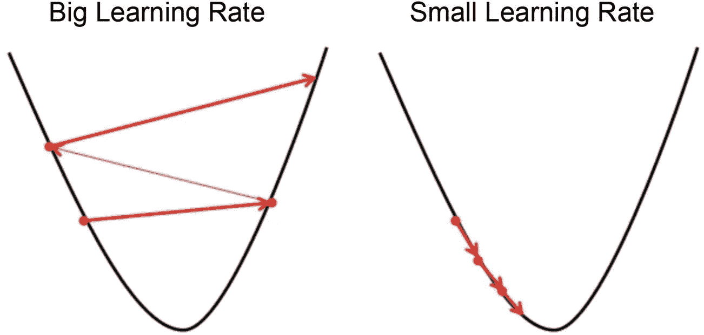

两张关于学习率影响的示意图。大学习率：锯齿状箭头连接开口向上抛物线两臂上的点。小学习率：箭头连接开口向上抛物线下降臂上的点。

图 5-15

大学习率与小学习率的影响

为了确保有效学习，合理设置学习率至关重要。通常，学习率的实用范围在 0.01 到 0.1 之间。常见的做法是从此范围内的学习率开始，然后根据具体问题进行调整。

##### 自适应学习率

除了在实用范围内手动设置学习率之外，另一种可考虑的方法是使用*自适应学习率*。自适应学习率算法会根据优化算法的行为，在训练过程中动态调整学习率。

一种流行的自适应学习率算法称为*自适应梯度（AdaGrad）*。AdaGrad 根据每个参数的历史梯度，单独调整其学习率。它为历史梯度较小的参数提供较大的更新，而为历史梯度较大的参数提供较小的更新。这种自适应调整有助于减轻手动调整学习率的需求。

另一种广泛使用的自适应学习率算法是*自适应矩估计（Adam）*。Adam 将自适应学习率与动量相结合，以实现更快的收敛。它为每个参数计算自适应学习率，并维护过去梯度和平方梯度的指数衰减平均值。这有助于根据梯度的大小自适应地缩放学习率。

通过使用像 AdaGrad 或 Adam 这样的自适应学习率算法，学习率会在训练过程中自动调整，从而可能在不需手动微调的情况下，实现更好的收敛性和性能。


##### 正则化

*正则化*是一种用于机器学习和统计建模的技术，旨在防止过拟合并提升模型的泛化能力。*过拟合*发生在模型变得过于复杂，开始记忆训练数据，从而导致对未见数据表现不佳时。

正则化的基本思想是在训练过程中对模型的权重引入额外的约束或惩罚。这些约束鼓励模型学习更简单的模式，避免数据中过于复杂或微妙的关系。

以下是一些常用的不同类型正则化技术：

*   *L1 正则化（LASSO）*：L1 正则化在损失函数中添加一个惩罚项，该惩罚项与模型权重的绝对值成正比。这种惩罚鼓励稀疏性，意味着它会使某些权重精确变为零，从而有效地进行特征选择并降低模型复杂度。

*   *L2 正则化（Ridge）*：L2 正则化在损失函数中添加一个惩罚项，该惩罚项与模型权重的平方大小成正比。这种惩罚鼓励权重变小，但不会像 L1 正则化那样激进地将其推向零。L2 正则化也称为*岭回归*，有助于减少线性模型中多重共线性的影响。

*   *弹性网络正则化*：弹性网络正则化结合了 L1 和 L2 正则化。它在损失函数中添加一个惩罚项，该惩罚项是权重绝对值和平方大小的组合。L1 和 L2 惩罚的结合在特征选择（稀疏性）和权重收缩之间提供了平衡。

*   *Dropout*：Dropout 是一种常用于神经网络的正则化技术。在训练过程中，Dropout 会以预定义的概率随机将层中的一部分单元（神经元）设置为零。这个过程有助于防止神经元的共适应，并鼓励网络学习更鲁棒的表示。Dropout 仅在训练期间应用，在推理期间，所有单元都会被使用，但它们的激活值会按 Dropout 概率进行缩放。

正则化技术通过在训练过程中添加约束或惩罚，有助于控制模型的复杂度并减少过拟合。通过鼓励更简单、更泛化的模型，正则化可以提升模型在未见数据上的性能，并增强机器学习模型的整体可靠性。

#### 随机梯度下降

梯度下降在每一步和每次迭代中计算所有训练样本的梯度。这个过程计算量巨大且耗时，尤其是在处理大型数据集时。此外，如果数据无法放入内存（RAM），则可能无法在单台机器上运行该算法，也无法进行并行计算。*随机梯度下降（SGD）* 解决了这些挑战。

SGD 基于训练集中易于放入内存的一小部分子集来计算梯度。以下是 SGD 工作原理的概述：

1.  随机化输入数据集，以消除偏差并确保梯度估计的随机性。

2.  使用随机选择的单个数据点或一小批数据计算梯度。

3.  使用公式 *权重* = *权重* – *学习率* * *梯度* 更新权重，其中 *学习率* 代表学习率。

在 SGD 中，通常一次计算少量训练样本（而非单个样本）的权重更新。这有助于减少权重方差，并导致更稳定的收敛。小批量大小设为 128 或 256 通常是一个不错的起点。然而，最佳批量大小可能因应用、架构和计算机的硬件能力而异。

通过使用 SGD，计算和内存需求显著降低，使得在大型数据集上训练模型变得更加可行。使用更小的子集也引入了随机性，可以帮助算法避免局部最小值，并探索优化空间的不同区域。

##### 用于分布式和并行计算的 SGD

当处理大型训练数据集时，可以将随机化后的集合划分为更小的迷你批次，并分发到集群架构中的多台计算机上。通过使用 SGD，每台计算机可以基于其分配的数据迷你批次独立并行地计算权重。然后，可以将各台计算机的结果在中央计算机上进行合并，以获得最终优化的权重。

此外，SGD 还可以利用单台计算机内多个 CPU 或 GPU 的并行处理能力。这允许同时计算权重，进一步加快了收敛速度。

通过利用分布式和并行操作，使用 SGD 算法计算优化权重，可以加速收敛过程。这种方法对于处理大型数据集以及利用多台机器的计算能力或单台机器内的并行处理能力特别有用。

##### 带动量的 SGD

如果你的代价函数呈现出具有陡峭壁面和狭窄底部的峡谷状曲线，建议采用*带动量的 SGD*。这些峡谷在局部最小值附近尤为明显。在这种情况下，标准 SGD 可能会在最小值附近振荡，难以达到目标。它通常会经历延迟收敛，尤其是在多次迭代之后。有关可视化表示，请参考图 5-16。

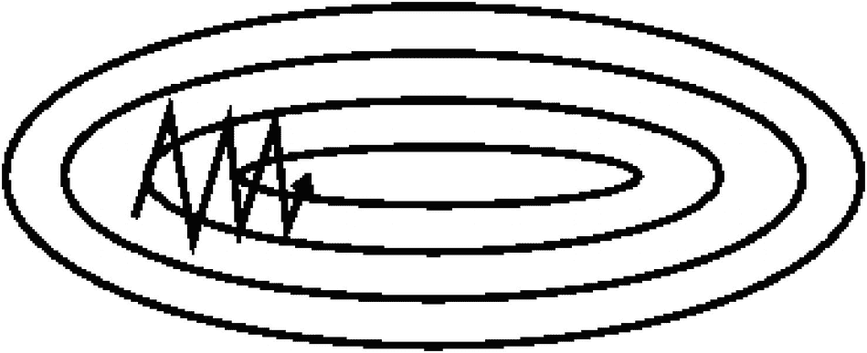

带动量的 SGD 示意图。四个同心椭圆左侧有一个重叠的锯齿形箭头。

图 5-16

无动量的 SGD

动量是一种通过控制梯度移动来控制振荡的方法。动量更新由以下方程给出：

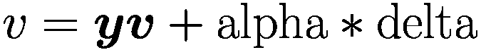

（方程 5-13）

其中，delta 是使用 SGD 计算的梯度，alpha 是学习率。𝒗 是与参数（或权重）维度相同的速度向量。𝞬 的值在 (0, 1) 范围内，通常默认取 0.9。

最后，使用以下方程更新权重：

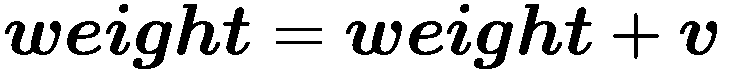

带动量的 SGD 是一种强大的优化技术，可以加速收敛、帮助逃离局部最小值、提供更平滑的优化轨迹，并提升泛化性能。它在具有峡谷状代价函数和复杂优化景观的场景中特别有用。


#### 自适应梯度（AdaGrad）算法

正如“自适应学习率”一节所述，梯度下降法和随机梯度下降法都需要手动设置和微调学习率。学习率过高，算法可能会越过最小值点；学习率过低，则会导致收敛速度缓慢。寻找理想的学习率通常需要手动试错，在处理多维神经网络时，这一过程变得尤为困难。面对成百上千个维度，手动选择合适的学习率几乎是不可能的。

为了解决这个问题，AdaGrad 提供了一种解决方案，它能够根据历史信息自动为每个参数确定合适的学习率。它为不常出现的特征分配较大的学习率，而为更频繁出现的特征分配较小的学习率。因此，每个参数都拥有自己的学习率，从而提升了处理涉及稀疏梯度问题的性能。AdaGrad 在处理稀疏数据（例如计算机视觉或自然语言处理中的数据）时非常高效。

然而，AdaGrad 的一个显著缺点是，其自适应学习率会随着时间的推移而显著下降。

#### 均方根传播（RMSProp）

如前所述，带动量的随机梯度下降法引入了一种机制来调节梯度沿陡峭曲线的移动。RMSProp 通过专门处理垂直方向上的梯度移动，改进了带动量的随机梯度下降法。设想你遇到一个陡峭的曲线。即使是很小的水平移动，也可能导致显著的垂直位移。RMSProp 通过控制垂直移动来解决这个问题，确保垂直和水平方向上的整体移动更加平衡。因此，这种平衡的移动加速了到达最小值点的过程。

#### 自适应矩估计（Adam）

Adam 优化算法同样在“自适应学习率”一节中介绍过，它广泛应用于深度学习，是优化器中的热门选择。它结合了带动量的随机梯度下降法和 RMSProp 的优点。Adam 根据训练数据对神经网络进行迭代的权重更新。

与 RMSProp 基于平均一阶矩（均值）来调整参数的学习率不同，Adam 利用了梯度的二阶矩的平均值。通过利用这些二阶矩，Adam 在更新网络权重方面提供了更优的性能。

Adam 背后的数学原理超出了本书的范围（再次强调，为了专注于本书的核心主题）。关于梯度如何计算和更新的更详细信息，请参阅原始论文 [`https://arxiv.org/pdf/1412.6980.pdf`](https://arxiv.org/pdf/1412.6980.pdf)。

该论文描述了 Adam 的以下优点：

*   实现简单
*   计算效率高
*   内存需求小
*   对梯度的对角缩放具有不变性
*   非常适合数据量和/或参数量大的问题
*   适用于非平稳目标
*   适用于带有噪声或稀疏梯度的问题
*   超参数具有直观的解释，通常只需少量调整

总之，Adam 易于实现、计算效率高且内存占用少。它能够灵活处理各种类型的问题，包括那些具有非平稳目标或噪声/稀疏梯度的问题。Adam 中使用的超参数直观易懂，通常只需少量微调。

### 反向传播

要训练一个神经网络，需要三个基本组件：

*   输入数据或输入特征
*   一个前馈多层神经网络
*   一个误差函数

为了启动训练过程，网络会为每个输入特征分配初始权重。使用诸如 SGD 或 Adam 之类的优化算法来优化误差函数并计算最小误差。这个优化过程涉及权重的更新。

正如本章前面所讨论的，多层感知器至少包含三层：输入层、一个或多个隐藏层以及输出层。前馈网络以前向方式计算每个神经元的输出，从第一个隐藏层开始，然后到后续的隐藏层，最后到达输出层。

下一步是估计误差，这进而导致权重的更新。这里采用了反向传播方法，首先在最后一层计算权重的梯度，然后计算前面各层的梯度。这种误差信息的反向流动有助于在每个层高效地计算梯度。换句话说，梯度计算并不是为每一层独立进行的。

为什么先计算最后一层的误差？原因很简单：隐藏层没有目标变量。是输出层映射到标记数据集中存在的目标变量。因此，首先在最后一层计算误差是合乎逻辑的。

本节（人工神经网络简介）概述了神经网络的工作原理及其所涉及的底层算法。它还强调了各种可调参数，例如学习率和动量，这些参数可用于微调训练过程。这些可调整的参数被称为*超参数*，将在本章后面深入介绍。

在接下来的章节中，我们将编写代码来实现本章到目前为止所涵盖的神经网络概念。我们将使用 Python 以及 TensorFlow 来运行这些示例。我们将从 TensorFlow 的高级介绍开始，重点介绍与计算机视觉相关的特性和函数，然后讨论神经网络概念的具体实现。

## TensorFlow 简介

TensorFlow 是一个全面的机器学习平台，它是开源的，并支持端到端的模型开发。它提供了一个用户友好且直观的 API 来创建机器学习模型。TensorFlow 是 Keras 的执行引擎，Keras 是一个基于 Python 的高级神经网络 API。

在本书的第二版中，我们利用了 TensorFlow 的高级功能，特别关注用于目标检测任务的更新函数。这些新功能的引入增强了本书对目标检测的覆盖范围，使您能够使用 TensorFlow 的强大工具探索该领域的最新发展。

### TensorFlow 安装

如果您按照第 1 章中的 TensorFlow 安装说明进行操作，那么您的工作环境中应该已经安装了 TensorFlow 和 Keras。如果您跳过了这些说明，请立即参考第 1 章并按照 TensorFlow 的安装说明进行操作。

### 如何使用 TensorFlow

要在代码中使用 TensorFlow，您必须按如下方式导入它：

```
import tensorflow as tf
```

您可以通过以下方式访问 Keras API：

```
tf.keras
```

### TensorFlow 术语

在深入研究实现神经网络的复杂性之前，您应该熟悉这里介绍的关键 TensorFlow 术语。


#### 张量

*张量*是一种数据结构，包含基础数据类型的 *n* 维数组。

*   如果 *n* 的值为 0，则称为*标量*，其秩为 0 或 0 维。
*   如果 *n* 的值为 1，则称为*向量*，其秩为 1 或 1 维。
*   如果 *n* 的值为 2，则称为*矩阵*，其秩为 2 或 2 维。
*   如果 *n* 的值为 3 或更大，则称为*张量*。根据 *n* 的值，其秩为 3 或更高。

因此，张量是向量和矩阵向更高维度的扩展。标量、向量、矩阵和张量之间的区别在表 5-1 中进行了概述，以供参考。

表 5-1

标量、向量、矩阵和张量的定义

| 数据结构 | 维度或秩（*n* 的值） | 示例 |
| --- | --- | --- |
| 标量 | 0 | `scalar_s = 231` |
| 向量 | 1 | `vector_v = [1,2,3,4,5]` |
| 矩阵 | 2 | `matrix_m = [[1,2,3],[4,5,6],[7,8,9]]` |
| 张量 | 3 或更大 | `tensor_3d = [``[[1,2,3],    [4,5,6],    [7,8,9]],``[[11,12,13], [14,15,16], [17,18,19]],``[[21,22,23], [24,25,26], [27,28,29]],``]` |

TensorFlow 在内部定义、操作张量并对其执行计算。为方便实现此功能，它提供了一个 `Tensor` 类，可通过以下方式访问：

```
tf.Tensor
```

`Tensor` 类具有以下属性：

*   数据类型，例如 `uint8`、`int32`、`float32` 或 `string`。张量的每个元素必须具有相同的数据类型。
*   形状，即维度的数量和每个维度的大小。

可以使用 TensorFlow 中的多种方法创建张量，例如通过显式定义值、使用特定分布初始化它们，或对现有张量执行操作。张量是 TensorFlow 中实现神经网络和其他机器学习算法的核心。

#### 变量

TensorFlow 有一个名为 `Variable` 的类，可通过 `tf.Variable` 访问。`tf.Variable` 类表示一个张量，其值通过读取和修改等操作进行操控。正如你将在本章后面看到的，`tf.keras` 使用 `tf.Variable` 来存储模型参数。清单 5-1 展示了一个 Python 示例，说明如何使用变量。

#### 常量

TensorFlow 还支持常量，常量是初始化后值保持固定且无法更改的张量。函数 `tf.constant()` 返回一个常量张量。要在 TensorFlow 中创建常量，请使用以下函数：

```
tf.constant(value, dtype=None, shape=None, name='Const')
```

其中，`value` 是设置为常量的实际值或列表；`dtype` 是常量表示的生成张量的数据类型；`shape` 是一个可选参数，表示生成张量的维度；`name` 是张量的名称。如果你未指定数据类型，`tf.constant()` 将根据常量的值推断数据类型。

清单 5-1 展示了一个创建张量变量的简单代码示例。

```
文件名: Listing_5_1.py
1    import tensorflow as tf

3    # 创建一个用零填充的张量变量，默认数据类型为 float32
4    a_tensor = tf.Variable(tf.zeros([2,2,2]))

6    # 创建一个 0 维数组或标量变量，数据类型为 tf.int32
7    a_scalar = tf.Variable(200, tf.int32)

9    # 创建一个 1 维数组或向量，数据类型为 tf.int32
10   an_initialized_vector = tf.Variable([1, 3, 5, 7, 9, 11], tf.int32)

12   # 创建一个 2 维数组或矩阵，默认数据类型为 tf.float32
13   an_initialized_matrix = tf.Variable([ [2, 4], [5, 25] ])

15   # 获取张量的秩和形状
16   rank = tf.rank(a_tensor)
17   shape = tf.shape(a_tensor)

19   # 创建一个用固定值初始化的常量。
20   a_constant_tensor = tf.constant(123.100)
21   print(a_constant_tensor)
22   tf.print(a_constant_tensor)
清单 5-1
创建张量变量
```

清单 5-1 的第 1 行导入了 TensorFlow 包。第 4 行创建了一个形状为 `[2,2,2]` 并用零填充的张量。默认情况下，它会创建一个数据类型为 `tf.float32` 的张量（如果在创建张量时未指定数据类型，则默认为 `float32`）。但是，数据类型是从初始值推断出来的。

第 7 行创建了一个类型为 `int32` 的标量数据，第 10 行创建了一个数据类型为 `int32` 的向量，第 13 行创建了一个默认数据类型为 `float32` 的 2×2 矩阵。

第 16 行展示了如何获取张量的秩（参见表 5-1），第 17 行展示了如何获取形状。

第 20 行创建了一个常量张量，其值初始化为 123.100。其数据类型由初始化它的值解释。

第 20 行和第 21 行展示了打印张量的两种不同方式。执行代码并注意两个 `print` 语句之间的区别。

要评估张量，请使用 `Tensor.eval()` 方法，该方法会创建一个与张量形状相同的等效 NumPy 数组。请注意，仅当默认的 `tf.Session` 处于活动状态时，才会评估张量。

本书不会过多地关注 TensorFlow。相反，它专注于开发计算机视觉和深度学习模型所必需的特定 TensorFlow 功能。要了解有关使用 TensorFlow Python 函数的更多信息，请访问 TensorFlow 官方网站。你可以在 [`https://www.tensorflow.org/api_docs/python/tf`](https://www.tensorflow.org/api_docs/python/tf) 找到 API 规范。我们将在本书的其余部分再次讨论 TensorFlow。

## 我们的第一个深度学习计算机视觉模型：手写数字分类

我们已经到了可以开始构建和训练我们的第一个计算机视觉模型的阶段。我们最初的重点将是创建一个简单的多层感知器分类器，它常被比作深度学习中的“Hello World”程序。通过这个过程，你将获得构建可运行计算机视觉模型的实践经验。与前面的章节一样，我将逐行全面解释 TensorFlow 代码。但首先，让我们讨论一下我们想要创建的计算机视觉模型，并概述创建它所需的步骤。


### 模型概述

我们的目标是训练一个模型，使用人工神经网络对包含手写数字（0 到 9）的图像进行分类。

我们将构建一个执行监督学习的神经网络。正如第 4 章所讨论的，对于监督学习，我们需要一个包含已标注数据的数据集。换句话说，我们需要那些已经用其所代表的数字进行了标注的图像。例如，如果一张图像包含手写数字 5，那么它就会被标注为 5。同样，我们想在训练中使用的所有图像都必须用相应的数字进行标注。

我们的数据集有十个类别，每个数字对应一个类别。类别索引从 0 开始。因此，我们的类别范围是(0, 9)。

这个已标注的图像数据集被分成两部分，通常按 70:30 的比例划分：

*   **训练集**：70%的已标注图像用于实际训练。

    为了获得理想的结果，拥有平衡的训练数据非常重要，要确保所有类别的样本数量大致相等。如果训练集缺乏平衡的类别，多数类将对模型产生更强的影响，可能导致模型很少或根本不会预测出少数类。为了解决这个问题，可以采用多种技术来平衡类别，例如过采样和欠采样。在*过采样*中，会引入额外的少数类实例，从而增加其代表性，使其接近多数类的代表性。相反，在*欠采样*中，会移除多数类中的图像，使其数量与少数类保持一致。

    还有其他合成方法来平衡类别。合成少数类过采样技术（SMOTE）就是其中一种方法，但不推荐用于计算机视觉。然而，[`https://arxiv.org/pdf/1710.05381.pdf`](https://arxiv.org/pdf/1710.05381.pdf)上的研究论文得出结论，欠采样的性能与过采样相当，因此出于计算效率的考虑，应优先选择欠采样。

*   **测试集**：通常 30%的已标注数据用作测试集。将测试集中的图像输入训练好的模型，并将预测结果与标签进行比较，以评估模型的准确率。

    保持训练集和测试集之间的图像集完全不同至关重要。此外，确保测试集以相等的比例包含所有类别也很重要。

我们将执行以下任务来构建模型：

1.  从[`https://storage.googleapis.com/tensorflow/tf-keras-datasets/mnist.npz`](https://storage.googleapis.com/tensorflow/tf-keras-datasets/mnist.npz)下载包含手写数字及其标签的图像数据集。

2.  配置一个具有四层的多层感知器（MLP）分类器：输入层、两个隐藏层和输出层。

3.  使用训练集拟合 MLP 模型。（*拟合*模型即训练模型。）

4.  使用测试集评估训练好的模型。

5.  使用模型对另一个数据集（未在训练集或测试集中使用过）进行预测，并显示结果。

### 模型实现

终于，我们来到了逐行查看 TensorFlow 代码，学习如何为计算机视觉训练一个基于深度学习的模型以对*手写数字*进行分类的环节。

让我们探索一下清单 5-2，它演示了如何训练一个基于深度学习的计算机视觉模型。

```
Filename: Listing_5_2.py
1    import tensorflow as tf, numpy as np, pandas as pd
2    import matplotlib.pyplot as plt
3    # 使用内置数据集下载函数加载 MNIST 数据
4    mnist = tf.keras.datasets.mnist
5    (x_train, y_train), (x_test, y_test) = mnist.load_data(path="/content/data/mnist.npz")

7    # 通过将每个像素值除以 255 来归一化像素值
8    x_train, x_test = x_train / 255.0, x_test / 255.0

10   # 构建 4 层神经网络（MLP）
11   model = tf.keras.models.Sequential([
12     tf.keras.layers.Flatten(input_shape=(28, 28)),
13     tf.keras.layers.Dense(128, activation='relu'),
14     tf.keras.layers.Dense(60, activation='relu'),
15     tf.keras.layers.Dense(10, activation='softmax')
16   ])

18   # 编译模型并设置优化器、损失函数和评估指标
19   model.compile(optimizer='adam',
20                 loss='sparse_categorical_crossentropy',
21                 metrics=['accuracy'])

23   # 最后，训练或拟合模型
24   trained_model = model.fit(x_train, y_train, validation_split=0.3, epochs=100)

26   # 可视化损失和准确率历史
27   plt.plot(trained_model.history['loss'], 'r--')
28   plt.plot(trained_model.history['accuracy'], 'b-')
29   plt.legend(['训练损失', '训练准确率'])
30   plt.xlabel('轮次')
31   plt.ylabel('百分比')
32   plt.show();

34   # 使用测试集评估结果。
35   evalResult = model.evaluate(x_test,  y_test, verbose=1)
36   print("评估结果", evalResult)
37   predicted = model.predict(x_test)
38   predicted_df = pd.DataFrame(predicted)
39   print("模型预测的所有类别的概率：")
40   print(predicted_df)
41   print("基于最高概率预测的类别：")
42   predicted_df.idxmax(axis=1)

44   print("===混淆矩阵==")
45   confusion = tf.math.confusion_matrix(y_test, np.argmax(predicted, axis=1), num_classes=10)
46   tf.print(confusion)
47   tensor_values = confusion.numpy()
48   confusion_df = pd.DataFrame(tensor_values)
49   print(confusion_df)
清单 5-2
用于手写数字图像分类的四层 MLP
```

为了便于参考，以下对清单 5-2 的解释中使用了粗体文本标记，以帮助定位代码部分。

**导入：** 第 1 行导入了 TensorFlow 包，该包提供了对 Keras 深度学习库以及其他几个深度学习相关函数的访问。第 2 行导入了 matplotlib。

**数据集：** 第 4 行初始化了`keras.datasets.mnist`模块，该模块提供了一个内置函数来下载改进的国家标准与技术研究所（MNIST）手写数字图像数据。MNIST 数据库是一个包含大量手写数字的集合，广泛用于训练各种计算机视觉系统。有关该数据集的更多信息以及下载工具，请访问 Keras 官方网站[`https://keras.io/api/datasets/mnist/`](https://keras.io/api/datasets/mnist/)。不过，MNIST 数据集的官方网站是[`https://yann.lecun.com/exdb/mnist/`](https://yann.lecun.com/exdb/mnist/)。

第 5 行下载 MNIST 数据集。`mnist`模块中的`load_data()`函数会下载数字数据库，并返回一个 NumPy 数组的元组。默认情况下，它会将数据库下载到您的主目录位置`~/.keras/datasets`，默认文件名为`mnist.npz`。您可以通过提供绝对文件路径将其下载到任何其他位置，例如，在函数`load_data(path='/absolute/path/mnist.npz')`中。请确保该目录已存在。


`load_data()` 函数返回一个由 NumPy 数组组成的元组，具体说明如下：

*   `x_train`：包含我们将用于训练的图像的像素值
*   `y_train`：包含 `x_train` 中每张图像对应的标签
*   `x_test` 和 `y_test`：包含测试数据集的图像像素值及其对应的标签

**数据归一化：** 我们需要对像素值进行归一化，使其范围在 0 到 1 之间。将每个像素值除以 255 即可实现归一化，如第 8 行所示。`x_train` 和 `x_test` 这两个 NumPy 数组均除以标量 255 以完成归一化。

在本示例中，我们使用 TensorFlow 的内置函数下载了一个公开数据集。如果你的数据存储在本地磁盘或分布式文件系统中，TensorFlow 也提供了相应的数据加载函数。本章后续部分将介绍如何从本地文件系统加载文件。

**神经网络：** 第 11 至 16 行定义了我们的神经网络。为清晰起见，该定义虽写为一条语句，但被拆分为多行。下面我们来分析该定义的各个组成部分：

*   `tf.keras.models.Sequential`：这是一个 TensorFlow 类，提供了创建神经网络层的方法。在本示例中，我们创建了四个层，并将它们以数组形式传递给 `Sequential` 类的构造函数。
*   `tf.keras.layers`：该模块提供了创建不同类型神经网络层的 API。在本示例中：
    *   `tf.keras.layers.Flatten(input_shape=(28, 28))` 通过初始化 `Flatten()` 函数来定义输入层。输入图像为 28×28 像素的单通道图像。该函数的参数是输入形状。这个展平函数将在输入层创建 28×28 = 784 个神经元。请记住，输入层的神经元数量与特征数量相同（如果使用偏置，则再加 1）。我们的数字图像是 28×28 像素，每个像素值都被视为一个输入特征；因此，该层的节点数为 784。本章后续部分将介绍更复杂的特征示例，现在先保持简单。
*   `tf.keras.layers.Dense` 在神经网络中创建一个全连接层。全连接层有两个重要参数：神经元数量和激活函数。请注意，在清单 5-2 的神经网络中，我们使用了三种类型的全连接层：

*隐藏层 1*：神经元数量为 128，激活函数为 `relu`。
*隐藏层 2*：神经元数量为 60，激活函数为 `relu`。
*输出层（最后一层）*：神经元数量为 10，激活函数为 `softmax`。

**激活函数：** 为什么隐藏层的激活函数是 `relu`？回顾“激活函数”部分和图 5-10，`ReLU` 始终生成 0 到无穷大范围内的输出，不会产生任何负数。像素值经过归一化后，范围在 (0,1) 之间。因此，RELU 非常适合这一层。

为什么输出层使用 `softmax`？请记住，softmax 会生成神经元输出的概率分布。输出层会生成每个类别的概率。在本示例中，对于每张输入图像，它将生成十个概率，每个类别对应一个。这些概率之和等于 1。通常，概率最高的类别被视为输入图像的预测类别。

**神经元数量：** 为什么输出层只有十个神经元？这是因为我们只需要预测十个数字，而分类问题的输出层神经元数量应与待预测的类别数量相同。

**优化器：** 第 19 至 21 行调用了 `compile()` 函数，以我们之前提供的配置来构建神经网络。`compile()` 函数接受以下参数：


*   `optimizer = 'adam'`：优化函数的名称，该函数将尝试找到损失函数的最小值。

*   `loss = 'sparse_categorical_crossentropy'`：将被优化的损失函数。这是一个多分类问题，我们选择使用`sparse_categorical_crossentropy`损失函数。

*   `metrics= ['accuracy']`：一个指标列表，用于在训练和测试期间评估模型。由于我们有一个单一输出模型且这是一个分类问题，因此我们在此列表中只传递一个指标，即“准确率”。

**模型拟合****：**第 24 行实际上是在拟合模型。当这行代码执行时，模型开始学习。`model.fit()` 接受以下参数：

*   `x_train`：像素值归一化后的 NumPy 表示
*   `y_train`：标签的 NumPy 表示
*   `validation_split = 0.3`：告知算法保留 30%的训练数据用于验证
*   `epochs = 100`：训练迭代次数

如果你想使用测试数据集或你有权访问的任何其他数据集进行验证，可以使用 `validation_data=(x_val, y_val)` 来代替 `validation_split`。

**超参数****：**问题是，我们应该使用多少次迭代或多少个周期来训练模型？通常，神经网络需要不止一次迭代才能学习。这是你需要调整的参数之一。当你的模型开始学习时，你会看到输出打印在控制台中（例如，如果你在 PyCharm 中执行代码，则会在 PyCharm 控制台中看到）。它会显示每个周期的损失和准确率。随着每个周期的进行，损失应该减少，准确率应该增加。如果你开始注意到损失不再减少或准确率不再增加，你应该将周期值设置在那个水平。

周期这个超参数需要在开始训练过程之前预先确定。因此，在不实际执行训练的情况下确定最佳周期数具有挑战性。为了克服这一挑战，TensorFlow 提供了一种称为*早停法*的技术，该技术在模型训练期间使用，以防止过拟合并确定最佳训练迭代次数。早停法背后的理念是在训练期间监控模型在验证集上的性能，如果性能开始下降，则停止训练过程。

验证集是标记数据的一个独立部分，不用于训练，但用于在训练期间评估模型的性能。验证集上的性能指标（如准确率或损失）会定期进行跟踪。

早停法通过将当前性能指标与迄今为止观察到的最佳性能进行比较来工作。如果验证集上的性能指标在预定义的连续周期数内没有改善或开始恶化，则提前停止训练，假设模型已达到其最佳状态，进一步训练只会导致过拟合。

通过提前停止训练，早停法有助于防止模型过于紧密地记忆训练数据，从而提高其泛化能力并在未见过的数据上表现良好。

在 TensorFlow 中，可以使用回调函数来实现早停法，例如 `tf.keras` 模块提供的 `EarlyStopping` 回调。此回调可以通过参数进行配置，例如监控的指标、等待改善的周期数以及监控指标的模式（最小化或最大化）。

图 5-17 显示了一个包含 100 个周期的示例训练输出。

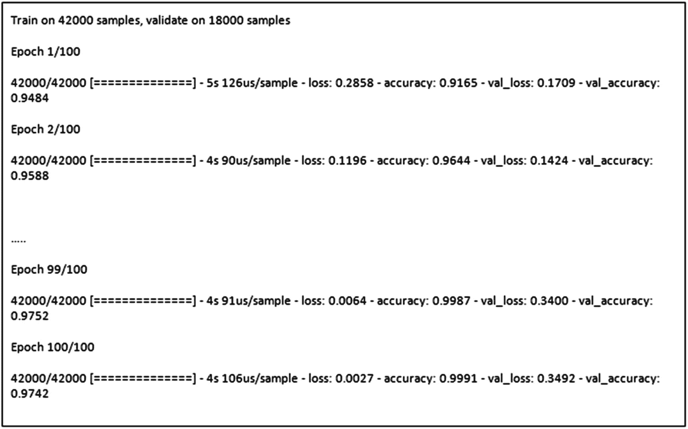

一个超参数的输出结果块。顶行显示：在 42000 个样本上训练，在 18000 个样本上验证。列出了第 1、2、99 和 100 个周期（共 100 个周期）的样本损失、准确率、验证损失和验证准确率。

图 5-17

显示每个周期损失和准确率的示例控制台输出

**学习曲线****：**第 27 到 32 行绘制了损失与周期的关系图以及准确率与周期的关系图，以了解训练进行得如何。训练后的模型会维护每个周期的损失和准确率历史记录，可以通过 `history['loss']` 和 `history['accuracy']` 访问。

图 5-18 中的示例图显示，由红线表示的损失在每个周期都持续下降，直到大约第十个周期，此时损失开始趋于平稳，表明进一步的迭代不太可能带来显著的减少。因此，为了优化计算资源，建议将周期设置为大约 10（在此示例中），并避免额外的计算。

类似地，图 5-18 中的准确率水平（蓝线）增加，并在几个周期后变得平坦。损失和准确率这两者都有助于我们确定训练神经网络的迭代次数。

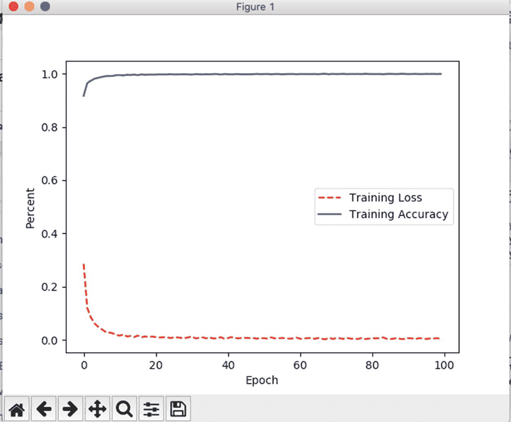

一个标题为“图 1”的窗口截图，其中包含一个绘制百分比与周期关系的图表。训练准确率从 (0, 0.95) 增加，并在 (10, 1.0) 和 (100, 1.0) 之间保持恒定。训练损失从 (0, 0.3) 下降，并在 (10, 0.0) 和 (100, 0.0) 之间保持恒定。数值为估计值。

图 5-18

训练损失和准确率与周期的关系图

我们可以通过调用 `history.keys()` 来打印 `History` 对象中的所有键。我们可能还想绘制 `val_acc` 和 `val_loss` 图，以查看模型如何针对 30%的验证数据进行评估。

**评估****：**第 35 行针对测试数据集评估模型。我们使用 `evaluate()` 函数，该函数接受以下参数：

*   `x_test`：包含所有测试图像归一化像素值的 NumPy
*   `y_test`：包含测试数据集标签的 NumPy
*   `verbose =1`：用于打印输出的可选参数

第 36 行打印示例输出，如图 5-19 所示，这表明我们的模型在测试数据集上评估时达到了 0.9787 或 97.87%的准确率（以及 0.2757 的损失值）。这个准确率水平被认为是令人满意的，表明我们的模型表现良好。


一行输出，内容为：Evaluation [0.2757401464153796, 0.9787]。

图 5-19

评估输出

如果你有一个测试数据集，就像我们在这个例子中一样，我们不需要像第 24 行那样保留 30%的训练集。如果你想像我们在第 35 行那样使用测试数据进行评估，参数 `validation_split=0.3` 是可选的。

**预测****：**在第 37 行，我们使用训练好的模型来预测未用于模型训练的输入图像的类别。任何新图像（具有归一化的像素值 NumPy）都可以输入到模型中以预测其类别。

为了预测类别，我们使用函数 `model.predict()`，该函数将图像 NumPy 作为参数。`predict()` 函数的输出是一个 NumPy 数组。该数组的元素是每个类别的概率。最大概率的索引就是该图像的预测类别。

例如，输入的手写数字图像得到的预测概率如图 5-20 所示。从零开始，第六个索引（以黄色高亮显示）具有最高的概率 0.99844。因此，输入图像的预测类别是 7，这与图中左侧显示的手写数字相符。

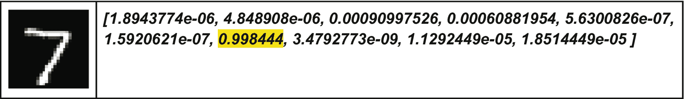


一个包含 2 列 1 行的表格。第一列是手写数字 7 的输入图像。第二列是一对方括号内列出的 10 个概率值，其中第七个值 0.998444 被高亮显示。

图 5-20

输入图像与预测概率

在第 38 行，我们将预测类别概率的 NumPy 数组转换为 pandas DataFrame。在第 42 行，我们使用 pandas 函数`idxmax(axis=1)`来获取概率最高的列索引。参数`axis=1`表示我们关注的是列索引，而非行索引。

第 44 行至第 49 行的内容将在本章后续“评估指标”部分结合混淆矩阵进行说明。

恭喜！你已经成功构建并训练了你的第一个用于计算机视觉的神经网络。下一节将解释评估模型有效性的技术，以区分良好性能与欠佳性能。之后，我们将探索微调参数的方法，旨在通过实现更低的损失和更高的准确率来优化模型。

## 模型评估

一旦我们训练好模型，通过分析损失和准确率指标来评估其性能至关重要。然而，需要注意的是，在训练数据上获得的高准确率和低损失并不能保证模型在面对新数据时仍能保持同等准确率。为了确保预测的可靠性，有必要使用与训练集不同的独立测试数据集来评估模型性能。以下是实践中常用的一些评估方法。

### 过拟合

过拟合模型的特点是，当输入训练数据时，其预测准确率高于使用验证集和测试数据时的预测准确率。例如，如果模型在训练集上达到 97%的高准确率，但在测试集或验证集上仅表现出 70%的较低准确率，则表明存在过拟合。图 5-21 直观展示了过拟合现象，其中测试准确率迅速低于训练准确率。

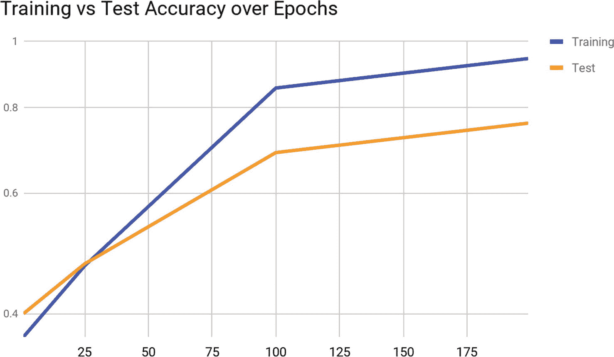

准确率与训练轮次的折线图。训练曲线从(0, 0.38)急剧上升至(100, 0.85)，随后以线性趋势逐渐上升，最终在(200, 0.95)结束。测试曲线从(0, 0.4)急剧上升至(100, 0.7)，然后逐渐上升，最终在(200, 0.77)结束。数值为估算值。

图 5-21

过拟合示例

如何避免过拟合？有几种方法可以控制或避免过拟合：

*   *正则化*：请参见本章前面的“正则化”部分。

*   *随机失活*：如前所述，随机失活是一种有效的正则化方法。通过随机失活，神经元被随机丢弃，这意味着被丢弃神经元的输出不会作为下一层的输入。这种丢弃是暂时的，仅适用于特定的一次前向/反向传播。这意味着在该次传播中，权重更新不会应用于临时移除的神经元。

    在 TensorFlow 中，随机失活通过添加一个称为*随机失活层*的层来实现，并指定失活率或概率（例如 20%）。随机失活层可以添加到输入层或隐藏层中。在大多数实际应用中，我们会保持较小的失活概率，以避免丢失重要特征。

    清单 5-3 中给出的示例代码片段展示了包含随机失活层的 TensorFlow 神经网络布局。

```
....
model = tf.keras.models.Sequential([
tf.keras.layers.Flatten(input_shape=(28, 28)),
tf.keras.layers.Dense(128, activation='relu'),
tf.keras.layers.Dropout(0.2),
tf.keras.layers.Dense(60, activation='relu'),
tf.keras.layers.Dense(10, activation='softmax')])
.....
清单 5-3
展示随机失活层的代码片段
```

### 欠拟合

当模型无法从训练数据中捕捉到潜在趋势时，我们称该模型为*欠拟合*。欠拟合模型简单来说就是模型对数据的拟合程度不够好。这通常发生在数据集较小，或者数据集不能真实代表我们试图建模的实际场景时。欠拟合模型在训练集和测试集上的准确率都不理想。应避免使用此类模型。

避免欠拟合的一个好方法是向训练集添加更多数据，或者拥有足够的数据，使其包含我们试图建模的所有变化和趋势。此外，通过特征工程选择正确的特征也有助于减少欠拟合。


#### 评估指标

为了评估模型的质量，考虑其他重要指标至关重要。以下描述概述了这些指标，它们是通过将预测结果与测试数据集中的相应标签值进行比较得出的。

*   *真正率 (TPR) 或灵敏度*：在二元分类中，如果标签值为正，且模型也预测为正，则称为*真正 (TP)*。TPR 定义如下：

TPR = 所有 TP 的总数 / 所有正例的总数

*   *真负率 (TNR) 或特异度*：在二元分类中，如果标签值为负，且模型也预测为负，则称为真负或 TN。TNR 定义如下：

TNR = 所有 TN 的总数 / 所有负例的总数

*   *假正率 (FPR) 或误报率*：FPR 定义如下：

FPR = 假正例的总数 / 所有负例的总数

*   *假负率 (FNR) 或漏报率*：FNR 定义如下：

FNR = 假负例的总数 / 所有正例的总数

*   *混淆矩阵*：混淆矩阵也称为*误差矩阵*。它以网格形式显示每个类别的正例和负例数量。例如，如果我们有两个类别，`dog` 和 `cat`，混淆矩阵可能如下所示：

|   | **cat (预测)** | **dog (预测)** |   |
    | --- | --- | --- | --- |
    | **cat (实际)** | 80 | 10 |   |
    | **dog (实际)** | 8 | 92 |   |

在此示例中，`cat` 类别有 80 个真正例、10 个假正例和 8 个假负例。类似地，对于 `dog` 类别，有 92 个真正例、8 个假正例和 10 个假负例。

清单 5-4 显示了清单 5-2 中的第 45 至 49 行。这些代码段计算混淆矩阵，将其转换为 NumPy 数组，再转换为 Pandas DataFrame，并最终打印生成的混淆矩阵。

```
.....
44    (print("===Confusion Matrix==")
45    confusion = tf.math.confusion_matrix(y_test, np.argmax(predicted, axis=1), num_classes=10)
46    tf.print(confusion)
47    tensor_values = confusion.numpy()
48    confusion_df = pd.DataFrame(tensor_values)
49    print(confusion_df)
.....
清单 5-4
混淆矩阵计算
```

清单 5-2 的第 37 行 `predicted = model.predict(x_test)` 使用测试数据集从模型进行预测。输出是每个输入的概率的 NumPy 数组。`np.argmax(predicted, axis=1)` 获取数组中最大概率的索引。该索引代表预测的类别。

在清单 5-4 中，第 45 行的 `tf.math.confusion_matrix()` 函数计算混淆矩阵。它接受以下参数：

*   `y_test`：测试集的实际类别标签。

*   `np.argmax(predicted, axis=1)`：预测的类别

*   `num_classes = 10`：可选参数，表示我们希望模型预测的类别数量

`confusion_matrix()` 函数返回一个张量。如果直接使用 `print(confusion)` 打印此张量，它将不会显示张量的值。您需要执行该张量，以便它在显示到控制台之前计算所有值。这就是为什么先将张量转换为 NumPy 数组，然后再转换为 Pandas DataFrame（第 48 行）以便打印（第 49 行）的原因。

图 5-22 显示了我们在本例中使用的测试集的示例混淆矩阵。

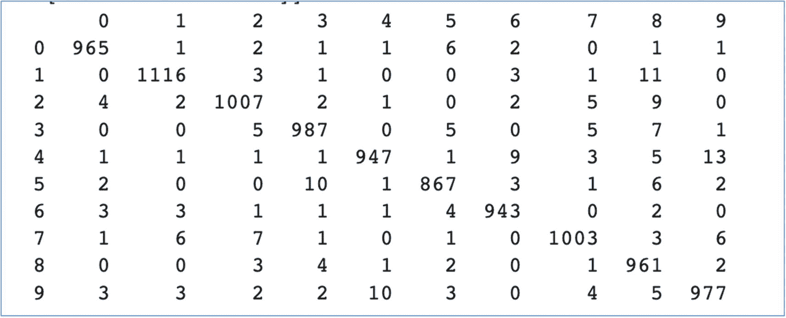

一个包含 11x11 混淆矩阵的输出屏幕。沿左对角线的值为 956、1116、1007、987、947、867、943、1003、961 和 977。其他元素的值小于 14。

图 5-22

混淆矩阵输出示例

在图 5-22 中，对角线上的值代表与对角线对齐的类别的真正值。在对角线的左侧和右侧，您可以找到假正值，而对角线的上方和下方则是假负值。例如，考虑数字 965，它对应于第零类。该值代表该类别的真正值。同一行中的所有数字都是假正值，而垂直位于其下方的所有数字都是第零类的假负值。

*   *精确率*：精确率是真正例总数与预测正例总数的比率。计算精确率的公式如下所示：

精确率 = 真正例总数 / 预测正例总数

= 真正例 / (真正例 + 假正例)

= TP / (TP + FP)

理想情况下，模型应具有零假正例 (FP = 0)。在这种情况下，精确率等于 1，表示完美得分或 100% 的精确率。本质上，精确率越高，模型的性能越好。

*   *召回率*：召回率是真正例总数与实际正例总数的比率。召回率与真正率相同。计算召回率的公式如下：

召回率 = 真正例总数 / 正例总数

= 真正例总数 / (真正例总数 + 假负例总数)

= TP / (TP + FN)

理想情况下，模型应具有零假负例 (FN = 0)。当满足此条件时，召回率为 1，表示完美性能或 100% 的召回率。换句话说，召回率越高，模型的性能越好。

*F1 分数*：在评估模型时，同时考虑精确率和召回率非常重要。如上所述，对于理想模型，这两个指标都应接近 100%。然而，如果其中一个指标小于另一个，则判断模型的整体性能可能具有挑战性。F1 分数通过将精确率和召回率组合成一个单一的复合指标来解决这种情况，从而提供对模型质量的平衡评估。通过同时考虑精确率和召回率，F1 分数帮助您对模型的好坏做出明智的判断。F1 分数是精确率和召回率的调和平均值，使用以下公式计算：

F1 分数 = 2 × 精确率 × 召回率 / (精确率 + 召回率)

*   *准确率*：准确率定义为正类和负类的正确预测总数与总样本量的比率。计算准确率的公式如下所示：

准确率 = (TP + TN) / 总样本数

= (TP + TN) / (P + N)

= (TP + TN) / (TP + TN + FP + FN)

本节涵盖的指标在决定是将模型部署到生产环境，还是微调参数并重新训练模型的过程中起着至关重要的作用。通过分析这些指标，我们可以评估模型的性能，并确定优化其有效性所需的步骤。


## 超参数

*超参数* 是我们在学习过程开始之前为神经网络模型设置的参数。这些被视为外部参数，与算法从训练数据中计算出的参数相对。超参数在模型训练过程中不会被算法推断出来。这些超参数会影响模型的整体性能，包括准确率和训练执行时间。

在前面的章节中，我们已经讨论了计算机视觉神经网络训练中使用的各种超参数的含义和重要性。以下是一些常见的需要调整的超参数：

*   网络中隐藏层的数量
*   隐藏层中的神经元数量
*   丢弃率和学习率
*   优化算法
*   激活函数
*   损失函数
*   周期或迭代次数
*   验证集划分比例
*   批量大小
*   动量

### TensorBoard

TensorBoard 是 TensorFlow 提供的一个基于 Web 的可视化工具，可用于可视化和理解机器学习模型的训练过程和结果。以下是 TensorBoard 广受欢迎且常用的几个原因：

*   *模型可视化*：TensorBoard 允许您可视化模型的架构，例如图结构、层形状和参数统计信息。这有助于您更有效地理解和调试模型。
*   *训练监控*：在训练过程中，TensorBoard 可以实时显示各种指标的可视化结果，如损失、准确率和其他自定义指标。它使您能够跟踪模型训练的进度，并识别潜在问题或改进点。
*   *超参数调优*：TensorBoard 可以通过可视化和比较不同的运行结果来帮助您优化模型的超参数。您可以检查更改超参数如何影响性能，并选择最佳配置。
*   *嵌入可视化*：如果您正在处理高维数据或嵌入，TensorBoard 提供了嵌入可视化，允许您在低维空间中探索和理解数据点之间的关系。
*   *调试和分析*：TensorBoard 提供了用于调试和分析模型性能的工具。您可以分析不同操作的执行时间，识别瓶颈，并优化代码以获得更好的性能。

总的来说，TensorBoard 通过提供一个直观且交互式的界面来可视化和分析模型、训练进度以及各种指标，从而增强了机器学习从业者的工作流程。它促进了在整个机器学习开发周期中更好的理解、更快的调试和更明智的决策。

TensorBoard 提供了一个 HParams 仪表板，可帮助我们识别最佳实验或最有希望的超参数集。使用上一节中的神经网络示例，我们可以利用 HParams 仪表板来可视化不同的超参数，并深入了解应如何调整它们以获得最佳性能。

在我们进行以下示例之前，请检查您是否已安装 TensorBoard。要验证 TensorBoard 是否安装在您的虚拟环境中，请执行以下命令（确保您处于本书一直使用的同一个虚拟环境 `cv` 中）：

```
(cv) username $: tensorboard --logdir my logdir
```

如果一切顺利，您应该会看到类似以下的输出：

```
TensorBoard 2.12.2 at http://localhost:6006/ (Press CTRL+C to quit)
```

将浏览器指向 `http://localhost:6066`，您应该会看到 TensorBoard 的 Web 界面。

要在 Google Colab 环境中可视化嵌入的 TensorBoard，请加载 TensorBoard 扩展，然后运行 `tensorboard` 命令，如下所示：

```
%load_ext tensorboard
%tensorboard --logdir mydir
```

### 超参数调优实验

清单 5-5 中的代码示例演示了一个简单的实验，该实验仅针对一个简单神经网络使用了三个超参数。为了学习目的，该示例保持简单。

我们的目标是使用以下参数进行实验：

*   第一个隐藏层中的神经元数量
*   优化函数
*   丢弃率

实验完成后，我们希望在 TensorBoard Web 界面中可视化结果，并使用 HParams 仪表板分析结果。

清单 5-5 显示了代码流程。

```
Filename: Listing_5_5.py
1    import tensorflow as tf
2    from tensorboard.plugins.hparams import api as hp

4    # 使用内置数据集下载函数加载 MNIST 数据
5    mnist = tf.keras.datasets.mnist
6    (x_train, y_train), (x_test, y_test) = mnist.load_data()

8    x_train, x_test = x_train / 255.0, x_test / 255.0

10   HP_NUM_UNITS = hp.HParam('num_units', hp.Discrete([16, 32]))
11   HP_DROPOUT = hp.HParam('dropout', hp.RealInterval(0.1, 0.2))
12   HP_OPTIMIZER = hp.HParam('optimizer', hp.Discrete(['adam', 'sgd']))

14   METRIC_ACCURACY = 'accuracy'

16   with tf.summary.create_file_writer('logs/hparam_tuning').as_default():
17     hp.hparams_config(
18       hparams=[HP_NUM_UNITS, HP_DROPOUT, HP_OPTIMIZER],
19       metrics=[hp.Metric(METRIC_ACCURACY, display_name='Accuracy')],
20     )

23   def train_test_model(hparams):
24         model = tf.keras.models.Sequential([
25             tf.keras.layers.Flatten(),
26             tf.keras.layers.Dense(hparams[HP_NUM_UNITS], activation=tf.nn.relu),
27             tf.keras.layers.Dropout(hparams[HP_DROPOUT]),
28             tf.keras.layers.Dense(10, activation=tf.nn.softmax),
29         ])
30         model.compile(
31             optimizer=hparams[HP_OPTIMIZER],
32             loss='sparse_categorical_crossentropy',
33             metrics=['accuracy'],
34         )

36         model.fit(x_train, y_train, epochs=5)
37         _, accuracy = model.evaluate(x_test, y_test)
38         return accuracy
39   def run(run_dir, hparams):
40     with tf.summary.create_file_writer(run_dir).as_default():
41       hp.hparams(hparams)  # 记录本次试验中使用的值
42       accuracy = train_test_model(hparams)
43       tf.summary.scalar(METRIC_ACCURACY, accuracy, step=1)

45   session_num = 0

47   for num_units in HP_NUM_UNITS.domain.values:
48     for dropout_rate in (HP_DROPOUT.domain.min_value, HP_DROPOUT.domain.max_value):
49       for optimizer in HP_OPTIMIZER.domain.values:
50         hparams = {
51             HP_NUM_UNITS: num_units,
52             HP_DROPOUT: dropout_rate,
53             HP_OPTIMIZER: optimizer,
54         }
55         run_name = "run-%d" % session_num
56         print('--- 开始试验: %s' % run_name)
57         print({h.name: hparams[h] for h in hparams})
58         run('logs/hparam_tuning/' + run_name, hparams)
59         session_num += 1
清单 5-5
TensorBoard HParams 上的超参数调优与可视化
```

第 5 到 8 行加载了我们之前使用过的相同 MNIST 数字数据。

第 10 行设置了神经元或单元的数量值：16 和 32。

第 11 行设置了丢弃率：0.1 和 0.2。

第 12 行设置了优化函数：`adam` 和 `sgd`。

请注意，`model.fit()` 函数是在一个嵌套的 `for` 循环（第 47 到 59 行）中针对三个超参数的每种组合调用的。指标输出被写入日志文件 `logs/hparam_tuning`。代码的其余结构很直接，无需解释。

实验成功执行后，使用以下命令启动 TensorBoard（再次确保您处于名为 `cv` 的虚拟环境中）：

```
(cv) username $: tensorboard -logdirlogs/hparam_tuning
```

您可能需要传递 `logs/hparam_tuning` 目录的绝对路径。


启动浏览器并访问 `http://localhost:6006`。你应该会看到 TensorBoard 的 Web 界面。从右上角的下拉菜单中选择 **HPARAMS**。此时你应该会看到类似图 5-23 所示的仪表盘。

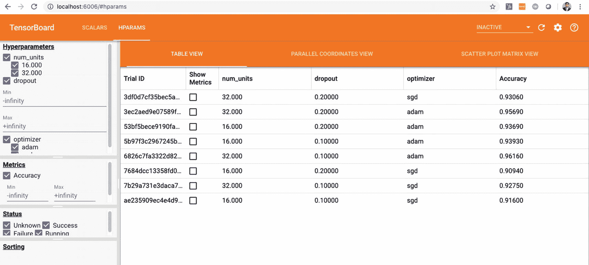

TensorBoard Web 界面截图，显示有 SCALARS 和 HPARAMS 选项卡。HPARAMS 选项卡被选中，表格视图列出了试验 ID、神经元数量、丢弃率、优化器和准确率。左侧窗格包含超参数、指标和状态下的复选框。另外还有两种视图可用。

**图 5-23**

TensorBoard 显示 HPARAMS 视图，其中包含与每种超参数组合对应的准确率

通过此仪表盘，你可以看到准确率最高的超参数组合：32 个神经元、0.1 丢弃率和使用 Adam 优化器时，准确率达到 96.160%。

或者，点击**平行坐标视图**选项卡，切换到图 5-24 所示的界面。

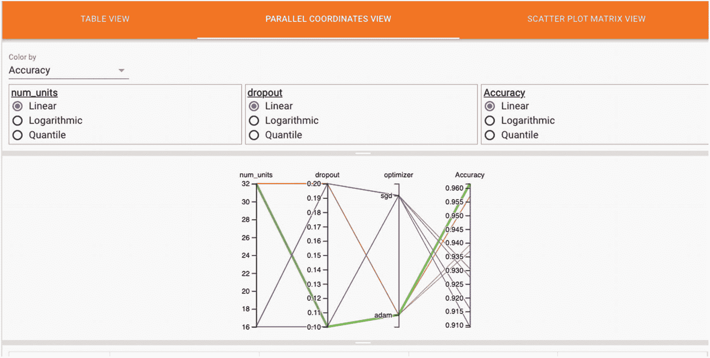

TensorBoard Web 界面中 HPARAMS 仪表盘的截图。平行坐标视图列出了神经元数量、丢弃率、优化器和准确率的折线图。顶部窗格在神经元数量、丢弃率和准确率部分下，有线性、对数和分位数三个单选按钮。

**图 5-24**

HPARAMS 的平行坐标视图选项卡

如图 5-24 所示，点击最高准确率（或任何你想检查的准确率）的链接，你会看到一条绿色高亮路径，它代表了产生该准确率的超参数组合。

## 保存与恢复模型

保存和加载训练好的模型至关重要，可以避免每次使用时都需要重新训练。模型训练可能非常耗时，根据数据大小、硬件能力和网络配置等因素，可能需要数小时甚至数天。因此，在训练期间和训练后保存模型是必不可少的。这样做，你可以从中断的地方恢复训练，从而节省宝贵的时间。

在接下来的章节中，我们将深入探讨训练神经网络的过程，包括在训练期间保存模型检查点、保存最终模型以供将来使用、加载保存的模型，以及在各种应用中有效利用它。这使我们能够利用训练好的模型的好处，而无需重复整个训练过程。

### 在训练期间保存模型检查点

代码清单 5-6 包含了我们初始模型训练代码（代码清单 5-2）中的大部分代码行。然而，在保存训练权重方面存在一些显著差异。让我们找出这些不同的代码行，并理解它们在训练期间保存权重的上下文中的重要性。

```
文件名: Listing_5_6.py
1    import tensorflow as tf
2    import matplotlib.pyplot as plt
3    import os

5    # 检查点将保存到的文件路径。
6    checkpoint_path = "cv_checkpoint_dir/mnist_model.ckpt"
7    checkpoint_dir = os.path.dirname(checkpoint_path)

9    # 创建一个保存模型权重的回调函数。
10   cp_callback = tf.keras.callbacks.ModelCheckpoint(filepath=checkpoint_path,
11   save_weights_only=True,
12   verbose=1)

14   # 使用内置数据集下载功能加载 MNIST 数据。
15   mnist = tf.keras.datasets.mnist
16   (x_train, y_train), (x_test, y_test) = mnist.load_data()

18   # 通过将每个像素值除以 255 来归一化像素值。
19   x_train, x_test = x_train / 255.0, x_test / 255.0

21   # 构建一个 4 层 ANN。
22   model = tf.keras.models.Sequential([
23     tf.keras.layers.Flatten(input_shape=(28, 28)),
24     tf.keras.layers.Dense(128, activation='relu'),
25     tf.keras.layers.Dense(60, activation='relu'),
26     tf.keras.layers.Dense(10, activation='softmax')
27   ])

29   # 编译模型并设置优化器、损失函数和指标
30   model.compile(optimizer='adam',
31                 loss='sparse_categorical_crossentropy',
32                 metrics=['accuracy'])

34   # 最后，训练或拟合模型，传递回调函数以保存模型权重。
35   trained_model = model.fit(x_train, y_train, validation_split=0.3, epochs=10, callbacks=[cp_callback])

37   # 可视化损失和准确率历史
38   plt.plot(trained_model.history['loss'], 'r--')
39   plt.plot(trained_model.history['accuracy'], 'b-')
40   plt.legend(['训练损失', '训练准确率'])
41   plt.xlabel('周期')
42   plt.ylabel('百分比')
43   plt.show();

45   # 使用测试集评估结果。
46   evalResult = model.evaluate(x_test,  y_test, verbose=1)
47   print("评估结果: ", evalResult)
代码清单 5-6
在训练期间保存模型权重
```

通过比较代码清单 5-6 和代码清单 5-2，我们可以识别出以下不同的代码行。

第 3 行导入了 `os` 包，它提供了与文件系统相关的函数，用于将模型保存到文件路径。

第 6 行是存储我们模型权重的文件名。

第 7 行创建了特定于操作系统的文件路径对象。

第 10 行通过传递以下参数初始化了一个名为 `ModelCheckpoint` 的 TensorFlow 回调类：

*   `filepath`：这是我们在第 7 行创建的文件路径对象。

*   `save_weights_only`：在训练期间，我们只应保存权重，而不是整个模型。默认情况下，此参数设置为 `False`，这意味着保存整个模型。通过将其设置为 `True`，我们告知神经网络我们只想保存权重。

*   `verbose = 1`：在控制台上打印日志并运行状态。否则，默认值 0 表示静默。

以下是我们可能根据意图传递的其他参数：

*   `save_best_only`：默认值为 `False`。如果设置为 `True`，算法将根据我们传递的指标评估并保存最佳权重。

*   `save_frequency`：默认值为 `epoch`，这意味着我们希望在每个周期结束时保存检查点。你也可以传递一个整数来指示保存检查点的频率。例如，如果你设置 `save_frequency = 5`，则每五个周期保存一次检查点。

你会注意到，在代码清单 5-6 中，除了第 35 行（拟合模型）之外，几乎所有代码行都与代码清单 5-2 相同。第 35 行在 `fit()` 函数中增加了一个参数 `callbacks = [cp_callback]`，用于在模型训练期间保存检查点。

请注意，我们在代码清单 5-6 的第 35 行将 `epochs=10` 作为参数传递给 `fit()` 函数。图 5-25 和图 5-26 显示了该模型损失和准确率的示例输出。该模型在测试数据上的准确率为 0.9775，损失为 0.084755。

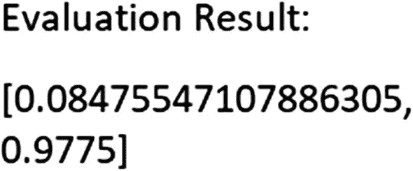

周期 2 的输出行，内容为：评估结果：[0.08475547107886305, 0.9775]。

**图 5-26**

使用 `epoch=10` 的模型评估

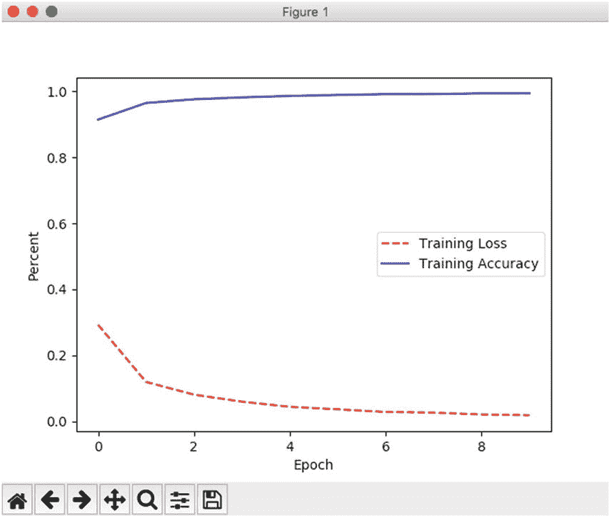

标题为“图 1”的窗口截图，显示百分比与周期的关系图。训练准确率从 (0, 0.9) 急剧上升，然后在 (1, 0.95) 和 (8.6, 1.0) 之间逐渐上升。训练损失从 (0, 0.3) 急剧下降，然后在 (1, 0.15) 和 (8.6, 0.0) 之间逐渐下降。数值为估计值。

**图 5-25**

训练损失和准确率


### 手动保存权重

如果你希望手动保存权重，而不是在每个训练周期或定期保存检查点，只需添加以下函数：

```
# 保存模型权重
checkpoint_path = "cv_checkpoint_dir/mnist_model.ckpt"
model.save_weights(checkpoint_path)
```

### 加载已保存的权重并重新训练模型

如果你想加载已保存的权重，无论是为了在中断后恢复训练，还是因为获得了更多数据（或出于其他任何原因），只需在创建/配置神经网络后添加以下代码行：

```
# 加载已保存的权重
model.load_weights(checkpoint_path)
```

请确保你已经像清单 5-6 中第 22 行和第 30 行那样初始化了神经网络。需要注意的是，网络架构必须与存储检查点的网络架构保持一致。

### 保存整个模型

调用 `model.save()` 函数来保存整个模型，包括模型架构、权重和训练配置。请确保在调用 `fit()` 方法之后调用 `model.save()` 函数。也就是说，在清单 5-6 的第 35 行之后调用 `save()` 函数。以下是保存整个模型的代码片段：

```
# 将整个模型保存到目录路径 "path/to/save/model"。
# 你也可以使用绝对路径来保存模型。
tf.saved_model.save(model, "path/to/save/model")
```

`tf.saved_model.save()` 函数以 `SavedModel` 格式保存模型，这是一种序列化表示形式，包含了模型架构、权重和训练配置。

运行此代码后，你将在指定目录中找到保存的模型。该目录将包含多个文件和子目录，分别代表已保存模型的资产、变量和 TensorFlow 元数据。

请注意，你也可以使用不同的函数（如 `model.save()` 或 `model.save_weights()`）来保存模型的特定部分，例如仅保存模型架构或仅保存模型权重。不过，建议使用 `tf.saved_model.save()` 以 `SavedModel` 格式保存整个模型，因为它便于部署，并能与不同 TensorFlow 平台和版本兼容。

### 重新训练现有模型

如果你想用额外数据或相同数据但不同超参数来重新训练现有模型，可以使用以下代码片段：

```
# 加载并创建现有模型，包括其权重和优化器
model = tf.saved_model.load(' path/to/save/model')
# 显示模型架构
model.summary()
# 重新训练模型
retrained_model = model.fit(x_train, y_train, validation_split=0.3, epochs=10)
```

重新训练模型后，请务必按照上一节所述，使用 `tf.saved_model.save()` 函数保存新模型。

### 在应用中使用训练好的模型

如果你在文件系统中保存了一个训练好的模型，可以轻松加载它并使用 `predict()` 函数进行预测。示例如下：

```
# 加载已保存的模型，包括其权重和优化器
model = tf.saved_models.load(' path/to/save/model')
# 从加载的模型预测输入图像的类别
predicted = model.predict(x_pixel_data)
print("Predicted", predicted)
```

在我们的探索过程中，我们涵盖了训练神经网络用于计算机视觉任务的几个关键方面。我们首先演示了一个使用 MNIST 图像数据集训练神经网络预测数字的示例。接着，我们深入探讨了保存训练好的模型、使用额外数据或不同超参数重新训练模型，以及基于重新训练的模型进行预测。

此外，我们还讨论了监控模型性能的重要性，并介绍了 TensorBoard 作为可视化各种模型指标和超参数的强大工具。通过利用 TensorBoard，我们深入了解了训练过程，识别了需要改进的领域，并做出了优化模型的明智决策。

通过应用这些技术，我们可以为广泛的应用构建稳健且有效的计算机视觉模型。

在下一节中，我们将探讨卷积神经网络（CNN），这是一种强大的架构，它将传统神经网络与一个负责自动特征提取的附加网络相结合。我们将分析 CNN 用于从输入图像中提取和选择特征的技术。在此过程中，我们将熟悉与 CNN 相关的常用术语。此外，我们将逐步讲解一个 TensorFlow 代码实现，以训练我们自己的 CNN 模型进行图像分类。随着我们的推进，我将详细解释每一行代码，以确保全面理解。

为了展示 CNN 的实际应用，我们将处理一个具体示例：对胸部 X 光图像进行分类以检测肺炎病例。通过利用 CNN 的强大功能，我们的目标是训练一个能够自动分析和准确分类这些医学图像的模型。

## 卷积神经网络

*卷积神经网络（CNN）* 是一种特殊类型的人工神经网络，它与传统人工神经网络（ANN）的主要区别在于其*自动特征工程*能力。ANN 通常需要手动进行特征工程，而 CNN 则擅长从输入数据中自动提取和选择相关特征。这一特性使得 CNN 特别适合处理网格状结构的数据，例如图像。

通过引入称为*卷积层*的特殊层，CNN 对输入数据的小区域应用局部操作。通过这一过程，网络学会从输入数据中识别和提取基本特征，如边缘、纹理或形状。CNN 的分层架构使其能够通过组合这些学习到的特征，逐步构建更高层次的表示。

CNN 的这种自动特征工程特性显著减少了对手动特征提取和选择的需求，使网络能够学习并适应数据中的各种模式和复杂性。因此，CNN 已成为计算机视觉任务（如图像分类、目标检测和图像分割）中的基础工具。


### CNN 的架构

传统的 ANN 或 MLP 由输入层、一个或多个隐藏层以及输出层组成。CNN 由一个常规的 MLP（包含输入层、隐藏层和输出层）堆叠在另一个称为卷积网络的网络之上构成，该卷积网络负责从输入图像中自动提取特征。输入图像被传递到卷积网络的第一层，如图 5-27 所示。

卷积层在对输入图像执行特征工程方面起着至关重要的作用。它对输入数据的小区域应用一组可学习的滤波器或卷积核，将其与图像进行卷积以生成特征图（如下文各节所述）。每个滤波器捕获输入图像中存在的特定模式或特征，例如边缘或纹理。

卷积层的输出（由这些特征图组成）随后被输入到全连接 MLP 的“输入”层。MLP 实现传统的深度学习算法，如前向传播，以基于提取的特征对图像进行分类。

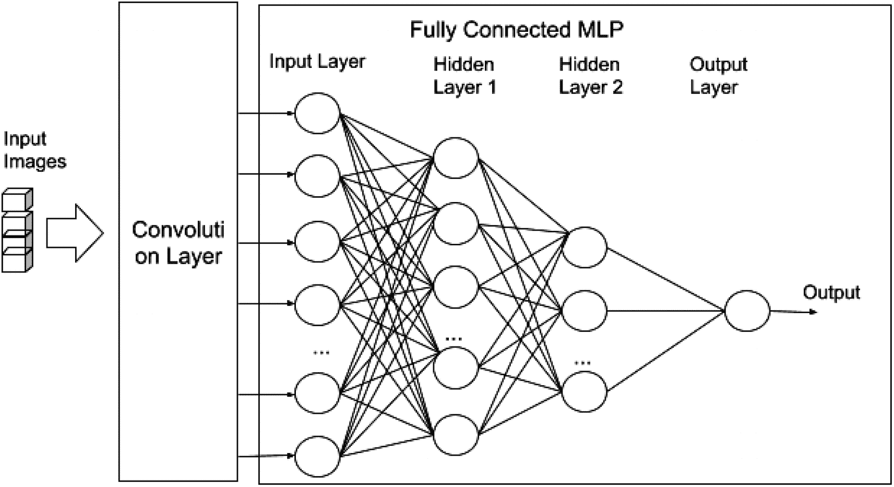

CNN 的神经网络示意图。输入图像被发送到卷积层，然后是包含输入层、隐藏层 1、隐藏层 2、输出层和输出的全连接 MLP。

图 5-27

CNN 架构

通过将多层的自动特征工程能力与全连接 MLP 层的分类能力相结合，CNN 可以有效地学习并对图像中的复杂模式和结构进行分类。

卷积网络有两种类型的层：

*   *卷积层*：该层从图像中提取特征（特征提取）。
*   *子采样层*：该层从提取的特征中进行选择（特征选择）。

图 5-28 描绘了一个完整的 CNN。

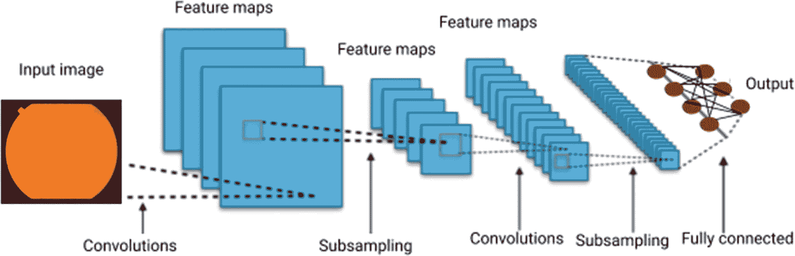

CNN 的神经网络架构示意图。输入图像通过卷积生成特征图，特征图再通过子采样传递到另一层特征图，接着是另外两层特征图、一个全连接层和输出。

图 5-28

包含卷积、子采样和全连接 MLP 层的 CNN

### CNN 的工作原理

我们在第 2 章中看到，计算机将单通道的黑白图像视为一个由像素值组成的二维矩阵（如图 5-29 所示）。具有 RGB 通道（三个通道）的彩色图像则显示为这些二维矩阵的堆叠。这些矩阵堆叠形成一个三维张量（还记得张量吗？）。图 5-30 展示了一个三维图像张量的可视化表示。

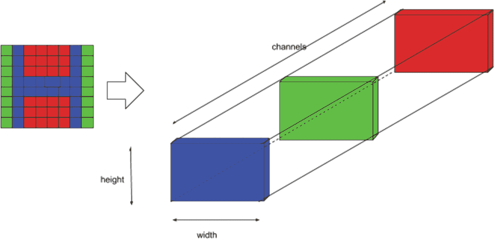

张量表示示意图。一个形状为字母 H 的网格具有 R、G、B 三种色调。图中标明了三个分别具有 R、G、B 色调的矩形块之间的高度、宽度和通道数。

图 5-30

三通道彩色图像作为二维矩阵堆叠的张量表示

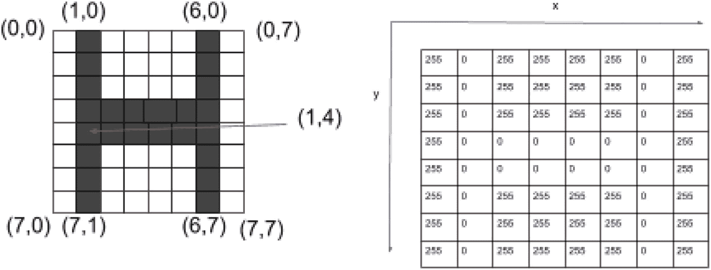

一张照片和一个矩阵。a. 一个输入图像，具有深色阴影的字母 H 和浅色阴影的背景，被划分为一个 8x8 的网格，其中标有各种单元格。b. 一个 8x8 的矩阵。构成字母 H 的单元格值为 0，周围单元格的值为 255。

图 5-29

计算机将黑白图像（左）视为一个二维矩阵（右）

有了图像如何表示为张量的背景知识，让我们来研究卷积过程。

#### 卷积

想象一下，我们有一张图像，用放大镜扫视它，并记下我们观察到的重要模式。这是一个很好的类比，可以说明卷积的工作原理。

以下是使用卷积从图像中提取重要特征的步骤：

1.  将图像划分为大小为 *k*×*k* 像素的网格。这被称为*卷积核*，表示为一个 *k*×*k* 矩阵。
2.  定义一个或多个与卷积核维度相同的滤波器。
3.  取其中一个通道的第一个卷积核（从二维矩阵的左上角开始），与第一个滤波器进行逐元素乘法，并将乘法结果相加。对其他通道执行相同操作，并将所有三个通道的结果求和，以获得新创建特征图的像素值。

    这在图 5-31 中进行了演示。在此示例中，我们采用一个 7×7×3 的图像，卷积核大小为 3×3。我们有两组滤波器：W0 和 W1（以红色显示）。滤波器 W0 的偏置为 1，滤波器 W1 没有任何偏置。输出特征图显示在绿色网格中（最右侧）。

    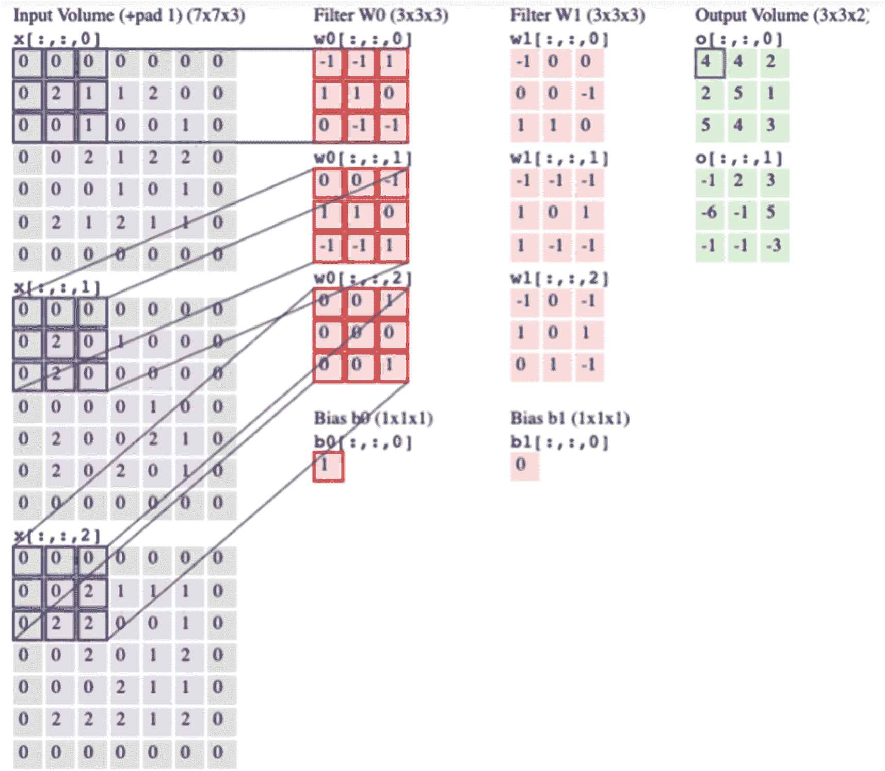

    卷积示意图。来自三个 7x7 输入矩阵（带有体积和填充 1）的 3x3 片段 x 被发送到滤波器 W0。偏置 b0 有一个单元格。滤波器 W1 有三个矩阵，其中包含负值 1。输出体积 o 有两个 3x3 矩阵，单元格中带有值。

    图 5-31

    卷积（图片由 Andrej Karpathy 提供）

    输出计算如下所示：

    `通道 1 输出 = 0x(-1) + 0x(-1) + 0x1 + 0x1 + 2x1 + 1x0 + 0x0 + 0x(-1) + 1x(-1) = 2`

    `通道 2 输出 = 0x0 + 0x0 + 0x(-1) + 0x1 + 2x1 + 0x0 + 0x(-1) + 2x(-1) + 0x1 = 0`

    `通道 3 输出 = 0x0 + 0x0 + 0x1 + 0x0 + 0x0 + 2x0 + 0x0 + 2x0 + 2x1 = 1`

    `特征值 = 通道 1 输出 + 通道 2 输出 + 通道 3 输出 + 偏置`

    `特征值 = 2 + 0 + 1 + 1 = 4`

    同样，值 4 在图 5-31（最右侧）顶部绿色网格的左上角以高亮显示。

4.  现在将卷积核向右移动，并如前所述计算特征值。当卷积核一直移动到最右侧时，它会向下移动到下一行，从该行的最左侧像素开始。卷积核为扫描整个图像而向水平和垂直方向移动的步数称为*步长*。步长表示为 *s*（例如，2 或 3 等）。步长为 2 意味着卷积核将向右移动两步，当到达图像右边缘时，它向下移动 2 个像素。
5.  当整个图像被扫描完毕后，会创建一个特征矩阵。在我们的示例中，特征矩阵的维度是 3×3（对于 7×7×3 像素的图像、3×3 的卷积核和 2×2 的步长）。这个特征矩阵，也称为*特征图*，如图 5-31 顶部 3×3 的绿色网格（右侧）所示。
6.  使用下一组滤波器重复相同的卷积过程，并创建一个特征图。图 5-31 底部的绿色网格显示了来自第二个滤波器的特征图。
7.  对所有滤波器重复此过程，并从每个滤波器生成特征图。

#### 池化/子采样/降采样

卷积从图像中提取特征。这些特征表示为 *n* × *n* 矩阵，并被馈送到另一层，称为*池化层*，该层执行“降采样”，很像特征选择。最大池化和平均池化是两种常用的对特征进行降采样的方法。


##### 最大池化

在池化层中，与卷积阶段非常相似，特征矩阵被划分为大小为 *k*×*k*（例如，图 5-32 中的 2×2 像素）且步长为 *s*（例如，示例中步长为 1）的核网格。在最大池化层中，取每个核区域内的最大像素值，并生成一个降采样矩阵。此过程对上一层每个滤波器的输出重复进行。

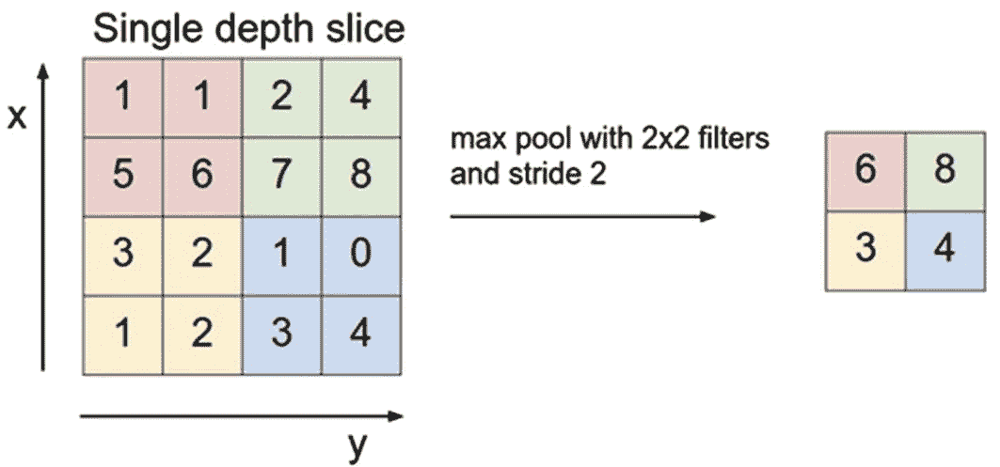

最大池化示意图。一个四乘四矩阵的四个象限各有不同深浅，代表单个深度切片。使用二乘二滤波器和步长 2 进行最大池化，得到一个二乘二矩阵，其中四个单元格分别填入每个象限的最大值。

图 5-32

用于特征降采样的最大池化（图片由 Andrej Karpathy 提供）

##### 平均池化

平均池化的工作方式与最大池化相同，区别在于平均池化取核像素的平均值（而非最大值）来生成降采样矩阵。

一个 CNN 通常由交替的卷积层和池化层以及一个多层感知机组成（如图 5-33 所示）。

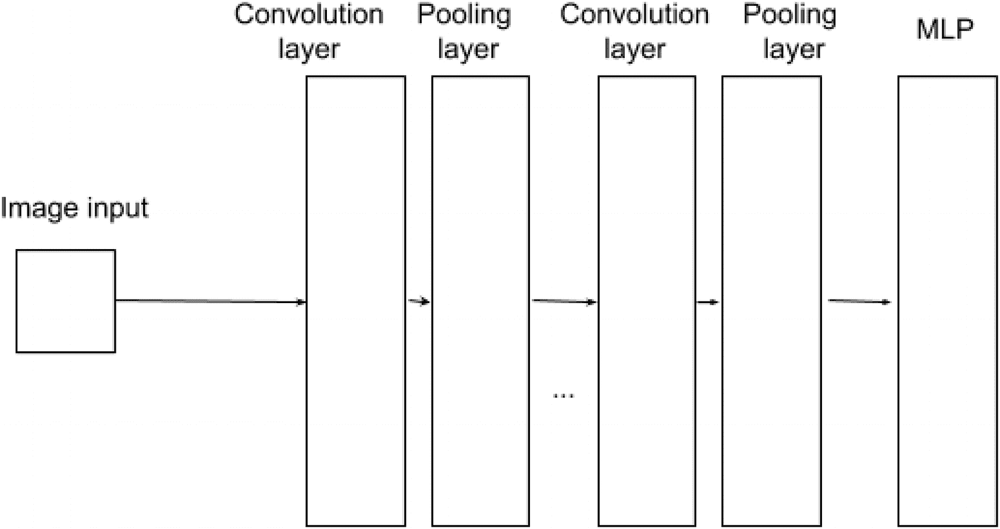

CNN 层的框图。图像输入依次经过多对卷积层和池化层，最后是 MLP。

图 5-33

CNN 层，交替的卷积层和池化层，末端为 MLP

### CNN 概念总结

以下是我们目前探讨过的 CNN 概念：

*   CNN 由交替的卷积层和池化层组成，末端为 MLP。并非每个卷积层都必须紧跟一个池化层。

*   卷积是卷积层中的特征提取过程。

*   定义一个维度为 *k*×*k* 的核，用于将输入图像划分为网格。

*   与核维度相同的滤波器与核内的像素相乘，然后将每个像素和每个图像通道的结果求和。结果中会添加一个可选的偏置，以生成特征矩阵。

*   池化层实现降采样算法（最大池化或平均池化）来对特征进行降采样。

*   此过程对每一对卷积-池化层重复进行，其中一个池化层的输出作为下一个卷积层的输入。

*   最后一个卷积/池化层将特征矩阵馈送到 MLP 的输入层。

*   网络的 MLP 部分像传统的 MLP 网络一样进行学习。

### 训练 CNN 模型：从胸部 X 光片中检测肺炎

*TensorFlow with Keras* 使得训练 CNN 模型变得简单。只需几行代码，您就可以实现并训练一个 CNN 模型。

在本节中，我们将深入探讨一个代码示例，该示例演示了如何使用胸部 X 光片训练一个用于肺炎检测的模型。

注意

此处介绍的模型是一个基础的 CNN，仅用于学术和学习目的。它不应用于诊断任何医疗状况。

#### 胸部 X 光数据集

我们从 Kaggle 托管的公开网站 [`https://www.kaggle.com/paultimothymooney/chest-xray-pneumonia`](https://www.kaggle.com/paultimothymooney/chest-xray-pneumonia) 获取了胸部 X 光图像。需要注意的是，此图像数据集根据 [`https://creativecommons.org/licenses/by/4.0/`](https://creativecommons.org/licenses/by/4.0/) 描述的 Creative Commons 许可证发布，并受其条款约束。

该数据集包含两组图像，一组包含健康肺部的胸部 X 光片（正常），另一组包含感染肺炎的肺部的 X 光片。这两组图像存储在不同的目录中；所有正常图像存储在 `NORMAL` 目录中，所有肺炎图像存储在 `PNEUMONIA` 目录中。此外，该数据集被划分为训练集、测试集和验证集。

从 Kaggle 网站下载图像后，将其保存在本地磁盘中。图 5-34 显示了一个示例目录结构。

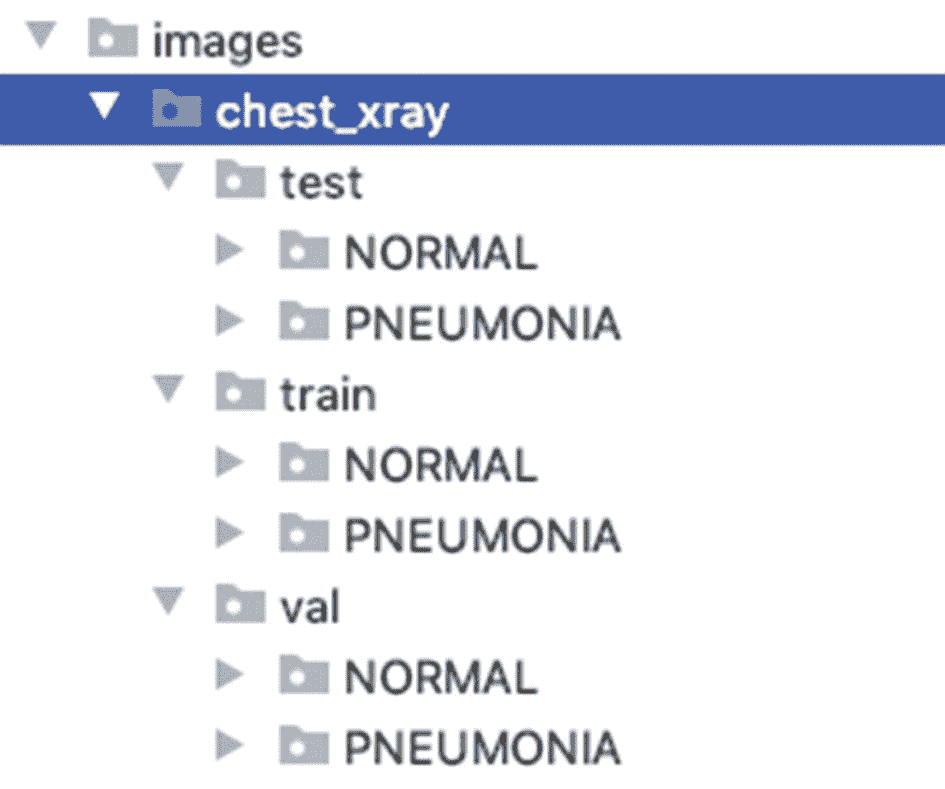

一个下拉文件目录的截图，以 images 为根文件夹。images 文件夹包含 chest_xray 文件夹，该文件夹又包含 test、train 和 val 子文件夹，每个子文件夹中都有 normal 和 pneumonia 文件夹。

图 5-34

胸部 X 光图像的目录结构

图 5-34 展示了父目录 `chest_xray` 的目录结构，其中包含名为 `test`、`train` 和 `val` 的子目录。这些子目录中的每一个都进一步包含两个子目录：`NORMAL` 和 `PNEUMONIA`。`NORMAL` 目录存储代表正常胸部 X 光片的图像，而 `PNEUMONIA` 目录存储描绘患有肺炎的 X 光片图像。这种目录组织方式是一种用各自类别标记图像的方法。

#### 代码结构

在组织代码以追求简洁和易于理解的同时，需要注意的是，存在更有效的方式来构建代码，使其更具可重用性并遵循面向对象原则。在生产级工作中，强烈建议对代码进行参数化以提高灵活性和可维护性，避免任何硬编码值。然而，出于学习目的，我使用了一些硬编码值以使代码易于理解。


#### CNN 模型训练

清单 5-7 展示了用于训练 CNN 模型以从胸部 X 光片预测肺炎的代码示例。

```
FileName: Listing_5_7.py
1    import numpy as np
2    import pathlib
3    import cv2

5    import tensorflow as tfimport matplotlib.pyplot as plt

8    # Section 1: Loading images from directories for training and test
9    trainig_img_dir ="/content/chest_xray/train"
10    test_img_dir ="/content/chest_xray/test"

12   # ImageDataGenerator class provides mechanism to load both small and large dataset.
13   # Instruct ImageDataGenerator to scale to normalize pixel values to range (0, 1)
14   datagen = tf.keras.preprocessing.image.ImageDataGenerator(rescale=1./255.)
15   #Create training image iterator that will be loaded in small batch size. Resize all images to a standard size.
16   train_it = datagen.flow_from_directory(trainig_img_dir, batch_size=8, target_size=(1024,1024))
17   #Create test image iterator that will be loaded in small batch size. Resize all images to a standard size.
18   test_it = datagen.flow_from_directory(test_img_dir, batch_size=8, target_size=(1024, 1024))

20   # Lines 22 through 24 are optional to explore your images.
21   # Notice, next() function call returns both pixel and labels values as numpy arrays.
22   train_images, train_labels = train_it.next()
23   test_images, test_labels = test_it.next()
24   print('Batch shape=%s, min=%.3f, max=%.3f' % (train_images.shape, train_images.min(), train_images.max()))

26   # Section 2: Build CNN and train with training dataset.
27   # You could pass argument parameters to build_cnn() function to set some of the values
28   # such as number of filters, strides, activation function, number of layers, etc.
29   def build_cnn():
30       model =  tf.keras.models.Sequential()
31       model.add(tf.keras.layers.Conv2D(64, (3, 3), activation='relu', strides=(2,2), input_shape=(1024, 1024, 3)))
32       model.add(tf.keras.layers.MaxPooling2D((2, 2)))
33       model.add(tf.keras.layers.Conv2D(32, (3, 3), strides=(2,2),activation='relu'))
34       model.add(tf.keras.layers.MaxPooling2D((2, 2)))
35       model.add(tf.keras.layers.Conv2D(16, (3, 3), strides=(2,2),activation='relu'))
36       model.add(tf.keras.layers.Flatten())
37       model.add(tf.keras.layers.Dense(16, activation='relu'))
38       model.add(tf.keras.layers.Dense(2, activation='softmax'))
39       return model

41   # Build CNN model
42   model = build_cnn()
43   # Compile the model with optimizer and loss function
44   model.compile(optimizer='adam',
45                 loss='categorical_crossentropy',
46                 metrics=['accuracy'])

48   # Fit the model using the fit() function and passing the data iterator to it so that it iteratively loads large number of images in batches
49   history = model.fit(train_it, epochs=100,
50                       validation_data=test_it, validation_steps=32)

52   # Section 3: Save the CNN model to disk for later use.
53   model_path = "models/pneumoniacnn"
54   tf.saved_model.save(model, model_path)

56   # Section 4: Display evaluation metrics
57   print(history.history.keys())
58   plt.plot(history.history['accuracy'], label='accuracy')
59   plt.plot(history.history['val_accuracy'], label = 'val_accuracy')
60   plt.plot(history.history['loss'], label='loss')
61   plt.plot(history.history['val_loss'], label = 'val_loss')

63   plt.xlabel('Epoch')
64   plt.ylabel('Metrics')
65   plt.ylim([0.5, 1])
66   plt.legend(loc='lower right')
67   plt.show()
68   test_loss, test_acc = model.evaluate(test_images,  test_labels, verbose=2)
69   print(test_acc)
Listing 5-7
Code to Train CNN Model to Predict Pneumonia from Chest X-rays
```

清单 5-7 中用于 CNN 模型训练的代码在逻辑上分为以下四个部分：

*   *加载图像* *(第 9 至 24 行)*：如前所述，我们的训练和测试图像存储在目录中。为了加载这些图像用于训练和验证，我们使用了 Keras 提供的一个强大类 `ImageDataGenerator`。以下是关于我们如何使用这个类的逐行解释：

第 9 行和第 10 行是包含训练和测试图像子目录的目录。

第 14 行初始化了 `ImageDataGenerator` 类。我们传递了参数 `rescale = 1/255`，因为我们希望将像素值归一化到 0 到 1 之间。这种归一化是通过将图像的每个像素乘以 1/255 来实现的。我们将此行称为 `datagen`，如变量名所示。

第 16 行调用了 `datagen` 对象的 `flow_from_directory()` 函数。此函数以批处理模式（例如，`batch_size = 32`）从目录 `training_img_directory` 加载图像，并将图像大小调整为 `target_size`（例如，1024×1024px）指定的尺寸。这是一个高度可扩展的函数，能够加载数百万张图像而无需将它们全部加载到内存中。它一次加载的图像数量由 `batch_size` 参数指定。对于大多数机器学习练习来说，将所有图像调整为标准尺寸非常重要。请注意，此函数的默认调整大小值为 256。如果您省略调整大小参数，所有输入图像都将被调整为 256×256。

第 17 行与第 16 行功能相同，只是它从 `test` 目录加载图像。虽然我们的目录中有验证数据（从 Kaggle 网站下载的数据集包含验证图像），但数量很少，因此我们使用测试数据集进行验证。

函数 `flow_from_directory()` 返回一个迭代器。如果您遍历此迭代器，您将得到一个包含两个 NumPy 数组的元组：图像像素值数组和标签数组。

请注意，标签是根据读取图像的子目录来解释的。例如，来自 `NORMAL` 目录的所有图像将获得标签 `NORMAL`，同样，属于 `PNEUMONIA` 子目录的图像将获得标签 `PNEUMONIA`。但是等等！这些标签不应该是数字吗？这些目录名称按其名称排序并索引，从 0 开始。在我们的例子中，`NORMAL` 将被索引为 0，`PNEUMONIA` 将被索引为 1。但是，事情并没有到此为止。函数 `flow_from_directory()` 接受一个名为 `class_mode` 的额外参数。默认情况下，`class_mode` 的值为 `categorical`。您也可以为其传递 `binary` 或 `sparse` 值。这三者之间的区别如下：
    *   `categorical` 将返回二维独热编码标签。

*   `binary` 将返回一维二进制标签。

*   `sparse` 将返回一维整数标签。

第 22 至 24 行是可选的，并非训练模型所必需。我提供它们是为了向您展示如何探索从 `flow_from_directory()` 函数返回的迭代器中的值。

*   *CNN 配置与训练* *(第 29 至 50 行)*：第 29 至 39 行实现了一个构建 CNN 的函数。这些行是我们本节的重点，所以让我们分解一下这里发生了什么。

第 30 行创建了一个顺序神经网络，我们将在其上堆叠各层。回想一下，我们使用了相同的 `tf.keras.model.Sequential` 类来创建顺序模型。`model object` 的 `add()` 函数用于按顺序添加层——先添加的层先执行，依此类推。

第 31 行将我们的第一层添加到网络中。如果您还记得我们之前关于 CNN 的讨论，CNN 的第一层必须是一个卷积层，它接收输入（图像像素值）。这里我们使用 `Conv2D` 类来定义我们的卷积层。我们向 `Conv2D()` 传递了五个重要参数：
    *   filters，在此示例中为 64。

*   内核维度，在此示例中为 3×3 像素，并以元组 (3,3) 形式传递。


*   激活函数，在我们的案例中为 `relu`（因为像素值范围在 0 到 1 之间，且不为负数）。

*   下一个参数是设置步长（strides），如果未设置，默认值为 (1,1)。在我们的案例中，我们将其设置为 (2,2)。

*   最后一个参数是设置输入尺寸。由于我们的图像被调整为 1024×1024 像素，且为彩色图像（三个通道），因此 `input_shape` 为 (1024,1024,3)。

第 32 行添加了池化层 `MaxPooling2D`。回顾一下，卷积层和池化层可以交替使用，但 MLP 层之前的那个层除外。我们传递参数来设置网格或卷积核的大小。在我们的示例中，它被设置为 (2,2)。

第 33、34 和 35 行再次是我们的卷积层和池化层。你可以根据需要设置任意数量的卷积层和池化层，以达到所需的准确率水平。

第 35 行卷积层的输出被馈送到 MLP 的第一层。回顾一下，MLP 的第一层称为输入层，其后是隐藏层，最后是输出层。

第 36 行将第 35 行的输出展平。

第 37 行是 MLP 的隐藏层，这在本章开头的 ANN 部分已经解释过。

第 38 行是最后一层，即输出层。如前所述，我们使用 softmax 激活函数，因为我们正在解决一个涉及两个类别（正常和肺炎）的分类问题。

第 42 行简单地调用了 `build_cnn()` 函数并创建了一个 `model object`。

第 44 行编译模型，正如我们之前在 ANN 中看到的那样。注意第 44 行与清单 5-6 中第 31 行在损失函数上的区别。这里我们使用的是损失函数 `categorical_crossentropy`，而不是我们在清单 5-6 中使用的 `sparse_categorical_crossentropy`。

最后，我们在第 49 行开始训练。注意，我们像在清单 5-6 中那样调用了 `fit()` 函数。`fit()` 函数会自动检测输入是否来自 `ImageDataGenerator` 类的生成器，该类以小批量加载图像。`fit()` 函数接受一个名为 `steps_per_epoch` 的重要参数，它表示每个 epoch 将完成的批次数。以下是官方定义：

`steps_per_epoch`：在声明一个 epoch 结束并开始下一个 epoch 之前，从 `generator`（数据加载器）中产生的总步数（样本批次）。它通常应等于数据集样本数除以批量大小。例如，如果你的训练集中有 1,000 个文件，并且你的 `batch_size` 为 8，则应将 `steps_per_epoch` 设置为 1000/8 = 125。

该函数的另一个重要参数是 `validation_steps`，其定义如下：

`validation_steps`：仅当 `validation_data` 是一个生成器时才相关。它是在停止之前，从生成器（数据加载器）中产生的总步数（样本批次）。

*   *将 CNN 模型保存到磁盘* *（第 53 和 54 行）*：第 54 行将训练好的模型保存到第 53 行指定的目录中。你也可以保存训练检查点。

*   *评估与可视化* *（第 57 至 69 行）*：我们绘制了训练损失、验证损失、训练准确率和测试准确率随 epoch 变化的图表。第 68 行评估模型，并在第 69 行简单地打印准确率。

图 5-35 显示了模型运行时的示例输出。图 5-36 显示了训练和验证指标的示例图表。如图所示，随着 epoch 数量的增加，训练和验证的损失均下降。同时，准确率也随着 epoch 的增加而提高。

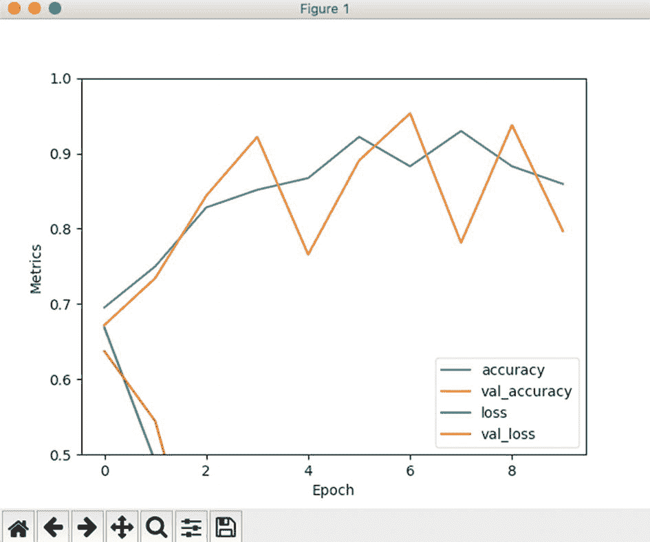

一个窗口的截图，显示指标与 epoch 的多线图。损失从 (0, 0.67) 下降到 (1, 0.5)。验证损失从 (0, 0.5) 下降到 (1.6, 0.5)。波动的验证准确率从 (0, 0.67) 上升到 (8.5, 0.8)。准确率从 (0, 0.7) 上升到 (8.5, 0.85)。数值为估计值。

图 5-36

训练和验证的指标（损失和准确率随 epoch 变化）示例图表

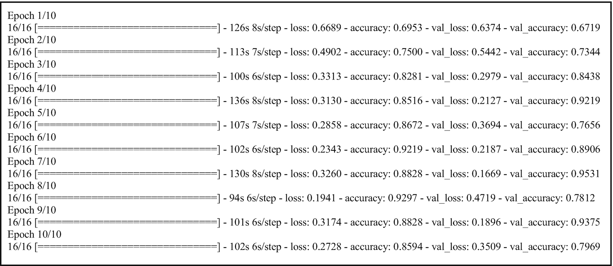

一个 CNN 模型训练的输出块，列出了第 1 到第 10 个 epoch 的时间（秒）、步长损失、准确率、验证损失和验证准确率。

图 5-35

CNN 模型训练的示例输出


#### 肺炎预测

清单 5-8 展示了如何使用之前训练好的 CNN 模型，从一组新图像中预测肺炎。

```
FileName: Listing_5_8.py
1    import numpy as np, pandas as pd
2    import tensorflow as tf
3    import os

5    model_path = "/content/models/pneumoniacnn"
6    input_dir = "/content/chest_xray/val"
7    classes = ["NORMAL", "PNEUMONIA"]
8    image_dimensions = [1024, 1024]
9    # 加载训练好的模型，包括其权重和优化器
10   model = tf.saved_model.load(model_path)

12   # 使用加载的模型预测输入图像的类别
13   for file in os.listdir(input_dir):
14     image_dir = os.path.join(input_dir, file)
15     if os.path.isdir(image_dir):
16       for img in os.listdir(image_dir):
17         image_path = os.path.join(image_dir, img)
18         image = tf.io.read_file(image_path)
19         image = tf.io.decode_image(image, channels=3)
20         image = tf.image.resize(image, image_dimensions)
21         image = image / 255.0  # 将像素值归一化到 0 和 1 之间
22         image = tf.expand_dims(image, axis=0)  # 添加批次维度
23         predicted = model(image)
24         max_probability = np.max(predicted)
25         max_index = np.argmax(predicted)
26         print("Image:", image_path, " Predicted", classes[max_index], " Actual:", file, " Probability: ", max_probability)
清单 5-8
使用训练好的 CNN 模型预测肺炎的代码
```

用于分类或预测图像中是否存在肺炎的代码分为三个部分。

*   *加载已保存的模型（第 10 行）*：回顾清单 5-7，我们将训练好的模型保存在目录 `models/pneumoniacnn` 中。第 10 行使用 TensorFlow 函数 `saved_model.load()` 从磁盘加载已保存的模型。此函数加载训练好的模型、元数据、权重和优化器。

*   *加载图像（第 13 至 22 行）*：在此示例中，我们处理来自 `val` 目录的图像预测。`val` 目录有两个子目录，`NORMAL` 和 `PNEUMONIA`，它们作为所包含图像的标签。第 13 至 16 行建立了两个 `for` 循环来遍历这些目录，并获取其中图像的路径（第 17 行）。第 18 行使用 TensorFlow 的 `io.read_file()` 函数从相应目录加载图像。第 19 行使用 `io.decode_image()` 函数，该函数会自动检测图像格式（BMP、GIF、JPEG 或 PNG），并相应地将输入字节字符串转换为张量。在模型训练期间，图像被调整为 1024×1024。因此，第 20 行将输入图像调整为匹配此尺寸。第 21 行执行像素值归一化，而第 22 行将图像张量转换为大小为 1 的批次。

*   *预测肺炎（第 23 行）*：预测的类别概率由 `model(image)` 函数生成，并存储为 NumPy 数组。在第 24 行中，获取数组中的最大概率，而在第 25 行中，检索与最大概率对应的索引。随后，在第 26 行中，打印获得的结果。

图 5-37 显示了一个示例预测输出。

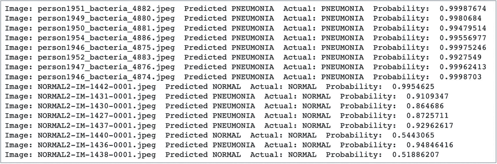

肺炎预测的输出屏幕。患有细菌性肺炎的人的图像，其预测和实际输出均为肺炎，概率大于 0.99。少数正常图像以高概率值被预测为肺炎，而正常图像的预测值较低。

图 5-37

示例预测输出

CNN 是计算机视觉领域广泛使用的一种重要算法。在本节中，您已经了解了 CNN 的基本概念及其运作机制。此外，我们还探讨了说明如何训练自定义 CNN 模型以进行肺炎预测的代码示例。

### 流行 CNN 示例

我们在清单 5-7 中构建的 CNN 并非生产级网络。我们构建了一个简单的网络来学习基础知识。让我们看看一些在全球范围内被证明是成功的流行网络。

#### LeNet-5

LeNet-5 CNN 架构由 LeCun 等人在其 1998 年的论文《基于梯度的学习应用于文档识别》中提出，主要用于识别文档中的手写和机器生成字符（光学字符识别 [OCR]）。该架构简单直接，因此被广泛用于教学。以下是 LeNet-5 架构的显著特点：

*   它是一个由七层组成的 CNN。

*   在这七层中，有三个卷积层（C1、C3 和 C5）。

*   有两个子采样层（S2 和 S4）。

*   有一个全连接层（F6）和一个输出层。

*   卷积层使用 5×5 的卷积核，步长为 1。

*   子采样层是 2×2 的平均池化层。

*   整个网络使用 TanH 激活函数，输出层除外，输出层使用 softmax。

图 5-38 展示了 LeNet-5 网络。

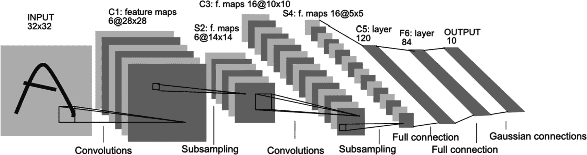

Le Net 5 的神经网络架构图。输入图像之后依次是 C 1、S 2、C 3 和 S 4 特征图（分别进行卷积和子采样）、全连接层 C 5 和 F 6、高斯连接以及输出。

图 5-38

LeNet-5（图片来源：[`​yann.​lecun.​com/​exdb/​publis/​pdf/​lecun-01a.​pdf`](https://yann.lecun.com/exdb/publis/pdf/lecun-01a.pdf)）

这里有一个练习供您完成：修改清单 5-7 中的 TensorFlow 代码，并实现 LeNet-5。

#### AlexNet

AlexNet 是由 Alex Krizhevsky 等人设计的卷积神经网络架构。当 AlexNet 在 2012 年参加 ImageNet 大规模视觉识别挑战赛（ILSVRC）并取得 15.3% 的前五错误率（比亚军低 10.8 个百分点以上）时，它变得流行起来。AlexNet 是一个深度网络，尽管计算成本高昂，但由于使用了 GPU，它变得可行。

AlexNet 的特点如下：

*   它是一个包含八层的深度 CNN。

*   输入尺寸为 224×224×3 的彩色图像。

*   前五层是卷积层和最大池化层的组合，配置如下：
    *   *卷积层 1*：核 11×11，滤波器 96，步长 4×4，激活函数 ReLU

    *   *池化层 1*：最大池化，核大小 3×3，步长 2×2

    *   *卷积层 2*：核 5×5，滤波器 256，步长 1×1，激活函数 ReLU

    *   *池化层 2*：最大池化，核大小 3×3，步长 2×2

    *   *卷积层 3*：核 3×3，滤波器 384，步长 1×1，激活函数 ReLU

    *   *卷积层 4*：核 3×3，滤波器 384，步长 1×1，激活函数 ReLU

    *   *卷积层 5*：核 3×3，滤波器 384，步长 1×1，激活函数 ReLU

    *   *池化层 5*：最大池化，核大小 3×3，步长 2×2

*   最后三层是一个全连接的 MLP。

*   所有卷积层都使用 ReLU 激活函数。

*   输出层使用 softmax 激活函数。

*   输出层有 1000 个类别。

*   该网络有 6000 万个参数和 65 万个神经元，在 GPU 上训练大约需要 3 天。

图 5-39 展示了 AlexNet 的图示。

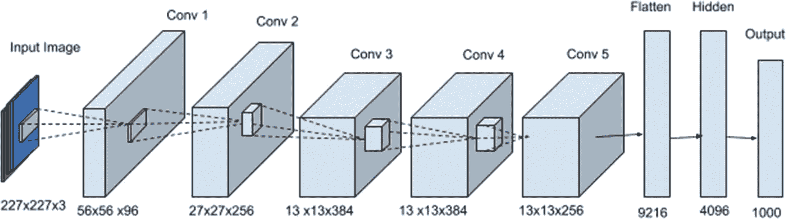

Alex Net 的神经网络图。输入图像之后依次是 conv 1、conv 2、conv 3、conv 4、conv 5、flatten、隐藏层和输出层。

图 5-39

具有五个卷积层和三个全连接 MLP 的 AlexNet


#### VGG-16

广受欢迎的 VGG-16 深度神经网络在 2014 年赢得了 ILSVRC 竞赛。VGG 由牛津大学视觉几何组（VGG）的研究人员设计。他们的论文可在 [`https://arxiv.org/abs/1409.1556`](https://arxiv.org/abs/1409.1556) 获取。

以下是 VGG-16 的显著特征列表：

*   它是一个包含 16 层的卷积神经网络。

*   它有 13 个卷积层和 3 个全连接密集层。

*   这 16 层具有以下特征：
    *   *卷积层 1*：输入尺寸 224×224×3，卷积核 3×3，滤波器 64，激活函数 ReLU

    *   *卷积层 2*：卷积核 3×3，滤波器 64，激活函数 ReLU

    *   *池化层*：最大池化，池化核大小 2×2，步长 2×2

    *   *卷积层 3*：卷积核 3×3，滤波器 128，激活函数 ReLU

    *   *卷积层 4*：卷积核 3×3，滤波器 128，激活函数 ReLU

    *   *池化层*：最大池化，池化核大小 2×2，步长 2×2

    *   *卷积层 5*：卷积核 3×3，滤波器 256，激活函数 ReLU

    *   *卷积层 6*：卷积核 3×3，滤波器 256，激活函数 ReLU

    *   *卷积层 7*：卷积核 3×3，滤波器 256，激活函数 ReLU

    *   *池化层*：最大池化，池化核大小 2×2，步长 2×2

    *   *卷积层 8*：卷积核 3×3，滤波器 512，激活函数 ReLU

    *   *卷积层 9*：卷积核 3×3，滤波器 512，激活函数 ReLU

    *   *卷积层 10*：卷积核 3×3，滤波器 512，激活函数 ReLU

    *   *池化层*：最大池化，池化核大小 2×2，步长 2×2

    *   *卷积层 11*：卷积核 3×3，滤波器 512，激活函数 ReLU

    *   *卷积层 12*：卷积核 3×3，滤波器 512，激活函数 ReLU

    *   *卷积层 13*：卷积核 3×3，滤波器 512，激活函数 ReLU

    *   *池化层*：最大池化，池化核大小 2×2，步长 2×2

    *   *全连接层 14（MLP 输入层）*：展平密集层，输入尺寸 25088

    *   *全连接隐藏层 15*：密集层，输入尺寸 4096

    *   *全连接输出层*：用于 1000 个类别的密集层

*   该网络拥有 1.38 亿个参数。

图 5-40 展示了 VGG-16 网络。

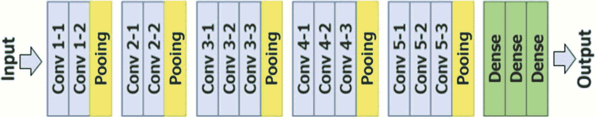

VGG-16 的框图。输入之后依次是：2 个卷积层 1 加一个池化层，2 个卷积层 2 加一个池化层，2 个卷积层 2 加一个池化层，3 个卷积层 4 加一个池化层，3 个卷积层 5 加一个池化层，3 个密集层，以及输出。

图 5-40

具有 16 层（13 个卷积层和 3 个密集层）的 VGG-16 架构

这里还有一个练习供你完成：修改清单 5-7 并使用 TensorFlow 实现 VGG-16 网络。

### 本章小结

本章提供了对人工神经网络和卷积神经网络的基础理解。我们实现了基于 TensorFlow 的代码来训练我们的 ANN 和 CNN 模型，评估了模型性能，并将保存的模型应用于图像分类任务。此外，我们探索了超参数调优的过程，并利用 TensorBoard 中的 HParams 仪表板来可视化和分析模型性能。最后，我们概述了三种流行的 CNN 架构——LeNet-5、AlexNet 和 VGG-16，以理解它们各自的特点和应用。

贯穿本章，主要焦点是解决分类问题，即训练我们的模型将输入图像分类到不同的类别中。

在此基础之上，第 6 章将介绍并探讨对图像中物体进行检测的关键技术和方法。我们将探索物体检测任务中使用的基本原理、算法和架构，为理解计算机视觉这一重要方面提供基础框架。

