# 6. 深度学习在物体检测中的应用

第 5 章介绍了如何使用标准多层感知器（MLP）和卷积神经网络（CNN）对图像进行分类。在分类任务中，我们的重点是预测整个图像的类别，而不考虑其中存在的特定物体。在本章中，我们将探讨如何检测物体并确定它们在图像中的位置。

本章的学习目标如下：

*   探索物体检测中使用的流行深度学习算法

*   使用 TensorFlow 在 GPU 上训练自定义物体检测模型

*   使用训练好的模型预测图像中的物体

本章介绍的概念将在后续三章中应用，以开发实际场景中的实用计算机视觉应用。

## 物体检测

*物体检测* 涉及两组不同的活动：定位物体和分类物体。在图像中定位物体称为*物体定位*，通常通过在物体周围绘制边界框来执行。在深度学习算法流行之前，物体定位是通过标记图像中包含物体的每个像素来执行的。例如，物体检测是使用诸如边缘检测和绘制轮廓（这两种技术在第 3 章中均有介绍）以及 HOG（在第 4 章中介绍）等技术来执行的。使用这些技术进行物体定位计算量大、速度慢，并且通常缺乏准确性。

如第 5 章所述，*物体分类* 指的是为图像中的物体分配特定的标签或类别。

基于深度学习的物体检测技术相比不使用深度学习的算法，展现出了卓越的速度和准确性。尽管在基于深度学习的物体检测中，学习过程计算量很大，但实际的检测过程快速且非常适合实时物体检测。利用基于深度学习的物体检测的应用示例包括：

*   自动驾驶汽车

*   机场安检系统

*   视频监控系统

*   工业生产过程中的缺陷检测

*   工业质量保证系统

*   人脸识别技术

用于物体检测的深度学习算法随着时间的推移而不断发展。在本章中，我们将探讨用于物体检测的两种不同的卷积神经网络变体：两步卷积和单步卷积。*基于区域的卷积神经网络（R-CNN）* 是一种两步算法。*你只看一次（YOLO）* 和*单次多框检测（SSD）* 是用于物体检测的单步算法示例。

在我们深入探讨物体检测算法之前，有必要确立物体检测器中广泛使用的一个基本指标的定义。


## 交并比

*交并比（IoU）*，也称为*杰卡德指数*，是目标检测算法中最常用的评估指标之一。它用于衡量任意两个形状的相似度。

在目标检测中，我们通过围绕物体绘制边界框来创建训练集并进行标注。训练集中的这些边界框也被称为*真实标注*。在模型学习过程中，目标检测算法会预测边界框，并将其与真实标注进行比较。IoU 用于评估预测边界框与真实标注的重叠程度。

预测边界框 A 与真实标注框 B 之间的 IoU 通过图 6-1 所示的公式计算。

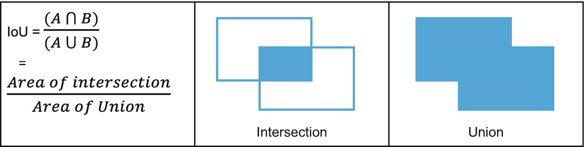

图示展示了交并比公式，该公式通过将 A 和 B 两个物体的交集面积除以它们的并集面积来衡量两者之间的重叠程度。

图 6-1

IoU

当我们标注一张图像时，通常会在图像中的物体周围绘制矩形框。这个围绕物体的矩形区域就是真实标注。在图 6-2 中，真实标注由绿色矩形框表示。

当算法学习时，它会预测围绕物体的边界框。在图 6-2 中，红色矩形区域是预测边界框。

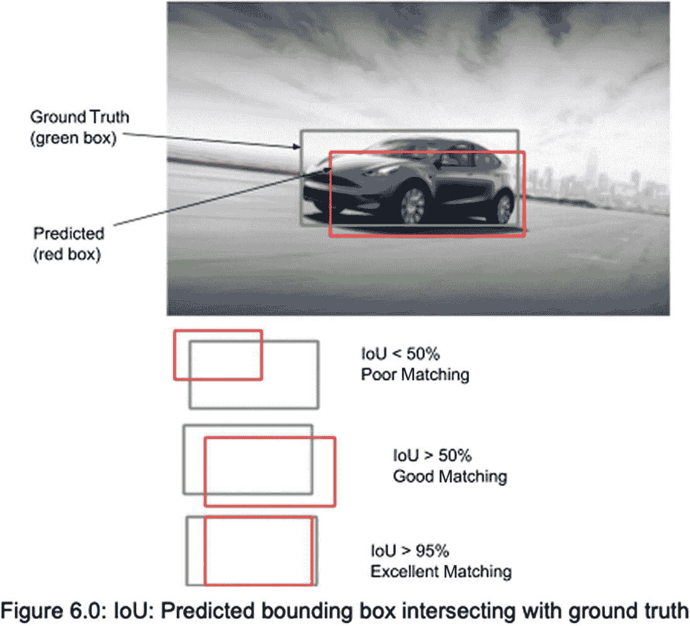

交并比示意图，展示了预测边界框与真实标注边界框之间的关系，并附有用于评估汽车照片匹配质量的相应 IoU 阈值。

图 6-2

IoU，预测边界框与真实标注相交

学习算法计算真实标注与预测边界框之间的 IoU。如果它们之间的 IoU 低于 50%，则认为预测与真实标注的匹配度较差。如果 IoU 在 50% 到 95% 之间，则认为匹配良好。IoU 大于 95% 则被认为是极佳的匹配。

目标检测算法的学习目标是优化 IoU。这个优化过程涉及微调算法参数，并在标注数据集上训练模型，以获得更高的 IoU 值，这表明目标检测性能得到了提升。

现在，让我们探索目标检测中使用的各种深度学习算法。我们还将回顾它们的优缺点以及它们之间的比较。

## 基于区域的卷积神经网络

R-CNN 是第一个成功使用大型卷积神经网络检测图像中物体的模型。该检测方法由 Ross Girshick 等人在其 2014 年的论文《用于精确目标检测和语义分割的丰富特征层次结构》（[`https://arxiv.org/pdf/1311.2524.pdf`](https://arxiv.org/pdf/1311.2524.pdf)）中描述。图 6-3 展示了 R-CNN 方法。

R-CNN 包含以下三个模块：

*   *区域提议*：R-CNN 算法首先在图像中寻找可能包含物体的区域。这些区域被称为*区域提议*。它们被称为*提议*，是因为这些区域可能包含也可能不包含物体，而学习函数的目标是排除那些不包含物体的区域。这些区域提议就是围绕物体的边界框（如图 6-3 中的图 2 所示）。

    Girshick 等人提出的 R-CNN 系统与寻找区域提议的算法无关。这意味着你可以使用任何算法，例如 HOG，来寻找区域。他们使用了一种称为*选择性搜索*的算法，该算法通过不同大小的网格来观察图像。对于每种网格大小，算法尝试通过比较纹理、颜色或像素值来将相邻像素分组，从而识别物体。该算法使用这种方法来创建区域提议。总之，该算法会创建一组潜在目标物体的边界框。

*   *特征提取*：将区域提议从图像中裁剪出来并调整大小。然后将这些裁剪后的图像输入到标准的 CNN 中以提取特征（见图 6-3 中的图 3）。根据原始论文，使用了 AlexNet 深度学习 CNN 进行特征提取。从每个区域中提取出 4,096 维的特征向量。

*   *分类器*：使用标准的分类算法（例如线性 SVM 模型）对提取的特征进行分类（图 6-3 中的图 4）。

    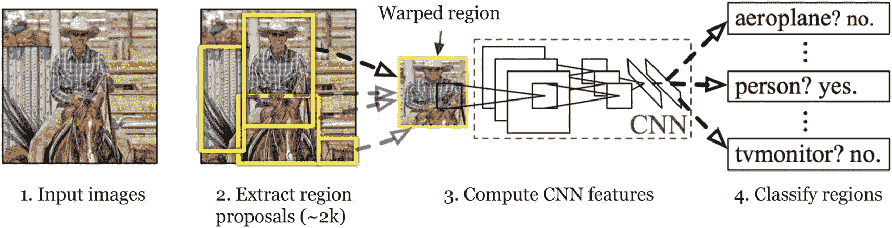

    一个框图概述了分析和分类图像内区域的过程，涉及提取区域提议、扭曲区域、使用卷积神经网络计算特征，以及分类物体（如人），同时排除其他物体（如飞机或电视显示器）。

    图 6-3

    R-CNN 模型（来源：Girshick 等人，[`​arxiv.​org/​pdf/​1311.​2524.​pdf`](https://arxiv.org/pdf/1311.2524.pdf)）

尽管 R-CNN 是第一个成功的基于深度学习的目标检测系统，但它在性能方面存在严重问题。其时间性能问题源于以下几点：

*   每个区域提议都被传递给 CNN 进行特征提取。每张图像可能需要大约 2,000 次这样的传递。
*   需要训练三个不同的模型：用于特征提取的 CNN、用于预测图像类别的分类器模型，以及用于收紧边界框的回归模型。训练过程计算量大，增加了计算时间。
*   每个区域提议都需要进行预测。由于区域数量众多，CNN 的预测速度很慢。


## Fast R-CNN

为了克服 R-CNN 的局限性，微软的 Ross Girshick 在 2015 年发表了一篇题为“Fast R-CNN”的论文，提出了一种能够直接学习并输出区域和分类的单一模型（[`https://arxiv.org/pdf/1504.08083.pdf`](https://arxiv.org/pdf/1504.08083.pdf)）。

Fast R-CNN 也使用一种算法（例如边缘框）来生成区域提议。与 R-CNN 对区域提议进行裁剪和调整大小不同，Fast R-CNN 处理的是整个图像。Fast R-CNN 并非对每个区域进行分类，而是汇集与每个区域提议相对应的 CNN 特征。

图 6-4 展示了 Fast R-CNN 的架构。它以整个图像作为输入，并生成一组区域提议。深度 CNN 的最后一层有一个特殊的层，称为*感兴趣区域（ROI）*池化层。ROI 池化层从特征图中提取一个固定长度的特征向量，该特征向量特定于给定的输入候选区域。

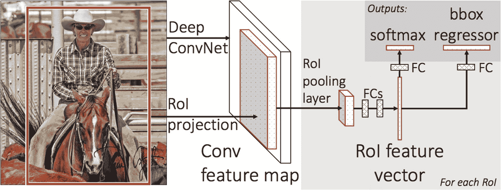

一张照片展示了与深度学习和目标检测相关的组件，包括 softmax、边界框、回归器、卷积神经网络、感兴趣区域池化、全连接层、特征图以及用于每个感兴趣区域的特征向量。

图 6-4

Fast R-CNN 架构（来源：Ross Girshick，[`​arxiv.​org/​pdf/​1504.​08083.​pdf`](https://arxiv.org/pdf/1504.08083.pdf)）

来自 ROI 池化的每个 ROI 特征向量被输入到一个全连接的 MLP 中，该 MLP 生成两组输出——一组用于对象类别，另一组用于边界框。softmax 激活函数预测对象类别，而线性回归器则生成与预测类别相对应的边界框。此过程对来自 ROI 池化的每个感兴趣区域重复进行。

正如原始论文所述，Ross Girshick 将 Fast R-CNN 与 VGG16 应用于 Microsoft COCO 数据集，以建立一个初步基准。COCO 数据集（[`https://cocodataset.org/`](https://cocodataset.org/)）是一个大规模的目标检测、分割和描述数据集，可免费在公共领域获取。Fast R-CNN 的训练集包含 80,000 张图像，训练迭代了 240,000 个周期。模型质量评估如下：

*   在 PASCAL 目标数据集上的平均精度均值（mAP）：35.9%
*   在 COCO 数据集上的平均精度（AP）：19.7%

与 R-CNN 相比，Fast R-CNN 在训练和预测方面快得多。然而，它仍然需要为每张输入图像提供一组候选区域提议，并由一个单独的模型来预测这些区域。

## Faster R-CNN

微软研究院的任少卿等人在 2016 年发表了一篇题为“Faster R-CNN: Towards Real-Time Object Detection with Region Proposal Networks”的论文（[`https://arxiv.org/pdf/1506.01497.pdf`](https://arxiv.org/pdf/1506.01497.pdf)）。该论文从训练速度和检测精度的角度描述了 Fast R-CNN 的改进版本。除了区域提议方法外，Faster R-CNN 在架构上与 Fast R-CNN 相似。

Faster R-CNN 架构包含一个*区域提议网络（RPN）*，该网络与检测网络共享全图的卷积特征，从而实现了近乎零成本的区域提议。RPN 是一个全卷积网络。它同时预测图像中每个位置的对象边界和对象性得分。RPN 经过端到端训练，以生成高质量的区域提议。这些区域提议被 Fast R-CNN 用于检测。如图 6-5 所示。

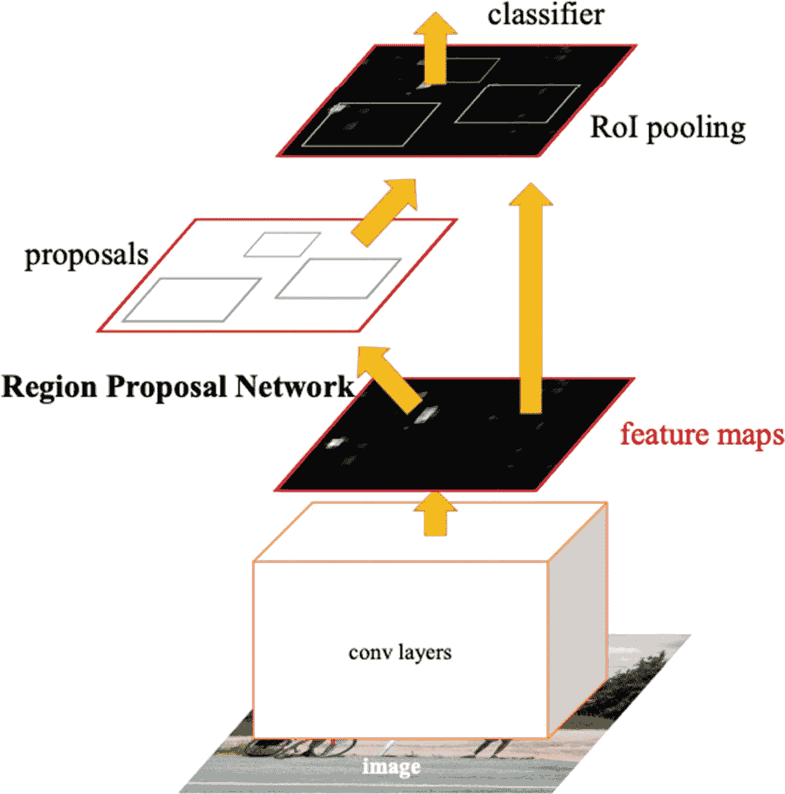

一张示意图展示了区域提议网络如何从图像生成区域提议。这些提议随后通过卷积层和 ROI 池化进行处理，以提取特征图。

图 6-5

带有 RPN 的 Faster R-CNN，一个用于更快目标检测的统一网络（来源：任少卿等人，[`​arxiv.​org/​pdf/​1506.​01497.​pdf`](https://arxiv.org/pdf/1506.01497.pdf)）

Faster R-CNN 由两部分组成：RPN 和 Fast R-CNN。

### 区域提议网络

RPN 是一个深度 CNN，它以图像作为输入，并生成一组矩形对象提议作为输出。每个矩形提议都有一个对象性得分。

图 6-6 展示了 RPN 如何生成区域提议。我们取最后一个共享卷积层生成的卷积特征图，并在其上滑动一个小型网络。这个小网络将输入卷积特征图的一个 *n*×*n* 空间窗口作为输入。每个滑动窗口都被映射到一个低维特征，例如对于 AlexNet 是 256 维特征，对于 VGG-16 是 5,126 维特征。

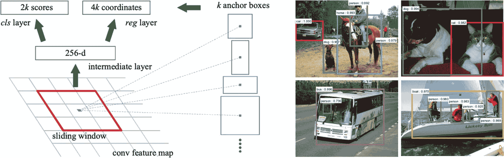

一张示意图和照片展示了目标检测的结果，分类器生成了 2k 个得分和 4k 个坐标。列出了各种对象及其相关得分，并使用锚框作为参考。中间层和卷积特征图在此过程中发挥作用。

图 6-6

使用滑动窗口和锚点进行区域检测（来源：任少卿等人，[`https://arxiv.org/pdf/1506.01497.pdf`](https://arxiv.org/pdf/1506.01497.pdf)）

该特征被输入到两个并列的全连接层——一个用于预测边界框的框回归层，以及一个用于预测对象类别的框分类层。

在每个滑动窗口位置预测多个区域提议。假设每个窗口位置的最大提议数为 k，则边界框坐标的总数为 4k，对象类别的数量为 2k（一个用于作为对象的概率，另一个用于不作为对象的概率）。每个窗口处的这些区域框被称为*锚点*。

### Fast R-CNN

Faster R-CNN 的第二部分是检测网络。这部分与 Fast R-CNN（如前所述）完全相同。Fast R-CNN 接收来自 RPN 的输入，以检测图像中的对象。


## Mask R-CNN

Mask R-CNN 是对 Faster R-CNN 的扩展。Faster R-CNN 因其检测速度快而被广泛用于目标检测任务。我们已经知道，对于给定的图像，Faster R-CNN 会预测图像中每个对象的类别标签和边界框坐标。Mask R-CNN 增加了一个额外的分支，用于在预测对象类别和边界框坐标的同时，预测对象掩码（请回顾第 3 章中关于掩码的概念）。

以下是 Mask R-CNN 与其前身 Faster R-CNN 的不同之处：

*   Faster R-CNN 有两个输出：类别标签和边界框坐标。
*   Mask R-CNN 有三个输出：类别标签、边界框坐标和对象掩码。

Ross Girshick 等人在其 2017 年的论文《Mask R-CNN》（[`https://arxiv.org/pdf/1703.06870.pdf`](https://arxiv.org/pdf/1703.06870.pdf)）中阐述了 Mask R-CNN。在 Mask R-CNN 中，每个像素被分类到一组固定的类别中，而不区分对象实例。它引入了一个称为*像素到像素对齐*的概念，用于神经网络的输出层和输入层之间。每个像素的类别决定了 ROI 中的掩码。

图 6-7 展示了 Mask R-CNN 的网络架构。

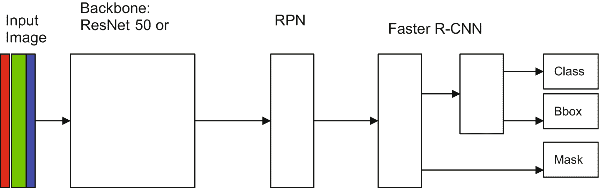

一个框图展示了 Faster R-CNN 模型的架构。它从输入图像开始，通过 ResNet-50 骨干网络处理，并将其馈送到区域提议网络。Faster R-CNN 分为类别、边界框和掩码。

图 6-7

在 Faster R-CNN 中增加了额外掩码预测分支的 Mask R-CNN

如图 6-7 所示，该网络由三个模块组成：骨干网络、RPN 和输出头。

### 骨干网络

骨干网络是标准的深度神经网络。原始的 Mask R-CNN 论文描述了使用 ResNet-50 和 ResNet-101。骨干网络的主要作用是特征提取。

除了 ResNet，还使用了*特征金字塔网络（FPN）*来提取图像更精细的特征细节。FPN 由一系列尺寸递减的 CNN 层组成，其中每个前向层的神经元数量更少。如图 6-8 所示，每个较高层将特征传递给较低层，并在每一层进行预测。较高层的尺寸较小，这意味着特征尺寸将小于前几层。这种方法在不同尺度上捕获图像的特征，从而能够检测图像中较小的对象。

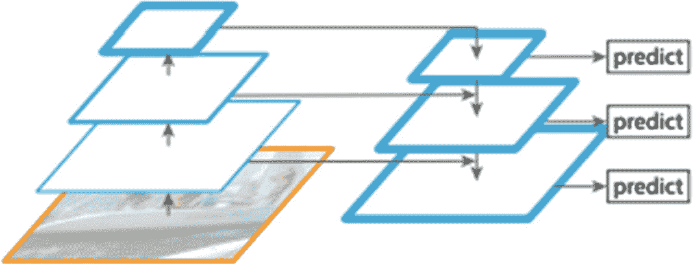

一幅插图展示了最初的四层，与三个标记为“预测”的层相连。

图 6-8

FPN（来源：Tsung-Yi Lin 等人）

FPN 是骨干网络的附加组件，通常独立于 ResNet 或其他骨干网络执行。FPN 不仅可以添加到 Mask R-CNN，还可以添加到 Fast R-CNN，以便能够检测不同大小的对象。

### RPN

如前所述，RPN 模块用于生成区域提议。在 Mask R-CNN 中，RPN 架构与 Faster R-CNN 中的相同。

### 输出头

如图 6-8 所示，最后一个模块由一个带有额外输出分支的 Faster R-CNN 组成。因此，该模块总共生成三个输出。其中两个输出——对象类别和边界框坐标——与 Faster R-CNN 的情况相同。第三个输出是对象掩码，它是一个定义对象轮廓的像素列表。

### 掩码的意义是什么？

Mask R-CNN（类似于 Faster R-CNN）生成对象类别和边界框。这两者的结合帮助我们定位图像中的对象。网络输出的掩码用于对象分割。这种对象分割广泛用于光学字符识别（OCR），以从文档中提取文本。Mask R-CNN 的另一个应用示例是在机场安检中，旅客的行李被扫描并通过掩码进行可视化。图 6-9 展示了 Mask R-CNN 的典型显示效果。

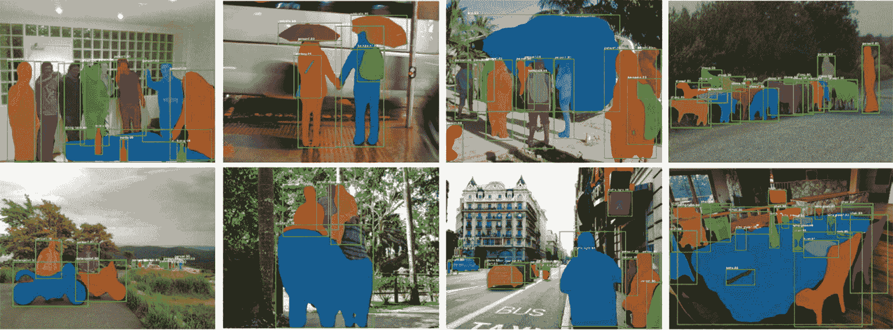

8 张照片展示了不同场景中的人物和物体，它们被不同深浅的颜色所掩码。

图 6-9

带有边界框和掩码的图像显示（来源：Ross Girshick 等人）

### Mask R-CNN 在人体姿态估计中的应用

Mask R-CNN 的一个有趣用途是估计人体姿态。该网络可以扩展，将关键点的位置建模为独热掩码。关键点定义为图像上的兴趣点。对于人体，这些关键点代表主要关节，如肘部、肩部或膝盖。关键点的选择应使其不随旋转、移动、缩放、平移和扭曲而改变。Mask R-CNN 被训练来预测 *K* 个掩码，每个掩码对应 *K* 种关键点类型之一（例如，左肩、右肘）。见图 6-10。

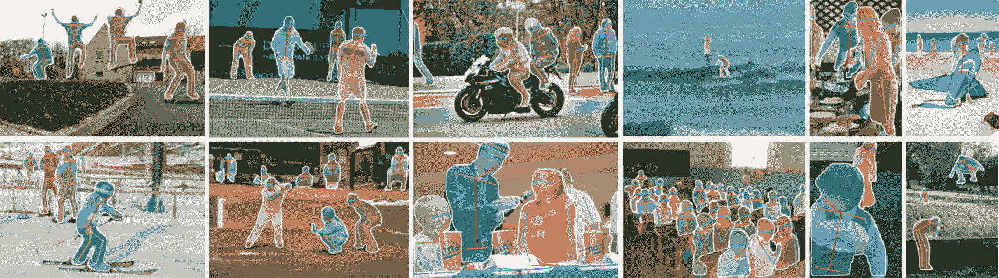

12 张照片展示了不同场景中不同姿态的人物，它们被不同深浅的颜色所掩码。

图 6-10

使用关键点预测进行人体姿态估计的显示（来源：Ross Girshick 等人）

为了训练一个网络来估计人体姿态，训练图像会标记有实例对象的 *K* 个关键点。对于每个关键点，训练目标是一个独热的 *m*×*m* 二值掩码，其中只有一个像素被标记为前景。

根据原始论文，作者使用了一种 ResNet-FPN 架构的变体作为特征提取骨干网络。头部架构（或输出模块）类似于常规的 Mask R-CNN。关键点头部由八个 3×3 512 维卷积层堆叠而成，随后是一个反卷积层和 2 倍双线性上采样。这产生了 56×56 的输出分辨率。据估计，关键点级别的定位精度需要相对较高分辨率（与掩码相比）的输出。

## 单次多框检测

R-CNN 及其变体是两阶段检测器。它们有两个专用的网络：一个网络生成区域提议以预测边界框，另一个网络预测对象类别。这些两阶段检测器相当准确，但计算成本很高。这意味着这些检测器不适合实时检测流视频中的对象。

单次目标检测器在网络的单次前向传播中同时预测边界框和对象类别。

单次多框检测（SSD）由 Wei Liu 等人在 2016 年的论文《SSD: Single Shot MultiBox Detector》（[`https://arxiv.org/pdf/1512.02325.pdf`](https://arxiv.org/pdf/1512.02325.pdf)）中阐述。首先，我们将回顾 SSD 的工作原理，然后在后续章节中，我们将使用 TensorFlow 训练一个自定义的 SSD 模型。

### SSD 网络架构

SSD 神经网络由两个组件组成：基础网络和预测/检测网络。

*   *基础网络*：基础网络是一个深度卷积网络，在任何分类层之前被截断。例如，移除 ResNet 或 VGG 的全连接层来创建 SSD 的基础网络。基础网络用于从输入图像中提取特征。

*   *检测网络*：在基础网络上附加一些额外的卷积层，这些层将实际执行边界框和对象类别的预测。检测网络具有以下特征：多尺度特征图以及默认框和宽高比。


#### 用于检测的多尺度特征图

附加在基础网络末端的卷积层被设计为逐层递减尺寸。这使得网络能够在多个尺度上预测目标。如图 6-11 所示。

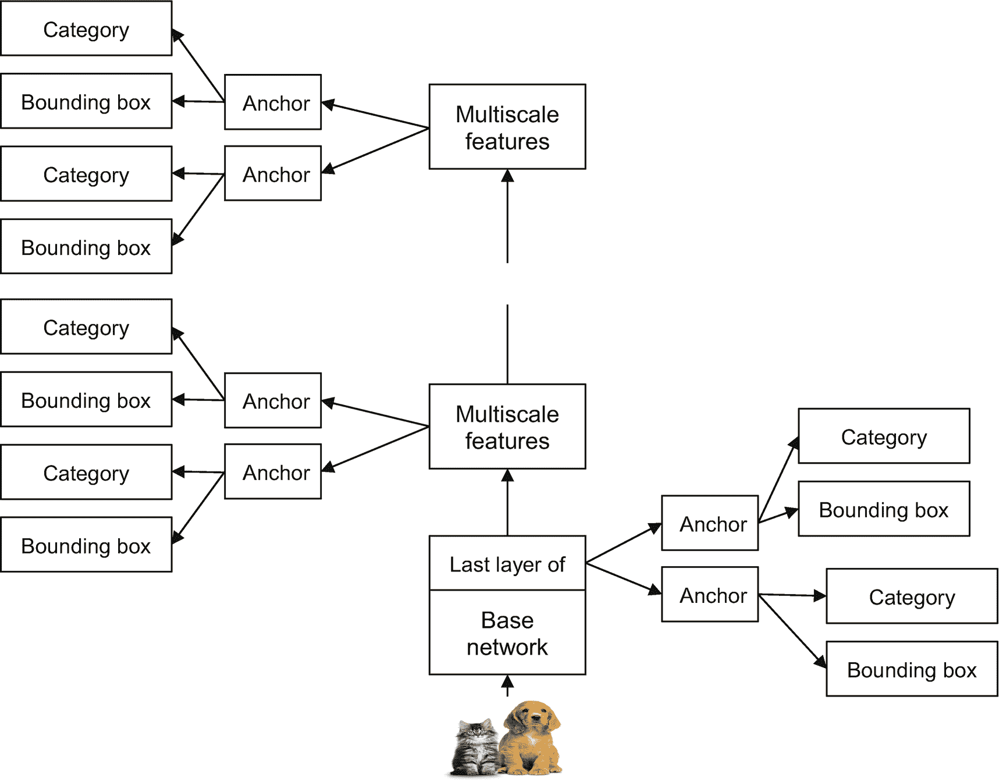

一个框图，描绘了网络结构中的类别、边界框、锚框以及多尺度特征的目标检测与识别。

图 6-11

尺寸递减的卷积层，用于在不同尺度上预测目标类别和边界框

如图 6-11 所示，每个检测层以及可选的基础网络最后一层，都会预测边界框的四个坐标偏移量和目标类别。边界框和目标是通过*锚框*来预测的，下文将对此进行描述。

##### 用于检测的锚框与卷积预测器

锚点是特征图每个卷积点上设置的一个或多个矩形形状。在图 6-12 中，一个点（蓝色所示）上设置了五个矩形锚框（红色轮廓所示）。

在 SSD 中，通常在每个点上选择五个锚框。每个锚框都充当一个检测器。这意味着特征图的每个位置通常有五个检测器，每个检测器检测五个不同的目标（或没有目标）。这些检测器尺寸的变化使它们能够检测不同大小的目标。较小的检测器会检测较小的目标，而较大的检测器能够检测较大的目标。

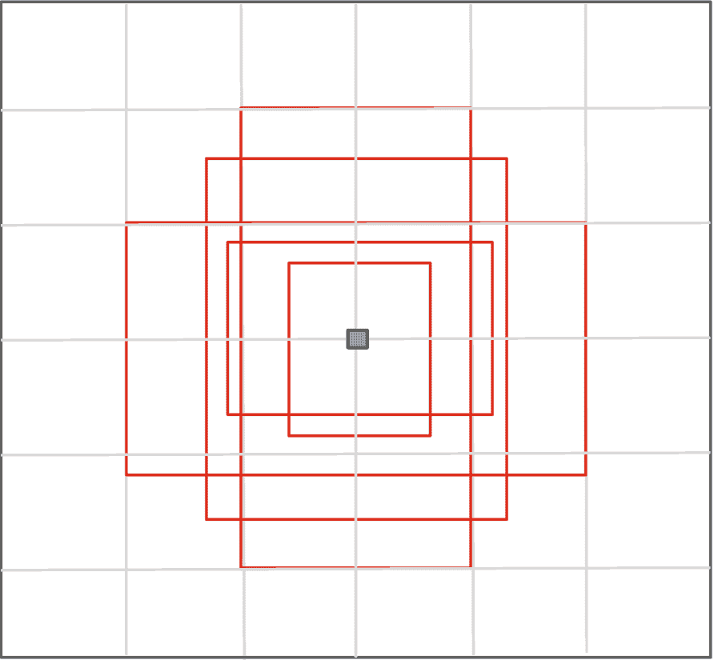

一幅插图，描绘了多个相互重叠的方形框。框的中心有一个中心方块。

图 6-12

锚框

在特征图的每个卷积点上（图 6-12 中蓝色所示），算法会预测边界框相对于锚框的偏移量。同时，它还会预测类别分数，以指示每个框中是否存在某个类别的实例。

#### 默认框与宽高比

需要注意的是，这些锚框是预先选定的常量。在 SSD 中，每个卷积点上会映射一组固定的“默认锚框”。

假设每个位置有 *K* 个框；我们计算 *C* 个类别分数和相对于默认框的四个偏移坐标。这将导致每个卷积点周围总共有 (*C*+4)×*K* 个滤波器。假设特征图大小为 *m*×*n*，则输出张量大小为 (*C*+4)×*K*×*m*×*n*。

这些默认锚框应用于每个检测卷积层（如图 6-11 所示）。这些卷积层的尺寸逐层递减，使得这些层能够生成多个不同分辨率的特征图。

图 6-13 展示了整体网络架构。

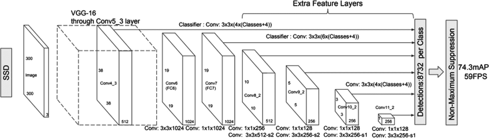

一个框图，展示了深度卷积神经网络架构 VGG 16，包含各种卷积层和全连接层，可能用于目标检测或图像分类。图中包含了层类型、维度和关键特征的详细信息。

图 6-13

截断的 VGG 主干网络，附加用于检测的卷积层（来源：Liu 等人，[`​arxiv.​org/​pdf/​1512.​02325.​pdf`](https://arxiv.org/pdf/1512.02325.pdf)）

### 训练

用于目标检测的 SSD 模型的训练过程涉及在图像的多个尺度上同时预测目标类别分数和边界框坐标。下面描述了用于优化边界框检测损失函数的训练过程以及目标匹配策略：

#### 匹配策略

在网络训练期间，算法会确定哪些默认框与真实标注框相对应，然后相应地训练网络。为了将默认框与真实标注框匹配，算法使用 IoU 来确定重叠程度。这种基于 IoU 的重叠也称为 Jaccard 重叠。IoU 阈值设为 0.5，用于判断默认框是否与任何真实标注框重叠。这种使用 IoU 的重叠计算在每个层上执行，使网络能够在不同尺度上学习。SSD 的学习过程以默认框作为初始预测，并尝试回归到更接近真实标注边界框的位置。图 6-14 说明了默认框重叠和选择的概念。

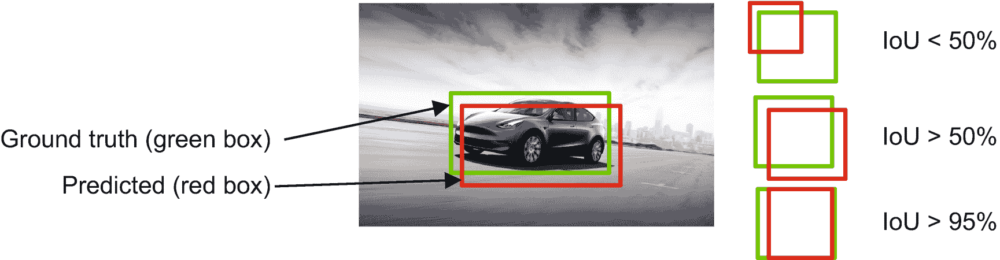

一张标记了交并比值的照片，突出了绿色框（真实标注）与红色框（预测）之间的关系。它指定了不同匹配质量评估的 IoU 阈值，包括 IoU 大于 95%、IoU 小于 50% 和 IoU 大于 50%。

图 6-14

默认框与真实标注框的匹配

#### 训练目标

SSD 的学习目标是优化一个损失函数，该函数是所有匹配的默认框上定位损失（loc）和置信度损失（conf）的加权和。

#### 为默认框选择尺度和宽高比

SSD 网络检测层尺寸的递减使其能够学习不同尺度的目标。随着训练的进行，特征图的尺寸会减小。算法如何确定每一层默认框的尺寸呢？

对于每一层，算法使用以下公式计算尺度：

*   *S*[*k*] *= S*[*min*] *+ {(S*[*max*] *− S*[*min*]*)/( m − 1)} (k − 1)，其中 k ∈ [1, m]*

其中 *m* 是特征图的尺寸，最低层的 *S*[*min*] = 0.2，最高层的 *S*[*max*] = 0.9。中间的所有其他层均匀分布。回想一下，SSD 中使用了五个默认框。这些默认框针对不同的宽高比设置：*a*[*r*] ∈ {1, 2, 3, ½, 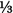 给定值为 1 比 3。}。每个默认框的宽度和高度使用以下公式计算：

*   宽度 = ***S***[***k***] 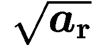

*   高度 = ***S***[***k***] ***/*** 

对于宽高比为 1 的情况，会计算另一个尺度为 ***S’***[***k***]= 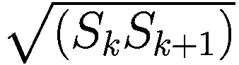 的框。这意味着每个特征图确定了六个默认框。默认框的中心使用以下公式设置：*( (i+0.5)/ |fk| , (j+0.5)/ |fk| )*，其中 *|fk|* 是第 k 个方形特征图的尺寸，i, j **∈** [0, |fk|)。

通过结合来自多个特征图所有位置、具有不同尺度和宽高比的所有默认框的预测，可以生成多样化的预测集。这涵盖了各种输入目标的大小和形状。

我们将在接下来的“YOLO”部分看到，YOLO 使用 K-means 聚类来动态选择锚框。此外，在 YOLO 中，这些锚框被称为*先验框*或*边界框先验*。


#### 难例负样本挖掘

在每一层和每个特征图上，都会生成大量默认边界框。在与真实标注框（IoU ≥ 0.5）匹配后，这些默认边界框中的大部分不会与真实标注框重叠。这些不重叠的默认边界框（IoU < 0.5）被称为*负样本框*，而与真实标注框匹配的则称为正样本框。在大多数情况下，负样本的数量远高于正样本的数量。这会导致类别不平衡，从而使预测结果产生偏差。为了平衡类别，负样本框会被排序，选取概率最高的负样本框，并丢弃其余部分，以使负样本与正样本的比例最多为 3:1。研究发现，这个比例能实现更快的优化。

#### 数据增强

SSD 对各种输入物体的大小和形状具有鲁棒性。为了实现这种鲁棒性，每个训练图像都会通过以下选项之一进行采样：

*   使用整个原始图像。
*   采样一个图像块，使得最小 IoU 为 0.1、0.3、0.5、0.7 或 0.9。
*   随机采样一个图像块。

每个样本的特征如下：

*   每个采样图像块的大小是原始图像大小的 [0.1, 1]。
*   宽高比在 1/2 到 2 之间。
*   如果真实标注框的中心位于采样的图像块内，则保留该真实标注框的重叠部分。

完成这些采样步骤后，每个采样的图像块会被调整到固定大小，并以 0.5 的概率进行水平翻转，此外还会应用一些光度失真。

#### 非极大值抑制

在推理时，SSD 学习过程的前向传播期间会生成大量边界框。处理所有这些边界框将耗费大量计算和时间。因此，丢弃那些包含物体的置信度低且 IoU 低的边界框非常重要。只选择具有最大 IoU 和置信度的前 *N* 个边界框，并丢弃或抑制非极大值框。这消除了重复项，并确保网络只保留最可能的预测结果。

### SSD 结果

SSD 是一个快速、鲁棒且准确的模型。采用 VGG-16 基础架构时，SSD 在准确性和速度方面均优于其最先进的目标检测同类模型。在 PASCAL VOC 和 COCO 数据集上，SSD-512 模型（使用 512×512 输入图像的最高分辨率网络）比当时最先进的 Faster R-CNN 快至少三倍，且更准确。SSD-300 模型能够以每秒 59 帧的速度在流式视频中更准确地进行实时目标检测，这比第一版 YOLO 更快。在第 7 章中，我们将探讨如何使用 SSD 检测视频中的物体。

## YOLO

YOLO 是一种快速、实时、多目标检测算法。YOLO 由一个单一的卷积神经网络组成，该网络同时预测边界框及其内部物体的类别概率。YOLO 在完整图像上进行训练，网络被设置为解决回归问题以检测物体。因此，YOLO 不需要复杂的处理流程，这使得它非常快速。

一个基础网络在 Nvidia Titan X GPU 上每秒可运行 45 帧。使用更快的 GPU 版本，速度可以更高，最高可达 150 FPS。这使得 YOLO 适用于实时检测流式视频中的物体，延迟低于 25 毫秒。此外，YOLO 的 mAP 是其他实时系统的两倍以上。

YOLO 由 Joseph Redmon、Santosh Divvala、Ross Girshick 和 Ali Farhadi 于 2016 年在其论文《You Only Look Once: Unified, Real-Time Object Detection》（[`https://arxiv.org/pdf/1506.02640.pdf`](https://arxiv.org/pdf/1506.02640.pdf)）中提出。

如图 6-15 所示并在原始论文中描述的检测过程如下：

1.  输入图像被划分为 S×S 的网格。
2.  如果物体的中心落在一个网格内，则该网格负责检测该物体。
3.  每个网格单元预测 *B* 个边界框以及这些边界框的置信度分数。
4.  置信度分数使用以下公式计算：
    置信度分数 = 物体存在概率 × 预测框与真实标注框之间的 IoU
    如果边界框不包含任何物体，则置信度分数为零。
5.  对于每个边界框，网络会进行五个预测：x、y、w、h 和置信度，其中：
    *   (x, y) 坐标表示边界框中心相对于网格单元边界的位置。
    *   w 和 h 是相对于整个图像的宽度和高度。
    *   置信度预测表示预测框与任何真实标注框之间的 IoU。
6.  同时，网络为每个网格单元预测一个类别条件概率 *C*，该概率以网格单元包含物体为条件。无论预测了多少个边界框 B，每个网格单元只预测一个条件概率。
7.  为了获得每个框的特定类别置信度分数，应用以下公式：
    类别置信度分数 = Pr(类别 i|物体) × Pr(物体) × 预测与真实标注之间的 IoU
    其中 Pr(类别 i|物体) 表示在网格单元内存在物体的条件下，属于某个类别的概率。
8.  这些预测被编码为一个 S × S × (B × 5 + C) 的张量。

YOLO 的发明者使用以下设置进行评估：
*   数据集：PASCAL Visual Object Classes，[`http://host.robots.ox.ac.uk/pascal/VOC/`](http://host.robots.ox.ac.uk/pascal/VOC/) (PASCAL VOC)
*   S = 7
*   B = 2
*   C = 20，因为 PASCAL VOC 有 20 个物体类别

最终的预测产生一个 7 × 7 × (2 × 5 + 20) = 7 × 7 × 30 的张量。

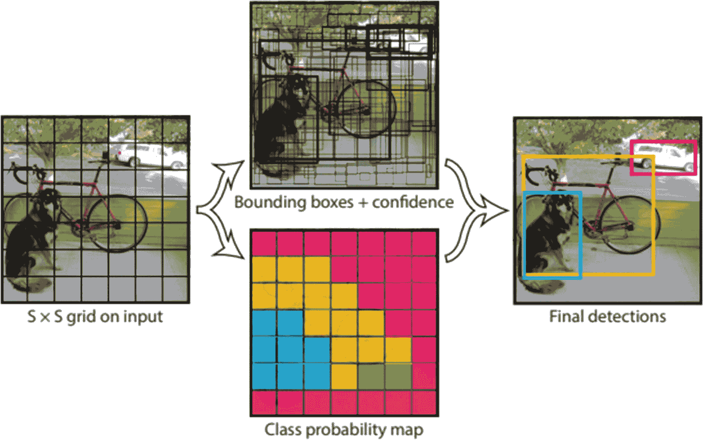

一张示意图，展示了输入图像被划分为 S×S 网格、边界框加置信度、类别概率图，并检测出狗、自行车和汽车。

图 6-15
YOLO 目标检测示意图（来源：Joseph Redmon 等人）

### YOLO 网络设计

YOLO 网络架构的灵感来源于用于图像分类的 GoogLeNet。为 YOLO 稍作修改的 GoogLeNet 由 24 个卷积层（含最大池化）后接两个全连接层组成。注意，图 6-16 所示的完整网络中，最后一层生成了输出张量，维度为 7×7×30。

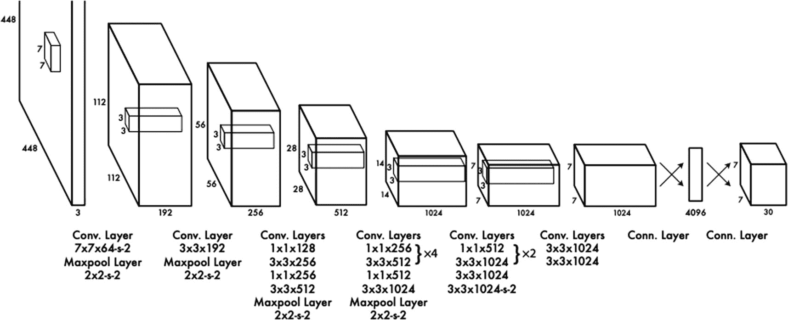

一个框图，展示了包含多个层（包括用于特征提取和分类的卷积层、最大池化层和全连接层）的卷积神经网络架构。

图 6-16
YOLO 神经网络架构（来源：Joseph Redmon 等人）

### YOLO 的局限性

尽管 YOLO 是最快的目标检测算法之一，但它也有一些局限性：

*   难以处理成群出现的小物体，例如鸟群。
*   在一个网格单元内只能预测一个物体类别。
*   如果物体具有训练集中未出现过的异常宽高比，则预测效果不佳。
*   其准确性低于某些最先进的算法，例如 Faster R-CNN。


### YOLO9000 或 YOLOv2

YOLOv2 是 YOLO 的改进版本。与 YOLO 相比，它提高了检测精度和速度。该模型经过训练可检测超过 9000 个物体类别；因此，它被命名为 YOLO9000。这项改进及其检测算法在 Joseph Redmon 和 Ali Farhadi 于 2016 年 12 月发表的论文《YOLO9000：更好、更快、更强》中进行了描述（[`https://arxiv.org/pdf/1612.08242.pdf`](https://arxiv.org/pdf/1612.08242.pdf)）。

YOLOv2 旨在克服 YOLO 的一些局限性，特别是精度和召回率水平。此外，它还能够检测具有未见过的宽高比的物体。

以下是 YOLOv2 为实现更好、更快、更强的结果所做的改进列表：

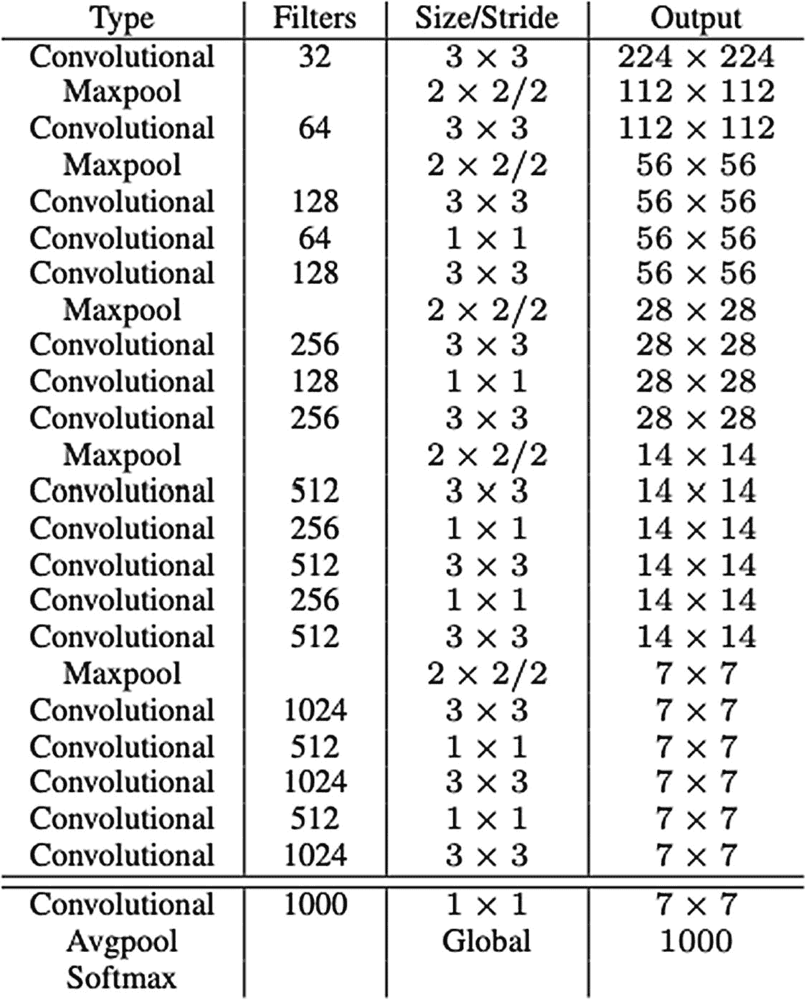

一张表格概述了卷积神经网络的配置，详细说明了滤波器、输出维度、层类型、大小和步长。该网络架构由卷积层、最大池化层和全连接层组成，每层都有特定的维度和参数。

图 6-17

Darknet-19（来源：Joseph Redmon 等人，[`​arxiv.​org/​pdf/​1612.​08242.​pdf`](https://arxiv.org/pdf/1612.08242.pdf)）

*   **批量归一化**：YOLOv2 在 YOLO 的所有卷积层上添加了批量归一化。回顾一下，批量归一化有助于正则化模型。通过使用批量归一化，YOLOv2 的 mAP 提升了超过 2%。

*   **高分辨率分类器**：YOLOv2 经过微调，可以从更高分辨率的输入图像中学习。在 448×448 分辨率下，网络输出提升了 4% 的 mAP。

*   **带锚点框的卷积**：YOLOv2 移除了全连接层，并使用全卷积层。它还引入了锚点框来预测边界框。尽管精度略有下降，但通过使用锚点框，YOLOv2 每张图像能够检测超过 1000 个物体，而 YOLO 只能检测 98 个。

*   **维度聚类**：锚点框的大小是通过对 VOC 2017 训练集进行 K-means 聚类确定的。k=5 的值在平均 IOU 与模型复杂度之间提供了最佳权衡。平均 IOU 为 61.0%。

*   **细粒度特征**：YOLOv2 使用一个直通层，通过将相邻特征堆叠到不同通道而非空间位置来连接更高分辨率的特征。这种方法带来了约 1% 的性能提升。

*   **多尺度训练**：YOLOv2 能够检测不同尺寸图像中的物体。YOLOv2 不固定输入图像尺寸，而是每隔几次迭代动态更改网络。例如，每十个批次，网络会随机选择一个新的图像维度。这意味着同一个网络可以在不同分辨率下预测检测结果。在低分辨率下，YOLOv2 作为一个廉价且相当准确的检测器运行。

288×288 的 YOLOv2 网络以超过 90 FPS 的速度运行，其 mAP 几乎与 Fast R-CNN 相当。这使得它非常适合较小的 GPU、高帧率视频或多个视频流。在高分辨率下，YOLOv2 是一个最先进的检测器，在 VOC 2007 上达到 78.6 mAP，同时仍以超实时速度运行。

*   **使用 DarkNet 替代 GoogLeNet**：YOLOv2 使用一个名为 DarkNet-19 的 CNN。该网络有 19 个卷积层和 5 个最大池化层。Darknet-19 处理一张图像仅需 55.8 亿次运算，而 VGG 需要 306.7 亿次，YOLO 需要 85.2 亿次。然而，它在 ImageNet 上实现了 72.9% 的 top-1 准确率和 91.2% 的 top-5 准确率。图 6-17 展示了 Darknet-19 的网络架构。

*   **联合分类与检测**：YOLOv2 可以从包含分类和检测标签的数据集中学习。在训练过程中，当网络看到标记为检测的图像时，它会执行完整的 YOLOv2 损失函数优化。而当它看到用于分类的图像时，它会使用网络的分类部分反向传播损失。YOLOv2 的数据集是通过合并 COCO 和 ImageNet 的数据集创建的。该网络能够从分类和检测数据集中学习，与普通的 YOLO 相比，构建了一个更强的模型。

下表总结了 YOLOv2 的改进及其对精度和速度的影响（与普通 YOLO 相比）：

|   | 改进 | 效果 |
| --- | --- | --- |
| 更好 | 批量归一化 | mAP 提升 2% |
|   | 高分辨率分类器 | mAP 提升 4% |
|   | 带锚点框的卷积 | 每张图像能够检测超过 1000 个物体 |
|   | 维度聚类 | mAP 提升 4.8% |
|   | 细粒度特征 | mAP 提升 1% |
|   | 多尺度训练 | mAP 提升 1.1% |
| 更快 | Darknet-19 | 计算量减少 33%，mAP 提升 0.4% |
|   | 卷积预测层 | mAP 提升 0.3% |
| 更强 | 联合分类与检测 | 能够检测超过 9000 个物体 |


### YOLOv3

YOLO 的另一个改进版本是 YOLOv3，它在 YOLOv2 的基础上进行了一些改进。YOLOv3 在 2018 年 4 月由 Joseph Redmon 和 Ali Farhadi 发表的论文《YOLOv3: An Incremental Improvement》中进行了描述（[`https://arxiv.org/pdf/1804.02767.pdf`](https://arxiv.org/pdf/1804.02767.pdf)）。

YOLOv3 的特性和改进如下所述：

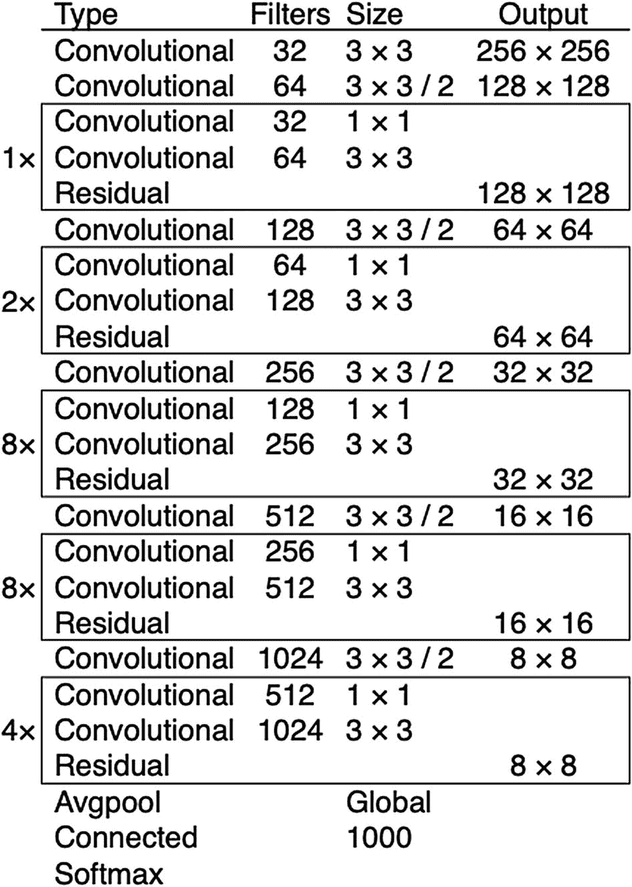

一张表格概述了 CNN 架构，指定了层类型、滤波器数量、大小和输出维度，包括残差块，最终以一个用于分类的 1000 类 softmax 层结束。

图 6-18

YOLOv3 中使用的 Darknet-53（来源：[`​arxiv.​org/​pdf/​1804.​02767.​pdf`](https://arxiv.org/pdf/1804.02767.pdf)）

*   *边界框预测*：在检测边界框方面，YOLOv3 与 YOLOv2 相比没有变化。YOLOv3 在训练过程中使用平方误差和损失。它还使用逻辑回归为每个边界框预测一个物体性分数。如果某个边界框先验与真实物体的重叠程度超过任何其他边界框先验，则该物体性分数记为 1。每个真实物体只分配一个边界框先验。如果边界框先验不是最佳的，但与真实物体的重叠程度超过某个阈值，则忽略该预测。YOLOv3 的发明者使用的阈值为 0.5。系统为每个真实物体只分配一个边界框先验。

*   *物体类别预测*：网络预测边界框内物体的多个类别。softmax 激活函数不适用于预测多标签类别。因此，YOLOv3 使用回归分类器代替 softmax。

*   *跨尺度预测*：YOLOv3 在三种不同的尺度上预测边界框。它仍然使用 K-means 聚类来确定边界框先验。它有九个聚类和任意选择的三个尺度，然后将聚类均匀地分配到各个尺度上。

    例如，在 COCO 数据集上，九个聚类如下：(10×13), (16×30), (33×23), (30×61), (62×45), (59×119), (116×90), (156×198), (373×326)。

*   *特征提取器*：作为特征提取的主干网络，YOLOv3 使用了 Darknet-19 的改进版本。该网络被命名为 Darknet-53。它有 53 个卷积层。图 6-18 展示了 Darknet-53 的网络架构。

*   *训练*：YOLOv3 的训练方法与 YOLOv2 相比没有变化。训练是在完整图像上进行的，使用了多尺度数据、批量归一化以及混合的分类和检测标签。

以下是 YOLOv3 的结果：

*   就整体 mAP 而言，由于网络更宽（53 层，而 YOLOv2 为 19 层），YOLOv3 的性能显著下降。

*   采用 608×608 分辨率图像的 YOLOv3 在 51ms 推理时间内达到了 33.0%的 mAP，而 RetinaNet-101–50–500 在 73ms 推理时间内仅达到 32.5%的 mAP。

*   YOLOv3 的准确率与 SSD 变体相当，但检测速度快了 3 倍。

## YOLOv4

YOLOv4 是 YOLO 的改进版本，建立在 YOLOv3 的成功和经验教训之上。Alex 等人关于 YOLOv4 的原始论文位于[`https://arxiv.org/pdf/2004.10934.pdf`](https://arxiv.org/pdf/2004.10934.pdf)。

YOLOv4 在 YOLOv3 的基础上引入了多项重大改进：

*   *主干网络架构*：YOLOv4 采用了更先进的主干网络，称为 CSPDarknet53，它基于 Darknet 架构。它集成了跨阶段局部网络（CSPNet）模块，实现了更高效、更准确的特征提取。

*   *颈部架构*：YOLOv4 引入了一种称为空间金字塔池化（SPP）和路径聚合网络（PANet）的颈部架构。SPP 允许模型在不同尺度上捕获上下文信息，而 PANet 则聚合来自多个层次的特征以提高检测精度。

*   *改进的锚点生成*：YOLOv4 采用了一种称为 Anchor-Free YOLO（YOLOv4-csp）的无锚点方法，消除了对锚点框的需求。这种方法简化了边界框预测过程，并提高了对小物体的检测精度。

*   *先进技术的使用*：YOLOv4 融合了多种先进技术，如 Mish 激活函数、完全交并比（CIOU）损失函数和自对抗训练。这些技术有助于改善梯度流、增强定位精度并提升整体性能。

*   *训练策略*：YOLOv4 采用了不同的训练策略，如随机形状训练、马赛克数据增强和改进的数据增强策略。这些策略增强了模型在不同场景下的泛化能力和性能表现。

## YOLOv7

YOLO 目标检测算法经历了多次迭代，每一次都建立在前代版本优势的基础上。最新版本代表了相较于早期版本的重大进步。YOLOv4 是官方 Darknet 项目系列迭代中的最终成就。

然而，基于 YOLO 的模型格局已扩展到官方谱系之外。YOLOv5，以及 YOLOR 和 YOLOX 等其他几个迭代版本，成为了值得注意的例子。这些模型虽然在原始 Darknet 项目的背景下是非官方的，但对 YOLO 方法的推进做出了重大贡献。

YOLOv7 树立了新的标杆，在速度和精度上超越了所有现有的目标检测器，其运行范围从 5 FPS 到 160 FPS。值得注意的是，它拥有无与伦比的精度，平均精度（AP）达到 56.8%，使其成为在 GPU V100 平台上以 30 FPS 或更高速度运行的实时目标检测器中的领跑者。

官方 YOLOv7 论文《YOLOv7: Trainable bag-of-freebies sets new state-of-the-art for real-time object detectors》（[`https://arxiv.org/pdf/2207.02696.pdf`](https://arxiv.org/pdf/2207.02696.pdf)）于 2022 年 7 月由 Chien-Yao Wang、Alexey Bochkovskiy 和 Hong-Yuan Mark Liao 发布。源代码根据 GPL-3.0 许可证（一种自由的 copyleft 许可证）作为开源发布，可在官方 YOLOv7 GitHub 仓库中找到：[`https://github.com/WongKinYiu/yolov7`](https://github.com/WongKinYiu/yolov7)。

YOLOv7 在保持高效推理的同时，在实时目标检测精度方面引入了重大进步。在基准测试比较中，YOLOv7 通过在最先进的实时目标检测系统中减少约 40%的参数和 50%的计算量，超越了其他已建立的目标检测器。这带来了更快的推理速度和更高的检测精度。

本质上，YOLOv7 提出了一种更快、更稳健的网络架构，该架构采用了更高效的特征集成方法。这进而带来了更高的目标检测精度、更强的损失函数，以及更高效的标签分配和模型训练。因此，与其他深度学习模型相比，YOLOv7 对计算硬件的要求显著降低。此外，它可以在较小的数据集上快速训练，无需预训练权重。

### YOLOv7 架构特性

YOLOv7 论文引入了以下主要变化：

*   YOLOv7 架构
    *   扩展的高效层聚合网络（E-ELAN）

    *   针对基于拼接模型的模型缩放

*   可训练的免费赠品包
    *   计划重参数化卷积

    *   用于辅助损失的粗粒度和用于主导损失的细粒度


#### E-ELAN

E-ELAN 是 YOLOv7 主干网络中的计算模块。其设计基于对以下影响速度和准确率因素的分析：

*   内存访问成本
*   输入/输出通道比率
*   逐元素操作
*   激活函数
*   梯度路径

E-ELAN 架构使框架能够更好地学习。它基于 ELAN 计算模块。E-ELAN 使用扩展、混洗、合并基数的方法，在不破坏原始梯度路径的前提下，持续增强网络的学习能力。ELAN 和 E-ELAN 的参考架构见图 6-19。

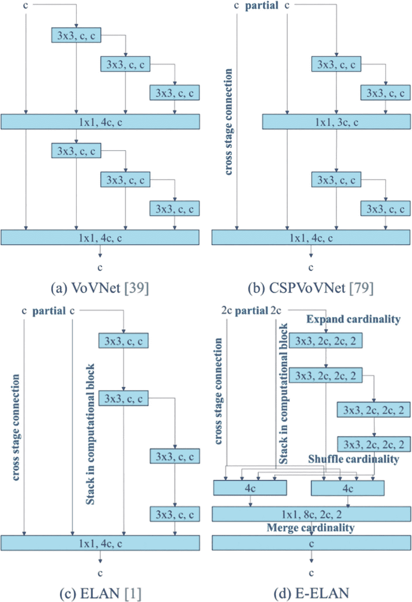

这些插图展示了不同 CNN 设计中使用的架构模块，包括卷积层、跨阶段连接、堆叠和混洗模块，以及不同基数，以增强网络性能。

图 6-19
VoVNet、CSPVoVNet、ELAN 和 E-ELAN 架构（来源：[`​arxiv.​org/​pdf/​2207.​02696.​pdf`](https://arxiv.org/pdf/2207.02696.pdf)）

#### 基于拼接模型的模型缩放

*模型缩放* 主要旨在修改模型的特定属性，从而创建不同尺度的模型。这种调整能够满足不同需求下对推理速度的要求。例如，EfficientNet 的缩放过程涉及调整宽度、深度和分辨率。相反，在 scaled-YOLOv4 中，缩放模型主要围绕修改阶段数量进行。

在采用基于拼接架构（如 ResNet 或 PlainNet）的传统方法中，必须综合而非孤立地考虑缩放因子。换句话说，当增加模型深度时，这种调整可能会引发过渡层中输入与输出通道比率的比例变化。因此，这种改变可能导致模型硬件利用率的降低。

这就是 YOLOv7 在基于拼接的模型框架中引入复合模型缩放的原因。复合缩放方法保留了模型在初始设计时所具备的固有特性，从而确保最优结构得以保持。

以下是复合模型缩放的工作原理：举例来说，调整计算模块的深度因子需要相应修改该模块的输出通道。随后，对过渡层应用等效调整来执行宽度因子缩放。图 6-20 和图 6-21 展示了这一概念。

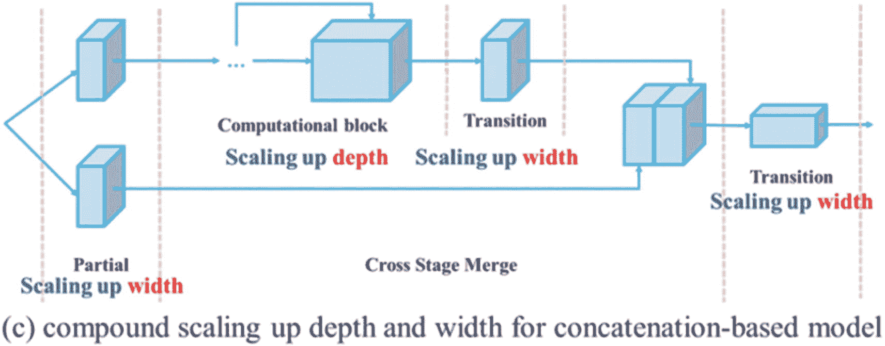

一个说明复合缩放的框图，该缩放结合了增加的深度和宽度，使基于拼接的模型能够适应并提升性能。

图 6-21
复合放大的基于拼接模型的示意图（来源：[`​arxiv.​org/​pdf/​2207.​02696.​pdf`](https://arxiv.org/pdf/2207.02696.pdf)）

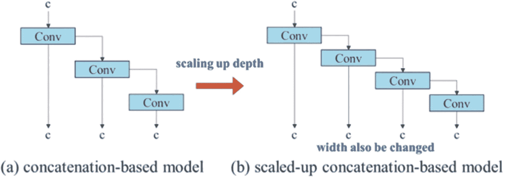

两个框图。a. 具有卷积层和拼接操作的基于拼接模型，用于调整深度和宽度。b. 一个放大的基于拼接模型，增加了层以获得更多灵活性。

图 6-20
基于拼接模型和放大的基于拼接模型的示意图（来源：[`​arxiv.​org/​pdf/​2207.​02696.​pdf`](https://arxiv.org/pdf/2207.02696.pdf)）

#### 计划重参数化卷积

*重参数化* 是一种旨在提升模型性能的训练后技术。虽然它会延长训练时间，但能带来更好的推理结果。用于模型优化的重参数化分为两类：

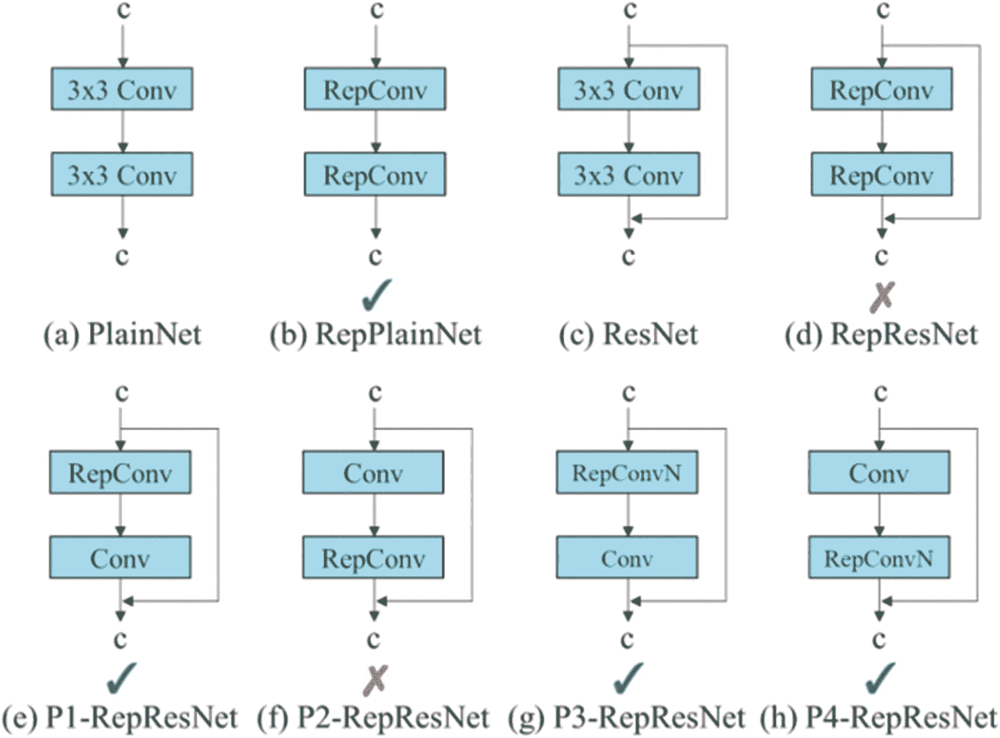

一个说明 8 种网络架构的框图，包括 Plain Net、Rep Plain Net、Res Net、Rep Res Net 以及各种 P-Rep Res Net 模型，每种模型都有不同的配置以提升性能。

图 6-22
计划重参数化模型（来源：[`​arxiv.​org/​pdf/​2207.​02696.​pdf`](https://arxiv.org/pdf/2207.02696.pdf)）

*   *模型级重参数化*：可以通过以下两种方法实现：
    *   使用不同的训练数据训练多个模型，同时保持一致的设置。随后，对其权重进行平均以得到最终模型。
    *   计算不同训练周期下模型权重的平均值。

*   *模块级重参数化*：这种方法在研究中获得了广泛关注。模型训练过程被拆分为多个模块。将输出进行集成以获得最终模型。YOLOv7 论文的作者展示了执行模块级集成的最佳方法。见图 6-22。

如图 6-22 所示，E-ELAN 计算模块的 3×3 卷积层被替换为 RepConv 层。通过切换或替换 RepConv、3×3 卷积和恒等连接的位置进行了实验。图中所示的残差旁路箭头是一个恒等连接，它是一个 1×1 卷积层。该实验有助于确定哪些配置有效，哪些无效。

RepConv 实际上将 3×3 卷积、1×1 卷积和恒等连接组合在一个卷积层中。在分析了 RepConv 与不同架构的组合及相应性能后，YOLOv7 的作者发现，RepConv 中的恒等连接破坏了 ResNet 中的残差结构和 DenseNet 中的拼接结构，而后者为不同的特征图提供了更多样化的梯度。因此，他们使用不含恒等连接的 RepConv（RepConvN）来设计计划重参数化卷积的架构。他们认为，当带有残差或拼接结构的卷积层被重参数化卷积替换时，不应包含恒等连接。


#### 辅助头粗粒度与主导头细粒度损失

如前所述，YOLO 架构包含主干网络、颈部网络和头部网络。头部网络包含预测输出。YOLOv7 采用了多头架构。

在 YOLOv7 中，负责最终输出的头部被称为*主导头*，而用于辅助中间层训练的头部被称为*辅助头*。

借助辅助损失，辅助头的权重得以更新。

*标签分配器*是一种机制，它将网络的预测结果与真实标注相结合，随后分配软标签。需要强调的是，这个过程会产生软化的、泛化的标签。

与传统的标签分配技术（通过直接引用真实标注并应用预定义规则来生成刚性标签）不同，创建可靠软标签的方法涉及使用计算和优化方法。这些方法在结合真实标注的同时，考虑了预测输出的质量和分布。以下两种方法用于创建作为训练目标的软标签：

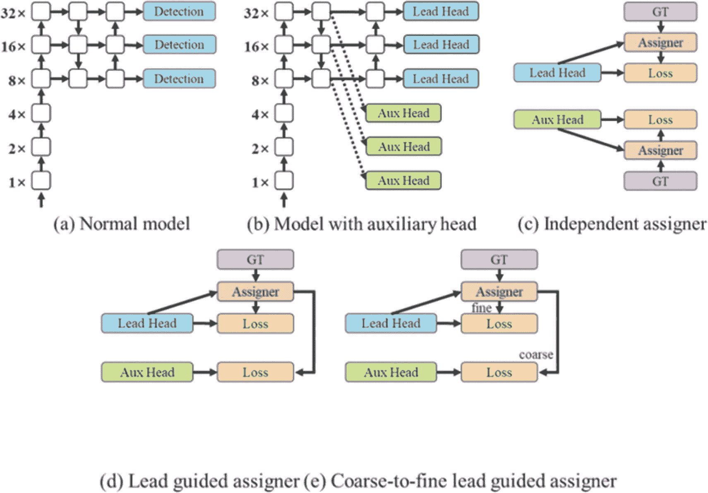

标记为 a 到 e 的框图代表了具有不同检测级别的不同网络模型和配置，包括普通模型、带辅助头的模型、独立分配器、主导头引导分配器以及用于提升性能和目标检测的由粗到精主导头引导分配器。

图 6-23

普通模型 (a)、带辅助头的模型 (b)、独立分配器 (c)、主导头引导分配器 (d) 和由粗到精主导头引导分配器 (e) 的示例（来源：[`​arxiv.​org/​pdf/​2207.​02696.​pdf`](https://arxiv.org/pdf/2207.02696.pdf)）

*   *主导头引导标签分配器*：主要依赖主导头的预测结果和真实标注来计算其值。然后，这些值通过优化过程用于生成软标签。这组软标签作为模型中辅助头和主导头的训练目标。

*   *由粗到精主导头引导标签分配器*：同样利用主导头的预测结果和真实标注来生成软标签。然而，这种方法会生成两组不同的软标签：粗标签和细标签。细标签与主导头引导标签分配器生成的软标签一致。另一方面，粗标签是通过放宽正样本分配过程的约束条件生成的，从而有效地将更多的网格单元指定为正目标。图 6-23 描绘了主导头引导分配器和由粗到精主导头引导分配器。

在本章中，我们将探讨如何训练自定义的 YOLOv7 模型，并在图像和视频中执行目标检测。

## 目标检测算法对比

到目前为止，在本章中，我们探讨了三种不同的目标检测算法类别：R-CNN 及其变体、SSD 和 YOLO。这些算法在两个流行的数据集（VOC 和 COCO）上进行了训练，并对其速度和准确性进行了基准测试。本节提供的对比可作为指南，用于判断在构建目标检测系统时，一种算法相对于另一种算法的适用性和应用性。性能指标和基准测试结果主要取自赵中求、郑鹏、徐守涛和吴信东于 2019 年 4 月发表的论文《基于深度学习的目标检测：综述》（[`https://arxiv.org/pdf/1807.05511.pdf`](https://arxiv.org/pdf/1807.05511.pdf)）。

### 架构对比

表 6-1 从目标检测算法所使用的神经网络架构方面进行了对比。

表 6-1

目标检测器神经网络架构对比

| 目标检测器 | 区域提议 | 激活函数 | 损失函数 | Softmax 层 |
| --- | --- | --- | --- | --- |
| R-CNN | 选择性搜索 | SGD | 铰链损失（分类），边界框回归 | 是 |
| Fast R-CNN | 选择性搜索 | SGD | 分类对数损失 + 边界框回归 | 是 |
| Faster R-CNN | RPN | SGD | 分类对数损失 + 边界框回归 | 是 |
| Mask R-CNN | RPN | SGD | 分类对数损失 + 边界框回归 + 语义 Sigmoid 损失 | 是 |
| SSD | 无 | SGD | 分类均方误差损失 + 边界框回归 | 否 |
| YOLO | 无 | SGD | 分类均方误差损失 + 边界框回归 + 目标置信度 + 背景置信度 | 是 |
| YOLOv2 | 无 | SGD | 分类均方误差损失 + 边界框回归 + 目标置信度 + 背景置信度 | 是 |
| YOLOv3 | 无 | SGD | 分类均方误差损失 + 边界框回归 + 目标置信度 + 背景置信度 | 逻辑分类器 |
| YOLOv4 | 无 | Mish | CIOU（完全交并比） | 逻辑分类器 |

### 性能对比

表 6-2 提供了在 Microsoft COCO 数据集上训练的目标检测算法的性能对比。训练在配备单核 Intel i7-6700K CPU 和 Nvidia Titan X GPU 的平台上进行。

表 6-2

目标检测模型性能对比

| 目标检测器 | 训练数据集 | mAP | 测试速度（秒/图像） | 每秒帧数 (FPS) | 适用于实时视频？ |
| --- | --- | --- | --- | --- | --- |
| R-CNN | COCO 2007 | 66.0% | 32.84 | 0.03 | 否 |
| Fast R-CNN | COCO 2007 和 2012 | 66.9% | 1.72 | 0.60 | 否 |
| Faster R-CNN (VGG-16) | COCO 2007 和 2012 | 73.2% | 0.11 | 9.1 | 否 |
| Faster R-CNN (RestNet-101) | COCO 2007 和 2012 | 83.8% | 2.24 | 0.4 | 否 |
| SSD300 | COCO 2007 和 2012 | 74.3% | 0.02 | 46 | 是 |
| SSD512 | COCO 2007 和 2012 | 76.8% | 0.05 | 19 | 是 |
| YOLO | COCO 2007 和 2012 | 73.4% | 0.02 | 46 | 是 |
| YOLOv2 | COCO 2007 和 2012 | 78.6% | 0.03 | 40 | 是 |
| YOLOv3 608×608 | COCO 2007 和 2012 | 76.0% | 0.029 | 34 | 是 |
| YOLOv3 416×416 | COCO 2007 和 2012 | 75.9% | 0.051 | 19 | 是 |
| YOLOv4 512×512 | COCO 2017 | 61.71% | 0.058 | 17 | 是 |


## 使用 TensorFlow 训练目标检测模型

我们现在准备编写代码来构建和训练我们自己的目标检测模型。我们将使用 TensorFlow API 并用 Python 编写代码。目标检测模型对计算资源要求很高，需要大量内存和强大的处理器。大多数通用笔记本电脑或计算机可能无法处理构建和训练目标检测模型所需的计算。例如，一台配备 32GB 内存和八核 CPU 的 MacBook Air 无法训练涉及约 7000 张图像的检测模型。幸运的是，谷歌免费提供有限的基于 GPU 的计算资源。事实证明，这些模型在 GPU 上的运行速度比在 CPU 上快很多倍。因此，学习如何在 GPU 上训练模型非常重要。出于演示和学习的目的，我们将使用谷歌 GPU 的免费版本。让我们首先明确我们的学习目标以及我们想要如何实现它。

*   *目标*：学习如何使用 Keras 和 TensorFlow 训练目标检测模型。

*   *数据集*：Oxford-IIIT Pet 数据集，可免费从 [`https://robots.ox.ac.uk/~vgg/data/pets/`](https://robots.ox.ac.uk/~vgg/data/pets/) 获取。该数据集包含 37 个类别的宠物，每个类别大约有 200 张图像。这些图像在尺度、姿态和光照方面差异很大。它们已经用边界框进行了标注和标记。

*   *执行环境*：我们将使用 Google Colaboratory（[`https://colab.research.google.com`](https://colab.research.google.com)），简称 Colab。我们将利用 Colab 免费提供的 GPU 硬件加速器。Google Colab 是一个免费的 Jupyter notebook 环境，无需设置，完全在云端运行。Jupyter notebook 是一个基于 Web 的开源应用程序，用于编写和执行 Python 程序。要了解更多关于如何使用 Jupyter notebook 的信息，请访问 [`https://jupyter.org`](https://jupyter.org)。文档可在 [`https://jupyter-notebook.readthedocs.io/en/stable/`](https://jupyter-notebook.readthedocs.io/en/stable/) 获取。我们将在编写代码的过程中学习 Colab notebook 环境。

我们将使用 TensorFlow 2.12.0 在 Google Colab 上训练检测模型，模型训练完成后，我们将下载它并在我们笔记本电脑的本地环境中使用。

### 在 Google Colab 上使用 GPU 运行 TensorFlow

Google Colab 为机器学习教育和培训提供了一个免费的 Jupyter notebook 环境。它提供大约 13GB 内存、80GB 磁盘空间和一个 Nvidia GPU 等资源，允许连续使用长达 12 小时。如果你的会话过期或达到 12 小时限制，你可以选择重新创建 Colab 运行时。

当你在 Colab 中执行代码时，它运行在一个专门为你的个人账户创建的虚拟机上。会话过期后，虚拟机将被终止，虚拟磁盘中保存的任何数据都将丢失。但是，Colab 提供了一种便捷的方法，可以将 Google Drive 目录挂载到 Colab 虚拟磁盘，使你能够将数据存储在永久的 Google Drive 上。这样，每当你创建新的 Google Colab 会话时，都可以检索到这些数据。

让我们开始使用 Google Colab 并配置其设置。

#### 访问 Google Colab

要访问 Google Colab，你需要一个 Google（或 Gmail）账户。如果你还没有，可以在 [`https://accounts.google.com`](https://accounts.google.com) 注册一个账户。

要开始使用 Google Colab，请打开你的网络浏览器并导航到 [`https://colab.research.google.com`](https://colab.research.google.com)。如果你已经登录到你的 Google 账户，你将可以立即访问 Colab。如果你尚未登录，请使用你的 Google 账户凭据登录以获取 Google Colab 的访问权限。

#### 连接到托管运行时

点击屏幕右上角、用户和设置图标下方的“连接”按钮，然后点击“连接到托管运行时”（见图 6-24）。此时，将创建一个 Colab 会话。

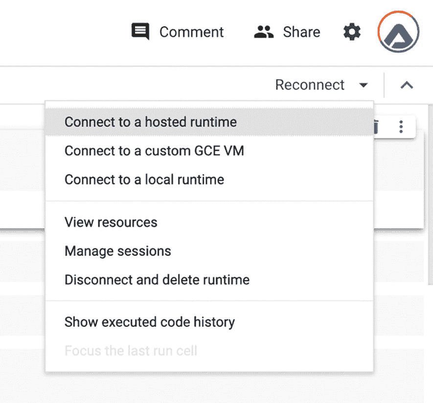

一张截图展示了代码运行时环境中的选项和控件，允许用户管理连接、资源、已执行代码历史记录以及最后运行的单元格，以实现高效的编码和调试。

图 6-24

连接到托管运行时

#### 选择 GPU 硬件加速器

点击“编辑”，然后点击“笔记本设置”（见图 6-25）以打开一个模态窗口。选择 GPU 作为硬件加速器。确保为运行时类型选择了 Python 3。点击“保存”按钮（见图 6-26）。

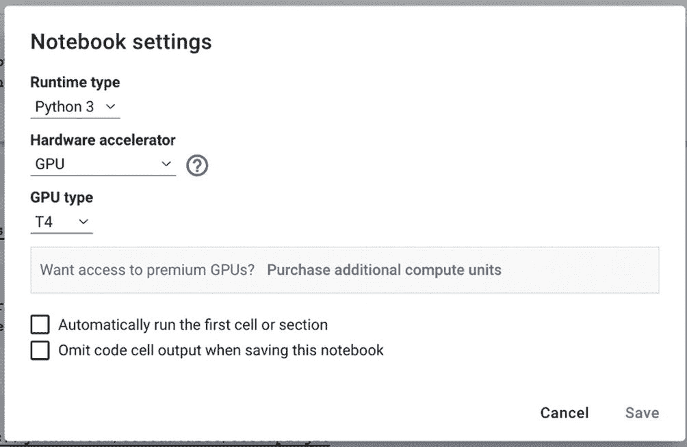

一张代码环境中笔记本设置的截图，显示了配置运行时类型、硬件加速器 GPU 类型以及自动运行代码单元格和保存笔记本输出的偏好选项。

图 6-26

选择 GPU 作为加速器

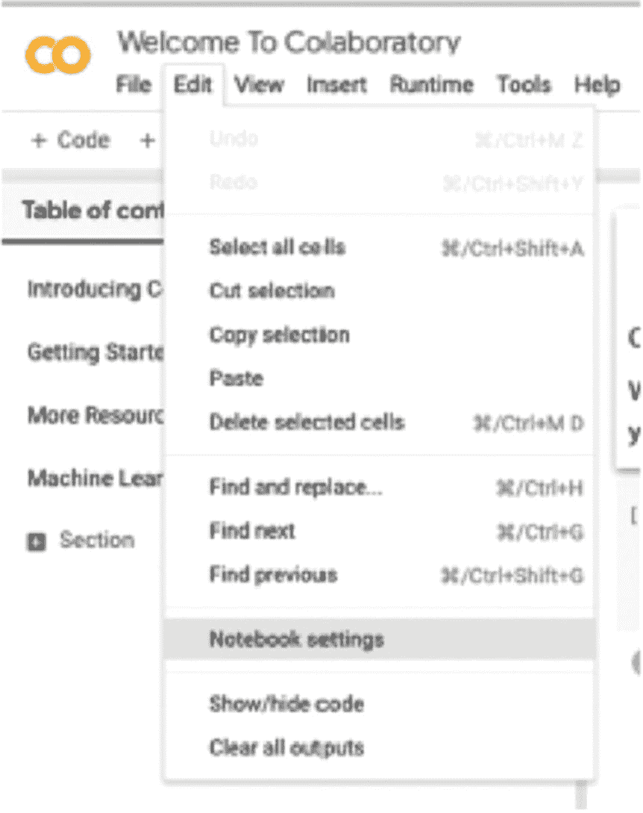

一张 Colaboratory 界面的截图，这是一个基于云的编码环境，显示了包含文件管理、编辑、查看和运行代码等各种选项的菜单栏。已选中“笔记本设置”。

图 6-25

访问笔记本设置

#### 创建 Colab 项目

点击“文件”，然后点击“新建笔记本”。新笔记本将在新的浏览器标签页中打开。给这个笔记本起一个有意义的名称，例如“目标检测模型训练”。默认情况下，此笔记本会保存到你的 Google Drive 中。

#### 为 TensorFlow 和模型训练设置运行时环境

点击“+代码”以在笔记本中插入一个代码单元格。注意笔记本主区域中有一个带有空单元格的代码块。你可以在此单元格中编写 Python 代码，并通过点击执行图标来执行它。

Google Colab 是一个交互式编程环境，不提供对底层操作系统的直接访问。你可以使用 `%%shell` 来调用 shell，该 shell 在调用它的单个代码单元格块内保持活动状态。你可以根据需要从任意多个代码块中调用 shell。

为了训练目标检测模型，我们将执行以下任务：

1.  安装并设置必要的库。

2.  下载并安装 TensorFlow `models` 项目。

3.  下载宠物数据集并将文件转换为 TFRecord 格式。

4.  下载用于迁移学习的预训练目标检测模型。

5.  配置训练流程。

6.  训练并监控 SSD 模型。

7.  最终确定并导出模型。

8.  使用 TensorBoard 可视化模型指标和评估结果。


##### 安装与设置库

在 Colab 中，你可以通过在命令前添加感叹号 (!) 来执行 shell 命令。此功能使你能够直接在 Colab 笔记本环境中运行终端命令。清单 6-1 列出了目标检测训练所需的一系列库。

```
文件名: Listing_6_1
1    !pip install numpy==1.23
2    !pip install pillow==9.5
3    !apt install -y protobuf-compiler
清单 6-1
安装必要的库和包
```

在撰写本文时，TensorFlow 2.12.0 版本要求 NumPy 版本为 1.23。然而，Google Colab 默认安装了更高版本的 NumPy。为了确保与 TensorFlow 的兼容性，必须显式安装 NumPy 1.23 版本，如第 1 行所示。

此外，为了与当前版本的 TensorFlow 无缝集成，我们正在安装用于图像处理任务的 Pillow 库的 9.5 版本（第 2 行）。

请注意，这些 NumPy 和 Pillow 的版本要求未来可能会发生变化，你可能需要相应地更新或删除清单 6-1 中的第 1 行和第 2 行。

在第 3 行，我们正在安装 protobuf-compiler。Protocol Buffers 编译器，通常被称为“protoc”或“protobuf-compiler”，是一个随 Protocol Buffers 库提供的命令行工具。它用于将 `.proto` 文件编译成特定语言的代码，例如 Python、C++、Java、Go 等。

##### 安装 TensorFlow 的 models 项目

TensorFlow `models` 项目是由 Google 和 TensorFlow 社区维护的一个官方 GitHub 仓库。它包含了一系列与 TensorFlow 库相关的预训练机器学习模型和工具。这些模型涵盖了广泛的任务，包括图像分类、目标检测、自然语言处理和生成模型。该仓库对于从事机器学习和人工智能领域的研究人员和开发者来说是一个宝贵的资源。然而，由于 TensorFlow 生态系统发展迅速，最好参考 GitHub 上的官方仓库以获取最新信息。

清单 6-2 展示了如何克隆和安装 `models` 项目。

```
文件名: Listing_6_2
1    %%shell
2    git clone --depth 1 https://github.com/tensorflow/models.git
3    cd models/research/
4    protoc object_detection/protos/*.proto --python_out=.
5    cd /content
6    git clone https://github.com/cocodataset/cocoapi.git
7    cd cocoapi/PythonAPI
8    make
9    cp -r pycocotools /content/models/research
10   cd
11   cd /content/models/research/
12   cp object_detection/packages/tf2/setup.py .
13   python -m pip install .
清单 6-2
下载并安装 TensorFlow models 项目
```

在清单 6-2 的第 1 行，我们使用了 `%%shell`，这被称为魔法命令，因为在代码单元格的开头使用 `%%shell` 会导致整个单元格的内容被解释为 shell 命令，而不是 Python 代码。这意味着我们可以直接在单元格中执行底层操作系统支持的任何 shell 命令。

在第 2 行，我们从 GitHub 克隆 TensorFlow 的 Models 仓库。`clone` 命令的 `--depth 1` 选项指定只检索最新的提交及其直接父提交。换句话说，它执行“浅克隆”，只获取最近的提交历史，而不是整个仓库历史。克隆的内容存储在 `models` 目录中，该目录在工作目录（通常是 `/content`）下创建。

第 3 行将当前工作目录更改为 `/models/research` 目录。

在第 4 行，我们执行 `protoc` 命令，该命令将 `object_detection/protos` 目录中的所有 `.proto` 文件转换为 Python 文件。

第 5 行将工作目录切换到主目录，在 Colab 中为 `/content`。

在第 6 行，我们将 `cocoapi` 下载到主目录 `/content`。然后第 8 行执行 `make` 操作，第 9 行将 `pycocotools` 子文件夹复制到 `/content/models/research` 目录。接下来，我们将 `setup.py` 从 `object_detection/packages/tf2/` 复制到 `research` 目录（第 12 行）。

最后，在第 13 行，我们运行 `pip install` 命令来安装目标检测 API。

如果一切顺利，目标检测 API 应该已成功安装。要测试安装，请执行清单 6-3 中所示的代码。

```
文件名: Listing_6_3
1    %%shell
2    cd models/research/
3    python object_detection/builders/model_builder_tf2_test.py
清单 6-3
测试目标检测 API 安装
```

第 1 行以魔法命令开头，第 2 行将目录更改为 `research` 目录。第 3 行通过运行 Python 脚本 `model_builder_tf2_test.py` 来执行测试。

测试完成后，你应该会看到类似于以下的输出：

```
...
[       OK ] ModelBuilderTF2Test.test_create_center_net_deepmac
[ RUN      ] ModelBuilderTF2Test.test_create_center_net_model0 (customize_head_params=True)
INFO:tensorflow:time(__main__.ModelBuilderTF2Test.test_create_center_net_model0 (customize_head_params=True)): 0.62s
I0726 13:49:07.605441 138969566220288 test_util.py:2462] time(__main__.ModelBuilderTF2Test.test_create_center_net_model0 (customize_head_params=True)): 0.62s
[       OK ] ModelBuilderTF2Test.test_create_center_net_model0 (customize_head_params=True)
[ RUN      ] ModelBuilderTF2Test.test_create_center_net_model1 (customize_head_params=False)
INFO:tensorflow:time(__main__.ModelBuilderTF2Test.test_create_center_net_model1 (customize_head_params=False)): 0.33s
I0726 13:49:07.931119 138969566220288 test_util.py:2462] time(__main__.ModelBuilderTF2Test.test_create_center_net_model1 (customize_head_params=False)): 0.33s
[       OK ] ModelBuilderTF2Test.test_create_center_net_model1 (customize_head_params=False)
[ RUN      ] ModelBuilderTF2Test.test_create_center_net_model_from_keypoints
INFO:tensorflow:time(__main__.ModelBuilderTF2Test.test_create_center_net_model_from_keypoints): 0.31s
I0726 13:49:08.246370 138969566220288 test_util.py:2462] time(__main__.ModelBuilderTF2Test.test_create_center_net_model_from_keypoints): 0.31s
[       OK ] ModelBuilderTF2Test.test_create_center_net_model_from_keypoints
[ RUN      ] ModelBuilderTF2Test.test_create_center_net_model_mobilenet
...
...
[       OK ] ModelBuilderTF2Test.test_unknown_faster_rcnn_feature_extractor
[ RUN      ] ModelBuilderTF2Test.test_unknown_meta_architecture
INFO:tensorflow:time(__main__.ModelBuilderTF2Test.test_unknown_meta_architecture): 0.0s
I0726 13:49:42.312576 138969566220288 test_util.py:2462] time(__main__.ModelBuilderTF2Test.test_unknown_meta_architecture): 0.0s
[       OK ] ModelBuilderTF2Test.test_unknown_meta_architecture
[ RUN      ] ModelBuilderTF2Test.test_unknown_ssd_feature_extractor
INFO:tensorflow:time(__main__.ModelBuilderTF2Test.test_unknown_ssd_feature_extractor): 0.0s
I0726 13:49:42.314031 138969566220288 test_util.py:2462] time(__main__.ModelBuilderTF2Test.test_unknown_ssd_feature_extractor): 0.0s
[       OK ] ModelBuilderTF2Test.test_unknown_ssd_feature_extractor

Ran 24 tests in 37.431s
OK (skipped=1)
```


#### 下载 Oxford-IIIT 宠物数据集

让我们在笔记本中再插入一个代码单元。我们将从官方网站下载带注释和标签的宠物数据集，并将其保存到 Colab 工作区的一个目录中。清单 6-4 包含了下载宠物数据集及其注释的代码。

```
FileName: Listing_6_4
1    %%shell
2    mkdir -p computer_vision/petdata
3    cd computer_vision/petdata
4    wget http://www.robots.ox.ac.uk/~vgg/data/pets/data/images.tar.gz
5    wget http://www.robots.ox.ac.uk/~vgg/data/pets/data/annotations.tar.gz
6    tar -xvf annotations.tar.gz
7    tar -xvf images.tar.gz
Listing 6-4
下载并解压宠物数据集的图像和注释
```

第 1 行调用了 shell。如果我们想使用任何 shell 命令，都需要在每个代码块中执行此操作。

第 2 行在 `computer_vision` 目录下创建了一个新的子目录 `petdata`。

第 3 行切换到 `petdata` 子目录。我们将在 `petdata` 目录中下载宠物数据集。

第 4 行下载宠物图像，第 5 行下载注释。

第 6 行和第 7 行解压下载的图像和注释文件。

当你执行此代码块时，你会看到图像和注释被下载到 `petdata` 目录中。图像将存储在 `images` 子目录中，注释将存储在 `petdata` 目录下的 `annotations` 子目录中。

#### 生成 TensorFlow TFRecord 文件

TFRecord 是一种用于存储二进制记录序列的简单格式。TFRecord 中的数据经过序列化并以较小的块（例如 100MB 到 200MB）存储，这使得它在网络传输和串行读取时更加高效。你将在第 9 章中了解更多关于 TFRecord、其格式以及如何将图像和相关注释转换为 TFRecord 文件格式的内容。现在，我们将使用从 GitHub 下载的 TensorFlow 源代码中 `research` 目录下提供的一个 Python 脚本。该脚本位于路径 `research/object_detection/dataset_tools/create_pet_tf_record.py`。

目标检测算法将 TFRecord 文件作为神经网络的输入。TensorFlow 提供了一个 Python 脚本，用于将 Oxford 宠物图像注释文件转换为一组 TFRecord 文件。清单 6-5 完成了训练集和测试集到 TFRecord 的转换。

```
FileName: Listing_6_5
1    %%shell
2    mkdir -p /content/computer_vision/petdata/tfrecords
3    cd /content/models/research
4    python object_detection/dataset_tools/create_pet_tf_record.py \
5    --label_map_path=object_detection/data/pet_label_map.pbtxt \
6    --data_dir=/content/computer_vision/petdata \
7    --output_dir=/content/computer_vision/petdata/tfrecords
Listing 6-5
将图像注释文件转换为 TFRecord 文件
```

第 1 行调用了魔法 shell。

第 2 行在 `petdata` 目录下创建了一个新的子目录 `tfrecords`。

第 3 行将工作目录更改为 `research` 目录。

第 4 行到第 7 行运行 Python 脚本 `create_pet_tf_record.py`，该脚本接受以下参数：

*   `label_map_path`：此文件包含 ID（从 1 开始）与对应类名的映射。对于宠物数据集，映射文件位于 `object_detection/data/pet_label_map.pbtxt` 文件中。我们将在第 9 章中探讨如何生成此映射文件。但现在，我们直接使用已有的文件。这是一个 JSON 格式的文件，包含两个键：`id` 和 `name`。以下是映射文件的一些示例条目：

    ```
    item {
    id: 1
    name: 'Abyssinian'
    }
    item {
    id: 2
    name: 'american_bulldog'
    }
    ...
    ```

*   `data_dir`：这是 `images` 和 `annotations` 子目录的父目录。

*   `output_dir`：这是存储 TFRecord 文件的目标目录。你可以提供任何现有的目录名称。图像和注释转换完成后，TFRecord 文件将保存在此目录中。

此代码块执行后，它会在 `output_directory` 中创建一组 `*.record` 文件。脚本 `create_pet_tf_record.py` 会同时创建训练集和验证集。

*   *训练集*：输出目录 `output_dir` 现在应包含十个训练文件和十个验证 TFRecord 文件。`*.record` 文件的数量可能因输入大小而异。训练集的 `*.record` 文件命名为 `pet_faces_train.record-?????-of-00010`。正则表达式 `?????` 从 `00001` 到 `00010` 依次取值。

*   *验证集*：评估数据集命名为 `pet_faces_val.record-?????-of-00010`。


#### 下载用于迁移学习的预训练模型

计算机视觉中的*迁移学习*是一种机器学习技术，它将在大规模数据集上预训练的模型作为新任务或数据集的起点。迁移学习无需从头训练模型，而是允许我们将预训练模型学到的知识迁移到新的问题领域。

使用 TensorFlow 进行目标检测的迁移学习涉及利用预训练模型（例如 TensorFlow 模型库中的模型）来加速并改进目标检测任务的训练过程。TensorFlow 提供了多个预训练的目标检测模型，例如单次多框检测器（SSD）和 Faster R-CNN，这些模型在 COCO（Common Objects in Context）或 Open Images 等大规模数据集上进行了训练。

基于 COCO 2017 数据集预训练的 SSD 系列模型集合可在 [`https://github.com/tensorflow/models/blob/master/research/object_detection/g3doc/tf2_detection_zoo.md`](https://github.com/tensorflow/models/blob/master/research/object_detection/g3doc/tf2_detection_zoo.md) 获取。表 6-3 总结了模型库网站上提供的各种预训练目标检测模型。

表 6-3

预训练目标检测模型及其性能指标

| 模型名称 | 速度（毫秒） | COCO mAP | 输出 |
| --- | --- | --- | --- |
| SSD MobileNet v2 320x320 | 19 | 20.2 | 边界框 |
| SSD MobileNet V1 FPN 640x640 | 48 | 29.1 | 边界框 |
| SSD MobileNet V2 FPNLite 320x320 | 22 | 22.2 | 边界框 |
| SSD MobileNet V2 FPNLite 640x640 | 39 | 28.2 | 边界框 |
| SSD ResNet50 V1 FPN 640x640 (RetinaNet50) | 46 | 34.3 | 边界框 |
| SSD ResNet50 V1 FPN 1024x1024 (RetinaNet50) | 87 | 38.3 | 边界框 |
| SSD ResNet101 V1 FPN 640x640 (RetinaNet101) | 57 | 35.6 | 边界框 |
| SSD ResNet101 V1 FPN 1024x1024 (RetinaNet101) | 104 | 39.5 | 边界框 |
| SSD ResNet152 V1 FPN 640x640 (RetinaNet152) | 80 | 35.4 | 边界框 |
| SSD ResNet152 V1 FPN 1024x1024 (RetinaNet152) | 111 | 39.6 | 边界框 |
| Faster R-CNN ResNet50 V1 640x640 | 53 | 29.3 | 边界框 |
| Faster R-CNN ResNet50 V1 1024x1024 | 65 | 31.0 | 边界框 |
| Faster R-CNN ResNet50 V1 800x1333 | 65 | 31.6 | 边界框 |
| Faster R-CNN ResNet101 V1 640x640 | 55 | 31.8 | 边界框 |
| Faster R-CNN ResNet101 V1 1024x1024 | 72 | 37.1 | 边界框 |
| Faster R-CNN ResNet101 V1 800x1333 | 77 | 36.6 | 边界框 |
| Faster R-CNN ResNet152 V1 640x640 | 64 | 32.4 | 边界框 |
| Faster R-CNN ResNet152 V1 1024x1024 | 85 | 37.6 | 边界框 |
| Faster R-CNN ResNet152 V1 800x1333 | 101 | 37.4 | 边界框 |
| Faster R-CNN Inception ResNet V2 640x640 | 206 | 37.7 | 边界框 |
| Faster R-CNN Inception ResNet V2 1024x1024 | 236 | 38.7 | 边界框 |
| Mask R-CNN Inception ResNet V2 1024x1024 | 301 | 39.0/34.6 | 边界框/掩码 |

为了演示我们的训练方法，我们将利用来自以下 URL 的 SSD ResNet50 V1 FPN 640x640 (RetinaNet50) 模型进行迁移学习：

[`http://download.tensorflow.org/models/object_detection/tf2/20200711/ssd_resnet50_v1_fpn_640x640_coco17_tpu-8.tar.gz`](http://download.tensorflow.org/models/object_detection/tf2/20200711/ssd_resnet50_v1_fpn_640x640_coco17_tpu-8.tar.gz)

请随意下载表 6-3 中列出的、最符合您速度和 mAP 偏好的任何模型。

清单 6-6 中的命令集用于下载 SSD RetinaNet50 模型。

```
FileName: Listing_6_6
1    %%shell
2    cd computer_vision
3    mkdir pre-trained-model
4    cd pre-trained-model
5    wget http://download.tensorflow.org/models/object_detection/tf2/20200711/ssd_resnet50_v1_fpn_640x640_coco17_tpu-8.tar.gz
6    tar -xvf ssd_resnet50_v1_fpn_640x640_coco17_tpu-8.tar.gz
清单 6-6
下载预训练的 SSD RetinaNet50 目标检测模型
```

在清单 6-6 中，第 1 行激活了魔法 shell。

第 2 行将工作目录更改为 `computer_vision`。

第 3 行在父目录 `computer_vision` 下创建了一个子目录 `pre-trained-model`。

第 5 行使用 `wget` 命令从模型库网站下载 RetinaNet50 预训练模型。

第 6 行使用 `tar` 命令将 RetinaNet50 模型文件解压到名为 `/content/pre-trained-model/ssd_resnet50_v1_fpn_640x640_coco17_tpu-8` 的目录中。

在 Google Colab 窗口中，展开左侧面板并检查“文件”选项卡。您应该会看到类似于图 6-27 所示的目录结构。

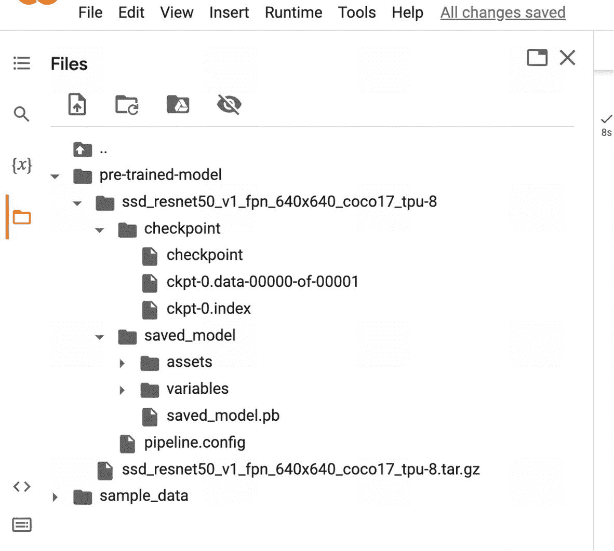

一张截图，显示了一个包含文件、编辑、查看、插入、运行时、工具和帮助选项的菜单栏。菜单栏下方是一个文件和文件夹列表，包括 pre-trained-model、ssd_resnet50_v1_fpn_640x640_coco17_tpu-8 以及其中的各种文件和目录。

图 6-27

预训练模型目录结构


#### 配置目标检测流水线

*训练流水线*是一个配置文件，用于指定训练目标检测模型的各种设置和超参数。它包含模型架构、数据集路径、批次大小、学习率、数据增强、评估设置等信息。该文件通常采用 Protocol Buffers 格式（`.config` 文件）。

训练流水线的模式定义位于 TensorFlow `models` 项目下 `research` 目录中的 `object_detection/protos/pipeline.proto` 文件内。

JSON 格式的训练流水线大致分为五个部分，如下所示。训练流水线的各部分说明如下：

*   `model`：此部分定义了目标检测模型的架构和配置。
    *   `ssd` 或 `faster_rcnn`：模型类型（单次多框检测器或 Faster R-CNN）

*   `train_config`：此部分包含与训练过程相关的各种设置。
    *   `batch_size`：每个训练批次中使用的图像数量

*   `fine_tune_checkpoint`：预训练模型检查点的路径，用于在训练前初始化模型

*   `num_steps`：训练过程中要执行的训练步数

*   `data_augmentation_options`：训练期间的数据增强选项（例如，随机亮度、旋转等）

*   `train_input_reader`：此部分包含训练数据输入的配置。
    *   `tf_record_input_reader`：训练 TFRecord 文件（`train.tfrecord`）的路径

*   `label_map_path`：`label_map.pbtxt` 文件的路径

*   `eval_config`：此部分包含评估过程的设置。
    *   `num_examples`：用于评估的样本数量

*   `max_evals`：要执行的最大评估次数

*   `eval_input_reader`：此部分包含评估数据输入的配置。
    *   `tf_record_input_reader`：评估 TFRecord 文件（`eval.tfrecord`）的路径

*   `label_map_path`：`label_map.pbtxt` 文件的路径

```
model: {
(... 在此处添加模型配置 ...)
}
train_config : {
(... 在此处添加训练配置 ...)
}
train_input_reader: {
(... 在此处添加训练输入配置 ...)
}
eval_config: {
(... 在此处添加评估配置 ...)
}
eval_input_reader: {
(... 在此处添加评估输入配置 ...)
}
```

训练流水线的各部分说明如下：

在图 6-27 中，请注意预训练模型目录 `ssd_resnet50_v1_fpn_640x640_coco17_tpu-8` 中的 `pipeline.config` 文件。我们需要编辑 `pipeline.config` 文件以相应地调整训练设置。从 Colab 下载 `pipeline.config` 文件（右键单击并下载），将其保存到本地计算机驱动器，然后编辑它以配置模型的训练流水线。

让我们检查一下需要对 `pipeline.config` 文件进行的修改，这些修改已用粗体标出。需要编辑的行旁边的注释提供了关于根据给定情况配置特定值的进一步指导。

```
model {
ssd {
num_classes: 37 # 将此设置为不同标签类别的数量
image_resizer {
fixed_shape_resizer {
height: 640
width: 640
}
}
feature_extractor {
type: "ssd_resnet50_v1_fpn_keras"
depth_multiplier: 1.0
min_depth: 16
conv_hyperparams {
regularizer {
l2_regularizer {
weight: 0.00039999998989515007
}
}
initializer {
truncated_normal_initializer {
mean: 0.0
stddev: 0.029999999329447746
}
}
activation: RELU_6
batch_norm {
decay: 0.996999979019165
scale: true
epsilon: 0.0010000000474974513
}
}
override_base_feature_extractor_hyperparams: true
fpn {
min_level: 3
max_level: 7
}
}
box_coder {
faster_rcnn_box_coder {
y_scale: 10.0
x_scale: 10.0
height_scale: 5.0
width_scale: 5.0
}
}
matcher {
argmax_matcher {
matched_threshold: 0.5 # 增加此值以获得更好的匹配。
unmatched_threshold: 0.5 # 匹配阈值与未匹配阈值之和必须等于 1。
ignore_thresholds: false
negatives_lower_than_unmatched: true
force_match_for_each_row: true
use_matmul_gather: true
}
}
similarity_calculator {
iou_similarity {
}
}
box_predictor {
weight_shared_convolutional_box_predictor {
conv_hyperparams {
regularizer {
l2_regularizer {
weight: 0.00039999998989515007
}
}
initializer {
random_normal_initializer {
mean: 0.0
stddev: 0.009999999776482582
}
}
activation: RELU_6
batch_norm {
decay: 0.996999979019165
scale: true
epsilon: 0.0010000000474974513
}
}
depth: 256
num_layers_before_predictor: 4
kernel_size: 3
class_prediction_bias_init: -4.599999904632568
}
}
anchor_generator {
multiscale_anchor_generator {
min_level: 3
max_level: 7
anchor_scale: 4.0
aspect_ratios: 1.0
aspect_ratios: 2.0
aspect_ratios: 0.5
scales_per_octave: 2
}
}
post_processing {
batch_non_max_suppression {
score_threshold: 9.99999993922529e-09
iou_threshold: 0.6000000238418579
max_detections_per_class: 100
max_total_detections: 100
use_static_shapes: false
}
score_converter: SIGMOID
}
normalize_loss_by_num_matches: true
loss {
localization_loss {
weighted_smooth_l1 {
}
}
classification_loss {
weighted_sigmoid_focal {
gamma: 2.0
alpha: 0.25
}
}
classification_weight: 1.0
localization_weight: 1.0
}
encode_background_as_zeros: true
normalize_loc_loss_by_codesize: true
inplace_batchnorm_update: true
freeze_batchnorm: false
}
}
train_config {
batch_size: 64 # 根据可用内存增加/减少此值（值越大所需内存越多，反之亦然）
data_augmentation_options {
random_horizontal_flip {
}
}
data_augmentation_options {
random_crop_image {
min_object_covered: 0.0
min_aspect_ratio: 0.75
max_aspect_ratio: 3.0
min_area: 0.75
max_area: 1.0
overlap_thresh: 0.0
}
}
sync_replicas: true
optimizer {
momentum_optimizer {
learning_rate {
cosine_decay_learning_rate {
learning_rate_base: 0.03999999910593033
total_steps: 25000
warmup_learning_rate: 0.013333000242710114
warmup_steps: 2000
}
}
momentum_optimizer_value: 0.8999999761581421
}
use_moving_average: false
}
fine_tune_checkpoint: "/content/pre-trained-model/ssd_resnet50_v1_fpn_640x640_coco17_tpu-8/checkpoint/ckpt-0" # 预训练模型检查点的路径
num_steps: 25000
startup_delay_steps: 0.0
replicas_to_aggregate: 8
max_number_of_boxes: 100
unpad_groundtruth_tensors: false
fine_tune_checkpoint_type: "detection" # 将此设置为"detection"，因为我们希望训练完整的检测模型
use_bfloat16: false # 如果不在 TPU 上训练，请将此设置为 false
fine_tune_checkpoint_version: V2
}
train_input_reader {
label_map_path: "PATH_TO_BE_CONFIGURED"  # 标签映射文件的路径
tf_record_input_reader {
input_path: "PATH_TO_BE_CONFIGURED"  # 训练 TFRecord 文件的路径
}
}
eval_config {
metrics_set: "coco_detection_metrics"
use_moving_averages: false
}
eval_input_reader {
label_map_path: "PATH_TO_BE_CONFIGURED" # 标签映射文件的路径
shuffle: false
num_epochs: 1
tf_record_input_reader {
input_path: "PATH_TO_BE_CONFIGURED"  # 测试 TFRecord 文件的路径
}
}
```


由于我们在为迁移学习下载的预训练模型训练过程中保留了 `pipeline.config` 文件，因此我们将保持其大部分内容不变，仅对特定高亮部分进行修改。根据你的 Colab 环境设置，需要调整的参数如下：

*   `num_classes: 37:` 代表我们数据集中宠物的 37 个类别。

*   `fine_tune_checkpoint: "/content/pre-trained-model/ssd_resnet50_v1_fpn_640x640_coco17_tpu-8/checkpoint/ckpt-0"`：这是我们存储预训练模型检查点的路径。请注意，在图 6-27 中，模型检查点的文件名是 `model.ckpt.data-00000-of-00001`，但在 `fine_tune_checkpoint` 配置中，我们只提供到 `model.ckpt`（你**不能**包含检查点文件的完整名称）。要获取此检查点文件的路径，请在 Colab 文件浏览器中，右键单击文件名并点击“复制路径”。

*   `num_steps: 25000`：这是算法应执行的步数。你可能需要调整此数值以获得理想的准确度水平。

*   `fine_tune_checkpoint_type: "detection"`：默认情况下，此项设置为 `"classification"`，但为了进行目标检测训练，需要将其更改为 `"detection"`。

*   `use_bfloat16: false`：在基于 TPU 的硬件上训练模型时，此项默认设置为 `true`。

*   `train_input_reader` → `label_map_path: /content/computer_vision/models/research/object_detection/data/pet_label_map.pbtxt`：这是包含 ID 和类别名称映射关系的文件路径。对于宠物数据集，该文件位于 `research` 目录中。

*   `train_input_reader` → `input_path: /content/computer_vision/petdata/pet_faces_train.record-?????-of-00010`：这是训练数据集的 TFRecord 文件路径。请注意，我们在训练集路径中使用了正则表达式 (`?????`)。这对于包含所有训练 TFRecord 文件至关重要。

*   `eval_input_reader` → `label_map_path: /content/computer_vision/models/research/object_detection/data/pet_label_map.pbtxt`：这与训练标签映射相同。

*   `eval_input_reader` → `input_path: /content/computer_vision/petdata/pet_faces_eval.record-?????-of-00010`：这是评估数据集的 TFRecord 文件路径。请注意，我们在评估集路径中使用了正则表达式 (`?????`)。这对于包含所有评估 TFRecord 文件至关重要。

需要注意的是，`pipeline.config` 中的参数 `override_base_feature_extractor_hyperparams` 设置为 `true`；**不要**更改此设置，否则模型将无法运行。

编辑完 `pipeline.config` 文件后，我们需要将其上传到 Colab。我们可以将其上传到任何目录位置，但在此示例中，我们将其上传到下载时的原始位置。我们将首先删除旧的 `pipeline.config` 文件，然后上传更新后的文件。

要从 Colab 目录位置删除旧的 `pipeline.config` 文件，请右键单击它，然后单击“删除”。要从本地计算机上传更新后的 `pipeline.config` 文件，请右键单击 Colab 目录（`ssd_resnet50_v1_fpn_640x640_coco17_tpu-8`），单击“上传”，然后浏览并从本地计算机上传编辑后的 `pipeline.config` 文件。

#### 执行模型训练

我们已准备好开始训练过程。要启动训练，只需执行代码清单 6-7。

```
1    %%shell
2    export PYTHONPATH=$PYTHONPATH:/content/models/research
3    export PYTHONPATH=$PYTHONPATH:/content/models/research/slim
4    cd /content/models/research
5    PIPELINE_CONFIG_PATH=/content/computer_vision/pre-trained-model/ssd_resnet50_v1_fpn_640x640_coco17_tpu-8/pipeline.config
6    MODEL_DIR=/content/computer_vision/pet_detection_model/
7    NUM_TRAIN_STEPS=100
8    SAMPLE_1_OF_N_EVAL_EXAMPLES=1
9    python object_detection/model_main_tf2.py \
--pipeline_config_path=${PIPELINE_CONFIG_PATH} \
--model_dir=${MODEL_DIR} \
--num_train_steps=${NUM_TRAIN_STEPS} \
--sample_1_of_n_eval_examples=${SAMPLE_1_OF_N_EVAL_EXAMPLES} \
--alsologtostderr
代码清单 6-7
执行模型训练
```

TensorFlow 提供了一个 Python 脚本 `model_main_tf2.py` 来触发模型训练。该脚本位于目录 `models/research/object_detection` 中。该脚本接受以下参数：

*   `pipeline_config_path`：这是 `pipeline.config` 文件的路径。

*   `model_dir`：这是训练后模型将保存到的目录。

*   `num_train_steps`：这是我们希望网络训练的步数。这将覆盖 `pipeline.config` 文件中的 `num_steps` 参数。

*   `sample_1_of_n_eval_examples`：这决定了模型应使用多少个样本中的一个进行评估。

在 Colab 中执行此代码块，并等待模型完成对训练图像集的学习。在模型学习过程中，你将在 Colab 控制台中看到打印出的迭代损失。如果一切顺利，你将得到一个训练好的目标检测模型，并保存在 `model_dir` 目录中（在我们的示例中为 `/content/computer_vision/pet_detection_model/`）。


#### 评估模型

回顾一下，在清单 6-2 中，我们通过第 6 至第 9 行从 `cocoapi` 安装了 `pycocotools`。`pycocotools` 是一个 Python 库，提供了用于处理 COCO（上下文中的常见对象）数据集的工具和实用程序。COCO 数据集是对象检测、分割和描述任务中广泛使用的基准。它包含大量具有复杂场景的图像和丰富的注释集，包括对象实例、关键点和描述。

`pycocotools` 使研究人员和开发人员能够与 COCO 数据集进行交互，并使用 AP 和 mAP 等标准评估指标来评估对象检测和分割模型的性能。

让我们先简要解释一下评估过程。在训练过程进行时，它会定期在 `model_dir` 目录内创建检查点文件。这些检查点代表了模型在特定训练步骤时的快照。当生成一组新的检查点文件时，评估过程就会启动。它利用这些检查点文件来评估模型在验证数据集上检测对象的性能。然后通过各种指标汇总评估结果，从而深入了解模型随时间的进展。

以下是执行评估过程的步骤：

1.  确保 `pycocotools` 已正确安装。

2.  在 `pipeline.config` 文件中，为 `eval_config` 块下的 `metrics_set` 键设置 `"coco_detection_metrics"`：

    ```
    eval_config {
    metrics_set: "coco_detection_metrics"
    use_moving_averages: false
    }
    ```

3.  执行清单 6-8 中所示的评估命令。

```
1    %%shell
2    python /content/models/research/object_detection/model_main_tf2.py \
3    --model_dir=/content/computer_vision/pet_detection_model \
4    --pipeline_config_path=/content/computer_vision/pre-trained-model/ssd_resnet50_v1_fpn_640x640_coco17_tpu-8/pipeline.config \
5    --checkpoint_dir=/content/computer_vision/pet_detection_model
清单 6-8
执行模型评估
```

执行清单 6-8 将花费几分钟时间，具体时长取决于数据集中验证图像的数量。在评估过程中，它会定期执行检查（默认每 300 秒一次），并利用 `model_dir` 中最新的检查点文件来评估模型的性能。评估结果以 TensorFlow 事件文件（`events.out.tfevents.*`）的形式存储在 `model_dir/eval_0` 目录中。这些文件用于可视化模型性能，如下一节所述。

#### 在 TensorBoard 中可视化训练结果

如第 5 章所述，TensorBoard 是 TensorFlow 提供的一个基于 Web 的可视化工具，旨在帮助用户理解、调试和优化他们的机器学习模型。它允许您在训练和评估期间监控和可视化模型性能的各个方面，从而更容易获得洞察并提高模型的有效性。

要查看训练统计数据和模型结果，请在 Colab 中使用清单 6-9 中的代码启动 TensorBoard 仪表板。`--logdir` 是我们保存模型检查点的目录。

```
1    %load_ext tensorboard
2    %tensorboard --logdir /content/computer_vision/pet_detection_model
清单 6-9
启动 TensorBoard 仪表板以查看训练结果
```

第 1 行加载了 TensorBoard 笔记本扩展。此扩展会在 Colab 屏幕内嵌入显示 TensorBoard 仪表板。

点击 TensorBoard 仪表板的“图像”选项卡以显示评估结果，如图 6-28 所示。

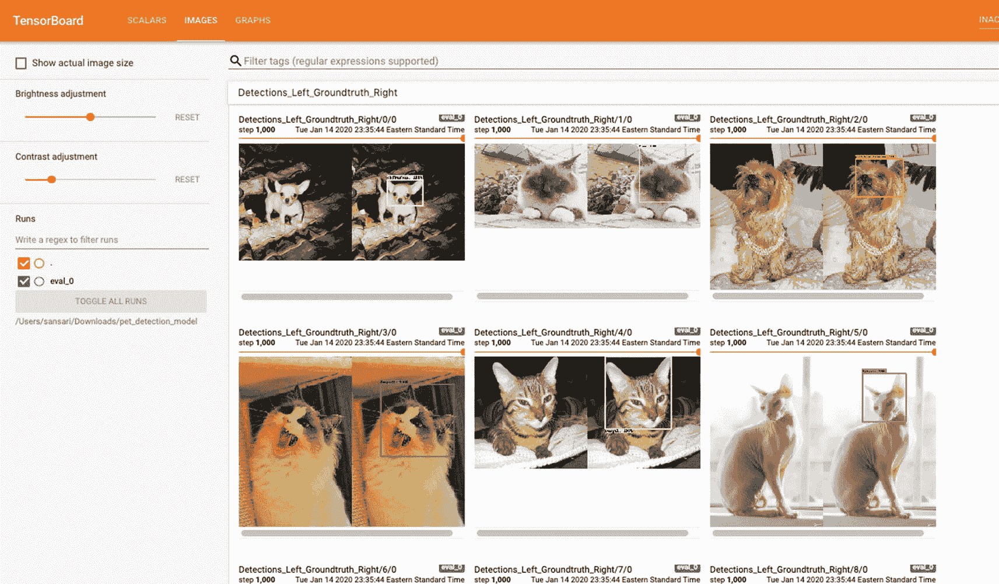

一张截图展示了 TensorBoard 的多种功能，包括标量、图像、图表、INAC 部分、标签过滤、亮度和对比度控制、步骤信息以及运行详情。它描绘了六种不同类型的猫检测数据，分别标记为左地面真值右 0、1、2、3、4 和 5。

图 6-28
TensorBoard 仪表板中的模型训练结果

或者，如果您想在本地计算机上离线评估模型，而不是在 Colab 上，您可以下载我们保存模型检查点的整个 `pet_detection_model` 目录。我们导出训练后模型的 `final_model` 目录不包含完整的模型统计数据和训练结果。因此，您必须下载整个 `pet_detection_model` 目录。

在您的计算机终端（或命令提示符）中，通过传递 `pet_detection_model` 目录的路径来启动 TensorBoard。确保您处于虚拟环境中（如第 1 章所述）。以下是命令：

```
(cv) username$ tensorboard --logdir ~/Downloads/pet_detection_model
```

上一条命令成功执行后，打开您的 Web 浏览器并访问 `http://localhost:6006` 以查看 TensorBoard 仪表板。点击顶部菜单中的“图像”选项卡，即可看到图像上带有边界框的评估输出，如图 6-28 所示。


#### 导出 TensorFlow 图

模型成功完成训练后，训练好的模型及其检查点都会保存在指定的 `model_dir` 目录中，在我们的案例中，该目录名为 `pet_detection_model`。此目录包含训练过程中生成的所有检查点。然而，为了有效利用此模型进行目标检测和边界框预测，我们必须按照下文所述，将其导出为最终模型。

首先，确定最新的检查点。在 `model_dir` 目录中找到最新的检查点文件。这是文件名中编号最大的检查点文件，代表了训练模型的最新状态。检查点通常包含以下三个文件：

*   `model.ckpt-${CHECKPOINT_NUMBER}.data-00000-of-00001`

*   `model.ckpt-${CHECKPOINT_NUMBER}.index`

*   `model.ckpt-${CHECKPOINT_NUMBER}.meta`

取 `${CHECKPOINT_NUMBER}` 值最大的检查点。我们的模型运行了 100 步，因此最大的检查点文件应如下所示：

*   `model.ckpt-100.data-00000-of-00001`

*   `model.ckpt-100.index`

*   `model.ckpt-100.meta`

清单 6-10 有助于将我们训练好的目标检测模型导出到指定的目录。

```
1    %%shell
2    export PYTHONPATH=$PYTHONPATH:/content/models/research
3    export PYTHONPATH=$PYTHONPATH:/content/models/research/slim
4    cd /content/models/research
5    python /content/models/research/object_detection/exporter_main_v2.py \
--input_type image_tensor --pipeline_config_path /content/computer_vision \
pre-trained-model/ssd_resnet50_v1_fpn_640x640_coco17_tpu-8/pipeline.config \
--trained_checkpoint_dir /content/computer_vision/pet_detection_model \
--output_directory /content/computer_vision/pet_detection_model/final_model
清单 6-10
导出 TensorFlow 图
```

第 5 行通过调用位于 `models/research/object_detection` 目录下的脚本 `exporter_main_v2.py` 来导出 TensorFlow 图。此脚本接受以下参数：

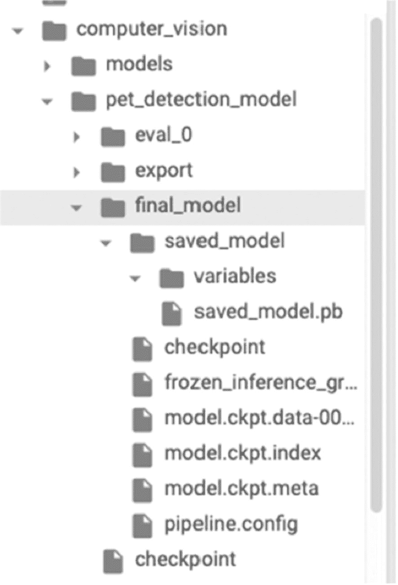

截图显示了文件夹列表，并且最终模型已被选中。

图 6-29

导出到 `final_model` 目录的模型

*   `input_type`：对于我们的模型，其值为 `image_tensor`。

*   `pipeline_config_path`：这是我们之前使用过的同一个 `pipeline.config` 文件路径。

*   `trained_checkpoint_dir`：这是保存训练模型检查点的路径。

*   `output_directory`：这是导出图将要保存的目录。图 6-29 显示了执行导出脚本后的输出目录结构。

#### 下载目标检测模型

Google Colab 不支持下载整个目录。下载单个文件是可行的，但为目录中的每个文件都执行此操作可能效率低下且耗时。相反，您可以将完全训练好的模型保存到您的个人 Google Drive 中，这提供了一种更方便、更高效的方式来存储和访问您的模型以供后续使用。

在连续使用数小时或会话过期后，Google Colab 将终止您的虚拟机并删除该会话中的所有数据。如果您未能下载模型，则有可能丢失它。但是，您可以选择将模型和数据直接保存到 Google Drive，这提供了一种安全可靠的存储解决方案。为确保模型安全，尤其是在长时间的训练会话期间，建议在开始训练过程之前将所有必要的数据和模型文件保存到 Google Drive。此预防措施将保护您的进度和成果，使您能够随时从 Google Drive 访问它们。

以下是挂载 Google Drive 的步骤：

1.  在左侧面板中，点击“文件”。

2.  选择“挂载驱动器”。此操作将在笔记本区域插入一些代码。

3.  点击代码块中的“播放”图标执行代码。这将挂载您的 Google Drive，使您能够从 Colab 笔记本访问和保存文件到其中。

点击授权链接以生成授权码。您可能需要再次登录您的 Google 帐户。复制授权码，将其粘贴到笔记本中，然后按 Enter 键。参见图 6-31。驱动器挂载后，您将在左侧面板的“文件”选项卡中看到目录列表（如图 6-30 所示）。请注意，图 6-31 中的示例 Google Drive 中已存在一个名为 `computervision` 的目录。您可以随意创建任何您想要的目录。

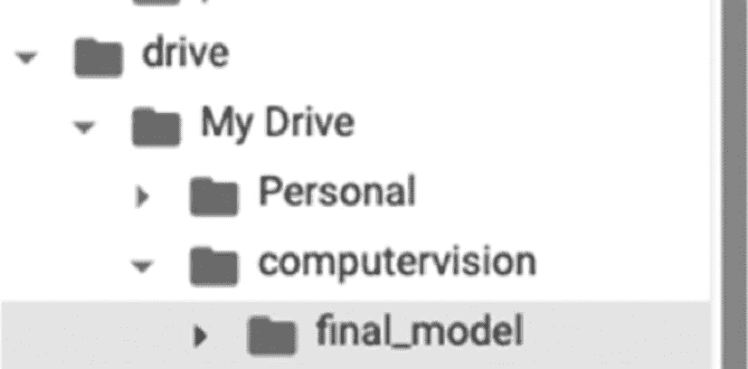

截图显示了文件夹列表，并且最终模型已被选中。

图 6-31

Google Drive 目录结构

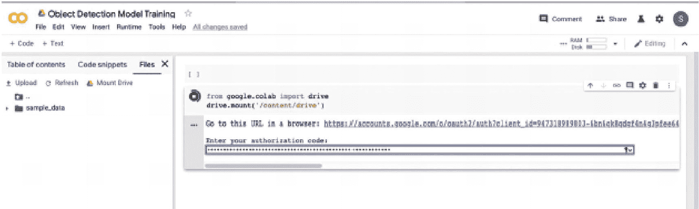

Colab 笔记本的截图显示了挂载 Google Drive、上传文件和访问示例数据的代码和说明。

图 6-30

挂载 Google Drive

将 `final_model` 目录移动到 Google Drive 目录。

要将训练好的目标检测模型保存到 Google Drive 目录，只需将 `final_directory` 从 Colab 目录拖拽到 Google Drive 目录即可。

您还必须将以下检查点文件复制到 Google Drive：

*   `model.ckpt-100.data-00000-of-00001`

*   `model.ckpt-100.index`

*   `model.ckpt-100.meta`

要从 Google Drive 下载模型，请登录您的 Google Drive 并将训练好的模型下载到您的本地计算机。您应该下载整个 `final_model` 目录。

## 使用训练好的模型检测目标

如前所述，训练模型并非日常任务。一旦我们获得了足够强大且具有高精度或高 mAP（平均精度均值）的模型，只要模型在预测中保持其精度，可能就无需重新训练。然而，需要注意的是，模型训练是资源密集型的，即使使用 GPU，也需要数小时或数天才能开发出高质量的模型。在某些情况下，利用 GPU 的强大算力在云端进行计算机视觉模型的训练是有优势且成本效益高的。随后，一旦模型准备就绪，就可以下载到本地计算机或应用服务器上使用。这种模型的本地化部署允许以经济高效的方式识别图像中的目标。

本节将解释在个人计算机上创建目标检测预测器的过程。这需要使用之前在 Google Colab 上训练好的模型。与之前的章节一样，我们将使用 PyCharm 作为 IDE。虽然使用 Colab 编写目标检测预测器当然也是可行的，但从生产部署的角度来看，这种方法并非最优。

以下是创建目标检测程序的一般步骤，将在接下来的两节中深入介绍：

1.  从 GitHub 仓库下载并安装 TensorFlow `models` 项目。

2.  编写 Python 代码，利用导出的 TensorFlow 图（导出的模型）来预测未包含在训练集或测试集中的新图像中的目标。


### 安装 TensorFlow 的 models 项目

TensorFlow `models` 项目的安装过程与本章前面描述的 Google Colab 安装过程相同。唯一的区别可能在于 Protobuf 的安装，因为它是一个依赖于平台的操作系统软件。在开始之前，请确保 PyCharm IDE 已配置为使用我们在第 1 章中创建的虚拟环境。我们将在 PyCharm 的终端窗口中执行命令。如果你选择使用操作系统的 shell 来执行命令，请确保已为 shell 会话激活了虚拟环境。（请参阅第 1 章回顾 virtualenv。）以下是安装和配置 `models` 项目的完整步骤：

1.  安装构建和安装 `models` 项目所需的库。在终端或命令提示符下（在 virtualenv 内）执行清单 6-11 中所示的命令。

1.  安装 Google 的 Protobuf 编译器。安装过程取决于你使用的操作系统。请根据你的操作系统遵循以下说明：
    1.  在 Ubuntu 上：`sudo apt-get install protobuf-compiler`

2.  在其他 Linux 操作系统上：

```
        wget -O protobuf.zip \
        https://github.com/google/protobuf/releases/download/v3.0.0/protoc-3.0.0-linux-x86_64.zip
        unzip protobuf.zip
        ```

请记住你安装 Protobuf 的目录位置，因为在构建 TensorFlow 代码时，你需要提供 `bin/protoc` 的完整路径。

3.  在 macOS 上：`brew install protobuf`

2.  从 GitHub 克隆 TensorFlow `models` 项目：

```
    git clone --depth 1 https://github.com/tensorflow/models.git
    ```

你也可以从 TensorFlow 官方仓库 [`https://github.com/tensorflow/models.git`](https://github.com/tensorflow/models.git) 下载 `models` 项目。

如图 6-32 所示，我将 TensorFlow `models` 项目下载到了一个名为 `chapter6` 的目录中。

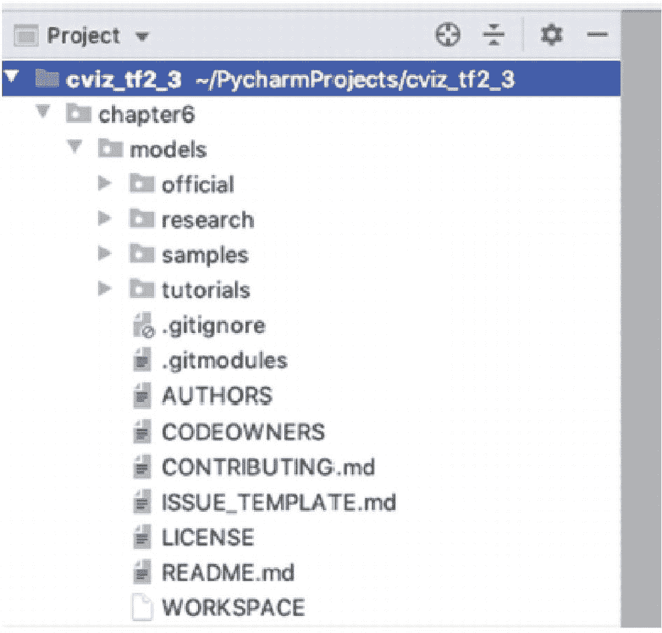

截图显示了一个项目列表，其中 `cviz_tf2_3` 项目被选中。

图 6-32

包含 TensorFlow `models` 项目的示例目录结构

3.  使用 Protobuf 编译器编译 `models` 项目。从 `models/research` 目录运行以下命令集：

```
    $ cd models/research
    $ protoc object_detection/protos/*.proto --python_out=.
    ```

如果你手动安装了 Protobuf 并将其解压到一个目录中，请在上一条命令中提供直到 `bin/protoc` 的完整路径。

4.  设置以下环境变量。通常的做法是在 `~/.bash_profile` 中设置这些环境变量。以下是操作说明：
    1.  打开命令提示符或终端，输入 `vi ~/.bash_profile`。你可以使用任何其他编辑器（如 nano）来编辑 `.bash_profile` 文件。

2.  在 `.bash_profile` 的末尾添加以下三行。确保路径与你计算机上的目录路径匹配。

```
        export PYTHONPATH=$PYTHONPATH:~/cviz_tf2_3/chapter6/models/research/object_detection
        export PYTHONPATH=$PYTHONPATH:~/cviz_tf2_3/chapter6/models/research
        export PYTHONPATH=$PYTHONPATH:~/cviz_tf2_3/chapter6/models/research/slim
        ```

3.  添加上述行后，保存 `~/.bash_profile` 文件。

4.  关闭终端并重新启动以使更改生效。你需要关闭 PyCharm IDE 以使环境变量在你的 IDE 中更新。要测试设置，请在 PyCharm 终端窗口中输入命令 `echo $PYTHONPATH`。它应该打印出你刚刚设置的路径。

5.  构建并安装我们刚刚使用 Protobuf 构建的 `research` 项目。从 `models/research` 目录执行以下命令：

```
    python setup.py build
    python setup.py install
```

```
1    pip install --user Cython
2    pip install --user contextlib2
3    pip install --user pillow
4    pip install --user lxml
清单 6-11
安装依赖项的命令
```

如果这些命令成功运行，你应该会看到类似这样的输出：

```
Finished processing dependencies for object-detection==0.1
```

我们的环境现在已准备好开始编写图像目标检测的代码。我们将使用的模型是从 Colab 导出并下载的模型。如果你尚未完成此步骤，请从 Google Colab 或 Google Drive 下载最终模型，假设你将模型存储在那里。

### 目标检测代码

在本节中，我们将编写代码来检测图像中的目标，并在其周围绘制边界框。为了使代码简单易懂，我们将其分为以下几个部分：


#### 配置与初始化

在代码的这一部分，我们初始化了模型路径、图像输入和输出目录。清单 6-12 展示了包含库导入和路径设置的第一部分代码。

```
文件名: Listing_6_9.py
1    import os
2    import pathlib
3    import random
4    import numpy as np
5    import tensorflow as tf
6    import cv2
7    # 导入目标检测模块。
8    from object_detection.utils import ops as utils_ops
9    from object_detection.utils import label_map_util

11   # 使 gfile 兼容 v2
12   #tf.gfile = tf.io.gfile

14   model_path = "ssd_model/final_model"
15   labels_path = "models/research/object_detection/data/pet_label_map.pbtxt"
16   image_dir = "images"
17   image_file_pattern = "*.jpg"
18   output_path="output_dir"

20   PATH_TO_IMAGES_DIR = pathlib.Path(image_dir)
21   IMAGE_PATHS = sorted(list(PATH_TO_IMAGES_DIR.glob(image_file_pattern)))

23   # 用于为每个边界框添加正确标签的字符串列表。
24   category_index = label_map_util.create_category_index_from_labelmap(labels_path, use_display_name=True)
25   class_num =len(category_index)
清单 6-12
目标检测代码的导入与路径初始化部分
```

第 1 到 6 行是我们常用的导入。第 8 和 9 行从 TensorFlow `models` 项目的 `research` 模块中导入了目标检测 API。请确保 `PYTHONPATH` 环境变量已正确设置（如前所述）。

第 12 行在 TensorFlow2 兼容模式下初始化了 `gfile`。`gfile` 提供了 TensorFlow 中的 I/O 功能。请注意，这一行已被注释掉，因为我们的模型是使用 TensorFlow v2.x 训练的。如果模型是使用 TensorFlow v1.x 训练的，请取消注释这一行。

第 14 行初始化了目标检测训练模型所在的目录路径。

第 15 行初始化了映射文件路径。我们设置了与训练时使用的相同 JSON 格式文件，其中包含类别 ID 和类别名称的映射。

第 16 行是包含需要检测目标的图像的输入目录路径。

第 17 行定义了输入图像路径中文件名的模式。如果你想从目录中加载所有文件，请使用 `*.*`。

第 18 行是输出目录路径，检测到目标并带有边界框的图像将保存于此。

第 20 和 21 行用于创建可迭代的路径对象，我们将遍历这些对象以逐个读取图像并检测其中的目标。

第 24 行使用标签映射文件来创建类别或类索引。

第 25 行将类别数量赋值给 `class_num` 变量。

此外，我们初始化了一个颜色表，用于绘制边界框。清单 6-13 展示了相关代码。

```
27   def get_color_table(class_num, seed=0):
28      random.seed(seed)
29      color_table = {}
30      for i in range(class_num):
31          color_table[i] = [random.randint(0, 255) for _ in range(3)]
32      return color_table

34   colortable = get_color_table(class_num)

清单 6-13
基于目标类别数量创建颜色表
```

#### 通过加载训练模型创建 `模型对象`

清单 6-14 展示了函数 `load_model()`，它以模型路径作为输入。第 40 行从目录中加载已保存的模型，并创建一个由该函数返回的 `模型对象`。我们将使用这个 `模型对象` 来预测目标和边界框。

```
36   # # 模型准备及从磁盘加载模型
37   def load_model(model_path):

39      model_dir = pathlib.Path(model_path) / "saved_model"
40      model = tf.saved_model.load(str(model_dir))
41      #model = model.signatures['serving_default']
42      return model

清单 6-14
从目录加载模型
```

#### 运行预测并以可用形式构建输出

我们编写了一个名为 `run_inference_for_single_image()` 的函数，它接受两个参数：`模型对象` 和图像 NumPy 数组。该函数返回一个 Python 字典。输出字典包含以下键值对：

`detection_boxes`，这是一个二维数组，包含边界框的四个角点。

`detection_scores`，这是一个一维数组，包含与每个边界框关联的分数。

`detection_classes`，这是一个一维数组，包含与每个边界框关联的目标类别索引的整数表示。

`num_detections`，这是一个标量，表示预测的目标类别数量。

清单 6-15 展示了函数 `run_inference_for_single_image()` 的实现。

让我们逐行分析代码清单。

TensorFlow `模型对象` 接收一批图像张量来预测目标类别及其周围的边界框。第 48 行将图像 NumPy 数组转换为张量。由于我们一次处理一张图像，而 `模型对象` 接收的是批次，因此我们需要将输入图像张量转换为一批图像。第 50 行完成了这一操作。`tf.newaxis` 表达式用于在现有数组的维度上增加一维（使用一次则增加一维）。因此，一维数组将变成二维数组，二维数组将变成三维数组，以此类推。

```
44   # 预测目标和边界框并格式化结果
45   def run_inference_for_single_image(model, image):

47      # 输入需要是张量，使用 `tf.convert_to_tensor` 进行转换。
48      input_tensor = tf.convert_to_tensor(image)
49      # 模型期望接收一批图像，因此使用 `tf.newaxis` 添加一个轴。
50      input_tensor = input_tensor[tf.newaxis, ...]

52      # 从模型运行预测
53      output_dict = model(input_tensor)

55      # 模型输入是张量，因此输出也是张量
56      # 转换为 numpy 数组，并取索引 [0] 以移除批次维度。
57      # 我们只对前 num_detections 个结果感兴趣。
58      num_detections = int(output_dict.pop('num_detections'))
59      output_dict = {key: value[0, :num_detections].numpy()
60                     for key, value in output_dict.items()}
61      output_dict['num_detections'] = num_detections

63      # detection_classes 应为整数类型。
64      output_dict['detection_classes'] = output_dict['detection_classes'].astype(np.int64)

66      # 处理带有掩码的模型：
67      if 'detection_masks' in output_dict:
68          # 将边界框掩码重新映射到图像尺寸。
69          detection_masks_reframed = utils_ops.reframe_box_masks_to_image_masks(
70              output_dict['detection_masks'], output_dict['detection_boxes'],
71              image.shape[0], image.shape[1])
72          detection_masks_reframed = tf.cast(detection_masks_reframed > 0.5,
73                                             tf.uint8)
74          output_dict['detection_masks_reframed'] = detection_masks_reframed.numpy()

76      return output_dict
清单 6-15
预测目标与边界框并组织输出
```

第 53 行是执行实际目标检测的代码。函数 `model(input_tensor)` 预测目标类别、边界框以及相关的分数。`model(input_tensor)` 函数返回一个字典，我们将对其进行格式化，使其仅包含与输入图像对应的输出，以便于使用。

由于模型接收一批图像，该函数会返回针对整个批次的输出。因为我们一次只有一张输入图像，所以我们只对这个输出字典中的第一个结果感兴趣（通过第 0 个索引访问）。第 59 行提取了第一个输出并重新赋值给 `output_dict` 变量。

第 61 行将检测数量存储在字典中，以便在处理结果时方便使用这个数字。


第 66 至 74 行仅适用于需要预测掩码的 Mask R-CNN。对于所有其他预测器，这些行可以省略。

第 76 行返回输出字典，其中包含检测到的边界框坐标、对象类别、得分以及检测数量。如果是 Mask R-CNN，它还会包含对象掩码。

接下来，我们将研究如何使用 `output_dict` 在图像中检测到的对象周围绘制边界框。

#### 编写代码以推断输出，在检测到的对象周围绘制边界框，并存储结果

清单 6-16 中的函数 `infer_object()` 用于推断由函数 `run_inference_for_single_image()` 返回的 `output_dict`。函数 `infer_object()` 在图像中每个检测到的对象周围绘制边界框。它还会用类别名称和得分标记对象，最后将结果保存到输出目录位置。清单 6-16 是实现此函数的代码段。

```
79   def infer_object(model, image_path):
80      # 使用 OpenCV 读取图像并创建图像 numpy 数组
81      # 最终输出图像，包含边界框和标签。
82      imagename = os.path.basename(image_path)

84      image_np = cv2.imread(os.path.abspath(image_path))
85      # 实际检测。
86      output_dict = run_inference_for_single_image(model, image_np)

88      # 检测结果的可视化。
89      for i in range(output_dict['detection_classes'].size):

91          box = output_dict['detection_boxes'][i]
92          classes = output_dict['detection_classes'][i]
93          scores = output_dict['detection_scores'][i]

95          if scores > 0.5:
96              h = image_np.shape[0]
97              w = image_np.shape[1]
98              classname = category_index[classes]['name']
99              classid =category_index[classes]['id']
100             # 绘制边界框
101             cv2.rectangle(image_np, (int(box[1] * w), int(box[0] * h)), (int(box[3] * w), int(box[2] * h)), colortable[classid], 2)

103             # 在边界框上方写入类别名称
104             font = cv2.FONT_HERSHEY_COMPLEX_SMALL
105             size = cv2.getTextSize(str(classname) + ":" + str(scores), font, 0.75, 1)[0][0]

107             cv2.rectangle(image_np,(int(box[1] * w), int(box[0] * h-20)), ((int(box[1] * w)+size+5), int(box[0] * h)), colortable[classid],-1)
108             cv2.putText(image_np, str(classname) + ":" + str(scores),
109                     (int(box[1] * w), int(box[0] * h)-5), font, 0.75, (0,0,0), 1, 1)
110         else:
111             break
112     # 将带有边界框和类别标签的结果图像保存到文件系统
113     cv2.imwrite(output_path+"/"+imagename, image_np)
清单 6-16
在输入图像中检测到的对象周围绘制边界框
```

第 79 行定义了函数 `infer_object()`，它接受两个参数：`model object` 和输入图像的路径。

第 82 行简单地获取图像的文件名，该文件名在第 113 行中使用，并将结果图像以相同名称存储到输出目录。

第 84 行使用 OpenCV 读取图像并将其转换为 NumPy 数组。

第 86 行通过将 `model object` 和图像 NumPy 数组传递给它来调用函数 `run_inference_for_single_image()`。回想一下，函数 `run_inference_for_single_image()` 返回一个包含检测到的对象和边界框的字典。

输出字典可能包含多个对象和边界框。我们需要循环遍历，并为那些得分超过阈值的对象绘制边界框。第 89 至 111 行循环遍历每个检测到的对象类别。输出字典中的得分按降序排列。因此，当得分低于阈值时，循环退出。

第 91 至 93 行简单地提取三个重要的输出数组——边界框坐标、此边界框内检测到的对象类别以及相关的预测得分——并将它们分配给相应的变量。

在第 91 行中，变量 `box` 是一个包含边界框四个角的数组，如下所述：

*   `box[0]` 是矩形边界框左上角的 y 坐标，`box[1]` 是 x 坐标。
*   `box[2]` 和 `box[3]` 是边界框右下角的 y 和 x 坐标。

第 95 行检查得分是否大于阈值。在此示例中，我们使用了阈值 0.5，但您可以使用适合特定应用的值。仅当得分大于阈值时，才会在图像上绘制边界框；否则，将退出 `for` 循环。

回想一下，在将图像输入模型进行训练之前，会调整其大小。图像根据我们用于训练的 `pipeline.config` 文件中的高度和宽度设置进行调整。因此，预测的边界框也会根据调整大小后的图像进行缩放。因此，我们需要根据用于检测的输入图像的原始大小重新缩放边界框。将边界框坐标与图像高度和宽度相乘，即可将坐标缩放到图像尺寸。

第 101 行使用 OpenCV 的 `rectangle()` 函数绘制矩形边界框（有关 `rectangle()` 函数的详细信息，请参阅第 2 章）。请注意，我们使用了 `colortable` 来动态地为不同类别获取不同颜色。

第 105 行在边界框正上方写入预测的类别名称和相应的得分。如果您愿意，可以在第 104 行更改字体样式。在我们的示例中，文本的字体颜色和边界框的边框颜色相同。您可以通过使用不同值调用 `colortable` 函数来使用不同的颜色。例如，向类别索引添加一个常量，然后调用颜色表来获取文本颜色。

如前所述，得分按降序排列，最高得分位于数组顶部。阈值之后的第一个得分情况将中断循环，以避免不必要的处理。

第 113 行将带有检测到的对象周围边界框的结果图像保存到输出目录。

现在我们已经定义了所有正确的设置和函数，需要调用它们来触发检测过程。清单 6-17 展示了如何触发检测。

```
116  # 获取模型对象
117  detection_model = load_model(model_path)

119  # 对每张图像调用预测
120  for image_path in IMAGE_PATHS:
121     infer_object(detection_model, image_path)
清单 6-17
触发检测过程的函数调用
```

在清单 6-17 中，第 117 行通过传递训练模型的路径来调用 `load_model()` 函数。此函数返回将在后续调用中使用的 `model object`。

第 120 行遍历每个图像文件，并为每个图像调用 `infer_object()`。为每个图像调用函数 `infer_object()`，并将带有检测到的对象周围边界框的最终输出保存到输出目录中。


#### 整合所有代码

现在我们将前面所有的代码片段整合在一起，以查看目标检测的完整源代码。清单 6-18 展示了完整可运行的代码。

```
Filename: Listing_6_18.py
1    import os
2    import pathlib
3    import random
4    import numpy as np
5    import tensorflow as tf
6    import cv2
7    # 导入目标检测模块。
8    from object_detection.utils import ops as utils_ops
9    from object_detection.utils import label_map_util

11   # 使 gfile 兼容 v2
12   #tf.gfile = tf.io.gfile

14   model_path = "ssd_model/final_model"
15   labels_path = "models/research/object_detection/data/pet_label_map.pbtxt"
16   image_dir = "images"
17   image_file_pattern = "*.jpg"
18   output_path="output_dir"

20   PATH_TO_IMAGES_DIR = pathlib.Path(image_dir)
21   IMAGE_PATHS = sorted(list(PATH_TO_IMAGES_DIR.glob(image_file_pattern)))

23   # 用于为每个边界框添加正确标签的字符串列表。
24   category_index = label_map_util.create_category_index_from_labelmap(labels_path, use_display_name=True)
25   class_num =len(category_index)

27   def get_color_table(class_num, seed=0):
28       random.seed(seed)
29       color_table = {}
30       for i in range(class_num):
31           color_table[i] = [random.randint(0, 255) for _ in range(3)]
32       return color_table

34   colortable = get_color_table(class_num)

36   # # 模型准备及从磁盘加载模型
37   def load_model(model_path):

39       model_dir = pathlib.Path(model_path) / "saved_model"
40       model = tf.saved_model.load(str(model_dir))
41       #model = model.signatures['serving_default']
42       return model

44   # 预测目标及边界框，并格式化结果
45   def run_inference_for_single_image(model, image):

47       # 输入需要是张量，使用 `tf.convert_to_tensor` 进行转换。
48       input_tensor = tf.convert_to_tensor(image)
49       # 模型期望一批图像，因此使用 `tf.newaxis` 添加一个轴。
50       input_tensor = input_tensor[tf.newaxis, ...]

52       # 运行模型预测
53       output_dict = model(input_tensor)

55       # 模型输入是张量，因此输出也是张量
56       # 转换为 numpy 数组，并取索引 [0] 以移除批次维度。
57       # 我们只对前 num_detections 个检测结果感兴趣。
58       num_detections = int(output_dict.pop('num_detections'))
59       output_dict = {key: value[0, :num_detections].numpy()
60                      for key, value in output_dict.items()}
61       output_dict['num_detections'] = num_detections

63       # detection_classes 应为整数。
64       output_dict['detection_classes'] = output_dict['detection_classes'].astype(np.int64)

66       # 处理带掩码的模型：
67       if 'detection_masks' in output_dict:
68           # 将边界框掩码重新映射到图像尺寸。
69           detection_masks_reframed = utils_ops.reframe_box_masks_to_image_masks(
70               output_dict['detection_masks'], output_dict['detection_boxes'],
71               image.shape[0], image.shape[1])
72           detection_masks_reframed = tf.cast(detection_masks_reframed > 0.5,
73                                              tf.uint8)
74           output_dict['detection_masks_reframed'] = detection_masks_reframed.numpy()

76       return output_dict

79   def infer_object(model, image_path):
80       # 使用 OpenCV 读取图像并创建图像 numpy 数组
81       # 最终输出带有边界框和标签的图像。
82       imagename = os.path.basename(image_path)

84       image_np = cv2.imread(os.path.abspath(image_path))
85       # 实际检测。
86       output_dict = run_inference_for_single_image(model, image_np)

88       # 检测结果的可视化。
89       for i in range(output_dict['detection_classes'].size):

91           box = output_dict['detection_boxes'][i]
92           classes = output_dict['detection_classes'][i]
93           scores = output_dict['detection_scores'][i]
94           print(box, classes, scores)
95           if scores > 0.5:
96               h = image_np.shape[0]
97               w = image_np.shape[1]
98               classname = category_index[classes]['name']
99               classid =category_index[classes]['id']
100              #绘制边界框
101              cv2.rectangle(image_np, (int(box[1] * w), int(box[0] * h)), (int(box[3] * w), int(box[2] * h)), colortable[classid-1], 2)

103              #在边界框上方写入类别名称
104              font = cv2.FONT_HERSHEY_COMPLEX_SMALL
105              size = cv2.getTextSize(str(classname) + ":" + str(scores), font, 0.75, 1)[0][0]

107              cv2.rectangle(image_np,(int(box[1] * w), int(box[0] * h-20)), ((int(box[1] * w)+size+5), int(box[0] * h)), colortable[classid-1],-1)
108              cv2.putText(image_np, str(classname) + ":" + str(scores),
109                      (int(box[1] * w), int(box[0] * h)-5), font, 0.75, (0,0,0), 1, 1)
110          else:
111              break
112      # 将带有边界框和类别标签的结果图像保存到文件系统
113      cv2.imwrite(output_path+"/"+imagename, image_np)
114      # cv2.imshow(imagename, image_np)

116  # 获取模型对象
117  detection_model = load_model(model_path)

119  # 对每张图像调用预测函数
120  for image_path in IMAGE_PATHS:
121      infer_object(detection_model, image_path)
清单 6-18
使用预训练模型进行目标检测的完整可运行代码
```

图 6-33 展示了一些示例输出，其中检测到的目标被边界框包围。

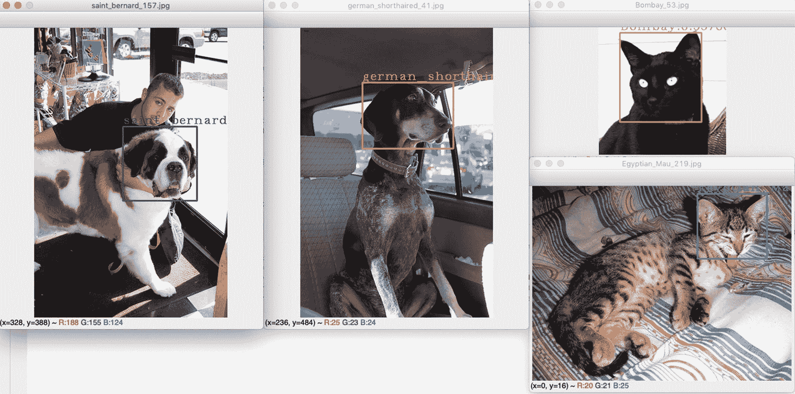

四张照片分别展示了圣伯纳犬、德国短毛指示犬、孟买猫和埃及猫。照片中指定 (x, y) 坐标处的颜色细节。

图 6-33

带有检测到的动物面部及周围边界框的示例输出图像

## 训练 YOLOv7 模型进行目标检测

TensorFlow 没有 YOLOv7 模型的官方实现。官方的 YOLOv7 源代码是用 PyTorch 编写的，并通过公共 GitHub 仓库 [`https://github.com/WongKinYiu/yolov7`](https://github.com/WongKinYiu/yolov7) 以开源形式发布。

在本节中，我们将探讨如何使用基于 PyTorch 的公共 GitHub 仓库来训练自定义的 YOLOv7 模型，将模型导出为 ONNX 格式，然后进一步将其导出为 TensorFlow 和 TensorFlow Lite (`tflite`) 格式。我们将使用 `tflite` 模型对图像进行预测和目标检测。

我们的目标是训练一个 YOLOv7 模型，用于检测各种场景和环境图像中的安全头盔和反光背心。

该检测系统对于要求使用这些安全物品的行业（如建筑、制造和采矿）将非常有价值。使用此数据集进行模型训练，企业可以实现安全监控自动化，并降低因安全装备不足而导致事故的可能性。


### 数据集

我们使用了一个已标注的数据集，其中包含穿着安全帽和反光背心的人员图像。该数据集可通过以下 URL 免费获取：

```
https://www.kaggle.com/datasets/niravnaik/safety-helmet-and-reflective-jacket/download?datasetVersionNumber=1
```

该数据集也可通过以下 Google Drive 链接获取：

[`https://drive.google.com/file/d/1MdlK9lvwWXHQgRcsjZFcteA5oiFb0jBy/view?usp=sharing`](https://drive.google.com/file/d/1MdlK9lvwWXHQgRcsjZFcteA5oiFb0jBy/view?usp=sharing)

该数据集包含 10,500 张图像，每张图像都标注了围绕两类物体的边界框：安全帽和反光背心。数据集包含在各种场景下拍摄的图片，包括建筑工地、工厂和户外工作场所。每张图像中大约有五个标记物体，为模型学习提供了全面的场景范围。

用于 YOLOv7 的数据集必须按照以下文件夹结构进行组织：

1.  在一个父目录下，包含三个子目录：`train`、`test` 和 `valid`。

2.  这些子目录中的每一个都包含两个子目录：`images` 和 `labels`。

3.  `images` 子目录包含图像文件（例如，`.png`、`.jpg` 和 `.jpeg`）。

4.  `labels` 子目录包含文本格式的标注文件，每张图像对应一个标注文本文件。`labels` 目录中的文件名必须与图像文件名相同，只是扩展名为 `.txt`。例如，如果图像文件名为 `helmet_jacket_07350.jpg`，则 `labels` 目录中的标注文件名必须为 `helmet_jacket_07350.txt`。

5.  文本文件包含一行或多行条目。文本文件中的每一行代表一个物体标注。文件中的多行表示该图像包含多个物体。标注文本文件中的每一行必须包含标注的边界框和物体类别，格式如下：

    `<object-class> <x_center> <y_center> <width> <height>`

    其中

    `<object-class>` 是物体的整数类别索引，范围从 0 到 (`num_class-1`)。

    `<x_center>` 和 `<y_center>` 是浮点数值，表示边界框中心相对于图像高度和宽度的位置。

    `<width>` 和 `<height>` 是边界框的宽度和高度，相对于图像高度和宽度。

    请注意，此文件中的行条目由空格分隔，而不是逗号或任何其他分隔符。

图 6-34 展示了 YOLOv7 标注数据集的示例目录结构。

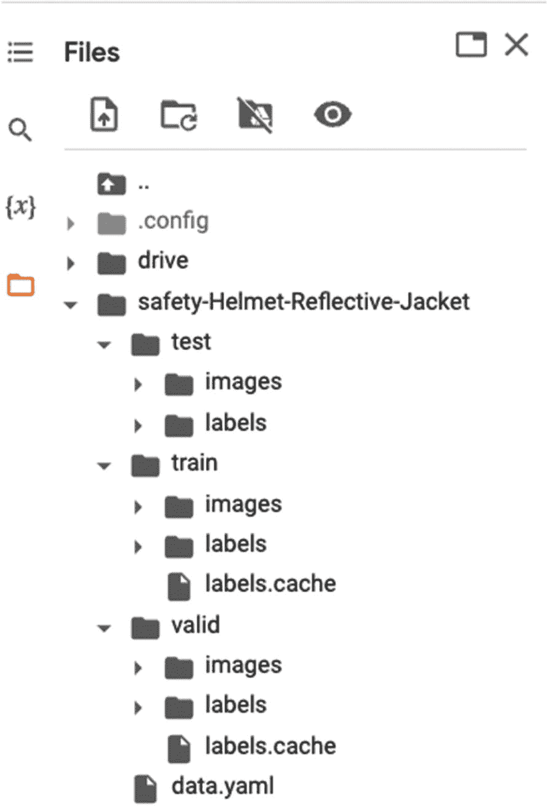

屏幕截图显示了文件和文件夹名称列表：drive、safety、test、train 和 valid。

图 6-34

用于训练的 YOLOv7 目录结构

父目录 `safety-Helmet-Reflective-Jacket` 包含子目录：`train`、`test` 和 `valid`。在每个子目录中，`images` 子目录包含用于训练、测试和验证的图像文件，`labels` 子目录包含标注文本文件。图 6-35 展示了一个包含类别 0 和类别 1 两个物体及其对应边界框的标注示例。请注意，边界框的坐标是相对于图像尺寸的：x 坐标除以图像宽度，y 坐标除以图像高度。这使得边界框坐标的值范围在 0 到 1 之间。

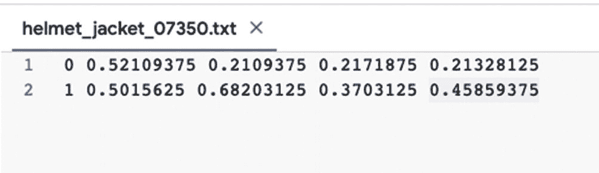

屏幕截图显示了文件夹名称 helmet_jacket_07350.txt。

图 6-35

带有边界框和物体类别的标注

## 准备 Colab 环境

首先在 Google Colab 中创建一个新项目。将上一节描述的数据集下载到本地计算机，然后将其上传到 Colab 环境。同样，建议将数据集上传到 Google Drive 目录，以避免在 Colab 会话终止时丢失数据。

下载数据集时，它将处于压缩形式（作为 `.zip` 文件）。在代码块中，执行清单 6-19 中显示的命令来解压缩 `.zip` 文件。命令成功执行后，解压缩的数据将存储在目录 `/content/safety-Helmet-Reflective-Jacket` 中。

```
!unzip '/content/drive/MyDrive/PPE/ppe.zip'
清单 6-19
解压缩数据集的命令
```

## 创建 data.yaml 文件

`data.yaml` 文件由训练函数用于定位与训练集、测试集和验证集对应的图像和标签。`data.yaml` 文件已存在于数据集目录 `/content/safety-Helmet-Reflective-Jacket` 中。编辑此文件以匹配图 6-36 中显示的条目。

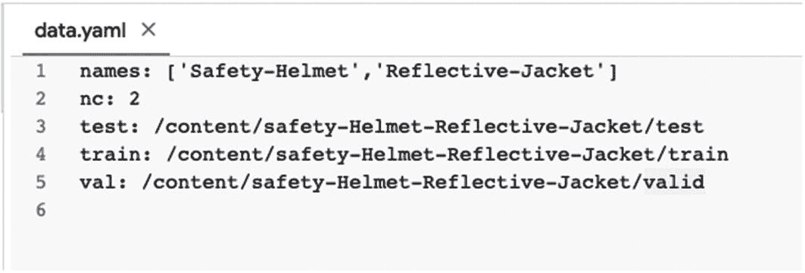

屏幕截图显示了包含 5 行代码的 data.yaml。

图 6-36

`data.yaml` 条目，用于指示训练集、测试集和验证集的位置

`data.yaml` 文件包含以下类型的条目：

*   `names`：类别名称或物体名称的列表。此列表中的名称顺序应与标注过程中使用的顺序一致。

*   `nc`：物体类别的数量。在我们的示例中，只有两个类别。

*   `test`：包含 `images` 和 `labels` 子目录的 `test` 目录的绝对路径。

*   `train`：包含 `images` 和 `labels` 子目录的 `train` 目录的绝对路径。

*   `val`：包含 `images` 和 `labels` 子目录的 `valid` 目录的绝对路径。

## 克隆 YOLOv7 GitHub 仓库

在单独的代码块中，通过运行清单 6-20 中列出的命令来克隆 YOLOv7 源代码的官方 GitHub 仓库。

```
!git clone https://github.com/WongKinYiu/yolov7.git /content/drive/MyDrive/PPE/yolov7
清单 6-20
克隆 YOLOv7 GitHub 仓库的命令
```

此命令会将 GitHub 仓库克隆到 Google Drive 的 `PPE/yolov7` 目录中。您可以指定任何您选择的目录。使用 Google Drive 目录的好处是，我们在此练习中训练的模型在 Colab 会话终止后不会被删除。

## 训练 YOLOv7 模型

如图 6-37 所示，`yolov7` 目录（包含克隆的源代码）包含 `cfg` 和 `data` 子目录。`cfg` 目录中的 `training` 子目录包含一些示例 `.yaml` 文件。这些 `.yaml` 文件包含 YOLOv7 神经网络配置。出于本练习的目的，我们将使用 `yolov7.yaml` 文件。

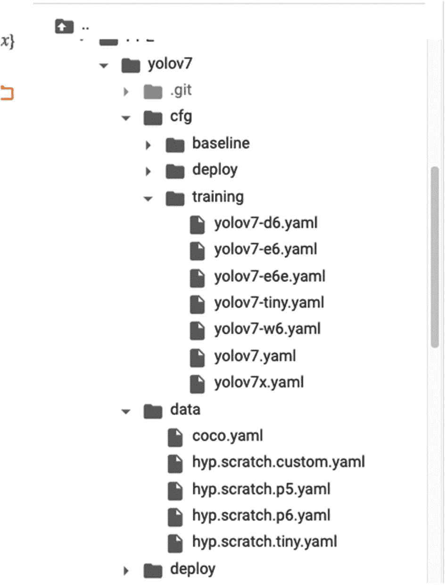

屏幕截图显示了文件夹名称列表：deploy、training、data 和 deploy。

图 6-37

`yolov7` 源代码的 `cfg` 和 `data` 目录截图

打开 `yolov7.yaml` 文件，并将包含 `nc` 键的行更改为 `nc: 2`，因为我们的数据集只包含两种类型的物体：`safety-helmet` 和 `reflective-jacket`。

显示已编辑部分的 `yolov7.yaml` 文件部分如图 6-38 所示。

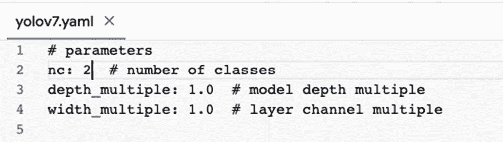

屏幕截图显示了包含 4 行代码的 yolov7.yaml。

图 6-38

`yolov7.yaml` 文件的一部分，显示 `nc: 2` 以指示两个物体

训练自定义 YOLOv7 模型有多种选项。在本节中，我们将探讨一些常用的选项。


### 启动 YOLOv7 模型训练

在接下来的章节中，我们将探讨如何在配备单 GPU 或多 GPU 的机器上触发 YOLO 模型训练。两种场景下的流程相同，唯一的区别在于配置“device”参数以匹配硬件设置。

#### 在单 GPU 上训练

清单 6-21 展示了如何在单 GPU 上从头开始训练 YOLOv7 模型。

```
1    %%shell
2    cd /content/drive/MyDrive/PPE/yolov7
3    python train.py \
--epochs 10  \
--workers 8 \
--device 0 \
--batch-size 16 \
--data /content/safety-Helmet-Reflective-Jacket/data.yaml \
--img 640 640 \
--cfg cfg/training/yolov7.yaml \
--weights '' \
--name yolov7-ppe \
--hyp data/hyp.scratch.p5.yaml
清单 6-21
在单 GPU 上从头训练 YOLOv7 模型
```

清单 6-21 的第 2 行将工作目录更改为我们从仓库克隆 YOLOv7 源码时创建的 yolov7 目录。该目录包含一个用于训练模型的 Python 脚本“train.py”。

第 3 行使用以下参数调用 `train.py` 脚本：

*   `--epochs 10`：表示训练应运行 10 个周期。
*   `--workers 8`：将数据加载工作进程数设置为 8。这些进程有助于高效加载和预处理训练数据。
*   `--device 0`：此标志指定用于训练的 GPU。本例中选择单个 GPU 0。
*   `--batch-size 16`：将批量大小设置为每次迭代 16 张图像。
*   `--data /content/safety-Helmet-Reflective-Jacket/data.yaml`：此标志指向包含数据集配置详细信息的 YAML 文件。
*   `--img 640 640`：将输入图像尺寸定义为 640×640 像素。
*   `--cfg cfg/training/yolov7.yaml`：指定 YOLOv7 架构的模型配置文件（YAML）。
*   `--weights ''`：表示模型不使用预训练权重。训练将从零开始。如果 `weights` 参数留空（如本例所示），则表示从头开始训练。提供现有权重的文件路径则表示迁移学习。
*   `--name yolov7-ppe`：为训练会话提供一个名称，可用于保存检查点和日志。默认情况下，模型存储在项目目录（本例中为 `yolov7`）的 `runs/train` 子目录中。在我们的示例中，模型将存储在 `/content/drive/MyDrive/PPE/yolov7/runs/train/yolov7-ppe` 目录中。如果第二次运行训练，模型将在 `/content/drive/MyDrive/PPE/yolov7/runs/train/yolov7-ppe2` 目录中创建，依此类推。
*   `--hyp data/hyp.scratch.p5.yaml`：指向 YAML 格式的超参数文件。

#### 在多 GPU 上训练

训练目标检测模型需要大量的计算资源。当处理包含高分辨率图像的大型训练数据集时，可能需要利用多个 GPU 来加速学习过程。

通过向清单 6-21 传递几个额外参数，我们可以增强训练过程以利用多个 GPU。清单 6-22 以粗体突出显示了这些补充参数，以便清晰识别。

```
1    %%shell
2    cd /content/drive/MyDrive/PPE/yolov7
3    python \
-m torch.distributed.launch \
--nproc_per_node 4 \
--master_port 9527 \
train.py \
--epochs 100  \
--workers 8 \
--device 0,1,2,3 \
--sync-bn \
--batch-size 16 \
--data /content/safety-Helmet-Reflective-Jacket/data.yaml \
--img 640 640 \
--cfg cfg/training/yolov7.yaml \
--weights '' \
--name yolov7-ppe \
--hyp data/hyp.scratch.p5.yaml
清单 6-22
在单 GPU 上从头训练 YOLOv7 模型
```

训练命令的参数和实参说明如下：

*   `python -m torch.distributed.launch`：命令的这一部分调用带有 `torch.distributed.launch` 模块的 Python 解释器，该模块有助于跨多个节点或 GPU 进行分布式训练。
*   `--nproc_per_node 4`：指定每个节点用于训练的进程（GPU）数量。本例中设置为四个 GPU。
*   `--master_port 9527`：此参数定义主进程在分布式训练期间用于同步的通信端口。
*   `train.py`：这是负责启动训练过程的 Python 脚本名称。
*   `--workers 8`：将数据加载工作进程数设置为 8。这些进程有助于高效加载和预处理训练数据。
*   `--device 0,1,2,3`：此标志指定用于训练的 GPU。本例中选择 GPU 0、1、2 和 3。
*   `--sync-bn`：表示使用同步批归一化，这可以改善分布式训练期间的收敛性。
*   `--batch-size 16`：将批量大小设置为每次迭代 16 张图像。
*   `--data /content/safety-Helmet-Reflective-Jacket/data.yaml`：此标志指向包含数据集配置详细信息的 YAML 文件。
*   `--img 640 640`：将输入图像尺寸定义为 640×640 像素。
*   `--cfg cfg/training/yolov7.yaml`：指定 YOLOv7 架构的模型配置文件（YAML）。
*   `--weights ''`：表示模型不使用预训练权重。训练将从零开始。
*   `--name yolov7-ppe`：为训练会话提供一个名称，可用于保存检查点和日志。
*   `--hyp data/hyp.scratch.p5.yaml`：指向 YAML 格式的超参数文件。


### 监控训练进度

模型训练时，Colab 控制台会显示训练日志输出，其中包含每个训练周期的各项损失值。例如，图 6-39 展示了最后几个训练周期以及训练结束时的日志输出。

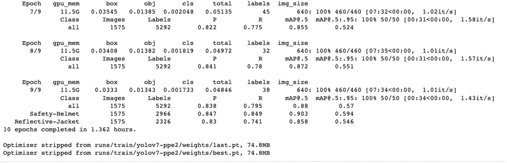

一张截图展示了目标检测模型的训练进度，详细列出了训练周期、GPU 内存、损失值、图像、标签、mAP 分数以及类别特定信息。

图 6-39

日志输出显示了每个训练周期的训练损失以及训练结束时的损失

在每个训练周期，日志会生成以下信息（以图 6-39 中的第 8 个训练周期为例进行说明）：

*   `Epoch 8/9`：表示训练过程正在进行第 8 个训练周期，总共 9 个训练周期。

*   `gpu_mem`：该列显示训练期间的 GPU 内存使用情况，表明正在使用 11.5GB 的 GPU 内存。

*   `box`：该列表示与边界框预测相关的损失。

*   `obj`：该列表示与目标性预测相关的损失。

*   `cls`：该列表示与类别预测相关的损失。

*   `total`：该列表示总损失，是边界框损失、目标性损失和类别损失的总和。

*   `labels`：该列指定训练批次中已标注对象的数量（本训练周期为 32 个）。

*   `img_size 640`：用于训练的输入图像尺寸为 640×640 像素。

*   进度条 `[07:35<00:00, 1.01it/s]` 表示当前批次的剩余时间和当前处理速度。训练速度约为每秒处理一张图像。

*   `Class Images Labels P R mAP@.5 mAP@.5:.95` 部分：提供与目标检测性能相关的指标：
    *   `all`：指所有类别的汇总指标。

    *   `Images`：评估数据集中的图像总数（1575 张）。

    *   `Labels`：评估数据集中真实标签的总数（5292 个）。

    *   `P`：精确率，表示正确预测的正检测结果与所有预测的正检测结果之比。

    *   `R`：召回率，表示正确预测的正检测结果与所有真实正实例之比。

    *   `mAP@.5`：在 IoU 阈值为 0.5 时的平均精度均值，用于衡量检测的准确性。

    *   `mAP@.5:.95`：在 IoU 阈值从 0.5 到 0.95 范围内的平均精度均值，提供了对检测性能更广泛的评估。

训练结束时，日志输出会显示以下信息（基于图 6-39 中的示例）：

*   `Optimizer stripped from runs/train/yolov7-ppe2/weights/best.pt, 74.8MB`：同样，此消息表示已从对应训练运行中最佳性能检查点的权重文件中移除了优化器状态。该权重文件位于目录 `runs/train/yolov7-ppe2/weights/best.pt`，其大小同样为 74.8 兆字节。

1.  `Optimizer stripped from runs/train/yolov7-ppe2/weights/last.pt, 74.8MB`：此消息表示已从对应训练运行中最后一个检查点的权重文件中移除了优化器状态。该权重文件位于目录 `runs/train/yolov7-ppe2/weights/last.pt`，其大小为 74.8 兆字节。在保存检查点用于分享或部署时，通常会移除优化器状态，因为推理时不需要它。

*   `10 epochs completed in 1.362 hours`：表示训练过程总共运行了十个训练周期，完成耗时约 1.362 小时。

### 使用 TensorBoard 监控训练指标

代码清单 6-23 展示了通过指定日志目录来启动 TensorBoard 的命令。理想情况下，你应该在与执行训练代码的 Colab 实例不同的另一个 Colab 实例中启动 TensorBoard。这样，你就可以在训练运行期间监控训练进度，而不是在训练完成后才进行监控。

```
1    %load_ext tensorboard
2    %tensorboard --logdir /content/drive/MyDrive/PPE/yolov7/runs/train
代码清单 6-23
启动 TensorBoard 以监控训练指标
```

TensorBoard 的 Web 控制台将直接显示在 Colab 界面中。

## 使用训练好的 YOLOv7 模型进行推理或目标检测

最终的权重文件存储在目录 `runs/train/yolov7-ppe/weights/best.pt` 中。代码清单 6-24 中的命令展示了如何使用训练好的模型检测图像中的目标。代码清单 6-25 展示了如何检测视频文件中的目标。

```
1    %%shell
2    cd /content/drive/MyDrive/PPE/yolov7
3    python detect.py \
--project /content/detection \
--weights /content/drive/MyDrive/PPE/yolov7/runs/train/yolov7-ppe3/weights/best.pt \
--conf 0.25 \
--img-size 640 \
--source /content/construction-site.mp4
代码清单 6-25
启动 TensorBoard 以监控训练指标
```

```
1    %%shell
2    cd /content/drive/MyDrive/PPE/yolov7
3    python detect.py \
--project /content/detection \
--weights /content/drive/MyDrive/PPE/yolov7/runs/train/yolov7-ppe3/weights/best.pt \
--conf 0.25 --img-size 640 \
--source /content/safety-Helmet-Reflective-ConstructionWorkers.png
代码清单 6-24
启动 TensorBoard 以监控 YOLO 的训练指标
```

在上述两个示例中，参数 `--project` 指定了一个目录路径，用于存储预测输出。如果省略此参数，输出将存储在项目的 `runs/detect/exp` 目录中。

图 6-40 展示了从零开始训练、仅经过十个训练周期的自定义模型的一个预测输出示例。

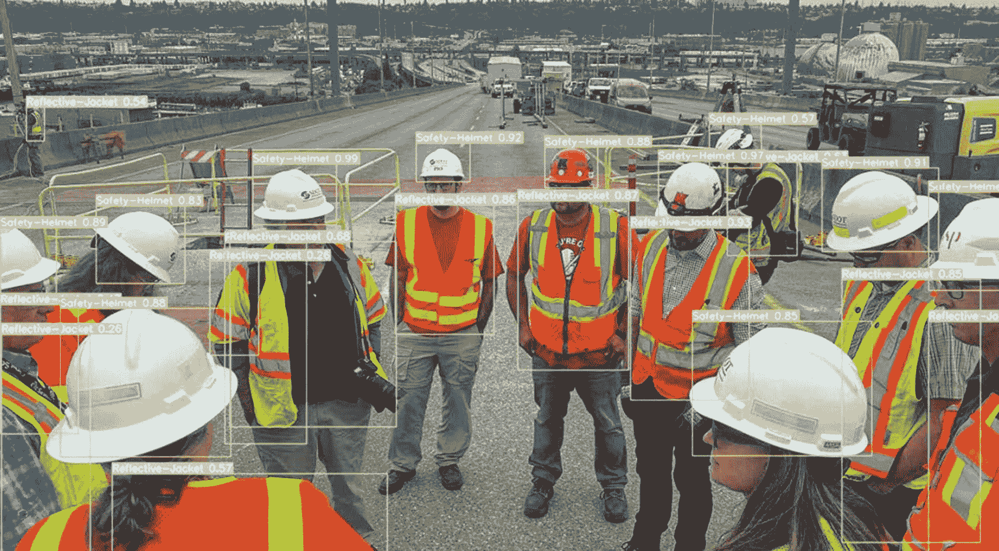

一张照片显示了一个安全帽，上面标有标签 R E C 和文字 Safety Helmet 088。

图 6-40

目标检测输出示例


## 将 YOLOv7 模型导出为 ONNX 格式

ONNX（全称为 Open Neural Network Exchange，即开放神经网络交换格式）是一种开放且可互操作的格式，用于在不同框架和工具之间表示和交换深度学习模型。

ONNX 的核心思想是提供一种通用的标准来表示机器学习模型，无论这些模型是在哪个框架中训练的。这种标准化使得在不同平台和框架上部署和使用模型变得更加容易，这在工作流的不同部分可能涉及不同工具或环境的场景中尤其有价值。

ONNX 支持广泛的深度学习框架，包括 TensorFlow、PyTorch、Caffe 等。使用 ONNX，我们可以在一个框架中训练模型，然后将其导出为 ONNX 格式。一旦转换为 ONNX 格式，我们就可以将模型导入到另一个支持的框架（如 TensorFlow）中进行推理或进一步开发，而无需重新训练。

除了模型格式之外，ONNX 还包含一个运行时，允许我们在不同设备上加载和运行 ONNX 模型，这使得在边缘设备、移动设备或云服务器上部署模型变得更加容易。

要将 YOLOv7 模型导出为 ONNX 格式，我们需要从 `pypi` 安装 `onnx` 模块。在 Google Colab 中，打开一个新的代码块，直接使用 `!pip install onnx` 来安装 ONNX 运行时。

清单 6-26 中的代码块将 YOLOv7 模型导出为 ONNX 格式，并将其存储在 `best.pt` 模型所在的同一位置。

```
1    %%shell
2    cd /content/drive/MyDrive/PPE/yolov7
3    python export.py \
--weights /content/drive/MyDrive/PPE/yolov7/runs/train/yolov7-ppe3/weights/best.pt \
--grid --end2end --simplify \
--topk-all 100 --iou-thres 0.65 \
--conf-thres 0.35 \
--img-size 640 640 --max-wh 640
清单 6-26
将 YOLOv7 模型导出为 ONNX 格式
```

导出的模型文件名为 `best.onnx`，其在示例目录结构中的位置如图 6-41 所示。

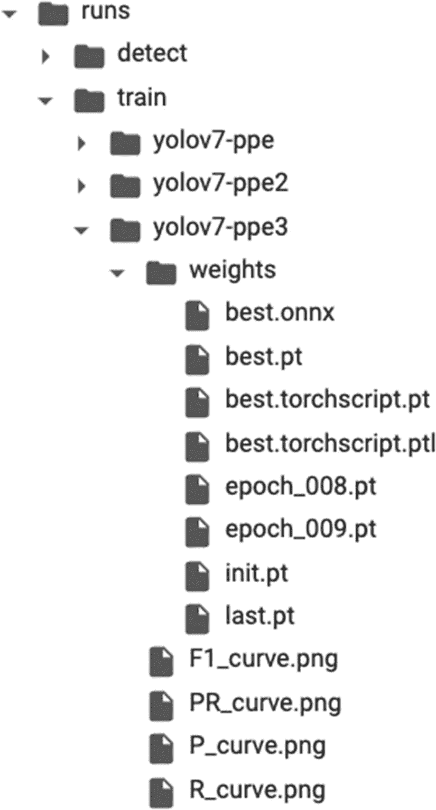

一张截图展示了标记为 runs、detect、train、weights 和 F 1 curve dot p n g 的文件夹和文件列表。

图 6-41

YOLOv7 模型及导出的 ONNX 模型所在的目录结构

## 将 ONNX 模型转换为 TensorFlow 和 TensorFlow Lite 格式

我们需要安装 `onnx-tf` 和 `tensorflow-probability` 模块，以便将 ONNX 模型转换为 TF 和 TFLite 格式。清单 6-27 展示了安装这些模块的命令。

```
!pip install onnx-tf tensorflow-probability
清单 6-27
安装从 ONNX 转换为 TF 和 TFLite 所需的包
```

清单 6-28 展示了实际将 ONNX 模型转换为 TensorFlow 格式的代码段。

```
1    %%shell
2    onnx-tf convert \
-i /content/drive/MyDrive/PPE/yolov7/runs/train/yolov7-ppe3/weights/best.onnx \
-o yolov7-tf
清单 6-28
将 ONNX 转换为 TensorFlow 的代码
```

参数 `-i` 指定 ONNX 文件路径。参数 `-o` 指定 TensorFlow 模型将保存到的输出位置。在清单 6-28 中，TF 模型将存储在当前工作目录的 `yolov7-tf` 目录中。

TensorFlow Lite 是由 Google 开发的 TensorFlow 深度学习框架的轻量级版本。它专门设计用于在资源受限的设备上部署机器学习模型，例如智能手机、嵌入式设备、微控制器和其他边缘设备。

清单 6-29 展示了一个将 TensorFlow 模型转换为 TensorFlow Lite 格式的 Python 代码片段。

```
1    import tensorflow as tf
2    converter = tf.lite.TFLiteConverter.from_saved_model('/content/yolov7-tf/')
3    tflite_model = converter.convert()

5    with open('/content/tflite/yolov7-tiny.tflite', 'wb') as f:
6      f.write(tflite_model)
清单 6-29
将 TensorFlow 转换为 TensorFlow Lite 的代码
```

执行此代码后，YOLOv7 模型将被转换为 TensorFlow Lite 格式。

在下一节中，我们将探讨如何从 TensorFlow Lite 模型预测目标检测结果。


## 使用 TensorFlow Lite 模型进行预测

清单 6-30 展示了使用从 YOLO 模型导出的 TensorFlow Lite 模型进行目标检测的代码。

```
FileName: listing_6_30
1    import cv2
2    import random
3    import numpy as np
4    from PIL import Image
5    import tensorflow as tf
6    from google.colab.patches import cv2_imshow
7    import numpy as np
8    # 加载 TFLite 模型
9    interpreter = tf.lite.Interpreter(model_path="/content/tflite/yolov7-tiny.tflite")

11   def resize_image(im, new_shape=(640, 640), color=(114, 114, 114), auto=True, scaleup=True, stride=32):
12       # 调整图像大小并填充，同时满足步长倍数约束
13       shape = im.shape[:2]  # 当前形状 [高度, 宽度]
14       if isinstance(new_shape, int):
15           new_shape = (new_shape, new_shape)

17       # 缩放比例 (新 / 旧)
18       r = min(new_shape[0] / shape[0], new_shape[1] / shape[1])
19       if not scaleup:  # 仅缩小，不放大（以获得更好的验证 mAP）
20           r = min(r, 1.0)

22       # 计算填充
23       new_unpad = int(round(shape[1] * r)), int(round(shape[0] * r))
24       dw, dh = new_shape[1] - new_unpad[0], new_shape[0] - new_unpad[1]  # 宽高填充

26       if auto:  # 最小矩形
27           dw, dh = np.mod(dw, stride), np.mod(dh, stride)  # 宽高填充

29       dw /= 2  # 将填充分为两侧
30       dh /= 2

32       if shape[::-1] != new_unpad:  # 调整大小
33           im = cv2.resize(im, new_unpad, interpolation=cv2.INTER_LINEAR)
34       top, bottom = int(round(dh - 0.1)), int(round(dh + 0.1))
35       left, right = int(round(dw - 0.1)), int(round(dw + 0.1))
36       im = cv2.copyMakeBorder(im, top, bottom, left, right, cv2.BORDER_CONSTANT, value=color)  # 添加边框
37       return im, r, (dw, dh)

39   # 根据类别索引定义类别名称。
40   names = ['安全帽','反光背心']

42   # 为边界框可视化生成随机颜色。
43   colors = {name:[random.randint(0, 255) for _ in range(3)] for i,name in enumerate(names)}

45   # 加载并预处理图像。
46   img = cv2.imread('/content/CosntructionWorkers.png')
47   img = cv2.cvtColor(img, cv2.COLOR_BGR2RGB)

49   image = img.copy()
50   image, ratio, dwdh = resize_image(image, auto=False)
51   image = image.transpose((2, 0, 1))
52   image = np.expand_dims(image, 0)
53   image = np.ascontiguousarray(image)

55   im = image.astype(np.float32)
56   im /= 255

58   # 分配张量。
59   interpreter.allocate_tensors()
60   # 获取输入和输出张量。
61   input_details = interpreter.get_input_details()
62   output_details = interpreter.get_output_details()

64   # 在随机输入数据上测试模型。
65   input_shape = input_details[0]['shape']
66   interpreter.set_tensor(input_details[0]['index'], im)

68   interpreter.invoke()

70   # 函数 `get_tensor()` 返回张量数据的副本。
71   # 使用 `tensor()` 获取指向张量的指针。
72   output_data = interpreter.get_tensor(output_details[0]['index'])

74   ori_images = [img.copy()]

76   for i,(batch_id,x0,y0,x1,y1,cls_id,score) in enumerate(output_data):
77       image = ori_images[int(batch_id)]
78       box = np.array([x0,y0,x1,y1])
79       box -= np.array(dwdh*2)
80       box /= ratio
81       box = box.round().astype(np.int32).tolist()
82       cls_id = int(cls_id)
83       score = round(float(score),3)
84       name = names[cls_id]
85       color = colors[name]
86       name += ' '+str(score)
87       cv2.rectangle(image,box[:2],box[2:],color,2)
88       cv2.putText(image,name,(box[0], box[1] - 2),cv2.FONT_HERSHEY_SIMPLEX,0.75,[225, 255, 255],thickness=2)

90   prediction = Image.fromarray(ori_images[0])

92   open_cv_image = np.array(prediction)
93   # 将 RGB 转换为 BGR
94   open_cv_image = open_cv_image[:, :, ::-1].copy()
95   cv2_imshow(open_cv_image)
清单 6-30
使用 TensorFlow Lite 模型进行预测的代码
```

以下是代码的逐步解析：

*   *导入所需库*：第 1 至 7 行导入了必要的库，例如 `cv2` (OpenCV)、`random`、`numpy`、`PIL` 和 `tensorflow`。同时还从 Google Colab 的补丁中导入了 `cv2_imshow` 函数，用于在 Colab 笔记本中显示图像。

*   *加载 TFLite 模型*：第 9 行创建了 `tf.lite.Interpreter` 类的一个实例，并从给定的模型路径（`/content/tflite/yolov7-tiny.tflite`）加载了 `YOLOv7-tiny` 模型。

*   `resize_image()`：`resize_image()` 函数接收输入图像并调整其大小，同时确保满足 YOLO 所需的某些约束。它会计算必要的填充和缩放，以匹配所需的尺寸和步长。此函数很重要，因为 YOLO 使用特定的输入尺寸和步长，因此需要相应地调整图像大小并进行填充。

*   *类别名称和颜色*：代码定义了一个类别名称列表（`names`），并为每个类别生成了随机颜色。这些颜色将用于在检测到的目标上绘制边界框和类别标签。

*   *加载并预处理图像*：代码使用 OpenCV 加载输入图像（`CosntructionWorkers.png`），将其从 BGR 格式转换为 RGB 格式，然后使用 `resize_image()` 函数调整图像大小并进行预处理。生成的图像经过重塑、转置、维度扩展，并归一化到 0 到 1 之间的值。

*   *分配并设置张量*：分配 TFLite 解释器的张量，并使用预处理后的图像设置输入数据。然后调用解释器对输入图像进行推理。

*   *检索输出数据*：使用 `get_tensor()` 函数从解释器检索输出数据。此输出数据包含有关检测到的目标的信息，包括其边界框坐标、类别 ID 和置信度分数。

*   *可视化检测到的目标*：然后，代码处理输出数据，提取相关信息，并使用 OpenCV 在原始图像上绘制边界框和标签。根据之前执行的调整大小和预处理步骤，对框进行正确缩放和定位。

*   *显示预测结果*：最后，代码将修改后的图像（带有边界框和标签）转换为与 OpenCV 兼容的格式，并使用 Colab 笔记本中的 `cv2_imshow()` 函数进行显示。

## 总结

在本章中，我们探讨了各种目标检测算法，并比较了它们的检测速度和精度。我们训练了两个检测模型，即 SSD 和 YOLOv7，并涵盖了从数据输入到保存预测输出的整个过程。

此外，我们还了解了如何利用 Google Colab 在云端训练目标检测模型，从而利用强大的 GPU。

需要注意的是，本章的重点主要是检测图像中的目标，我们没有涉及任何视频示例。然而，视频中的目标检测过程与图像中的目标检测类似，因为视频本质上是由帧（即单个图像）组成的。第 7 章将专门探讨视频中的目标检测。

此外，我们将在第 9 章和第 10 章中应用本章涵盖的概念，届时我们将开发利用深度学习技术的计算机视觉实际用例。


