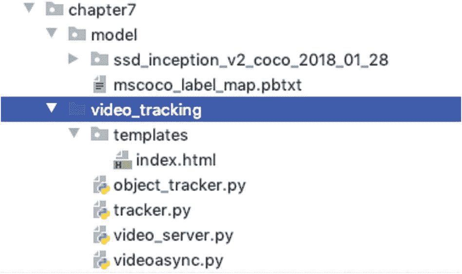
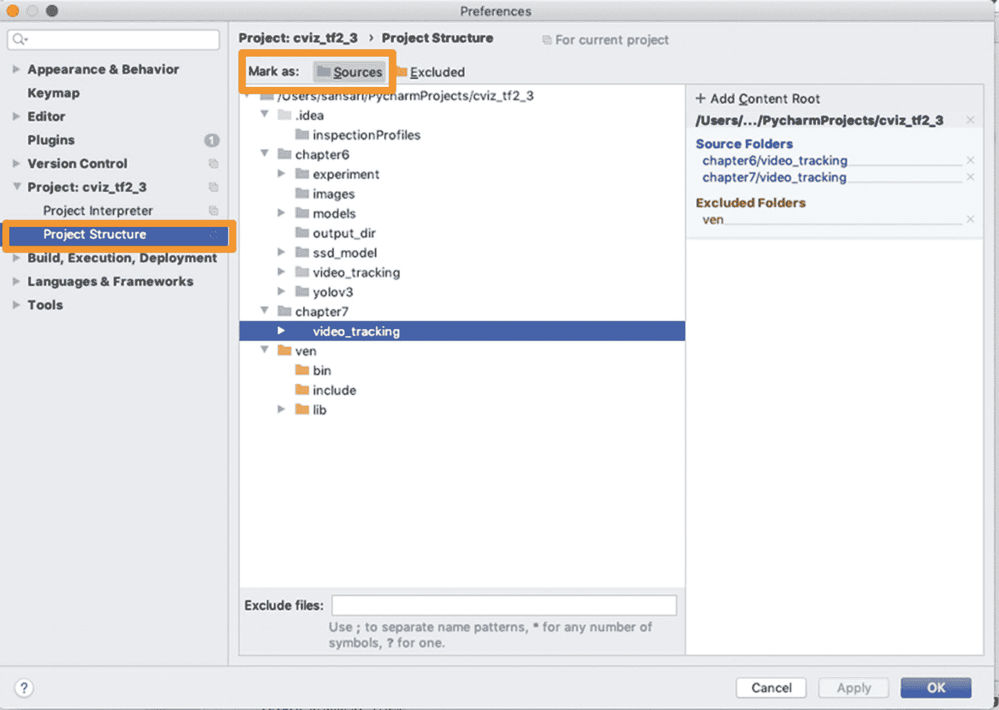
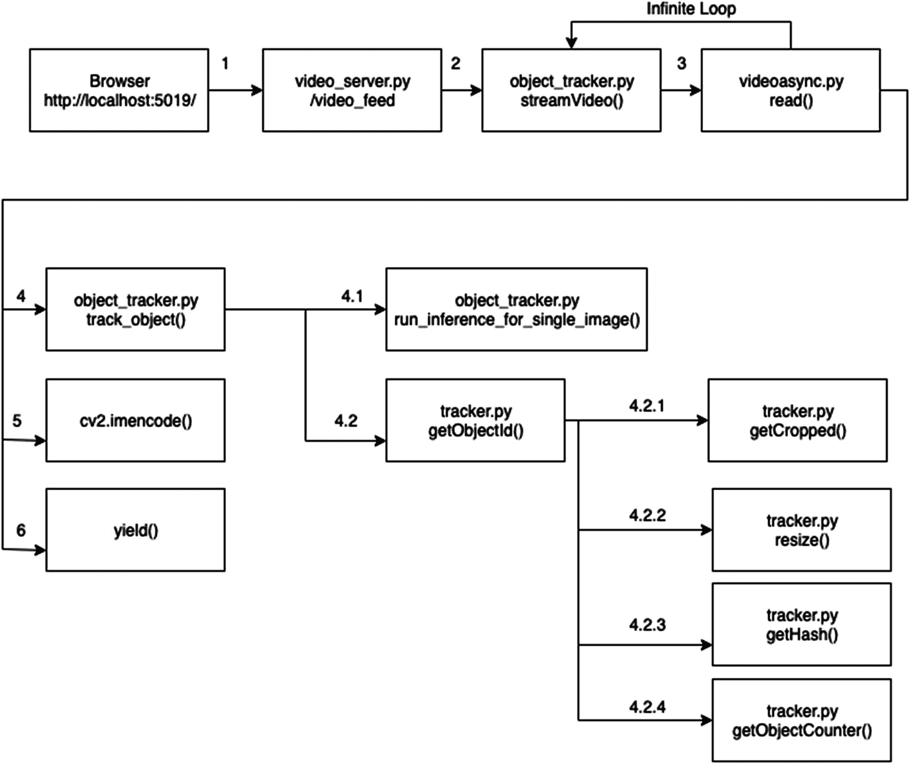

# 7. 实践示例：视频中的目标跟踪

本章的重点是计算机视觉的两项关键能力：目标检测与目标跟踪。通常，在一组图像的上下文中，目标检测能够识别图像中的一个或多个目标，而目标跟踪则能在一组图像中跟踪已检测到的目标。在前几章中，我们探讨了训练深度学习模型以检测目标的技术细节。在本章中，我们将深入探讨如何将目标检测知识实际应用于视频领域。

视频中的目标跟踪，或简称为`视频跟踪`，涉及检测、定位目标并随时间对其进行跟踪。视频跟踪不仅用于在不同帧中检测目标，还用于跨帧跟踪目标。当首次检测到目标时，会提取其唯一标识，并在后续帧中进行跟踪。

目标跟踪在现实世界中有许多应用，例如：
* 自动驾驶汽车
* 安防与监控
* 交通管制
* 增强现实（AR）
* 犯罪侦查与罪犯追踪
* 医学影像等

在本章中，我们将探讨如何实现视频跟踪，并通过代码示例进行实践。学完本章后，你应该能拥有一个功能完整的视频跟踪系统。

我们的高级实现计划如下：
1.  `视频源`：我们将使用 `OpenCV` 从网络摄像头或笔记本电脑内置摄像头读取实时视频流。你也可以从文件或 IP 摄像头读取视频。
2.  `目标检测模型`：我们将使用在 `COCO` 数据集上预训练的 `SSD` 模型。你可以针对自己的特定用例训练自己的模型（关于训练目标检测模型的信息，请回顾第 6 章）。或者，你也可以改用 `YOLO` 模型。
3.  `预测`：我们将预测视频每一帧中的目标类别（检测）及其边界框（定位）（关于在图像中检测目标的信息，请回顾第 6 章）。
4.  `唯一标识`：我们将使用哈希算法为每个目标创建唯一标识。本章后面将提供有关哈希算法的更多细节。
5.  `跟踪`：我们将使用汉明距离算法（本章后面会详细介绍）来跟踪先前检测到的目标。
6.  `显示`：我们将输出视频流，以便在网页浏览器中显示。为此，我们将使用 `Flask`，一个轻量级的 Web 应用微框架。

## 准备工作环境

让我们建立一个目录结构，以便于理解代码并完成练习。我们将分析刚才描述的六个步骤中每个步骤的代码片段。最后，我们将把所有内容整合在一起，使目标跟踪系统完整且可运行。

我们有一个名为 `video_tracking` 的目录。在该目录下，有一个名为 `templates` 的子目录，其中包含一个名为 `index.html` 的 HTML 文件。`templates` 子目录是 `Flask` 查找 HTML 页面的标准位置。在 `video_tracking` 目录中，我们有四个 Python 文件：`videoasync.py`、`object_tracker.py`、`tracker.py` 和 `video_server.py`。图 7-1 展示了这个目录结构。



一个包含文件夹和文件的文件目录截图。包括 chapter 7, model, s s d inception v 2 coco 2018 01 28, m s coco label map dot p b t x t, video tracking, templates, index dot h t m l 以及其他 .py 文件。图 7-1：代码目录结构

我们将在 `object_tracker.py` 中将 `videoasync` 作为模块导入。因此，`video_tracking` 目录必须在 `PyCharm` 中被识别为源目录。要将其设为 `PyCharm` 中的源目录，请点击屏幕左上角的 `PyCharm` 菜单选项，然后点击 `Preferences`，展开左侧面板中的 `Project`，点击 `Project Structure`，选择 `video_tracking` 目录，并在 `Mark As` 选项（位于屏幕顶部）中点击 `Sources`，如图 7-2 所示。最后，点击 `OK` 关闭窗口。



一张显示 `PyCharm` IDE 中偏好设置和项目结构的截图。它展示了项目的目录结构，并包含了 Sources、Excluded folders 以及第 6 章和第 7 章的源文件夹。其中 `video_tracking` 被选中。图 7-2：在 `PyCharm` 中将目录标记为源目录

## 读取视频流

`OpenCV` 提供了便捷的方法来连接视频源并从视频帧中读取图像。这些帧中的图像会被 `OpenCV` 内部转换为 `NumPy` 数组。这些 `NumPy` 数组会经过进一步处理，以检测和跟踪其中的物体。检测过程计算量很大，可能无法跟上读取帧的速度。因此，在主线程中读取帧并执行检测操作会表现出较慢的性能，尤其是在处理高清（HD）视频时。在代码清单 7-1 中，我们将实现用于捕获帧的多线程处理。我们将其称为视频帧的`异步读取`。

```
# file: videoasync.py
import threading
import cv2

class VideoCaptureAsync:
    def __init__(self, src=0):
        self.src = src
        self.cap = cv2.VideoCapture(self.src)
        self.grabbed, self.frame = self.cap.read()
        self.started = False
        self.read_lock = threading.Lock()

    def set(self, key, value):
        self.cap.set(key, value)

    def start(self):
        if self.started:
            print('[Warning] Asynchronous video capturing is already started.')
            return None
        self.started = True
        self.thread = threading.Thread(target=self.update, args=())
        self.thread.start()
        return self

    def update(self):
        while self.started:
            grabbed, frame = self.cap.read()
            with self.read_lock:
                self.grabbed = grabbed
                self.frame = frame

    def read(self):
        with self.read_lock:
            frame = self.frame.copy()
            grabbed = self.grabbed
        return grabbed, frame

    def stop(self):
        self.started = False
        # self.cap.release()
        # cv2.destroyAllWindows()
        self.thread.join()

    def __exit__(self, exec_type, exc_value, traceback):
        self.cap.release()
```
代码清单 7-1：视频帧异步读取的实现

文件 `videoasync.py` 实现了 `VideoCaptureAsync` 类（第 5 行），该类包含一个构造函数以及用于启动线程、读取帧和停止线程的函数。

第 6 行定义了一个构造函数，该函数将视频源作为参数。此源的默认值 `src=0`（也称为`设备索引`）表示来自笔记本电脑/计算机内置摄像头的输入。如果你有 USB 摄像头，请相应地设置此 `src` 的值。如果你的计算机端口连接了多个摄像头，没有标准的方法来查找设备索引。一种方法是从起始索引 0 开始循环，直到连接到设备。你可以打印设备属性来识别要连接的设备。对于基于 IP 的摄像头，请传入 IP 地址或 URL。

如果你的视频源是文件，请传入视频文件的路径。

第 8 行使用 `OpenCV` 的 `VideoCapture()` 函数，并传入源 ID 以连接到视频源。分配给 `self.cap` 变量的 `VideoCapture` 对象用于读取帧。

第 9 行读取第一帧并占用与摄像头的连接。

# 异步视频读取模块与物体跟踪

第 10 行是用于管理锁的标志。第 11 行实际获取线程锁。

第 13 和 14 行实现了一个函数，用于设置 `VideoCapture` 对象的属性，例如帧高度、宽度和每秒帧数（FPS）。

第 16 到 23 行实现了 `start()` 函数，用于启动线程以进行异步读取帧。

第 25 到 30 行实现了 `update()` 函数，用于读取帧并更新类级别的帧变量。`update()` 函数在第 21 行的 `start()` 函数内部使用，以异步读取视频帧。

第 32 到 36 行实现了 `read()` 函数，该函数仅返回在 `update()` 函数块中更新的帧。此函数还返回一个布尔值，指示帧是否已成功读取。

第 38 到 40 行实现了 `stop()` 函数，用于停止线程并将控制权返回给主线程。`join()` 函数会阻止主线程关闭，直到子线程完成其执行。

退出时，视频源被释放（第 45 行）。

现在，我们将编写代码来利用异步视频读取模块。在同一个目录 `video_tracking` 中，我们将创建一个名为 `object_tracker.py` 的 Python 文件，该文件实现以下功能。

## 加载物体检测模型

我们将使用与第 6 章中用于检测图像中物体相同的预训练 SSD 模型。如果你基于自己的图像训练了模型，则可以使用该模型；只需提供模型目录的路径即可。代码清单 7-2 展示了如何从磁盘加载训练好的模型。回想一下，这与我们在第 6 章的代码清单 6-11 中使用的函数相同。我们将只加载模型一次，并将其用于检测所有帧中的物体。

```
# # Model preparation
def load_model(model_path):
   model_dir = pathlib.Path(model_path) / "saved_model"
   model = tf.saved_model.load(str(model_dir))
   model = model.signatures['serving_default']
   return model

model = load_model(model_path)
```

代码清单 7-2 用于从磁盘加载训练模型的 `load_model()` 函数

## 检测视频帧中的物体

物体检测的代码与我们在第 6 章中用于相同目的的代码几乎一致。区别在于，这里我们创建了一个无限循环，在循环中每次读取一帧图像，并调用 `track_object()` 函数来追踪该帧中的物体。`track_object()` 函数内部调用了我们在第 6 章代码清单 6-15 中实现的同一个 `run_inference_for_single_image()` 函数。

`run_inference_for_single_image()` 函数的输出是一个字典，包含 `detection_classes`、`detection_boxes` 和 `detection_scores`。我们将利用这些值来计算每个物体的唯一标识并追踪其位置。

代码清单 7-3 展示了 `streamVideo()` 函数，该函数实现了无限循环，用于从视频源读取流式帧。

在代码清单 7-3 中，第 115 行开始 `streamVideo()` 函数的代码块。第 116 行使用 `global` 关键字声明了线程锁。

第 117 行开始无限 `while` 循环。在此循环内，第一行（第 118 行）通过调用 `VideoCaptureAsync` 类的 `read()` 函数读取当前视频帧（图像）。`read()` 函数返回一个元组，包含一个表示帧是否成功读取的布尔值，以及一个图像帧的 NumPy 数组。

如果帧成功获取（第 119 行），则获取锁（第 120 行），以确保在当前线程的图像仍在进行物体检测时，其他线程不会修改该帧的 NumPy 数组。

第 121 行通过传递模型对象和帧的 NumPy 数组来调用 `track_object()` 函数。我们将在后面的代码清单 7-13 中了解 `track_object()` 函数的具体功能。在第 123 行，输出的 NumPy 数组被转换为压缩的 `.jpg` 图像，使其轻量化并易于通过网络传输。我们使用 `cv2.imencode()` 将 NumPy 数组转换为图像。该函数返回一个元组，包含一个表示转换是否成功的布尔值，并返回编码后的图像。

如果图像转换不成功，则跳过该帧（第 125 行）。

最后，在第 127 行，它生成（yield）字节编码的图像。`yield` 关键字从 `while` 循环返回一个只读一次的迭代器。

第 130 行到第 137 行是清理函数，当程序终止或按下 Q 键退出屏幕时执行。

```
# 实现无限 while 循环以读取视频帧并生成输出   #供网页浏览器使用
def streamVideo():
    global lock
    while (True):
        retrieved, frame = cap.read()
        if retrieved:
            with lock:
                frame = track_object(model, frame)

                (flag, encodedImage) = cv2.imencode(".jpg", frame)
                if not flag:
                    continue

                yield (b'--frame\r\n' b'Content-Type: image/jpeg\r\n\r\n' +
                   bytearray(encodedImage) + b'\r\n')

        if cv2.waitKey(1) & 0xFF == ord('q'):
            cap.stop()
            cv2.destroyAllWindows()
            break

    # 一切完成后，释放捕获对象
    cap.stop()
    cv2.destroyAllWindows()
```

代码清单 7-3 实现无限循环以读取视频帧流，并在内部为每一帧调用物体追踪函数

## 使用 dHash 为物体创建唯一标识

我们使用感知哈希来为图像中检测到的物体创建唯一标识。差异哈希（简称 dHash）是计算图像唯一哈希最常用的算法之一。dHash 提供了若干优势，使其成为识别和比较图像的合适选择。以下是使用 dHash 的一些显著优点：

-   如果宽高比发生变化，图像哈希不会改变。
-   亮度或对比度的变化要么不会改变图像哈希，要么只会使其发生微小变化。这意味着不同对比度的哈希值之间仍然保持接近。
-   dHash 的计算速度极快。

我们不使用加密哈希，例如 MD-5 或 SHA-1。原因在于，对于这些哈希算法，如果图像发生细微变化，加密哈希将完全不同。即使是一个像素的变化也会导致完全不同的哈希值。因此，如果两幅图像在感知上相似，它们的加密哈希值也会完全不同。这使得它不适用于需要比较两幅图像的应用场景。

dHash 算法很简单。以下是计算 dHash 的步骤：

1.  将图像或图像片段转换为灰度图。这会使计算速度更快，并且如果颜色有细微变化，dHash 也不会有太大改变。在物体检测中，我们使用边界框裁剪检测到的物体，并将裁剪后的图像转换为灰度图。
2.  调整灰度图像的大小。为了计算 64 位哈希，图像会被调整为 9×8 像素，忽略其宽高比。忽略宽高比是为了确保生成的图像哈希能够匹配相似的图像，无论它们初始的空间尺寸如何。
    为什么是 9×8 像素？在 dHash 中，算法计算相邻像素的梯度差异。九行与相邻行进行差异计算，结果中只会产生八行，因此最终输出为 8×8 像素，这将为我们提供一个 64 位的哈希值。
3.  通过应用“大于”公式，将每个像素转换为 0 或 1 来构建哈希，如下所示：
    如果 `P[x=1] > P[x]`，则为 1，否则为 0。
    然后将这些二进制值转换为整数哈希。

代码清单 7-4 展示了 dHash 的 Python 和 OpenCV 实现。

```
```
32      def getCropped(self, image_np, xmin, ymin, xmax, ymax):
33          return image_np[ymin:ymax, xmin:xmax]

35      def resize(self, cropped_image, size=8):
36          resized = cv2.resize(cropped_image, (size+1, size))
37          return resized

39      def getHash(self, resized_image):
40          diff = resized_image[:, 1:] > resized_image[:, :-1]
41          # 将差异图像转换为哈希值
42          dhash = sum([2 ** i for (i, v) in enumerate(diff.flatten()) if v])
43          return int(np.array(dhash, dtype="float64"))
```
代码清单 7-4 从图像计算 dHash

第 32 行和第 33 行实现了裁剪函数。我们传入完整图像帧的 NumPy 数组以及包围物体的边界框的四个坐标。该函数裁剪出包含检测到的物体的图像部分。

第 35 行到第 37 行用于将裁剪后的图像调整为 9×8 大小。

第 39 行到第 43 行实现了 `dHash` 的计算。第 40 行通过应用前面描述的“大于”规则来查找相邻像素的差异。第 42 行根据二进制位值构建数值哈希。第 43 行将哈希值转换为整数，并从函数返回 `dhash`。

## 使用汉明距离判断图像相似度

汉明距离通常用于比较两个哈希值。它衡量的是两个哈希值中不同比特位的数量。

如果两个哈希值的汉明距离为零，则表示这两个哈希值完全相同。汉明距离越小，两个哈希值越相似。

清单 7-5 展示了如何计算两个哈希值之间的汉明距离。

```
45      def hamming(self, hashA, hashB):
46          # 计算并返回两个整数之间的汉明距离
47          return bin(int(hashA) ^ int(hashB)).count("1")
```
代码清单 7-5 汉明距离的计算

第 45 行的 `hamming()` 函数接收两个哈希值作为输入，并返回这两个输入哈希值中不同比特位的数量。

## 对象跟踪

在图像中检测到对象后，通过计算包含该对象的图像裁剪部分的 `dHash` 来创建其唯一标识。通过计算对象 `dHash` 的汉明距离，可以在帧与帧之间跟踪该对象。跟踪有许多用例。在我们的示例中，我们创建了两个跟踪函数来实现以下功能：

1. 跟踪对象从首次出现在某一帧到后续所有帧中出现的路径。此函数跟踪边界框的中心，并绘制一条连接所有这些中心的线或路径。清单 7-6 展示了此实现。函数 `createHammingDict()` 接收当前对象的 `dHash`、其边界框中心以及所有对象及其中心的历史记录。该函数将当前对象的 `dHash` 与迄今为止看到的所有 `dHash` 进行比较，并使用汉明距离找到相似对象以跟踪其运动或路径。
2. 获取对象的唯一标识符，并跟踪检测到的唯一对象数量。清单 7-7 实现了一个名为 `getObjectCounter()` 的函数，用于统计跨帧检测到的唯一对象数量。它将当前对象的 `dHash` 与之前所有帧中计算出的所有 `dHash` 进行比较。

```
49      def createHammingDict(self, dhash, center, hamming_dict):
50          centers = []
51          matched = False
52          matched_hash = dhash
53          # matched_classid = classid

55          if hamming_dict.__len__() > 0:
56              if hamming_dict.get(dhash):
57                  matched = True

59              else:
60                  for key in hamming_dict.keys():

62                      hd = self.hamming(dhash, key)

64                      if(hd  self.max_track_frame:
67                              centers.pop(0)
68                          centers.append(center)
69                          del hamming_dict[key]
70                          hamming_dict[dhash] = centers
71                          matched = True
72                          break

74          if not matched:
75              centers.append(center)
76              hamming_dict[dhash] = centers

78          return  hamming_dict
```
代码清单 7-6 跟踪多帧之间检测到的对象边界框中心

```
80      def getObjectCounter(self, dhash, hamming_dict):
81          matched = False
82          matched_hash = dhash
83          lowest_hamming_dist = self.threshold
84          object_counter = 0

86          if len(hamming_dict) > 0:
87              if dhash in hamming_dict:
88                  lowest_hamming_dist = 0
89                  matched_hash = dhash
90                  object_counter = hamming_dict.get(dhash)
91                  matched = True

93              else:
94                  for key in hamming_dict.keys():
95                      hd = self.hamming(dhash, key)
96                      if(hd < self.threshold):
97                          if hd < lowest_hamming_dist:
98                              lowest_hamming_dist = hd
99                              matched = True
100                             matched_hash = key
101                             object_counter = hamming_dict.get(key)
102         if not matched:
103             object_counter = len(hamming_dict)
104         if matched_hash in hamming_dict:
105             del hamming_dict[matched_hash]

107         hamming_dict[dhash] = object_counter
108         return  hamming_dict
```
代码清单 7-7 用于跟踪视频帧中检测到的唯一对象数量的函数

## 在网页浏览器中显示实时视频流

我们将把视频跟踪代码发布到 Flask（一个轻量级 Web 框架）上。这将允许我们通过 URL 在网页浏览器中查看带有跟踪对象的实时视频流。您也可以使用其他框架（例如 Django）来发布视频，使其可从网页浏览器访问。在我们的示例中，我选择 Flask 是因为它轻量、灵活且只需几行代码即可轻松实现。

让我们探讨如何在当前上下文中使用 Flask。我们将从在虚拟环境中安装 Flask 开始。

### 安装 Flask

# Flask视频跟踪系统

我们将使用`pip`命令安装Flask。确保激活您的虚拟环境并执行命令`pip install flask`，如下所示：

```
(cv_tf2) computername:~ username$ pip install flask
```

## Flask目录结构

请参考图7-1中的目录结构。我们在`video_tracking`目录中创建了一个名为`templates`的子目录。我们将创建一个HTML文件`index.html`，其中包含显示流式视频的代码。我们将`index.html`保存到`templates`目录中。目录名称必须为`templates`，因为Flask会查找此目录以找到HTML文件。

## 用于显示视频流的HTML

清单7-8显示了保存在`index.html`页面中的HTML代码。第7行是最重要的一行，因为它将显示实时视频流。这是HTML中标准的``标签，通常用于在网页浏览器中显示图像。第7行代码中的`{{...}}`部分是Flask符号，指示Flask从URL加载图像。当加载此HTML页面时，它将调用`/video_feed` URL并从那里获取图像以在``标签内显示。

```
3       计算机视觉

6       视频监控

清单 7-8
用于显示视频流的HTML代码
```

现在我们需要一些服务端代码来提供此HTML页面。我们还需要一个服务端实现，以便在调用`/video_feed` URL时提供图像。

我们将在单独的Python文件`video_server.py`中实现这两个函数，该文件保存在`video_tracking`目录中。确保`video_server.py`文件和`templates`目录位于同一个父目录中。

清单7-9展示了Flask服务的服务端实现。第2行导入了Flask及其相关包。第3行导入了我们的`object_tracker`包，其中包含对象检测和跟踪的实现。

第4行使用构造函数`app = Flask(__name__)`创建了一个Flask应用程序，该构造函数将当前模块作为参数。通过调用构造函数，我们实例化了Flask Web应用程序框架，并将其赋值给一个名为`app`的变量。我们将把所有服务端服务绑定到此`app`。

所有Flask服务都通过URL提供，我们必须将URL或路由绑定到它将提供的服务。以下是我们示例中需要实现的两个服务：

*   从主页URL（例如`http://localhost:5019/`）渲染`index.html`的服务
*   从`/video_feed` URL（例如`http://localhost:5019/video_feed`）提供视频流的服务

### Flask加载HTML页面

清单7-9的第6行有一个路由绑定`/`，它表示主页URL。当从Web浏览器调用主页URL时，会调用`index()`函数来处理请求（第7行）。`index()`函数仅从我们在清单7-8中创建的模板`index.html`渲染一个HTML页面。

### Flask提供视频流服务

清单7-9的第11行将`/video_feed` URL绑定到Python函数`video_feed()`。此函数进而调用我们为实现视频中目标检测与跟踪而编写的`streamVideo()`函数。第15行根据视频帧创建`Response`对象，并向调用方发送一个多部分HTTP响应。

```
1    # video_server.py
2    from flask import Flask, render_template, Response
3    import object_tracker as ot
4    app = Flask(__name__)

6    @app.route("/")
7    def index():
8        # return the rendered template
9          return render_template("index.html")

11   @app.route("/video_feed")
12   def video_feed():
13         # return the response generated along with the specific media
14         # type (mime type)
15         return Response(ot.streamVideo(),mimetype = "multipart/x-mixed-replace; boundary=frame")

17   if __name__ == '__main__':
18         app.run(host="localhost", port="5019", debug=True,
19                     threaded=True, use_reloader=False)
清单 7-9
用于启动index.html并提供视频流服务的Flask服务器端代码
```

### 运行Flask服务器

在终端中，从`video_tracking`目录下输入命令`python video_server.py`来执行`video_server.py`文件。请确保已激活你的虚拟环境。

```
(cv) computername:video_tracking username$ python video_server.py
```

这将启动Flask服务器，并在`host="localhost"`和`port="5019"`上运行（清单7-9的第18行）。你应该为生产环境更改主机和端口。同时，在第18行通过设置`debug=False`来关闭调试模式。

当服务器启动后，将你的Web浏览器指向URL `http://localhost:5019/`，即可看到带有目标跟踪的实时视频流。

## 整合所有组件

我们已经探索了视频跟踪系统的各个构建模块。现在让我们将它们整合起来，形成一个功能完备的系统。图7-3展示了我们视频跟踪系统函数调用的高级序列。



流程图展示了一个基于Web的系统中的无限循环。它从浏览器访问本地服务器开始，引出了涉及视频流、目标跟踪和数据处理的各种函数和进程。此循环持续运行，确保视频源和目标跟踪不间断。

当使用URL `http://localhost:5019/`启动Web浏览器时，Flask后端服务器提供`index.html`页面，该页面内部调用URL `http://localhost:5019/video_feed`，进而调用服务器端函数`video_feed()`。如图7-3所示，其余函数调用完成后，会将带有检测到的目标及其跟踪信息的视频帧发送到Web浏览器进行显示。清单7-10至7-14提供了视频跟踪系统的完整源代码。

清单7-10的文件路径是`video_tracking/templates/index.html`。

```

Computer Vision

Video Surveillance

清单 7-10
index.html
```

清单7-11的文件路径是`video_tracking/video_server.py`。

```
# video_server.py
from flask import Flask, render_template, Response
import object_tracker as ot
app = Flask(__name__)
@app.route("/")
def index():
# return the rendered template
return render_template("index.html")
@app.route("/video_feed")
def video_feed():
# return the response generated along with the specific media
# type (mime type)
return Response(ot.streamVideo(),mimetype = "multipart/x-mixed-replace; boundary=frame")
if __name__ == '__main__':
app.run(host="localhost", port="5019", debug=True,
threaded=True, use_reloader=False)
清单 7-11
video_server.py
```

清单 7-12 的文件路径是 `video_tracking/object_tracker.py`。

```python
import os
import pathlib
import random
import numpy as np
import tensorflow as tf
import cv2
import threading

# 导入目标检测模块。
from object_detection.utils import ops as utils_ops
from object_detection.utils import label_map_util
from videoasync import VideoCaptureAsync
import tracker as hasher

lock = threading.Lock()

# 使 gfile 兼容 v2
tf.gfile = tf.io.gfile

model_path = "./../model/ssd_inception_v2_coco_2018_01_28"
labels_path = "./../model/mscoco_label_map.pbtxt"

# 用于为每个边界框添加正确标签的字符串列表。
category_index = label_map_util.create_category_index_from_labelmap(
    labels_path, use_display_name=True
)
class_num = len(category_index) + 100
object_ids = {}
hasher_object = hasher.ObjectHasher()

# 为每个对象类别创建颜色表的函数
def get_color_table(class_num, seed=50):
    random.seed(seed)
    color_table = {}
    for i in range(class_num):
        color_table[i] = [random.randint(0, 255) for _ in range(3)]
    return color_table

colortable = get_color_table(class_num)

# 初始化并启动异步视频捕获线程
cap = VideoCaptureAsync().start()

# 模型准备
def load_model(model_path):
    model_dir = pathlib.Path(model_path) / "saved_model"
    model = tf.saved_model.load(str(model_dir))
    model = model.signatures['serving_default']
    return model

model = load_model(model_path)

# 预测对象和边界框并格式化结果
def run_inference_for_single_image(model, image):
    # 输入需要是张量，使用 `tf.convert_to_tensor` 进行转换。
    input_tensor = tf.convert_to_tensor(image)
    # 模型期望一批图像，因此使用 `tf.newaxis` 添加一个轴。
    input_tensor = input_tensor[tf.newaxis, ...]
    # 从模型运行预测
    output_dict = model(input_tensor)
    # 模型输入是张量，因此输出也是张量
    # 转换为 NumPy 数组，并取索引 [0] 以移除批次维度。
    # 我们只对前 num_detections 个检测结果感兴趣。
    num_detections = int(output_dict.pop('num_detections'))
    output_dict = {
        key: value[0, :num_detections].numpy() for key, value in output_dict.items()
    }
    output_dict['num_detections'] = num_detections
    # detection_classes 应为整数。
    output_dict['detection_classes'] = output_dict['detection_classes'].astype(
        np.int64
    )
    return output_dict

# 在图像帧上绘制边界框和跟踪信息的函数
def track_object(model, image_np):
    global object_ids, lock
    # 实际检测。
    output_dict = run_inference_for_single_image(model, image_np)
    # 可视化检测结果。
    for i in range(output_dict['detection_classes'].size):
        box = output_dict['detection_boxes'][i]
        classes = output_dict['detection_classes'][i]
        scores = output_dict['detection_scores'][i]
        if scores > 0.5:
            h = image_np.shape[0]
            w = image_np.shape[1]
            classname = category_index[classes]['name']
            classid = category_index[classes]['id']
            # 绘制边界框
            cv2.rectangle(
                image_np,
                (int(box[1] * w), int(box[0] * h)),
                (int(box[3] * w), int(box[2] * h)),
                colortable[classid],
                2,
            )
            # 在边界框上方写入类别名称
            font = cv2.FONT_HERSHEY_COMPLEX_SMALL
            hash, object_ids = hasher_object.getObjectId(
                image_np,
                int(box[1] * w),
                int(box[0] * h),
                int(box[3] * w),
                int(box[2] * h),
                object_ids,
            )
            size = cv2.getTextSize(
                str(classname) + ":" + str(scores) +
                "[Id: " + str(object_ids.get(hash)) + "]",
                font, 0.75, 1
            )[0][0]
            cv2.rectangle(
                image_np,
                (int(box[1] * w), int(box[0] * h - 20)),
                ((int(box[1] * w) + size + 5), int(box[0] * h)),
                colortable[classid],
                -1,
            )
            cv2.putText(
                image_np,
                str(classname) + ":" + str(scores) +
                "[Id: " + str(object_ids.get(hash)) + "]",
                (int(box[1] * w), int(box[0] * h) - 5),
                font, 0.75, (0, 0, 0), 1, 1
            )
            cv2.putText(
                image_np,
                "检测到的对象数量: " + str(len(object_ids)),
                (10, 20), font, 0.75, (0, 0, 0), 1, 1
            )
        else:
            break
    return image_np

# 实现无限 while 循环以读取视频帧并为 Web 浏览器生成输出的函数
def streamVideo():
    global lock
    while (True):
        retrieved, frame = cap.read()
        if retrieved:
            with lock:
                frame = track_object(model, frame)
            (flag, encodedImage) = cv2.imencode(".jpg", frame)
            if not flag:
                continue
            yield (
                b'--frame\r\n'
                b'Content-Type: image/jpeg\r\n\r\n' +
                bytearray(encodedImage) + b'\r\n'
            )
        if cv2.waitKey(1) & 0xFF == ord('q'):
            cap.stop()
            cv2.destroyAllWindows()
            break
    # 所有操作完成后，释放捕获
    cap.stop()
    cv2.destroyAllWindows()
```

清单 7-12: `object_tracker.py`

## 清单 7-13

文件路径是 `video_tracking/videoasync.py`。

```python
# 文件: videoasync.py
import threading
import cv2
class VideoCaptureAsync:
    def __init__(self, src=0):
        self.src = src
        self.cap = cv2.VideoCapture(self.src)
        self.grabbed, self.frame = self.cap.read()
        self.started = False
        self.read_lock = threading.Lock()
    def set(self, var1, var2):
        self.cap.set(var1, var2)
    def start(self):
        if self.started:
            print('[警告] 异步视频捕获已启动。')
            return None
        self.started = True
        self.thread = threading.Thread(target=self.update, args=())
        self.thread.start()
        return self
    def update(self):
        while self.started:
            grabbed, frame = self.cap.read()
            with self.read_lock:
                self.grabbed = grabbed
                self.frame = frame
    def read(self):
        with self.read_lock:
            frame = self.frame.copy()
            grabbed = self.grabbed
        return grabbed, frame
    def stop(self):
        self.started = False
        # self.cap.release()
        # cv2.destroyAllWindows()
        self.thread.join()
    def __exit__(self, exec_type, exc_value, traceback):
        self.cap.release()
```

清单 7-13 `videoasync.py`

## 清单 7-14

文件路径是 `video_tracking/tracker.py`。

# tracker.py
```
import numpy as np
import cv2

class ObjectHasher:
    def __init__(self, threshold=20, size=8, max_track_frame=10, radius_tracker=5):
        self.threshold = 20
        self.size = 8
        self.max_track_frame = 10
        self.radius_tracker = 5

    def getCenter(self, xmin, ymin, xmax, ymax):
        x_center = int((xmin + xmax)/2)
        y_center = int((ymin+ymax)/2)
        return (x_center, y_center)

    def getObjectId(self, image_np, xmin, ymin, xmax, ymax, hamming_dict={}):
        croppedImage = self.getCropped(image_np,int(xmin*0.8), int(ymin*0.8), int(xmax*0.8), int(ymax*0.8))
        croppedImage = cv2.cvtColor(croppedImage, cv2.COLOR_BGR2GRAY)
        resizedImage = self.resize(croppedImage, self.size)
        hash = self.getHash(resizedImage)
        center = self.getCenter(xmin*0.8, ymin*0.8, xmax*0.8, ymax*0.8)
        # hamming_dict = self.createHammingDict(hash, center, hamming_dict)
        hamming_dict = self.getObjectCounter(hash, hamming_dict)
        return hash, hamming_dict

    def getCropped(self, image_np, xmin, ymin, xmax, ymax):
        return image_np[ymin:ymax, xmin:xmax]

    def resize(self, cropped_image, size=8):
        resized = cv2.resize(cropped_image, (size+1, size))
        return resized

    def getHash(self, resized_image):
        diff = resized_image[:, 1:] > resized_image[:, :-1]
        # convert the difference image to a hash
        dhash = sum([2 ** i for (i, v) in enumerate(diff.flatten()) if v])
        return int(np.array(dhash, dtype="float64"))

    def hamming(self, hashA, hashB):
        # compute and return the Hamming distance between the integers
        return bin(int(hashA) ^ int(hashB)).count("1")

    def createHammingDict(self, dhash, center, hamming_dict):
        centers = []
        matched = False
        matched_hash = dhash
        # matched_classid = classid
        if hamming_dict.__len__() > 0:
            if hamming_dict.get(dhash):
                matched = True
            else:
                for key in hamming_dict.keys():
                    hd = self.hamming(dhash, key)
                    if(hd  self.max_track_frame):
                        centers.pop(0)
                    centers.append(center)
                    del hamming_dict[key]
                    hamming_dict[dhash] = centers
                    matched = True
                    break
        if not matched:
            centers.append(center)
            hamming_dict[dhash] = centers
        return  hamming_dict

    def getObjectCounter(self, dhash, hamming_dict):
        matched = False
        matched_hash = dhash
        lowest_hamming_dist = self.threshold
        object_counter = 0
        if len(hamming_dict) > 0:
            if dhash in hamming_dict:
                lowest_hamming_dist = 0
                matched_hash = dhash
                object_counter = hamming_dict.get(dhash)
                matched = True
            else:
                for key in hamming_dict.keys():
                    hd = self.hamming(dhash, key)
                    if(hd < self.threshold):
                        if hd < lowest_hamming_dist:
                            lowest_hamming_dist = hd
                            matched = True
                            matched_hash = key
                            object_counter = hamming_dict.get(key)
        if not matched:
            object_counter = len(hamming_dict)
        if matched_hash in hamming_dict:
            del hamming_dict[matched_hash]
        hamming_dict[dhash] = object_counter
        return  hamming_dict

    def drawTrackingPoints(self, image_np, centers, color=(0,0,255)):
        image_np = cv2.line(image_np, centers[0], centers[len(centers) - 1], color)
        return image_np
```

清单 7-14
`tracker.py`

在终端中执行命令 `python video_server.py` 来运行 Flask 服务器。要查看视频的实时流，请启动您的网络浏览器并访问 URL `http://localhost:5019`。

## 总结

在本章中，我们通过利用一个预训练的 SSD 模型，开发了一个功能完备的视频跟踪系统。此外，我们深入了解了差异哈希（dHash）算法，并利用汉明距离来衡量图像相似度。我们的实现被集成到了 Flask 微网络框架中，使我们能够直接在网络浏览器中呈现实时视频跟踪。