# 8. 实践示例：人脸识别

人脸识别是一个计算机视觉问题，旨在检测和识别图像或视频中的人脸。人脸识别的第一步是检测并定位输入图像中人脸的位置。这是我们在前几章中探讨过的典型目标检测任务。检测到人脸后，会从人脸上的各个关键点创建一个特征集，也称为*面部足迹*或*人脸嵌入*。一张人脸有 80 个节点或显著特征点，用于创建该特征集（美国专利号 US7634662B2，[`https://patents.google.com/patent/US7634662B2/`](https://patents.google.com/patent/US7634662B2/)）。然后将人脸嵌入与数据库进行比较，以确定人脸的身份。

人脸识别在现实世界中有许多应用，例如：

*   作为高安全区域访问控制的密码

*   在机场海关和边境保护中

*   在识别遗传性疾病中

*   作为预测个人年龄和性别的一种方式（例如，用于控制基于年龄的访问，如购买酒精饮料）

*   在执法中（例如，警方通过扫描数百万张照片来寻找潜在的犯罪嫌疑人和目击者）

*   在整理数码相册中（例如，社交媒体上的照片）

在本章中，我们将探讨 FaceNet，这是一种由谷歌工程师开发的流行人脸识别算法。我们将研究如何训练一个基于 FaceNet 的神经网络来开发人脸识别模型。最后，我们将编写代码来开发一个功能完备的人脸识别系统，该系统能够从视频流中实时检测人脸。

## FaceNet

FaceNet 由三位谷歌工程师 Florian Schroff、Dmitry Kalenichenko 和 James Philbin 发明。他们于 2015 年在一篇题为“FaceNet: A Unified Embedding for Face Recognition and Clustering”（[`https://arxiv.org/pdf/1503.03832.pdf`](https://arxiv.org/pdf/1503.03832.pdf)）的论文中发表了他们的工作。

FaceNet 是一个统一的系统，提供以下功能：

*   人脸验证（是同一个人吗？）

*   识别（这个人是谁？）

*   聚类（有相似的人脸吗？）

FaceNet 是一个深度神经网络，它执行以下操作：

*   从输入图像计算一个 128 维的紧凑特征向量，称为*人脸嵌入*。回顾第 4 章，特征向量包含描述对象重要特征的信息。128 维特征向量是一个包含 128 个实数值的列表，代表试图量化人脸的输出。

*   通过优化三元组损失函数（本章后面会描述）进行学习。

### FaceNet 神经网络架构

图 8-1 展示了 FaceNet 的架构。

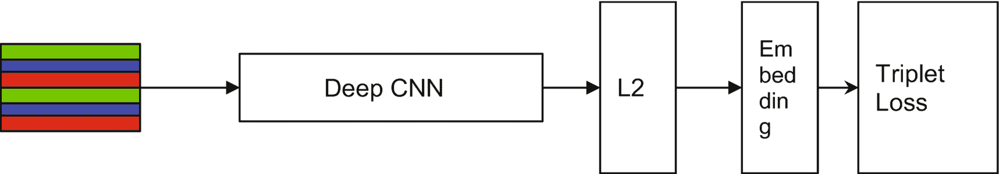

一个神经网络架构的流程图。一个带有 6 条交替颜色带的矩形图像由深度 CNN 训练，随后进行 L2 归一化、嵌入和三元组损失计算。

图 8-1

FaceNet 神经网络架构

FaceNet 网络的组成部分将在以下章节中描述。

#### 输入图像

训练集由从图像中裁剪出的人脸缩略图组成。除了平移和缩放之外，不需要对人脸裁剪图像进行其他对齐操作。


#### 深度卷积神经网络

FaceNet 使用深度卷积神经网络进行训练，采用了带动量的随机梯度下降（SGD）和 AdaGrad 优化器。初始学习率设为 0.05，并随着迭代次数逐渐降低以完成模型训练。训练过程在基于 CPU 的集群上进行了 1000 到 2000 小时。

FaceNet 论文描述了两种具有不同权衡的深度卷积神经网络架构。第一种架构受 Zeiler 和 Fergus 的启发，第二种则是谷歌的 Inception 架构。这两种架构主要在两个方面有所不同：参数数量和每秒浮点运算次数（FLOPS）。FLOPS 是衡量需要浮点运算的计算机性能的标准指标。

Zeiler 和 Fergus 的 CNN 架构包含 22 层，在每张图像上以 16 亿 FLOPS 训练 1.4 亿个参数。这种 CNN 架构被称为 NN1，其输入尺寸为 220×220。

表 8-1 展示了 FaceNet 中使用的基于 Zeiler 和 Fergus 的网络配置。

**表 8-1**

基于 Zeiler 和 Fergus 网络架构的深度 CNN（来源：Schroff 等人，[`https://arxiv.org/pdf/1503.03832.pdf`](https://arxiv.org/pdf/1503.03832.pdf)）

| 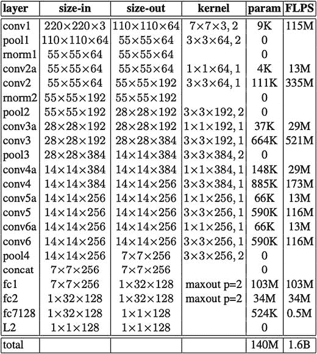 一张 CNN 网络架构表。包含 6 列：层、输入尺寸、输出尺寸、卷积核、参数和 FLOPS。多行给出了卷积层和池化层组件。总参数为 1.4 亿，总 FLOPS 为 16 亿。 |

第二种网络是基于 GoogLeNet 的 Inception 模型。该模型的参数数量减少了 20 倍（约 660 万到 750 万），FLOPS 减少了 5 倍（约 5 亿到 16 亿）。

基于输入尺寸的不同，Inception 模型有几种变体。这里简要描述如下：

*   ***NN2***：这是一个 Inception 模型，输入图像尺寸为 224×224，在每张图像上以 16 亿 FLOPS 训练 750 万个参数。

表 8-2 展示了 FaceNet 中使用的 NN2 Inception 模型。

**表 8-2**

基于 GoogLeNet 的 Inception 模型架构（来源：Schroff 等人，[`https://arxiv.org/pdf/1503.03832.pdf`](https://arxiv.org/pdf/1503.03832.pdf)）

| 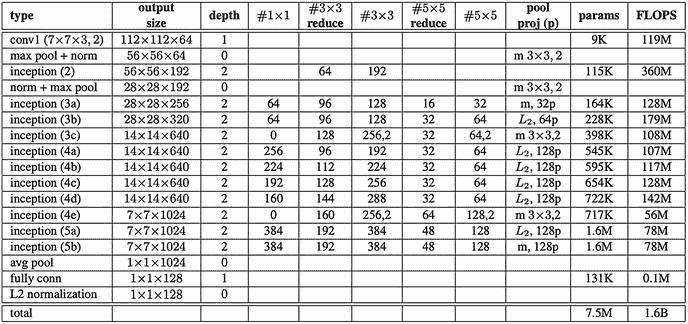 一张 Inception 模型架构表。包含类型、输出尺寸、深度、1x1、3x3 降维、3x3、5x5 降维、5x5、池化投影、参数和 FLOPS 列。行包括卷积层和平均池化层，以及从 3a 到 5b 的 Inception 层。总参数为 750 万，总 FLOPS 为 16 亿。 |

*   ***NN3***：该架构与 NN2 相同，只是输入尺寸为 160×160，导致网络规模更小。

*   ***NN4***：该网络的输入尺寸为 96×96，导致参数大幅减少，每张图像仅需 2.85 亿 FLOPS（相比之下，NN1 和 NN2 需要 16 亿 FLOPS）。由于尺寸减小且 FLOPS 降低，所需的 CPU 时间更少，因此 NN4 适用于移动设备。

*   ***NNS1***：由于其尺寸较小，也被称为“迷你”Inception。其输入尺寸为 165×165，拥有 2600 万个参数，每张图像仅需 2.2 亿 FLOPS。

*   ***NNS2***：这被称为“微型”Inception。其输入尺寸为 140×116，拥有 430 万个参数，需要 2000 万 FLOPS。

NN4、NNS1 和 NNS2 由于参数数量较少，每张图像所需的 CPU FLOPS 较低，因此适用于移动设备。

需要指出的是，FLOPS 越高，模型精度通常也越高。一般来说，FLOPS 较低的网络运行速度更快，内存消耗更少，但精度也较低。

图 8-2 展示了不同 CNN 架构的 FLOPS 与精度的关系图。

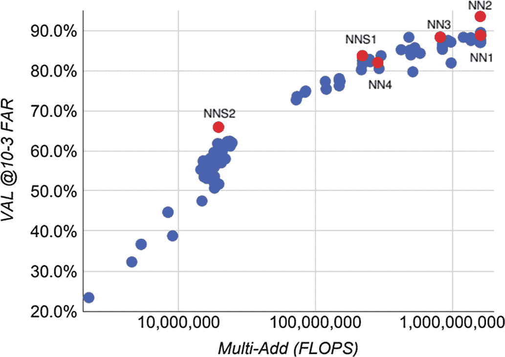

一张散点图，显示了在 FAR 为 10 的负 3 次方时，VAL 从 20% 到 80% 与乘法加法 FLOPS 的关系。这些点呈现正相关的上升趋势。图中标记了 NNS2、NNS1 以及 NN1 到 NN4 的点。

**图 8-2**

FLOPS 与精度对比图（来源：FaceNet，[`​arxiv.​org/​pdf/​1503.​03832.​pdf`](https://arxiv.org/pdf/1503.03832.pdf)）

#### 人脸嵌入

尺寸为 1×1×128 的人脸嵌入是从深度 CNN 的 L2 归一化层生成的（如图 8-1 以及表 8-1 和 8-2 所示）。

计算出嵌入向量后，通过计算嵌入向量之间的欧几里得距离来执行人脸验证（或查找相似人脸），并根据以下规则查找相似人脸：

*   同一个人的脸距离较小。
*   不同人的脸距离较大。

人脸识别通过标准的 K 近邻（K-NN）分类来执行。

聚类则使用 K-means 或凝聚聚类等技术完成。

#### 三元组损失函数

FaceNet 中使用的损失函数被称为*三元组损失函数*。

同一人脸的嵌入向量被称为*正样本*，不同人脸的嵌入向量被称为*负样本*。正在分析的人脸被称为*锚点*。为了计算损失，会形成一个由锚点、正样本和负样本嵌入组成的三元组，并分析它们之间的欧几里得距离。FaceNet 的学习目标是**最小化**锚点与正样本之间的距离，并**最大化**锚点与负样本之间的距离。

图 8-3 说明了三元组损失函数和学习过程。

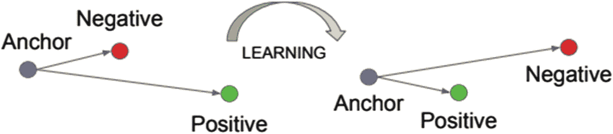

一张三元组损失函数和学习过程的流程图。它描绘了一个锚点、一个负样本和一个正样本点。它分别最小化和最大化锚点与正样本、锚点与负样本之间的距离。

**图 8-3**

三元组损失最小化锚点与正样本（两者身份相同）之间的距离，并最大化锚点与负样本（身份不同）之间的距离（来源：FaceNet，[`​arxiv.​org/​pdf/​1503.​03832.​pdf`](https://arxiv.org/pdf/1503.03832.pdf)）。

每张人脸图像都是一个特征向量，表示一个 d 维的欧几里得超球面，并由函数 ||*f(x)||*[*2*] *= 1* 表示。

假设人脸图像 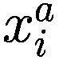（锚点）比不同人的 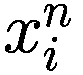（困难负样本）人脸更接近同一个人的 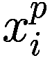（困难正样本）人脸。此外，假设训练集中有 N 个三元组。三元组损失函数由以下公式表示：

*   ![$$ {\sum}_i^N\left[\kern0.5em {\left\Vert \kern0.5em f\left({x}_i^a\right)-f\left({x}_i^p\right)\kern0.5em \right\Vert}_2²-{\left\Vert f\left({x}_i^a\right)-f\left({x}_i^n\right)\kern0.5em \right\Vert}_2²+\alpha \kern0.5em \right] $$](images/493065_2_En_8_Chapter/493065_2_En_8_Chapter_TeX_IEq4.png)

其中 *α* 是正样本和负样本嵌入之间的距离边界。

如果我们考虑所有可能的三元组组合，数量会非常庞大，上述函数可能需要很长时间才能收敛。此外，并非每个三元组都有助于模型学习。因此，我们需要一种方法来选择合适的三元组，以便我们的模型训练高效且精度达到最优。


#### 三元组选择

理想情况下，我们应选择这样的三元组：使得 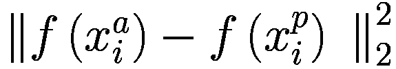 最小，且 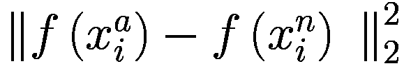 最大。但在整个数据集中计算这个最小值和最大值可能不可行。因此，我们需要一种方法来高效地计算距离的最小值和最大值。这可以通过离线方式完成，然后将结果输入算法，或者使用某些算法在线确定。

在在线方法中，我们将嵌入向量划分为小批量。每个小批量包含一小部分正样本和一些随机选择的负样本。FaceNet 的发明者使用了包含 40 个正样本和随机选择的负样本嵌入向量的小批量。为每个小批量计算最小和最大距离，以创建三元组。

在接下来的章节中，我们将基于 FaceNet 训练我们自己的模型，并构建一个实时人脸识别系统。

## 训练人脸识别模型

David Sandberg 提供了最流行的 FaceNet TensorFlow 实现之一。这是一个开源版本，在 MIT 许可下可免费从 GitHub 获取，地址为 [`https://github.com/davidsandberg/facenet`](https://github.com/davidsandberg/facenet)。我已将原始 GitHub 仓库分叉，并将一个稍作修改的版本提交到我的 GitHub 仓库，地址为 [`https://github.com/ansarisam/facenet`](https://github.com/ansarisam/facenet)。我没有修改核心神经网络和三元组损失函数的实现。我从 David Sandberg 的仓库分叉而来的 FaceNet 修改版，使用 OpenCV 读取和处理图像。我还升级了 TensorFlow 的一些库函数。

在以下示例中，我们将使用 Google Colab 来训练我们的人脸检测模型。需要注意的是，人脸检测模型是计算密集型的，即使在 GPU 上也可能需要数天时间进行学习。因此，Colab 并非训练长时间运行模型的理想平台，因为 Colab 会话过期后，您将丢失所有数据和设置。您应考虑使用基于云的 GPU 环境来训练生产质量的人脸识别模型。第 10 章将向您展示如何在云上扩展模型训练。现在，让我们先使用 Colab 进行学习。

开始之前，请创建一个新的 Colab 项目，并为其指定一个有意义的名称，例如 FaceNet Training。

### 从 GitHub 检出 FaceNet

检出来自 TensorFlow 实现的 FaceNet 源代码。在 Colab 中，点击 +Code 图标添加一个代码单元格。编写命令以克隆 GitHub 仓库，如代码清单 8-1 所示。点击执行按钮运行该命令。成功执行后，您应该在 Colab 文件浏览器面板中看到 `facenet` 目录。

```
1    %%shell
2    git clone https://github.com/ansarisam/facenet.git
代码清单 8-1
克隆 FaceNet 的 TensorFlow 实现的 GitHub 仓库
```

如果您克隆的是官方 GitHub 仓库，则需要做出以下更改，使其能在 TensorFlow 2.x 环境中运行。官方的 FaceNet 是在 TensorFlow 1.x 中实现的，目前不支持 TensorFlow 2.x。为了运行本章提供的代码，请按如下方式更新源代码：

1.  使用以下命令安装 `tf_slim` 模块：

    ```
    !pip install tf_slim
    ```

2.  对 `facenet/src/models/inception_resnet_v1.py` 文件进行以下更改：
    1.  注释掉 `import tensorflow as tf`，并添加以下行：

        ```
        import tensorflow.compat.v1 as tf
        tf.disable_v2_behavior()
        ```

    2.  注释掉 `import tensorflow.contrib.slim as slim`，并添加以下导入行：

        ```
        import tf_slim as slim
        ```

3.  在 `facenet/src/train_tripletloss.py` 文件中，注释掉 `import tensorflow as tf`，并添加以下行：

1.  在 `facenet/src/facenet.py` 文件中，注释掉 `import tensorflow as tf`，并添加以下行：

```
import tensorflow.compat.v1 as tf
tf.disable_v2_behavior()
```

```
import tensorflow.compat.v1 as tf
tf.disable_v2_behavior()
```

仓库 [`https://github.com/ansarisam/facenet.git`](https://github.com/ansarisam/facenet.git) 已经包含了上述更改，无需任何编辑即可执行本章提供的代码清单。

### 数据集

我们将使用 VGGFace2 数据集来训练我们的人脸识别模型。VGGFace2 是一个用于人脸识别的大规模图像数据集，由视觉几何组提供，地址为 [`https://www.robots.ox.ac.uk/~vgg/data/vgg_face2/`](https://www.robots.ox.ac.uk/~vgg/data/vgg_face2/)。

VGGFace2 数据集包含超过 9,000 人（称为*身份*）的 330 万张人脸。每个身份的数据样本平均有 362 张图像。该数据集在 Q. Cao、L. Shen、W. Xie、O. M. Parkhi 和 A. Zisserman 于 2018 年发表的论文中有所描述，论文地址为 [`http://www.robots.ox.ac.uk/~vgg/publications/2018/Cao18/cao18.pdf`](http://www.robots.ox.ac.uk/~vgg/publications/2018/Cao18/cao18.pdf)。

训练集大小为 35GB，测试集大小为 1.9GB。数据集以压缩（zip）文件形式提供。人脸图像按子目录组织。每个子目录的名称是身份类别 ID，格式为 `n< classID >`。图 8-4 显示了包含训练图像的示例目录结构。

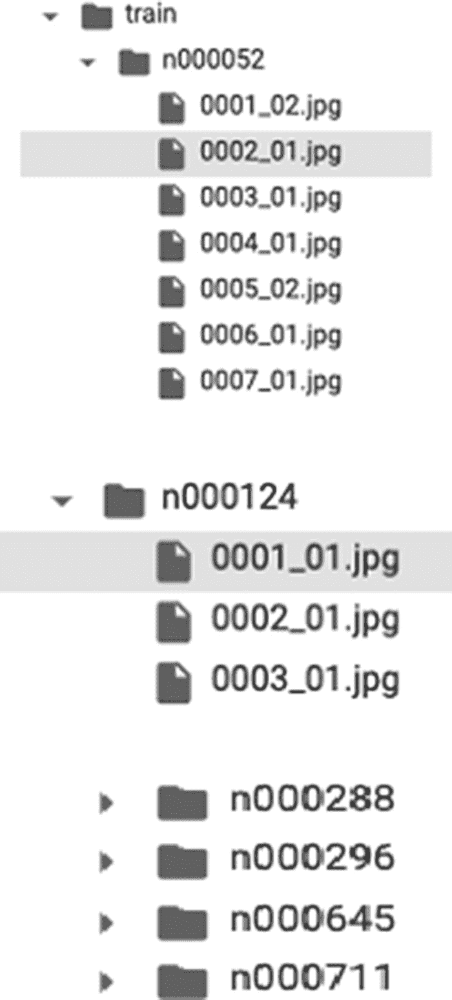

不同文件夹（包括 train）的子目录截图。选中了两个包含图像的子目录。它们分别是 0 0 0 2 0 1 点 j p g 和 0 0 0 1 0 1 点 j p g。

图 8-4

包含图像的子目录

提供了一个单独的 CSV 格式的元数据文件。该元数据文件的标题如下：

*   ***身份 ID，姓名，样本数量，训练/测试标志和性别***

简要说明如下：

*   `身份 ID` 映射到子目录名称。

*   `姓名` 是包含其人脸图像的人员姓名。

*   `样本数量` 表示子目录中的图像数量。

*   `训练/测试标志` 指示该身份属于训练集还是测试集。训练集用标志 1 表示，测试集用 0 表示。

*   `性别` 是该人员的性别。

需要注意的是，该数据集的大小过大，无法放入免费版的 Google Colab 或 Google Drive。

但是，您可以仅使用数据的一个子集（可能几百个身份）用于学习目的。

当然，如果您想构建自定义的人脸识别模型，也可以使用自己的图像。您需要做的就是将同一个人的图像保存在一个目录中，每个人拥有自己的目录，并使目录结构看起来像图 8-4。请确保您的目录名称和图像文件名不包含任何空格。


### 下载 VGGFace2 数据

要下载图像，您需要先在 [`http://zeus.robots.ox.ac.uk/vgg_face2/signup/`](http://zeus.robots.ox.ac.uk/vgg_face2/signup/) 注册。注册后，登录 [`https://www.robots.ox.ac.uk/~vgg/data/vgg_face2/`](https://www.robots.ox.ac.uk/~vgg/data/vgg_face2/) 直接下载数据，将压缩的训练集和测试集文件保存到本地驱动器，然后上传到 Colab。

如果您更倾向于直接在 Colab 中下载图像，可以使用清单 8-2 中的代码。使用正确的 URL 运行程序，即可下载训练集和测试集。

```
1    import sys
2    import getpass
3    import requests

5    VGG_FACE_URL = "http://zeus.robots.ox.ac.uk/vgg_face2/login/"
6    IMAGE_URL = "http://zeus.robots.ox.ac.uk/vgg_face2/get_file?fname=vggface2_train.tar.gz"
7    TEST_IMAGE_URL="http://zeus.robots.ox.ac.uk/vgg_face2/get_file?fname=vggface2_test.tar.gz"

9    print('请输入您的 VGG Face 2 凭据：')
10   user_string = input('    用户：')
11   password_string = getpass.getpass(prompt='    密码：')

13   credential = {
14       'username': user_string,
15       'password': password_string
16   }

18   session = requests.session()
19   r = session.get(VGG_FACE_URL)

21   if 'csrftoken' in session.cookies:
22       csrftoken = session.cookies['csrftoken']
23   elif 'csrf' in session.cookies:
24       csrftoken = session.cookies['csrf']
25   else:
26       raise ValueError("无法定位 CSRF 令牌。")

28   credential['csrfmiddlewaretoken'] = csrftoken

30   r = session.post(VGG_FACE_URL, data=credential)

32   imagefiles = IMAGE_URL.split('=')[-1]

34   with open(imagefiles, "wb") as files:
35       print(f"正在下载文件：`{imagefiles}`")
36       r = session.get(IMAGE_URL, data=credential, stream=True)
37       bytes_written = 0
38       for data in r.iter_content(chunk_size=400096):
39           files.write(data)
40           bytes_written += len(data)
41           MegaBytes = bytes_written / (1024 * 1024)
42           sys.stdout.write(f"\r 已下载 {MegaBytes:0.2f} MiB...")
43           sys.stdout.flush()

45   print("\n 图像已成功下载。正在退出进程。")
清单 8-2
用于下载 VGGFace2 图像的 Python 代码（来源：https://github.com/MistLiao/jgitlib/blob/master/download.py）
```

下载训练集和测试集后，解压缩它们，按照图 8-4 所示的结构获取训练和测试目录及子目录。要解压缩，可以执行清单 8-3 中的命令。

```
1    %%shell
2    tar xvzf vggface2_train.tar.gz
3    tar xvzf vggface2_test.tar.gz
清单 8-3
解压缩文件的命令
```

### 数据准备

FaceNet 的训练集应仅包含人脸部分的图像。因此，我们需要裁剪图像以提取人脸，对齐它们，并在需要时调整大小。我们将使用一种称为*多任务级联卷积网络 (MTCNN)* 的算法，该算法已被证明在保持实时性能的同时，优于许多人脸检测基准。

我们从 GitHub 仓库克隆的 FaceNet 源码中包含一个基于 TensorFlow 的 MTCNN 实现。该模型的实现超出了本书的范围。我们将使用 `align` 模块中提供的 Python 程序 `align_dataset_mtcnn.py` 来获取训练集和测试集中检测到的所有人脸的边界框。该程序将保留目录结构，并将裁剪后的图像保存在相同的目录层次结构中，如图 8-4 所示。

清单 8-4 展示了执行人脸裁剪和对齐的脚本。请注意，此代码仅适用于 [`https://github.com/ansarisam/facenet.git`](https://github.com/ansarisam/facenet.git) 仓库。

```
1    %%shell
2    export PYTHONPATH=$PYTHONPATH:/content/facenet
3    export PYTHONPATH=$PYTHONPATH:/content/facenet/src
4    for N in {1..10}; do \
5    python /content/facenet/src/align/align_dataset_mtcnn.py \
/content/drive/MyDrive/chapter8/train \
/content/drive/MyDrive/chapter8/train_aligned \
--image_size 182 \
--margin 44 \
--random_order \
--gpu_memory_fraction 0.10 \
& done
清单 8-4
使用 MTCNN 进行人脸检测、裁剪和对齐的代码
```

在清单 8-4 中，第 1 行激活了 shell。

第 2 行和第 3 行将 `PYTHONPATH` 环境变量设置为 `facenet` 和 `facenet/src` 目录。如果您使用的是虚拟机或物理机，并且可以直接访问操作系统，则应考虑在 `~/.bash_profile` 文件中设置该环境变量。

为了加快人脸检测和对齐过程，我们创建了十个并行进程（第 4 行），并且每个进程使用 10% 的 GPU 内存（第 5 行）。如果您的数据集较小，并且希望以单个进程处理 MTCNN，请将 N 的值设置为 1。

第 5 行调用文件 `align_dataset_mtcnn.py` 并传递以下参数：

*   第一个参数 `/content/drive/MyDrive/chapter8/train` 是训练图像所在的目录路径。

*   第二个参数 `/content/drive/MyDrive/chapter8/train_aligned` 是存储对齐后图像的目录路径。

*   第三个参数 `--image_size` 是裁剪后图像的尺寸。我们将其设置为 182×182 像素。

*   参数 `--margin` 设置为 44，会在裁剪图像的四周创建一个边距。

*   下一个参数 `--random_order`，如果存在，则并行进程会以随机顺序选择图像。

*   最后一个参数 `--gpu_memory_fraction` 用于告知算法每个并行进程应使用 GPU 内存的多少比例。

上一个脚本中裁剪后的图像尺寸为 182×182 像素。Inception-ResNet-v1 的输入仅为 160×160。这为随机裁剪提供了额外的边距。使用额外的 44 像素边距是为了向模型添加任何上下文信息。这个额外的 44 像素边距应根据您的具体情况进行调整，并应评估裁剪性能。

执行上一个脚本以启动裁剪和对齐过程。请注意，这是一个计算密集型过程，可能需要数小时才能完成。

对测试图像重复上述过程。

如果您想使用 MTCNN 库并编写自定义 Python 代码来裁剪图像中的人脸部分并执行对齐，清单 8-5 中的代码将有所帮助。首先，使用以下命令安装 mtcnn 库：


```
1    import numpy as np
2    import pandas as pd
3    import cv2
4    from mtcnn.mtcnn import MTCNN
5    from matplotlib import pyplot as plt
6    from keras.models import load_model
7    from PIL import Image
8    import os
9    # extract a single face from a given photograph
10   def extract_face(filename, required_size=(160, 160)):
11       # load image from file
12       image = Image.open(filename)
13       # convert to RGB, if needed
14       image = image.convert('RGB')
15       # convert to array
16       pixels = np.asarray(image)
17       # create the detector, using default weights
18       detector = MTCNN()
19       # detect faces in the image
20       results = detector.detect_faces(pixels)
21       # extract the bounding box from the first face
22       x1, y1, width, height = results[0]['box']
23       # deal with negative pixel index
24       x1, y1 = abs(x1), abs(y1)
25       x2, y2 = x1 + width, y1 + height
26       # extract the face
27       face = pixels[y1:y2, x1:x2]
28       # resize pixels to the model size
29       image = Image.fromarray(face)
30       image = image.resize(required_size)
31       face_array = np.asarray(image)
32       return face_array

34   inputpath = "/content/drive/MyDrive/chapter8/train"
35   outputpath = "/content/drive/MyDrive/chapter8/train_aligned"
36   for dir in os.listdir(inputpath):
37     if os.path.isdir(os.path.join(inputpath, dir)):
38       os.makedirs(os.path.join(outputpath, dir))
39       for image in os.listdir(os.path.join(inputpath, dir)):
40         pixels = extract_face(os.path.join(inputpath, dir, image))
41         cv2.imwrite(os.path.join(outputpath, dir, image), pixels)
42     else:
43       print(dir, " is not a dir")
代码清单 8-5
裁剪图像中人脸部分的脚本
```

```
!pip install mtcnn
```

以下是代码清单 8-5 的详细解析：

1.  导入必要的库：
    1.  numpy as np：用于 Python 数值计算的库

2.  pandas as pd：用于数据处理和分析的库

3.  cv2：用于计算机视觉任务的 OpenCV 库

4.  mtcnn.mtcnn 中的 MTCNN：用于人脸检测的多任务级联卷积网络的实现

5.  matplotlib 中的 pyplot：用于创建图表和可视化的库

6.  keras.models 中的 load_model：加载预训练的 Keras 模型

7.  PIL 中的 Image：Python 图像处理库中用于图像处理的模块

8.  os：用于与操作系统交互的模块

2.  定义一个函数 `extract_face(filename, required_size)`：
    1.  该函数接收一个图像文件路径（`filename`）和一个可选参数，用于指定所需的人脸尺寸（`required_size`）。

2.  它使用 PIL 加载图像，必要时将其转换为 RGB 格式，再转换为 NumPy 数组，然后使用 MTCNN 检测图像中的人脸。

3.  它提取检测到的第一张人脸的边界框坐标。

4.  它根据边界框从图像中提取人脸区域，将其调整为所需尺寸，并返回最终的人脸数组。

3.  定义图像处理的输入和输出路径。

4.  遍历输入路径中的目录：
    1.  如果输入路径中的项目不是目录，则打印一条消息，表明它不是目录。

*   它调用 `extract_face()` 函数从图像中提取人脸。

*   它使用 OpenCV 的 `cv2.imwrite()` 函数将提取的人脸保存为输出路径中相应子目录下的图像。

1.  对于输入路径中的每个子目录（dir），代码会在输出路径中创建对应的子目录。

2.  然后处理每个子目录中的每张图像：

### 模型训练

代码清单 8-6 是一个使用 FaceNet 框架训练人脸识别模型的脚本。FaceNet 学习将人脸映射到一个高维空间，在该空间中，相似的人脸彼此更接近。该脚本使用三元组损失作为其训练目标。

```
1    !export PYTHONPATH=$PYTHONPATH:/content/facenet/src
2    !python facenet/src/train_tripletloss.py \
--logs_base_dir logs/facenet/ \
--models_base_dir /content/drive/MyDrive/chapter8/facenet_model4/ \
--data_dir /content/drive/MyDrive/chapter8/train_aligned/ \
--image_size 160 \
--model_def models.inception_resnet_v1 \
--optimizer ADAGRAD \
--learning_rate 0.01 \
--weight_decay 1e-4 \
--max_nrof_epochs 10 \
--epoch_size 200 \
--people_per_batch 45 \
--images_per_person 20 \
代码清单 8-6
使用三元组损失函数训练 FaceNet 模型的脚本
```

让我们逐步解析代码清单 8-6 中的代码。

第 1 行将 `/content/facenet/src` 目录添加到 Python 路径中。这是必要的，以便后续的 `python` 命令能够找到并从该目录导入所需的模块。

第 2 行使用 `python 解释器` 执行位于 `facenet/src` 目录下的 `train_tripletloss.py` 脚本。它向脚本传递了以下命令行参数，以配置和控制训练过程：

*   `--logs_base_dir logs/facenet/`：指定存储训练日志的基础目录。

*   `--models_base_dir /content/drive/MyDrive/chapter8/facenet_model4/`：指定保存训练模型的基础目录。

*   `--data_dir /content/drive/MyDrive/chapter8/train_aligned/`：指定包含训练数据的目录，这些数据是对齐后的人脸图像。

*   `--image_size 160`：设置训练期间输入人脸图像的目标尺寸。

*   `--model_def models.inception_resnet_v1`：指定神经网络模型的架构。本例中使用的是 Inception ResNet v1 架构。

*   `--optimizer ADAGRAD`：指定训练期间使用的优化器。ADAGRAD 是选定的优化算法。

*   `--learning_rate 0.01`：设置优化器的学习率。

*   `--weight_decay 1e-4`：指定优化器的权重衰减系数。

*   `--max_nrof_epochs 10`：定义最大训练轮数。

*   `--epoch_size 200`：指定每个轮次中的批次数量。

*   `--people_per_batch 45`：设置每个批次中不同人物（类别）的数量。

*   `--images_per_person 20`：指定每个批次中每人的图像数量。

通过点击 Colab 中的“运行”按钮来执行训练。根据训练数据量和训练参数，完成模型可能需要数小时甚至数天。

模型成功训练后，检查点将保存在我们在代码清单 8-6 中配置的 `--model_base_dir` 目录中。

### 评估

在模型运行期间，每个轮次和每个批次的损失值将打印到控制台。这可以让您了解模型的学习情况。理想情况下，损失值应逐渐减小，并稳定在一个非常低的值，接近零。图 8-5 显示了训练过程中的一个示例输出。

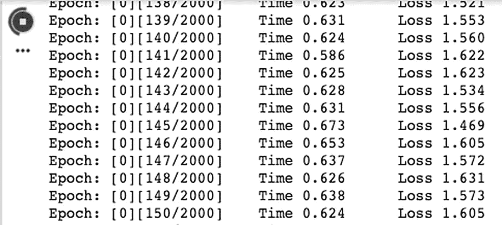

训练期间输出页面的截图。列表中给出了包含损失和时间的轮次详情。左侧提供了一个停止运行的选项按钮。

图 8-5

训练进行中的 Colab 控制台输出，显示每个轮次每个批次的损失

您还可以使用 TensorBoard 评估模型性能。使用代码清单 8-7 中的命令启动 TensorBoard 仪表板。

```
1    %tensorflow_version 2.x
2    %load_ext tensorboard
3    %tensorboard --logdir /content/logs/facenet
代码清单 8-7
通过指向日志目录启动 TensorBoard
```

## 开发实时人脸识别系统

一个人脸识别系统需要三个重要组件：

*   一个人脸检测模型

*   一个分类模型

*   一个图像或视频源


### 人脸检测模型

在上一节中，我们探讨了如何训练一个人脸检测模型。我们可以使用自己构建的模型，也可以使用符合需求的现有预训练模型。表 8-3 列出了可免费公开获取的预训练模型及其下载位置。这些模型由 David Sandberg 慷慨提供。

表 8-3

David Sandberg 提供的人脸识别预训练模型

| 模型名称 | 训练数据集 | 下载地址 |
| --- | --- | --- |
| `20180408-102900` | `CASIA-WebFace` | [`https://drive.google.com/open?id=1R77HmFADxe87GmoLwzfgMu_HY0IhcyBz`](https://drive.google.com/open?id=1R77HmFADxe87GmoLwzfgMu_HY0IhcyBz) |
| `20180402-114759` | `VGGFace2` | [`https://drive.google.com/open?id=1EXPBSXwTaqrSC0OhUdXNmKSh9qJUQ55-`](https://drive.google.com/open?id=1EXPBSXwTaqrSC0OhUdXNmKSh9qJUQ55-) |

这些模型已在 LFW（Labeled Faces in the Wild）数据集上进行了评估，该数据集可从 [`http://vis-www.cs.umass.edu/lfw/`](http://vis-www.cs.umass.edu/lfw/) 获取。表 8-4 展示了模型架构和准确率。

表 8-4

基于 CASIA-WebFace 和 VGGFace2 数据集训练的 FaceNet 模型的准确率评估结果（信息由 David Sandberg 提供）

| 模型名称 | LFW 准确率 | 训练数据集 | 架构 |
| --- | --- | --- | --- |
| `20180408-102900` | `0.9905` | `CASIA-WebFace` | `Inception ResNet v1` |
| `20180402-114759` | `0.9965` | `VGGFace2` | `Inception ResNet v1` |

在我们的示例中，将使用 VGGFace2 模型。

### 人脸识别分类器

我们将构建一个模型来识别人脸（即识别此人是谁）。我们将训练该模型识别乔治·W·布什、巴拉克·奥巴马和唐纳德·特朗普——这三位是乔·拜登之前的最近三任美国总统。

为简化操作，我们将为这三位前总统各下载几张图片，并按子目录组织，如图 8-6 所示。

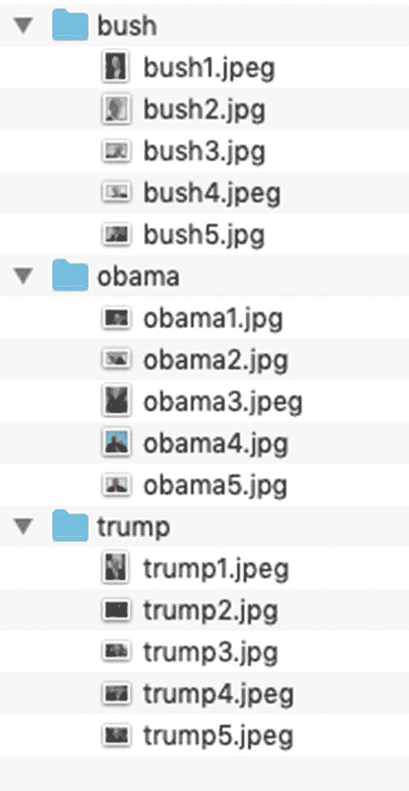

三个文件夹（bush、obama、trump）的目录截图。每个文件夹包含 5 张扩展名为 jpg 或 jpeg 的图片。

图 8-6

输入图片目录结构

在本练习中，我们将在个人电脑/笔记本电脑上开发一个人脸检测模型。在第 10 章中，我们将探讨如何使用云端 GPU 构建大规模计算机视觉模型。我们将在个人电脑/笔记本电脑上开发人脸检测器。在训练分类器之前，需要克隆 FaceNet GitHub 仓库。执行以下命令：

```
git clone https://github.com/ansarisam/facenet.git
```

克隆 FaceNet 源码后，将 `PYTHONPATH` 设置为 `facenet/src` 并添加到环境变量中：

```
export PYTHONPATH=$PYTHONPATH:/home/user/facenet/src
```

`src` 目录的路径必须是您计算机上的实际目录路径。

#### 人脸对齐

在本节中，我们将对图片进行人脸对齐。我们将使用与上一节相同的 MTCNN 模型。由于图片集较小，我们将使用单进程来对齐这些人脸。清单 8-8 展示了人脸对齐的脚本。

```
1    python facenet/src/align/align_dataset_mtcnn.py \
2    ~/presidents/ \
3    ~/presidents_aligned \
4    --image_size 182 \
5    --margin 44
清单 8-8
使用 MTCNN 进行人脸对齐的脚本
```

注意

在基于 Mac 的计算机上，图片目录可能包含一个名为 `.DS_Store` 的隐藏文件。请确保从所有包含输入图片的子目录中删除该文件。同时，确保子目录中仅包含图片，没有其他文件。

执行清单 8-8 中的脚本，以裁剪并对齐人脸。图 8-7 展示了示例输出。

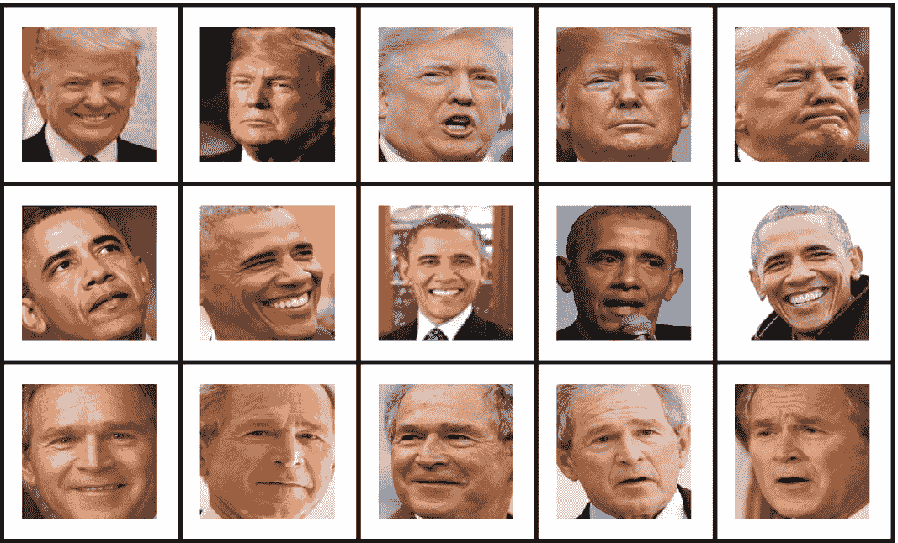

包含布什、奥巴马和特朗普三位美国总统的 18 张照片矩阵。每位总统各有 5 张不同表情的图片，如微笑、倾听或讲话。

图 8-7

三位美国总统的裁剪并对齐后的人脸

#### 分类器训练

完成上述最小化设置后，我们就可以开始训练分类器了。清单 8-9 展示了启动分类器训练的脚本。

```
1    python facenet/src/classifier.py TRAIN \
~/presidents_aligned \
~/20180402-114759/20180402-114759.pb \
~/presidents_aligned/face_classifier.pkl \
--batch_size 1000 \
--min_nrof_images_per_class 40 \
--nrof_train_images_per_class 35 \
--use_split_dataset
清单 8-9
启动人脸分类器训练的脚本
```

以下是对清单 8-9 中代码的解释：

*   `python facenet/src/classifier.py TRAIN`：启动 `classifier.py` 脚本的执行，并指定脚本处于 TRAIN 模式，表明目的是训练一个分类器。

*   `~/presidents_aligned`：指定包含待识别个体对齐人脸图片的目录。该目录包含多个子目录，每个子目录对应一个不同的个体，并包含其人脸图片。

*   `~/20180402-114759/20180402-114759.pb`：指定预训练 FaceNet 模型的路径，该模型采用 TensorFlow 的 Protocol Buffer（protobuf）格式（`.pb` 文件）。此模型将用于从输入人脸图片中提取面部特征嵌入。

*   `~/presidents_aligned/face_classifier.pkl`：指定训练好的人脸分类器将保存为序列化 Python 对象（pickle 文件）的路径。该分类器将使用 FaceNet 模型生成的特征嵌入来区分不同的个体。

*   `--batch_size 1000`：设置训练的批次大小。训练图片将按每批 1000 张进行处理。

*   `--min_nrof_images_per_class 40`：指定训练数据中每个类别（个体）所需的最少图片数量。图片数量少于该值的类别将从训练中排除。

*   `--nrof_train_images_per_class 35`：设置每个类别（个体）用于训练的图片数量。该值限制了每个类别用于训练的图片数量，可能用于创建平衡的数据集。

*   `--use_split_dataset`：指示将训练数据拆分为训练集和验证集。验证集用于监控训练进度并防止过拟合。

分类器模型成功执行后，训练好的分类器将存储在文件 `~/presidents_aligned/face_classifier.pkl` 中。


#### 视频流中的人脸识别

在代码清单 7-1 中，我们使用了 OpenCV 的便捷函数 `cv2.VideoCapture()` 来从计算机内置摄像头、USB 摄像头或 IP 摄像头读取视频帧。`VideoCapture()` 函数的参数 0 通常用于从内置摄像头读取帧。在本节中，我们将探讨如何将 YouTube 作为视频源。

为了读取 YouTube 视频，我们将使用一个名为 `pafy` 的 Python 库，该库内部使用了 `youtube_dl` 库。在你的开发环境中使用 PIP 安装这些库。只需执行代码清单 8-10 中的命令即可安装 `pafy`。

```
pip install pafy
pip install youtube_dl
代码清单 8-10
安装 YouTube 相关库的命令
```

我们为此练习克隆的 FaceNet 仓库在 `contributed` 模块中提供了源代码 `real_time_face_recognition.py`，用于识别视频中的人脸。代码清单 8-11 展示了如何使用 Python API 从视频中检测和识别人脸。

```
1    python real_time_face_recognition.py \
2    --source youtube \
3    --url https://www.youtube.com/watch?v=ZYkxVbYxy-c \
4    --facenet_model_checkpoint ~/20180402-114759/20180402-114759.pb \
5    --classfier_model ~/presidents_aligned/face_classifier.pkl
代码清单 8-11
调用实时人脸识别 API 的脚本
```

在代码清单 8-11 中，第 1 行调用了 `real_time_face_recognition.py` 并传递了以下参数：

*   第 2 行设置了参数 `--source` 的值，此处为 `youtube`。如果跳过此参数，它将默认为计算机的内置摄像头。你可以显式传递参数 `webcam` 来从内置摄像头读取帧。
*   第 3 行用于传递 YouTube 视频 URL。当视频源为摄像头时，不需要此参数。
*   第 4 行提供了预训练 FaceNet 模型的路径。你可以提供检查点目录或冻结的 `*.pb` 模型的路径。
*   第 5 行提供了我们在上一节中训练的分类器模型的文件路径，例如用于识别三位美国总统面部的分类器模型。

当你执行代码清单 8-11 时，它将读取 YouTube 视频帧，并用边界框显示识别出的人脸。图 8-8 展示了一个识别示例。

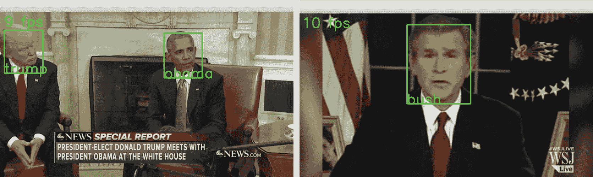

两张美国总统照片的截图。它们分别是来自 news dot com 的唐纳德·特朗普和奥巴马坐在一起的照片，以及来自《华尔街日报》的乔治·W·布什的照片。面部被高亮显示，帧率分别显示在顶部为 9 和 10 fps。

图 8-8

从视频中截取的样本截图，其中人脸已被识别（视频输入源为 YouTube）

## 总结

人脸检测是一个有趣的计算机视觉问题，涉及检测和分类面部嵌入，以识别图像中的人物身份。在本章中，我们探讨了 FaceNet，这是一种基于 ResNet 的流行人脸识别算法。我们分析了使用 MTCNN 算法裁剪图像中面部区域的技术。我们还训练了自己的分类器，并通过一个示例对三位美国总统的面部进行了分类。最后，我们引入了来自 YouTube 的视频流，并实现了一个实时人脸识别系统。

