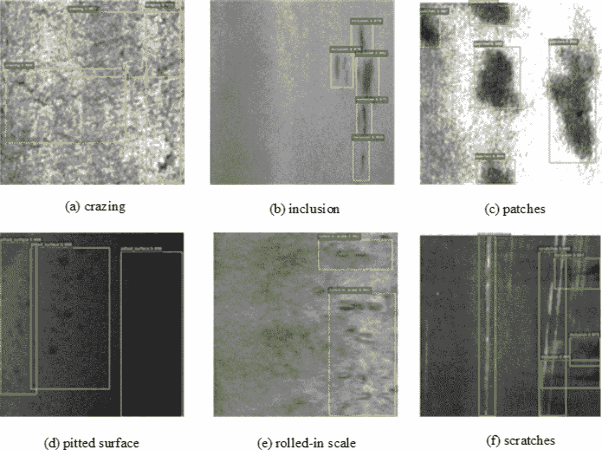
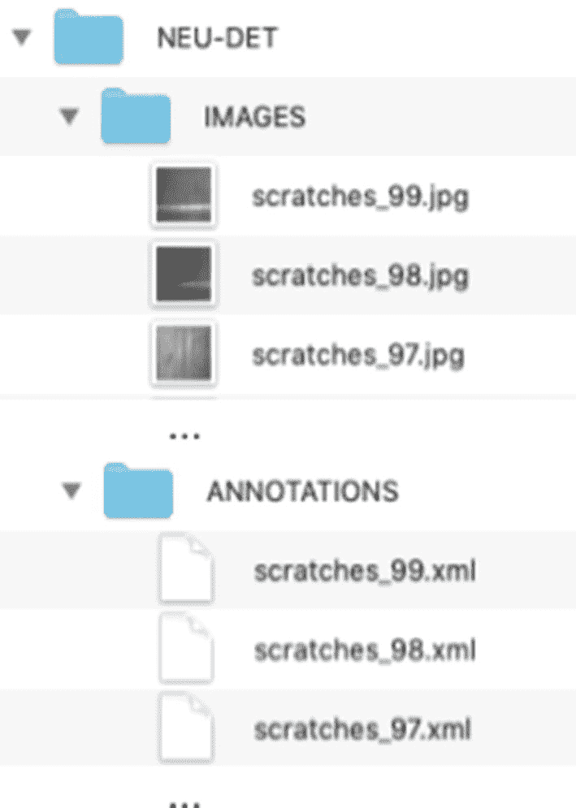
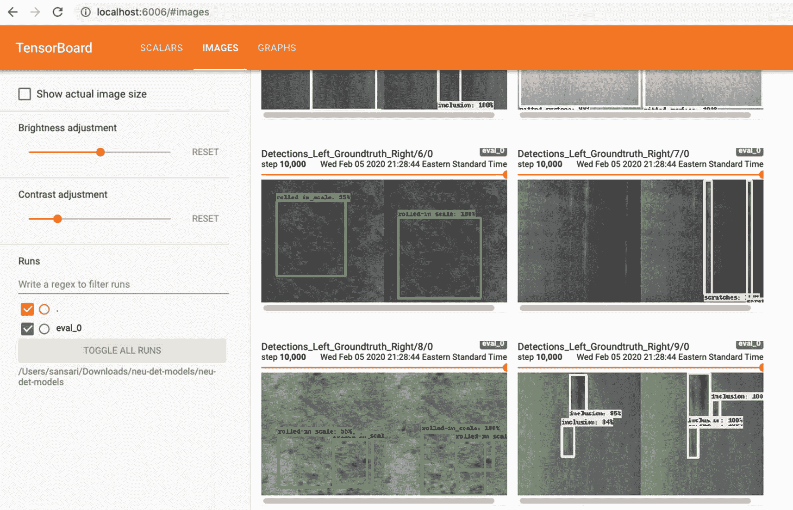
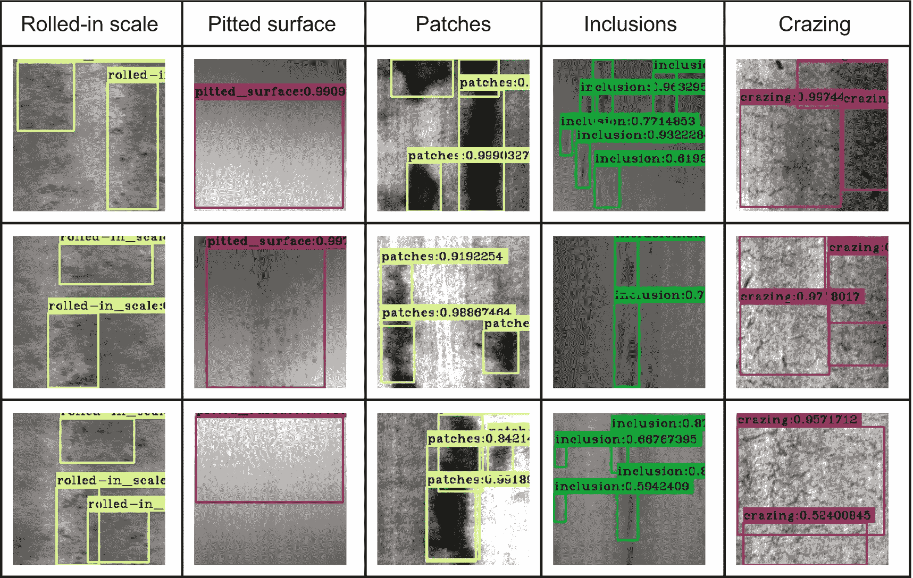
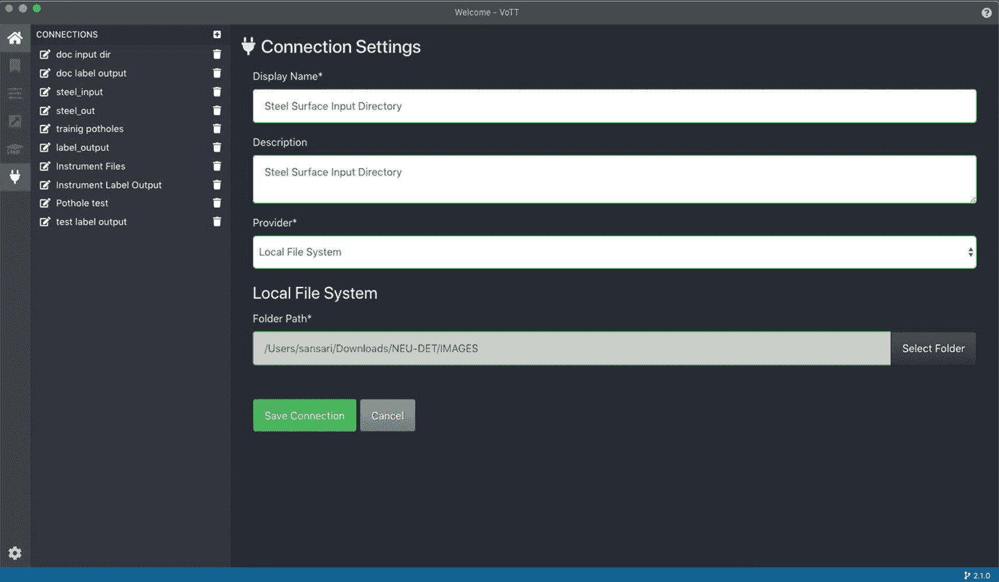
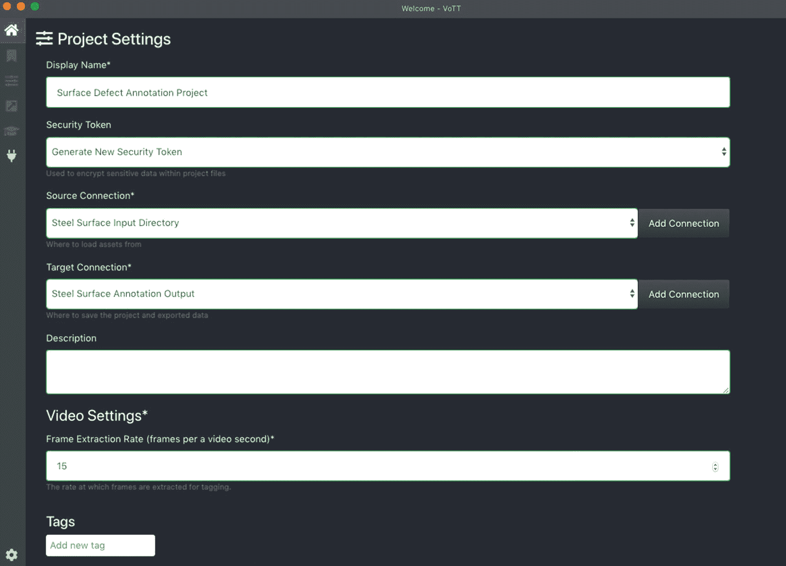
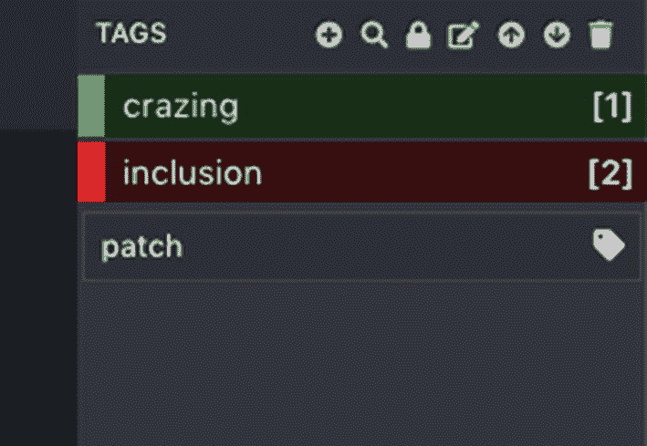
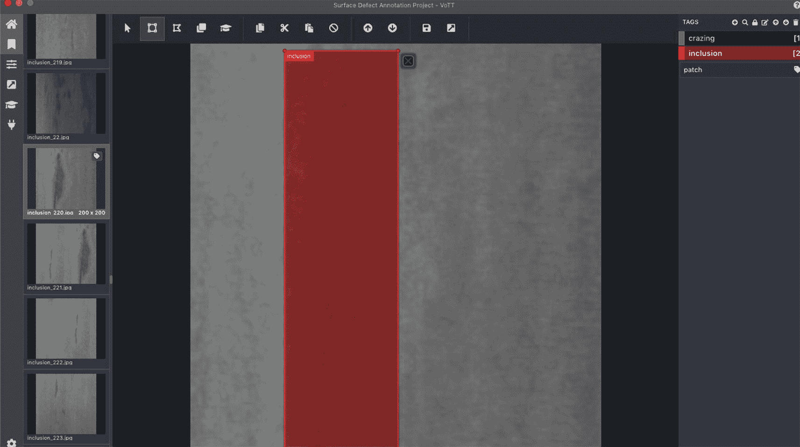
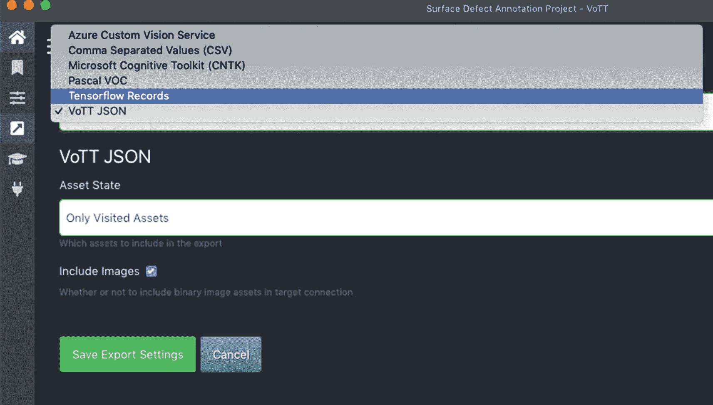

# 9. 工业应用：工业制造中的实时缺陷检测

计算机视觉在工业制造中有众多应用，其中之一是在自动化视觉检测中发挥作用，以确保质量控制与保证，这正是本章的重点。

大多数制造公司会培训员工进行人工视觉检测。这种方法不仅涉及一个主观的评估过程，其准确性可能因检验员的经验和判断而异，而且劳动强度大。

当出现机器校准问题、不利环境条件或设备故障等问题时，如果未能立即检测到，它们可能导致整个生产批次出现缺陷。人工检测更可能导致延迟检测，这可能导致整个批次（可能成百上千件）被丢弃，造成巨大的潜在费用（除了更换成本之外）。至少，该批次将受到怀疑，需要人工后期生产检测，并产生相关成本。

总之，人工检测过程既缓慢又不精确，导致高成本。相比之下，基于计算机视觉的视觉检测系统能够通过分析连续的视频帧流，立即识别表面缺陷。该系统在检测到任何缺陷或一系列缺陷时，可以及时发出实时警报，从而允许立即停止生产以防止潜在损失。

在本章中，我们将开发一个基于深度学习的计算机视觉系统，用于检测表面缺陷，例如斑块、划痕、麻点和裂纹。我们将使用一个包含热轧钢带标注图像的数据集。我们将首先转换数据集，训练一个 SSD 模型，并利用该模型构建一个缺陷检测器。我们还将介绍如何为任何目标检测任务标注自己的图像。

## 实时表面缺陷检测系统

在本节中，我们将首先检查用于训练和测试表面缺陷检测模型的数据集。我们将把图像和标注转换为 TFRecord 文件，并在 Google Colab 上训练一个 SSD 模型。我们将应用第 6 章中介绍的目标检测概念。


### 数据集

我们将使用由东北大学（NEU）的 K. Song 和 Y. Yan 提供的数据集。该数据集包含热轧钢带表面的六种缺陷类型。这些缺陷的标签如下：

*   **轧制氧化皮 (RS)**，通常发生在轧制过程中，轧制氧化皮被压入金属内部时。
*   **斑块 (Pa)**，可能是不规则的表面斑块。
*   **网状裂纹 (Cr)**，是表面上的裂纹网络。
*   **麻点 (PS)**，由许多细小的浅坑组成。
*   **夹杂物 (In)**，是嵌入钢材内部的化合物。
*   **划痕 (Sc)**

图 9-1 展示了带有这六种缺陷的钢表面标注图像。



从 a 到 f 的六张显微照片描绘了热轧钢带表面的不同类型缺陷，例如网状裂纹、夹杂物、斑块、麻点、轧制氧化皮和划痕，这些缺陷都用边界框进行了标记和标注。

图 9-1

具有六种不同类型缺陷的表面标注图像样本（来源：[`​faculty.​neu.​edu.​cn/​yunhyan/​NEU_​surface_​defect_​database.​html`](http://faculty.neu.edu.cn/yunhyan/NEU_surface_defect_database.html)）

该数据集包含 1,800 张灰度图像，每个缺陷类别有 300 个样本。

该数据集可免费下载，用于教育和研究目的，下载地址为：[`https://drive.google.com/file/d/1qrdZlaDi272eA79b0uCwwqPrm2Q_WI3k/view`](https://drive.google.com/file/d/1qrdZlaDi272eA79b0uCwwqPrm2Q_WI3k/view)。请从此链接下载数据集并解压缩。解压后的数据集按图 9-2 所示的目录结构组织。图像位于子目录 `IMAGES` 中。`ANNOTATIONS` 子目录包含以 PASCAL VOC 注释格式存储的边界框和缺陷类别的 XML 注释文件。



屏幕截图显示了 N E U-D E T 数据集的结构，该数据集由图像和注释文件夹组成。这些文件夹包含 j p g 格式的图像和 x m l 格式的注释。

图 9-2

NEU-DET 数据集目录结构

### Google Colab 笔记本

首先，在 Google Colab 上创建一个新笔记本，并为其命名，例如 Surface Defect Detection v1.0。

由于 NEU 数据集位于 Google Drive 上，您可以直接将其复制到您的个人 Google Drive。在 Colab 上，我们将挂载个人 Google Drive，解压缩数据集，并设置开发环境（参见代码清单 9-1）。请复习第 6 章以加深对实现的理解。

```
代码块 1：挂载 Google Drive
1    # 代码块 1：挂载 Google Drive
2    from google.colab import drive
3    drive.mount('/content/drive')
代码块 2：解压缩 NEU 数据集
4    # 代码块 2：解压缩 NEU 数据
5     %%shell
6    ls /content/drive/'MyDrive'/NEU-DET.zip
7    unzip /content/drive/'MyDrive'/NEU-DET.zip
代码块 3：安装必要的依赖项
8    !pip install numpy==1.23
9    !apt install -y protobuf-compiler
10   !pip install pillow==9.5
代码块 4：安装 TensorFlow 模型项目
11   %%shell
12   git clone --depth 1 https://github.com/tensorflow/models.git
13   cd models/research/
14   protoc object_detection/protos/*.proto --python_out=.
15   cd /content
16   git clone https://github.com/cocodataset/cocoapi.git
17   cd cocoapi/PythonAPI
18   make
19   cp -r pycocotools /content/models/research
20   cd
21   cd /content/models/research/
22   cp object_detection/packages/tf2/setup.py .
23   python -m pip install .
代码清单 9-1
挂载 Google Drive、下载、构建和安装 TensorFlow 模型
```

### 数据转换

我们将把 NEU 数据集转换为 TFRecord 格式（回顾第 6 章的 SSD 模型训练部分）。代码清单 9-2 是基于 TensorFlow 的代码，用于将图像和注释转换为 TFRecord。

```
文件名：generic_xml_to_tf_record.py
1    import hashlib
2    import io
3    import logging
4    import os

6    from lxml import etree
7    import PIL.Image
8    import tensorflow as tf

10   from object_detection.utils import dataset_util
11   from object_detection.utils import label_map_util
12   import random

14   flags = tf.app.flags
15   flags.DEFINE_string('data_dir', '', '原始 PASCAL VOC 数据集的根目录。')

17   flags.DEFINE_string('annotations_dir', 'annotations',
18                      '注释目录的（相对）路径。')
19   flags.DEFINE_string('image_dir', 'images',
20                      '图像目录的（相对）路径。')

22   flags.DEFINE_string('output_path', '', '输出 TFRecord 的路径')
23   flags.DEFINE_string('label_map_path', 'data/pascal_label_map.pbtxt',
24                      '标签映射 proto 的路径')
25   flags.DEFINE_boolean('ignore_difficult_instances', False, '是否忽略 '
26                       '困难实例')
27   FLAGS = flags.FLAGS

29   # 此函数生成用于训练和验证的图像列表。
30   def create_trainval_list(data_dir):
31      trainval_filename = os.path.abspath(os.path.join(data_dir,"trainval.txt"))
32      trainval = open(os.path.abspath(trainval_filename), "w")
33      files = os.listdir(os.path.join(data_dir, FLAGS.image_dir))
34      for f in files:
35          absfile =os.path.abspath(os.path.join(data_dir, FLAGS.image_dir, f))
36          trainval.write(absfile+"\n")
37          print(absfile)
38      trainval.close()

41   def dict_to_tf_example(data,
42                         dataset_directory,
43                         label_map_dict,
44                         ignore_difficult_instances=False,
45                         image_subdirectory=FLAGS.image_dir):
46    """将 XML 派生的字典转换为 tf.Example 原型。

48    请注意，此函数会规范化原始数据提供的边界框坐标。

50    参数：
51      data: 保存单个图像的 PASCAL XML 字段的字典
52      dataset_directory: 保存 PASCAL 数据集的根目录路径
53      label_map_dict: 从字符串标签名称到整数 ID 的映射。
54      ignore_difficult_instances: 是否跳过数据集中的困难实例
55        （默认值：False）。
56      image_subdirectory: 指定 PASCAL 数据集目录中保存实际图像数据的子目录的字符串。

58    返回：
59      example: 转换后的 tf.Example。

61    引发：
62      ValueError: 如果 data['filename'] 指向的图像不是有效的 JPEG
63    """
64    filename = data['filename']

66    if filename.find(".jpg") < 0:
67        filename = filename+".jpg"
68    img_path = os.path.join("",image_subdirectory, filename)
69    full_path = os.path.join(dataset_directory, img_path)

71    with tf.gfile.GFile(full_path, 'rb') as fid:
72      encoded_jpg = fid.read()
73    encoded_jpg_io = io.BytesIO(encoded_jpg)
74    image = PIL.Image.open(encoded_jpg_io)
75    if image.format != 'JPEG':
76      raise ValueError('图像格式不是 JPEG')
77    key = hashlib.sha256(encoded_jpg).hexdigest()

79    width = int(data['size']['width'])
80    height = int(data['size']['height'])

82    xmin = []
83    ymin = []
84    xmax = []
85    ymax = []
86    classes = []
87    classes_text = []
88    truncated = []
89    poses = []
90    difficult_obj = []
91    if 'object' in data:
92      for obj in data['object']:
93        difficult = bool(int(obj['difficult']))
94        if ignore_difficult_instances and difficult:
95          continue

97        difficult_obj.append(int(difficult))


101       xmin.append(float(obj['bndbox']['xmin']) / width)
102       ymin.append(float(obj['bndbox']['ymin']) / height)
103       xmax.append(float(obj['bndbox']['xmax']) / width)
104       ymax.append(float(obj['bndbox']['ymax']) / height)
105       classes_text.append(obj['name'].encode('utf8'))
106       classes.append(label_map_dict[obj['name']])
107       truncated.append(int(obj['truncated']))
108       poses.append(obj['pose'].encode('utf8'))

110   example = tf.train.Example(features=tf.train.Features(feature={
111       'image/height': dataset_util.int64_feature(height),
112       'image/width': dataset_util.int64_feature(width),
113       'image/filename': dataset_util.bytes_feature(
114           data['filename'].encode('utf8')),
115       'image/source_id': dataset_util.bytes_feature(
116           data['filename'].encode('utf8')),
117       'image/key/sha256': dataset_util.bytes_feature(key.encode('utf8')),
118       'image/encoded': dataset_util.bytes_feature(encoded_jpg),
119       'image/format': dataset_util.bytes_feature('jpeg'.encode('utf8')),
120       'image/object/bbox/xmin': dataset_util.float_list_feature(xmin),
121       'image/object/bbox/xmax': dataset_util.float_list_feature(xmax),
122       'image/object/bbox/ymin': dataset_util.float_list_feature(ymin),
123       'image/object/bbox/ymax': dataset_util.float_list_feature(ymax),
124       'image/object/class/text': dataset_util.bytes_list_feature(classes_text),
125       'image/object/class/label': dataset_util.int64_list_feature(classes),
126       'image/object/difficult': dataset_util.int64_list_feature(difficult_obj),
127       'image/object/truncated': dataset_util.int64_list_feature(truncated),
128       'image/object/view': dataset_util.bytes_list_feature(poses),
129   }))
130   return example

132  def create_tf(examples_list, annotations_dir, label_map_dict, dataset_type):
133     writer = None
134     if not os.path.exists(FLAGS.output_path+"/"+dataset_type):
135         os.mkdir(FLAGS.output_path+"/"+dataset_type)

137     j = 0
138     for idx, example in enumerate(examples_list):

140         if idx % 100 == 0:
141             logging.info('On image %d of %d', idx, len(examples_list))
142             print((FLAGS.output_path + "/tf_training_" + str(j) + ".record"))
143             writer = tf.python_io.TFRecordWriter(FLAGS.output_path + "/"+dataset_type+"/tf_training_" + str(j) + ".record")
144             j = j + 1

146         path = os.path.join(annotations_dir, os.path.basename(example).replace(".jpg", '.xml'))

148         with tf.gfile.GFile(path, 'r') as fid:
149             xml_str = fid.read()
150         xml = etree.fromstring(xml_str)
151         data = dataset_util.recursive_parse_xml_to_dict(xml)['annotation']

153         tf_example = dict_to_tf_example(data, FLAGS.data_dir, label_map_dict,
154                           FLAGS.ignore_difficult_instances)
155         writer.write(tf_example.SerializeToString())

157  def main(_):

159     data_dir = FLAGS.data_dir
160     create_trainval_list(data_dir)

162     label_map_dict = label_map_util.get_label_map_dict(FLAGS.label_map_path)

164     examples_path = os.path.join(data_dir,'trainval.txt')
165     annotations_dir = os.path.join(data_dir, FLAGS.annotations_dir)
166     examples_list = dataset_util.read_examples_list(examples_path)

168     random.seed(42)
169     random.shuffle(examples_list)
170     num_examples = len(examples_list)
171     num_train = int(0.7 * num_examples)
172     train_examples = examples_list[:num_train]
173     val_examples = examples_list[num_train:]

175     create_tf(train_examples, annotations_dir, label_map_dict, "train")
176     create_tf(val_examples, annotations_dir, label_map_dict, "val")

178  if __name__ == '__main__':
179     tf.app.run()
列表 9-2
将 PASCAL VOC 格式的图像和标注转换为 TFRecord
```

列表 9-2 执行以下操作：

1.  首先，调用函数 `create_trainval_list()` 创建一个文本文件，其中包含来自 `IMAGES` 子目录的所有图像的绝对路径列表。

2.  将图像路径列表按 70:30 的比例分割，为训练集和验证集生成独立的图像列表。

3.  对于训练集中的每张图像，使用函数 `dict_to_tf_example()` 创建一个 TFRecord。该 TFRecord 包含图像的字节、边界框、标注的类别名称以及关于图像的其他若干元数据。TFRecord 被序列化并写入一个文件。会创建多个 TFRecord 文件，文件数量取决于图像总数以及每个 TFRecord 文件中要包含的图像数量。

4.  类似地，为验证集中的每张图像创建 TFRecord 并将其序列化到文件中。

5.  将训练集和验证集保存到 `output` 目录下的两个独立子目录——`train` 和 `val` 中。

我们需要一个将类别索引与类别名称映射起来的映射文件。该文件包含 JSON 内容，通常扩展名为 `.pbtxt`。我们有六个缺陷类别，可以手动编写标签映射文件，如下所示：

```
文件名: steel_label_map.pbtxt
item {
id: 1
name: 'rolled-in_scale'
}
item {
id: 2
name: 'patches'
}
item {
id: 3
name: 'crazing'
}
item {
id: 4
name: 'pitted_surface'
}
item {
id: 5
name: 'inclusion'
}
item {
id: 6
name: 'scratches'
}
```

将 `steel_label_map.pbtxt` 文件上传到您的 Colab 环境中的 `/content` 目录（或您想要的任何其他目录，但请确保在列表 9-3 中提供正确的路径）。

```
1    %%shell
2    python /content/generic_xml_to_tf_record.py \
--label_map_path=/content/steel_label_map.pbtxt \
--data_dir=/content/NEU-DET \
--output_path=/content/NEU-DET/out \
--annotations_dir=ANNOTATIONS \
--image_dir=IMAGES
列表 9-3
执行创建 TFRecord 文件的 generic_xml_to_tf_record.py
```

列表 9-3 中的脚本通过提供以下参数来执行 `generic_xml_to_tf_record.py`：

*   `--label_map_path`：`steel_label_map.pbtxt` 的路径。

*   `--data_dir`：图像和标注目录所在的根目录。

*   `--output_path`：您想要保存生成的 TFRecord 文件的路径。请确保此目录存在。如果不存在，请在执行此脚本之前创建此目录。

*   `--annotations_dir`：标注 XML 文件所在的子目录名称。

*   `--image_dir`：图像所在的子目录名称。

运行列表 9-3 中的脚本，在输出目录中创建 TFRecord 文件。您将看到两个子目录——`train` 和 `val`，其中保存了用于训练和验证的 TFRecord。

再次强调，在您执行列表 9-3 中的代码之前，输出目录必须存在。


### 训练 SSD 模型

现在我们已经准备好了正确的 TFRecord 格式输入集，可以训练 SSD 模型了。训练步骤与我们在第 6 章中遵循的步骤完全相同。首先，基于我们之前创建的训练集和验证集，下载一个预训练的 SSD 模型用于迁移学习。你可以从以下网址下载适合迁移学习的模型：[`https://github.com/tensorflow/models/blob/master/research/object_detection/g3doc/tf2_detection_zoo.md`](https://github.com/tensorflow/models/blob/master/research/object_detection/g3doc/tf2_detection_zoo.md)。

代码清单 9-4 展示了我们在第 6 章（代码清单 6-5）中使用的相同代码。

```
1    %%shell
2    mkdir pre-trained-model
3    cd pre-trained-model
4    wget http://download.tensorflow.org/models/object_detection/tf2/20200711/ssd_resnet50_v1_fpn_640x640_coco17_tpu-8.tar.gz
5    tar -xvf ssd_resnet50_v1_fpn_640x640_coco17_tpu-8.tar.gz
代码清单 9-4
下载预训练的目标检测模型
```

现在，我们将按照第 6 章“配置目标检测管道”一节中的说明编辑 `pipeline.config` 文件。代码清单 9-5 显示了根据当前配置编辑后的 `pipeline.config` 文件部分内容。

```
model {
ssd {
num_classes: 6
image_resizer {
fixed_shape_resizer {
height: 640
width: 640
}
}
......
batch_norm {
decay: 0.999700009823
center: true
scale: true
epsilon: 0.0010000000475
train: true
}
}
override_base_feature_extractor_hyperparams: true
}
.....
matcher {
argmax_matcher {
matched_threshold: 0.7
unmatched_threshold: 0.3
ignore_thresholds: false
negatives_lower_than_unmatched: true
force_match_for_each_row: true
}
}
......
fine_tune_checkpoint: "/content/pre-trained-model/ssd_resnet50_v1_fpn_640x640_coco17_tpu-8/checkpoint/ckpt-0"
from_detection_checkpoint: true
num_steps: 100000
}
train_input_reader {
label_map_path: "/content/steel_label_map.pbtxt"
tf_record_input_reader {
input_path: "/content/NEU-DET/out/train/*.record"
}
}
eval_config {
num_examples: 8000
max_evals: 10
use_moving_averages: false
}
eval_input_reader {
label_map_path: "/content/steel_label_map.pbtxt"
shuffle: false
num_readers: 1
tf_record_input_reader {
input_path: "/content/NEU-DET/out/val/*.record"
}
}
代码清单 9-5
必须编辑的 pipeline.config 部分，以指向正确的目录结构
```

如代码清单 9-5 所示，我们必须编辑代码清单 9-5 中以粗体突出显示的部分。

```
num_classes: 6
fine_tune_checkpoint: 预训练模型检查点的路径
label_map_path: .pbtxt 文件的路径
input_path: 训练 TFRecord 文件的路径
label_map_path: .pbtxt 文件的路径
input_path: 验证 TFRecord 文件的路径
```

编辑 `pipeline.config` 文件并将其上传到 Colab 环境。

使用代码清单 9-6 中所示的脚本执行模型训练。回顾第 6 章中关于代码清单 6-6 的讨论，以重温相关概念。

```
1    %%shell
2    export PYTHONPATH=$PYTHONPATH:/content/models/research
3    export PYTHONPATH=$PYTHONPATH:/content/models/research/slim
4    cd /content/models/research
5    PIPELINE_CONFIG_PATH=/content/computer_vision/pre-trained-model/ssd_resnet50_v1_fpn_640x640_coco17_tpu-8/pipeline.config
6    MODEL_DIR=/content/computer_vision/surface_defect_detection_model/
7    NUM_TRAIN_STEPS=100000
8    SAMPLE_1_OF_N_EVAL_EXAMPLES=1
9    python object_detection/model_main_tf2.py \
--pipeline_config_path=${PIPELINE_CONFIG_PATH} \
--model_dir=${MODEL_DIR} \
--num_train_steps=${NUM_TRAIN_STEPS} \
--sample_1_of_n_eval_examples=${SAMPLE_1_OF_N_EVAL_EXAMPLES} \
--alsologtostderr
代码清单 9-6
执行模型训练
```

在模型学习过程中，日志会打印在 Colab 控制台上。记录每个 epoch 的损失，并在需要时调整模型的超参数。

### 模型评估

代码清单 9-7 是我们需要执行以运行模型评估的代码。

```
1    %%shell
2    python /content/models/research/object_detection/model_main_tf2.py \
--model_dir=/content/computer_vision/surface_defect_detection_model \
--pipeline_config_path=/content/computer_vision/pre-trained-model/ssd_resnet50_v1_fpn_640x640_coco17_tpu-8/pipeline.config \
--checkpoint_dir=/content/computer_vision/ surface_defect_detection_model
代码清单 9-7
执行模型评估
```

启动 TensorBoard 仪表板以评估模型质量。代码清单 9-8 展示了如何启动 TensorBoard 仪表板。

```
1    %tensorflow_version 2.x
2    %load_ext tensorboard
3    %tensorboard --logdir /drive/'MyDrive'/NEU-DET-models/
代码清单 9-8
启动 TensorBoard 仪表板
```

图 9-3 展示了 TensorBoard 的示例训练输出。



一张屏幕截图展示了 Tensor Board 输出页面，其中选中了“图像”选项卡，该选项卡显示带有表面缺陷的产品显微照片，缺陷由带标签的方框标出。左侧面板中有亮度和对比度调节滑块以及“运行”选项。

图 9-3

表面缺陷检测模型训练的 TensorBoard 输出显示

### 导出模型

训练成功完成后，检查点会保存在代码清单 9-6 第 6 行指定的目录中。

为了将模型用于实时检测，我们需要导出 TensorFlow 图。有关此内容的详细信息，请参阅第 6 章的“导出 TensorFlow 图”一节。

代码清单 9-9 展示了如何导出我们刚刚训练的 SSD 模型。

```
1  %%shell
2  export PYTHONPATH=$PYTHONPATH:/content/models/research
3  export PYTHONPATH=$PYTHONPATH:/content/models/research/slim
4  cd /content/models/research
5  python /content/models/research/object_detection/exporter_main_v2.py --input_type image_tensor --pipeline_config_path /content/computer_vision/pre-trained-model/ssd_resnet50_v1_fpn_640x640_coco17_tpu-8/pipeline.config --trained_checkpoint_dir /content/computer_vision/surface_defect_detection_model --output_directory /content/computer_vision/surface_defect_detection_model/final_model
代码清单 9-9
将模型导出为 TensorFlow 图
```

导出模型后，应将其保存到 Google Drive。从 Google Drive 将最终模型下载到本地计算机。我们可以使用此模型实时检测视频帧中的表面缺陷。回顾第 7 章中介绍的概念。


### 预测

如果你已按照第 6 章“使用训练模型检测物体”一节所述设置好工作环境，那么你应该已具备预测图像中表面缺陷所需的一切条件。只需修改代码清单 9-10 中的变量，并执行代码清单 6-18 中所示的 Python 代码。根据你在计算机上的设置，更改以粗体突出显示的路径。

```
model_path = "/Users/sansari/Downloads/neu-det-models/final_model"
labels_path = "/Users/sansari/Downloads/steel_label_map.pbtxt"
image_dir = "/Users/sansari/Downloads/NEU-DET/test/IMAGES"
image_file_pattern = "*.jpg"
output_path="/Users/sansari/Downloads/surface_defects_out"
代码清单 9-10
来自代码清单 6-18 的变量初始化部分代码
```



一张表格展示了十五张显微照片，显示了样本产品的表面缺陷，如轧制氧化皮、麻点、斑块、夹杂物和裂纹，这些缺陷由带标签的方框标出。

图 9-4

带有边界框的缺陷表面样本预测输出

图 9-4 展示了针对不同缺陷类别的预测输出样本。

### 实时缺陷检测器

按照第 7 章提供的说明，部署一个能够从摄像头读取视频图像并实时检测表面缺陷的检测系统。如果你的同一设备连接了多个摄像头，请在函数 `cv2.VideoCapture(x)` 中为参数 `x` 使用适当的值。默认情况下，`x=0` 从计算机的内置摄像头读取视频。`x=1`、`x=2` 等值将读取连接到计算机端口的视频。对于基于 IP 的摄像头，`x` 的值应为 IP 地址。

## 图像标注

在之前的所有示例中，我们使用的都是已经过注释和标注的图像。在本节中，我们将探讨如何为物体检测或人脸识别标注图像。

有几种开源和商业工具可用于图像标注。我们将探讨微软视觉对象标记工具 (VoTT)，这是一个用于图像和视频资产的开源注释和标注工具。VoTT 的源代码可在 [`https://github.com/microsoft/VoTT`](https://github.com/microsoft/VoTT) 获取。

### 安装 VoTT

VoTT 需要 NodeJS 和 NPM。

要安装 NodeJS，请从官方网站 [`https://nodejs.org/en/download/`](https://nodejs.org/en/download/) 下载适用于你操作系统的可执行二进制文件。例如，下载并安装 Windows 安装程序 (`.msi`) 以在 Windows 操作系统上安装 NodeJS，下载并安装 macOS 安装程序 (`.pkg`) 以在 Mac 上安装，或选择适用于 Linux 的 Linux 二进制文件 (x64)。

NPM 随 NodeJS 一起安装。要检查你的计算机上是否已安装 NodeJS 和 NPM，请在终端窗口中执行以下命令：

```
node -v
npm -v
```

适用于不同操作系统的 VoTT 安装程序托管在 GitHub ([`https://github.com/Microsoft/VoTT/releases`](https://github.com/Microsoft/VoTT/releases)) 上。下载适用于你操作系统的安装程序。在撰写本书时，最新的 VoTT 是 2.1.1 版本，可以从以下位置下载：

*   Windows：[`https://github.com/microsoft/VoTT/releases/download/v2.1.0/vott-2.1.0-win32.exe`](https://github.com/microsoft/VoTT/releases/download/v2.1.0/vott-2.1.0-win32.exe)

*   Mac：[`https://github.com/microsoft/VoTT/releases/download/v2.1.0/vott-2.1.0-darwin.dmg`](https://github.com/microsoft/VoTT/releases/download/v2.1.0/vott-2.1.0-darwin.dmg)

*   Linux：[`https://github.com/microsoft/VoTT/releases/download/v2.1.0/vott-2.1.0-linux.snap`](https://github.com/microsoft/VoTT/releases/download/v2.1.0/vott-2.1.0-linux.snap)

通过运行下载的可执行文件在你的计算机上安装 VoTT。

要从源代码运行 VoTT，请在终端上执行以下命令：

```
git clone https://github.com/Microsoft/VoTT.git
cd VoTT
npm ci
npm start
```

使用 `npm start` 命令运行 VoTT 将同时启动 electron 版本和浏览器版本。这两个版本的主要区别在于浏览器版本无法访问本地文件系统，而 electron 版本可以。由于我们的图像位于本地文件系统上，因此我们将探讨 VoTT 的 electron 版本。

当你启动 VoTT 用户界面时，你将看到主屏幕，你可以在其中创建新项目、打开本地项目或打开云项目。

要标注图像，我们将按照后续章节中的步骤进行操作。

### 创建连接

我们将创建两个连接：一个用于输入，另一个用于输出。输入连接指向存储未标注图像的目录。输出连接指向存储注释的目录。

目前，VoTT 支持连接到以下内容：

*   Azure Blob 存储

*   Bing 图像搜索

*   本地文件系统

我们将创建一个到本地文件系统的连接。要创建新连接，请单击左侧导航栏中的“新建连接”图标以启动连接屏幕。单击位于左上方面板中标签为“连接”对应的加号图标。参见图 9-5。



一张截图显示了连接设置页面，其中包含显示名称、描述、提供程序和带有文件夹路径的本地文件系统的输入字段。页面底部的“保存连接”按钮已被选中。

图 9-5

创建新连接

为“提供程序”字段选择“本地文件系统”。单击“选择文件夹”以打开本地文件系统目录结构。选择包含需要标注的输入图像的目录。单击“保存连接”按钮。

类似地，创建另一个用于存储输出的连接。

### 创建新项目

图像注释和标注的任务在项目下进行管理。要创建项目，请单击主页图标，然后单击“新建项目”以打开“项目设置”页面。参见图 9-6。



一张截图显示了项目设置页面，其中包含显示名称、安全令牌、源连接、目标连接、描述、带有帧提取率的视频设置以及标签的输入字段。

图 9-6

用于创建新项目的项目设置页面

“项目设置”页面上的两个重要字段是“源连接”和“目标连接”。选择我们在上一步中为输入和输出目录创建的相应连接。单击“保存项目”按钮。

### 创建类别标签

保存项目设置后，屏幕将转换到主标注页面。要创建类别标签，请单击右侧面板右上角（如图 9-7 所示）标签为“标签”对应的 (+) 图标。创建所有类别标签，例如裂纹、斑块、夹杂物等。



一张截图展示了标签页面的一个片段，其中显示了一个标签列表，例如裂纹、夹杂物和斑块。

图 9-7

创建类别标签


### 标注图像

从左侧面板中选择一个图像缩略图，该图像将在主标注区域中打开。在图像的缺陷区域周围绘制矩形或多边形，并选择相应的标签进行标注。参见图 9-8。



截图展示了表面缺陷标注项目页面，左侧面板显示了一系列图像缩略图，其中一张已被选中。选中的图像显示在屏幕中央，缺陷区域用矩形标记并标注为“夹杂物”。

图 9-8

在缺陷区域周围绘制矩形并选择类别标签以标注图像

同样地，逐一标注所有图像。

### 导出标签

VoTT 支持以下导出格式：

*   Azure Custom Vision Service

*   Microsoft Cognitive Toolkit (CNTK)

*   TensorFlow（Pascal VOC 和 TFRecords）

*   VoTT（通用 JSON 模式）

*   逗号分隔值 (CSV)

我们将配置设置，将标注导出为 TensorFlow TFRecord 文件格式。

要进行配置，请点击左侧导航栏中的导出图标。该导出图标看起来像一个指向右上方的斜向箭头。此时会打开“导出设置”页面。在“提供程序”字段中，选择“TensorFlow Records”，然后点击“保存导出设置”按钮（参见图 9-9）。



“导出设置”页面的截图显示了一个选项列表，其中选择了“VoTT JSON”选项。下方提供了一个“资产状态”输入字段，其中已输入“仅访问过的资产”。页面底部的“保存导出设置”按钮已被选中。

图 9-9

导出设置页面

返回项目页面（点击“标签编辑器”图标）。点击顶部工具栏中的  标签编辑器图标（该图标是一个内部带有对角箭头的正方形），将标注导出为 TensorFlow Records 文件。

检查本地文件系统的输出文件夹。你会注意到，在输出目录中已创建了一个名称包含 `TFRecords-export` 的目录。

导出为 TFRecord 格式还会生成一个 `tf_label_map.pbtxt` 文件，其中包含类别和索引的映射关系。

有关图像标注的最新信息和说明，请访问微软维护的 VoTT 项目官方 GitHub 页面：[`https://github.com/microsoft/VoTT`](https://github.com/microsoft/VoTT)。

## 总结

在本节中，我们创建了一个专门用于识别表面缺陷的系统。我们使用一个包含热轧带钢标注图像的现有数据集（涵盖六种不同的缺陷类别）训练了一个 SSD 模型。然后，我们使用这个训练好的模型来预测图像和视频中发现的表面缺陷。此外，我们还深入探讨了如何使用名为 VoTT 的图像标注工具，该工具有助于标注图像，并随后将标签导出为 TFRecord 格式。

