# 10. 云端计算机视觉建模

训练最先进的卷积神经网络可能需要大量的计算资源。根据训练样本数量、网络配置和可用硬件资源的不同，训练一个计算机视觉模型可能需要数小时甚至数天。单个 GPU 可能无法胜任训练包含大量训练图像的复杂网络。模型需要在多个 GPU 上进行训练。一台机器上只能安装有限数量的 GPU。对于大量图像的训练，一台配备多个 GPU 的机器可能也不够用。如果在多台机器（每台机器配备多个 GPU）上进行训练，速度会更快。

很难预估在特定时间范围内训练一个模型需要多少 GPU 和机器。在大多数实际情况下，事先并不知道建模需要多少台机器，以及训练会运行多长时间。此外，建模工作并非频繁进行。一个预测准确度很高的模型可能不需要在几天、几周、几个月内重新训练，甚至只要它能给出准确结果，就无需重新训练。因此，为建模采购的任何硬件在模型重新训练之前可能一直处于闲置状态。

在云端建模是一种将训练扩展到多台机器和多个 GPU 的好方法。大多数云提供商都提供按需付费模式的虚拟机、计算资源和存储。这意味着你只需为模型学习期间所使用的云资源付费。模型成功训练后，你可以将其导出到应用服务器，并在那里用于预测。此时，你可以删除所有不再需要的云资源，从而降低成本。

TensorFlow 提供了用于在单台或多台机器上的多个 CPU 和 GPU 上训练机器学习模型的 API。

在本章中，我们将探索分布式建模，并在云端大规模训练计算机视觉模型。

本章的学习目标如下：

*   探索用于分布式训练的 TensorFlow API

*   在三大主流云提供商（Amazon Web Services (AWS)、Google Cloud Platform (GCP) 和 Microsoft Azure）上，设置涉及多台虚拟机和多个 GPU 的分布式 TensorFlow 集群

*   在云端的分布式集群上训练计算机视觉模型

## TensorFlow 分布式训练

本节讨论 TensorFlow 提供的分布式训练的核心概念。

### 什么是分布式训练？

用于计算机视觉的最先进神经网络需要从大量图像中计算数百万个参数。如果所有计算都在单个 CPU 或 GPU 上执行，训练将非常耗时。此外，整个训练数据集需要加载到内存中，这可能超出单台机器的内存容量。

在分布式训练中，计算在多个 CPU 或 GPU 上同时执行，然后将结果合并以创建最终模型。理想情况下，计算量应随 GPU 或 CPU 的数量线性扩展。换句话说，如果在一个 GPU 上训练一个模型需要 *H* 小时，那么在 *N* 个 GPU 上训练该模型应该只需要 *H/N* 小时。

在分布式训练中，有两种常用的方法来实现并行化：数据并行和模型并行。TensorFlow 提供了通过将模型拆分到多个设备（CPU、GPU 或计算机）上来进行分布式训练的 API。


#### 数据并行

大型训练数据集可被划分为更小的迷你批次，随后可将其分发到集群架构中的多台计算机上。随机梯度下降（SGD）能够独立且并行地在处理小批量数据的单台计算机上计算权重。各台计算机的计算结果可汇总到一台中央计算机，从而获得最终优化后的权重。

SGD 还可以通过利用单台计算机上的多个 CPU 或 GPU 进行并行处理来优化权重。使用 SGD 算法计算优化权重的分布式和并行操作有助于其更快收敛。

图 10-1 展示了数据并行的示意图。

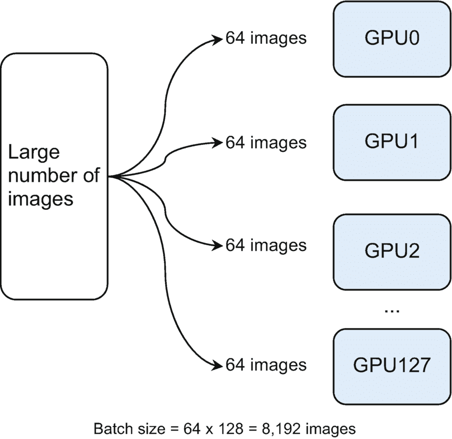

一个树状图，展示了使用 GPU 0 到 GPU 127，每个 GPU 处理来自包含大量图像的数据集中的 64 张图像。下方计算如下：批次大小等于 64 乘以 128，即 8192 张图像。

图 10-1
数据并行与批次大小计算

数据并行可以通过以下两种方式实现：

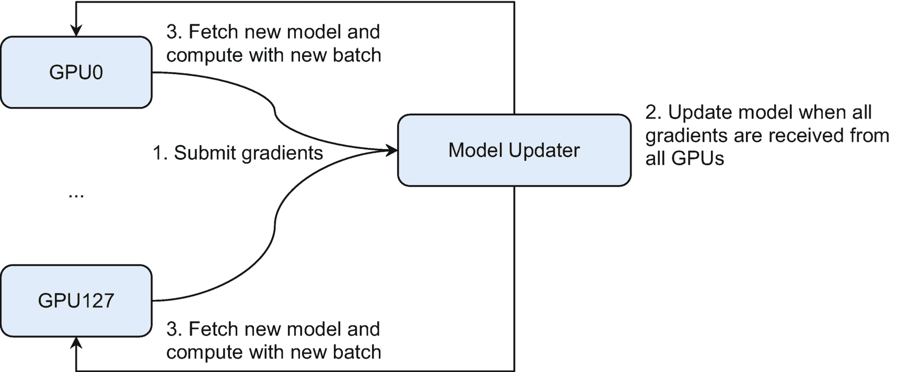

一个流程图。GPU 0 到 GPU 127 将梯度提交给模型更新器，模型更新器更新模型并将其发送回 GPU，GPU 获取新模型并使用新批次进行计算。

图 10-2
同步数据并行

*   **同步**：在此情况下，所有节点在不同的输入数据块上进行训练，并在每一步聚合梯度。梯度的同步通过全归约方法完成，如图 10-2 所示。

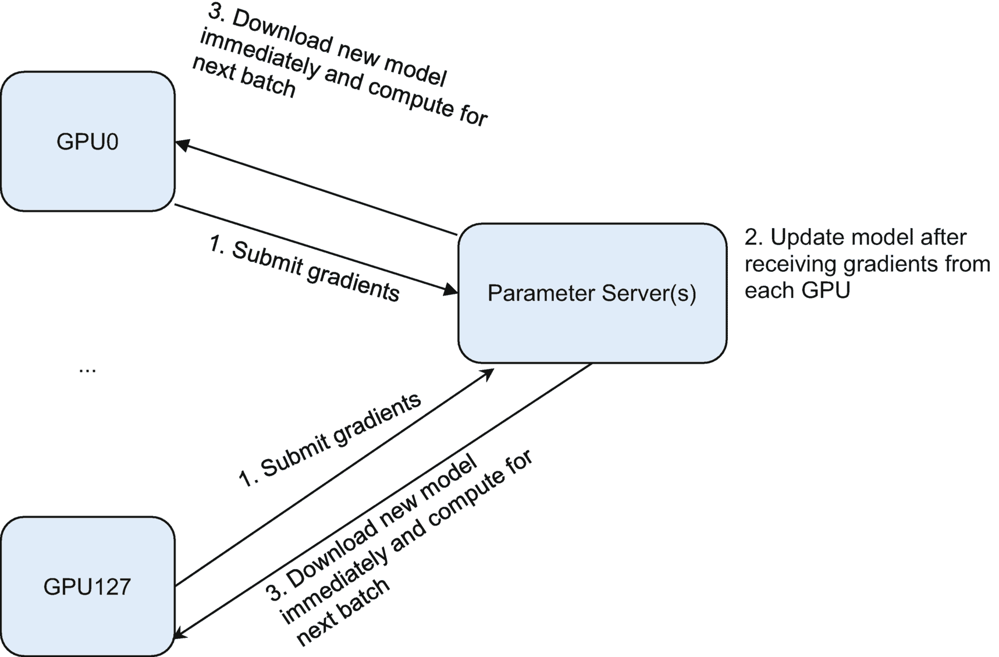

一个流程图。GPU 0 到 GPU 127 模块将梯度提交给参数服务器，参数服务器更新模型并将其发送回 GPU 的数据，GPU 立即下载新模型并为下一个批次进行计算。

图 10-3
使用参数服务器的异步数据并行

*   **异步**：在此情况下，所有节点独立地在输入数据上进行训练，并通过一个名为*参数服务器*的专用服务器异步更新变量，如图 10-3 所示。

#### 模型并行

深度神经网络（如 Darknet）需要计算数十亿个参数。即使批次大小很小，将整个网络加载到单个 CPU 或 GPU 的内存中也是一项挑战。*模型并行*是一种将模型拆分为不同部分的方法，每个部分在物理计算机硬件的不同 CPU、GPU 或节点上对同一组数据执行操作。相同的数据批次被复制到集群中的所有节点，但节点获取模型的不同部分。这些模型部分在不同的节点上并发地对其输入数据集进行操作。

当模型的各部分并行运行时，它们共享的参数需要同步。这种并行方法在单台机器上拥有多个 CPU 或 GPU 时效果最佳，因为这些设备通过高速总线连接。

现在，我们将探讨 TensorFlow 如何将训练分布到多个 GPU 或机器上。

### TensorFlow 分布策略

TensorFlow 提供了一个高级 API，用于将训练分布到多个 GPU 或多个节点。该 API 通过 `tf.distribute.Strategy` 类暴露。只需添加几行代码并进行少量代码修改，我们就可以分布我们在之前所有示例中探索过的神经网络。

我们可以将 `tf.distribute.Strategy` 与 Keras 结合使用，以分布使用 Keras API 构建的网络。我们也可以使用它来分布自定义训练循环。通常，TensorFlow 中的任何计算都可以使用此 API 进行分布。

TensorFlow 支持以下类型的分布策略。

#### MirroredStrategy

`MirroredStrategy` 支持在一台机器的多个 GPU 上进行同步分布式训练。模型的所有变量都在所有 GPU 上进行镜像。这些变量统称为 `MirroredVariables`。训练的计算在每个 GPU 上并行执行。通过应用相同的更新，变量彼此同步。

`MirroredVariables` 通过使用全归约算法在所有设备上进行更新。*全归约算法*通过将所有设备上的张量相加并使其在每个设备上可用，来聚合这些张量。图 10-2 展示了一个全归约算法的示例。这些算法效率很高，并且同步的通信开销不大。

有几种全归约算法。TensorFlow 在 `MirroredStrategy` 中使用 NVIDIA NCCL 作为默认的全归约算法。

我们将探讨如何使用 `MirroredStrategy` 来分布深度神经网络的训练。为了简单易懂，让我们修改清单 5-2 中的代码，使其分布式化。请参考清单 5-2 的第 11、19 和 24 行。这些代码行如下所示：

第 11 行，清单 5-2：`model = tf.keras.models.Sequential([...])`

第 19 行，清单 5-2：`model.compile(...)`

第 24 行，清单 5-2：`history = model.fit(...)`

以下是并行化清单 5-2 训练的步骤：

1.  创建一个 `MirroredStrategy` 实例。
2.  将模型的创建和编译（清单 5-2 的第 11 和 19 行）移动到 `MirroredStrategy` 对象的 `scope()` 方法内部。
3.  拟合模型（第 24 行，无需任何更改）。

清单 5-2 的所有其他行保持不变。

清单 10-1 展示了这一概念。

```
1      strategy = tf.distribute.MirroredStrategy()
2       with strategy.scope():
3          model = tf.keras.Sequential([...])
4          model.compile(...)
5      model.fit(...)
清单 10-1
使用 MirroredStrategy 进行同步分布式训练
```

因此，只需添加两行代码并进行少量调整，我们就可以将训练分布到单台机器的多个 GPU 上。

如清单 10-1 所示，在 `MirroredStrategy` 对象的 `scope()` 方法内，我们创建了希望以分布式和并行方式运行的计算。`MirroredStrategy` 对象负责在可用的 GPU 上复制模型的训练、聚合梯度等。

输入的每个批次在副本之间平均分配。例如，如果输入批次大小为 16，并且我们使用带有两个 GPU 的 `MirroredStrategy`，那么每个 GPU 在每一步将获得 8 个输入样本。我们应该适当调整批次大小，以有效利用 GPU 的计算能力。

`tf.distribute.MirroredStrategy()` 方法创建默认对象，该对象使用 TensorFlow 可见的所有可用 GPU。如果您只想使用机器上的部分 GPU，只需执行以下操作：

```
strategy = tf.distribute.MirroredStrategy(devices=["/gpu:0", "/gpu:1"])
```

这里有一个练习供您完成：修改清单 5-4 中所示的代码示例，并使用 `MirroredStrategy` 以分布式模式训练数字识别模型。


#### CentralStorageStrategy

`CentralStorageStrategy` 将模型变量放置在 CPU 上，并在单台机器的所有本地 GPU 上复制计算。除了将变量放置在 CPU 上而非在 GPU 上复制之外，`CentralStorageStrategy` 与 `MirroredStrategy` 类似。

在撰写本书时，`CentralStorageStrategy` 仍处于实验阶段，未来可能会发生变化。要在 `CentralStorageStrategy` 下进行分布式训练，只需将清单 10-1 的第 1 行替换为以下内容：

```
strategy = tf.distribute.experimental.CentralStorageStrategy()
```

#### MultiWorkerMirroredStrategy

`MultiWorkerMirroredStrategy` 与 `MirroredStrategy` 类似。它将训练分布到多台机器上，每台机器拥有一个或多个 GPU。它会在所有机器的每个设备上复制模型中的所有变量。执行计算的这些机器被称为*工作节点*。

为了在所有工作节点之间保持变量同步，`MultiWorkerMirroredStrategy` 使用 `CollectiveOps` 作为全规约通信方法。*集体操作*是 TensorFlow 图中的单个操作。它可以根据硬件、网络拓扑和张量大小，在 TensorFlow 运行时自动选择全规约算法。

要在 `MultiWorkerMirroredStrategy` 下跨多个工作节点进行分布式训练，只需将清单 10-1 的第 1 行替换为以下内容：

```
strategy = tf.distribute.experimental.MultiWorkerMirroredStrategy()
```

这将创建默认的 `MultiWorkerMirroredStrategy`，其中 `CollectiveCommunication.AUTO` 作为 `CollectiveOps` 的默认值。你可以选择以下两种 `CollectiveOps` 实现之一：

*   `CollectiveCommunication.RING` 使用 gRPC 作为通信层实现基于环的集体通信。gRPC 是 Google 开发的远程过程调用的开源实现。要使用此实现，请按如下方式调用之前的实例化：

    ```
    strategy = tf.distribute.experimental.MultiWorkerMirroredStrategy(tf.distribute.experimental.CollectiveCommunication.RING)
    ```

*   `CollectiveCommunication.NCCL` 使用 NVIDIA NCCL 实现集体通信。以下是使用示例：

    ```
    strategy = tf.distribute.experimental.MultiWorkerMirroredStrategy(tf.distribute.experimental.CollectiveCommunication.NCCL)
    ```

##### 集群配置

TensorFlow 使得跨多个工作节点进行分布式训练变得简单。但它如何知道集群配置呢？在运行使用 `MultiWorkerMirroredStrategy` 进行分布式训练的代码之前，我们必须设置所有将参与模型训练的工作节点上的 `TF_CONFIG` 环境变量。`TF_CONFIG` 将在本节后面介绍。

##### 数据集分片

数据如何提供给工作节点？当我们使用 `model.fit(x=train_datasets, epochs=3, steps_per_epoch=5)` 时，我们将训练集直接传递给 `fit()` 函数。在多工作节点训练中，数据集由 TensorFlow 自动分片。

##### 容错性

如果任何一个工作节点发生故障，整个集群将失败。TensorFlow 中没有内置的故障恢复机制。然而，`tf.distribute.Strategy` 与 Keras 结合使用，通过保存训练检查点提供了一种容错机制。如果任何工作节点发生故障，所有其他工作节点将等待故障工作节点重启。由于检查点已保存，一旦故障工作节点恢复，训练将从停止的地方重新开始。

要使分布式集群具有容错性，你必须保存训练检查点（回顾第 5 章，了解如何使用回调保存检查点）。

#### TPUStrategy

*张量处理单元 (TPU)* 是 Google 设计的专用集成电路 (ASIC)，用于显著加速机器学习工作负载。TPU 可在 Cloud TPU 和 Google Colab 上使用。

在实现方面，`TPUStrategy` 与 `MirroredStrategy` 相同，只是模型变量被镜像到 TPU 上。清单 10-2 展示了如何实例化 `TPUStrategy`。

```
1    cluster_resolver = tf.distribute.cluster_resolver.TPUClusterResolver(
tpu=tpu_address)
2    tf.config.experimental_connect_to_cluster(cluster_resolver)
3    tf.tpu.experimental.initialize_tpu_system(cluster_resolver)
4    tpu_strategy = tf.distribute.experimental.TPUStrategy(cluster_resolver)
清单 10-2
TPUStrategy 的实例化
```

在第 1 行中，通过将 TPU 地址传递给参数 `tpu=tpu_address` 来指定它。

#### ParameterServerStrategy

在 `ParameterServerStrategy` 中，模型变量被放置在一台专用机器上，称为*参数服务器*。在这种情况下，一些机器被指定为工作节点，另一些被指定为参数服务器。计算在所有工作节点的所有 GPU 上复制，而变量则在参数服务器中更新。

`ParameterServerStrategy` 的实现与 `MultiWorkerMirroredStrategy` 相同。我们必须设置每台参与机器上的 `TF_CONFIG` 环境变量。`TF_CONFIG` 将在接下来解释。

要在 `ParameterServerStrategy` 下进行分布式训练，只需将清单 10-1 的第 1 行替换为以下内容：

```
strategy = tf.distribute.experimental.ParameterServerStrategy()
```

#### OneDeviceStrategy

有时，我们希望在将分布式代码迁移到涉及多个设备的完全分布式系统之前，先在单个设备（GPU）上进行测试。`OneDeviceStrategy` 就是为此目的而设计的。当我们使用此策略时，模型变量被放置在指定的设备上。

要使用此策略，只需将清单 10-1 的第 1 行替换为以下内容：

```
strategy = tf.distribute.OneDeviceStrategy(device="/gpu:0")
```

此策略仅用于测试代码。在完全分布式环境中训练模型之前，请切换到其他策略。

需要注意的是，除了 `MirroredStrategy` 之外，上述所有用于分布式训练的策略目前都处于实验阶段。


### TF_CONFIG：TensorFlow 集群配置

用于分布式训练的 TensorFlow 集群由一台或多台机器组成，这些机器被称为*工作节点*。模型训练的计算在每个工作节点中执行。有一个专门的工作节点，称为*主节点*或*首席工作节点*，除了作为普通工作节点外，它还承担额外的职责。首席工作节点的额外职责包括保存检查点以及为 TensorBoard 写入摘要文件。

TensorFlow 集群还可能包含用于参数服务器的专用机器。在使用 `ParameterServerStrategy` 时，参数服务器是必需的。

TensorFlow 集群配置由 `TF_CONFIG` 环境变量指定。我们必须在集群中的所有机器上设置此环境变量。

`TF_CONFIG` 的格式是一个 JSON 文件，包含两个部分：`cluster` 和 `task`。

`cluster` 部分提供参与模型训练的工作节点和参数服务器的信息。这是一个字典列表，包含工作节点的主机名和通信端口（例如，`localhost:1234`）。

`task` 部分指定当前任务的工作节点角色。通常，将工作节点列表中索引为 0 的第一个工作节点指定为主节点或首席工作节点。

表 10-1 描述了 `TF_CONFIG` 的键值对。

表 10-1

`TF_CONFIG` 格式说明

| 键 | 描述 | 示例 |
| --- | --- | --- |
| `cluster` | 一个字典，包含键 `worker`、`chief` 和 `ps`。每个键都是一个列表，包含所有参与训练的机器的主机名:端口。 | `cluster: {``worker:["host1:12345","host2:2345"]``}` |
| `task` | 指定特定机器将要执行的任务。它包含以下键：`type`：指定工作节点类型，取值为字符串 `worker`、`chief` 或 `ps`。`index`：任务的从零开始的索引。大多数分布式训练任务有一个主任务、一个或多个参数服务器以及一个或多个工作节点。`trial`：在执行超参数调优时使用。此值设置训练的试验次数。这有助于识别当前正在运行的是哪次试验。它接受一个包含试验编号的字符串值，从 1 开始。 | `task: { type: chief, index:0}`这表示 `host1:1234` 是首席节点。 |
| `job` | 启动任务时使用的任务参数。这是可选的，在大多数情况下可以忽略。 |   |

#### TF_CONFIG 示例

假设我们有一个由三台机器组成的集群，用于分布式训练。这些机器的主机名分别是 `host1.local`、`host2.local` 和 `host3.local`。假设它们都通过端口 8900 进行通信。

此外，假设每台机器的角色如下：

```
worker: host1.local (首席工作节点)
worker: host2.local (普通工作节点)
ps: host3.local (参数服务器)
```

需要在所有三台机器上设置的 `TF_CONFIG` 环境变量如表 10-2 所示。

表 10-2

在具有两个工作节点和一个参数服务器的三节点集群中，`TF_CONFIG` 环境变量示例

| 主节点 | 工作节点 | 参数服务器 |
| --- | --- | --- |
| `'cluster': {``'worker': ["host1.local:8900", "host2.local:8900"], "ps":["host3.local:8900"]``},``'task': {'type': worker, 'index': 0}``}` | `'cluster': {``'worker': ["host1.local:8900", "host2.local:8900"], "ps":["host3.local:8900"]``},``'task': {'type': worker, 'index': 1}``}` | `'cluster': {``'worker': ["host1.local:8900", "host2.local:8900"], "ps":["host3.local:8900"]``},``'task': {'type': ps, 'index': 0}``}` |

## 使用参数服务器进行分布式训练的示例代码

清单 10-3（清单 5-2 的修改版本）展示了一个简单的 `ParameterServerStrategy` 实现，用于将训练分发到多个工作节点。我们将探讨如何在云上执行此代码。

```
File name: distributed_training_ps.py
1    import argparse
2    import tensorflow as tf
3    from tensorflow_core.python.lib.io import file_io

5    #Disable eager execution
6    tf.compat.v1.disable_eager_execution()

8    # Instantiate the distribution strategy -- ParameterServerStrategy. This needs to be in the beginning of the code.
9    strategy = tf.distribute.experimental.ParameterServerStrategy()

11   # Parse the command line arguments
12   parser = argparse.ArgumentParser()
13   parser.add_argument(
14         "--input_path",
15         type=str,
16         default="",
17         help="Directory path to the input file. Could you be cloud storage"
18   )
19   parser.add_argument(
20         "--output_path",
21         type=str,
22         default="",
23         help="Directory path to the input file. Could you be cloud storage"
24   )
25   FLAGS, unparsed = parser.parse_known_args()

27   # Load MNIST data using built-in datasets' download function
28   mnist = tf.keras.datasets.mnist
29   (x_train, y_train), (x_test, y_test) = mnist.load_data()

31   # Normalize the pixel values by dividing each pixel by 255
32   x_train, x_test = x_train / 255.0, x_test / 255.0

34   BUFFER_SIZE = len(x_train)
35   BATCH_SIZE_PER_REPLICA = 16
36   GLOBAL_BATCH_SIZE = BATCH_SIZE_PER_REPLICA * 2
37   EPOCHS = 10
38   STEPS_PER_EPOCH = int(BUFFER_SIZE/EPOCHS)

40   train_dataset = tf.data.Dataset.from_tensor_slices((x_train, y_train)).repeat().shuffle(BUFFER_SIZE).batch(GLOBAL_BATCH_SIZE,drop_remainder=True)
41   test_dataset = tf.data.Dataset.from_tensor_slices((x_test, y_test)).batch(GLOBAL_BATCH_SIZE)

44   with strategy.scope():
45        # Build the ANN with 4-layers
46       model = tf.keras.models.Sequential([
47       tf.keras.layers.Flatten(input_shape=(28, 28)),
48       tf.keras.layers.Dense(128, activation='relu'),
49       tf.keras.layers.Dense(60, activation='relu'),
50       tf.keras.layers.Dense(10, activation='softmax')])

52       # Compile the model and set optimizer, loss function, and metrics
53       model.compile(optimizer='adam',
54                 loss='sparse_categorical_crossentropy',
55                 metrics=['accuracy'])

57   # Save checkpoints to the output location -- most probably on a cloud storage, such as GCS
58   callback = tf.keras.callbacks.ModelCheckpoint(filepath=FLAGS.output_path)
59   # Finally, train or fit the model
60   history = model.fit(train_dataset, epochs=EPOCHS, steps_per_epoch=STEPS_PER_EPOCH, callbacks=[callback], use_multiprocessing=True)
61   # history = model.fit(train_dataset, epochs=EPOCHS, steps_per_epoch=STEPS_PER_EPOCH,  use_multiprocessing=True)
62   # Save the model to the cloud storage
63   model.save("model.h5")
64   with file_io.FileIO('model.h5', mode='r') as input_f:
65       with file_io.FileIO(FLAGS.output_path+ '/model.h5', mode='wb+') as output_f:
66           output_f.write(input_f.read())
清单 10-3
使用 ParameterServerStrategy 将训练分发到多个工作节点
```

清单 10-3 中的代码可以分为四个逻辑部分：

*   *读取并解析命令行参数（第 11–25 行）*：它接受两个参数：训练数据输入路径，以及用于保存检查点和最终模型的输出路径。

*   *加载输入图像并创建训练集和测试集（第 27–41 行）*：需要注意的是，`ParameterServerStrategy` 不支持处理最后的非完整批次，当数据集在多个工作节点上不平衡时，需要将 `steps_per_epoch` 参数传递给 `model.fit()`。请注意第 38 行中 `steps_per_epoch` 的计算。


*   *在 `ParameterServerStrategy` 的作用域内创建并编译 Keras 模型*（第 9 行和第 44–55 行）：这里有几点重要事项需要考虑：
    *   在程序开头创建 `ParameterServerStrategy` 或 `MultiWorkerMirroredStrategy` 的实例，并在实例化策略后，将可能创建操作的代码放在其后。

*   需要分布式的代码部分必须包裹在策略的作用域内。

*   第 44 行定义了 `scope()` 块，我们在其中包裹了模型定义和编译。

*   第 46 至 50 行在策略作用域内创建模型。

*   第 53 至 55 行在策略作用域内编译模型。

*   *训练模型并保存检查点和最终模型（第 57–66 行）*：
    *   第 58 行创建了模型检查点对象，该对象被传递给模型的 `fit()` 函数，以便在模型训练时保存检查点。

*   第 60 行通过调用 `fit()` 函数触发模型训练。如前所述，传递给 `fit()` 函数的 `train_dataset` 由分布策略（此处为 `ParameterServerStrategy`）自动分发。

*   第 63 行将完整模型保存到本地目录。

*   第 64 至 66 行将本地模型复制到云存储，例如 Google Cloud Storage (GCS) 或 Amazon S3。

*   第 57 至 66 行位于策略作用域之外。

现在，我们拥有了可以在多个工作节点上分布并使用参数服务器以并行模式训练的模型训练代码。接下来，我们将使用图 10-4 所示的架构在云上运行此训练。

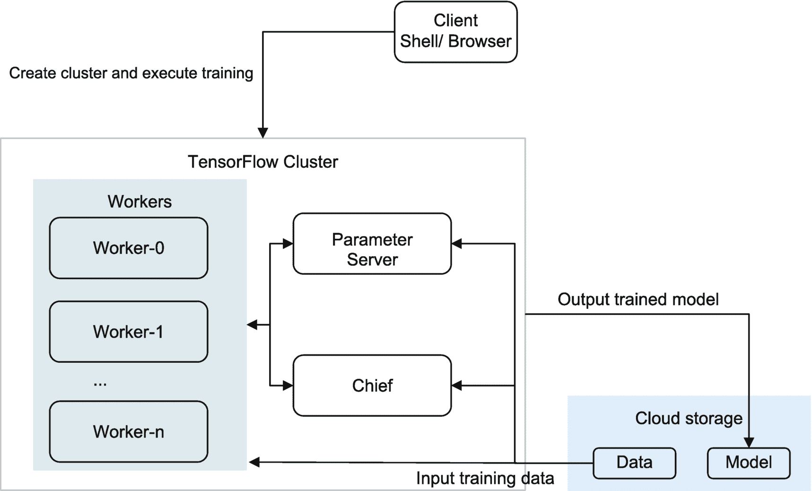

一个流程图。客户端 Shell 浏览器创建 TensorFlow 集群并执行训练，该集群由主节点、工作节点和参数服务器组成，它们相互交互并最终生成一个输出训练模型，该模型存储在云中。来自云存储的输入训练数据被发送回集群。

图 10-4

TensorFlow 集群架构，主节点、工作节点和参数服务器位于云虚拟机之上（数据和模型位于可扩展存储系统上）

## 在云上运行分布式训练的步骤

我们将基于图 10-4 所示的架构，在云上部署一个 TensorFlow 集群，并执行以下步骤来完成训练：

1.  *创建 TensorFlow 集群。*
    1.  *参数服务器、主节点和工作节点*：所有三大云提供商——AWS、GCP、Azure——都提供基于浏览器的 Shell 和图形用户界面 (GUI) 来创建和管理虚拟机。我们可以根据数据大小和神经网络的复杂度，创建基于 GPU 或基于 CPU 的虚拟机。

2.  *在所有虚拟机上安装 TensorFlow 和所有必需的库*：请参阅第 1 章了解安装先决条件的说明。为了运行清单 10-3 中的代码，我们只需安装 TensorFlow。

3.  *创建云存储目录（也称为存储桶）*：根据云提供商的不同，我们将创建以下之一：
    *   AWS S3 存储桶
    *   Google Cloud Storage (GCS) 存储桶
    *   Azure 容器

4.  *上传 Python 代码并在每台机器上执行训练*：使用 Cloud Shell 或任何其他 SSH 客户端，登录到每个节点并执行以下操作：
    1.  将包含依赖项和模型训练代码（来自清单 10-3）的 Python 包上传到每个节点。通过 `scp` 或任何其他文件传输协议上传代码。由于我们的代码已提交到 GitHub，我们可以克隆仓库并在所有节点上下载代码。

        在每台机器上，克隆 GitHub 仓库，如清单 10-4 所示。

        ```
        git clone https://github.com/ansarisam/dist-tf-modeling.git
        清单 10-4
        克隆 GitHub 仓库
        ```

    2.  在每台机器上设置特定于机器角色的 `TF_CONFIG` 环境变量，并执行用于分布式训练的 Python 代码，如清单 10-5 所示。

```
export TF_CONFIG=$CONFIG;python distributed_training_ps.py --input_path gs://cv_training_data --output_path gs://cv_distributed_model/output
清单 10-5
执行分布式训练
```

在每个节点上手动执行清单 10-5 中的命令效率不高，尤其是在工作节点数量众多的情况下。我们可以编写脚本来自动化在大型集群上启动分布式训练。清单 10-4 中显示的 GitHub 仓库包含一个可用于自动化的 Python 脚本。为了理解其工作原理，我们将遵循手动步骤，逐一在每个虚拟机上启动训练。

## 在 Google Cloud 上进行分布式训练

Google Cloud Platform (GCP) 是一套云计算服务，运行在 Google 内部用于其终端用户产品（如 Google 搜索和 YouTube）的同一基础设施上。

我们将使用两项 GCP 服务来运行分布式训练。这两项服务是：用于保存检查点和训练模型的 Google Cloud Storage (GCS)，以及用于虚拟机的 Compute Engine。

让我们开始吧！

### 注册 GCP 访问权限

如果您已有 GCP 账户，请跳过本节。如果没有，请在 [`https://cloud.google.com`](https://cloud.google.com) 创建一个 GCP 账户。Google 为教育和学习提供 300 美元的赠金。我们将在本节练习中使用这个免费账户。对于商业和生产部署，您必须启用结算功能。

创建账户后，登录 Google Cloud Console，网址为 [`https://console.cloud.google.com`](https://console.cloud.google.com)。成功登录后，您将进入 GCP 控制台首页，如图 10-5 所示。

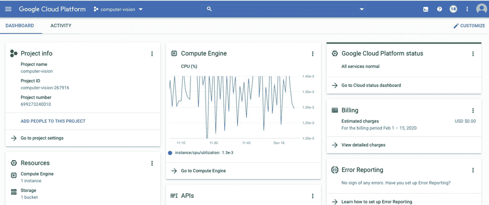

Google Cloud Platform 计算机视觉页面的截图，选中了控制台首页选项，显示了项目信息、资源、Compute Engine 图表、Google Cloud Platform 状态、结算和错误报告等详细信息。

图 10-5

Google Cloud Platform 控制台首页

### 创建 Google Cloud Storage 存储桶

GCS 是 Google Cloud 上高度持久的对象存储。它可以扩展以存储 EB 级的数据。GCS 存储桶类似于文件系统中的目录。我们可以通过以下两种方式之一创建 GCS 存储桶。


#### 通过 Web 界面创建 GCS 存储桶

要通过 Web 界面创建存储桶，请按照以下步骤操作：

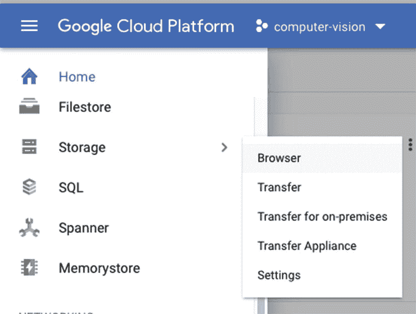

谷歌云平台计算机视觉页面截图，已选中存储选项，显示一个菜单，列出了浏览器、传输、本地传输、传输设备和设置等选项。

图 10-6

存储菜单

1.  登录谷歌云控制台，网址为 [`https://cloud.google.com`](https://cloud.google.com)。从左侧导航菜单中，点击“存储”，然后点击“浏览器”，打开存储浏览器页面（见图 10-6）。

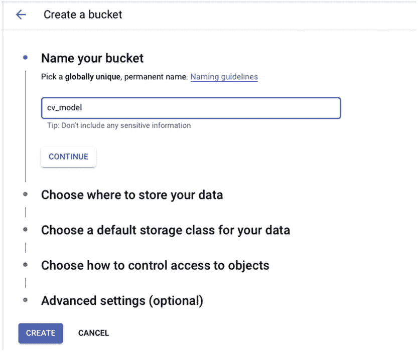

“创建存储桶”页面截图，包含一个用于命名存储桶的输入字段，其中已输入“c v model”。下方是剩余的 4 个步骤：选择数据存储位置、选择默认存储类别、选择如何控制对对象的访问以及高级设置。底部的“创建”按钮已被选中。

图 10-7

创建存储桶的表单

1.  点击页面顶部的“创建存储桶”按钮。

2.  在下一页，填写存储桶名称（例如 `cv_model`），然后点击“继续”（见图 10-7）。

3.  为位置类型选择“区域”，选择合适的位置，例如“us-east4（北弗吉尼亚）”，然后点击“继续”。

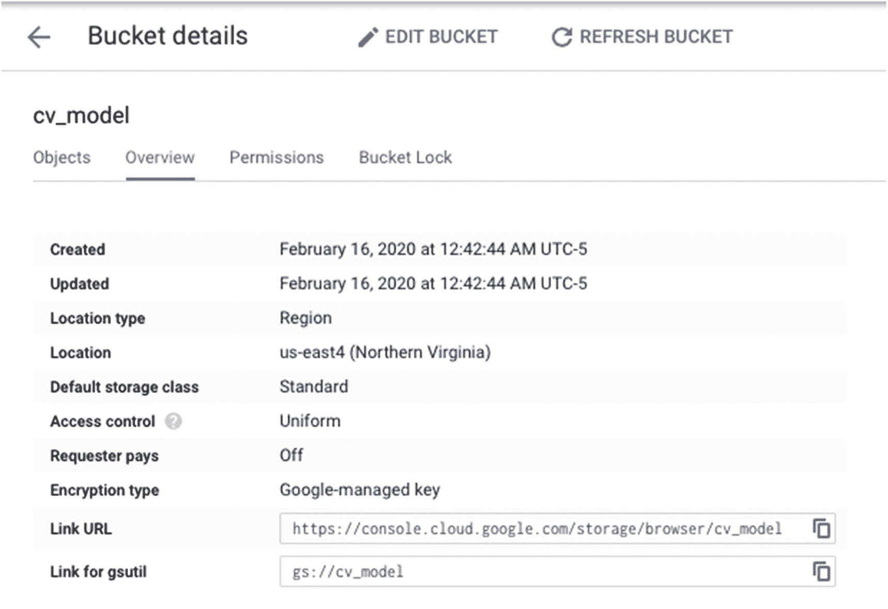

存储桶详情页面截图，已选中“概览”选项卡，显示创建日期和时间、更新日期和时间、位置类型、位置、默认存储类别、访问控制、请求者付费、加密类型、链接 URL 和 gsutil 链接等详细信息。

图 10-8

存储桶详情页面

1.  为默认存储类别选择“标准”，然后点击“继续”。

2.  为访问控制选择“统一”，然后点击“继续”。

3.  点击“创建”按钮来创建存储桶。

4.  在下一页，点击“概览”选项卡查看存储桶详情（见图 10-8）。

#### 通过 Cloud Shell 创建 GCS 存储桶

如果您已经通过 Web 界面创建了存储桶，则无需执行这些步骤。使用命令行创建存储桶非常简单。

1.  点击右上角的  Cloud Shell 图标（一个包含大于号和连字符的方形图标）来激活 Cloud Shell。Cloud Shell 将在屏幕底部（同一浏览器窗口内）打开。

2.  在 Cloud Shell 中执行清单 10-6 中的命令来创建存储桶。

    ***清单 10-6.*** *用于创建 GCS 存储桶的* *gsutil* *命令*

    ```
    gsutil mb -c regional -l us-east4 gs://cv_model
    ```

    在清单 10-6 的命令中提供适当的区域和存储桶名称。如果您已经通过 Web 界面创建了存储桶，请确保使用不同的存储桶名称。

    `gsutil` 是一个 Python 应用程序，允许我们从命令行访问云存储。

图 10-9 显示了在 Cloud Shell 中执行 `gsutil` 命令的情况。

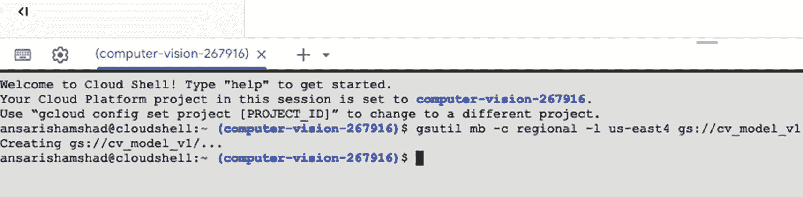

截图显示了使用 Cloud Shell 创建存储桶的七行代码。

图 10-9

使用 Cloud Shell 创建存储桶的 `gsutil` 命令

### 启动 GCP 虚拟机

我们将为练习启动以下类型的虚拟机：

*   *一台基于 GPU 的虚拟机*：参数服务器
*   *一台基于 GPU 的虚拟机*：主节点
*   *两台基于 GPU 的虚拟机*：工作节点

这些虚拟机将在我们的 GCS 存储桶所在的同一区域（上例中的 us-east4）启动。

要启动虚拟机，请按照以下步骤操作：

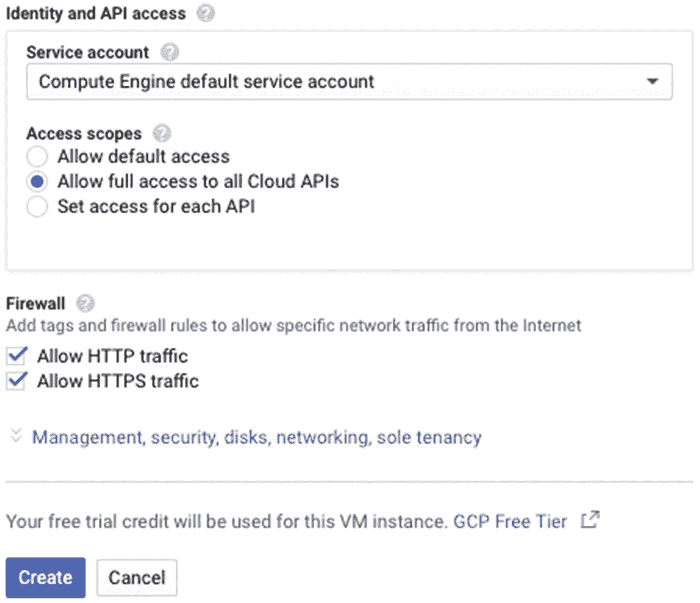

截图显示了身份和 API 访问页面，其中包含服务账号、访问范围、防火墙等详细信息。页面底部的“创建”按钮已被选中。

图 10-11

实例创建表单的底部部分

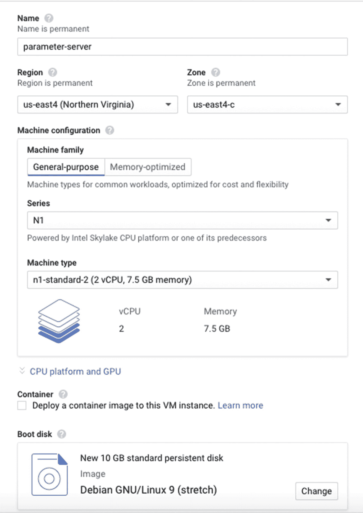

截图显示了名称、区域和可用区的输入字段。在“机器配置”下，已选中“通用用途”，系列输入为 N 1，机器类型为 n 1 standard。下方提供了容器的复选框。启动磁盘框显示“新的 10 GB 标准持久磁盘”。

图 10-10

提供信息以创建虚拟机的表单（顶部部分）

1.  在主导航菜单中，点击“计算引擎”，然后点击“虚拟机实例”，打开显示之前启动的虚拟机列表的页面。

2.  点击“创建”以打开我们需要填写以创建实例的 Web 表单。图 10-10 和图 10-11 显示了实例创建表单。

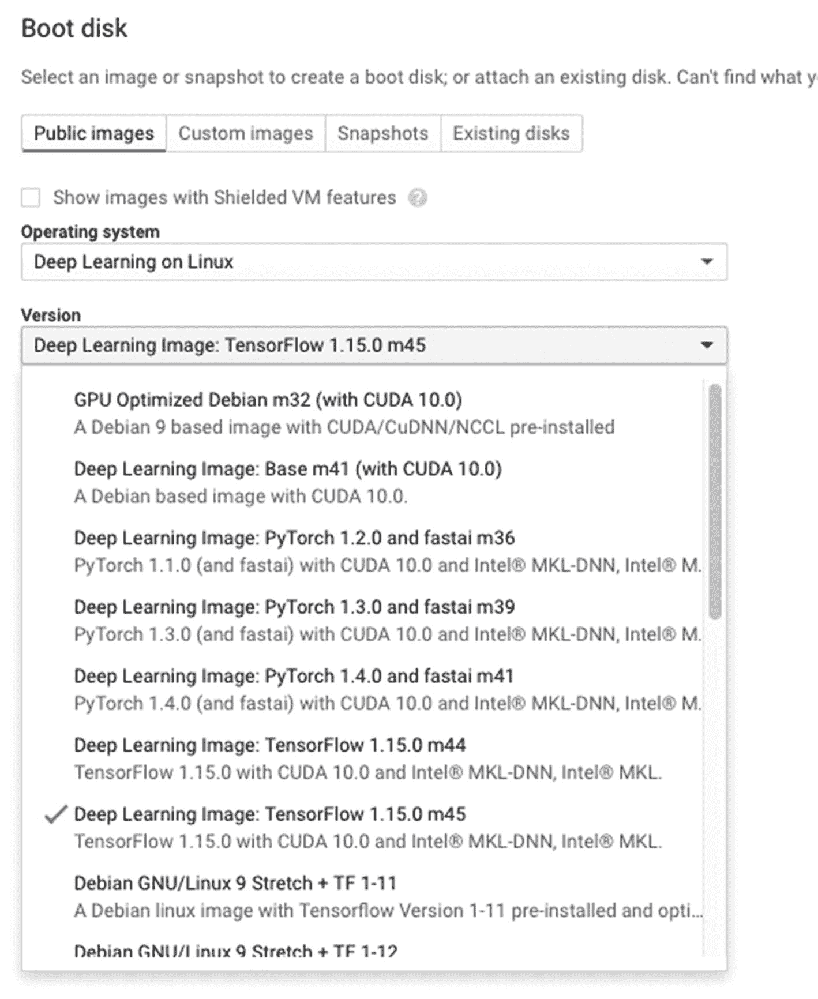

启动磁盘页面截图，已选中“公共映像”选项卡，显示操作系统，其中已选中“Linux 上的深度学习”。下方列出了深度学习映像的版本，其中已选中“Tensor Flow 1.15.0 m45”。

图 10-13

基于 CUDA 10 的 Linux 操作系统，预装了 TensorFlow 1.15

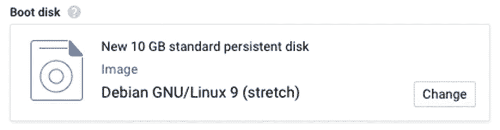

截图展示了实例创建表单的一部分，显示启动磁盘为“新的 10 GB 标准持久磁盘”，右下角有“更改”按钮。

图 10-12

点击“更改”按钮以打开启动磁盘选择页面

1.  我们将创建四台基于 GPU 的虚拟机来组建集群。在实例创建表单中，点击“启动磁盘”下“映像”旁边的“更改”按钮（如图 10-12 所示）。

    在下一个屏幕上（如图 10-13 所示），为操作系统选择“Linux 上的深度学习”，为版本选择“深度学习映像：TensorFlow 1.15.0 m45”。

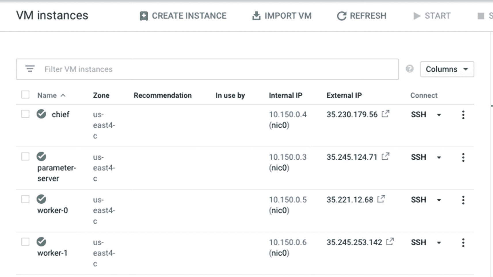

虚拟机实例页面截图，显示一个表格，包含名称、可用区、建议、被谁使用、内部 IP、外部 IP 和连接等列。名称列已被选中。

图 10-14

所有已创建的虚拟机列表

1.  图 10-14 显示了列出我们创建的所有四台虚拟机的屏幕。

### 使用 SSH 登录每台虚拟机

我们将使用 Cloud Shell 和 `gsutil` 登录上一节中创建的所有四台虚拟机。激活 Cloud Shell 并点击 + 图标（在图 10-15 中用红色矩形标记）。

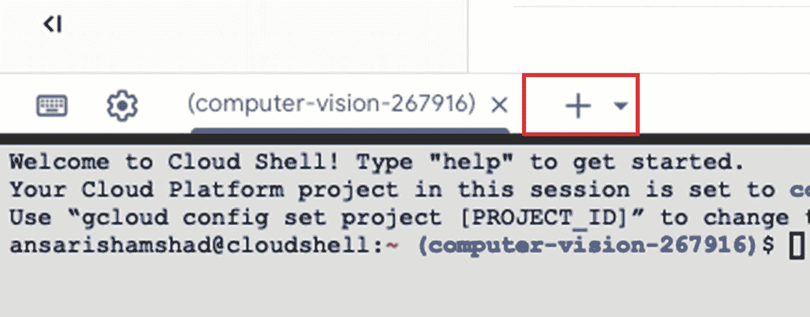

截图展示了 Cloud Shell 页面的一部分，显示四行代码。页面顶部的“添加”按钮已被选中。

图 10-15

通过点击 + 图标创建 Cloud Shell 的多个标签页

要通过 SSH 登录，请在四个 Cloud Shell 标签页中分别执行清单 10-7 中所示的命令。

```
SSH 到参数服务器    gcloud compute ssh parameter-server
SSH 到主节点        gcloud compute ssh chief
SSH 到 worker-0     gcloud compute ssh worker-0
SSH 到 worker-1     gcloud compute ssh worker-1
清单 10-7
使用 Cloud Shell 通过 SSH 登录所有 4 台虚拟机
```


### 上传分布式训练代码或克隆 GitHub 仓库

通过 SSH 登录后，执行以下命令克隆包含分布式模型训练代码的 GitHub 仓库（如代码清单 10-8 所示）。此操作需要在所有机器上执行。

```
git clone https://github.com/ansarisam/dist-tf-modeling.git
代码清单 10-8
克隆 GitHub 仓库的命令
```

如果 `git` 命令无法运行，请使用命令 `sudo apt-get install git` 安装 `git`。

### 安装先决条件与 TensorFlow

“Deep Learning on Linux” 镜像已预装所有先决条件和 TensorFlow。但若想自行配置环境，请执行代码清单 10-9 中的所有命令（详细说明请参阅第 1 章）。

```
sudo apt-get update
sudo apt-get -y upgrade && sudo apt-get install -y python-pip python-dev
sudo apt-get install python3-dev python3-pip
sudo pip3 install -U virtualenv
mkdir cv
virtualenv --system-site-packages -p python3 ./cv
source ./cv/bin/activate
pip install tensorflow==1.15
代码清单 10-9
安装包括 TensorFlow 在内的先决条件
```

### 运行分布式训练

请确保已在所有机器上克隆了 GitHub 仓库（如代码清单 10-8 所示）。同时，确保已通过 SSH（使用 Cloud Shell）登录到每台虚拟机。在每台虚拟机上执行以下命令以启动分布式训练。

以下是参数服务器的命令：

```
cd dist_tf_modeling
export TF_CONFIG='{"task": {"index": 0, "type": "ps"}, "cluster": {"chief":["chief:8900"],"worker": ["worker-0:8900", "worker-1:8900"],  "ps":["parameter-server:8900"]}}';python distributed_training_ps.py --output_path gs://cv_model_v1
```

以下是主节点的命令：

```
cd dist_tf_modeling
export TF_CONFIG='{"task": {"index": 0, "type": "chief"}, "cluster": {"chief":["chief:8900"],"worker": ["worker-0:8900", "worker-1:8900"],  "ps":["parameter-server:8900"]}}';python distributed_training_ps.py --output_path gs://cv_model_v1
```

以下是 worker-0 节点的命令：

```
cd dist_tf_modeling
export TF_CONFIG='{"task": {"index": 0, "type": "worker"}, "cluster": {"chief":["chief:8900"],"worker": ["worker-0:8900", "worker-1:8900"],  "ps":["parameter-server:8900"]}}';python distributed_training_ps.py --output_path gs://cv_model_v1
```

以下是 worker-1 节点的命令：

```
cd dist_tf_modeling
export TF_CONFIG='{"task": {"index": 1, "type": "worker"}, "cluster": {"chief":["chief:8900"],"worker": ["worker-0:8900", "worker-1:8900"],  "ps":["parameter-server:8900"]}}';python distributed_training_ps.py --output_path gs://cv_model_v1
```

请注意，所有参与节点必须能够通过 `TF_CONFIG` 中配置的端口与参数服务器通信。此外，节点必须具有对 GCS 存储桶的必要读写权限。

模型检查点保存在 GCS 的 `gs://cv_model_v1` 路径下。训练好的模型以 `model.h5` 形式保存在 `gs://cv_model_v1` 中。

配备 GPU 的 GCP 实例价格昂贵。为避免产生费用，如果不再使用，应将其终止。

## 在 Azure 上进行分布式训练

Microsoft Azure 是一种云计算服务，用于通过 Microsoft 管理的数据中心构建、测试、部署和管理应用程序与服务。

代码清单 10-3 中使用 `ParameterServerStrategy` 的分布式训练在 Azure 上的工作方式与在 GCP 上几乎相同。GCP 与 Azure 的区别在于创建虚拟机节点的方式。我们不会重复在 Azure 集群上分发基于参数服务器的训练过程，而是探索一种不同的分布式训练策略。

我们将使用 `MirroredStrategy` 在单个多 GPU 节点上进行分布式训练。在本节中，您将学习以下内容：

*   如何使用 Web 界面在 Azure 上创建基于多 GPU 的虚拟机

*   如何设置 TensorFlow 以在 GPU 上运行

*   需要做哪些更改才能使代码清单 10-3 中的代码在多个 GPU 上运行

*   如何执行训练并对其进行监控

请注意，TensorFlow 的 GPU 支持适用于搭载 CUDA 兼容显卡的 Ubuntu 和 Windows 系统。在本练习中，我们将创建一个配备两个 GPU 的 Ubuntu 20.4 虚拟机。


### 在 Azure 上创建多 GPU 虚拟机

首先，您需要在 [`https://azure.microsoft.com/`](https://azure.microsoft.com/) 注册以创建一个免费账户。然后前往 [`https://portal.azure.com/`](https://portal.azure.com/) 并登录您的账户。免费账户仅允许您创建单 GPU 的虚拟机。要创建多 GPU 的虚拟机，您必须激活计费功能。请按照以下说明进行激活：

1.  点击主导航（展开位于左上角的汉堡图标）。

2.  选择“成本管理 + 计费”，然后点击“Azure 订阅”。

3.  点击“添加”。

4.  按照屏幕上的指示操作。

要创建虚拟机，请执行以下操作：

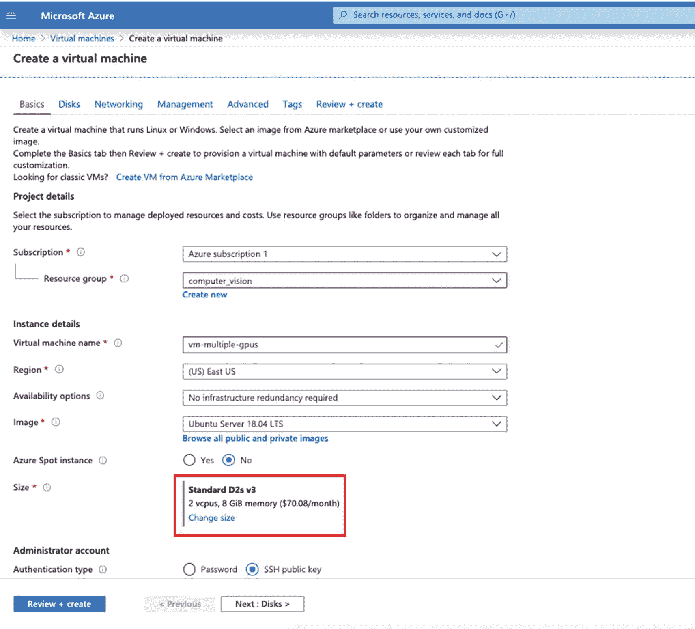

一张截图展示了 Microsoft Azure 页面，其中“创建虚拟机”选项卡已被选中。在“基本信息”选项卡下，显示了项目详情、实例详情和管理员账户。大小选项下的“Standard D2s v3”被框选。底部的“查看 + 创建”按钮已被选中。

图 10-16

用于创建虚拟机的 Azure 配置页面

1.  在主页上，点击“虚拟机”图标。

2.  点击页面底部的“创建虚拟机”按钮，或点击左上角的“+ 添加”图标。

3.  填写表单以配置虚拟机。图 10-16 显示了基本配置的顶部部分。对于“映像”字段，选择“Ubuntu Server 20.04 LTS”。

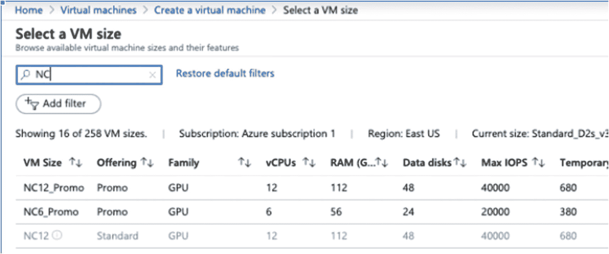

一张截图展示了“选择 VM 大小”页面的部分内容，该页面以表格形式列出了 VM 大小、产品系列、系列、vCPU、RAM、数据磁盘、最大 IOPS 和临时存储等详细信息。

图 10-17

设备大小（GPU）选择界面

1.  我们将为虚拟机添加 GPU。点击图 10-16 中红色矩形框内的“更改大小”链接。这将打开一个页面，显示您在图 10-16 的“区域”字段中所选区域内所有可用设备的列表。

如图 10-17 所示，首先清除所有筛选器，然后搜索 *NC* 以找到 NC 系列的 GPU。我们将选择 NC12_Promo VM 大小，它为我们提供两个 GPU、12 个 vCPU 和 112GB 内存。高亮显示与 NC12_Promo 大小对应的行，然后点击屏幕底部的“选择”按钮。

访问 [`https://docs.microsoft.com/en-us/azure/virtual-machines/linux/sizes-gpu`](https://docs.microsoft.com/en-us/azure/virtual-machines/linux/sizes-gpu) 以获取有关其他 VM 大小的更多信息。

如果您想使用的 GPU 对应的行呈灰色显示，这意味着您要么尚未升级订阅，要么没有足够的配额来使用该虚拟机。

您可以请求 Microsoft 增加您的配额。访问 [`https://docs.microsoft.com/en-us/azure/azure-resource-manager/templates/error-resource-quota`](https://docs.microsoft.com/en-us/azure/azure-resource-manager/templates/error-resource-quota) 以获取有关如何请求增加配额的更多信息。

在基本配置界面（图 10-16，底部），您可以为身份验证类型选择以下任一选项（取决于您的安全策略）：
    *   *SSH 公钥*：粘贴您将用于访问此虚拟机的 SSH 公钥。

*   *密码*：创建一个用户名和密码，在通过 SSH 连接时需要提供这些信息。在我们的练习中，我们将使用此选项。

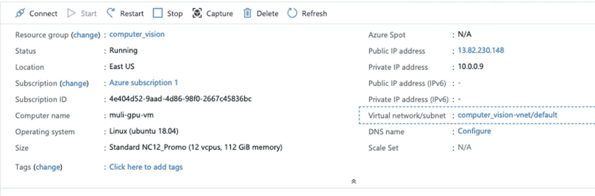

一张虚拟机详情页面的截图，列出了资源组、状态、位置、订阅、计算机名称、操作系统、大小、标签、Azure 竞价实例、公共 IP 地址、私有 IP 地址、虚拟网络、DNS 名称和规模集等详细信息。公共 IP 地址被高亮显示。

图 10-18

显示公共 IP 地址的虚拟机详情页面

1.  其他所有选项保持默认，然后点击屏幕左下角的“查看 + 创建”按钮。在下一页，我们将检查配置以确保所有选项都正确选择，最后点击“创建”按钮。如果一切顺利，将创建包含两个 GPU 的虚拟机。虚拟机准备就绪可能需要几分钟时间。

在这种情况下，我们没有创建任何磁盘，因为虚拟机自带的磁盘大小足以运行我们的训练。这不是持久性磁盘，如果虚拟机终止，它将被删除。因此，在生产环境中，您必须添加一个持久性磁盘以避免数据丢失。

2.  虚拟机准备就绪后，如果我们没有离开之前的页面，将会看到一个提示虚拟机已可使用的警报。我们也可以返回主页，点击“虚拟机”图标查看已创建的虚拟机列表。点击虚拟机名称以打开详情页面，如图 10-18 所示。

1.  记下公共 IP 地址或将其复制下来，因为您需要通过 SSH 连接到虚拟机时使用它。使用 SSH 客户端（例如 Windows 的 Putty 或 Mac/Linux 的 Shell 终端），通过您之前选择的身份验证方法登录到虚拟机。以下是通过两种身份验证方法进行 SSH 的命令：
    *   基于密码的身份验证：

`$ ssh username@13.82`**.230.148**

`username@13.82`**.230.148**`'s password:`

*   基于 SSH 公钥的身份验证：

`$ ssh -`**i** `~/sshkey.pem 13.82.230.148`

如果身份验证成功，您将登录到虚拟机。


### 安装 GPU 驱动和库

要在基于 GPU 的机器上运行 TensorFlow，我们需要安装 GPU 驱动和一些库。请执行以下步骤：

1.  在终端上执行清单 10-10 中的所有命令（确保您已通过 SSH 登录）。

    ```
    # 添加 NVIDIA 软件包仓库
    $ wget https://developer.download.nvidia.com/compute/cuda/repos/ubuntu1804/x86_64/cuda-repo-ubuntu1804_10.1.243-1_amd64.deb
    $ sudo dpkg -i cuda-repo-ubuntu1804_10.1.243-1_amd64.deb
    sudo apt-key adv --fetch-keys $ https://developer.download.nvidia.com/compute/cuda/repos/ubuntu1804/x86_64/7fa2af80.pub
    $ sudo apt-get update
    $ wget http://developer.download.nvidia.com/compute/machine-learning/repos/ubuntu1804/x86_64/nvidia-machine-learning-repo-ubuntu1804_1.0.0-1_amd64.deb
    $ sudo apt install ./nvidia-machine-learning-repo-ubuntu1804_1.0.0-1_amd64.deb
    sudo apt-get update
    清单 10-10
    添加 NVIDIA 软件包仓库的命令
    ```

2.  如果 NVIDIA 软件包仓库添加成功，则使用清单 10-11 中的命令安装 NVIDIA 驱动。

    ```
    $ sudo apt-get install --no-install-recommends nvidia-driver-418
    清单 10-11
    安装 NVIDIA 驱动
    ```

3.  您需要重启虚拟机以使之前的安装生效。在 SSH 终端 shell 中，执行命令 `sudo reboot`。

4.  再次通过 SSH 连接到虚拟机。

5.  要测试 NVIDIA 驱动是否成功安装，请执行以下命令：

    ```
    $ nvidia-smi
    ```

此命令应显示类似图 10-19 的内容。

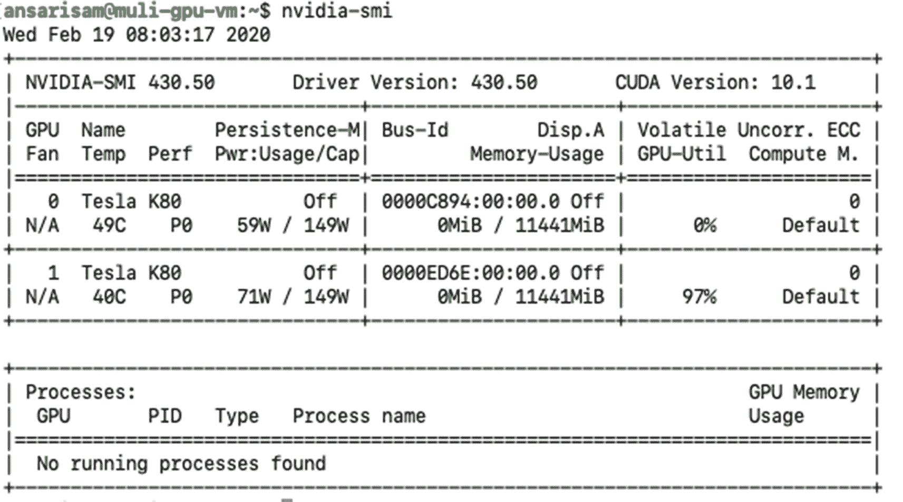

一张屏幕截图，以表格形式显示了 `nvidia-smi` 命令的输出。它显示了不同版本、GPU、温度、使用率、总线 ID、内存使用率、易失性 GPU 利用率以及未校正 ECC 的值。在“进程”标题下，文本显示“未发现正在运行的进程”。

图 10-19

命令 `nvidia-smi` 的输出

1.  我们现在将安装开发和运行时库（清单 10-12）。大小约为 4GB。

    ```
    $ sudo apt-get install --no-install-recommends \
    cuda-10-1 \
    libcudnn7=7.6.4.38-1+cuda10.1  \
    libcudnn7-dev=7.6.4.38-1+cuda10.1
    清单 10-12
    安装开发和运行时库
    ```

2.  安装 TensorRT 库，如清单 10-13 所示。

    ```
    $ sudo apt-get install -y --no-install-recommends libnvinfer6=6.0.1-1+cuda10.1 \
    libnvinfer-dev=6.0.1-1+cuda10.1 \
    libnvinfer-plugin6=6.0.1-1+cuda10.1
    清单 10-13
    安装 TensorRT
    ```

### 创建虚拟环境并安装 TensorFlow

按照第 1 章提供的说明安装您需要的所有库和依赖项。我们将执行清单 10-14 中的命令来安装当前练习所需的所有先决条件。

```
$ sudo apt update
$ sudo apt-get install python3-dev python3-pip
$ sudo pip3 install -U virtualenv
$ mkdir cv
$ virtualenv --system-site-packages -p python3 ./cv
$ source ./cv/bin/activate
(cv) $ pip install  tensorflow
(cv) $ pip install tensorflow-gpu
清单 10-14
安装 Python、创建虚拟环境并安装 TensorFlow
```

### 实现 MirroredStrategy

请参考清单 10-3 的第 9 行。我们将创建 `MirroredStrategy` 的实例，而不是实例化 `ParameterServerStrategy`，如下所示：

```
strategy = tf.distribute.MirroredStrategy()
```

清单 10-3 的所有其他行保持不变。

我们已将包含 `MirroredStrategy` 实现的修改后代码提交到 GitHub 仓库。GitHub 仓库地址为 [`https://github.com/ansarisam/dist-tf-modeling.git`](https://github.com/ansarisam/dist-tf-modeling.git)，包含 `MirroredStrategy` 代码的文件名为 `mirrored_strategy.py`。

### 运行分布式训练

通过 SSH 登录到我们之前创建的虚拟机。然后克隆 GitHub 仓库，如清单 10-15 所示。

```
$ git clone https://github.com/ansarisam/dist-tf-modeling.git
清单 10-15
克隆 GitHub 仓库
```

执行清单 10-16 中所示的 Python 代码来训练分布式模型。

```
$ python dist-tf-modeling/mirrored_strategy.py
清单 10-16
执行基于 MirroredStrategy 的分布式模型
```

如果一切顺利，您将在终端控制台上看到训练进度。图 10-20 显示了一些示例输出。

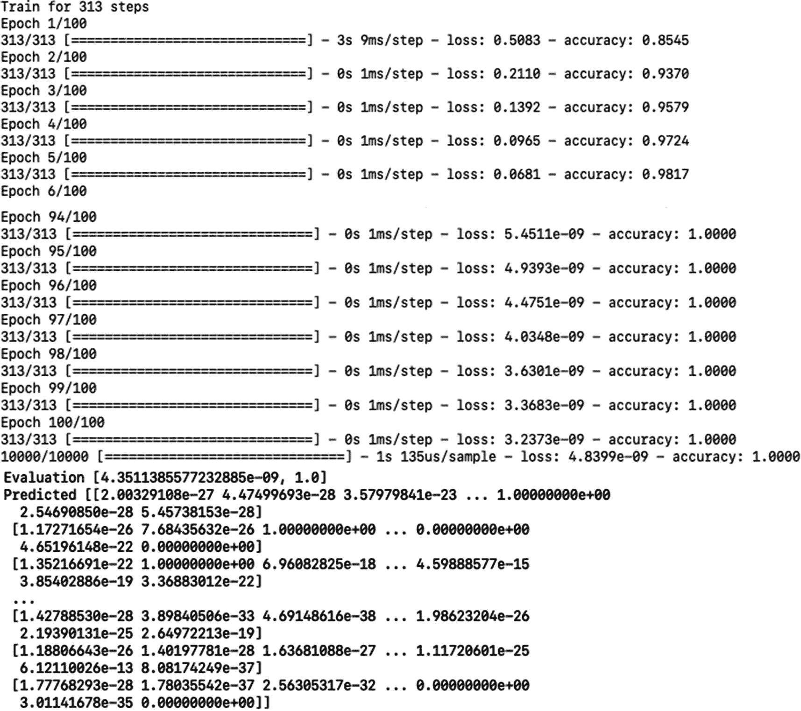

一张屏幕截图，显示了在 313 步中训练样本的代码行，下方显示了评估输出。

图 10-20

示例训练进度和评估输出

要检查 GPU 是否被用于分布式训练，请从另一个终端通过 SSH 连接到虚拟机，并执行清单 10-17 中所示的命令。

```
$ nvidia-smi
清单 10-17
检查 GPU 状态
```

图 10-21 和 10-22 显示了此命令的输出。

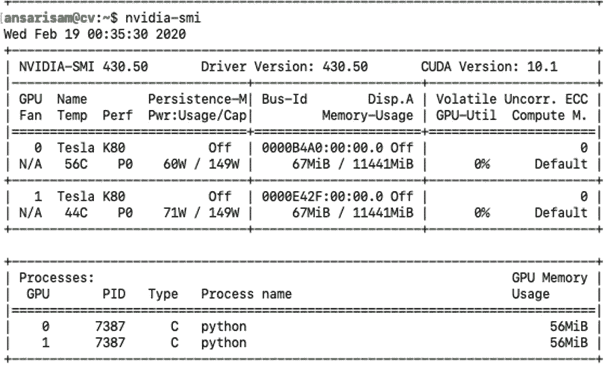

一张屏幕截图，以表格形式显示了 `nvidia-smi` 命令的输出。在“进程”标题下，GPU、PID、类型、进程名称和 GPU 内存使用率的值以两行显示。

图 10-22

训练进行中的 GPU 状态

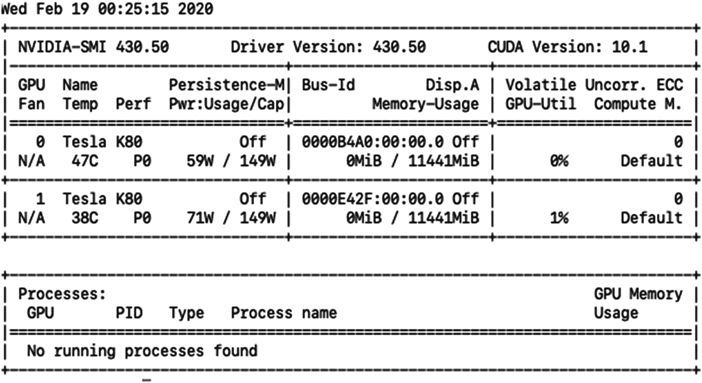

一张屏幕截图，以表格形式显示了 `nvidia-smi` 命令的输出。包括版本、GPU 风扇、名称温度、总线 ID 和内存使用率的详细信息。在“进程”标题下，GPU 状态显示为“未发现正在运行的进程”。

图 10-21

训练开始前的 GPU 状态

如果您不再需要该虚拟机，应将其终止以避免产生任何费用，因为这些基于 GPU 的虚拟机非常昂贵。在终止虚拟机之前，请确保将训练好的模型和检查点下载并存储到永久存储中。

## 在 AWS 上进行分布式训练

Amazon Web Services (AWS) 是亚马逊的子公司，按计量即用即付的方式向个人、公司和政府提供按需云计算平台和 API。在本节中，我们将探讨如何在 AWS 上训练分布式模型。

清单 10-3 的分布式训练也适用于 AWS。我们只需要创建虚拟机，并遵循我们在 GCP 上训练模型时所采取的步骤。

类似地，我们可以在具有多个 GPU 的 AWS 虚拟机上训练基于 `MirroredStrategy` 的模型。除了创建基于多 GPU 的虚拟机的方法不同之外，所有在 Azure 上进行训练的说明同样适用于 AWS。

在这里，我们将探讨另一种在云上训练可扩展模型的技术。我们将使用 Horovod 在 AWS 上分发训练。让我们首先了解 Horovod 框架是什么以及如何在分布式模型训练中使用它。


### Horovod

官方文档将 Horovod 描述为一个用于 TensorFlow、Keras、PyTorch 和 Apache MXNet 的分布式深度学习训练框架。Horovod 旨在使分布式深度学习变得快速且易于使用。Horovod 由 Uber 开发，并由 Linux 基金会 AI 托管。

包含文档的源代码托管在 GitHub 仓库 [`https://github.com/horovod/horovod`](https://github.com/horovod/horovod) 中。官方文档位于 [`https://horovod.readthedocs.io/en/latest/summary_include.html`](https://horovod.readthedocs.io/en/latest/summary_include.html)。

要使用 Horovod，我们需要对用于模型训练的 TensorFlow 代码进行一些小的修改。我们将使用清单 5-2 中的相同示例代码，并对其进行修改以使其与 Horovod 兼容。

### 如何使用 Horovod

当我们定义神经网络时，我们会指定优化算法，例如 AdaGrad，我们希望网络使用该算法来优化梯度。在分布式学习中，梯度在多个节点上计算，使用 all-reduce 或 all-gather 算法进行平均，然后使用优化算法进一步优化。Horovod 提供了一个包装函数，用于将优化分发到所有参与节点，并将梯度优化任务委托给我们包装在 Horovod 中的原始优化算法。

我们将使用 Horovod 与 TensorFlow 一起，将模型训练分发到多个节点，每个节点拥有一个或多个 GPU。我们将使用清单 5-2 中的相同代码示例，对其进行一些小的修改以使其与 Horovod 兼容，并在 AWS 上执行训练。要使用 Horovod，我们需要对清单 5-2 中的代码进行以下修改：

1.  导入 `horovod.tensorflow` 为 `hvd`。

2.  使用 `hvd.init()` 初始化 Horovod。

3.  使用以下代码固定将处理梯度的 GPU（每个进程一个 GPU）：

    ```
    config = tf.ConfigProto()
    config.gpu_options.visible_device_list = str(hvd.local_rank())
    ```

4.  像在 TensorFlow 中通常所做的那样构建模型。定义损失函数。

5.  定义 TensorFlow 优化函数，如下所示：

```
    opt = tf.train.AdagradOptimizer(0.01 * hvd.size())
    ```

6.  调用 Horovod 分布式优化函数，并传入步骤 5 中的原始 TensorFlow 优化器。这是 Horovod 的核心。

```
    opt = hvd.DistributedOptimizer(opt)
    ```

7.  创建一个 Horovod 钩子，将训练变量广播到所有处理器：

```
    hooks = [hvd.BroadcastGlobalVariablesHook(0)]
    ```

0 表示从所有等级为零的处理器（例如，第一个 GPU）到所有处理器。

8.  最后，使用以下代码训练模型：

```
    train_op = opt.minimize(loss)
    ```

让我们将所有这些步骤整合在一起，并将清单 5-2 中的代码转换为与 Horovod 兼容的代码，该代码可以跨多个具有多个 GPU 的节点进行分发。清单 10-18 显示了完整的代码，我们可以在以 TensorFlow 作为执行引擎的 Horovod 集群上执行该代码。取自 Horovod 官方源代码 `examples` 目录的代码托管在 [`https://github.com/horovod/horovod.git`](https://github.com/horovod/horovod.git)。

```
File name: horovod_tensorflow_mnist.py
1    import tensorflow as tf
2    import horovod.tensorflow.keras as hvd

4    # Horovod: 初始化 Horovod。
5    hvd.init()

7    # Horovod: 固定 GPU 以处理本地等级（每个进程一个 GPU）
8    gpus = tf.config.experimental.list_physical_devices('GPU')
9    for gpu in gpus:
10       tf.config.experimental.set_memory_growth(gpu, True)
11   if gpus:
12       tf.config.experimental.set_visible_devices(gpus[hvd.local_rank()], 'GPU')

14   # 使用内置数据集下载函数加载 MNIST 数据
15   mnist = tf.keras.datasets.mnist
16   (x_train, y_train), (x_test, y_test) = mnist.load_data()

18   # 通过将每个像素除以 255 来归一化像素值
19   x_train, x_test = x_train / 255.0, x_test / 255.0

21   BUFFER_SIZE = len(x_train)
22   BATCH_SIZE_PER_REPLICA = 16
23   GLOBAL_BATCH_SIZE = BATCH_SIZE_PER_REPLICA * 2
24   EPOCHS = 100
25   STEPS_PER_EPOCH = int(BUFFER_SIZE/EPOCHS)

27   train_dataset = tf.data.Dataset.from_tensor_slices((x_train, y_train)).repeat().shuffle(BUFFER_SIZE).batch(GLOBAL_BATCH_SIZE,drop_remainder=True)
28   test_dataset = tf.data.Dataset.from_tensor_slices((x_test, y_test)).batch(GLOBAL_BATCH_SIZE)

31   mnist_model = tf.keras.Sequential([
32       tf.keras.layers.Conv2D(32, [3, 3], activation='relu'),
33       tf.keras.layers.Conv2D(64, [3, 3], activation='relu'),
34       tf.keras.layers.MaxPooling2D(pool_size=(2, 2)),
35       tf.keras.layers.Dropout(0.25),
36       tf.keras.layers.Flatten(),
37       tf.keras.layers.Dense(128, activation='relu'),
38       tf.keras.layers.Dropout(0.5),
39       tf.keras.layers.Dense(10, activation='softmax')
40   ])

42   # Horovod: 根据 GPU 数量调整学习率。
43   opt = tf.optimizers.Adam(0.001 * hvd.size())

45   # Horovod: 添加 Horovod DistributedOptimizer。
46   opt = hvd.DistributedOptimizer(opt)

48   # Horovod: 指定 `experimental_run_tf_function=False` 以确保 TensorFlow
49   # 使用 hvd.DistributedOptimizer() 计算梯度。
50   mnist_model.compile(loss=tf.losses.SparseCategoricalCrossentropy(),
51                       optimizer=opt,
52                       metrics=['accuracy'],
53                       experimental_run_tf_function=False)

55   callbacks = [
56       # Horovod: 将初始变量状态从等级 0 广播到所有其他进程。
57       # 这对于确保当训练以随机权重开始或从检查点恢复时所有工作线程的初始化一致是必要的。
58       hvd.callbacks.BroadcastGlobalVariablesCallback(0),

61       # Horovod: 在每个 epoch 结束时平均工作线程之间的指标。
62       #
63       # 注意：此回调必须位于 ReduceLROnPlateau、
64       # TensorBoard 或其他基于指标的回调之前的列表中。
65       hvd.callbacks.MetricAverageCallback(),

67       # Horovod: 从一开始就使用 `lr = 1.0 * hvd.size()` 会导致最终准确率更差。
68       # 在前三个 epoch 期间将学习率从 `lr = 1.0` 缩放为 `lr = 1.0 * hvd.size()`。
69       # 详情请参见 https://arxiv.org/abs/1706.02677。
70       hvd.callbacks.LearningRateWarmupCallback(warmup_epochs=3, verbose=1),
71   ]

73   # Horovod: 仅在工作线程 0 上保存检查点，以防止其他工作线程损坏它们。
74   if hvd.rank() == 0:
75       callbacks.append(tf.keras.callbacks.ModelCheckpoint('./checkpoint-{epoch}.h5'))

77   # Horovod: 在工作线程 0 上写入日志。
78   verbose = 1 if hvd.rank() == 0 else 0

80   # 训练模型。
81   # Horovod: 根据 GPU 数量调整步数。
82   mnist_model.fit(train_dataset, steps_per_epoch=500 // hvd.size(), callbacks=callbacks, epochs=24, verbose=verbose)
清单 10-18
使用 Horovod 进行分布式训练
```

使用 Horovod API 的代码部分在注释中标记为 `Horovod:`。代码已适当注释，以帮助您理解如何使用 Horovod。所有其他代码行已在第 5 章中解释过。


### 在 AWS 上创建 Horovod 集群

您必须拥有一个 AWS 账户，并且能够登录到 AWS 管理控制台。如果您没有账户，请在 [`https://aws.amazon.com`](https://aws.amazon.com) 创建一个。AWS 提供某些类型的资源免费使用一年。但是，我们在 Horovod 集群上训练模型所需的资源类型可能需要您启用计费。您的账户可能会因用于运行分布式训练的资源而被收费。您可能还需要申请增加某些资源的配额，例如 vCPU 和 GPU。增加配额的说明可在 [`https://aws.amazon.com/about-aws/whats-new/2019/06/introducing-service-quotas-view-and-manage-quotas-for-aws-services-from-one-location/`](https://aws.amazon.com/about-aws/whats-new/2019/06/introducing-service-quotas-view-and-manage-quotas-for-aws-services-from-one-location/) 找到。

#### Horovod 集群

AWS 提供了一种便捷的方式，只需点击几下即可创建一个大规模可扩展的 Horovod 集群。为了完成本节中的练习，我们将创建一个包含两个节点的集群，每个节点只有一个 GPU。请执行以下操作：

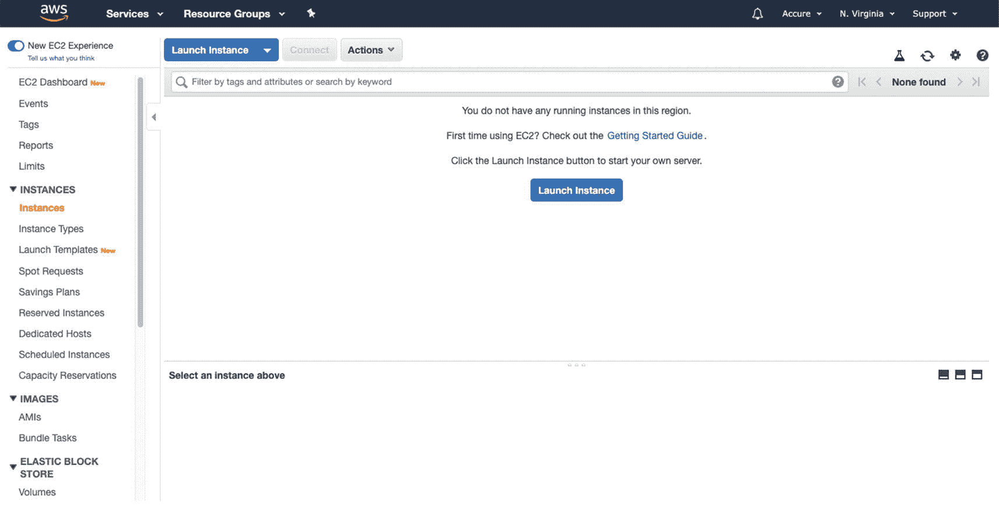

截图显示了 AWS 服务、资源组网页页面，左侧面板的列表中选择实例选项，右侧显示实例启动屏幕，其中“启动实例”按钮被高亮显示。

图 10-23

AWS 实例启动屏幕

1.  登录您的 AWS 账户以访问 AWS 管理控制台；请参见 [`https://console.aws.amazon.com`](https://console.aws.amazon.com)。

2.  依次点击“服务”、“EC2”、“实例”，然后点击“启动实例”（如图 10-23 所示）。

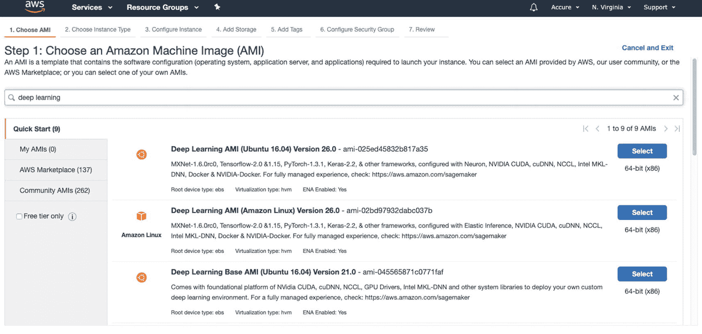

截图显示了 AWS 服务、资源组网页页面，其中选择了“选择 AMI”选项卡，该选项卡列出了深度学习 AMI 列表，例如 Ubuntu 16.04、Amazon Linux 和深度学习基础 AMI，并且“选择”按钮被高亮显示。

图 10-24

AMI 选择屏幕

1.  在下一个屏幕上，搜索 *deep learning*，并从 Amazon 机器镜像 (AMI) 列表中选择“Deep Learning AMI (Amazon Linux) Version 26.0 - ami-02bd97932dabc037b”。请参见图 10-24。

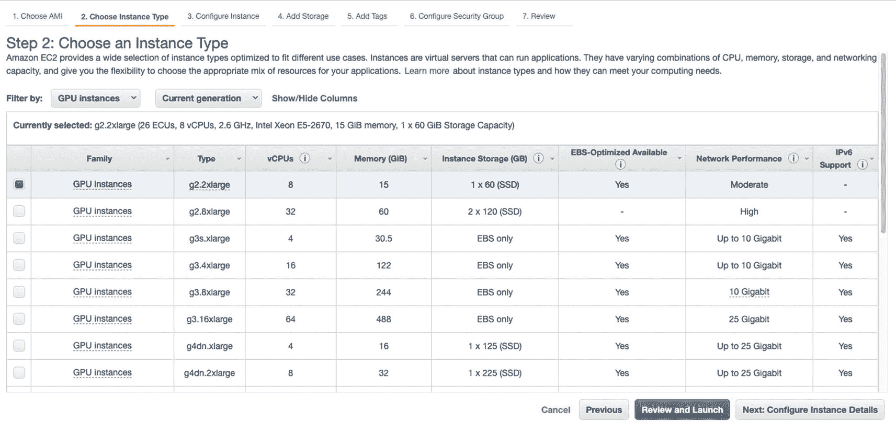

截图显示了“步骤 2：选择实例类型”页面，该页面以表格形式列出了详细信息，例如系列、类型、vCPU、内存、实例存储、EBS 优化可用性、网络性能和 IPv6 支持。页面底部的“审核和启动”按钮被选中。

图 10-25

选择实例类型屏幕

1.  在“选择实例类型”页面上，选择 GPU 实例，类型为 **g2.2xlarge**，将 vCPU 设置为 8，并将内存设置为 15GB（如图 10-25 所示）。您可以选择任何基于 GPU 的实例来满足您的训练需求。点击屏幕底部的“下一步：配置实例详细信息”按钮。

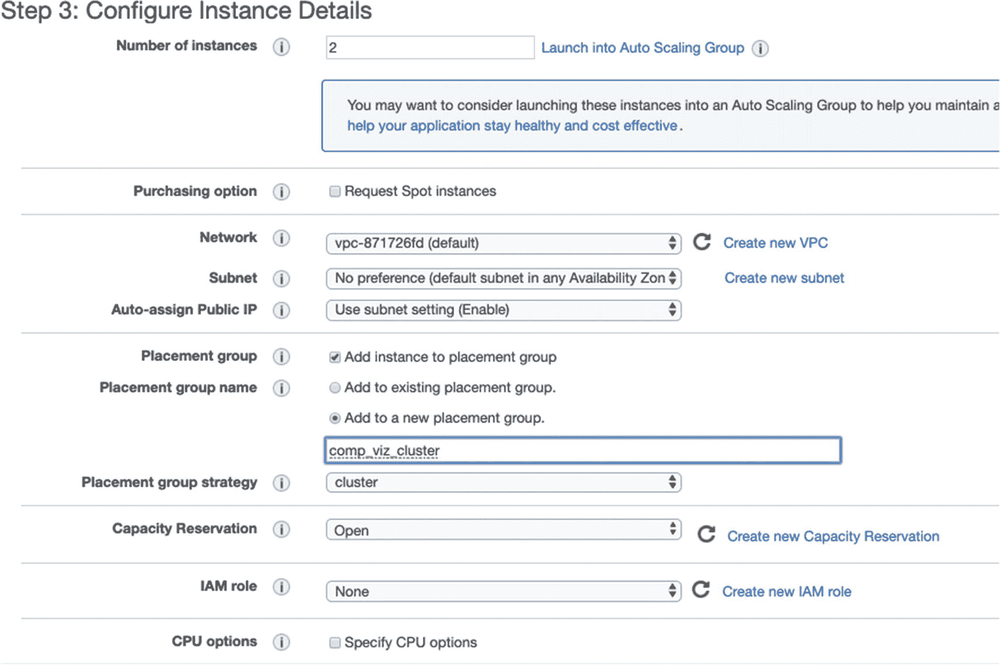

截图显示了“步骤 3：配置实例详细信息”页面，该页面提供了实例数量、购买选项、网络、子网、自动分配公有 IP、置放群组、置放群组名称、置放群组策略、容量预留、IAM 角色和 CPU 选项等详细信息。

图 10-26

配置实例详细信息

1.  填写“配置实例详细信息”页面（如图 10-26 所示）。在“实例数量”字段中，我输入了 **2** 以在集群中创建两个节点。您可以根据需要创建任意数量的节点来扩展训练。

对于“置放群组”设置，勾选“将实例添加到置放群组”复选框，并选择创建新的置放群组（如图 10-26 所示）或添加到现有群组。对于“置放群组策略”字段，选择“集群”。

将此页面上的其他所有设置保留为默认值，然后点击“下一步：添加存储”按钮。

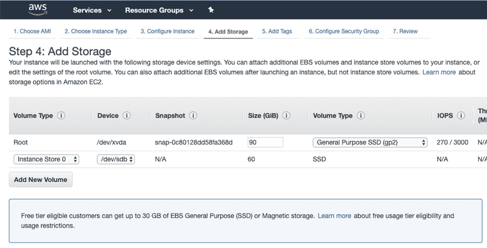

截图显示了 AWS 网页页面，其中选择了“步骤 4：添加存储”选项卡，该页面提供了卷类型、设备、快照、大小、卷类型和 IOPS 等详细信息。页面底部提供了“添加新卷”按钮。

图 10-27

添加存储页面

1.  在“添加存储”页面（如图 10-27 所示）上，根据您的需要提供磁盘大小的数值。在此示例中，我们将保留所有默认设置。点击“下一步：添加标签”按钮，然后点击“下一步：配置安全组”按钮。

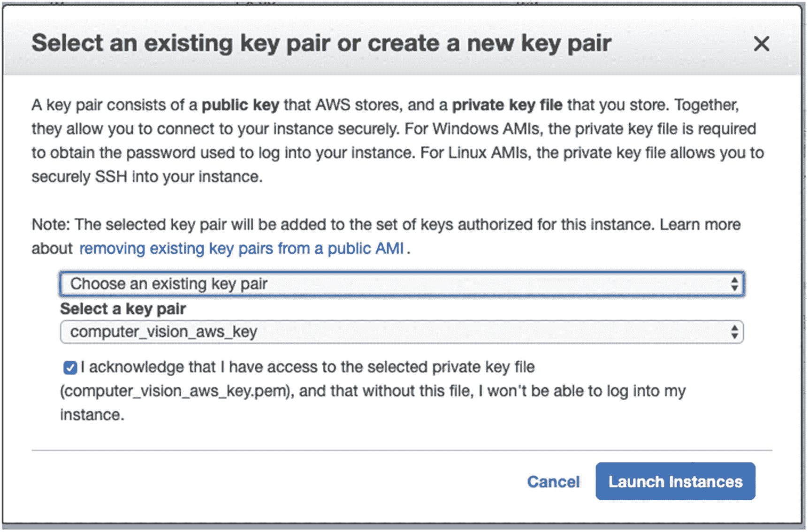


一张截图显示了一个标题为“选择现有密钥对或创建新密钥对”的对话框。用于选择现有密钥对的输入字段被高亮显示。对话框底部的“启动实例”按钮处于选中状态。

图 10-29

创建或选择密钥对的弹出屏幕

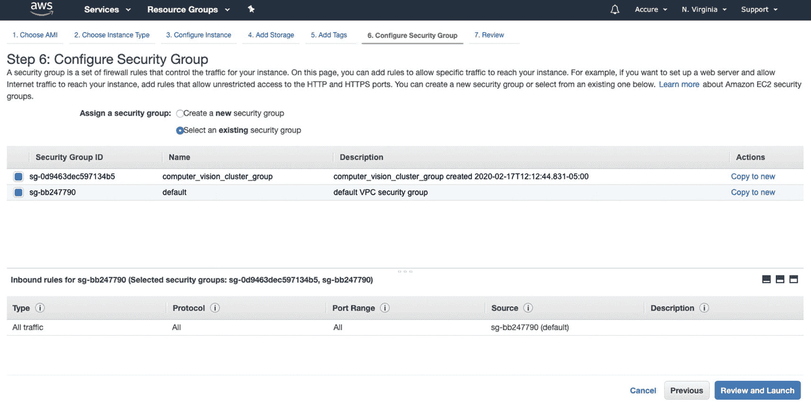

一张截图显示了 AWS 网站页面，其中第 6 步“配置安全组”选项卡被选中，该页面展示了安全组 ID、名称、类型、协议、端口范围、源、描述和操作等详细信息。页面底部的“审核和启动”按钮处于选中状态。

图 10-28

创建或选择安全组的页面

1.  要么创建一个新的安全组，要么如果您想使用现有的安全组，则选择“选择现有安全组”（见图 10-28）。点击“审核和启动”，然后点击“启动”按钮。这将显示一个弹出屏幕，用于创建或选择密钥对。此密钥对用于通过 SSH 登录到虚拟机。请按照屏幕上的说明进行操作（如图 10-29 所示）。

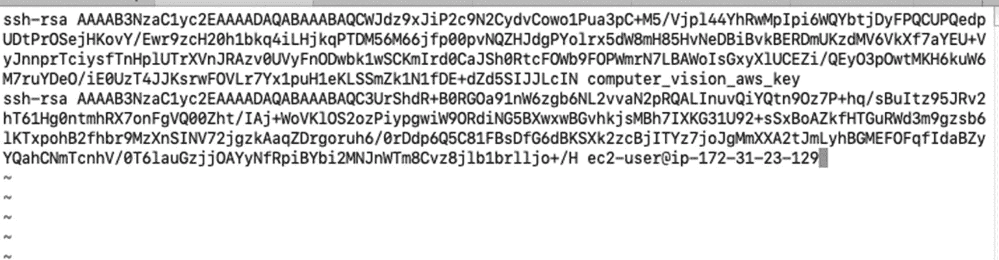

一张截图显示了编程代码行，正在复制授权密钥文件的内容。

图 10-32

将 `id_rsa.pub` 的内容粘贴到 `authorized_keys` 文件的末尾

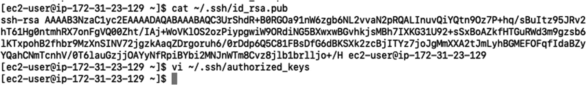

一张截图显示了输出的编程代码行，正在复制从 `ssh-rsa` 开始的全部文本。

图 10-31

`cat ~/.ssh/id_ras.pub` 的输出；复制从 `ssh-rsa` 开始的全部文本

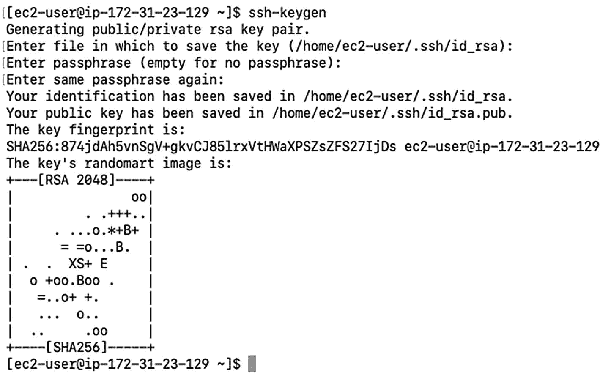

一张截图显示了 `ssh-keygen` 命令输出的编程代码行。

图 10-30

`ssh-keygen` 的输出

1.  实例成功启动后，我们需要创建免密码 SSH，以使每个节点能够相互通信。我们在一台机器上创建一个 RSA 密钥，并将 `rsa_id.pub` 文件中的公钥复制到所有节点的 `authorized_keys` 文件中。步骤如下：
    1.  SSH 登录到机器 1，在其主目录下执行命令 `ssh-keygen`。在每个提示符处按回车键，直到屏幕上打印出指纹。终端输出应类似于图 10-30。

2.  将 `~/.ssh/id_rsa.pub` 的内容复制到 `~/.ssh/authorized_keys`，如图 10-31 和图 10-32 所示。

3.  将一台机器的 `id_rsa.pub` 内容复制到所有节点的 `authorized_keys` 文件的末尾。

4.  在其余机器上重复创建 `ssh-keygen` 的过程，并将 `id_rsa.pub` 的内容复制到每个节点的 `authorized_keys` 文件的末尾。

5.  您应该通过从一台机器 SSH 登录到另一台机器来验证。它应该允许您无需任何密码即可登录。如果 SSH 提示输入密码，则意味着您没有在一台机器和另一台机器之间建立免密码通信。要使 Horovod 正常工作，所有机器必须能够无需密码地与其他机器通信。

#### 运行分布式训练

我们在此示例中使用的 AMI 包含用于以分布式模式启动训练的脚本。在 `/home/ec2-user/examples/horovod/tensorflow` 目录下有一个 `train_synthetic.sh` shell 脚本。您可以修改此脚本以指向您的代码并启动训练。

此示例脚本在我们刚刚创建的 Horovod 集群上启动基于 RestNet 的训练。只需按如下方式执行它：

```
sh /home/ec2-user/examples/horovod/tensorflow/train_synthetic.sh 2
```

参数 2 表示集群中的 GPU 数量。

如果一切顺利，您将得到一个训练好的模型，您可以将其下载到将要托管使用此模型预测结果的应用程序的机器上。

我们使用的 AMI 已经安装了 Horovod。如果您想使用没有安装 Horovod 的虚拟机，请按照下一节的安装说明进行操作。

### 安装 Horovod

Horovod 的运行依赖于 OpenMPI。首先，我们需要使用清单 10-19 中所示的命令安装 OpenMPI。

```
# 下载 Open MPI
$ wget https://download.open-mpi.org/release/open-mpi/v4.0/openmpi-4.0.2.tar.gz
# 解压缩
$ gunzip -c openmpi-4.0.2.tar.gz | tar xf -
$ cd openmpi-4.0.2
$ ./configure --prefix=/usr/local
$ make all install
清单 10-19
安装 OpenMPI
```

安装 OpenMPI 需要几分钟时间。

成功安装 OpenMPI 后，使用 `pip` 命令安装 Horovod，如清单 10-20 所示。

```
$ pip install horovod
清单 10-20
安装 Horovod
```

清单 10-19 和 10-20 必须在集群的所有机器上执行。

### 运行 Horovod 执行分布式训练

要在具有四个 GPU 的机器上运行，请使用以下命令：

```
$ horovodrun -np 4 -H localhost:4 python horovod_tensorflow_mnist.py
```

要在四台各具有四个 GPU 的机器上运行，请执行以下命令：

```
$ horovodrun -np 16 -H host1:4,host2:4,host3:4,host4:4 python horovod_tensorflow_mnist.py
```

您也可以在一个主机文件中指定主机节点。示例如下：

```
$ cat horovod_cluster.conf
host1 slots=2
host2 slots=2
host3 slots=2
```

此示例列出了主机名（`host1`、`host2` 和 `host3`）以及每个主机有多少个“槽位”。槽位表示训练可能在一个节点上执行的 GPU 数量。

要在一个名为 `horovod_cluster.conf` 的文件中指定的主机上运行，请执行以下命令：

```
$ horovodrun -np 6 -hostfile horovod_cluster.conf python horovod_tensorflow_mnist.py
```

带有 GPU 的虚拟机成本高昂。因此，建议在不再使用时终止这些虚拟机。图 10-33 显示了如何终止您的实例。

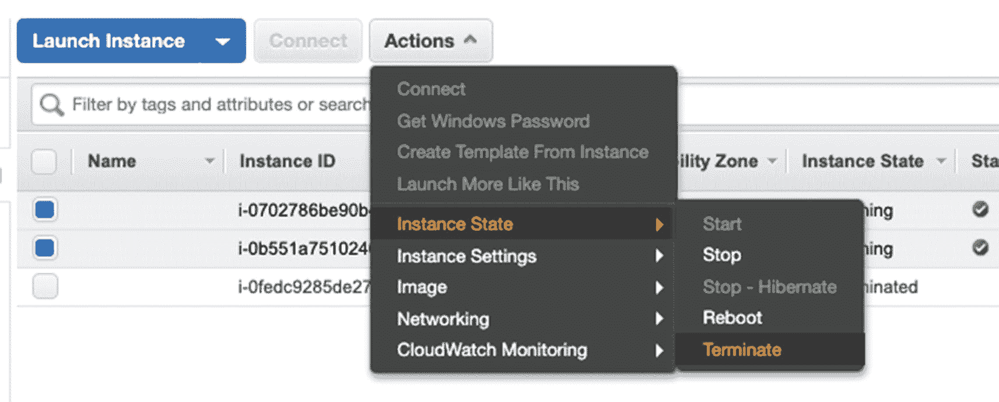

一张截图显示了 AWS 网站页面的一个片段，其中“启动实例”选项被选中。屏幕上的弹出菜单显示了一个选项列表，从中选择了“实例状态”，这导致了一个子菜单，从中选择了“终止”选项。

图 10-33

终止 AWS 虚拟机

## 总结

本章从计算机视觉模型分布式训练的简介开始。我们探讨了 TensorFlow 支持的各种分布式策略，并分析了如何为分布式训练编写代码。

我们在 GCP、Azure 和 AWS 云基础设施上基于 MNIST 数据集训练了我们的手写识别模型。我们探讨了在三个云平台（GCP、AWS 和 Azure）上训练模型的三种不同技术。我们的示例训练基于 TensorFlow 支持的分布式策略：`ParameterServerStrategy` 和 `MirroredStrategy`。您还学习了如何使用 Horovod 进行计算机视觉模型的大规模训练。


