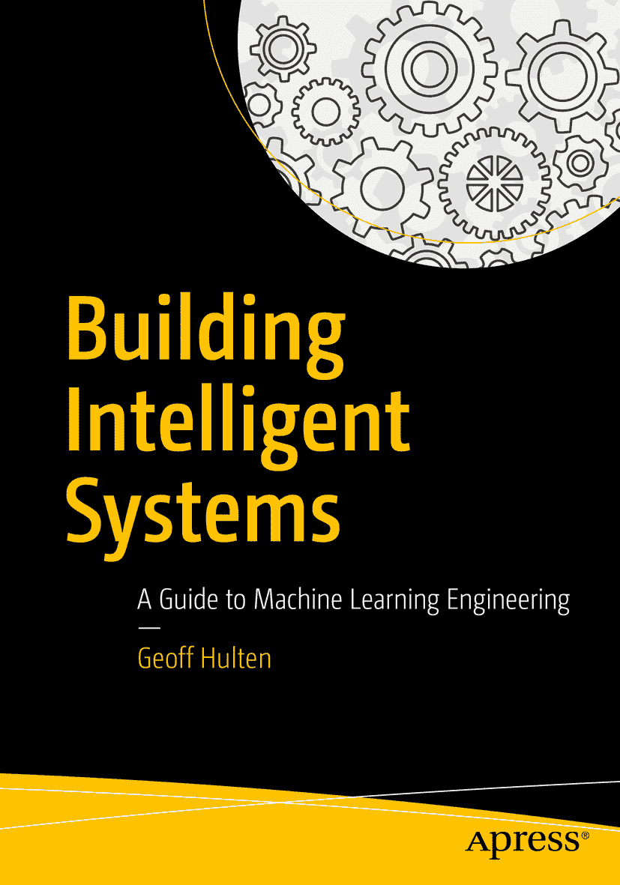

<!--

本书作者引用的任何源代码或其他补充材料，读者均可通过本书的产品页面在 GitHub 上获取，网址为 [www.apress.com/9781484234310](http://www.apress.com/9781484234310)。如需更详细信息，请访问 [`www.apress.com/source-code`](http://www.apress.com/source-code)。ISBN 978-1-4842-3431-0 e-ISBN 978-1-4842-3432-7 [`doi.org/10.1007/978-1-4842-3432-7`](https://doi.org/10.1007/978-1-4842-3432-7) 美国国会图书馆控制号：2018934680 © 杰夫·赫尔滕 2018 本作品受版权保护。出版商保留所有权利，无论是整体还是部分材料，具体包括翻译、重印、插图复用、朗诵、广播、微缩胶片复制或任何其他物理形式，以及电子改编、计算机软件或目前已知或未来开发的类似或不同方法的传输或信息存储与检索。本书中可能出现商标名称、标识和图像。我们仅在编辑风格中使用这些名称、标识和图像，以利于商标所有者，并无意侵犯商标权，而非在每次出现商标名称、标识或图像时都使用商标符号。本出版物中对商品名称、商标、服务标志及类似术语的使用，即使未明确标识，也不应被视为对其是否受专有权利保护的看法。尽管本书中的建议和信息在出版时被认为是真实准确的，但作者、编辑和出版商均不对可能存在的任何错误或遗漏承担法律责任。出版商对本书所含内容不作任何明示或暗示的保证。本书采用无酸纸印刷，通过 Springer Science+Business Media New York 向全球图书贸易发行，地址：233 Spring Street, 6th Floor, New York, NY 10013。电话：1-800-SPRINGER，传真：(201) 348-4505，电子邮件：orders-ny@springer-sbm.com，或访问 www.springeronline.com。Apress Media, LLC 是一家加利福尼亚有限责任公司，其唯一成员（所有者）是 Springer Science + Business Media Finance Inc (SSBM Finance Inc)。SSBM Finance Inc 是一家特拉华州公司。献给父亲，感谢您告诉我需要听的话。献给母亲，感谢您几乎只告诉我我想听的话。还有献给妮可。
-->

# 引言

《构建智能系统》是一本关于在实践中运用机器学习的书。

它涵盖了生产一个功能完备的智能系统所需的一切——一个能够利用机器学习和来自用户交互的数据，随时间推移不断改进并取得成功的系统。

阅读本书后，你将能够端到端地设计一个智能系统。你将了解：

*   何时使用智能系统以及如何使其实现你的目标。
*   如何设计用户与智能系统之间的有效交互。
*   如何在客户端、服务端和后端实现一个智能系统。
*   如何构建驱动智能系统的智能，并使其随时间增长。
*   如何在整个生命周期中编排一个智能系统。

你还将理解如何将你现有的技能（无论是软件工程、数据科学、机器学习、管理还是项目管理）应用到这项工作中。

有许多优秀的书籍教授数据和机器学习技能。这些书类似于编程语言书籍；它们以极大的细节教授宝贵的技能。而本书更像是一本软件工程书籍；它教授如何利用那些基础技能来构建可工作的系统。

本书基于十多年构建互联网规模智能系统的经验，这些系统每天处理数亿次用户交互，运行于世界上一些最大、最重要的软件系统中。我希望这本书能帮助加速将数据转化为影响力的系统普及，并帮助读者在这一重要领域培养实用技能。

## 本书适合读者

本书适合任何拥有计算机科学学位、希望了解构建有效智能系统所需条件的人。

想象一位被分配到机器学习项目的典型软件工程师。他们想了解更多相关知识，于是拿起一本书，却发现内容技术性很强，充满了统计学、数学和建模方法。这些固然是重要技能，但对于帮助这位软件工程师为项目做出贡献来说，却是错误的信息。《构建智能系统》正是适合他们的书。

想象一位机器学习从业者，他需要了解端到端系统将如何与他们生成的模型交互，他们可以依赖什么，以及在实践中需要注意什么。《构建智能系统》正是适合他们的书。

想象一位技术经理，他希望开始从机器学习中获益。也许他聘请了一位机器学习博士，并让其工作一段时间。这位机器学习从业者带着图表、精确率/召回率曲线和训练数据需求回来，却没有提供关于如何应用这些成果的框架。《构建智能系统》正是适合那位经理的书。

### 数据和机器学习从业者

数据和机器学习是许多智能系统的核心，但从开发出一个可工作的模型（通过机器学习创建）到最终实现可持续的客户影响之间，还有大量工作要做。理解这些支撑性工作将在多个方面帮助你更好地进行建模。

首先，理解这些系统对你的建模施加的约束非常重要。例如，模型将在哪里运行？它能访问哪些数据？它需要多快？误报（假阳性）对业务有何影响？漏报（假阴性）呢？应如何调整模型以最大化业务成果？

其次，能够影响其他参与者也很重要。理解工程师和业务所有者面临的压力，将有助于你找到良好的解决方案并最大化成功机会。例如，由于遥测采样，你可能无法获得所有想要的训练数据。你是应该加倍努力围绕该问题进行建模，还是采用工程解决方案更合理？或者，当你的模型已经达到非常好的（但略低）精确率时，却被要求优化到难以达到的极高精确率。你是应该继续追求那种超高精确率，还是应该努力以降低错误对客户影响的方式来影响用户体验？

第三，理解支撑系统如何使你受益也很重要。升级路径、手动覆盖、遥测、防止重大错误的防护栏——这些都是你可以利用的工具。你需要了解何时使用它们以及如何将它们与你的建模过程整合。你是否应该丢弃一个对 99%用户表现可接受，但对 1%用户表现极差的模型？或者，你可以依赖系统的其他部分来解决这个问题。

### 软件工程师

构建令客户满意的软件是一项艰巨的工作。这无可避免，因为每个成功的软件产品和服务背后，都离不开扎实的工程能力。智能系统具有一些独特的属性，会带来有趣的挑战。本书将介绍相关概念，帮助你设计和构建高效、可靠，并能最好地释放机器学习与数据科学力量的智能系统。

首先，本书将识别一个成功的智能系统内需要存在的实体和抽象概念。你将学习智能运行时、上下文与特征、模型、遥测、训练数据、智能管理、编排等背后的概念。

其次，本书将让你对机器学习和数据科学有一个概念性的理解。这将帮助你更好地讨论工程投入与建模投入之间的权衡取舍。你的哪部分工作能真正促成解决方案？在哪些情况下，你被要求为了节省一点点建模时间而去做“煮沸大海”般浩大的工程？

第三，本书将探讨我和我的同事们在过去十年中，通过实现众多实际工作系统而总结出的智能系统模式。在客户端或服务中运行智能的优缺点是什么？如何界定和验证具有概率性的组件？遥测中需要包含哪些内容，以便系统能够持续演进？

### 项目经理

机器学习和数据科学是热门话题。它们是极好的工具，但终究只是工具，而非解决方案。本书将为你提供足够的概念性理解，让你了解这些工具擅长什么，以及如何部署它们来解决你的业务问题。

你首先要学会的是培养一种直觉，判断何时适合使用机器学习和数据科学。没有什么比试图把方钉敲进圆孔更糟糕的了。你需要理解哪些类型的问题可以通过机器学习解决。但同样重要的是，你需要理解哪些类型的问题不能——或者至少不容易——解决。在一个成功的项目中，参与者众多，他们说着各种截然不同、高度专业化的语言，这使得沟通尤为困难。本书将帮助你理解足够多的知识，以便你能提出正确的问题，并从答案中获取所需信息。

其次，要培养对投资回报率的直觉，以便你能决定使用多少智能系统。通过理解构建和维护一个将数据转化为影响力的系统的真实成本，你就能在决定是否实施时做出更明智的选择。你也能以清醒的头脑投入其中，并为成功设定恰当的投资规模。有时你需要本书描述的所有要素，但有时对你的业务而言，更简单的选择才是正确的。本书将帮助你做出明智的决策，并充满信心和可信度地进行沟通。

最后，项目经理在这里学到的第三件事是理解如何规划、组建团队和管理一个智能系统项目。你将受益于我们构建众多大规模智能系统的经验：智能系统的生命周期；日常运行流程；以及你成功所需的团队和技能。

### 致谢

多年来，有许多人参与了我所从事的智能系统项目。这些人帮助我学习，帮助我理解。在此，我特别要感谢：

Jeb Haber 和 John Scarrow，他们是本书所述概念发展的两位关键人物，也是多年来出色的合作伙伴。没有他们的领导和奉献，这一切都不可能发生。

# 目录

## 第一部分：走近智能系统项目

### 第 1 章：​介绍智能系统

智能系统的要素

一个智能系统示例

互联网烤面包机

利用数据进行烘烤

传感器与启发式智能

使用机器学习进行烘烤

构建一个智能系统

总结

思考题…

### 第 2 章：​判断何时使用智能系统

需要智能系统的问题类型

大问题

开放式问题

随时间变化的问题

本质上困难的问题

智能系统适用的场景

当部分系统可行且有趣时

当你可以利用系统数据来改进时

当系统能与目标交互时

当成本效益显著时

当你不确定是否需要智能系统时

总结

思考题

### 第 3 章：​数据处理快速回顾

结构化数据

对数据提出简单问题

使用数据模型

概念性机器学习

数据处理中的常见陷阱

总结

思考题

### 第 4 章：​定义智能系统的目标

好目标的标准

为何选择目标如此困难：一个示例

目标的类型

组织目标

领先指标

用户成果

模型属性

目标分层

衡量目标的方法

等待更多信息

A/​B 测试

人工标注

询问用户

解耦目标

保持目标健康

总结

思考题

## 第二部分：智能体验

### 第 5 章：​智能体验的组成部分

向用户呈现智能

呈现智能的示例

实现系统目标

实现目标的示例

最小化智能缺陷

创建数据以发展系统

收集数据的示例

总结

思考题…

### 第 6 章：​为何创建智能体验如此困难

智能会犯错

智能会犯离谱的错误

智能会犯不同类型的错误

智能会变化

人为因素

总结

思考题…

### 第 7 章：​平衡智能体验

强制力

频率

成功的价值

错误的代价

知晓错误的存在

从错误中恢复

智能质量

总结

思考题…

### 第 8 章：​智能交互模式

自动化

提示

组织

注释

混合体验

总结

思考题…

### 第 9 章：​从体验中获取数据

示例：TeamMaker

简单交互

使其有趣

连接成果

好数据的属性

上下文、行动与成果

良好的覆盖

真实使用

无偏

不包含反馈循环

规模

理解成果的方法

隐式成果

评分

报告

升级

用户分类

总结

思考题…

### 第 10 章：​验证智能体验

获得预期体验

处理上下文

处理智能

整合

实现目标

持续验证

总结

思考题…

## 第三部分：实现智能

### 第 11 章：​智能实现的组成部分

智能实现示例

智能实现的组成部分

智能运行时

智能管理

智能遥测管道

智能创建环境

智能编排

总结

思考题…

### 第 12 章：​智能运行时

上下文

特征提取

模型

执行

结果

智能的不稳定性

智能 API

总结

思考题…

### 第 13 章：​智能的部署位置

定位智能的考量

更新延迟

执行延迟

运营成本

离线运行

智能的放置位置

产品中的静态智能

客户端智能

以服务器为中心的智能

后端（缓存）智能

混合智能

总结

思考题…

### 第 14 章：​智能管理

智能管理概述

智能管理的复杂性

智能管理的频率

人工系统

智能合理性检查

检查兼容性

检查运行时约束

检查明显错误

启用智能

单次部署

静默智能

受控发布

分阶段发布

关闭智能

总结

思考题…

### 第 15 章：​智能遥测

为何需要遥测

确保系统正常运行

理解成果

收集数据以发展智能

有效遥测系统的属性

采样

汇总

灵活定位

常见挑战

偏差

罕见事件

间接价值

隐私

总结

思考题…

## 第四部分：创建智能

### 第 16 章：​智能概述

智能示例

上下文

运行时实现

可用于智能创建

智能可预测的内容

分类

概率估计

回归

排序

混合与组合

总结

思考题…

### 第 17 章：​表示智能

表示智能的标准

用代码表示智能

用查找表表示智能

用模型表示智能

线性模型

决策树

神经网络

总结

思考题…

### 第 18 章：​智能创建过程

智能创建示例：Blinker

理解环境

定义成功

获取数据

引导数据

使用数据

准备评估

简单启发式方法

机器学习

理解权衡

评估与迭代

智能创建的成熟度

精通智能创建

数据调试

基于验证的方法

工具箱直觉

数学 (?​)

总结

思考题…

### 第 19 章：​评估智能

评估准确性

泛化

错误类型

错误分布

评估其他类型的预测

评估回归

评估概率

评估排序

使用数据进行评估

独立评估数据

实践中的独立性

评估子群体

合适的数据量

比较智能

操作点

曲线

主观评估

探索错误

想象用户体验

寻找最糟糕的情况

总结

思考题…

### 第 20 章：​机器学习智能

机器学习的工作原理

复杂性的利弊

欠拟合

过拟合

平衡复杂性

特征工程

将数据转换为可用格式

帮助模型使用数据

归一化

暴露隐藏信息

扩展上下文

消除误导性内容

建模

复杂性参数

识别过拟合

总结

思考题…

### 第 21 章：​组织智能

组织智能的理由

良好组织的智能的属性

组织智能的方法

解耦特征工程

多模型搜索

追踪错误

元模型

模型排序

划分上下文

覆盖

总结

思考题…

## 第五部分：编排智能系统

### 第 22 章：​智能编排概述

良好编排的智能的属性

为何需要编排

目标变化

用户变化

问题变化

智能变化

成本变化

滥用

编排团队

总结

思考题…

### 第 23 章：​智能编排环境

监控成功标准

检查交互

平衡体验

覆盖智能

创建智能

总结

思考题…

### 第 24 章：​处理错误

可能发生的最坏情况

智能可能出问题的方式

系统中断

模型中断

智能错误

智能退化

缓解错误

投资智能

平衡体验

调整智能管理参数

实施护栏

覆盖错误

总结

思考题…

### 第 25 章：​对手与滥用

滥用是一门生意

滥用会规模化

评估你的风险

滥用问题的表现

对抗滥用的方法

增加成本

降低对滥用者的吸引力

与对手进行机器学习

让滥用者脱离循环

总结

思考题…

### 第 26 章：​构建你自己的智能系统

智能系统清单

走近智能系统项目

规划智能体验

规划智能系统实现

准备创建智能

编排你的智能系统

总结

思考题…

索引

关于作者与关于技术审校

关于作者

关于技术审校

---

此外，还要感谢：Anthony P.、Tomasz K.、Rob S.、Rob M.、Dave D.、Kyle K.、Eric R.、Ameya B.、Kris I.、Jeff M.、Mike C.、Shankar S.、Robert R.、Chris J.、Susan H.、Ivan O.、Chad M. 以及许多其他人……