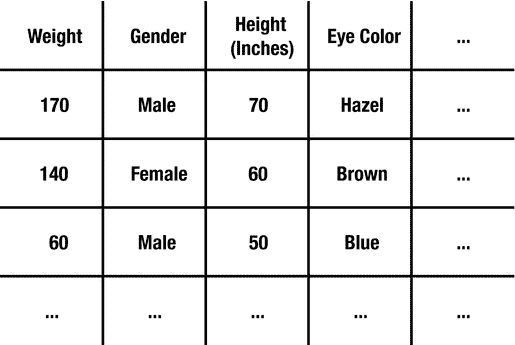

# 3. 数据处理基础速览

数据是每个智能系统的核心。本章从概念层面概述数据处理，介绍数据科学、统计学和机器学习中的关键概念。目标是建立共同的理解基础，以促进智能系统项目所有参与者之间的讨论和决策。

本章将涵盖：
* 结构化数据。
* 向数据提问。
* 数据模型。
* 概念性机器学习。
* 数据处理中的一些常见陷阱。

## 结构化数据

数据正在改变世界，这一点毋庸置疑。

但数据究竟是什么？是磁盘上的一堆图片？是你高中时写的所有学期论文？还是每一位棒球运动员的击球率？

没错，所有这些都是数据。数据浩如烟海——无数数字以 0 和 1 的形式填满了全球各地的硬盘驱动器。原始形式的数据通常被称为非结构化数据，处理起来可能相当困难。

当我们把数据转化为智能时，通常处理的是具有一定结构的数据。也就是说，数据被分解成描述实体或事件的单元。

例如，想象一下处理关于人的数据。每个数据单元通过以下属性描述一个人：体重、身高、性别、眼睛颜色等等。

一种便捷的思考方式是将其视为电子表格中的表格（图 3-1）。每个人对应一行，每个人的每个属性对应一列。也许每行的第一列包含一个数字，代表对应人的体重。而每行的第三列包含一个数字，代表这个人的身高。以此类推。

图 3-1 结构化数据示例

这些列通常包含数字（如身高和体重），或者从少量类别中选择（如眼睛颜色为棕色或蓝色），或者是像姓名这样的短文本字符串。当然，还有更高级的选项，但这种简单的方案已经相当强大，可以用来表示各种事物（并解锁我们对它们进行统计和机器学习的能力）。

例如：
* 你可以通过以下方式表示一个网页：它包含的单词数量、图片数量、链接数量，以及它包含 1000 个常见关键词中每个关键词的次数。
* 你可以通过以下方式表示一次搜索引擎访问：用户输入的查询词、用户在结果页面上停留的时间、用户点击的搜索结果数量，以及他们最终点击结果的 URL。
* 你可以通过以下方式表示我们联网烤面包机上的一次烘烤事件：放入烤面包机的物品温度、用户选择的强度设置、用户在取出物品前停止和启动烤面包机的次数，以及物品从放入到取出之间的总时间。

这些是简单的例子。在实践中，即使是简单的概念，其表示形式也往往包含数十甚至数百个元素（每行有数十或数百列）。选择正确的数据集进行收集，并赋予它们正确的表示形式，对于从数据中获得良好结果至关重要。而且，在成功之前，你可能会失败几次——要做好不断演进的准备。

## 向数据提出简单问题

那么，你能用数据做什么呢？你可以向它提问。例如，在一个关于人的数据集中，你可能想知道：
* 平均身高是多少？
* 谁最高？
* 有多少人身高低于 5 英尺 5 英寸？

这些问题很容易回答；只需查看数据并计算数值即可（求和，或统计符合条件的行数）。

在智能系统中，你会提出大量类似的问题。例如：
* 用户每天执行某个特定操作的次数是多少？
* 用户在参与智能体验后点击广告的百分比是多少？
* 每位客户每月的平均收入是多少？

回答这类问题对于理解系统是否达到目标（并确保它没有失控）至关重要。

你还可以用数据做另一件事：进行预测。想象一个包含一百个人的数据集。想知道平均身高？没问题，直接计算即可。但如果你想知道下一个将被添加到数据集的人的身高呢？或者下一个被添加的人身高是低于还是高于 5 英尺？

你能做到这些吗？当然可以！嗯，某种程度上可以，借助基础统计学。

通过一些简单的假设，统计学可以估算出下一个被添加到数据集的人最可能的身高。但统计学能做的远不止于此。它可以精确地表达估算的准确度；例如：
> 下一个人的最可能身高是 5 英尺 10 英寸，并且有 95%的置信度认为下一个人的身高将在 5 英尺 8 英寸到 6 英尺之间。

这被称为置信区间。置信区间的宽度取决于你拥有的数据量以及数据的“规整程度”。数据越多，区间越窄（例如，下一个人有 95%的可能性身高在 5 英尺 9 英寸到 5 英尺 11 英寸之间）。数据越少，区间越宽（例如 5 英尺 5 英寸到 6 英尺 3 英寸）。这为什么重要呢？

让我们想象一下，通过减少客户支持能力来优化互联网业务以节省成本。假设当前系统每周有能力处理 200 个客户支持电话。查看历史遥测数据，你可以计算出平均每周有 75 个支持电话，并且任何一周的最高电话数量是 98 个。直观上，200 远高于 75——系统肯定浪费了很多钱。将能力减半（降至 100）似乎是安全的，特别是因为你没有任何一周的电话量记录超过这个数字。

但请检查置信区间。如果结果显示最可能的电话量是每周 75 个，并且有 95%的置信度认为下周的电话量将在 40 到 110 个之间呢？那么，100 似乎就不是一个明显的好答案了。在一个数据密集型项目中，你应该总是寻求答案。但你也应该询问这些答案的确定程度。并且你应该确保所做的决策同时考虑了答案和确定程度。

## 使用数据模型

模型能够捕捉数据中的答案，并将其转换为更便捷或更有用的格式。

从技术上讲，我们之前讨论的投影就是一种模型。回想一下，呼叫中心通话量的数据集被转换为平均每周通话量 75 次，以及 95%置信区间 40-110 次。原始数据可能非常庞大，可能包含十年间十 TB 的遥测数据。但模型只包含了四个数字：75、95%、40 和 110。

这个简单的模型对于制定容量规划决策更为有用，因为它恰好包含了相关信息，并以一种直观的方式捕捉了当前任务所需的内容。

模型还可以填补数据中的空白，并估算数据中未包含的问题的答案。

考虑一个包含人们身高和体重的数据集。假设数据集中有一个身高 5 英尺 8 英寸的人和一个身高 5 英尺 10 英寸的人，但没有身高 5 英尺 9 英寸的人。

如果你需要预测一个身高 5 英尺 9 英寸的人的体重，该怎么办？

你可以构建一个简单的模型。查看数据，你可能会注意到数据集中的人每英寸身高大约重 2.5 磅。使用这个模型，一个身高 5 英尺 9 英寸的人体重将是 172.5 磅。很好。但真的如此吗？

评估模型质量的一种常见方法是**泛化误差**。具体做法是保留一部分数据集，对建模者隐藏这部分数据，然后在保留的数据上测试模型，看看模型的表现如何——即它对未见数据的泛化能力。

例如，数据集中可能确实有一个身高 5 英尺 9 英寸的人，但有人将其从建模过程中隐藏了。也许这个被隐藏的 5 英尺 9 英寸的人体重是 150 磅。但模型预测的是 172.5 磅。这差了 22.5 磅。

好还是不好？这取决于你需要模型做什么。

如果你将数十或数百个从建模过程中保留的人的这种误差累加起来，就能对模型的好坏有所了解。有很多技术方法可以汇总误差并传达模型的质量，其中两个重要的方法是：
* **回归误差**：数值与预测值之间的差异，如体重示例所示。在前面的例子中，模型的回归误差是 22.5。
* **分类误差**：用于预测类别的模型，例如一个试图根据身高和体重预测一个人是男性还是女性的模型（是的，我同意这个模型不会有很多朋友）。衡量分类误差的一种方法涉及准确率：模型在区分男性和女性方面的准确率为 85%。

## 概念性机器学习

简单的模型可能很有用。身高-体重模型非常简单，但也很容易发现其缺陷。例如，它没有考虑性别、体脂率、腰围或人的籍贯。统计对于进行预测很有用。创建一个简单的模型，用它来回答问题。但模型也可以很复杂——非常、非常、非常复杂。

机器学习利用计算机来改进从数据中生成（复杂）模型的过程。这些模型可以从数据中进行预测，有时准确得惊人，有时也错误得惊人。

机器学习算法会探索数据，以确定最佳方式将表示（数据集中的列）中包含的信息组合成一个模型，该模型能准确地对未见数据进行泛化。

例如，机器学习算法可能会预测以下任何一项：
* 通过身高、体重、年龄和姓名预测性别。
* 使用性别、身高、年龄和姓名预测体重。
* 根据性别和体重预测身高。
* 等等……

模型的工作方式可能非常复杂，以对人类来说毫无意义但能产生准确结果的方式对各个输入进行乘法和缩放。

可能有数千种机器学习算法可以生成数据模型。有些速度很快；有些则需要运行数天或数周才能生成模型。有些生成非常简单的模型；有些生成的模型需要数兆字节或千兆字节的磁盘空间。有些生成的模型可以在新数据上非常快速地做出预测，只需一毫秒或更短时间；有些生成的模型执行起来计算量很大。有些模型在某些类型的数据上表现良好，但在其他类型的问题上却会失败。

似乎没有一种普遍适用于所有情况的最佳机器学习算法——大多数算法在某些情况下表现良好，但在其他情况下表现不佳。每隔几年就会出现一种新技术，在解决重要问题方面表现出色，并引起广泛关注。

而且，一些机器学习从业者非常喜欢他们最熟悉的算法，即使有相反的证据，也会誓死捍卫它。你已经被警告过了。

机器学习过程通常分为以下几个阶段，所有这些阶段都很困难，需要专家付出相当大的努力：
* **获取要建模的数据**：这涉及处理噪声，并准确确定要预测什么以及如何为建模算法获取训练样本。
* **特征工程**：这涉及将数据处理成具有正确表示（电子表格中的列）的数据集，以供机器学习算法使用。

## 处理数据时的常见陷阱

数据可能很复杂，而且有很多地方可能出错。以下是处理数据密集型系统（如智能系统）时需要牢记的几个常见陷阱。

**置信区间可能失效。** 置信区间非常有用。知道某件事有 95%的可能性介于两个值之间，这很棒。但 95%的概率落在区间内，也意味着有 5%的概率落在区间外。而且一旦落在区间外，偏差可能非常大。这意味着什么？5%就是二十分之一。因此，如果你每周进行一次估算（例如调整呼叫中心容量），那么每二十周中就有一周会超出区间——这意味着每年会有 2.6 次容量过剩或不足。5%听起来很小，好像永远不会发生，但请记住，如果你一直碰运气，即使是低概率事件最终也会发生。

**你的数据中存在噪声。** 噪声是误差的另一种说法。比如，数据集中可能有一个身高为 1 英寸或 15 英尺 7 英寸的人。这是真实的吗？很可能不是。噪声从何而来？来源多种多样。例如，软件有漏洞；数据也有缺陷。遥测系统记录了错误的值。数据在处理过程中被损坏。实现统计查询的代码存在错误。用户在奇怪的时间关闭电脑，导致奇怪的客户端状态和疯狂的遥测数据。有时，当客户端出现错误时，它不会生成数据元素。有时它会生成部分数据。有时这种噪声是由计算机以不应有的方式运行引起的。有时是由人与人之间的沟通不畅造成的。每个大型数据集都会有噪声，这会给基于数据创建的内容注入一些误差。

**你的数据存在偏差。** 当数据收集方式与数据使用方式存在系统性差异时，就会产生偏差。例如，我们用来估算身高的人群数据集可能是通过在纽约街头随机采访路人创建的。这个数据的模型对于估算日本、危地马拉或廷巴克图人的身高准确吗？

偏差会降低数据的实用性，而且偏差可能源于各种看似无害的地方，比如对数据收集地点或数据收集背景的简单疏忽。例如，与非常喜欢或非常讨厌某物的用户相比，那些“有点喜欢”某物的用户回复调查的可能性更低。请确保数据被用于其原本的用途，或者确保你花时间理解数据偏差所带来的影响。

**你的数据已经过时。** 大多数（简单的）统计和机器学习技术都有一个重要的基本假设——即事物不会改变。但事物确实会改变。想象一下，你建立了一个支持呼叫量的模型，然后试图用它来估算一个重大新功能发布后一周的支持呼叫量。或者一场大风暴后一周的呼叫量。实现智能系统所有部分的主要原因之一，就是使系统能够稳健地应对变化。

**你希望数据说出它没有说出的内容。** 有时数据是不确定的，但人们喜欢得到答案。这是人的天性。人们可能会淡化不确定性程度，说“答案是 42”，而不是说“我们无法回答这个问题”或“答案介于 12 和 72 之间”。给出精确的答案会让人感觉自己更聪明。给人们提供他们可以使用的答案（而不是给出一个冗长、不完整的答案）几乎显得更礼貌。在数据中发现故事很有趣，比如“我们最好的产品是牙膏，因为我们上个月重新布置了展示柜。”这些故事非常诱人，以至于人们即使不存在也会发现它们。

> 提示：在处理数据时，始终要问几个问题：这是正确的吗？我们有多确定？是否有其他解释？我们如何知道哪个是正确的？

**你的数据模型会犯错。** 智能系统，尤其是那些通过数据建模构建的系统，是错误的。而且经常出错。有时这些错误是有道理的。但有时它们完全是反直觉的胡言乱语。而且有时在不引入新错误的情况下修复一个错误非常困难。但这没关系。不要害怕错误。只需记住：任何基于模型的系统都需要一个处理错误的计划。

## 总结

数据正在改变世界。当数据以符合其用途的方式结构化时，它最为有用。结构化数据就像电子表格，每一行代表一个事物（人、事件、网页等），每一列代表该事物的一个属性（身高、体重、性别）。

数据可用于回答问题并做出预测。统计学可以回答简单的问题，并指导你了解答案的准确程度。机器学习可以创建非常复杂的模型，以做出非常复杂的预测。机器学习拥有许多非常有用的工具，可以帮助创建准确的数据模型。而且新的工具正在不断被开发出来。

数据也可能被严重误用——你必须小心谨慎。

## 思考题

阅读本章后，你应该：

*   理解数据用于哪些类型的事情。
*   对如何应用数据所能做的事情有一些直觉。
*   对数据如何出错并导致不良结果有一些直觉。

你应该能够回答如下问题：

*   你所知道的、可能因某人误用数据而造成的最大错误是什么？
